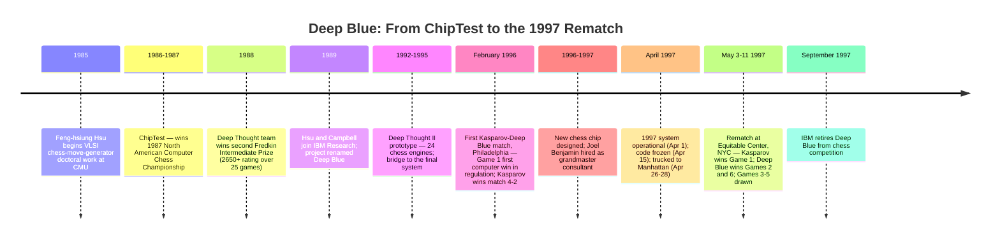

:::tip[In one paragraph]
In May 1997, Feng-hsiung Hsu's chess-specific hardware lineage culminated in Deep Blue's 3.5-2.5 match victory over world champion Garry Kasparov, the first such defeat under classical tournament conditions. The win came from custom chips, search engineering, and grandmaster-tuned evaluation, not from modern machine learning or general intelligence.
:::

<strong>Cast of characters</strong>

| Name | Lifespan | Role |
|---|---|---|
| Feng-hsiung Hsu | 1959– | Chip designer; originator of the ChipTest → Deep Thought → Deep Blue ASIC lineage; chip architect for both Deep Blue I (1996) and Deep Blue II (1997). |
| Murray Campbell | — | AI lead; CMU classmate of Hsu's; joined IBM in late 1989; primary post-match spokesperson and retrospective source. |
| A. Joseph Hoane Jr. | — | Search-software lead; co-author on all major Deep Blue papers; central to the match-time software work. |
| Joel Benjamin | — | US Chess Champion; IBM grandmaster consultant from late 1996; curated the opening book and stress-tested Deep Blue's evaluation function. |
| Garry Kasparov | 1963– | Reigning Classical World Chess Champion 1985-2000; opponent in the 1996 Philadelphia match (won 4-2) and the 1997 New York rematch (lost 2.5-3.5). |
| Monty Newborn | — | McGill computer-science professor; ICCA organizer; chronicler of the rematch in *Deep Blue: An Artificial Intelligence Milestone* (2003). |

<strong>Timeline (1985–1997)</strong>

<strong>Plain-words glossary</strong>

- **ASIC (application-specific integrated circuit)** — A chip designed to do one specialized job rather than general computation.
- **Alpha-beta search** — A pruning procedure that makes tree search tractable by discarding branches that cannot affect the final result once a better option is known. Deep Blue's hardware implemented a minimum-window variant; the software layer handled the top plies with selective extensions and null-move pruning.
- **Ply** — One move by one player. A twelve-ply search looks six full move-pairs ahead. Deep Blue's non-extended search reached roughly twelve plies; forcing lines could be extended to about forty plies.
- **Panic time** — Deep Blue's search-control rule for spending extra time when a candidate move looked worse at greater depth.
- **Evaluation function** — The scoring formula that assigns a numerical value to a chess position. Deep Blue's evaluation function included hundreds of features (material, king safety, pawn structure, mobility, etc.) with weights adjustable from software — tuned by Joel Benjamin in the months before the rematch.
- **Grandmaster-level performance** — Defined operationally in the Fredkin Intermediate Prize framework as sustaining a rating of 2650 or above across a meaningful tournament-game sample (the threshold Deep Thought met in 1988 across twenty-five consecutive USCF-rated games). Deep Blue's 1997 performance rating was approximately 2875 — higher than Kasparov's ~2815 over the six-game sample.

The victory of Deep Blue over Garry Kasparov in May 1997 is often remembered as the moment artificial intelligence "arrived," a symbolic passing of the torch from human intuition to machine logic. The public version of the story was larger than the machine itself: the reigning world chess champion had fallen, and chess had long served as a proxy for disciplined thought. But to the engineers who built Deep Blue, the 3.5-2.5 match win was something narrower, more technical, and far more concrete. It was the culmination of a twelve-year triumph in single-purpose hardware design. Deep Blue did not "learn" to play chess in any modern sense of machine learning, nor did it possess a general representation of intelligence that could be applied to any other domain. It was a chess machine built from chess circuits: application-specific integrated circuits (ASICs) that embedded move generation, evaluation, and search control into silicon. Its strength was not a breakthrough in cognitive science, but the scaling of alpha-beta search through custom hardware, careful engineering, and grandmaster-tuned chess knowledge.

The arc of Deep Blue began in 1985 at Carnegie Mellon University. Feng-hsiung Hsu, a doctoral student from Taiwan, began work on a custom VLSI chip designed for a singular, repetitive task: generating chess moves quickly enough that a program could search far beyond what ordinary processors could manage. His later thesis, *Large-Scale Parallelization of Alpha-Beta Search*, named the subject plainly. This was not a thesis about how a machine might acquire concepts, generalize from experience, or represent human intelligence. It was an architectural study of how to make a known search procedure run at extreme speed.

That distinction shaped the whole lineage. ChipTest, built in 1986 and 1987, used Hsu's move generator and became the top computer-chess program of its moment, winning the 1987 North American Computer Chess Championship. Its chip was still a student-era object, fabricated in 3-micron technology, but the governing idea was already present: do one small chess operation so efficiently in hardware that the rest of the program could search more deeply. Deep Thought followed from 1988 to 1991. In 1988 it achieved sustained grandmaster-level performance, earning Hsu, Murray Campbell, and Thomas Anantharaman the second Fredkin Intermediate Prize for maintaining a 2650-plus rating across twenty-five consecutive games. The prize mattered because it treated computer chess as a sequence of measurable barriers. Deep Blue would later claim the final barrier, but the path there was made of intermediate machines, each one a faster and more specialized answer to the same search problem.

In late 1989, the project moved from Carnegie Mellon to IBM Research. Hsu and Campbell joined the staff at the Thomas J. Watson Research Center in Yorktown Heights, and IBM renamed the successor project Deep Blue, playing on the company's "Big Blue" nickname. The move followed an instructive public failure: Kasparov had played Deep Thought in a two-game exhibition in October 1989 and won both games. For IBM, that did not make the project less interesting. It made the target clearer. The machine did not need a new theory of mind; it needed a far larger and more disciplined version of the same architecture.

For the next several years, the team refined the architecture into Deep Thought II, a prototype that used twenty-four chess engines and an improved version of Hsu's move-generator design. The system belonged to a middle period between the Carnegie Mellon machines and the final 1997 version: larger than the original lab hardware, still not strong enough to settle the question. Murray Campbell later described the goal as a tightly framed empirical question: whether the best human chess players possessed something that would remain beyond computers for the foreseeable future, or whether enough search, combined with enough domain knowledge, could close the gap under tournament conditions. The point was not to make a machine that reasoned generally. The point was to test whether world-championship chess, long treated as a citadel of human calculation and judgment, would yield to a sufficiently engineered search machine.

The first major test came in February 1996 in Philadelphia, at the ACM Computer Chess Challenge. Deep Blue won Game 1 against Garry Kasparov, becoming the first machine to defeat a reigning world champion in a regulation game. That single game was an enormous signal to the IBM team; it showed that the approach could reach the champion's board without collapsing. It also showed how far the system still had to go. Kasparov adapted over the match, found the computer's positional weaknesses, and won 4-2. Hsu later wrote that computation speed alone apparently did not suffice. The 1996 system had serious gaps in its grasp of chess knowledge, especially in positions where the right move did not appear as an immediate tactical gain.

The rebuild for the 1997 rematch therefore had two intertwined goals. It had to be faster, but it also had to be less naive. The team hired US chess champion Joel Benjamin as a full-time consultant. Benjamin curated the opening library and served as a sparring partner, looking for positions where the machine's evaluation preferred moves that were materially tidy but strategically poor. Hsu also redesigned the new chips so that the weights attached to positional features could be changed from software. The distinction is important. Benjamin was not teaching Deep Blue in the later machine-learning sense; the system was not adjusting itself from a training set. Human chess knowledge was being translated into feature weights, opening-book choices, and test positions. The machine's "personality" was adjustable because engineers had built knobs into a hand-designed evaluation function.

Those knobs mattered because the 1996 loss had exposed a mismatch between speed and judgment. A chess evaluation function must reduce a position to numbers: king safety, pawn structure, mobility, threats, space, center control, material, and hundreds of smaller features. A human grandmaster sees these as patterns. Deep Blue saw them as terms in a scoring function, with weights assigned by designers and adjusted by the team. Making those weights software-adjustable did not make the chip flexible in a broad sense, but it made the rematch system more responsive than a fixed circuit. Between games, the team could alter how strongly the machine valued features that Kasparov was likely to probe.

The 1997 system, known as Deep Blue II, was an engineering object before it was a cultural symbol. Its two cabinets were assembled and tested in Poughkeepsie, New York, then loaded onto a truck on April 26, 1997, for the hundred-mile trip to the Equitable Center in midtown Manhattan. By April 28 it was running at the match site. The team also prepared backups: the older Philadelphia-era SP2 system at Yorktown Heights and a fast deskside RS/6000 workstation in the IBM operations room. The public match looked like a man across a chessboard from a computer, but the working system was a small infrastructure project: cabinets, accelerator cards, backup machines, a frozen code base, and a team watching logs as closely as moves.

The dates underline how little slack the project had. Newborn records the new system as operational on April 1 and testing complete by April 15, with the code frozen "in theory." Then came the move to Manhattan, the backup arrangements, and the first game on May 3. Deep Blue's famous stillness at the chessboard hid an active support environment. Operators had to trust that the cards had survived transport, that the code freeze had not preserved a fatal flaw, and that the backups would be available if the main system failed. The later bug in Game 1 matters partly because it pierced that public surface. Deep Blue looked monolithic, but it was still software and hardware under deadline.

The as-built machine contained thirty IBM RS/6000 SP nodes and 480 custom chess chips, arranged as sixty accelerator cards. That number needs saying carefully because IBM's public descriptions did not always say the same thing. Some contemporaneous event material described a thirty-two-node system with 256 chess processors, and later corporate summaries compressed the machine into still simpler language. Hsu's post-match engineering account and Monty Newborn's chronicle both give the more precise figure: thirty RS/6000 computers, each controlling up to sixteen chess chips on two Micro Channel cards, with eight chips per card. The discrepancy is not a hidden mystery so much as a reminder that the machine existed in two registers at once: a public emblem called Deep Blue, and an as-built system whose actual architecture was documented after the match by the people who had to make it work.

Each chess chip was fabricated in a 0.6-micron, three-metal-layer, 5-volt CMOS process. It ran at a cycle time of 40 to 50 nanoseconds, consumed about one watt, and needed roughly ten cycles to process a position. Hsu divided the chip into four functional blocks. The move generator was implemented as an 8x8 array of combinatorial logic, effectively a chessboard made out of silicon. The smart-move stack included hardware support for tracking repeated positions. The evaluation function was split into fast and slow parts, allowing simple features to be scored quickly while more expensive positional terms were handled separately. The search-control logic implemented the chip's portion of alpha-beta search.

This was why Deep Blue's brute force was not simply "a faster computer" in the ordinary sense. On a general-purpose processor of the era, Hsu estimated that the work done by the chess chip for one chess position could require as many as 40,000 ordinary instructions. The chip reduced that to about ten hardware cycles. At 2 to 2.5 million positions per second per chip, a single ASIC performed the chess-specific work of a notional 100-billion-instruction-per-second supercomputer. The full machine's throughput was often reported as 200 million chess positions per second, roughly 8 tera-operations per second, and that figure was real as a sustained engineering headline. Campbell later gave the more honest match-time range: between 100 million and 200 million positions per second, depending on the position. A quiet position and a forcing tactical position did not impose the same search burden.

The search itself was a hierarchy. The master node handled the first few plies of the tree in software. Worker nodes took the next layer. The chess chips finished the last four or five plies in hardware, including quiescence search, the extra tactical checking needed so that the machine did not stop its search in the middle of a capture sequence. The software portion accounted for only a small fraction of the positions examined, but it controlled much of the depth and the shape of the tree. It handled null-move pruning, transposition tables, and selective extensions. The chips used a minimum-window variant of alpha-beta search, a choice that made the hardware simpler by eliminating the value stack a full conventional implementation would require.

The hierarchy also explains why the software could matter out of proportion to the number of positions it searched. Hsu described the software portion as handling about one percent of the total positions while controlling roughly two-thirds of the search depth. The chips supplied the flood of leaf evaluations; the RS/6000 processors shaped which leaves would be reached. In a human metaphor, the software chose where to look and the hardware made looking cheap. In engineering terms, the master and workers distributed the upper tree, used tables to avoid repeating known positions, pruned branches, and handed enormous batches of lower-tree work to the chess cards.

In ordinary play Deep Blue's non-extended search reached about twelve plies, but forcing lines could be extended to roughly forty plies. A ply is one move by one player, so a twelve-ply search looks six pairs of moves ahead before any selective extension. Across a typical three-minute tournament move, the system examined on the order of 20 to 40 billion positions. Those numbers were spectacular, but they should not be confused with understanding. Alpha-beta search is a pruning procedure: it avoids searching branches that cannot affect the final choice if better alternatives are already known. Selective extensions push deeper in volatile lines where shallow evaluation is likely to be misleading. Deep Blue's power lay in making that old procedure brutally literal. It did not imagine plans the way a human player does. It generated legal moves, scored positions through hand-designed features, discarded branches that could not matter, and repeated the process at a scale no human could inspect.

The rematch began on May 3, 1997. Game 1 seemed at first to restore the familiar hierarchy. Kasparov played White in a Reti / King's Indian Attack setup and gradually took control. Deep Blue was not behind in material for much of the game, but the position deteriorated in ways that revealed the difference between counting and playing. By the late middlegame, Hsu was watching the machine slide into a losing position; Newborn records the physical detail of Hsu sitting with his arm hanging limply over the chair. After move 40, Campbell took over at the board for the IBM side. The game's finish then produced one of the strangest moments of the match.

On its 44th move, Deep Blue played 44...Rd1, a "totally illogical" rook move that caused the machine's own evaluation to drop by about 300 points, roughly three pawns. The move looked, from the outside, like a machine doing something profound or alien. It was neither. The logs confirmed that a known intermittent bug had surfaced. The bug had appeared before, including in earlier testing against Larry Christiansen, and the team had identified five triggering paths. Four had been fixed. One remained. When the program failed to find a move satisfying its search conditions, it fell back to a random selection. That evening Joseph Hoane Jr. worked to remove the missed path.

Campbell later offered a cautious interpretation of what followed. Kasparov's team, trying to understand why the machine had made so poor a move, examined alternatives and found that they also lost. From that, Campbell believed, they may have inferred that Deep Blue had searched thirty or forty plies ahead, seen that all roads lost, and therefore played any move at all. That was not what had happened. The move was not a resigned insight into the future; it was a fail-safe. Still, the misunderstanding mattered because it changed the atmosphere around the machine. A random move from a bug could be mistaken for a glimpse of impossible depth.

:::note[Campbell's caution]
> "They were overestimating Deep Blue's talents here."

Campbell's sentence is evidence for IBM's interpretation of the misreading, not proof of Kasparov's private psychology. The verbatim retrospective preserves the *epistemic limit* of the claim — Campbell believed the team had misread the bug; the inference about Kasparov's state of mind is itself an inference. Source: Newborn 2003, *Deep Blue: An Artificial Intelligence Milestone*, p.151.
:::

This episode is the hinge between the engineering story and the human story. The bug itself belonged to the ordinary world of large systems: a rare trigger, an incomplete fix, a fall-back behavior, an overnight repair. The interpretation belonged to the psychology of playing against an opaque machine. A human opponent cannot see the search tree, cannot inspect the evaluation function, and cannot know whether a strange move is a mistake, a trap, or the result of deeper calculation. Deep Blue's weakness therefore had a paradoxical effect. Precisely because the bad move was inexplicable at the board, it could be read as strength.

Game 2, played on May 4, became the emotional center of the match because it turned that atmosphere into suspicion. Deep Blue had White in a Ruy Lopez Smyslov Variation. After 35.Bxd6 Bxd6, the machine faced a choice. One candidate, 36.Qb6, looked like the sort of material-grabbing move Kasparov expected from a computer. The other, 36.axb5, was quieter and more positional. The engineering account later reported by Bruce Weber and preserved by Newborn shows that Deep Blue did not choose the subtle move because it had acquired grandmaster taste. It chose it because its search was becoming alarmed by the alternative.

At eight plies, the search favored 36.Qb6 with a strong evaluation. As the search deepened through nine, ten, and eleven plies, that score dropped. Deep Blue's search-control code included a "panic time" mechanism: if the value of a line fell by more than about a quarter-pawn as the search deepened, the program could spend additional wall-clock time before committing. On move 36 it did exactly that. After roughly another hundred seconds, the program completed its deeper look at 36.Qb6, now scoring it lower than before, and then quickly evaluated 36.axb5 as better. It spent more than six minutes on the move, the longest think of the rematch, and played the pawn capture.

The same mechanism was not unique to that moment. Newborn notes that Deep Blue spent more than five minutes on eleven other moves across the rematch, each a sign that iterative deepening had found trouble in a line that had looked better at shallower depth. Panic time was therefore not an emotional analogy imposed after the fact. It was a search-control rule for when the machine's own numbers became unstable. The term is useful because it captures a real operational fact: Deep Blue was strongest when it had a procedure for noticing that its first answer might be misleading.

The move's meaning depended on who was looking. To the machine, it was a numerical comparison after an extended search. To Kasparov, it looked like a computer refusing the obvious material line and instead playing a restrained positional move. The next move sharpened the impression. After 36...axb5, Deep Blue later played 37.Be4, another move that did not simply grab material. Newborn describes it as a major positional choice because it limited Kasparov's ability to create trouble with his e-pawn and preserved the possibility of a queen invasion. The machine had considered more materialistic continuations and found lines leading toward equality. It chose restraint, not because it understood restraint, but because the scores pushed it there.

Kasparov resigned after move 45 in a position later shown to contain a drawing resource for Black, beginning with 45...Qe3 and perpetual-check possibilities. The resignation was shocking enough; the accusation afterward made the game famous beyond chess. Kasparov publicly charged IBM with human intervention, arguing that moves like 36.axb5 and 37.Be4 were too humanly positional for a computer. The engineering record points in the opposite direction. The move was not a hand slipping into the machine. It was a search-control artifact: an initially favored line began to fail under deeper analysis, the program bought more time, and a quieter alternative survived the comparison. Later engine analysis has been reported as supporting 36.axb5 on the merits, but that is a different question from why Deep Blue played it. The reason was not intuition. It was panic managed by code.

The middle of the match did not resolve the tension. Game 3 was drawn. Game 4 was drawn. Game 5 was drawn. The sequence left the score tied 2.5-2.5 heading into May 11, Mother's Day Sunday, at the Equitable Center. By then both sides had reason to feel the match was escaping simple explanation. The human champion had won the first game and lost the second in a way he mistrusted. The machine had survived several drawn games but had not made the victory look inevitable. A six-game match is a narrow sample, and Hsu would later caution against taking the implied performance rating too seriously. Yet the final game would decide the public meaning of the whole encounter.

Kasparov had Black in Game 6 and chose the Caro-Kann Defence, entering the Steinitz Variation. Newborn notes that he had not used the opening in formal tournament play since the early 1980s. The choice appears to have been an attempt to move the game away from Deep Blue's strongest preparation, but the result was the opposite. On move 8, Deep Blue played 8.Nxe6, sacrificing a knight. The sacrifice was not a spontaneous act of machine daring. It was a known refutation of the line Kasparov had entered, contained in the grandmaster-curated opening preparation. The same fact that had made Deep Blue vulnerable in some positional middlegames made it lethal here: once a prepared line was in the book, the machine did not need courage to play it.

That distinction matters because Game 6 is easy to misread in the same way as Game 2. A knight sacrifice by a computer against Garry Kasparov looks, in retrospect, like a statement of machine confidence. In context it was more prosaic and more devastating. Opening preparation is a memory system, not a calculation performed from scratch at the board. Joel Benjamin's work on the book was therefore not ornamental. It placed human chess preparation inside the machine's first moves, allowing Deep Blue to act instantly in lines where human theory had already done the hard work. Kasparov's attempt to leave preparation instead walked into it.

The game collapsed quickly. Kasparov resigned after 19.c4, fewer than twenty moves into the game, the shortest game of either match. Deep Blue won the rematch 3.5-2.5, the first time a machine defeated a reigning world chess champion in a match under classical tournament time controls. Hsu later listed Kasparov's rating at about 2815 and Deep Blue's match performance at roughly 2875, while warning that six games were too few to make the number more than suggestive. The score was as close as a match victory can be. The symbolism was not close at all.

IBM declined Kasparov's request for a rematch. Campbell later explained the decision in practical terms: the team felt it had achieved its goal, demonstrating that a computer could defeat the world champion in a match, and it was time to move to other research areas. By September 1997, Deep Blue was retired from chess matches. Newborn later described the team's intent to send a rack to the Smithsonian; the more specific museum-by-museum disposition of the hardware is less firmly documented. What is clear is that the machine did not continue as a growing chess intelligence. The project ended because its target had been met.

The team dispersed into the less theatrical aftermath of a completed engineering project. Hsu's own author note in the 1999 chip paper pointed toward an independent startup to build chess chips for consumers. Other IBM personnel moved on or retired. The public had seen a historical match; the builders had finished a long experiment. Even the Fredkin Prize, awarded after the match for defeating a reigning world champion, fit the older computer-chess framework better than the broader cultural story. It was a prize for crossing a chess barrier, not for building a general mind.

That ending is essential to the meaning of Deep Blue. The machine was a triumph of hardware mastery, but it was also an architectural dead end. Its move generator was a silicon chessboard. Its repetition detector, evaluation function, and search control were built around chess and only chess. Its grandmaster knowledge entered through human-selected features, adjustable weights, and opening preparation. It could not transfer that knowledge to another game. It could not play tic-tac-toe unless someone built a different system for that purpose. It could not read, speak, reason about a story, or learn a new domain from examples.

Deep Blue proved that a specific, high-dimensional game could be conquered by massive parallel search, specialized silicon, and enough expert tuning. It also proved how misleading the word "intelligence" can become when a system is judged only by the prestige of the task it defeats. In 1997 the machine looked, for one week in Manhattan, like a general prophecy. Under the hood it was more exact and more limited: an engineering victory for an old search algorithm, scaled to the limits of 1990s hardware and aimed at a single board of sixty-four squares. The later revolution in machine intelligence would arrive by a different route, through learning systems whose representations were not etched as chess circuitry. Deep Blue belongs to the history of artificial intelligence not because it showed that machines had begun to think like people, but because it showed how far they could go without doing so.

:::note[Why this still matters today]
Deep Blue settled an empirical question that had shadowed computer science for decades: brute-force search, combined with domain-specialized hardware and expert-tuned evaluation, can defeat the best human practitioners in a high-dimensional combinatorial game. That result established the ceiling for one class of approach and cleared the ground for the next. Every game-playing and search-driven system since has had to decide whether to follow the specialized-silicon path or replace hand-designed evaluation with learned representations. The clean failure of Deep Blue to generalize — it could not play tic-tac-toe on its own hardware — made the case for the alternative direction as forcefully as the victory made the case for the approach it used.
:::
