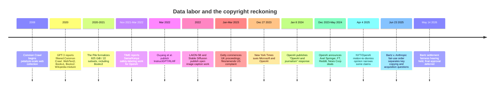

:::tip[In one paragraph]
Frontier AI needed people and rights-cleared material, not just compute. RLHF contractors and safety labelers made human judgment part of the model stack, while GPT-3, The Pile, Books3, LAION-5B, and Stable Diffusion turned web pages, books, and images into training inputs. Getty, New York Times, and Bartz v. Anthropic put that pipeline into court records. Crawler controls and publisher licensing closed the loop: data became negotiated, blocked, or priced.
:::

<strong>Cast of characters</strong>

| Name | Lifespan | Role |
|---|---|---|
| OpenAI labelers / Ouyang et al. contractors | — | Contractors who wrote demonstrations and rankings for InstructGPT/RLHF (March 2022). |
| Sama workers in Kenya | — | TIME's anonymous sources for toxic-content labeling on an OpenAI safety-filtering project (Nov. 2021–March 2022). |
| Getty Images | — | Stock-image licensor; commenced UK proceedings against Stability AI and amended a US complaint in 2023. |
| The New York Times | — | News publisher; sued Microsoft/OpenAI on December 27, 2023. |
| Sidney H. Stein | — | US District Judge, S.D.N.Y.; authored the April 4, 2025 NYT/OpenAI motion-to-dismiss opinion. |
| William Alsup | — | US District Judge, N.D. Cal.; authored the June 23, 2025 Bartz v. Anthropic fair-use order. |

<strong>Timeline (2008–2026)</strong>

<strong>Plain-words glossary</strong>

- **RLHF (Reinforcement Learning from Human Feedback):** Training a language model to prefer answers that human labelers ranked higher; Ouyang et al. 2022 used demonstrations, rankings, a reward model, and PPO.
- **Common Crawl:** A public web corpus collected at petabyte scale since 2008, distributed as raw web pages, metadata, and text extracts.
- **The Pile / Books3:** An 825 GiB English language-model dataset of 22 subsets; Books3 is one named book component that later became legally salient in book-corpus litigation.
- **LAION-5B:** An open dataset of 5.85 billion CLIP-filtered image-text pairs used to train and study image-generation models such as Stable Diffusion v1-4.
- **Fair use:** A US copyright defense that excuses some unlicensed copying based on factors including transformativeness, purpose, market harm, and amount used; the defense is fact-specific, not a general permission.
- **Motion to dismiss:** An early procedural request asking a court to throw out claims; at this stage the court assumes complaint facts are true to test legal sufficiency, not to find liability.
- **Robots.txt / GPTBot:** A web-server control surface for telling crawlers which paths they may visit.

The model stack did not begin with the model.

Chapter 67 followed the visible gates: GPUs, cloud capacity, partnerships, enterprise distribution, and platform contracts. Ch68 turns to a quieter gate underneath them. Frontier AI needed more than compute. It needed people to make outputs usable, corpora to make language broad, images and captions to make generation visual, books and articles to make systems literate, and legal theories to explain why any of that was allowed.

The industry often described these inputs as if they were passive material. Compute was scarce, expensive, and visible on balance sheets. Data seemed abundant. The web was there. Books were there. Images were there. Workers could be hired through vendors. A model card, a dataset paper, or a training report could compress millions of human decisions and cultural artifacts into a few technical nouns.

That compression was not always malicious. Researchers need abstractions. A corpus has to be cleaned and described. A labeler pool has to be summarized. A model paper cannot narrate every document, photograph, article, or worker involved in the supply chain. But abstraction has consequences. It can make the world outside the lab look frictionless. It can turn permission into a preprocessing issue. It can hide the human cost of making a machine look fluent, safe, and useful.

For years, the language of machine learning made that supply chain sound neutral. Data was collected, filtered, labeled, deduplicated, ranked, embedded, and trained on. Web pages became corpora. Books became tokens. Images became image-text pairs. Human judgment became preference data. Toxicity review became safety labeling. A vast cultural and labor system became input material.

Then the abstraction cracked.

Workers described the cost of making models safer. Artists found their styles and images inside training debates. Authors discovered named book datasets. News organizations argued that search indexing was not the same as generative training. Courts began separating complaint allegations, company defenses, fair-use rulings, acquisition paths, and settlement fights. Publishers and platforms started negotiating licenses. Webmasters got crawler controls. Data stopped looking like an ambient commons and started looking like infrastructure someone could block, price, license, or sue over.

That shift changed the economics of AI. A lab could still want as much data as possible, but more data was no longer automatically better in the public story. The question became which data, under what permission, with what provenance, at what cost, and with what risk. A legally uncertain corpus could be technically useful but commercially awkward. A smaller licensed archive could be valuable because it came with permission, attribution, and a customer-facing story. The value moved from volume alone toward controlled access.

This chapter does not decide the legal merits. It follows the historical turn. The hidden data supply chain became visible.

The first hidden layer was human judgment.

InstructGPT made the respectable research pipeline legible. Ouyang and collaborators described a system that used human demonstrations, model-output rankings, a reward model, and reinforcement learning with PPO. The paper reported that OpenAI hired about 40 contractors to label data, and it explicitly noted a limit that is easy to forget: the system was aligned to the preferences of a particular group of labelers, researchers, and API customers, not to all human values.

That limit should not be treated as a small footnote. It is the core social fact of RLHF. The reward model does not learn "humanity." It learns a distribution of judgments collected under a particular process. The people doing the judging are selected, trained, instructed, audited, and paid. They see a subset of possible prompts. They apply policy guidance. They make tradeoffs between helpfulness, caution, clarity, and refusal. The model then internalizes a statistical shadow of that process.

That sentence is historically important. It cuts through the myth that alignment is a purely mathematical property. Human preference data is not an oracle. It is produced by people under instructions, incentives, examples, policies, time pressure, and cultural assumptions. The reward model learns from those judgments. The assistant then looks more helpful, harmless, or instruction-following because a labor process shaped the target.

The pipeline sounds clean in a paper diagram. A prompt arrives. A human writes a demonstration. A model produces candidate answers. Humans rank them. A reward model is trained. PPO adjusts the language model toward preferred behavior. The interface later feels natural because the model has been trained to imitate and optimize around human feedback.

But "human feedback" is not a substance. It is work.

Some of that work is ordinary annotation: ranking helpfulness, choosing better completions, writing demonstrations, comparing outputs. Some of it is emotionally heavier: reading violent, hateful, sexual, or abusive content so a system can learn to avoid generating or amplifying it. The polished product depends on both kinds of labor, but the product interface tends to hide them.

The hiddenness is partly architectural. When a user sees a refusal, a warning, or a careful answer, they see the final behavior. They do not see the policy document, the contractor interface, the examples used to train a classifier, the reward model, or the review queue. A safety layer looks like model personality. In reality, it is often a sediment of many human choices.

TIME's January 2023 reporting on Sama workers in Kenya made the harsher layer visible. TIME reported that OpenAI outsourced toxic-content labeling work to Sama, and that workers reviewed and labeled large numbers of disturbing text snippets for a safety-related project beginning in late 2021. TIME reported take-home wages around \$1.32 to \$2 per hour for workers on the OpenAI project, while also reporting Sama's responses disputing parts of the wage picture and giving a higher possible range. TIME also included responses from OpenAI and Sama about the project, counseling, scope, and vendor-management issues.

Those caveats matter. This is not OpenAI's payroll record, and it is not the same worker group as the contractors in the Ouyang paper. Ouyang is a research source for the RLHF pipeline. TIME is an investigative source about a safety-labeling/content-filtering project. They should not be collapsed into one story.

The shared point is narrower and stronger: usable AI systems required human judgment at scale, and some of that judgment involved labor that users rarely saw.

It is tempting to make those workers into a dramatic scene. That would be the wrong move. The facts are serious enough without using trauma as atmosphere. The historical point is structural. The assistant that politely refuses harmful content, follows instructions, ranks possible answers, and avoids some dangerous categories is not only the product of pretraining and GPUs. It is also the product of people reading, writing, comparing, labeling, and absorbing the edge cases that the product later tries to manage.

That labor also shaped the meaning of "alignment." In public debate, alignment sometimes sounds like a philosophical problem about values. In practice, early product alignment often looked like a workflow: write policies, collect examples, hire labelers, build datasets, train reward models, test outputs, patch failures, and repeat. The moral language was implemented through queues.

This does not make the models fake. It makes them social products. A helpful assistant is not simply a transformer with enough parameters. It is a transformer wrapped in instructions, preference data, safety data, post-training, filters, evaluations, and user-feedback loops. Ch57 covered the alignment problem as a technical and philosophical problem. Ch68 adds the labor claim: every "aligned" behavior had to be operationalized somewhere by people and processes.

The worker story also complicates a common phrase: "the model learned from the internet." For deployed assistants, the internet was only one layer. Human contractors ranked outputs. Safety workers labeled bad examples. Researchers wrote policies. Product teams chose thresholds. Reviewers inspected failures. When a model becomes a service, its behavior reflects a long chain of judgments that are not contained in the pretraining data alone.

The second hidden layer was the scraped corpus.

Common Crawl is the cleanest way to see the earlier assumption. It presents a public web corpus collected at petabyte scale since 2008, with raw web page data, metadata, and text extracts made available through public datasets. To researchers, this looked like infrastructure: a way to study the web, train models, and avoid every lab building its own crawler from scratch.

By 2020, GPT-3 made web-and-book mixtures look like normal foundation-model practice. The GPT-3 paper reported a training mixture that included filtered Common Crawl, WebText2, Books1, Books2, and Wikipedia. The point here is not that every later model used the same mixture. The point is that the categories were normalized: web text, books, and encyclopedic material could become training input for a general-purpose language model.

The phrase "filtered Common Crawl" did a lot of work. Filtering sounds like a technical improvement, and it is. It can remove spam, low-quality pages, duplicates, boilerplate, and unwanted text. It can improve model quality. But filtering also makes a rights problem harder to see. The cleaned corpus is farther from the original web pages. A document has passed through enough processing that it feels less like someone's writing and more like a row in a dataset.

The language of "datasets" made the transformation feel technical. A web page stopped being a blog post, a news article, a forum answer, a personal page, or a product manual. It became a document in a corpus. A book stopped being a commercial work or a library object. It became text. A hyperlink graph, a download, a deduplication pass, and a tokenizer turned culture into model fuel.

The Pile made the open-corpus moment more explicit. Published as an 825 GiB English language-model dataset with 22 subsets, it collected named sources for model training and evaluation. Its components included Books3, Project Gutenberg and PG-19, OpenSubtitles, Wikipedia, Enron emails, and other sources. The Pile authors wrote in a research context where assembling a broad corpus was a technical contribution.

The named-subset format was useful because it made the corpus inspectable. It also made later disputes easier to formulate. A vague statement that a model was trained on "the internet" is difficult to contest. A named component such as Books3 can be traced, discussed, criticized, and cited in litigation. Transparency and exposure moved together. The more legible the data pipeline became, the easier it was for people outside ML to ask what had been included and on what theory.

Books3 is important because it later became legally salient. In the dataset paper, it appears as one component among many. In copyright litigation, named book corpora helped authors and courts talk about acquisition, copying, and training with specificity. The same artifact could be seen inside ML as a useful text subset and outside ML as a collection of books whose legal status mattered.

This is the recurring shift in Ch68. A data source first appears as input. Later it reappears as property, labor, authorship, licensing, privacy, or provenance.

None of this means every web crawl or dataset use is legally identical. The chapter is not making that claim. It is tracing how the social meaning changed. Before the generative AI boom, many researchers treated large public corpora as practical infrastructure. After the boom, rights holders began asking whether "publicly accessible" had been quietly translated into "free to train on."

That question cut across legal doctrine and social expectation. Search engines had long crawled the web. Libraries had digitized. Researchers had mined text. Users had copied snippets. But generative AI changed the perceived stakes because outputs could imitate genres, answer queries directly, summarize archives, generate images, and compete for attention. A training copy was no longer an obscure intermediate step. It was connected, in public imagination, to a product that could substitute for the source.

The corporate stakes changed too. A research dataset can live in a paper as an experimental object. A product dataset has to survive customer questions, investor diligence, procurement reviews, and litigation discovery. Once generative AI became a product category, data provenance became part of enterprise risk. The same corpus that felt ordinary in a research setting could look different when it powered a paid API, a chatbot, a coding assistant, or a design tool.

Images made the conflict visible to a mass public.

LAION-5B described an open large-scale dataset of 5.85 billion CLIP-filtered image-text pairs, including 2.32 billion English pairs. In research language, that scale enabled replication, fine-tuning, and open image-model work. The Stable Diffusion v1-4 model card made the connection concrete: it described training on LAION-5B and LAION-2B(en) subsets and listed safety and bias caveats, including adult material and cultural bias.

That model card mattered because it made the dataset layer legible. Stable Diffusion was not only a spectacular image generator. It was a model with a documented training-data lineage. The public could argue about it because the training corpus was visible enough to name.

It also mattered because image generation made training data emotionally concrete. A language model's relation to a paragraph is hard to see. An image model's relation to a style, watermark, stock-photo pose, or visual motif is easier for creators to feel. The model might not store a literal copy, but the output could still look to a human like a market displacement or reputational injury. That perception fed the legal and cultural conflict even where the technical details were contested.

For many creators, that visibility was the shock. Their work, or work like theirs, could be part of a web-scale image-caption corpus. The same open-data language that sounded liberating to researchers sounded extractive to artists, photographers, illustrators, and image agencies. The model did not only generate pictures. It forced a fight over whether scraped visual culture could become training material.

Getty Images became one of the clearest image-rights flashpoints. In January 2023, Getty said it had commenced UK proceedings against Stability AI, claiming that Stability copied and processed millions of copyrighted images and associated metadata without a license. Getty also emphasized that it licenses content for AI training. In the United States, Getty's amended complaint alleged more than 12 million copied photographs plus captions and metadata, direct competition, and watermark or trademark confusion.

Those allegations show how rights holders translated dataset practice into litigation. The dispute was not only about pixels. It included captions, metadata, licensing markets, source attribution, and marks associated with a commercial image library. The training corpus was being described not as neutral research material but as a set of protected works and business assets.

Those are Getty's claims and allegations. They are not a finding by themselves. The historical lesson is that image datasets converted a technical supply chain into legal language: copying, processing, metadata, watermarks, trademarks, licensing markets, and jurisdiction.

That conversion changed product strategy. A company that wanted to train or sell an image model had to think not only about model quality but about dataset provenance, indemnity, content filters, license warranties, and customer risk. Getty's own public position that it licenses content for AI training mattered for that reason: it pointed toward a market in which rights-cleared image data could be sold as a safer input.

The image dispute also showed why output behavior matters to rights holders even when the training question remains contested. Watermarks, source-like styles, and market-substitution claims made the model's outputs part of the evidence conversation. A dataset can be hidden during training, but outputs are public. When users can prompt a system into images that resemble protected brands, stock styles, or recognizable visual conventions, the training-data debate becomes a product-safety and brand-risk debate.

News organizations translated the same shock into a different vocabulary.

On December 27, 2023, The New York Times sued Microsoft and OpenAI. The Times complaint alleged that its content had been used without permission, disputed fair-use defenses, and argued that generative outputs could substitute for Times products. It distinguished search indexing, archives, APIs, and licensed uses from generative AI use, and said The Times had not granted permission for that kind of use.

The search distinction was central. Search engines send readers outward. A generative system can answer inside the interface. That does not decide the legal question, but it explains the business anxiety. If a system can summarize or reproduce the value of reporting without sending traffic, attribution, or revenue back to the publisher, the publisher sees more than a training dispute. It sees a change in distribution.

Again, those are allegations. They are not the final legal answer.

OpenAI responded with a different frame. In its January 2024 "OpenAI and journalism" post, the company said it supports journalism, works through partnerships, believes training on publicly available internet material is fair use, offers opt-out mechanisms, and treats memorization or regurgitation as a rare bug or misuse problem that it works to reduce. That is OpenAI's company position, not a court holding.

OpenAI's response also showed how the company wanted to separate several issues that public debate often merges. Training on public material was framed as fair use. Publisher partnerships were framed as support for journalism and product improvement. Opt-outs were framed as control. Regurgitation was framed as an unwanted failure mode, not the purpose of the system. Whether a court or publisher accepts those distinctions is a separate matter. Historically, they show how AI companies built a defense vocabulary around training, access, partnerships, and output behavior.

The courtroom phase then began doing what courts do: narrowing, separating, and proceduralizing. On April 4, 2025, the court's opinion on motions to dismiss allowed some claims to proceed and dismissed or narrowed others. The opinion also reminded readers that, at that procedural stage, complaint facts were assumed true for purposes of the motion. That is not the same as proving liability.

This procedural caution is essential. Public debate wants a slogan: "AI training is fair use" or "AI training is theft." The legal record is more granular. Which works? Which copies? Which use? Which output? Which market harm? Which jurisdiction? Which procedural stage? Which claims survived, and which were dismissed? The legal system was not handing the public a single sentence. It was sorting a supply chain.

That sorting process made lawsuits a form of discovery about the AI industry itself. Complaints, motions, orders, and discovery fights forced companies and plaintiffs to describe datasets, output examples, retention obligations, licensing history, opt-outs, model behavior, and product markets. Even before final judgments, litigation changed what the public could see. It turned data supply into a docketed object.

Books produced the sharpest court-record lesson.

In June 2025, the Bartz v. Anthropic order drew distinctions that should shape how the whole chapter is read. The order described book-copy sources including Books3, LibGen, and PiLiMi and discussed millions of book copies. It then separated uses and acquisition paths. In that order, training copies were treated as fair use, purchased print-to-digital copies were treated differently and also found fair for that use, while pirated central-library copies were not justified by fair use. The order granted and denied summary judgment in a split way and set remaining issues, including pirated copies and damages, for further proceedings.

:::note
> A separate justification was required for each use.

This one district-court order matters because it separates use from acquisition path; it does not turn AI training into a universal yes or no. — *Bartz et al. v. Anthropic PBC*, Order on Fair Use, N.D. Cal., June 23, 2025.
:::

The order was especially important because books carry a different cultural weight from web pages. A book is an authored object, a commercial object, a library object, and often a registered copyright object. When book corpora entered foundation-model training debates, authors did not have to argue in the abstract about "the web." They could point to titles, libraries, scans, downloads, and acquisition paths.

That is a narrow legal posture, but a historically powerful one.

It teaches that "used for AI" is not one legal fact. A copy can be acquired one way and used another. A court can view training as transformative in one posture while still refusing to bless the acquisition path for a central library of pirated copies. The same model developer can win on one theory and face trial or settlement pressure on another.

As of mid-2026, Bartz settlement finality remained time-sensitive. The settlement fairness hearing was held on May 14, 2026; the court weighed objections and, as of this writing, had not yet entered final approval. That means the chapter should not treat the settlement process as final. The stable point for this chapter is the June 23, 2025 fair-use order and its split by use and acquisition path.

That split is the best antidote to sloppy claims. It does not support "all training is legal." It does not support "all training is illegal." It shows a court separating training use, purchased scanning, pirated acquisition, class procedure, and damages.

It also explains why licensing and provenance became strategic. If the legal risk depends partly on how data was obtained, then the same text can have different business value depending on its paper trail. A licensed archive, a purchased print copy, a public web page, a user submission, and a pirated library are not interchangeable once lawyers, enterprise customers, and insurers enter the room. The model may only see tokens. The market sees provenance.

This is where the data question reconnects to platform power. Large AI providers could negotiate licenses, manage legal teams, build opt-out systems, and absorb litigation risk. Smaller labs and open communities often had less capacity to do that. A rights-cleared dataset might lower legal risk while raising the price of entry. A public corpus might widen access while increasing dispute risk. Data governance therefore became another gate in the stack, not only an ethical concern.

The data supply chain was becoming a rights supply chain.

Crawler controls made the shift visible on the web. OpenAI's crawler documentation distinguishes OAI-SearchBot and GPTBot and says webmasters can use robots.txt tags to allow search while disallowing training-related crawling. In OpenAI's description, GPTBot crawls content that may be used to train foundation models, while OAI-SearchBot is associated with search. That is company documentation, not a universal law of the web. But it shows the endpoint: site owners were being offered a vocabulary for separating search visibility from training use.

The split between search and training is the practical heart of the new control surface. A publisher may want to appear in search results while refusing training use. A forum may want public visibility while charging for structured access. A website may allow summaries but block crawlers associated with model improvement. These are not merely technical preferences. They are attempts to express economic and legal boundaries in a protocol built for web crawling.

That control surface is modest, and the modesty matters. Robots.txt is not a full licensing system. It does not explain every downstream use, compensate contributors, verify past collection, or resolve whether a training copy was lawful. It is closer to a machine-readable notice: this path may be visible to one kind of crawler but not another. Even so, notice changed the posture. Once a company documents a training crawler separately from a search crawler, site owners can ask why the categories exist, whether their choices were honored, and what happened before the controls were available. A technical switch became evidence that training access was no longer being treated as indistinguishable from ordinary indexing. It was a low-friction boundary marker, not a settlement of rights.

Licensing deals made the same shift commercial. In December 2023, OpenAI announced an Axel Springer partnership involving ChatGPT summaries, attribution, links, and use of Axel Springer content. In April 2024, OpenAI and the Financial Times announced a strategic partnership and licensing agreement involving attributed FT content and model improvement. In May 2024, OpenAI announced a Reddit partnership giving access to Reddit's Data API for real-time structured content and making OpenAI an advertising partner. Later that month, OpenAI and News Corp announced a multi-year partnership with permission to display content and access current and archive material from named publications.

These announcements read like business development, but historically they mark a change in the data regime. The valuable thing is not only a pile of text. It is freshness, structure, permission, attribution, archive depth, and the ability to use content inside products without immediately inheriting the same dispute as the lawsuits. Reddit's Data API mattered because platform conversations are not simply static documents. They are current, structured, and socially rich. News deals mattered because professionally edited archives and current reporting are high-value inputs and high-value outputs.

The point is not that these deals prove earlier training required a license. They do not. The point is that the market moved toward negotiated access. Data that had once been gathered through crawling, scraping, public datasets, and research corpora was increasingly being separated into categories: blocked, allowed, attributed, licensed, API-mediated, paid for, or litigated.

Negotiated access also changed what counted as "good" data. The best data was no longer just high quality in a statistical sense. It could be timely, structured, legally usable, attributable, commercially safe, and connected to a partner willing to keep supplying it. A stale scrape and a live API are different assets. An anonymous corpus and a licensed archive have different value. The technical data race was becoming a contracting race.

This is the "enclosure" turn.

The word should be used carefully. The web did not become private overnight, and the public interest in research did not disappear. But high-quality human data became harder to treat as ambient. News archives, book corpora, image libraries, platform conversations, and expert communities became strategic assets. Some owners sued. Some licensed. Some blocked crawlers. Some built APIs. Some negotiated attribution. Some kept publishing freely while objecting to training use.

The enclosure was uneven. Large publishers could negotiate. Major platforms could sell API access. Stock-image agencies could litigate and license. Individual authors, artists, forum posters, translators, moderators, and workers had less leverage. The data supply chain was not becoming fair simply because it was becoming visible. Visibility created bargaining power for some actors and only complaint mechanisms for others.

That unevenness is why labor and copyright belong in the same chapter. They are not the same issue, but they expose the same hidden dependency. People supplied judgments, moderation, language, images, reporting, books, comments, and cultural context. Institutions with enough scale could convert that dependency into contracts or lawsuits. People with less scale often appeared only as data subjects, workers, claimants, or absent contributors. The reckoning was legal, but it was also about recognition.

The AI industry had learned that data was not only volume. It was permission, provenance, quality, freshness, labor, and leverage. A dataset could now be a technical asset, a liability, a bargaining chip, and a moral claim at the same time.

That realization connects backward and forward. Ch67 showed platform concentration around compute and distribution. Ch68 shows another gate: the right to use the material that makes models useful. Ch69 will turn to the technical question that follows when high-quality human data becomes scarce, expensive, fenced, or contaminated by model outputs. If the old assumption was that the web was a reservoir, the new question was what happens when the reservoir becomes a negotiated market.

The model stack needed people and culture before it needed predictions.

The reckoning began when those people and that culture asked who had been counted as infrastructure.

:::note[Why this still matters today]
Every modern assistant inherits this supply chain. Behind a chat reply sits a chain of contractors, safety labelers, scraped pages, image-text corpora, books, and platform APIs — each with its own permission and labor story. Court orders, robots.txt distinctions between search and training crawlers, and publisher licensing deals are now standard parts of how AI products are built and sold. Procurement, indemnity, and dataset provenance are no longer back-office concerns; they are gates on shipping. The chapter's split — training use, acquisition path, market harm, and worker conditions — is the working vocabulary practitioners read in model cards, terms of use, and risk disclosures today.
:::
