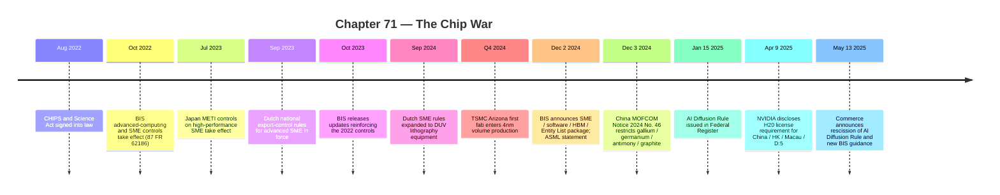

:::tip[In one paragraph]
In 2022 the United States began treating advanced AI accelerators as instruments of geopolitical power. BIS's October 7, 2022 controls linked advanced computing ICs, supercomputers, AI, military modernization, WMD design, and surveillance, then expanded across 2023 and 2024 from chips into the manufacturing stack. ASML, TSMC, the Netherlands, and Japan became part of the rulebook. CHIPS funded slow re-shoring; China answered with materials controls. Frontier AI capability became a negotiated property of supply chains and law.
:::

<strong>Cast of characters</strong>

| Name | Lifespan | Role |
|---|---|---|
| Gina Raimondo (BIS / U.S. Commerce) | — | Public face of the 2023/2024 export-control announcements |
| Alan Estevez / Thea Rozman Kendler / Jeffrey Kessler (BIS) | — | BIS leadership voices through the 2025 policy pivot |
| Jensen Huang (NVIDIA) | — | Company-side witness to product-threshold adaptation |
| C.C. Wei (TSMC) | — | Annual-report voice for advanced-node and CoWoS packaging capacity |
| ASML management / investor relations | — | Institutional witness for EUV/DUV and export-control exposure |
| MOFCOM / China's Bureau of Industrial Security | — | Counterparty in the December 2024 materials-control notice |

<strong>Timeline (2022–2025)</strong>

<strong>Plain-words glossary</strong>

**Export controls** — A government's legal authority to restrict the shipment of items, technology, software, services, and U.S.-person support across borders. BIS's October 2022 rule used controls to link advanced computing ICs, supercomputers, and AI applications to national-security rationale.

**Foreign direct product (FDP) rule** — A jurisdictional hook that can bring items made outside the United States under U.S. export controls when they are direct products of certain U.S. technology or software.

**Semiconductor manufacturing equipment (SME)** — The machines that produce advanced chips: lithography systems, deposition tools, etch tools, metrology, and process-control equipment.

**EUV / DUV lithography** — Two patterning technologies used to print circuit features onto wafers. EUV uses 13.5 nanometer light for the smallest, highest-density features at advanced nodes; DUV immersion remains important across mature and advanced process flows.

**High-bandwidth memory (HBM)** — Stacked memory packaged close to an accelerator to feed it data fast enough for AI training and inference at scale.

**Advanced packaging / CoWoS** — The back-end manufacturing step that integrates compute dies, memory, and substrates into a single accelerator package.

**Entity List** — A BIS-published list of foreign persons and organizations that require licenses for items subject to U.S. export controls. The December 2024 package added 140 entities and modified 14 more, often with FDP footnotes that extend reach.

The server became a strategic asset.

Chapter 70 followed the power. Frontier AI stopped looking like software alone and became a load on substations, generation fleets, interconnection rules, nuclear contracts, and local grids. Ch71 follows the machine upstream. Before a model can draw power in a data center, someone has to get the accelerators, memory, packaging, lithography, foundry capacity, software tools, and legal permissions that make the accelerator exist.

That supply chain was global before AI made it political. NVIDIA-class accelerators depended on high-bandwidth memory, advanced packaging, foundries, lithography machines, electronic design software, materials, logistics, and specialized labor. No single country held the whole stack. The United States had design firms, cloud buyers, export-law reach, and industrial-policy money. Taiwan had TSMC's most advanced manufacturing capacity. The Netherlands had ASML's unique EUV lithography position. Japan had critical manufacturing-equipment capacity. China had vast demand, manufacturing ambition, and counter-levers in materials. The chip was not one object. It was a treaty with reality.

In 2022, the United States began treating parts of that stack as instruments of geopolitical power.

The October 2022 BIS rule made the mental reversal explicit. Advanced computing integrated circuits and supercomputers were no longer ordinary commercial parts in the policy frame. BIS linked advanced computing ICs, supercomputers, artificial intelligence applications, PRC military modernization, weapons-of-mass-destruction design and testing, and surveillance. That is the U.S. government's stated rationale, not an independent proof that every Chinese AI use was military. But the policy shift was unmistakable: AI compute had entered the national-security rulebook.

That framing changed the moral status of an accelerator. In the cloud era, a server part could be described as infrastructure for search, advertising, recommendation, scientific computing, video, or enterprise software. In the frontier AI era, the same broad class of part could be described as an input to strategic modeling, military analysis, cyber capability, surveillance, and weapons design. The part did not change shape. The interpretation around it changed.

The key change was not only that some chips required licenses. It was that capability became regulated across a supply chain. The rule covered advanced computing items, supercomputer end uses, semiconductor manufacturing equipment, Entity List mechanisms, foreign direct product rules, and U.S.-person support. In plain language, the United States was trying to control not only the shipment of specific chips, but the conditions under which advanced chips, systems, manufacturing tools, and support could reach certain end users and end uses.

This was a legal firewall built around compute.

The firewall had several layers. One layer targeted advanced computing chips and related items. Another targeted supercomputer end uses. Another reached semiconductor manufacturing equipment and IC production support. Entity List footnotes and foreign direct product rules tried to reach items made outside the United States when U.S. technology or software gave export law jurisdiction. U.S.-person support controls mattered because advanced semiconductor manufacturing does not happen with tools alone; it requires people, know-how, servicing, and integration.

That last point is easy to miss. A semiconductor plant is not a warehouse of machines that operate by themselves. It is a living process. Tools need installation, maintenance, calibration, software updates, spare parts, process recipes, yield engineering, and expert troubleshooting. If rules limit not only shipments but support, they reach into the human and organizational layer of manufacturing. The chip war was therefore not just about boxes at ports. It was about whether the knowledge system around the boxes could keep functioning.

Foreign direct product rules made the reach even more ambitious. The logic is that an item made outside the United States can still fall under U.S. export controls when it is a direct product of certain U.S. technology or software. In a globally distributed semiconductor industry, that kind of jurisdictional reach matters because few advanced manufacturing flows are cleanly national. Design software, equipment, process technology, and component inputs cross borders long before a finished chip ships.

That architecture is hard to read because export-control law is designed for compliance, not narrative clarity. The historical point is simpler. AI capability had become something a government could try to meter through licenses, end-use checks, and jurisdictional reach. A chip could be commercially available in one context and strategically restricted in another. A system could be legal for one buyer and controlled for another. A machine made outside the United States could still be touched by U.S. law if the legal hook reached far enough.

The rules also changed the work of companies. A semiconductor firm no longer had only to design a product and find a customer. It had to map thresholds, destinations, end users, license requirements, subsidiaries, distributors, cloud customers, and future rule changes. A cloud provider had to think about where controlled chips were installed and who could access them. A manufacturer had to understand whether a tool, spare part, software update, or service visit crossed a control line.

The compliance problem cut across the stack. A chip vendor had to classify products. A distributor had to screen customers. A cloud provider had to think about whether remote access could become a substitute for physical export. A tool supplier had to track whether a software patch or service visit supported a controlled fabrication process. A legal department had to translate technical specifications into export categories. The engineer's performance metric became a government threshold.

Even vocabulary changed. "Compute" no longer meant only a benchmark result or a bill from a cloud provider. It became an administrable quantity, something that could be licensed, denied, redesigned, monitored, or routed. That bureaucratic translation is historically important because it shows the moment AI capacity stopped being merely a private engineering resource and became a state-recognized strategic resource.

This is a strange kind of infrastructure dependency. Most users never see it. They see a model launch, a benchmark score, a cloud instance type, or a product demo. Underneath, a compliance team may have decided which regions can receive which hardware, which customers need review, which contracts carry end-use language, and which engineering changes keep a product within allowed bounds. The border enters the server room through documentation.

That is why a legal firewall becomes a compliance chase.

Controls create incentives to route around them. BIS's later guidance about diversion tactics, PRC advanced computing IC risks, Huawei Ascend chips, U.S. AI chips used for Chinese AI models, shell companies, and third-country routing shows the enforcement problem. A rule on paper is only the beginning. Once the controlled item is valuable enough, the market tests the edges: affiliates, resellers, cloud access, transshipment, product redesign, and ambiguous end use.

The more the frontier depends on scarce compute, the more those edges matter.

This does not mean controls are useless. It means controls are operational systems. They work through paperwork, audits, licenses, denial policies, corporate compliance departments, customs scrutiny, allied rules, and enforcement. They change cost, access, timing, and risk. They do not make capability disappear.

They make capability conditional.

That is the right scale for judging them. If a control delays access by a year, raises cost, forces a less efficient architecture, reduces cluster size, or pushes a company toward a weaker substitute, it has altered the capability landscape even if it has not ended the program. Export controls are not magic erasers. They are friction engines.

The threshold then started moving.

In October 2023, BIS announced updates that it described as reinforcing the October 2022 controls. The package updated restrictions on advanced computing semiconductors, semiconductor manufacturing equipment, supercomputing items, and related Entity List additions. That second step mattered because it showed the control system was not a one-time wall. It was an adaptive regime.

Adaptive regimes are necessary because companies adapt too. A regulation defines a threshold. Engineers and product managers study the threshold. Customers still want capability. Firms try to design products that remain competitive while fitting the rules. Governments then decide whether the workaround defeats the policy purpose. The chip war became a loop: rule, product response, enforcement concern, revised rule.

This loop has a strange side effect: regulation becomes part of product architecture. Performance, interconnect, memory bandwidth, and destination are no longer only market requirements. They become legal design constraints. A product can be shaped to satisfy a customer, fit a manufacturing process, fit a data-center power envelope, and fit an export-control threshold at the same time. That makes the resulting chip a political artifact as much as an engineering artifact.

The moving-threshold dynamic also creates uncertainty for customers. A buyer can build a training plan around a permitted product, only to see the rules shift. A cloud provider can plan a region around a compliant accelerator, only to face license uncertainty. A chip vendor can create a product for a specific regulatory window, only to have the window close. The rule does not need to confiscate a chip already installed to change behavior; the possibility of future restriction changes purchasing, inventory, and architecture decisions today.

NVIDIA's public filings made that loop concrete. The company disclosed that U.S. licensing requirements applied to products exceeding thresholds, including A100, A800, H100, H800, L40, RTX 4090, GB200, and B200. It also disclosed that on April 9, 2025, the U.S. government informed it that H20 exports to China, Hong Kong, Macau, and D:5 countries required a license. NVIDIA said it incurred a $4.5 billion charge and warned that if it could not offer a competitive approved product, it might be foreclosed from China's data-center compute market.

:::note
> "Repeated changes in the export control rules are likely to impose compliance burdens on our business and our customers, negatively and materially impacting our business."

This turns moving export thresholds into SEC-disclosed operating risk: a U.S. semiconductor leader pricing rule volatility into shareholder language.
:::

That filing should not be turned into a NVIDIA monopoly chapter. Ch67 owns that story. Here, H20 matters because it shows policy and product co-evolving. Export thresholds do not merely block old products; they shape future products. A chip can become the artifact of a negotiation between customer demand, engineering constraints, and government limits.

The controls expanded again in December 2024. BIS announced a package covering more semiconductor manufacturing equipment, software tools, high-bandwidth memory, red-flag guidance, Entity List additions, and modifications. HBM belonged in the rulebook because AI training and inference at scale are not only about arithmetic units. They need memory bandwidth. If the accelerator cannot move data fast enough, raw compute cannot be used efficiently.

The inclusion of software tools made the same point from another direction. A chip is not born from silicon alone. Electronic design automation and manufacturing software help turn architecture into manufacturable layouts and process flows. Controlling software tools means controlling part of the path from idea to wafer. The December 2024 package therefore widened the aperture from "who can buy the accelerator" to "who can produce the next generation of accelerators."

The Entity List and red-flag pieces mattered because enforcement cannot rely on a product label alone. A controlled accelerator may move through a distributor. A manufacturing tool may support a facility whose ownership or customer base is not obvious from the purchase order. A cloud customer may be one step removed from the hardware. Export control therefore becomes a demand for institutional memory: who owns the buyer, where the item will be used, whether the end use matches the paperwork, and whether a transaction pattern looks like diversion. The more valuable AI compute became, the more those questions moved from specialist compliance work into the strategic core of the business.

That 2024 package also moved the story beyond the accelerator itself. The strategic object was not just a GPU. It was the manufacturing stack that made frontier accelerators possible.

The machines behind the machines mattered.

ASML sits at the lithography layer. Its 2024 annual report states that EUV uses 13.5 nanometer light, prints the smallest and highest-density features, simplifies some advanced manufacturing compared with DUV multiple patterning, and that ASML is the world's only manufacturer of EUV lithography systems. That does not mean ASML alone determines AI capability. It means one of the deepest choke points for advanced chip manufacturing sat in a single specialized equipment ecosystem.

Lithography is a good place to see why the chip war is not really about chips alone. A frontier accelerator arrives as a board in a server, but the capability is created through layers of machinery that most software users never see. Patterning the smallest features of advanced chips requires machines that are themselves among the most complex industrial products ever built. If access to those machines is constrained, the ability to manufacture at the frontier is constrained even before anyone discusses GPU architecture.

EUV mattered because frontier AI chips depended on advanced semiconductor nodes. Smaller, denser, more power-efficient logic requires extraordinary manufacturing precision. Lithography is the part of the process that patterns features onto wafers. At advanced nodes, EUV became a central tool. DUV immersion remained important too, especially in export-control exposure and older or less advanced process flows. But EUV uniqueness made ASML a geopolitical company whether it wanted to be one or not.

The Netherlands therefore became part of the chip war. Dutch national export-control rules for advanced semiconductor manufacturing equipment were in force from September 2023 and expanded in September 2024, including controls relevant to DUV lithography equipment. The Dutch government framed the measures around security risks and the Netherlands' leading position, with case-by-case authorizations rather than a simple blanket ban. Japan's METI controls on specified high-performance semiconductor manufacturing equipment, described in CSIS translation as license requirements based on technology or performance thresholds, added another allied equipment layer.

Case-by-case authorization is historically important because it avoids a cartoon version of the policy. These regimes were not always blunt prohibitions. They created review gates. A customer, tool, destination, and end use could be examined through a national-security lens. That makes the manufacturing equipment market slower and more political, even where sales remain possible.

This is allied coordination as visible national measures, not a secret treaty. The practical effect was that U.S. controls mattered more when Dutch and Japanese equipment policies lined up functionally. A U.S. rule can restrict American technology. It is stronger when allied governments also restrict machines, tools, and capabilities that sit in their jurisdictions.

ASML's own December 2024 statement showed the business side. The company said updated U.S. rules imposed additional restrictions on chip-manufacturing technology, added restricted technologies including metrology and software, added fab locations mainly in China, and could affect DUV immersion exports if Dutch authorities made similar assessments. ASML also said it expected China business around 20% of 2025 total net sales and would comply with export-control laws. The policy was not abstract to the supplier. It shaped revenue, disclosures, and customer planning.

The reference to metrology is a reminder that manufacturing precision is measured as much as it is made. Advanced chip production depends on inspecting, aligning, correcting, and validating processes across many steps. A lithography machine does not simply stamp success onto a wafer. It sits inside a feedback system of measurement tools, process-control software, yield analysis, and engineering correction. Restricting that surrounding system can matter even when the controlled item is not the most famous machine in the fab.

TSMC sits at a different layer: foundry and packaging capacity. Its 2024 annual report said it expanded 3nm, 2nm, and CoWoS capacities in Taiwan, and that advanced technologies at 7nm and beyond accounted for 69% of wafer revenue in 2024. It also described about 17 million 12-inch-equivalent wafer capacity and listed Taiwan and overseas fabs. The Arizona first fab entered 4nm volume production in Q4 2024, with a second fab using 3nm and a third planned for 2nm or more advanced technology.

The TSMC scene is not only about one company being excellent. It is about concentration. When advanced AI depends on leading-edge nodes and advanced packaging, the location of that capacity becomes strategic. A lab buying accelerators may not care which fab produced the die, but governments do. A supply shock, earthquake, political crisis, export rule, or packaging bottleneck can ripple up into model training schedules.

Those details make the supply chain real. Frontier AI chips require leading-edge wafers, but also advanced packaging and memory integration. CoWoS, high-bandwidth memory, and packaging capacity can become bottlenecks even when wafer capacity exists. A model lab buying accelerators experiences the stack as a server delivery date. Underneath that date are wafer starts, lithography tools, packaging lines, memory supply, testing, substrates, logistics, and export permissions.

Advanced packaging deserves its own emphasis because it breaks the simple story that "smaller transistors" are the whole frontier. Training accelerators need to move enormous amounts of data between compute units and memory. HBM sits close to the processor package because distance, bandwidth, and energy matter. Packaging becomes a performance technology, not an afterthought. A wafer without sufficient packaging capacity is not yet the compute a data center can install.

This is where the chip war connects back to model architecture. Transformers are hungry for memory bandwidth and interconnect. Large training clusters are limited not only by how many arithmetic units exist but by how quickly data can move through the system. The manufacturing stack therefore shapes what kinds of models are economical. A bottleneck in packaging or HBM can become a bottleneck in the pace of model scaling.

TSMC's geography also matters. Arizona expansion showed re-shoring momentum, but the 2024 report still made Taiwan central to the most advanced capacity and CoWoS expansion. Re-shoring is not the same as independence. A new fab is not a laptop factory. It takes years, specialized suppliers, trained labor, process transfer, equipment installation, yield learning, customer qualification, and packaging integration.

That is where CHIPS enters the story.

The CHIPS and Science Act was an industrial-policy response to fragility. NIST's CHIPS for America fact sheet framed the program as boosting domestic semiconductor manufacturing, technological leadership, economic security, and national security. It listed \$52.7 billion total, including \$39 billion in manufacturing incentives, \$13.2 billion for R&D and workforce, and \$500 million for global supply-chain programs. It also explicitly covered fabrication, assembly, testing, and packaging facilities.

The packaging language matters. The AI chip stack does not end when a wafer leaves a fab. Advanced packaging and memory integration determine whether compute can be delivered at the performance frontier. A country can have chip design talent and still depend on offshore packaging capacity. It can have a fab and still lack enough HBM. It can have equipment money and still wait years for tools, construction, and skilled workers.

This is why industrial policy in semiconductors is slow even when the money is large. The constraint is not only capital. It is ecosystem depth. Suppliers need capacity. Universities and companies need trained workers. Tool deliveries must be scheduled. Permits must be obtained. Process technology must be transferred and qualified. Customers must trust the output. Yield has to improve enough for production economics to work. A state can write a check quickly; a semiconductor ecosystem cannot be summoned at software speed.

CHIPS was therefore not instant sovereignty. It was a bet that public money could rebuild parts of a dispersed industrial base over time. That distinction matters because the AI race moves faster than fab construction. A model generation can be trained, released, benchmarked, and surpassed while a semiconductor plant is still moving through construction and tool installation. State capacity operates on a different clock from software.

The policy still mattered. It told companies that advanced manufacturing, packaging, and workforce were national priorities, not merely private capital expenditures. It gave suppliers and customers a reason to plan around U.S. capacity. It made the geography of chips part of AI strategy. But it did not dissolve dependence on TSMC, ASML, HBM suppliers, Japanese equipment, substrates, chemicals, or allied policy.

This is the same pattern as Ch70's energy story. The public debate wants a switch: dependence or independence, access or denial, clean power or dirty power. The infrastructure reality is graduated. More domestic capacity can reduce one risk while leaving another. A new fab can improve resilience without matching Taiwan's full advanced-node ecosystem. A packaging investment can help one bottleneck while memory supply remains constrained. Progress is real and partial at the same time.

The Arizona example captures that partial progress. TSMC saying the first Arizona fab entered 4nm volume production is a meaningful re-shoring milestone. But the same TSMC report's discussion of Taiwan capacity, advanced nodes, and CoWoS makes clear that the center of gravity did not instantly move. A geographically diversified supply chain can still have a core. Industrial policy can bend geography without erasing the old map.

That distinction should discipline how we read every ribbon-cutting. A new site announcement is not the same thing as a mature capacity pool. Production has to reach useful yields. Customers have to qualify parts. Engineers have to stabilize processes after tools are installed. The output has to connect to packaging, testing, logistics, and downstream server assembly. For AI, the question is even narrower: can that capacity deliver the specific high-end logic, packaging, memory integration, and reliability that frontier clusters require? A fab can be real, expensive, and strategically important while still not solving the immediate accelerator shortage that a model lab feels.

China had its own levers.

The chip war is often narrated as the United States denying China advanced compute. That is part of the story, but it is incomplete. China also controlled or influenced parts of the materials stack. In December 2024, MOFCOM Notice 2024 No. 46, as translated by CSET, restricted U.S.-bound exports of gallium, germanium, antimony, and superhard materials, and imposed stricter checks on graphite. The notice followed U.S. chip controls and framed the measures through dual-use export-control language.

These materials controls are not a mirror image of EUV controls. Gallium and germanium are not NVIDIA H100s. Graphite checks are not TSMC 3nm capacity. But they are counter-levers in the broader semiconductor and technology supply chain. They show that supply-chain power exists at multiple layers: materials, machines, designs, foundries, packaging, memory, servers, and cloud access.

The lower layers can look less glamorous than accelerators, but the stack needs them. Materials do not train models by themselves. They enable components, substrates, optics, electronics, and manufacturing processes that sit below the visible product. Restricting them is a way to remind the other side that dependency is not one-way. A supply chain with many specialized inputs creates many possible pressure points.

Materials controls also show why the chip war spills beyond the semiconductor industry as narrowly imagined. A model lab may never think about gallium or graphite. A procurement team buying accelerators may never touch antimony. Yet those materials sit somewhere in the extended technology base that supports electronics, defense, and manufacturing. The farther upstream the dependency, the easier it is for software people to forget it exists until it becomes constrained.

The asymmetry is important. The United States and allies targeted high-end computing and manufacturing choke points. China responded in a different part of the stack. That does not make the tools equal, but it makes the conflict reciprocal. A country that lacks one choke point may still hold another. A supply chain with many specialized dependencies gives every actor reason to ask what it can withhold, license, substitute, stockpile, or accelerate domestically.

China's response also increased domestic substitution pressure. Export controls can slow access to frontier tools while also motivating alternatives. They can increase cost and delay, but they can also push investment into domestic accelerators, domestic equipment, indigenous software stacks, and alternative supply chains. The safe claim is not that China was stopped. The safe claim is that controls changed the path: more expensive, more constrained, more politically managed, and more focused on substitution.

That substitution pressure can have ambiguous long-term effects. In the short term, denial may slow access to the frontier. In the long term, it may deepen domestic investment and reduce dependence on foreign suppliers. Whether that tradeoff is worth it is a policy judgment beyond this chapter. The historical point is that export controls do not freeze technology. They redirect incentives. Chapter 73 examines a memory design and asks what evidence would connect such an architectural choice to policy pressure.

Substitution also changes the technical shape of the race. If one side cannot freely obtain the most efficient accelerator stack, it may pursue different chips, different interconnect assumptions, different software compilers, different deployment strategies, or heavier use of older hardware. Those paths can be slower and more expensive, but they are still paths. This is why a serious history cannot equate export controls with technological immobility. The more accurate picture is uneven adaptation under constraint.

Policy volatility then became its own constraint.

In January 2025, the United States issued an AI Diffusion Rule that sought a broader global framework for controlling advanced computing chips. In May 2025, Commerce announced rescission of that Biden-era rule before compliance took effect and said a replacement would come. On the same day, BIS issued guidance about PRC advanced computing IC risks, Huawei Ascend chips, U.S. AI chips used for Chinese AI models, and diversion tactics.

This sequence matters because it shows that even the controlling state was searching for the right shape of control. A narrow adversary-focused rule risks diversion through third countries. A broad global control regime risks alienating allies, burdening companies, and pushing customers toward competitors. Too little control may fail national-security goals. Too much control may harm domestic firms and allied AI capacity. The policy target was moving because the technology, market, and diplomatic constraints were moving.

The AI Diffusion episode also exposed the difference between a rule that is analytically elegant and a rule that the ecosystem can live with. Broad regimes promise clarity from Washington's perspective. But allies, cloud providers, chip firms, and customers experience such rules as limits on capacity, sovereignty, contracts, and national AI plans. A policy built to control adversary access can collide with friendly demand. That is why rescission itself became part of the story: the United States was not only restricting technology; it was learning how hard it is to govern a global compute market.

The guidance issued alongside rescission kept the concern alive. Commerce did not say the problem had vanished. It pointed to PRC advanced computing ICs, Huawei Ascend chips, U.S. AI chips used for Chinese AI models, and diversion tactics. In other words, the form of the rule changed, but the operating problem remained: how to prevent controlled compute from reaching restricted uses while preserving enough lawful trade, allied access, and domestic industry strength.

That was the signal.

For companies, volatility is not background noise. It changes product roadmaps, revenue forecasts, inventory, contracts, cloud-region strategy, compliance staffing, customer promises, and capital allocation. NVIDIA's H20 disclosure shows how a product designed for an export-control environment can itself become controlled. ASML's statements show how equipment rules enter annual-report risk. TSMC's expansion plans show how geographic capacity becomes a strategic asset. The policy environment became part of the technology stack.

For governments, volatility reveals a different pressure. Move too slowly and the controlled technology spreads. Move too broadly and partners resist. Move too narrowly and workarounds appear. Move too often and companies cannot plan. The chip war is therefore a governance problem as much as a supply problem. It asks whether legal systems can track an industry where product cycles, model capability, and geopolitical priorities all shift at once.

There is also a measurement problem. Export rules need thresholds, but frontier AI capability does not sit neatly inside one number. FLOPS, interconnect bandwidth, memory capacity, memory bandwidth, packaging density, cluster scale, software maturity, and cloud access all matter. A rule can specify a technical boundary, yet the market can discover that another part of the system carries the real capability. That is why HBM, manufacturing software, and equipment controls followed chip controls into the story. The object being governed kept changing shape under the regulator's hand.

That is the deeper lesson of Ch71. Frontier AI capability was no longer a simple function of who could afford GPUs. It became a negotiated property of supply chains and law. A lab needed accelerators, but accelerators needed HBM. HBM needed memory suppliers and packaging. Packaging needed capacity and equipment. Advanced nodes needed TSMC or comparable foundry capability. Foundries needed ASML-class lithography and other SME. SME sales needed licenses and allied policy. Materials had their own export controls. Cloud access created another enforcement surface.

The enforcement surface widened because compute can be consumed in more than one way. A physical chip can be exported. A server can be installed in a third country. A cloud service can provide remote access. A model developer can rent capacity instead of buying hardware. A distributor can obscure end users. An affiliate can sit between seller and buyer. Each route asks regulators to define what it means to transfer AI capability. The chip war therefore did not stop at customs declarations.

That is why the cloud mattered geopolitically. In an older hardware export story, the key question was whether the box crossed a border. In the AI cloud era, a user may consume compute without owning the box. Capacity, access, model training, and inference can be mediated by accounts, regions, APIs, subsidiaries, and contracts. The strategic asset is no longer only the physical accelerator. It is the usable compute service built on top of it.

The word "chip" hides all of that.

It compresses an industrial system into a consumer-scale noun.

That compression is useful for headlines and dangerous for careful, serious historical analysis.

So does the word "sovereignty." A country can fund fabs and still depend on foreign tools. A company can design a chip and still depend on external foundries. A cloud provider can buy accelerators and still depend on export licenses. A government can write rules and still depend on allied implementation. China can be restricted and still adapt. The chip war did not produce clean autonomy. It revealed interdependence under pressure.

That interdependence is why triumphalism fails. The United States had extraordinary leverage, but not complete control. China faced real constraints, but not disappearance. Allies mattered, but had their own commercial and political interests. Companies complied, adapted, warned investors, and searched for allowed markets. The supply chain did not become national. It became politicized.

The AI race had therefore become a race over permission as much as invention. Who may buy? Who may sell? Who may service? Who may manufacture? Which chips cross borders? Which tools need licenses? Which customers trigger red flags? Which country can assemble the stack quickly enough?

The people answering those questions were not only presidents and ministers. They were export-control lawyers, procurement managers, cloud-region planners, foundry account teams, equipment service organizations, customs officials, and engineers translating bandwidth or interconnect specifications into regulatory categories. A century earlier, electrification turned invention into a utility problem. In the AI boom, compute turned invention into a permitting problem. Capability still came from science and engineering, but it had to pass through a bureaucracy of scarce machines.

That question points directly to the book's final chapter. Ch70 showed that chips need power. Ch71 showed that chips need supply-chain permission. Ch72 asks where all of this actually lands: the campuses, land, water, financing structures, construction timelines, and industrial-scale commitments that turn models into permanent infrastructure.

:::note[Why this still matters today]
Every frontier model launch you read about in the late 2020s sits inside this stack. The accelerators in the cluster came from a foundry that is mostly in Taiwan; the lithography came from one Dutch supplier; the memory and packaging came from a small group of vendors; the legal permission to ship them came from BIS, plus Dutch and Japanese coordinated controls. CHIPS funding moved capacity slowly while AI scaled fast. China's materials controls were a reminder that supply-chain leverage runs both ways. When you read "export license" or "sanctioned chip" next to an AI announcement, you are seeing this chapter still operating: AI capability remains a negotiated property of supply chains and law.
:::

At the beginning of AI history, intelligence looked like a theorem, a neuron, a program, or a search tree.

By the 2020s, it also looked like an export license.

That long arc leads to a technical case and an open historical question in [Chapter 73: The Algorithmic Response](./ch-73-the-algorithmic-response/): how could we establish a link between hardware constraints and an architectural choice?
