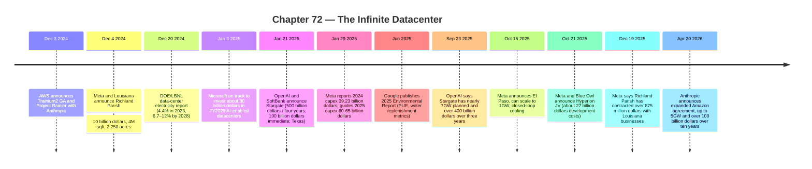

:::tip[In one paragraph]
The model became a construction project. By 2025, frontier AI announcements were no longer just about architectures, benchmarks, or APIs; they were about power, land, financing, construction, cooling, transmission, and named campuses. Stargate, Richland Parish, Hyperion, El Paso, and AWS Project Rainier turned compute into industrial coordination. This chapter closes the book's main infrastructure arc by arguing that intelligence, once mechanized, became infrastructure.
:::

<strong>Cast of characters</strong>

| Name | Lifespan | Role |
|---|---|---|
| Sam Altman / OpenAI | — | Public face of the Stargate compute buildout |
| Masayoshi Son / SoftBank | — | Stargate chair and financial lead in the January 2025 announcement |
| Brad Smith / Microsoft | — | Author of the January 2025 essay framing AI infrastructure as a physical buildout |
| Susan Li / Meta CFO | — | Capex guidance and Blue Owl financing voice for Meta's 2025 infrastructure push |
| Blue Owl Capital | — | Infrastructure-finance partner in Meta's Hyperion JV |
| Dario Amodei / Anthropic | — | Frontier-model customer making AWS infrastructure commitments narratively concrete |

<strong>Timeline (2024–2026)</strong>

<strong>Plain-words glossary</strong>

**Capex (capital expenditure)** — Spending on long-lived assets like buildings, land, transmission, and equipment, recorded on the balance sheet and depreciated over years rather than expensed immediately.

**Gigawatt (GW)** — One billion watts of power capacity. Frontier AI campuses use this unit because their planned electrical loads resemble large industrial systems, not ordinary office computing.

**PUE (Power Usage Effectiveness)** — Total facility energy divided by IT-equipment energy. Lower is better, but PUE measures overhead efficiency, not absolute power growth.

**WUE / closed-loop cooling** — Water Use Effectiveness measures water consumed per unit of IT energy. Closed-loop cooling recirculates water inside the facility, reducing operational withdrawal, but it does not mean lifecycle water is zero.

**Joint venture (JV) / residual value guarantee** — A jointly owned legal entity and a lease-finance promise about an asset's future value. In AI infrastructure, these structures can move datacenter construction into a mix of tenant commitments, investor ownership, private debt, and long-term guarantees.

**Project Rainier / UltraCluster** — AWS's named Trainium2 compute cluster for Anthropic, an example of cloud capacity becoming a dedicated industrial system rather than a generic instance pool.

The model became a construction project.

That is the final reversal in the book's main arc. For decades, artificial intelligence was described through ideas: logic, search, symbols, gradients, features, attention, scaling laws, alignment, agents. Even when the field became industrial, the visible artifacts were still software artifacts: papers, checkpoints, APIs, demos, benchmarks, leaderboards, and product launches. The machine room was always there, but it sat behind the story.

By the mid-2020s, the machine room moved to the front.

Chapter 70 followed the electricity. Chapter 71 followed the chip supply chain and the export license. Chapter 72 follows the place where those constraints land. Before a frontier model can be trained, served, fine-tuned, queried, or embedded into a product, the compute has to exist somewhere. It needs land. It needs buildings. It needs substations, transmission lines, fiber, cooling systems, water planning, transformers, switchgear, concrete, steel, security, permits, workers, leases, debt, guarantees, and long construction schedules.

The decisive AI artifact was no longer only the model checkpoint. It was the campus.

The word "cloud" hides this. It makes compute sound weightless, instantly elastic, and cleanly abstract. The cloud is useful precisely because it gives users that illusion. A developer asks for instances; a model lab asks for a cluster; a product team asks for inference capacity. The physical substrate is converted into an API.

But the substrate did not disappear. It became larger.

OpenAI's January 2025 Stargate announcement made the language shift impossible to miss. The company announced a new infrastructure venture intended to invest 500 billion dollars over four years, with 100 billion dollars intended for immediate deployment, initial buildout starting in Texas, and equity participation from SoftBank, OpenAI, Oracle, and MGX. The technology partners listed Arm, Microsoft, NVIDIA, Oracle, and OpenAI. That alone would have been a large capital announcement. The more revealing line came later: OpenAI said it was evaluating sites and asked firms across power, land, construction, equipment, and the built data-center infrastructure landscape to contact it.

That is not the language of a software release.

It is the language of a megaproject. "Power, land, construction, equipment" is the vocabulary of industrial capacity. It says that the limiting question is not only whether a lab has a new architecture or enough training data. The question is whether the surrounding economy can produce the physical works fast enough to house the next model generation.

Stargate was an announcement, not a completed fact. That distinction matters. A four-year 500 billion dollar intention is not the same thing as fully built capacity. A planned gigawatt is not an operational gigawatt. A site under development is not the same as a site running at full load. Still, announcements can be historically important when they reveal how the actors themselves understand the constraint. In January 2025, the constraint was no longer being described as only talent, algorithms, chips, or electricity. It was being described as the entire built data-center infrastructure landscape.

By September 2025, OpenAI said Stargate had reached nearly seven gigawatts of planned capacity and more than 400 billion dollars in investment over three years, with a path toward 500 billion dollars and ten gigawatts by the end of 2025. It described a July Oracle agreement for up to 4.5 gigawatts, sites in Texas, New Mexico, the Midwest and Wisconsin, Ohio, and Milam County, and more than 300 proposals from more than 30 states. It also said Abilene was running early training and inference workloads with NVIDIA GB200 racks.

Again, the verbs matter. Planned. Path. Agreement. Sites. Proposals. Running early workloads. This is not a single state of completion. It is a pipeline of physical capacity at different stages. Some capacity is in use. Some is planned. Some is proposed. Some depends on future construction, equipment delivery, power connection, financing, and local approvals.

The site search itself is the historical point. When more than 300 proposals from more than 30 states become part of an AI infrastructure story, compute has become a geography contest. States, counties, utilities, landowners, construction firms, and local officials enter the AI race. The model is still trained in tensors, but the competition to host those tensors starts with parcels, rights of way, substations, roads, workforce, and tax structures.

Site selection is where the abstraction first meets resistance. A model company can say it needs more compute. A site proposal has to answer different questions. Is there enough land in the right configuration? Can transmission reach it? Can a utility plan around the load? Are roads strong enough for construction traffic? Is there water, wastewater capacity, and a cooling plan? Are there enough electricians, pipefitters, equipment operators, and concrete crews? Can long-lead equipment arrive on time? Will the community accept the bargain? Every "yes" becomes part of the model's eventual capability.

That is why a site map is not a footnote to AI history. It is a record of where the industry thinks the next layer of intelligence can be physically hosted. The geography is not incidental. It determines proximity to power, access to labor, climate and cooling conditions, land cost, utility politics, and the willingness of public institutions to reshape infrastructure around a private campus.

The national competition for sites also changes the political imagination around AI. Earlier AI booms were concentrated in universities, corporate labs, and software hubs. The megacampus boom reaches into rural parishes, border cities, former industrial regions, and utility territories. A place that was not central to model research can become central to model capacity. That widens the coalition around AI while also widening the set of people who can contest its terms.

That is why "infinite datacenter" should be heard ironically. The industry talks as if capacity can be ordered on demand. A product roadmap wants more tokens. A lab wants a larger training run. A cloud customer wants more accelerators. A board wants the company to keep pace. But every new campus must pass through places. It has to be permitted, financed, built, connected, cooled, staffed, insured, and operated.

The abstraction scales faster than the world.

The capex wall made this visible in corporate language. In January 2025, Microsoft's Brad Smith wrote that the company was on track to invest about 80 billion dollars in fiscal year 2025 to build AI-enabled data centers for model training and AI and cloud deployment, with more than half in the United States. He also described massive data centers as built by construction firms, steel manufacturers, electricity and liquid-cooling advances, electricians, and pipefitters.

That list is worth slowing down over. It does not sound like the old myth of a few people in a lab changing the world with a clever program. It sounds like a regional construction economy. Steel. Cooling. Electrical work. Pipefitting. The AI stack had expanded until tradespeople became part of its scaling law.

Meta's public filings and announcements told the same story from another angle. In January 2025, Meta reported 2024 capital expenditures, including finance lease principal payments, of 39.23 billion dollars. It guided 2025 capital expenditures to 60 billion to 65 billion dollars, driven by generative AI and core business, and said infrastructure costs were expected to be the single largest driver of expense growth in 2025.

This is not ordinary software spending. It is the movement of AI from payroll and cloud bills into balance sheets, depreciation schedules, finance leases, and infrastructure cost guidance. The frontier model becomes a capital allocation problem. The strategic question is not only "Can we train it?" but "Can we fund the physical base of training and serving without breaking the company's financial structure?"

There is a timing problem inside those numbers. A company can decide it needs capacity before the revenue from that capacity is certain. It can commit to land, buildings, chips, power systems, and long-lived infrastructure before demand has stabilized. The resulting risk is different from hiring a research team or renting a modest cloud allocation. If the forecast is right, the company owns scarce strategic capacity. If the forecast is wrong, it owns enormous fixed costs.

That is why infrastructure cost became an AI story. Depreciation, leases, and capital expenditures are not glamorous, but they shape the frontier. A lab with a better idea may still be constrained if it cannot access enough compute. A company with a weaker model may survive if it has distribution and capacity. A cloud provider may become strategically important because it can absorb construction and financing risk that a model startup cannot. The balance sheet becomes a moat alongside data, talent, and algorithms.

That question changes who sits at the table. Researchers still matter. Product leaders still matter. But CFOs, treasurers, infrastructure-finance teams, tax advisers, utility negotiators, and real-estate executives become part of the AI system. Their work does not appear in a model card, but it determines whether the next cluster exists.

A campus is not a server room.

Meta's Richland Parish announcement made the scale tactile. In December 2024, Louisiana Economic Development and Meta announced a 10 billion dollar AI-optimized data center in northeast Louisiana. The project was described as four million square feet on 2,250 acres, with construction expected through 2030. The release attributed more than 500 direct jobs, more than 1,000 indirect jobs, and 5,000 construction workers at peak to the project. It also described Entergy energy planning, at least 1,500 megawatts of new renewable energy, water restoration, workforce programs, and more than 200 million dollars in local infrastructure improvements.

Those claims should be read with attribution. They are company and state economic-development claims, not neutral public audit findings. But they still show what an AI campus asks from a place. Four million square feet is not a metaphor. 2,250 acres is not a dashboard metric. Construction through 2030 is not a sprint. Thousands of construction workers at peak are not "cloud elasticity." Roads, water systems, workforce programs, and local infrastructure improvements are the local form of frontier AI.

The scale also changes what "deployment" means. In software, deployment can mean moving code to production. In a campus, deployment means earthwork, foundations, buildings, electrical rooms, mechanical yards, cooling equipment, switchgear, backup systems, fiber, security, commissioning, and staged occupancy. Capacity may arrive in phases. A portion of a campus can be useful while other buildings are still under construction. That phased reality makes public announcements hard to read unless the verbs are kept precise.

The project name Hyperion made the mythology explicit, but the history is in the details. A model lab may experience capacity as a cluster allocation. A local community experiences it as trucks, grading, concrete, noise, hiring, utility work, road changes, public meetings, workforce promises, and long-term questions about water and power. The same infrastructure can look like strategic national capacity from one level and like a land-use bargain from another.

That bargain is not simple. Communities may get jobs, contractor spending, grants, tax base, roads, training programs, and infrastructure investments. They may also inherit water questions, land-use conflict, grid connection complexity, ratepayer concerns, construction disruption, and long-term dependence on a small number of large corporate facilities. The historical point is not praise or condemnation. It is that communities became part of the AI stack.

Meta's later Richland Parish update, in December 2025, said the project had contracted more than 875 million dollars with Louisiana businesses, had local infrastructure investment over 300 million dollars, and had 3,700 construction workers so far with 5,000 peak expected by June 2026. It described Hyperion as Meta's largest multi-gigawatt AI training cluster and repeated claims about operational jobs, Entergy customer-cost effects, and water restoration plans. These are again company claims and should be treated that way. But they show the same thing: the model's future depends on procurement in Louisiana, construction labor, utility negotiation, and civil infrastructure.

The local contractor number is especially revealing. It translates AI capacity into purchase orders for firms that may never touch a neural network. Grading, hauling, electrical work, mechanical systems, concrete, fencing, roadwork, security, and site services become indirect inputs to model training. The stack extends outward until a frontier model depends on local businesses, workforce pipelines, and construction schedules.

El Paso gives a second campus scene with different emphasis. Meta announced and later updated an AI-optimized data center there, saying the site could scale to one gigawatt, that updated investment exceeded 10 billion dollars, that more than 4,000 construction jobs were expected at peak, and that more than 300 operational jobs were expected. It also said the site would use closed-loop water-efficient cooling with no operational water use for most of the year, and that Meta had paid for new grid infrastructure, transmission lines, and substations. It described clean-energy projects under contract adding more than 5,000 megawatts in Texas.

El Paso also shows why an AI campus is negotiated with more than one public system at once. The company may talk about AI-optimized infrastructure. The utility sees a large new load and connection requirements. Local government sees land use, tax base, roads, and employment. Water authorities see cooling claims, conservation commitments, and regional scarcity. Residents see construction and long-term change. A single campus can be a technology project, an economic-development project, a utility project, and an environmental-management project at the same time.

The cooling line matters because heat is the most honest part of compute. Every calculation becomes heat. A datacenter is a machine for moving heat away from chips while keeping power, networking, and reliability within operating bounds. The higher the density of the rack, the more cooling becomes design, not housekeeping.

Closed-loop cooling does not mean water questions vanish. "No operational water use for most of the year" is a specific claim about operations under certain conditions, not a claim that water has no role in the broader system. Water withdrawal, water discharge, water consumption, water replenishment, and water-use effectiveness are different concepts. A serious history has to keep them separate.

Google's 2025 Environmental Report gives the broader vocabulary. Google said digital services create data centers that require energy for operations and water for cooling, and that scaling increases the environmental challenge. It reported a 2024 fleet power usage effectiveness of 1.09 compared with an industry average of 1.56, framing that as 84 percent less overhead energy. It also reported about 4.5 billion gallons of water replenishment in 2024, equal to 64 percent of freshwater consumption, and Alphabet water withdrawal, discharge, and consumption figures of 11,011 million gallons, 2,876 million gallons, and 8,135 million gallons.

Those numbers do not produce a simple moral. They produce a measurement problem. PUE measures overhead energy relative to IT load. It does not measure total power growth. Water replenishment is not the same as water not consumed. Withdrawal is not the same as consumption. A company can improve efficiency while total demand still rises. A site can use closed-loop cooling and still depend on local environmental conditions, backup strategies, construction water, or regional water planning.

The measurement problem is important because AI infrastructure debates often collapse into one number. A low PUE can show efficient facility overhead, but it does not tell the reader how much total IT load has grown. A replenishment percentage can show a company's stated water-stewardship progress, but it does not mean the same gallons return to the same watershed at the same time. A closed-loop system can reduce operational water use for much of the year, but it does not remove the need to ask how the site handles heat during different seasons and operating conditions. The data center is full of metrics that are useful only when the denominator is understood.

Cooling is therefore not a footnote. It is one of the ways the model becomes local. Outside-air cooling, liquid cooling, closed-loop systems, water restoration, water-use metrics, and heat-rejection equipment all shape where and how a campus can operate. DOE's geothermal and data-center materials made the same design point from the public-sector side, describing reliable continuous power and reliable cooling as data-center requirements and listing options such as geothermal generation, cold underground thermal energy storage, and abandoned mine water cooling research. None of those options solves the whole AI buildout. They show the breadth of engineering responses once compute becomes industrial load.

Cooling also affects architecture. A denser rack may reduce the amount of floor space needed for a given amount of compute, but it can increase the difficulty of moving heat. Liquid cooling can make high-density deployments more practical, but it changes facility design, maintenance, and supply chains. Outside-air cooling can reduce water or energy demand in some climates and conditions, but it depends on local weather and system design. The point is not that one method is morally pure. The point is that every model roadmap eventually implies a heat-removal strategy.

Finance became architecture too.

Meta's October 2025 Blue Owl announcement is a useful x-ray. Meta and funds managed by Blue Owl Capital formed a joint venture to develop and own Hyperion. Meta said it would provide construction and property management, while Blue Owl would bring capital. Ownership was described as 80 percent Blue Owl funds and 20 percent Meta. The parties were to fund about 27 billion dollars of development costs for buildings and long-lived power, cooling, and connectivity infrastructure. Blue Owl contributed about 7 billion dollars in cash. Meta received about a 3 billion dollar distribution. The structure included leases, a residual value guarantee, and private debt to PIMCO and select bond investors.

This is not trivia for finance specialists. It shows that the datacenter is not only a technical architecture. It is a financing architecture. A hyperscale AI campus can be too large to think of as a simple internal facilities project. Companies may want capacity without carrying every dollar of asset ownership in the same way. Investors may want exposure to long-lived infrastructure backed by large technology tenants. Debt markets, guarantees, joint ventures, and leases become part of how compute is built.

The phrase "long-lived power, cooling, and connectivity infrastructure" is doing historical work. It names the assets that sit between a model and the world. Power distribution, cooling systems, and network connectivity are not accessories to the AI system. They are the durable frame around it. When those assets are financed through joint ventures and private debt, the ownership of AI capacity becomes more complicated than the ownership of a model.

This also means that infrastructure investors become indirect participants in the AI race. They may not train models. They may not design accelerators. But they provide capital to build the shell, power, cooling, and connectivity that make training possible. The frontier system is therefore assembled by more actors than the public usually sees: model firms, cloud providers, equipment suppliers, utilities, contractors, landlords, lenders, bond investors, and local governments.

That changes the meaning of "AI investment." A model can be framed as scientific progress, product advantage, national security, or consumer utility. But at this scale, it is also an infrastructure asset class. The future of intelligence becomes entangled with private credit, sovereign and global capital, lease accounting, residual value assumptions, and the durability of demand forecasts.

Stargate carried a similar signal at the venture level. SoftBank and OpenAI were the lead partners in the January 2025 announcement, with Oracle and MGX also listed as equity funders. Oracle, NVIDIA, Arm, Microsoft, and OpenAI were part of the technology partner list. Capital structure and technology stack were presented together in the same infrastructure announcement. That does not prove every promised dollar or gigawatt will arrive. It shows the kind of coalition frontier AI now requires: model company, cloud/infrastructure operator, chip and systems suppliers, global capital, and sites.

The old AI story often turned on scarcity of insight. Who had the better algorithm? Who had the better representation? Who had the better training trick? The new story still needs insight, but insight alone cannot pour concrete or finance a campus. Balance-sheet capacity became a competitive capability.

Cloud also changed shape.

In the first cloud era, a user rented abstracted capacity from a generalized pool. That is still true for many workloads. But frontier AI pushed cloud providers toward named clusters and long-term model-specific infrastructure. AWS Project Rainier is the cleanest example of that shift.

In December 2024, AWS announced Trainium2 instances and Project Rainier with Anthropic. It described Trn2 instances with 16 Trainium2 chips, Trn2 UltraServers with 64 interconnected chips, Project Rainier with hundreds of thousands of Trainium2 chips, third-generation low-latency petabit-scale Elastic Fabric Adapter networking, more than five times the exaflops used for Anthropic's then-current generation, and what AWS expected to be the world's largest AI compute cluster reported to date when completed.

The important word is "cluster." Frontier AI does not only require many chips. It requires those chips to behave like a coherent training machine. Networking, topology, scheduling, software, reliability, and failure recovery all matter because training and serving large models stress the system as a system. A chip that cannot communicate efficiently with its neighbors is less valuable than its theoretical arithmetic suggests. A campus that cannot cool dense racks cannot use the chips it has bought. A cluster that cannot survive failures cannot run long jobs reliably.

This is cloud becoming legible as a named industrial system. Trainium2 chips, UltraServers, NeuronLinks, EFA networking, multiple data centers, and dedicated Anthropic capacity are not the language of casual instance rental. They are the language of vertical integration: custom silicon, server design, network fabric, facilities, power, cooling, and customer commitment arranged around frontier-model demand.

AWS later said Project Rainier was in use, with nearly half a million Trainium2 chips and Anthropic workloads running. It said Claude was expected to be on more than one million Trainium2 chips by the end of the year. Those are company statements, and the expected future state must remain an expected future state. But the historical direction is clear. The cloud provider was not merely waiting for demand to appear. It was building named capacity around a model developer's trajectory.

Anthropic's April 2026 Amazon announcement pushed the point further. Anthropic said it signed with Amazon for up to five gigawatts of new capacity, with nearly one gigawatt by the end of 2026, more than 100 billion dollars over ten years to AWS technologies, more than one million Trainium2 chips in use, and Amazon investing 5 billion dollars immediately with up to 20 billion dollars later. Anthropic tied rapid demand growth to reliability and performance pressure and near-term capacity expansion.

Here the cloud stops sounding like a utility that simply exists and starts sounding like a negotiated industrial partnership. A model company needs capacity years ahead. A cloud provider needs confidence to build. Custom chips and clusters need software, networking, and workload commitments. The result is a long-horizon infrastructure relationship in which model roadmaps and datacenter roadmaps begin to co-evolve.

This is one of the clearest differences between ordinary cloud growth and frontier AI growth. Ordinary cloud demand can often be pooled across many customers and workloads. Frontier training demand can be concentrated, bursty, hardware-specific, and strategically sensitive. A provider building around a leading model lab is not merely adding generic capacity. It is making a bet about architectures, chips, customer demand, and the future shape of AI workloads.

Dedicated capacity also changes dependence. A model company gains access to a scale of infrastructure it could not quickly reproduce alone, but it also becomes tied to a provider's chips, software stack, reliability, delivery schedule, and commercial terms. The cloud provider gains a flagship customer, but it also takes on concentrated execution risk. The partnership is powerful because the need is mutual.

That co-evolution matters for the whole book. In early AI, a program could be copied and run wherever a suitable machine existed. In the expert-system era, deployment meant selling software and consulting. In the deep learning era, training increasingly required GPUs and large datasets, but the visible object was still often the model. By the frontier era, the model was inseparable from the infrastructure contract that made it possible.

The DOE/LBNL numbers show why this could not stay invisible. DOE said data centers consumed 4.4 percent of U.S. electricity in 2023 and projected 6.7 to 12 percent by 2028, rising from 176 terawatt-hours in 2023 to 325 to 580 terawatt-hours by 2028. Once demand reaches that scale, a datacenter campus becomes a public-infrastructure actor whether or not it is privately owned.

It touches utility planning. It touches rate design. It touches retired industrial sites, transmission, substations, workforce availability, and local politics. DOE's resource hub listed public-sector strategies and tools around right-sizing grids, onsite power and storage, retired coal infrastructure reuse, rate structures, geothermal, nuclear, storage, and efficiency. A private model roadmap can therefore create public planning problems.

This is where private and public timelines collide. A company may announce capacity goals because it needs to reassure customers, investors, partners, or researchers. A utility has to plan assets with long lives. A public official has to explain costs and benefits to residents. A construction workforce has to be trained or imported. An environmental commitment has to be monitored over time. The AI roadmap is therefore translated into many other roadmaps, each moving at its own speed.

That translation is part of the infrastructure now. It is how private capacity becomes a public place, with public consequences, public questions, public politics, public accountability, and public memory afterward.

The community bargain is where those problems become concrete. A county may want construction jobs, contractor spend, and infrastructure improvements. A city may want tax base and a place in the AI economy. A utility may want a large customer but worry about timing, cost recovery, and grid upgrades. Residents may disagree about land use, water, noise, or who pays for infrastructure. State officials may frame the project as economic development. Companies may frame it as investment and stewardship. All of those stories can be true enough to matter and incomplete enough to require scrutiny.

This is why the campus is political even when it is privately owned. Its benefits are distributed through wages, contracts, tax structures, grants, and infrastructure upgrades. Its costs and risks are distributed through construction disruption, utility planning, water concerns, land conversion, and long-term exposure to a single industry's demand cycle. A community can rationally want the investment and still demand accountability. A company can make real infrastructure commitments and still be speaking from its own interest.

That is why attribution is not a pedantic exercise. When Meta says a project will support jobs or restore water, say Meta says it. When OpenAI says a project has a path to ten gigawatts, say OpenAI says it. When Google reports PUE and water metrics, say Google reports them. When DOE gives national electricity estimates, treat those as public-sector baselines. The chapter's honesty depends on keeping announced futures, company benefits, and measured conditions in their proper categories.

The infrastructure race also changes the tempo of AI. Software can ship quickly. A benchmark can be exceeded overnight. A model can be released globally in a day. A datacenter cannot. Construction runs through seasons, procurement cycles, permitting, supply chains, workforce availability, utility interconnection, commissioning, testing, and customer qualification. That mismatch creates pressure throughout the industry. Product timelines ask for instant capacity. Physical timelines answer in years.

The mismatch also changes strategic behavior. If capacity takes years, companies must reserve it before they know exactly which models will need it. If chips are scarce, buildings may be planned around expected hardware. If cooling density changes, facility design may have to anticipate racks not yet deployed. If demand shifts from training toward inference, the load profile changes. The campus is therefore built for a future that is still technically uncertain.

This mismatch is the hidden drama behind the word "scale." Scaling a parameter count is mathematically simple to describe. Scaling a campus is not. You can write a larger training run into a plan before you can build the site that runs it. You can announce a gigawatt before it is connected. You can sign a financing agreement before the buildings are complete. The frontier is therefore full of future tense: planned, expected, under development, can scale, committed, in use, operational.

The future tense is not necessarily deception. It is how megaprojects speak. But history has to hear it accurately.

It must ask what exists, what is contracted, what is under construction, and what remains an intention.

Without that discipline, infrastructure history becomes marketing copy.

With it, the scale becomes more impressive, not less, because the hard parts stay visible on the page, where readers can judge them.

The "infinite datacenter" is the dream that every bottleneck can be overcome by building more. More land. More power. More chips. More cooling. More finance. More workers. More campuses. The dream is powerful because it has worked before. The computing industry has repeatedly turned scarcity into infrastructure and infrastructure into a new abstraction. Mainframes became time-sharing. Time-sharing became personal computing. Personal computers became networks. Networks became clouds. Clouds became AI factories.

But each abstraction rests on a material base. The AI factory is not floating above the world. It is built into it.

This is why the infrastructure close belongs after chips and power rather than before them. A datacenter campus is the place where the previous constraints converge. It cannot exist without chips, but chips alone do not make it useful. It cannot exist without electricity, but electricity alone does not make it a cluster. It cannot exist without capital, but capital alone does not cool a rack. It cannot exist without a community, but local approval alone does not train a model. The campus is the intersection point.

It is also the place where AI stops being easy to separate from the rest of the economy. A training run pulls on semiconductor supply chains, utility planning, water accounting, construction labor, local politics, debt markets, and cloud contracts. The model may appear to users as an answer in a browser or an assistant in a phone. Behind that answer is a chain of industrial commitments that cannot be reduced to software.

That is the main arc's closing lesson. Artificial intelligence began in this book as a question about thought. Could reasoning be formalized? Could a machine manipulate symbols? Could a neuron be abstracted? Could a universal machine imitate intelligence? The early field was poor in compute but rich in ambition. It imagined minds before it had the machines to sustain them.

Then the field learned its constraints. The first winter exposed brittle optimism. Expert systems found the knowledge bottleneck. The statistical turn found that data could outperform hand-built rules. Deep learning found that old ideas became new when data and GPUs arrived. Transformers found that attention, scale, and self-supervision could turn the web into a training substrate. Product AI found that a model could become an interface. Agents found that a model could call tools. Benchmarks became politics. Copyright became a supply-chain fight. Inference became economics. Energy became a grid issue. Chips became statecraft.

And finally, intelligence became construction.

That does not mean ideas stopped mattering. It means ideas alone were no longer enough. A frontier system required industrial capacity: chips from contested supply chains, electricity from strained grids, data from disputed sources, labor from visible and invisible workers, capital from global finance, and campuses negotiated with local communities. The model was still math. But the math needed a place to live.

The history of AI is often told as a history of minds. That is only half true. It is also a history of machines becoming large enough to host the ambitions projected onto them. The universal machine was a conceptual breakthrough. The stored-program computer made it practical. The GPU made learning at scale possible. The hyperscale datacenter made foundation models deployable. The AI megacampus made frontier AI an industrial sector.

The main arc does not end with the physical world defeating AI. It ends with AI becoming powerful enough to need the physical world at full scale. Its limits became the limits of industrial coordination: how fast societies can build, finance, power, cool, govern, and legitimize the factories of computation. That is a more serious story than hype or backlash. It says that intelligence, once mechanized, became infrastructure.

:::note[Why this still matters today]
When you read about a frontier model launch in the late 2020s, the campus is now part of the news. A site in Texas or Louisiana, a transmission line, a closed-loop cooling system, a private-credit financing of long-lived infrastructure, a hyperscaler's named cluster, and a community's bargain over jobs, water, and grid load all sit beneath the model card. The vocabulary of AI extended outward until it included electricians, pipefitters, utility planners, county officials, lease accountants, and bond investors. That extension is the main arc's closing claim: intelligence, once mechanized, became infrastructure. Every announced gigawatt is also a question — about what was actually built, who paid, who hosts, and who lives next to the answer.
:::

At the start, intelligence looked like a theorem.

Then it looked like a program.

Then it looked like data.

Then it looked like a model.

By the end of this arc, it also looked like a construction site.

One technical coda remains. [Chapter 73: The Algorithmic Response](../ch-73-the-algorithmic-response/) turns to KV-cache memory pressure and Multi-head Latent Attention. It examines a documented design while asking what evidence would connect that architectural choice to the wider hardware and policy constraints.
