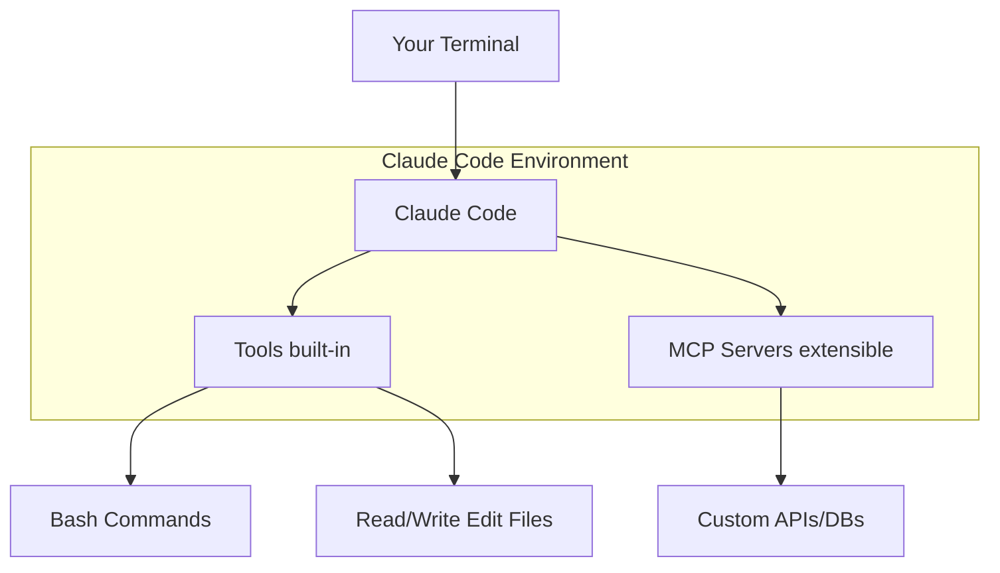
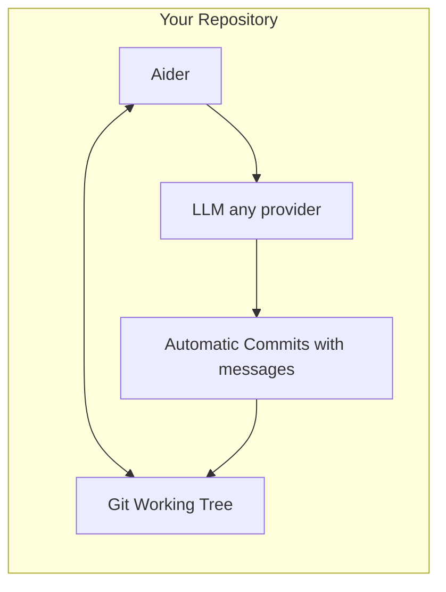
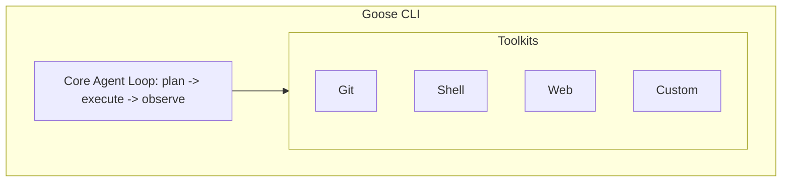

> **AI/ML Engineering Track** | Complexity: `[MEDIUM]` | Time: 4-6 hours
> **Prerequisites**: Module 01 (AI-Driven Development), Module 1.4 (Agent-First IDEs)

---

## What You'll Be Able to Do

By the end of this module, you will be able to:

- **Configure** a Model Context Protocol integration to extend agent capabilities into legacy databases and internal network systems.
- **Implement** an automated error-recovery pipeline using non-interactive CLI agents to triage and resolve test failures programmatically.
- **Evaluate** the economic, security, and operational trade-offs between GUI-based and CLI-based AI coding workflows, including the autonomy frontier (L4/L5) and local-model cost dynamics.
- **Diagnose** production failures in headless environments by scoping AI context to relevant system logs and executing targeted codebase modifications.
- **Compare** the execution models, system requirements, and architectural limits of modern CLI utilities including Claude Code, Aider, Codex CLI, Gemini CLI, and Copilot CLI.

---

## Why the Terminal Matters for AI-Assisted Development

CLI AI coding agents occupy a distinctive position in the form-factor spectrum we explored in Module 1.4 — the IDE agent. Where an IDE agent lives inside a graphical editor, watching your cursor, completing your code, and operating on a visible buffer, a CLI agent runs directly in the terminal, communicating through standard input and standard output streams. This architectural choice is not a downgrade from the graphical experience. It is a deliberate trade-off that unlocks environments IDEs cannot reach.

The terminal is the universal interface of computing infrastructure. Every server, container, bastion host, CI runner, and SSH session speaks it. When you are debugging a production incident through a jump host with no X11 forwarding, your IDE is absent but your terminal is present. When a GitHub Actions runner needs to analyze a pull request diff at 3 AM, there is no human with an editor open — but a shell script can pipe that diff into a CLI agent and post the result as a comment. When you need to run the same refactoring across fifty repositories in a batch, a shell `for` loop dispatching a CLI agent is the natural tool.

This is the durable value proposition of the CLI form factor: terminals are everywhere, they compose with pipes, and they run without a GUI. CLI AI coding agents inherit these properties and add LLM reasoning to the Unix pipeline.

The lineage matters. Before AI coding agents, the terminal was already the power user's primary interface for software engineering. `grep`, `sed`, `awk`, `make`, `git`, and shell pipelines formed a composable toolchain that could search, transform, build, and version code without a graphical environment. What CLI AI agents add to this lineage is not a replacement for these tools but a reasoning layer on top of them — the ability to understand intent expressed in natural language and translate it into the precise shell invocations, file edits, and git operations that the Unix toolchain expects. This is a natural evolution, not a disruption: the terminal was already the most expressive programming environment ever built. Adding an LLM that can generate commands for that environment is more like giving a seasoned Unix user a faster pair of hands than like replacing the terminal with something new.

This distinction — CLI agents as augmentation of existing terminal workflows rather than replacement of them — is what separates effective CLI agent usage from frustrating trial-and-error. The agent is most powerful when you already know what the terminal can do and use the agent to accelerate execution, not when you treat it as a magic box that replaces understanding.

> **Hypothetical scenario:** Imagine a production outage at 2 AM. The on-call engineer SSHs into a bastion host — no IDE, no graphical debugger, just a terminal. The stack traces are scrolling in `journalctl`. A CLI agent can be pointed at the relevant source files and the error output simultaneously, analyzing both to propose a fix, all within the same terminal session the engineer is already using. The agent reads the stack trace from stdin, cross-references it with the source tree, and produces a patch. This is not a claim about a specific incident. It is a description of the architectural capability that the CLI form factor provides — and the reason infrastructure engineers invest in learning it.

> **Go deeper:** For harness layers, guardrails, and operating agent loops in headless environments, see [Harness Fundamentals](/ai/ai-engineering-foundations/module-3.1-harness-fundamentals-layers-and-system-of-record/), [Guardrails, Gates, and Agent-Legible Apps](/ai/ai-engineering-foundations/module-3.2-guardrails-gates-and-agent-legible-apps/), and [Operating the Harness](/ai/ai-engineering-foundations/module-3.3-operating-the-harness/).

---

## Theory: The Power of the Command Line

While agent-first development environments wrap artificial intelligence capabilities in polished graphical interfaces, CLI-based coding agents take a fundamentally different architectural approach. They integrate directly into the terminal subsystem, binding to the standard input and standard output streams that developers use to orchestrate their operating systems. This provides an execution model that values composability, automation, and headless operation over visual aesthetics.

Think of a graphical IDE agent as an assistant who works exclusively inside a well-lit studio. They are incredibly effective when you are sitting right next to them, looking at the same canvas. A CLI agent, conversely, is an assistant equipped with a flashlight and a toolkit who will follow you down into the basement, crawl into the ventilation shafts, and repair the plumbing. The CLI agent operates natively wherever a secure shell connection can reach.

The Unix philosophy, established decades ago, dictates that systems should consist of small, highly focused programs that do one thing well and communicate via standard text streams. CLI agents honor this philosophy. They do not attempt to reinvent text editing, source control, or window management. Instead, they act as intelligent text processors that read project files, analyze standard error streams from failed compilations, and output exact diffs. You can pipe a failing test report directly into a CLI agent, instruct it to diagnose the failure, and pipe its output directly into a logging aggregator.

> **Pause and predict**: If you pass an entire monorepo to a CLI agent without scoping the context, what will happen to the language model's reasoning capabilities, and why?

---

## The CLI Agent Landscape

The ecosystem of command-line agents spans several distinct philosophies, from deeply integrated vendor tools to model-agnostic open-source frameworks. Each tool makes different trade-offs around git integration, extensibility, model lock-in, and headless operation. Understanding these differences is essential for selecting the right tool for a given environment.

A foundational concept that applies across all CLI agents is the split between the **harness** (the software that manages context, tools, and agent loops) and the **model** (the LLM doing the reasoning). Some harnesses are model-locked — Claude Code requires a Claude model, Codex CLI requires an OpenAI model. Others are model-agnostic or "bring-your-own" (BYO): Aider, Goose, Hermes, and OpenClaw let you point them at any provider, including local open-weights models running on Ollama. This BYO capability becomes architecturally decisive when we reach the autonomy frontier later in this module. For the harness-model distinction in detail, cross-reference the Rosetta framework in [Module 1.1: Prompt Fundamentals](/ai/ai-engineering-foundations/module-1.1-prompt-fundamentals/).

### Claude Code: Deep Integration and Extensibility

Claude Code is Anthropic's official terminal agent, engineered for complex, multi-step tasks by deeply analyzing the active workspace. It provides dedicated terminal commands supporting a non-interactive execution mode designated by the `-p` flag, alongside advanced session management features. Installation is via native platform installers; the legacy npm path (`npm install -g @anthropic-ai/claude-code`) is deprecated. System prerequisites require macOS 13.0+, Ubuntu 20.04+, Debian 10+, or Alpine 3.19+.

The application manages its own lifecycle through an auto-update mechanism with configurable channels. This mechanism defaults to the `latest` channel while allowing opt-in for `stable` releases, and permits manual intervention via the `claude update` command. Extensibility is achieved natively; the CLI configures the Model Context Protocol directly using the `claude mcp` subcommand, facilitating immediate integration with external MCP servers. When instantiating the agent, developers use model selection flags that recognize shorthand aliases such as `sonnet` and `opus`.



Claude Code relies on programmatic hooks and slash commands to align the language model with project practices. Hooks allow the execution of shell commands whenever the AI modifies a file, helping ensure formatting tools run consistently.

```json
// ~/.config/claude-code/settings.json
{
  "hooks": {
    "PostToolUse": [
      {
        "matcher": "Edit",
        "command": "prettier --write $FILE_PATH"
      }
    ],
    "PreCommit": [
      {
        "command": "npm run lint"
      }
    ]
  }
}
```

The Model Context Protocol extends Claude Code's capabilities to interact with external databases and version control systems through auditable, isolated server processes.

```json
// MCP server configuration
{
  "mcpServers": {
    "database": {
      "command": "mcp-postgres",
      "args": ["postgresql://localhost/mydb"]
    },
    "github": {
      "command": "npx",
      "args": ["-y", "@anthropic-ai/mcp-server-github"]
    }
  }
}
```

Custom slash commands enable developers to encode repeatable project workflows directly into the agent's configuration, so the agent always operates within the team's established conventions.

```text
# .claude/commands/security-review.md
Review this PR for:
1. Security vulnerabilities
2. Performance regressions
3. Best practices violations

Focus on: $ARGUMENTS
```

Global repository contexts are managed through a foundational markdown file. This file keeps the agent aligned with established architectural mandates, such as relying on specific Object-Relational Mappers instead of executing raw database queries.

```text
# CLAUDE.md

Project Overview
This is a FastAPI backend serving a React frontend.

Conventions
- Use pydantic for all data validation
- Async functions for all I/O
- Tests in pytest, aim for 80% coverage

Don't
- Never commit .env files
- Don't use raw SQL, always use SQLAlchemy ORM
```

```bash
# Install (native installer — recommended; see docs.anthropic.com/claude-code)
# Legacy npm path (deprecated): npm install -g @anthropic-ai/claude-code

# Start interactive session
claude

# Non-interactive with prompt
claude -p "explain this file" < src/main.py

# With specific model
claude --model claude-sonnet-4-20250514
```

### Aider: Git-Native Pair Programming

Aider is a specialized, Git-native AI pair-programming tool designed for direct terminal execution. The recommended installation uses an isolated installer flow triggered via `aider-install`, supporting Python environments from versions 3.8 to 3.13. Deployment is also supported through pip, pipx, and custom install scripts. Aider supports over one hundred distinct programming languages. Its core architectural advantage lies in its deep integration with the local git binary, effectively managing, tracking, and automatically committing all AI-generated code changes directly within the local working tree.



By binding directly to git, Aider guarantees that no AI modification is ever lost or blended invisibly into a monolithic file state.

```bash
$ aider
> Add input validation to the User model

# Aider edits the file and commits:
# "feat: Add input validation to User model"
# - Added email format validation
# - Added password strength requirements
# - Added age range check
```

Aider natively maintains a persistent understanding of multiple files simultaneously, coordinating complex refactoring efforts across application routers, core domain models, and testing suites.

```bash
$ aider src/models/user.py src/api/routes.py tests/test_user.py

> Refactor User to use dataclass and update all usages
```

Accessibility and rapid input are facilitated through dedicated voice capture modules.

```bash
$ aider --voice
 Listening...
"Add a rate limiting middleware that allows 100 requests per minute per IP"
```

For massive architectural overhauls, Aider exposes an architect mode that halts execution and forces the developer to approve the proposed system design before any code is mutated.

```bash
$ aider --architect

> Implement user authentication with JWT

Planning...
1. Create auth service module
2. Add JWT utility functions
3. Create login/register endpoints
4. Add auth middleware
5. Update user model with password hash
6. Add tests

Proceed? [y/n]
```

Model flexibility is one of Aider's defining characteristics: it is fully model-agnostic, supporting both commercial API endpoints and locally hosted neural networks. This BYO-model architecture makes Aider a natural choice for teams that want to trade between frontier-model capability and local-model cost/privacy.

```bash
# OpenAI
$ aider --model gpt-5

# Anthropic
$ aider --model claude-4.6-sonnet

# Local models via Ollama
$ aider --model ollama/deepseek-coder

# Any OpenAI-compatible API
$ aider --openai-api-base http://localhost:8000/v1
```

```bash
# Install
pip install aider-chat

# Start with files
aider src/main.py src/utils.py

# With specific model
aider --model gpt-5

# Voice mode
aider --voice
```

### Goose: Extensible Toolkits

Goose relies on a modular architecture to expand its capabilities. It uses Python-based toolkits to connect standard LLM reasoning to disparate enterprise systems.



Developers can define completely isolated Python classes that decorate internal logic with the `@tool` directive, exposing legacy systems directly to the autonomous agent.

```python
# Custom toolkit example
from goose.toolkit import Toolkit, tool

class DatabaseToolkit(Toolkit):
    """Tools for database operations."""

    @tool
    def query(self, sql: str) -> str:
        """Execute a SQL query and return results."""
        return self.db.execute(sql)

    @tool
    def schema(self, table: str) -> str:
        """Get the schema for a table."""
        return self.db.get_schema(table)
```

```bash
# Install
pip install goose-ai

# Start session
goose session start

# With specific toolkit
goose session start --toolkit developer github
```

### OpenAI Codex CLI

The OpenAI Codex CLI is a terminal-based coding agent that executes locally on the developer's machine. It can deeply inspect a repository, edit files in place, and run arbitrary commands within the current working directory. Installation uses `npm i -g @openai/codex`, with upgrades via `npm i -g @openai/codex@latest`. The tool supports macOS and Linux; Windows support is marked as experimental. The underlying engine is built in Rust. The Codex CLI is open source under the Apache-2.0 license. Access requires a ChatGPT Plus, Pro, Business, Edu, or Enterprise plan, and the initial execution requires an interactive ChatGPT authentication flow or direct API-key authentication.

### Gemini CLI

Google's Gemini CLI is an open-source terminal AI agent under the Apache-2.0 license. The official documentation recommends macOS 15+, Windows 11 24H2+, or Ubuntu 20.04+, paired with a minimum runtime of Node.js 20.0.0+. Installation pathways include npm, Homebrew, MacPorts, and Anaconda. The interface is accessed via the `gemini` executable. The development cycle tracks three release channels — stable, preview, and nightly — which map to package manager tags including `latest`, `preview`, and `nightly`. For cloud-native developers, Gemini CLI ships pre-installed within both Google Cloud Shell and Google Cloud Workstations.

### GitHub Copilot CLI

The GitHub Copilot CLI extends standard repository tooling directly into the terminal and is available across all Copilot tier plans, subject to organizational and enterprise policy enablement. The agent supports Linux, macOS, and Windows, using PowerShell or Windows Subsystem for Linux on the latter. Installation targets multiple package managers, including npm (requiring Node.js 22+), Winget, and Homebrew. Usage models support both direct programmatic invocations and fully interactive sessions initiated by typing `copilot`. For complex, multi-stage operations, the tool provides an advanced autopilot mode capable of executing sequences autonomously without requiring interactive prompting between individual steps. To maintain context across long-running development efforts, the Copilot CLI persists complete session data locally within `~/.copilot/session-state/`, supporting both seamless session resumption and history inspection through the `/chronicle` command.

```bash
# Interactive session (authenticate with /login on first launch)
copilot

# Non-interactive prompt for scripts and CI (see docs.github.com Copilot CLI)
copilot -p "find all Python files modified in the last week" -s
```

Older tutorials sometimes referenced `gh copilot suggest` or a separate `q` executable. The current GitHub Copilot CLI is invoked as `copilot`, with programmatic work routed through `-p` (and often `-s` for script-friendly output). For multi-step unattended runs, the programmatic reference documents flags such as `--allow-tool` and `--no-ask-user` so CI jobs can grant narrowly scoped shell and write permissions without dropping into interactive confirmation. Treat the official Copilot CLI docs as the source of truth when wiring automation — command surfaces change faster than blog posts.

> **Stop and think**: When an incident occurs in a highly secure, air-gapped production environment, how does the architecture of a locally running CLI agent provide a critical advantage over a cloud-dependent IDE extension?

---

## Comparing CLI Agents

Evaluating which agent to deploy depends on the engineering environment's constraints, the necessity for robust source control guarantees, and the requirement for deep system extensibility. No single agent is "best" — the right choice depends on your specific operational context.

| Feature | Claude Code | Aider | Goose |
|---------|-------------|-------|-------|
| **Git Integration** | Manual commits | Auto-commits | Manual |
| **Multi-file Editing** | Yes | Yes | Yes |
| **Extensibility** | MCP servers | Limited | Toolkits |
| **Voice Input** | No | Yes | No |
| **Model Support** | Claude only | Multi-model (BYO) | Multi-model |
| **Custom Commands** | Slash commands | Limited | Toolkits |
| **Project Context** | CLAUDE.md | .aider files | Config |
| **IDE Integration** | Yes (plugins) | No | No |
| **Open Source** | No | Yes | Yes |

When assessing financial impact, the underlying cost of API tokens must be balanced against the reduction in manual engineering hours.

> **Pricing snapshot — as of 2026-06; verify against current vendor pricing before relying.**

| Approach | Monthly Cost | Best For |
|----------|-------------|----------|
| Manual coding | $0 (just salary) | Learning, interviews |
| GitHub Copilot | $19/month | Autocomplete, snippets |
| Cursor Pro | $20/month | IDE-centric workflows |
| Aider + gpt-5 | ~$30-100/month API | Git-native development |
| Aider + Claude | ~$20-80/month API | Complex reasoning |
| Claude Code | ~$50-200/month API | Multi-step automation |
| Aider + Local (Ollama) | $0-5/month | Privacy, offline, cost savings |

The final row is significant: a model-agnostic (BYO) harness pointed at a local open-weights model has near-zero marginal token cost. The trade-off is raw capability — local models currently underperform frontier APIs on complex reasoning tasks — but for many refactoring, formatting, and boilerplate-generation workflows, the cost savings outweigh the capability gap. We return to this trade-off in detail in the autonomy frontier section below.

Subscription and API prices in the table above are order-of-magnitude guides, not guarantees. Vendor list prices, included credits, and enterprise discounts shift quarterly; agentic workloads also burn tokens differently than autocomplete-style usage because multi-step CLI runs may issue dozens of model calls per task. Budget for CLI agents by measuring your own harness: log prompt and completion tokens per workflow, multiply by your contracted rate, and re-check vendor pricing pages whenever you renew. The dated snapshot callout exists precisely because vendor pricing and bundled credits in this category move quickly.

## Choosing a CLI Agent for Your Context

With six active CLI agents in the landscape — and the autonomy frontier adding more — selecting the right one for a given task is not about picking a "winner." It is about matching the tool's architectural strengths to your operational constraints. The decision breaks down into several dimensions that every engineering team should evaluate before standardizing on a tool.

**Model lock-in versus model flexibility.** If your organization has an existing relationship with a specific LLM provider, a model-locked harness can simplify procurement and access management. Claude Code integrates deeply with Anthropic's model family and provides first-class support for features like extended thinking and MCP. Codex CLI is the natural choice if your team is already on OpenAI's platform. However, model lock-in also means you cannot switch providers if pricing changes, if a competitor releases a more capable model, or if you need to run fully air-gapped with a local model. Model-agnostic harnesses like Aider, Goose, Hermes, and OpenClaw let you swap the model without changing the tool — a form of architectural portability that becomes valuable as the LLM market evolves rapidly.

**Git integration depth.** If your workflow depends on clean, auditable commit histories with AI-authored changes clearly attributed, Aider's auto-commit model is a significant advantage. It ensures every AI edit is captured as an atomic commit with a descriptive message, making it trivial to review, revert, or bisect AI-authored changes. Claude Code and Goose leave commit management to the developer, which provides more control but requires more discipline. For solo developers or small teams comfortable with git, manual commits are fine. For larger teams or regulated environments where every change must be traceable to a specific prompt and model version, Aider's git integration is closer to a requirement than a preference.

**Extensibility model.** Claude Code uses MCP, an open protocol with a growing ecosystem of community servers. Goose uses Python-based toolkits that are easy to write but specific to Goose. Codex CLI and Gemini CLI have their own extension mechanisms. If your environment includes custom internal services — a proprietary database, an in-house deployment API, a legacy logging system — the ease of connecting the agent to those services may be the deciding factor. MCP's open-standard design means an MCP server you write for Claude Code can theoretically be reused by any MCP-compatible client. A Goose toolkit is Goose-specific. Weigh the long-term maintenance cost of custom integrations against the short-term ease of writing them.

**Operational environment.** If you deploy agents in CI pipelines (GitHub Actions, GitLab CI, Jenkins), the agent must support fully non-interactive, exit-coded execution. Claude Code's `-p` flag, Aider's `--yes` flag, and Copilot CLI's autopilot mode all provide this, but each has different behavior around error handling, retry, and output formatting. Test the agent in your actual CI environment — not just on your laptop — before committing to it for pipeline automation. A tool that works beautifully in an interactive terminal may behave differently when stdin is a pipe and no TTY is attached.

**The local-model path.** If cost, privacy, or air-gapped operation are primary concerns, your harness must be model-agnostic and your model must run locally. Aider with Ollama, Hermes with a local provider, or OpenClaw on your own hardware are the paths to explore. The capability gap between local models and frontier APIs is real and task-dependent — expect to invest time in prompt engineering and model selection for complex reasoning tasks — but for a large class of refactoring, formatting, code review, and boilerplate work, local models are already productive. This is not a fringe use case; it is the architecture that makes autonomous-agent economics viable at scale, as we explore in the next section.

There is no single correct answer. The right CLI agent for your team is the one whose architectural trade-offs align with your operational constraints, your security model, and your budget. The most durable choice is to keep the harness layer decoupled from the model layer — so that as models improve and pricing shifts, you can adapt without retooling your entire workflow.

---

## Building CLI Workflows

The true power of terminal-based coding agents emerges when they are integrated into automated continuous execution loops. By decoupling the agent from a human operator, organizations can process technical debt, execute codebase-wide vulnerability patching, and construct self-healing continuous integration pipelines.

Piping data directly into a non-interactive execution mode allows external shell logic to handle repository state while the AI agent focuses purely on analysis.

```bash
#!/bin/bash
# review-pr.sh - Automated PR review

PR_NUMBER=$1
DIFF=$(gh pr diff $PR_NUMBER)

echo "$DIFF" | claude -p "Review this diff for:
1. Security issues
2. Performance concerns
3. Test coverage gaps

Output as markdown checklist."
```

Chaining tools together creates self-healing loops. A standard testing framework can output a stack trace, which a shell script evaluates. If the execution code returns a failure, the script automatically summons the AI to remediate the broken codebase.

```bash
#!/bin/bash
# smart-fix.sh - Diagnose and fix issues

# Step 1: Run tests to find failures
pytest --tb=short 2>&1 | tee test_output.txt

# Step 2: If tests fail, use Aider to fix
if [ $? -ne 0 ]; then
  aider --message "Fix the failing tests shown in test_output.txt" \
        --read test_output.txt \
        tests/test_example.py src/example.py
fi
```

Integrating these commands directly into GitHub Actions translates to a persistent, tireless code reviewer that analyzes every pull request asynchronously before a human engineer ever opens the interface.

```yaml
# .github/workflows/ai-review.yml
name: AI Code Review

on: [pull_request]

jobs:
  review:
    runs-on: ubuntu-latest
    steps:
      - uses: actions/checkout@v4

      - name: AI Review
        run: |
          gh pr diff ${{ github.event.pull_request.number }} | \
          claude -p "Review this PR for issues" > review.md

      - name: Post Comment
        uses: actions/github-script@v7
        with:
          script: |
            const review = require('fs').readFileSync('review.md', 'utf8');
            github.rest.issues.createComment({
              owner: context.repo.owner,
              repo: context.repo.repo,
              issue_number: ${{ github.event.pull_request.number }},
              body: review
            });
```

---

## Advanced Patterns

Command-line execution requires meticulous management of the underlying model's context window. Throwing an entire unindexed file tree at an agent degrades performance and wastes financial resources.

```bash
# Only include relevant files
aider src/auth/*.py tests/test_auth.py
```

```bash
# Don't include your entire codebase
aider **/*.py  # Overwhelming!
```

Prompt design inside terminal applications differs significantly from web chat behaviors. You must be aggressively specific about structural requirements.

```bash
# Too vague
> "improve the code"

# Better
> "Refactor the UserService class to:
> 1. Use dependency injection for the database connection
> 2. Add type hints to all methods
> 3. Extract email validation to a separate utility
> Keep the public API unchanged."
```

Because external LLM API endpoints can fail, time out, or produce hallucinated code, rigid programmatic retry logic is a fundamental requirement for background execution. In production pipelines, pair retries with guardrails: cap the number of files an agent may touch per run, require a clean test pass before merging auto-generated commits, and emit structured logs (agent name, model version, prompt hash, exit code) so operators can audit what the harness did without replaying an entire terminal session. These habits mirror how you would supervise a human contractor working overnight — the CLI agent is fast, but speed without traceability recreates the same review nightmares that git-native tools like Aider were invented to prevent.

```bash
#!/bin/bash
MAX_RETRIES=3
RETRY=0

while [ $RETRY -lt $MAX_RETRIES ]; do
  aider --message "Fix any remaining test failures" && break
  RETRY=$((RETRY + 1))
  echo "Attempt $RETRY failed, retrying..."
  sleep 2
done
```

---

## The Autonomy Frontier: Beyond Supervised CLI Agents

> **Snapshot as of 2026-06; the landscape moves fast — verify before relying.**

The CLI agents covered so far — Claude Code, Aider, Codex CLI, Gemini CLI, Copilot CLI, and Goose — all operate at what the Rosetta framework (see [Module 1.1](/ai/ai-engineering-foundations/module-1.1-prompt-fundamentals/)) classifies as **L3: Supervised Agent**. They wait for an explicit human prompt, execute a bounded task, and return control when done. They are powerful, but they are still tools — they do not initiate actions, maintain persistent memory across restarts, or operate across multiple communication surfaces without being explicitly told to do so.

Beyond L3 sits the autonomy frontier: agents that run without continuous human supervision, maintain persistent memory, initiate actions across multiple surfaces (terminals, messaging apps, email, calendars), and self-author their own tool extensions. These are **L4 (Autonomous Agent)** and **L5 (Persistent Agent)** — systems that operate more like a teammate than a tool.

### Hermes Agent: Open-Source Autonomous and Persistent Agent

[Hermes Agent](https://hermes-agent.nousresearch.com/) by Nous Research, released in February 2026, is an open-source autonomous and persistent AI agent designed for always-on operation. Its architecture centers on several capabilities that distinguish it from the L3 CLI agents:

- **Persistent memory**: Hermes maintains context across sessions and restarts, building a durable understanding of projects, preferences, and patterns over time.
- **Self-authored skills**: The agent can write, test, and register its own reusable tool extensions (skills), adapting its capabilities to the environment without requiring the user to write plugin code.
- **Multi-surface gateway**: A single Hermes instance connects to Telegram, Discord, Slack, WhatsApp, Signal, and CLI simultaneously — meaning the same agent you talk to in a chat can execute commands in your terminal and report results back to the chat thread.
- **Flexible deployment**: Hermes runs locally, in Docker, over SSH, or on serverless infrastructure. You choose where the agent lives and what it can reach.
- **Model-agnostic (BYO)**: Hermes is explicitly designed to work with any provider — `hermes --provider deepseek`, `hermes --provider anthropic`, or with a local open-weights model via Ollama. This BYO architecture is central to the cost/safety trade-off we explore below.

Hermes Desktop, a graphical management layer for configuring and monitoring Hermes instances, entered public preview around June 2026.

### OpenClaw: Autonomous Agent on Your Own Hardware

[OpenClaw](https://en.wikipedia.org/wiki/OpenClaw) is an open-source autonomous agent created by Peter Steinberger that runs on the user's own hardware. It connects email, calendar, browser, and messaging surfaces, operating as a persistent digital presence that can manage schedules, respond to messages, and execute tasks across the user's digital life.

By March 2026, OpenClaw had amassed approximately **247,000 GitHub stars** per [Wikipedia](https://en.wikipedia.org/wiki/OpenClaw), climbing rapidly and earning a description as among the fastest-growing open-source projects in GitHub history. In February 2026, Steinberger joined OpenAI, and stewardship of the OpenClaw project moved to an independent OpenClaw Foundation, ensuring continued community-governed development.

### The Cost Reality of Autonomous Agents

The autonomy frontier introduces a new economic dimension that every engineer and engineering manager must understand. At L3, cost is predictable: each invocation consumes tokens proportional to the task size, and you pay per task. At L4/L5, where the agent is always on — polling, monitoring, responding, initiating — the economics change fundamentally.

OpenClaw's creator publicly documented a real-world benchmark: running approximately **100 autonomous Codex agents over a 30-day period**. The cost: **\$1.3 million in OpenAI API tokens** — consuming 603 billion tokens across 7.6 million requests. That figure used Codex "Fast Mode" (higher throughput, higher cost); standard-mode pricing would have placed the same workload at approximately **\$300,000**, or roughly **\$13,000 per agent per month**. OpenAI covered the bill for that experimental run.

This is not a criticism of any tool or vendor. It is a data point that illustrates a structural reality of the autonomy frontier: **L4/L5 autonomy on a frontier API is expensive per agent.** A deployment of ten persistent agents at \$13,000/month each is a \$1.56M annual line item before factoring in any value they produce.

However, this cost equation has a second branch. The same harness architecture that supports frontier-API autonomy can be pointed at a **local open-weights model** (Gemma, Llama, Qwen, DeepSeek via Ollama) with **near-zero marginal token cost**. A BYO harness like Aider, Hermes, or OpenClaw, combined with a capable local model running on your own hardware, operates at the cost of electricity and GPU depreciation — not per-token API billing. The trade-off is raw capability: local models currently underperform frontier APIs on complex multi-step reasoning, but for a broad class of monitoring, triage, formatting, boilerplate-generation, and simple-automation tasks, they are already viable.

This is the **autonomy × cost × safety frontier** — three dimensions you must navigate simultaneously:

| Dimension | Frontier API (L4/L5) | Local Model (L4/L5) |
|-----------|---------------------|---------------------|
| **Capability** | Highest reasoning quality | Moderate; task-dependent |
| **Cost** | Illustrative; up to ~$13,000+/agent/month on frontier APIs (Fast Mode benchmark) | ~$0 marginal token cost |
| **Privacy** | Code leaves your network | All processing is local |
| **Control** | Vendor rate limits, billing changes | Full control; no external dependency |
| **Safety blast radius** | Same for both — L5 = shell + messaging access is a security surface | Same, but local processing reduces exfiltration risk |

The durable lesson: organizations planning autonomous agent deployments must model cost under both frontier-API and local-model scenarios, and architect their harness layer to support switching between them as the capability/cost curves evolve.

### Billing Decoupling: The Industry Adjusts to Agentic Scale

As agentic workloads grew through 2025-2026, cloud AI providers began restructuring their billing models to decouple programmatic and agentic API usage from flat-rate chat subscriptions. This is an industry-level adjustment reflecting the fundamentally different economics of agentic workloads (continuous, high-volume, automated) versus chat workloads (intermittent, human-paced, interactive):

- **Anthropic** introduced separate "Agent SDK credits" effective **June 15, 2026**, covering `claude -p` (non-interactive CLI mode), the Agent SDK, and GitHub Actions integrations. This followed a sequence of policy adjustments — an April 2026 restriction on third-party agent usage, a May 2026 reversal — culminating in a billing model that meters programmatic usage separately from interactive chat subscriptions.
- **OpenAI** meters Codex Cloud and API usage against separate credit pools distinct from ChatGPT subscriptions.

These changes are neither surprising nor punitive. They reflect the industry's recognition that a fleet of roughly 100 persistent agents processing 7.6 million requests over a month is consuming resources at a different order of magnitude than a developer asking occasional questions in a chat interface. When planning autonomous agent deployments, assume metered programmatic access — not flat-rate bundling — and budget accordingly.

### Safety: The Other Side of Autonomy

More autonomy means a larger blast radius. An L3 CLI agent running a bounded refactoring task in a CI pipeline has a limited damage surface: it operates in the directory you scoped, produces a diff, and exits. An L5 persistent agent with shell access, messaging connectivity, and the ability to self-author tools and write files is a fundamentally different security surface.

The sandboxing and permission-boundary principles covered in Module 1.1 (the Rosetta framework, L0-L5 ladder) apply here with compounding force. An always-on agent with file-system write access and messaging reach should be treated with the same access-control discipline you would apply to a human operator: least privilege, audit logging, explicit approval gates for destructive operations, and — critically — awareness that an agent compromised via prompt injection on a messaging surface (e.g., a malicious Telegram message) can execute commands in your terminal.

Autonomous agents are not inherently unsafe. But they are inherently different from supervised agents, and the security model must reflect that difference. An L5 agent is a persistent process with credentials — treat it like one.

This is not a theoretical concern. An L5 agent connected to a messaging surface (Telegram, Discord, Slack) is reachable by anyone who can send it a message. A prompt injection — a malicious message crafted to override the agent's system instructions — can cause the agent to execute commands, read files, or exfiltrate data through the very messaging channel the attacker used to deliver the injection. The same class of vulnerability that affects LLM chatbots is amplified when the target is an agent with shell access and file-system write permissions.

The mitigation patterns are well-understood but must be applied deliberately. Run the agent under a dedicated OS user account with minimal permissions — not your daily driver account and certainly not root. Scope its file-system access to specific directories. Use sandboxing (Docker, Firejail, macOS seatbelt) to limit what the agent process can touch, even if compromised. Audit all agent-initiated shell commands — Hermes and Claude Code both support logging — and review those logs regularly, not just after an incident. Treat the agent's messaging inbox as an untrusted input surface and apply the same scrutiny you would to a public-facing web endpoint.

The architectural insight that ties safety back to the cost discussion is this: a local model running on your own hardware has a smaller exfiltration surface than a frontier API model processing your code in a vendor's cloud. If the agent is compromised via prompt injection, the blast radius is still large — it can still delete files, push bad commits, or send messages — but it cannot accidentally ship your proprietary source code to a third-party API endpoint, because there is no third-party API endpoint in the loop. This is not a reason to avoid frontier APIs, but it is a reason to understand the full security picture when selecting your deployment architecture.

---

## Did You Know?

- **Model Context Protocol (MCP)**: Anthropic introduced MCP in November 2024 as an open standard for connecting AI models to external data sources. Within three months of its release, over 200 community-built servers had been published, covering integrations from standard Postgres databases to advanced Kubernetes clusters.
- **Bash/Shell in the Stack Overflow survey**: The [2024 Stack Overflow Developer Survey](https://survey.stackoverflow.co/2024/technology) reports Bash/Shell among the technologies professional developers use — approximately 34% of respondents in the 2024 edition — reflecting sustained terminal use alongside GUI-centric workflows.
- **Aider on SWE-bench**: Aider, created in early 2023, consistently ranks in the top tier on the [SWE-bench coding benchmark](https://aider.chat/benchmarks) by late 2024, demonstrating the power of tight version control integration over standalone chat interfaces.
- **Gemini CLI licensing**: The Gemini CLI was built from the ground up as an open-source terminal AI agent under the Apache-2.0 license; its official documentation as of April 2026 recommends macOS 15+, Windows 11 24H2+, and Ubuntu 20.04+ alongside Node.js 20.0.0+ for optimal performance.

---

## Common Mistakes and How to Avoid Them

| Mistake | Why it happens | How to fix |
|---------|----------------|------------|
| Overloading Context | Adding entire directories exhausts the LLM's working memory, causing hallucinations and driving up API costs. | Supply only the specific files necessary for the targeted change using explicit paths. |
| Vague Prompts | Developers assume the CLI agent shares the visual context of an IDE, which it does not. | Provide explicit instructions detailing constraints, expected patterns, and precise file targets. |
| Ignoring Git History | Relying on the agent for massive, sweeping changes without committing creates an unreviewable monolith. | Use agents like Aider that automatically commit incremental, atomic changes to the working tree. |
| Missing Context Files | The agent lacks knowledge of system architecture, leading to code that violates project conventions. | Define global repository rules in files like `CLAUDE.md` to ensure the agent aligns with architectural guidelines. |
| Manual Repetition | Treating the CLI agent as a chat bot instead of a programmable shell utility wastes engineering time. | Wrap agent invocations inside bash scripts or CI/CD pipelines to process files programmatically. |
| Bypassing Verification | Trusting AI-generated code without secondary validation introduces silent regression bugs into production. | Chain the agent execution with test runners to explicitly verify behavior before committing the result. |
| Incorrect Agent Selection | Using an interactive agent for a non-interactive pipeline halts execution waiting for user input. | Utilize flags like `-p` in Claude Code or autopilot modes in Copilot CLI for background execution. |
| Ignoring System Requirements | Running modern CLI agents on outdated runtimes causes native binary or library dependency failures. | Verify environments meet specific baselines, such as Node.js 18+ for Claude Code or Node.js 22+ for Copilot CLI. |

```bash
#  Bad: Adding entire codebase
aider **/*.py  # "I'll just add everything!"

#  Good: Focused context
aider src/auth/login.py src/auth/session.py tests/test_auth.py
```

```bash
#  Bad: Too vague
> "make it better"
> "fix the bugs"
> "improve performance"

#  Good: Specific and actionable
> "Add input validation to the create_user function: email must be valid format,
>  password must be 8+ chars with 1 number, username must be alphanumeric 3-20 chars.
>  Raise ValueError with descriptive messages for each validation failure."
```

```bash
#  Bad: Letting changes pile up
> "refactor the entire module"
> "also add tests"
> "and update the docs"
# Now you have one massive commit you can't easily undo

#  Good: Incremental changes
> "refactor the User class to use dataclass"
# Review commit, verify it works
> "add tests for the refactored User class"
# Review commit, verify tests pass
> "update docstrings to reflect new structure"
```

```bash
#  Bad: Every session
> "We use FastAPI with Pydantic models. All async. SQLAlchemy for ORM.
>  Tests in pytest. Don't use raw SQL. Use type hints everywhere..."
```

```text
# CLAUDE.md

Tech Stack
- FastAPI + Pydantic + SQLAlchemy (async)
- PostgreSQL 15, Redis for caching
- pytest for testing, 80% coverage required

Conventions
- All I/O functions must be async
- Use repository pattern for database access
- Type hints on all public functions
- No raw SQL—use ORM or named queries
```

```bash
#  Bad: Manual repetition
$ aider
> "fix the type error in file1.py"
$ aider
> "fix the type error in file2.py"
# Repeat 20 times...

#  Good: Scripted automation
$ mypy src/ --json | jq -r '.[] | .file' | sort -u | while read f; do
    aider --message "fix type errors" "$f"
done
```

---

## Knowledge Check

<details>
<summary>1. You are configuring an automated CI pipeline using Claude Code, but the pipeline keeps timing out after 6 hours. The logs show the agent successfully analyzed the PR diff but never exited. Based on the tool's execution model, what is the root cause of this failure?</summary>

The tool was executed without the `-p` (non-interactive) flag, causing it to drop into an interactive session rather than completing and returning control to the shell. In a headless CI environment, there is no human operator present to provide standard input, so the process hangs indefinitely waiting for a prompt that will never arrive. This is a fundamental mismatch between the agent's execution mode and the environment it was placed in — interactive mode assumes a human is watching, while CI runners expect processes that start, finish, and return an exit code. The correct invocation pipes the prompt directly: `claude -p "Review this diff" < diff.txt`, which causes the agent to process the input, emit its response to standard output, and exit cleanly. Always validate that CLI agent invocations in automated contexts use non-interactive flags before deploying to production pipelines.
</details>

<details>
<summary>2. Your team uses `pytest` for testing and requires 80% coverage. You notice that your CLI coding agent consistently generates code without accompanying tests, violating your conventions. What is the most robust way to resolve this globally for the project?</summary>

You must establish a foundational `CLAUDE.md` context file in the root of the repository, which the agent reads before every session begins. This file serves as persistent global memory that the agent parses prior to execution, eliminating the need to repeat architectural constraints in every individual prompt. By defining strict testing constraints — coverage thresholds, the test framework in use, and the convention of co-locating tests with source files — within this document, the agent is forced to align its output with enterprise mandates during every invocation. Without this file, the agent operates with no project-specific knowledge and defaults to generic patterns that may contradict your standards. Think of `CLAUDE.md` as the equivalent of an onboarding document you would give a new engineer on their first day — it establishes the non-negotiable ground rules before any work begins.
</details>

<details>
<summary>3. You are tasked with analyzing an isolated transaction failure inside a legacy Python service. You have instantiated an Aider session. What is the most efficient way to supply context to the LLM without degrading its reasoning capability?</summary>

You must supply only the explicit files directly involved in the transaction logic. Executing a command like `aider src/auth/login.py tests/test_auth.py` aggressively narrows the context window to the exact code paths under investigation. Providing the entire directory structure clogs the LLM's memory buffers, resulting in severe reasoning hallucinations and unnecessary token expenditure. The model's attention mechanism distributes focus across all supplied tokens, so injecting irrelevant files actively pulls the model's reasoning away from the specific failure site. A disciplined scoping strategy — reviewing the stack trace first, identifying the two or three files directly implicated, and passing only those — consistently produces more accurate diagnoses than broad context floods.
</details>

<details>
<summary>4. Your security policy strictly mandates that developer tool updates cannot occur automatically. You are managing a fleet of Claude Code installations. An engineer reports their CLI automatically downloaded a patch that broke their workflow. What configuration failure allowed this to happen, and how should the fleet be managed?</summary>

The auto-update mechanism was left on its default `latest` channel, which causes the tool to silently pull and apply new releases without waiting for operator approval. This default is designed for individual developer convenience rather than fleet management, where uncoordinated updates can introduce breaking changes across an entire team simultaneously. The fleet configuration must be audited to disable or constrain the auto-update behavior, shifting every installation to a controlled release channel and disabling automatic downloads. Engineers must be trained to treat `claude update` as a deliberate, approval-gated operation rather than a routine maintenance step. Centralizing update governance — for example, through a tested internal mirror or a pinned version in your provisioning scripts — is the only reliable way to prevent a single upstream patch from silently breaking workflows across dozens of machines.
</details>

<details>
<summary>5. A critical production database is displaying unexpected query latency. You instruct an AI agent to analyze the schema, but it hallucinates table names because it lacks real-time database access. Why is configuring the Model Context Protocol (MCP) with `mcp-postgres` a more secure architectural choice to solve this than installing a custom community plugin into the agent?</summary>

MCP standardizes the connection mechanism as a discrete external server process rather than embedding database access logic directly inside the agent's execution environment. This separation of concerns means the MCP server process can be granted narrowly scoped, read-only database credentials without those credentials ever being embedded in agent configuration files or accessible to the agent's core memory space. A custom community plugin, by contrast, typically executes arbitrary code within the agent process itself, expanding the attack surface: a malicious or buggy plugin can exfiltrate credentials, execute unintended writes, or escalate privileges. MCP servers are also independently auditable and replaceable — you can swap `mcp-postgres` for an internal hardened implementation without modifying the agent configuration. The protocol's open standard design means integrations can be reviewed, version-pinned, and patched independently of the agent release cycle, which is essential in regulated production environments where all data access paths must be documented and approved.
</details>

<details>
<summary>6. You are writing a shell script that iterates over a list of files containing type errors, utilizing Aider to fix them. The script frequently stops processing when a file requires a complex refactor, breaking the pipeline. How should you structure the execution?</summary>

The bash script must implement explicit error handling and retry mechanics so that a single agent failure does not terminate the entire batch. Encapsulating the `aider` invocation inside a `while` loop that monitors the execution exit code ensures that if the agent fails or times out on a complex refactor, the pipeline programmatically retries the operation up to a configurable maximum threshold before abandoning that specific file and moving to the next. This is critical because LLM API calls have inherent non-determinism — a request that fails due to a timeout or context overflow on the first attempt may succeed on a retry with a slightly different prompt or after the API recovers. A well-structured pipeline also logs failures to a separate file rather than silently swallowing them, so the operator can review which files required manual intervention after the automated pass completes. Treating each file as an independent unit of work with its own retry budget and failure isolation prevents one problematic file from blocking the remediation of dozens of others.
</details>

<details>
<summary>7. An engineer using GitHub Copilot CLI for a multi-stage infrastructure deployment complains that the tool keeps pausing after generating each YAML manifest, requiring manual confirmation before applying it. Since they cannot monitor the terminal constantly, what execution model feature are they failing to utilize?</summary>

They are failing to utilize the explicit autopilot mode, which is specifically designed for exactly this scenario: multi-step operations where requiring human confirmation between each discrete action defeats the purpose of automation. Autopilot mode instructs the CLI to carry the full execution plan through to completion, applying each generated artifact sequentially without pausing for operator approval at intermediate stages. The default interactive confirmation behavior exists as a safety mechanism for exploratory or destructive operations where a human should review each step — it is appropriate when an engineer is actively watching the terminal but becomes an obstacle in scheduled or unattended deployments. Enabling autopilot shifts the approval boundary to the start of the workflow rather than between each step, which is the correct model for infrastructure-as-code pipelines where the inputs are version-controlled and the expected outputs are well-defined. Engineers using the CLI for automated deployments should always evaluate whether the interactive confirmation model matches their operational context before running long sequences.
</details>

<details>
<summary>8. You are evaluating whether to deploy an L5 persistent agent for automated PR triage across your organization's repositories. The agent would need shell access and GitHub API credentials to function. Based on the autonomy frontier model discussed in this module, what are the three dimensions you must evaluate before deployment, and what is the key cost-model insight that could make the deployment economically viable at scale?</summary>

The three dimensions are **capability, cost, and safety** — the autonomy × cost × safety frontier. On capability: you must verify that the model you are using (frontier API or local) can reliably perform PR triage at the quality level your team requires. On cost: if using a frontier API, running an always-on agent can cost thousands of dollars per agent per month in API tokens (the OpenClaw benchmark showed ~\$13,000/agent/month on Codex Fast Mode, ~\$3,000/agent/month on standard mode). On safety: an L5 agent with shell access and GitHub credentials has a significant blast radius — a prompt injection or hallucinated destructive command could affect multiple repositories. The key cost-model insight is that a **model-agnostic (BYO) harness pointed at a local open-weights model** has near-zero marginal token cost. For PR triage — a task that involves reading diffs, checking conventions, and flagging issues — a capable local model may provide sufficient quality at a fraction of the cost, making the deployment economically viable at scale. The architecture should support switching between local and frontier models as the capability/cost curves evolve, rather than hard-coding the agent to a single provider.
</details>

---

## Hands-On Practice

> **Lab Prerequisites — API Key Required**: Aider (used in Tasks 2 and 4) requires an active LLM API key. Before starting, export one of the following in your shell:
> ```bash
> export ANTHROPIC_API_KEY="sk-ant-..."
> # OR
> export OPENAI_API_KEY="sk-..."
> ```
> Without this, both Aider invocations fail immediately with an authentication error. If you do not have a key, register at https://console.anthropic.com (Anthropic) or https://platform.openai.com (OpenAI) before proceeding.

This comprehensive lab will walk you through the fundamental mechanics of utilizing CLI coding agents programmatically. You must execute these commands sequentially. Ensure you have Python installed in your local environment.

### Task 1: Environment Preparation and Initialization

The first task establishes an isolated git-tracked repository with a baseline Python script that we will refactor in subsequent tasks. Create a temporary working directory, initialize git, and seed it with a simple `user_service.py` module that contains a procedural function we will transform into a structured class. Execute the following commands in order — each one sets up state that the later automation steps depend on.

```bash
# Initialize a fresh directory
mkdir -p /tmp/cli-agent-lab && cd /tmp/cli-agent-lab

# Initialize git tracking
git init
git config user.email "lab@example.com"
git config user.name "Lab User"

# Generate a baseline legacy functional script
cat << 'EOF' > user_service.py
def process_user(email, age):
    if age < 18:
        return "Minor"
    return "Adult"
EOF

# Commit the initial state
git add user_service.py
git commit -m "Initial commit of user service"
```

<details>
<summary>Checkpoint Verification</summary>
Run `git status` to confirm the working tree is completely clean and `user_service.py` is safely tracked. The output must state: `nothing to commit, working tree clean`.
</details>

### Task 2: Automated Refactoring with Aider

Now we put the CLI agent to work. Install Aider via pip and direct it at `user_service.py` with a specific, unambiguous refactoring prompt. The instruction asks Aider to convert the procedural function into a `User` dataclass with an email validator method and an age-based status property — a non-trivial structural transformation that exercises the agent's ability to reason about class design, data validation, and backward compatibility. The `--yes` flag tells Aider to proceed without asking for confirmation at each step, making the workflow suitable for scripted automation.

```bash
# Install the agent via pip
pip install aider-chat

# Execute the agent, passing the target file and the instruction
aider --yes user_service.py --message "Convert this functional script into a User dataclass with an explicit email validator method. Retain the age logic as a property."
```

<details>
<summary>Checkpoint Verification</summary>
Run `git log -n 1`. You will see that Aider automatically generated a semantic commit message detailing the exact structural modifications it applied to the codebase. Execute `cat user_service.py` to observe the generated dataclass.
</details>

### Task 3: Building a Testing Harness

With the refactored code in place, we need to validate that Aider produced a working implementation. Write a minimal pytest suite that imports the `User` class and verifies the `status` property behaves correctly for a minor-aged user. This step mirrors real-world practice: after an AI agent modifies code, you run the test suite before trusting the result. Install pytest and execute the test — a passing run confirms the refactoring preserved correct behavior.

```bash
# Generate the unit test
cat << 'EOF' > test_user_service.py
import pytest
from user_service import User

def test_minor_user():
    u = User(email="test@test.com", age=16)
    assert u.status == "Minor"
EOF

# Install testing dependencies
pip install pytest

# Run the test suite
pytest test_user_service.py
```

<details>
<summary>Checkpoint Verification</summary>
The pytest runner will output a clean pass if the AI correctly implemented the `status` property in Task 2. If it fails, you are perfectly positioned for the next automation loop.
</details>

### Task 4: Constructing a Self-Healing Pipeline

The final task ties everything together into an autonomous error-recovery loop — the pattern that makes CLI agents valuable in CI and production environments. First, intentionally corrupt the test file by replacing `assert` with `assrt`, simulating a regression bug introduced by a careless edit. Then construct a `smart-fix.sh` shell script that runs the test suite, detects the failure via the exit code, and automatically dispatches Aider with the failing test output as context. The agent reads the stack trace, identifies the typo, and commits the fix — all without a human touching the keyboard. This pipeline is the direct ancestor of the production-grade self-healing CI workflows discussed in the Building CLI Workflows section.

```bash
# Intentionally break the test file by corrupting an assertion
# sed -i.bak works identically on both macOS and Linux (creates a .bak backup)
sed -i.bak 's/assert/assrt/g' test_user_service.py

# Construct the auto-fix pipeline
cat << 'EOF' > smart-fix.sh
#!/bin/bash
pytest --tb=short 2>&1 | tee test_output.txt

if [ ${PIPESTATUS[0]} -ne 0 ]; then
  echo "Failure detected. Dispatching AI agent..."
  aider --yes --message "Fix the failing tests shown in test_output.txt. Do not modify the underlying domain model." \
        --read test_output.txt test_user_service.py
fi
EOF

# Execute the pipeline
chmod +x smart-fix.sh
./smart-fix.sh
```

<details>
<summary>Checkpoint Verification</summary>
The shell script will execute pytest, identify the failure code, trigger Aider, supply the stack trace and the broken file directly into context, and Aider will execute a git commit fixing the typo without user intervention.
</details>

**Success Checklist**:
- [ ] You established an isolated, git-tracked directory.
- [ ] Aider successfully converted a raw Python function into a structured class.
- [ ] The git history accurately reflects autonomous commit messages.
- [ ] The `smart-fix.sh` script successfully routed standard output errors into the agent's context window.

---

## Deliverables

### Primary Deliverable: CLI Agent Automation Toolkit

Build a Python toolkit that provides a multi-agent orchestrator capable of routing tasks to the appropriate CLI agent based on installation paths and task requirements, an intelligent context manager that selects only the files relevant to each task to avoid exceeding model context-window limits, a set of pre-built workflow templates for standard testing and review cycles that can be dropped into any CI pipeline, and a metrics dashboard that tracks agent usage counts, success rates, and estimated token costs across your automation fleet.

The toolkit should live at `examples/module_01.5/deliverable_cli_agent_toolkit.py` and must satisfy three criteria: all demonstration functions execute without compilation errors, the pipeline correctly handles both standard output streams and standard error logging without losing diagnostic information, and the context manager accurately scopes execution to the minimal set of directories needed for each task in order to optimize API consumption and keep per-task costs predictable.

---

## Learner Check

Take a moment to reflect on the core ideas from this module.

> "More autonomy means a larger blast radius. An L3 CLI agent running a bounded refactoring task in a CI pipeline has a limited damage surface: it operates in the directory you scoped, produces a diff, and exits. An L5 persistent agent with shell access, messaging connectivity, and the ability to self-author tools and write files is a fundamentally different security surface."

If you can explain why this distinction matters and how the BYO-model architecture changes the economic equation for autonomous agents, you have grasped the central thesis of this module.

---

## Further Reading

- [Claude Code Documentation](https://docs.anthropic.com/claude-code)
- [Aider Documentation](https://aider.chat/docs)
- [Goose GitHub Repository](https://github.com/block/goose)
- [Codex CLI GitHub Repository](https://github.com/openai/codex)
- [Gemini CLI GitHub Repository](https://github.com/google-gemini/gemini-cli)
- [Copilot CLI Documentation](https://docs.github.com/en/copilot/using-github-copilot/using-copilot-in-the-command-line)
- [SWE-bench Leaderboard](https://swebench.com)
- [Aider Benchmarks](https://aider.chat/benchmarks)
- [Hermes Agent Documentation](https://hermes-agent.nousresearch.com/docs)
- [OpenClaw Wikipedia](https://en.wikipedia.org/wiki/OpenClaw)
- [Model Context Protocol Specification](https://modelcontextprotocol.io)

---

## Next Module

Continue to [Module 1.7: AI-Powered Code Generation](/ai-ml-engineering/ai-native-development/module-1.7-ai-powered-code-generation/) to apply CLI agent workflows to structured code generation patterns and move from terminal automation into deliberate generation workflows.

---

## Sources

- [Claude Code Product Page](https://www.anthropic.com/claude-code) — Current high-level positioning, capabilities, and pricing context for Claude Code.
- [Aider GitHub Repository](https://github.com/Aider-AI/aider) — Best upstream reference for Aider's current feature set, install guidance, and Git-native workflow.
- [Gemini CLI GitHub Repository](https://github.com/google-gemini/gemini-cli) — Documents current installation methods, release channels, licensing, and command-line behavior.
- [OpenAI Codex Repository](https://github.com/openai/codex) — Provides the maintained Codex CLI README, release artifacts, and license information.
- [Hermes Agent](https://hermes-agent.nousresearch.com/) — Open-source autonomous/persistent agent; model-agnostic BYO architecture.
- [OpenClaw (Wikipedia)](https://en.wikipedia.org/wiki/OpenClaw) — Open-source autonomous agent created by Peter Steinberger; among the fastest-growing OSS projects on GitHub (~247k stars by Mar 2026 per Wikipedia).
- [OpenClaw creator burns through $1.3 million in OpenAI API tokens](https://www.tomshardware.com/tech-industry/artificial-intelligence/openclaw-creator-burns-through-1-3-million-in-openai-api-tokens-in-a-single-month) — Tom's Hardware coverage of the 603B-token / 7.6M-request autonomous-agent cost benchmark.
- [Anthropic reinstates OpenClaw and third-party agent usage on Claude subscriptions — with a catch](https://venturebeat.com/technology/anthropic-reinstates-openclaw-and-third-party-agent-usage-on-claude-subscriptions-with-a-catch) — VentureBeat coverage of the April/May/June 2026 policy and Agent SDK credits rollout.
- [Anthropic Agent SDK Credits](https://thenewstack.io/anthropic-agent-sdk-credits/) — The New Stack coverage of the June 15, 2026 Agent SDK credits and billing decoupling.
