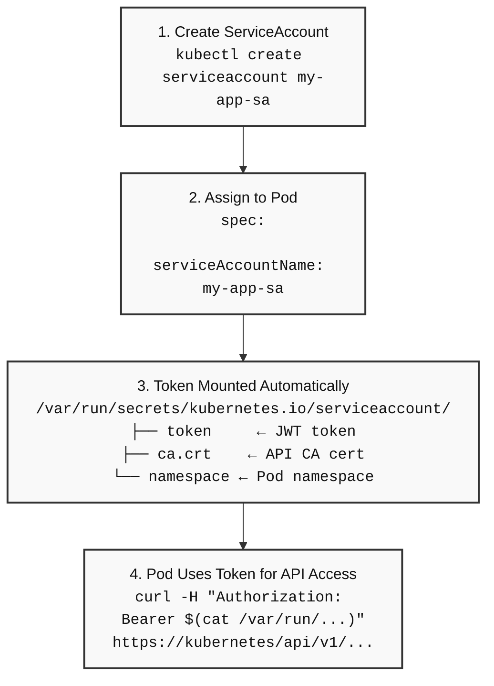

> **Complexity**: `[MEDIUM]` - Important for API access and workload identity
>
> **Time to Complete**: 40-55 minutes
>
> **Prerequisites**: [Module 4.4: SecurityContexts](../module-4.4-securitycontext/), basic Pod manifests, and RBAC vocabulary

---

## Learning Outcomes

After completing this module, you will be able to:
- **Implement** a custom ServiceAccount and assign workloads to use that identity instead of the namespace default.
- **Compare** default, custom, and no-token ServiceAccount patterns when deciding whether a Pod should receive Kubernetes API credentials.
- **Debug** in-cluster API failures by tracing Pod identity, token projection, Role rules, and RoleBinding subjects.
- **Design** a least-privilege ServiceAccount setup that gives an application only the namespace-scoped permissions it needs.
- **Diagnose** token exposure and legacy-token risks by auditing automount settings, projected volumes, and manually requested tokens.

## Why This Module Matters

Hypothetical scenario: a team ships a small web dashboard that only renders static status pages, so nobody expects it to talk to the Kubernetes API. The image later receives an emergency patch after a remote-code-execution bug, and the first question from the incident channel is not whether the container was compromised. The better question is whether that otherwise boring Pod had a readable ServiceAccount token mounted under `/var/run/secrets/kubernetes.io/serviceaccount/`, because that single file can turn application compromise into control-plane access.

ServiceAccounts are the identity layer for processes inside Pods, while RBAC decides what those identities may do after authentication succeeds. CKAD tasks often test the visible part, such as creating a ServiceAccount or adding `serviceAccountName` to a Pod spec, but production failures usually live in the invisible chain between admission, token projection, and authorization. You need to see the whole path: the Pod references an identity, the kubelet mounts a token, a client sends that token to the API server, and the API server checks RoleBinding or ClusterRoleBinding subjects before returning data.

This module builds that chain one piece at a time. You will start by inspecting the automatically created `default` ServiceAccount, then create purpose-built workload identities, then decide when token mounting should be disabled entirely. The final sections connect those mechanics to RBAC debugging, because the most common ServiceAccount mistake is treating authentication as if it were authorization. Kubernetes 1.35 keeps ServiceAccounts familiar on the surface, but its modern token model is very different from the long-lived Secret-backed tokens that older clusters used.

## ServiceAccounts as Workload Identity

Kubernetes separates human users from workload identities. Human users normally come from an external identity provider such as OpenID Connect, a cloud IAM integration, or a client certificate workflow, and Kubernetes does not store native `User` objects for them. Workloads, however, need an identity that can be expressed as a Kubernetes object, bound with RBAC, and injected into Pods during admission. A ServiceAccount is that native object: it represents a process identity for code running inside the cluster.

That distinction matters because a Pod is not a person, even when a human created the manifest. If a Deployment controller creates ten replicas, each replica needs a consistent identity that survives restarts and rescheduling. The ServiceAccount object gives the controller a name to put into each Pod template, while the actual credential is supplied later by the token projection machinery. Think of the ServiceAccount as the badge record and the projected token as the temporary badge printed for one shift.

Every namespace receives a ServiceAccount named `default` when the namespace is created. If you create a Pod without specifying `spec.serviceAccountName`, the ServiceAccount admission controller mutates the Pod and assigns that namespace default. The default identity usually has no useful RBAC permissions beyond baseline API discovery, but it is still an authenticated identity, and it may still receive a mounted token unless automounting is disabled. That is why "no explicit ServiceAccount" is not the same as "no identity."

```bash
# View default ServiceAccount (Kubernetes 1.35 — NAME and AGE only)
kubectl get serviceaccount
# NAME      AGE
# default   10d

# Describe shows no legacy token Secret — Pods still get projected tokens
kubectl describe sa default
# Name:                default
# Namespace:           default
# Tokens:              <none>

# Or inspect the object directly
kubectl get sa default -o yaml
```

Engineers who learned Kubernetes before 1.24 often expect a `SECRETS` column on `kubectl get serviceaccount`. That column was removed in Kubernetes 1.24+, so current clusters—including 1.35—list only `NAME` and `AGE`. `kubectl describe sa default` may show `Tokens: <none>` even while admitted Pods still receive bound, projected tokens under `/var/run/secrets/kubernetes.io/serviceaccount/`. The absence of a legacy token Secret on the ServiceAccount object does not mean the workload has no API credential; it means Kubernetes no longer auto-creates long-lived `kubernetes.io/service-account-token` Secrets for every ServiceAccount.

When a Pod exists, you can confirm which identity it received by reading the Pod spec or by using `kubectl describe`. This is often the fastest first check during an exam troubleshooting question because it tells you whether you are debugging the intended identity or the namespace default. A manifest can look correct in Git while an older ReplicaSet, a stale Pod, or a hand-created debugging Pod is actually running with something different.

```bash
# Check pod's ServiceAccount
kubectl get pod my-pod -o jsonpath='{.spec.serviceAccountName}'
# default

# Or in describe
kubectl describe pod my-pod | grep "Service Account"
```

Pause and predict: if a Pod manifest leaves `serviceAccountName` empty, what should you expect this command to print after admission has accepted the Pod? The useful answer is not only "`default`." The deeper answer is that the value was added server-side, so the identity decision happened even though the field was absent from the file you submitted.

The admission sequence is strict enough that it can stop a bad Pod before scheduling. First the ServiceAccount admission controller checks whether the Pod names a ServiceAccount. If the field is blank, it writes `default`; if the field is set, it preserves that name. Next it verifies that the referenced ServiceAccount exists in the same namespace as the Pod, because ServiceAccounts are namespaced objects and a Pod cannot directly use a ServiceAccount from a different namespace.

After the identity exists, admission evaluates token mounting rules from both the Pod and the ServiceAccount. If mounting is allowed, the admitted Pod spec includes a projected volume that the kubelet will populate with a token, a namespace file, and a CA certificate. This is why ServiceAccount bugs can appear as admission errors, scheduling-time surprises, or application-level API failures depending on where the chain breaks. The identity name, the mounted credential, and the authorization rules are separate checks.

The employee badge analogy is useful if you keep it precise. A ServiceAccount is like an employee record that says "this workload is the inventory reader," not a master key for the whole building. The projected token is the badge printed for the current shift, and RBAC is the access-control system on each door. The default badge may get you into the lobby, but it should not open the server room unless someone deliberately bound permissions to it.

## Creating and Assigning Purpose-Built Identities

Least privilege starts with naming the identity that a workload should use. If every Pod runs as `default`, audit output cannot distinguish the web frontend from the migration job, and a later RoleBinding to `default` expands access for every workload that forgot to opt out. A purpose-built ServiceAccount makes intent visible in manifests, RBAC subjects, audit logs, and incident response notes. The name should describe the application role, not the developer who created it.

The imperative command is appropriate for quick exam tasks, temporary lab environments, and focused troubleshooting. It creates the object immediately and lets you move on to the Pod or Deployment manifest that consumes it. In long-lived environments, the same identity should still be represented declaratively in version control, because RBAC and workload identity are security-relevant configuration rather than disposable cluster state.

```bash
# Create ServiceAccount
kubectl create serviceaccount my-app-sa

# In specific namespace
kubectl create sa my-app-sa -n my-namespace
```

The short resource name `sa` is a Kubernetes resource alias, not a shell alias, so it remains runnable in non-interactive shells. For clarity in teaching material, it is still worth knowing both forms because the CKAD exam and official examples often use abbreviated resource names. The important rule is that the binary remains `kubectl`; do not rely on a shell function or local alias to make copied examples work.

Declarative identity is intentionally small. A ServiceAccount object does not contain permission rules by itself, and it should not be treated as a place to hide credentials. Its main job is to provide a namespaced subject that Pods can reference and RBAC can bind. The metadata block is therefore the part that matters most: name it clearly, put it in the same namespace as the workload, and keep ownership labels consistent with the rest of the application.

```yaml
apiVersion: v1
kind: ServiceAccount
metadata:
  name: my-app-sa
  namespace: default
```

Assigning a Pod to an identity is done with `spec.serviceAccountName`. The field lives at the Pod spec level, not inside a container, because all containers in a Pod share the same Kubernetes identity. Sidecars, init containers, and the main application container all see the same projected ServiceAccount volume unless individual volume mounts or automount settings prevent access. That shared identity is a reason to avoid putting unrelated processes into the same Pod.

```yaml
apiVersion: v1
kind: Pod
metadata:
  name: my-pod
spec:
  serviceAccountName: my-app-sa    # Use this ServiceAccount
  containers:
  - name: app
    image: curlimages/curl
    command: ["sleep", "3600"]
```

With Deployments, DaemonSets, StatefulSets, Jobs, and CronJobs, the ServiceAccount belongs in the Pod template. Putting `serviceAccountName` on the controller object itself will not work because the controller is not the process that needs the runtime identity. The controller stamps out Pods from `spec.template`, so the identity must be inside `spec.template.spec`. When you change that field on a Deployment, expect a new ReplicaSet and a rollout because the Pod template changed.

```yaml
apiVersion: apps/v1
kind: Deployment
metadata:
  name: my-app
spec:
  replicas: 2
  selector:
    matchLabels:
      app: my-app
  template:
    metadata:
      labels:
        app: my-app
    spec:
      serviceAccountName: my-app-sa    # Pod template uses this SA
      containers:
      - name: app
        image: curlimages/curl
        command: ["sleep", "3600"]
```

Before running this, what output do you expect from `kubectl get pod my-pod -o jsonpath='{.spec.serviceAccountName}'` after the Pod above is admitted? If you expect `my-app-sa`, you are tracking the admission path correctly. If the command prints `default`, inspect whether you applied the manifest you think you applied, whether the Pod was recreated after editing the Deployment template, and whether the ServiceAccount name exists in the same namespace.

There is a subtle operational rule here: changing the ServiceAccount on an existing naked Pod is not how you fix a running workload. Pod specs are mostly immutable after creation, and controllers recreate Pods from templates. In practice, you update the Deployment, Job, or StatefulSet template, let the controller create new Pods, and then verify the new Pods rather than the old ones. This avoids a common exam trap where the manifest is fixed but the observed Pod is still from the old template.

ServiceAccount names also become part of audit trails. Kubernetes authentication identifies a ServiceAccount as a username like `system:serviceaccount:namespace:name`, and authorization checks use that subject. When audit logs show that `system:serviceaccount:payments:invoice-reader` listed ConfigMaps, the name gives you a starting hypothesis. When the subject is only `system:serviceaccount:payments:default`, you first have to discover which workload was actually behind the call.

## Token Projection and API Calls from Inside a Pod

Naming an identity is only the first half of authentication. A process must present proof of that identity when it calls the API server, and Kubernetes supplies that proof through a projected volume. By default, the kubelet mounts files under `/var/run/secrets/kubernetes.io/serviceaccount/` inside each container. Client libraries know this path, which is why in-cluster clients can usually discover the API server and authenticate without a manually written kubeconfig file.

The mounted directory usually contains three useful files. The token is a JSON Web Token used in the HTTP `Authorization: Bearer` header. The CA certificate lets the client verify that `https://kubernetes.default.svc` is really the cluster API server. The namespace file tells the application which namespace it is running in, which helps client libraries and small scripts avoid hard-coded namespace values.

```bash
# View mounted token files
kubectl exec my-pod -- ls /var/run/secrets/kubernetes.io/serviceaccount/
# ca.crt
# namespace
# token

# View the token
kubectl exec my-pod -- cat /var/run/secrets/kubernetes.io/serviceaccount/token
```

| File | Purpose |
|------|---------|
| `token` | JWT token for API authentication |
| `ca.crt` | CA certificate to verify API server |
| `namespace` | Pod's namespace |

The table looks simple, but each file answers a different question. The token answers "who is calling?" The CA certificate answers "am I talking to the real API server?" The namespace file answers "where am I running?" Losing any one of those pieces changes the failure mode. A missing token produces authentication errors, a missing CA can produce TLS verification errors, and a missing namespace often causes clients to call the wrong path or require an explicit namespace argument.

A ServiceAccount token is a JWT, so it has a header, a payload, and a signature. The payload contains claims about the ServiceAccount, namespace, Pod, audience, and expiration. The signature lets the API server detect tampering, which means editing the token text inside a container does not upgrade privileges. If an attacker changes a claim from one ServiceAccount name to another, the signature check fails and authentication is rejected before RBAC is even evaluated.

Modern Kubernetes tokens are bound and short lived. The token that a Pod receives through the default projected volume is tied to the Pod and has an expiration, and the kubelet refreshes it before it becomes invalid. Well-written Kubernetes clients reread the token or let the official client library manage rotation. A script that reads the token once at process start and then runs for many hours can fail later with confusing authentication errors if it never reloads the file.

When a workload actually needs to call the API server without a client library, the required HTTP pieces are visible. The script reads the token, uses the CA certificate for TLS verification, reads its namespace, and sends the token as a bearer credential. This is not the preferred pattern for complex applications, but it is an excellent debugging model because it shows exactly what in-cluster authentication depends on.

```bash
# Inside a pod, query the API
TOKEN=$(cat /var/run/secrets/kubernetes.io/serviceaccount/token)
CACERT=/var/run/secrets/kubernetes.io/serviceaccount/ca.crt
NAMESPACE=$(cat /var/run/secrets/kubernetes.io/serviceaccount/namespace)

# List pods in current namespace
curl -s --cacert $CACERT \
  -H "Authorization: Bearer $TOKEN" \
  https://kubernetes.default.svc/api/v1/namespaces/$NAMESPACE/pods
```

If that request returns an authentication error, inspect the token mount first. If it returns a forbidden response, authentication probably succeeded and RBAC denied the verb or resource. This distinction is central to ServiceAccount debugging: "cannot authenticate" and "not authorized" are different failures. The former points to token projection, automount settings, request audience, or TLS setup; the latter points to Role, ClusterRole, RoleBinding, and ClusterRoleBinding objects.

For manual testing from your workstation, `kubectl create token` talks to the TokenRequest API and asks the API server to issue a short-lived token for a ServiceAccount. The command does not recreate the old automatic Secret behavior. It is useful when testing an external integration or reproducing an authorization problem with `curl`, but it should not become a hidden credential distribution system. If an external system needs long-term cluster access, design that integration deliberately instead of copying tokens into ad hoc files.

```bash
# Create short-lived token
kubectl create token my-app-sa

# Create token with duration
kubectl create token my-app-sa --duration=1h
```

The full identity path is easiest to remember as a sequence rather than as disconnected features. Create or select a ServiceAccount, assign it to a Pod template, let token projection place credentials in the container, and then let the workload present that credential to the API server. The API server authenticates the token and then asks authorization whether the subject can perform the requested action.



Notice that the diagram does not include permission creation. That absence is deliberate. A token proves identity, but it does not grant the right to list Pods, read Secrets, or patch Deployments. Permissions are separate authorization rules, and keeping that separation clear will save time when you face a `403 Forbidden` response during the CKAD exam.

## Disabling Automount and Choosing Token Lifetimes

The secure default for many applications is no Kubernetes API credential at all. A static web server, a worker that only talks to a database, or an application that receives configuration through environment variables may not need to call the API server. If such a workload receives a token anyway, every application vulnerability has a second consequence: a reader or attacker who reaches the container filesystem can also try to use the cluster credential.

Kubernetes gives you two places to disable automatic token mounting. The Pod-level field is the strongest local statement because it controls that specific Pod. The ServiceAccount-level field sets the default behavior for Pods that use that ServiceAccount. When both are present, the Pod spec is the direct workload-level decision, so it is the easiest one to spot while reviewing a manifest. Use it when the workload should be visibly isolated from API credentials.

```yaml
apiVersion: v1
kind: Pod
metadata:
  name: no-api-access
spec:
  automountServiceAccountToken: false    # Don't mount token
  containers:
  - name: app
    image: curlimages/curl
    command: ["sleep", "3600"]
```

The ServiceAccount setting is useful when you want a named identity but still want token mounting to be opt-in. That sounds unusual until you consider controllers, webhook sidecars, or policy-constrained namespaces where identity labels and ownership conventions matter even for workloads that should not call the API. A restricted ServiceAccount can express "this workload belongs to this application" while still refusing the default credential mount.

```yaml
apiVersion: v1
kind: ServiceAccount
metadata:
  name: restricted-sa
automountServiceAccountToken: false    # Default for pods using this SA
```

Choose the Pod-level setting when reviewing a single workload and the ServiceAccount-level setting when defining an application identity used by many Pods. If a Deployment has mixed containers and only one sidecar needs the API, do not assume a shared Pod identity is harmless. Because all containers in a Pod share the same ServiceAccount token volume unless you design custom mounts, an unrelated container can become part of the trust boundary.

Modern bound tokens also let you request specific audiences and lifetimes. An audience constrains who should accept the token. A token meant for the Kubernetes API server should not automatically be accepted by an external secrets system, and a token meant for an external integration should not automatically be accepted everywhere else. Audience binding turns the token from a general badge into a badge printed for a particular desk.

```yaml
# Request token with specific audience
apiVersion: v1
kind: Pod
metadata:
  name: my-pod
spec:
  serviceAccountName: my-app-sa
  containers:
  - name: app
    image: my-app
    volumeMounts:
    - name: token
      mountPath: /var/run/secrets/tokens
  volumes:
  - name: token
    projected:
      sources:
      - serviceAccountToken:
          path: token
          expirationSeconds: 3600    # 1 hour
          audience: my-audience
```

This projected volume is different from the default mount path, so an application must be configured to read the token from the custom location. That is useful when a sidecar or helper process needs a token for a particular audience while the main application should not use the default client-library path. The more specific the mount, audience, and lifetime are, the smaller the blast radius if that particular file is exposed.

Historically, before Kubernetes 1.24 stopped automatically creating ServiceAccount token Secrets, clusters often contained long-lived token Secrets for each ServiceAccount. Those tokens were convenient but risky because a copied Secret could remain valid until someone deleted it or rotated signing keys. In Kubernetes 1.35 you should not recreate that legacy Secret pattern for new workloads.

```text
# Legacy credential model (deprecated — do not use in 1.35)
# Pre-1.24 clusters auto-created Secrets of type:
#   kubernetes.io/service-account-token
# Manually creating that Secret type revives long-lived bearer credentials.
```

For workstation debugging, `kubectl create token` is the current approach. It calls the TokenRequest API and returns a short-lived bearer token. It is not a substitute for designing external identity, but it is the right tool when you need to reproduce an authorization problem with `curl` from outside the Pod.

```bash
# Current debugging approach (TokenRequest API — short-lived token)
kubectl create token my-app-sa

# Optional expiration for manual tests
kubectl create token my-app-sa --duration=1h
```

Using `kubectl create token` as a replacement for old persistent token Secrets is the bad habit—not the command itself. It is a debugging and integration tool, not a reason to paste bearer tokens into configuration repositories. If a human asks for a ServiceAccount token that never expires, your design review should pause and ask what system is going to store, rotate, scope, and audit that credential.

Which approach would you choose here and why: a batch Job needs to list ConfigMaps in its own namespace for two minutes at startup, while a web frontend in the same namespace never calls the API? A strong answer creates a custom ServiceAccount for the Job, binds only the required read permission, and disables token automounting for the frontend. Sharing `default` between them solves the YAML quickly and creates a broader identity than either workload needs.

Token lifetime does not replace RBAC. A short-lived token with broad permissions can still cause damage during its valid window, and a narrowly scoped token with an unnecessary audience can still be accepted by more systems than intended. Treat lifetime, audience, object binding, automount settings, and RBAC as independent layers. Each layer should answer one question: how long is this credential valid, who should accept it, what object owns it, where is it mounted, and what can it do?

## RBAC Debugging: Identity Is Not Authorization

The most important ServiceAccount debugging sentence is this: authentication tells Kubernetes who is calling, and authorization decides what the caller may do. A Pod can have the correct ServiceAccount, a valid projected token, and a healthy network path to the API server, yet still receive `403 Forbidden` because no RoleBinding grants the requested verb on the requested resource. When a workload says "the API is broken," read the error carefully before changing identity settings.

RBAC subjects refer to ServiceAccounts by name and namespace. A RoleBinding in the application namespace can bind a Role to `system:serviceaccount:that-namespace:that-name` through a structured subject entry. A ClusterRoleBinding can grant cluster-wide or cross-namespace permissions, which is sometimes necessary for controllers but too broad for ordinary application Pods. For CKAD-level application design, prefer a Role and RoleBinding in the namespace unless the requirement truly crosses namespace boundaries.

```yaml
apiVersion: rbac.authorization.k8s.io/v1
kind: Role
metadata:
  name: pod-reader
  namespace: default
rules:
- apiGroups: [""]
  resources: ["pods"]
  verbs: ["get", "list", "watch"]
---
apiVersion: rbac.authorization.k8s.io/v1
kind: RoleBinding
metadata:
  name: pod-reader-to-my-app
  namespace: default
subjects:
- kind: ServiceAccount
  name: my-app-sa
  namespace: default
roleRef:
  kind: Role
  name: pod-reader
  apiGroup: rbac.authorization.k8s.io
```

That manifest grants only three verbs on only the core `pods` resource in the `default` namespace. It does not grant access to Secrets, Deployments, Nodes, or Pods in another namespace. It also does not grant the permission to update Pods, which means a workload that later tries to patch labels will still fail. This is good least-privilege behavior, not a sign that the binding is broken.

You can test authorization from outside the Pod with impersonation-style checks. `kubectl auth can-i` can ask whether a named ServiceAccount subject may perform a verb on a resource in a namespace. This is faster than repeatedly deploying a container and reading application logs, and it makes the subject explicit. When the answer is "no," inspect RoleBinding subjects and Role rules before touching token projection.

```bash
kubectl auth can-i list pods \
  --as=system:serviceaccount:default:my-app-sa \
  -n default

kubectl auth can-i get secrets \
  --as=system:serviceaccount:default:my-app-sa \
  -n default
```

In-cluster debugging follows the same split. First verify identity with the Pod spec: does `spec.serviceAccountName` match the intended ServiceAccount? Next verify the token files: does the container have the expected projected volume and token path? Then verify authorization: can the subject perform the verb on the resource? The order matters because changing RBAC cannot fix a missing token, and changing token mounts cannot fix a missing RoleBinding.

SelfSubjectAccessReview is another useful concept because it lets an authenticated client ask the API server whether it can perform an action. Application frameworks may use this pattern when they need to enable or disable features based on permissions. For a learner, the key idea is that the check runs as the current user or ServiceAccount. It is not a magic bypass; it simply asks the authorization layer to explain a yes-or-no decision for the caller's current identity.

```yaml
apiVersion: authorization.k8s.io/v1
kind: SelfSubjectAccessReview
spec:
  resourceAttributes:
    namespace: default
    verb: list
    resource: pods
```

Hypothetical scenario: a controller starts successfully after you assign `my-app-sa`, but its logs show `forbidden: User "system:serviceaccount:default:my-app-sa" cannot list resource "pods" in API group "" in the namespace "default"`. The ServiceAccount assignment worked, because the API server names that exact subject in the error. The fix is not another token or another Pod restart; the fix is an RBAC rule and binding that grant the specific verb and resource.

The reverse problem also happens. A workload may have a RoleBinding but still fail with an authentication error because automounting was disabled or a custom audience token is being presented to the wrong recipient. In that case, adding broader RBAC only widens the blast radius without fixing the credential. Good debugging keeps the layers separate: identity name, token availability, token validity, audience, and RBAC authorization.

ServiceAccounts also interact with namespace boundaries. A RoleBinding lives in one namespace and grants permissions within that namespace, but its subject can reference a ServiceAccount from another namespace. That cross-namespace subject reference is legal, but it should be rare in application design because it makes ownership harder to reason about. For CKAD tasks, keep the ServiceAccount, Role, RoleBinding, and workload in the same namespace unless the prompt explicitly says otherwise.

## Auditing Existing Namespace Posture

Designing a new ServiceAccount is cleaner than auditing an old namespace, because a new design can begin with least privilege. Existing namespaces have history: temporary Jobs, abandoned RoleBindings, controller migrations, and Pods that quietly fell back to `default`. A useful audit therefore starts by separating inventory from judgment. First list what identities exist and which workloads reference them. Only after that inventory is clear should you decide which identities need RBAC, which need no token, and which should be deleted after workload owners confirm they are unused.

The first inventory question is simple: which ServiceAccounts exist in the namespace, and do their names map to real workload roles? Names like `web`, `worker`, `backup-reader`, or `metrics-scraper` give reviewers useful clues. Names like `test`, `new-sa`, or `admin-sa` are risk signals because they do not explain the workload or permission boundary. You are not proving insecurity from the name alone, but unclear names increase the chance that broad permissions will survive because nobody wants to break an unknown dependency.

The second inventory question is which Pods actually use each identity. A ServiceAccount with no current Pods may still be needed by a CronJob, but an unused identity with powerful bindings deserves a closer look. A Pod using `default` is not automatically vulnerable, yet it is a prompt to ask whether the application intentionally chose the namespace default or merely inherited it through omission. That distinction matters during cleanup because inherited defaults often hide accidental access paths.

Automount posture comes next. For each workload, ask whether the application has a reason to call the Kubernetes API. If the answer is no, the correct audit finding is not "ServiceAccount should have fewer permissions" but "the Pod should not receive a token." Removing the mount is stronger than granting an empty Role because it removes the bearer credential from the filesystem. RBAC still matters, but a missing token is a cleaner control for API-free workloads.

When a workload does need API access, audit the smallest complete path rather than only the Role. The Pod template should name a purpose-built ServiceAccount, the ServiceAccount should be in the expected namespace, the token should be mounted only where needed, and the RoleBinding should bind that subject to the narrow Role. A mismatch at any point weakens the story. For example, a narrow Role bound to `default` is still risky because the subject is shared, while a well-named ServiceAccount with a broad ClusterRoleBinding may be too powerful.

Legacy-token auditing is still relevant on upgraded clusters. Kubernetes 1.35 does not automatically create old-style token Secrets for every ServiceAccount, but manually created ServiceAccount token Secrets can still exist in some environments for compatibility. During an audit, look for Secrets of type `kubernetes.io/service-account-token` and ask why each one exists. A documented bootstrap integration is one thing; an unexplained long-lived token Secret next to an application namespace is another.

Projected custom tokens deserve their own check because they often indicate a non-default integration. A Pod that projects a token to `/var/run/secrets/tokens` with a custom audience is probably talking to a specific recipient, such as an external identity or secrets system. The audit question is whether the audience, duration, and mount path match that integration. A token with a vague audience or a mount shared with every container in the Pod can be too permissive even when the RBAC rules are narrow.

Audit findings should be written as testable statements. "Default ServiceAccount is bad" is too vague to act on. "Deployment `frontend` has no Kubernetes API dependency and still receives the default token mount" is actionable because the fix is a Pod-template change. "RoleBinding `read-all` grants `list` on Pods to `system:serviceaccount:default:default`" is actionable because the fix is a named ServiceAccount and a narrower subject. Good findings point to the exact layer that failed.

There is also a positive audit result worth recording: some workloads should keep their ServiceAccount access. Controllers, operators, metrics collectors, and Jobs that inspect Kubernetes resources need API credentials to do their jobs. The audit goal is not to remove every token; it is to make every token explainable. A ServiceAccount is acceptable when its workload, token mount, token audience, and RBAC permissions form a coherent chain that another engineer can verify later.

For CKAD practice, turn the audit into a repeatable checklist. Identify the Pod identity, check whether the token path exists, decide whether the workload needs the API, inspect RoleBinding subjects, and run an authorization check for the exact verb and resource. This sequence is faster than reading every YAML file top to bottom because it follows the same path an API request follows. It also prevents the common mistake of fixing the layer that is easiest to edit rather than the layer that actually failed.

Cleanup needs the same care as creation. Deleting an unused ServiceAccount before deleting or updating the controller that references it can cause new Pods to be rejected at admission, because the ServiceAccount admission controller verifies that the named identity exists. A safer cleanup sequence is to update the workload template first, watch the replacement Pods become healthy, confirm no current controller template references the old identity, and only then remove the obsolete ServiceAccount and bindings.

During reviews, pay attention to ownership labels and Git history around ServiceAccount objects. An identity created by a Helm chart, an operator, or a platform add-on may be reconciled by another controller, so manual edits can be reverted or overwritten. That does not mean the access is acceptable; it means the fix belongs in the upstream chart values, operator configuration, or platform policy. ServiceAccounts are security objects, but they are also part of the application's delivery system.

Finally, write audit recommendations in a way that preserves developer intent. If an application owner says the workload calls the API to discover sibling Pods, ask which resource, verb, namespace, and client path are involved. That conversation often turns a vague request for "API access" into a Role with three verbs or a decision to remove the API dependency entirely. The most valuable ServiceAccount review is the one that converts an assumed permission into a stated, testable requirement.

Keep the final audit note close to the workload manifest, because ServiceAccount decisions age quickly when they live only in a ticket comment. A future maintainer should be able to read the Pod template, ServiceAccount, and RoleBinding together and understand why the token exists or why it is deliberately absent.

## Patterns & Anti-Patterns

ServiceAccount design is mostly about reducing ambiguity. A good pattern makes it obvious which workload is calling the API, which namespace owns the identity, which token paths are present, and which RBAC rules explain successful requests. A bad pattern hides those answers behind defaults, shared identities, or broad ClusterRoleBindings. The table below focuses on decisions that change operational behavior rather than style preferences.

| Pattern or Anti-Pattern | When It Appears | Why It Works or Fails | Better Decision |
|---|---|---|---|
| Pattern: one ServiceAccount per application role | A workload has a specific API task, such as reading ConfigMaps or listing Pods | Audit logs, RoleBindings, and incident response all point to the same named identity | Name the ServiceAccount after the workload role and bind only the needed verbs |
| Pattern: disable automount for API-free Pods | Static web servers, simple workers, and apps that receive config without API calls | Removing the token removes one control-plane credential from the container filesystem | Set `automountServiceAccountToken: false` on the Pod or ServiceAccount |
| Pattern: namespace-scoped Role plus RoleBinding | The application only needs resources in its own namespace | The permission boundary follows the application's ownership boundary | Prefer RoleBinding over ClusterRoleBinding unless the requirement crosses namespaces |
| Anti-pattern: binding permissions to `default` | A team wants to make a failing Pod work quickly | Every workload that forgot a ServiceAccount may inherit the new access | Create a named ServiceAccount and bind that subject instead |
| Anti-pattern: using `kubectl create token` as a secret factory | An external script asks for a bearer token and no rotation plan exists | Short-lived tokens become copied credentials with unclear storage and renewal behavior | Use TokenRequest deliberately or integrate with an identity provider designed for that system |
| Anti-pattern: treating `403 Forbidden` as a token problem | The Pod has a token but lacks the requested RBAC rule | Recreating Pods or tokens does not change authorization | Use `kubectl auth can-i` and inspect RoleBinding subjects and Role rules |
| Anti-pattern: sharing a Pod identity across unrelated containers | A sidecar needs API access but the main app does not | All containers can often reach the same mounted token path | Split workloads or mount a specific projected token only where it is needed |

The scaling consideration is reviewability. Small clusters can survive a few confusing ServiceAccount choices because the same person may know every workload. Larger clusters need names, namespaces, labels, and bindings to explain themselves without private memory. A least-privilege ServiceAccount pattern is therefore not only about limiting attackers; it is also about making future debugging cheaper.

## Decision Framework

Start with the application behavior, not with the Kubernetes object. If the process does not call the Kubernetes API, choose no mounted token and document that decision in the Pod spec or ServiceAccount. If the process calls the API only within its own namespace, create a custom ServiceAccount and a namespace RoleBinding. If the process watches cluster-scoped resources or multiple namespaces, slow down and treat the design as controller-level access rather than ordinary application access.

| Question | Choose This | Tradeoff to Accept |
|---|---|---|
| Does the workload never call the Kubernetes API? | Disable token automounting | Some in-cluster client libraries will fail unless reconfigured, which is the intended signal |
| Does it need only namespaced reads? | Custom ServiceAccount plus Role and RoleBinding | More YAML than using `default`, but audit output becomes meaningful |
| Does it need to update resources? | Add only the required update or patch verbs | A mistaken verb can become write access to more objects than the app needs |
| Does an external system need a token? | Use TokenRequest with explicit audience and duration | You must handle renewal and secure storage outside the cluster |
| Does it need cluster-wide visibility? | Consider a controller-style design with careful ClusterRole rules | ClusterRoleBinding increases blast radius and should be reviewed more heavily |

When debugging, read failures through the same framework in reverse. If the Pod cannot find token files, check automount settings and volume projection. If the token is rejected, check audience, expiration, and whether the request is aimed at the intended recipient. If the API server names the ServiceAccount in a forbidden error, check RBAC. If a permission unexpectedly succeeds, search for broader ClusterRoleBindings or bindings to the namespace default.

For CKAD exam speed, memorize a compact path: ServiceAccount object, Pod template reference, token mount, RBAC binding, authorization test. That order prevents random changes. It also matches how Kubernetes processes the request from manifest admission to API call authorization, which means each check either confirms the current layer or points to the next one.

## Did You Know?

- Kubernetes 1.24 stopped automatically creating long-lived ServiceAccount token Secrets and removed the `SECRETS` column from `kubectl get serviceaccount`, so `Tokens: <none>` on describe does not mean Pods receive no projected tokens.
- A ServiceAccount username is formatted as `system:serviceaccount:<namespace>:<name>`, and that exact subject string is what you often see in authorization errors and audit events.
- Bound ServiceAccount tokens became the default projection model before Kubernetes 1.35, so current clusters expect token rotation and expiration rather than static token files that live forever.
- The TokenRequest API supports audiences, which lets one ServiceAccount request a token meant for the Kubernetes API and a separate token meant for a different trusted recipient.

## Common Mistakes

| Mistake | Why It Happens | How to Fix It |
|---|---|---|
| Granting permissions to the `default` ServiceAccount | It is already assigned to Pods, so the first failing workload starts working quickly | Create a named ServiceAccount for the workload and bind permissions only to that subject |
| Forgetting `serviceAccountName` inside a Deployment template | Engineers place the field near the Deployment metadata instead of the Pod spec | Put `serviceAccountName` under `spec.template.spec` and verify new Pods after rollout |
| Treating `403 Forbidden` as a missing-token error | The application says the API call failed, but the exact status is ignored | Separate authentication from authorization and test the subject with `kubectl auth can-i` |
| Leaving tokens mounted for API-free applications | The default automount behavior is easy to overlook in simple Pods | Set `automountServiceAccountToken: false` on Pods or on restricted ServiceAccounts |
| Copying short-lived tokens into external configuration | `kubectl create token` feels like a convenient credential generator | Use explicit audience, duration, renewal, and storage design, or use a proper external identity integration |
| Binding a Role in the wrong namespace | RoleBindings grant permissions in their own namespace, not wherever the ServiceAccount lives | Keep workload, ServiceAccount, Role, and RoleBinding together unless cross-namespace access is deliberate |
| Sharing one Pod identity across unrelated containers | Sidecars make it convenient to package processes together | Split trust boundaries or project a specific token only into the container that needs it |

## Quiz

<details><summary>Question 1: Your Deployment has `serviceAccountName: report-reader` in the top-level Deployment spec, but new Pods still show the `default` ServiceAccount. What should you inspect and change?</summary>

The field must be under `spec.template.spec`, because the Deployment creates Pods from the Pod template. A top-level field on the Deployment does not assign the runtime identity. Move the field into the template, apply the manifest, and verify the newly created Pods rather than an older Pod from the previous ReplicaSet.

</details>

<details><summary>Question 2: A Pod can read `/var/run/secrets/kubernetes.io/serviceaccount/token`, but its API call returns `403 Forbidden` naming `system:serviceaccount:default:my-app-sa`. What layer is most likely wrong?</summary>

Authentication is working because the API server identified the exact ServiceAccount subject. The likely problem is authorization: the Role, ClusterRole, RoleBinding, or ClusterRoleBinding does not grant the requested verb on the requested resource. Use `kubectl auth can-i --as=system:serviceaccount:default:my-app-sa` with the same verb and namespace to confirm the RBAC decision.

</details>

<details><summary>Question 3: A static NGINX Pod never calls the Kubernetes API, but a security review finds a mounted ServiceAccount token. What design change should you make?</summary>

Disable token automounting for that workload, preferably directly in the Pod template with `automountServiceAccountToken: false` so the decision is visible during review. If several Pods share a restricted identity, setting the field on the ServiceAccount can also establish a safer default. The goal is to remove an unnecessary control-plane credential from the container filesystem.

</details>

<details><summary>Question 4: A Job needs to list ConfigMaps in its namespace during startup and then exits. Should you bind that permission to the namespace `default` ServiceAccount?</summary>

No. Create a named ServiceAccount for the Job and bind a Role that grants only the required ConfigMap read verbs in that namespace. Binding `default` makes every Pod that accidentally uses the namespace default a potential holder of the same permission, which weakens both least privilege and audit clarity.

</details>

<details><summary>Question 5: Your external integration asks for a ServiceAccount token that will be stored in a configuration file for months. Why is `kubectl create token` not a complete design by itself?</summary>

The command creates a short-lived token through the TokenRequest API, so storage and renewal still need a deliberate plan. Copying the output into a long-lived file recreates the operational risk of old static credentials without giving you rotation or audience review. A better design specifies audience, duration, secure storage, renewal, and the narrow RBAC permissions the integration needs.

</details>

<details><summary>Question 6: A Pod uses a custom projected token with `audience: vault`, then a script sends that token to `https://kubernetes.default.svc`. What failure should you expect and why?</summary>

The API server may reject the token because the audience is not intended for that recipient. Audience binding limits where a token should be accepted, so a token minted for an external system is not automatically a valid Kubernetes API credential. Use the default API token for Kubernetes API calls or request a token with the correct audience for the intended recipient.

</details>

<details><summary>Question 7: A RoleBinding exists in namespace `tools`, but the application Pod and ServiceAccount are in namespace `default` and the app still cannot list Pods in `default`. What is the namespace mistake?</summary>

A RoleBinding grants permissions in the namespace where the RoleBinding exists. If the binding is in `tools`, it does not grant namespaced Pod permissions in `default`, even if its subject references a ServiceAccount from `default`. Put the Role and RoleBinding in the namespace whose resources the application needs to access, or use a carefully reviewed ClusterRoleBinding only when cluster-wide access is truly required.

</details>

## Hands-On Exercise

This exercise assumes a Kubernetes 1.35-compatible cluster and a namespace where you can create Pods, ServiceAccounts, Roles, and RoleBindings. Use a disposable namespace if you are practicing outside the hosted lab. The goal is to implement a custom identity, compare it with the default behavior, debug a permission failure, and then remove unnecessary token exposure from a workload that does not need API access.

### Tasks

1. Create a ServiceAccount named `dojo-reader` and assign a simple Pod to use it. Verify the admitted Pod spec shows `dojo-reader` rather than `default`.
2. Inspect the token mount inside the Pod and identify the `token`, `ca.crt`, and `namespace` files. Explain which file proves identity, which file protects TLS, and which file avoids hard-coded namespace values.
3. Try to list Pods from inside the container using the mounted token. Observe whether the failure is authentication or authorization, then grant only `get`, `list`, and `watch` on Pods in the namespace.
4. Use `kubectl auth can-i` as `system:serviceaccount:<namespace>:dojo-reader` to confirm that listing Pods is allowed while reading Secrets is denied.
5. Create a second Pod named `dojo-no-api` with `automountServiceAccountToken: false`. Verify that the default ServiceAccount directory is absent or does not contain the token files.

<details><summary>Solution guidance for tasks 1 and 2</summary>

Create the ServiceAccount first, then put `serviceAccountName: dojo-reader` under the Pod's `spec`. After the Pod starts, use `kubectl get pod <pod-name> -o jsonpath='{.spec.serviceAccountName}'` to verify the admitted identity. Use `kubectl exec <pod-name> -- ls /var/run/secrets/kubernetes.io/serviceaccount/` to inspect the projected files, and map each file back to authentication, TLS verification, or namespace discovery.

</details>

<details><summary>Solution guidance for tasks 3 and 4</summary>

If the in-cluster API request reaches the API server and receives `403 Forbidden`, keep the ServiceAccount assignment and token mount unchanged. Create a Role with only Pod read verbs and bind it to `dojo-reader` in the same namespace. Then run `kubectl auth can-i list pods --as=system:serviceaccount:<namespace>:dojo-reader -n <namespace>` and compare it with `kubectl auth can-i get secrets --as=system:serviceaccount:<namespace>:dojo-reader -n <namespace>`.

</details>

<details><summary>Solution guidance for task 5</summary>

Add `automountServiceAccountToken: false` to the Pod spec for `dojo-no-api`. After the Pod starts, inspect the standard ServiceAccount path. The success condition is not that the Pod has a different token; it is that the workload no longer receives the default API credential because it does not need to call the Kubernetes API.

</details>

Success criteria:

- [ ] Implement a custom ServiceAccount and assign it to both a Pod manifest and a controller-style Pod template.
- [ ] Compare the default token mount with a no-token Pod and explain when each pattern is appropriate.
- [ ] Debug an in-cluster API failure by separating token projection from RBAC authorization.
- [ ] Design a least-privilege Role and RoleBinding that grant only namespace-scoped Pod reads.
- [ ] Diagnose token exposure risk by proving that an API-free Pod has no automatic ServiceAccount token mount.

## Learner check

> Engineers who learned Kubernetes before 1.24 often expect a `SECRETS` column on `kubectl get serviceaccount`. That column was removed in Kubernetes 1.24+, so current clusters—including 1.35—list only `NAME` and `AGE`.

Before you move on, explain why `kubectl describe sa default` can show `Tokens: <none>` while a Pod using that ServiceAccount still has a bearer token under `/var/run/secrets/kubernetes.io/serviceaccount/token`. A solid answer separates the ServiceAccount object (no legacy auto-created token Secret) from Pod admission and kubelet token projection (bound, short-lived JWT mounted at runtime).

## Sources

- https://kubernetes.io/docs/concepts/security/service-accounts/
- https://kubernetes.io/docs/tasks/configure-pod-container/configure-service-account/
- https://kubernetes.io/docs/reference/access-authn-authz/service-accounts-admin/
- https://kubernetes.io/docs/reference/access-authn-authz/rbac/
- https://kubernetes.io/docs/reference/access-authn-authz/authentication/
- https://kubernetes.io/docs/reference/access-authn-authz/authorization/
- https://kubernetes.io/docs/reference/kubernetes-api/authentication-resources/token-request-v1/
- https://kubernetes.io/docs/reference/kubernetes-api/authorization-resources/self-subject-access-review-v1/
- https://kubernetes.io/docs/concepts/storage/projected-volumes/
- https://kubernetes.io/docs/reference/kubectl/generated/kubectl_create/kubectl_create_token/
- https://kubernetes.io/docs/tasks/debug/debug-application/debug-running-pod/

## Next Module

[Module 4.6: Custom Resource Definitions (CRDs)](../module-4.6-crds/) - Extend the Kubernetes API with custom resources and schema validation.
