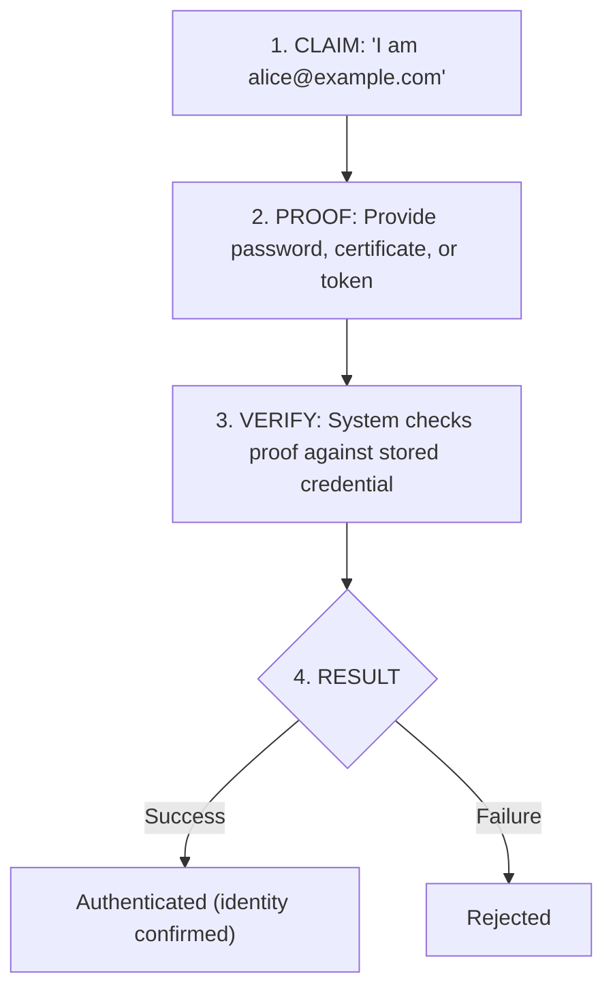
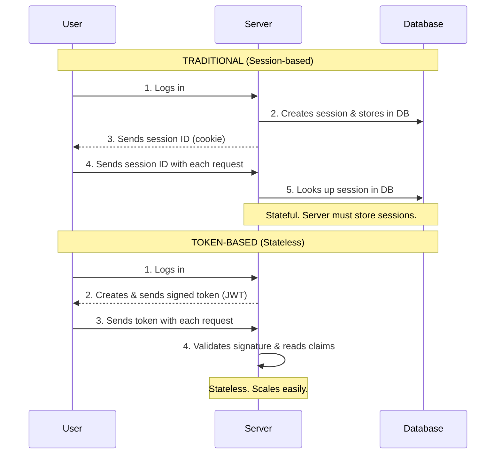
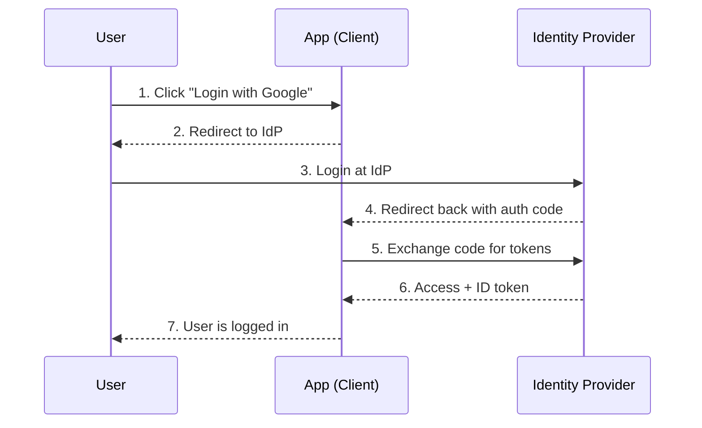
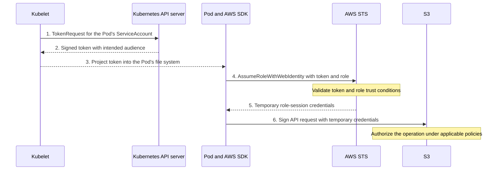

> **Complexity**: `[MEDIUM]`
>
> **Time to Complete**: 90-120 minutes (planning estimate)
>
> **Prerequisites**: [Module 4.2: Defense in Depth](../module-4.2-defense-in-depth/)
>
> **Track**: Foundations

Plan 35–50 minutes for reading, worked examples and inline checks, 15–30 minutes for the scenario quiz and reflection, and 40 minutes for the four-part design exercise. These are suggested allocations, not measured completion times; your background and any tool setup can change the time you need.

## What You'll Be Able to Do

After completing this module, you will be able to:

1. **Design** identity and access management architectures that enforce least privilege across human users, service accounts, and machine identities
2. **Implement** authentication and authorization patterns (OIDC, RBAC, ABAC, short-lived credentials) appropriate for different trust levels
3. **Evaluate** how an IAM configuration reduces lateral-movement risk by auditing permission scope, credential lifetime, and access review processes
4. **Analyze** access-related incidents by separating documented credential and privilege failures from unverified hypotheses, then identifying the evidence needed to assess proposed controls
5. **Compare** workload identity federation against static cloud credentials and justify which to use for a given workload

---

**July 2020. Stolen employee access reaches Twitter's internal tools.**

The [New York State Department of Financial Services investigation, October 2020](https://www.dfs.ny.gov/reports-and-publications/other-reports/Twitter_Report), describes attackers impersonating Twitter's IT help desk by phone to steal employee credentials. The report also explains how attackers persuaded employees to complete application-based MFA during the fraudulent login. Authentication controls existed, but those controls did not prevent access to powerful internal tools (printed pp. 5 and 16).

The report records 130 compromised accounts, of which 45 were used to send tweets (printed p. 7). Its access-management discussion says more than 1,000 employees had access to the internal tools and that Twitter reduced that access after the attack, at an operational cost (printed p. 16). Those observations support examining both authentication strength and the reach of employee privileges; they do not supply a complete permission model for every internal action.

For your own IAM design, ask which identities need sensitive operations, how that access is reviewed, and what happens if one identity is compromised. The report discusses stronger authentication and second-employee approval for high-risk functions as protective measures. Treat those as design options to evaluate against the workflow, rather than assuming an internal tool is safe because its users have already logged in.

This module teaches identity and access management — how to authenticate who someone is, authorize what they can do, scope every permission to the smallest useful surface, and ensure the principle of least privilege limits the damage when (not if) a credential is compromised. By the end you will be able to read an existing IAM design and explain how it reduces the risk and impact of compromised employee access.

---

## Why This Module Matters

Every security incident eventually reduces to a single question: "Who did this, and why were they allowed to?" Forensics teams trace the answer through logs that depend entirely on identity being meaningful, and remediation depends on access being scoped tightly enough that the answer to "why were they allowed to" isn't simply "because everyone was allowed to do everything." If you cannot answer that question crisply for any action in your system, you do not have an IAM system; you have a logging system that records mysteries.

Identity and Access Management (IAM) is the foundation of security. Network controls, encryption, and runtime protections all rest on the assumption that the system can tell who is making a request and decide whether they should be granted it. Get IAM wrong and the strongest network perimeter only delays the attacker; get it right and even a compromised credential triggers a small, contained, auditable blast.

This module teaches you the principles of authentication (proving identity) and authorization (granting access), then builds those principles into concrete patterns: RBAC in Kubernetes, OAuth and OIDC for web applications, ServiceAccount scoping for workloads, and federated workload identity for cloud access. The same conceptual framework applies whether you are securing a Kubernetes cluster, an AWS account, a SaaS admin panel, or an internal microservice — the names of the primitives change, but the questions you must answer about each request do not.

> **The Bouncer Analogy**
>
> A nightclub bouncer does two jobs at the door: check your ID (authentication) and decide if you can enter (authorization). They are different questions handled in sequence. You might present a valid ID and still be turned away because you are not on the guest list, dressed appropriately, or because the venue is at capacity. Inside, a second layer of authorization might decide whether you can enter the VIP room — same person, different resource, different decision. In systems, authentication proves who you are once; authorization decides what you can do many times, on every request.

---

## What You'll Learn

This module is organized as a progression from individual concepts to integrated patterns. Part 1 covers authentication factors and the methods used to prove identity. Part 2 covers authorization models — ACL, RBAC, ABAC — and shows how to debug a real over-privileged Kubernetes binding. Part 3 grounds least privilege in concrete implementation steps. Part 4 explores token-based authentication, JWTs, and OAuth/OIDC. Part 5 covers service identity, ServiceAccount design, and workload identity federation including a concrete IAM trust policy example. Each part builds on the previous one; do not skip ahead, because Part 5 quietly assumes you can already read RBAC fluently.

---

## Part 1: Authentication Fundamentals

### 1.1 What is Authentication?

Authentication answers exactly one question: **"Who are you?"** It is the process of verifying that an entity making a request is actually the entity it claims to be. Authentication does not decide whether the request should succeed, what data the entity can see, or whether the action is wise — it only confirms identity. Conflating it with the other security concerns is one of the most common architectural mistakes in early-career engineers, and untangling that confusion is half the work of becoming senior in this area.

Authentication is a yes/no decision based on a presented claim and a presented proof. The claim is "I am alice@example.com." The proof might be a password, a TLS client certificate, a signed JWT, a fingerprint, or a hardware token's response to a challenge. The system compares the proof to a stored expectation — a hashed password, a public key, a trusted issuer's signature — and either accepts or rejects the claim.

#### Authentication Flow



#### What Authentication Is Not

A successful authentication does not imply a successful action. The system has confirmed Alice is Alice; it has not confirmed Alice may delete the production database, view another user's medical records, or change the company's billing address. A successful authentication also does not log what Alice did — that is auditing, a separate subsystem that consumes the authenticated identity as input. And it does not protect the data in transit between Alice and the server — that is transport encryption, typically TLS, which runs orthogonally to authentication.

| Concern | Question Answered | Subsystem |
|---------|-------------------|-----------|
| Authentication | Who are you? | Identity provider, password store, certificate authority |
| Authorization | What can you do? | RBAC engine, policy engine (OPA), IAM |
| Auditing | What did you do? | Log pipeline, SIEM, audit log |
| Encryption | Can someone read this in transit? | TLS, mTLS, application-layer encryption |

> **Stop and think**: If a user is successfully authenticated, does that mean they can modify any data in the system? Why or why not? Sketch one sentence justifying your answer before reading on. The answer should reference the table above.

### 1.2 Authentication Factors

Authentication factors are categories of proof: something you know, something you have, and something you are. Two passwords are not two factors; they use the same category twice. MFA requires distinct categories, but counting categories alone does not establish resistance to a particular attack. Examine how the proofs are checked, whether an attacker can relay them together, and whether recovery or session handling bypasses the intended protection.

#### Something You Know

Passwords and PINs are knowledge factors. They can be guessed, observed or phished, and a compromised password verifier may expose material for offline guessing. Password reuse can extend the impact to another service. Evaluate password storage, rate limiting and recovery as well as the login form; do not assume that adding another password-like question creates a second factor.

#### Something You Have

Examples include OTP authenticators, cryptographic security keys and smart cards. An attacker need not physically steal a device to misuse its output: a phishing site can relay a manually entered OTP to the legitimate verifier. SMS delivery also has telecommunications-specific risks. A WebAuthn cryptographic authenticator can bind its response to the legitimate relying party, resisting this credential-relay route. Check the protocol and mode in use; a physical token that emits a manually entered OTP does not gain phishing resistance merely from being hardware ([NIST SP800-63B-4, §3.2.5](https://pages.nist.gov/800-63-4/sp800-63b.html#verifimpers)).

#### Something You Are

Fingerprint and facial comparisons are examples of biometric checks. Their outcomes are probabilistic. Biometric characteristics are not secrets and cannot simply be replaced like a password. Protect biometric data and account for comparison errors and recovery. Within [NIST's framework, §3.2.3](https://pages.nist.gov/800-63-4/sp800-63b.html#biometric_use), biometrics are permitted only as part of MFA with a physical authenticator, rather than as a standalone authenticator.

#### Multi-Factor Authentication (MFA)

[MFA combines distinct factor categories](https://pages.nist.gov/800-63-4/sp800-63b.html#authentication-assurance-level-2). A password plus TOTP can stop an attacker who has only the password, but a relay attack can capture both proofs in one interaction. Their compromise probabilities are therefore not automatically independent and cannot be multiplied without a justified model. Phishing-resistant authentication addresses that relay threat; it does not establish that the endpoint, recovery process or an already authorized session is uncompromised.

One authenticator can supply multiple factors. A cryptographic authenticator may require a PIN or biometric activation in addition to possession of its key ([WebAuthn: authenticator factor capabilities](https://www.w3.org/TR/webauthn-3/#sctn-authentication-factor-capability)). A touch indicating user presence is different from user verification: the relying party must [require user verification](https://www.w3.org/TR/webauthn-3/#enum-userVerificationRequirement) and check its result when its assurance policy depends on that additional factor. Passwordless does not by itself mean either single-factor or multi-factor.

### 1.3 Authentication Methods

| Method | Factor | Security | Usability |
|--------|--------|----------|-----------|
| **Password** | Know | Low (if weak) | High |
| **Password + TOTP** | Know + Have | Resists password-only theft; OTP remains phishable | Medium |
| **Password + WebAuthn Key** | Know + Have | Phishing-resistant protocol; recovery and sessions still matter | Medium |
| **Certificate (mTLS)** | Have | High | Low (complex setup) |
| **SSO/OIDC** | Delegated | Depends on IdP | High |
| **Passwordless (WebAuthn)** | Have; Know or Are when user verification is enforced | Phishing-resistant protocol; validate the required verification | Medium-High |

Choose a method against the attack and operational constraints. WebAuthn can provide phishing-resistant authentication, but the browser and relying party must perform the protocol's origin, relying-party and signature checks; the relying party must also validate the required user verification. A hardware OTP token does not provide the same verifier binding. mTLS requires certificate issuance, key protection and trust-store management. SSO/OIDC centralizes authentication at an identity provider, so assess that provider's controls and recovery alongside the downstream application's token checks and authorization. For WebAuthn, also plan supported devices, enrollment and recovery. No method name alone establishes that an application meets its assurance policy.

> **Try This (2 minutes)**
>
> List the authentication methods you use daily:
>
> | Service | Method | Factors | Could be stronger? |
> |---------|--------|---------|-------------------|
> | | | | |
> | | | | |
> | | | | |

---

## Part 2: Authorization Fundamentals

### 2.1 What is Authorization?

Authorization answers a different question: **"What can you do?"** Once authentication has confirmed an identity, authorization runs on every request and decides whether that identity may perform the requested action on the requested resource. Authentication is rare and expensive (it might involve a network call to an IdP); authorization is frequent and cheap (it should be a fast in-memory check against a precomputed policy). Strong authentication does not replace scoped authorization. The Twitter investigation identified weaknesses in both access management and authentication, including employees being persuaded to approve MFA requests (printed p. 16).

Every authorization decision takes four inputs and produces one output. The inputs are the authenticated identity (who), the action (what), the resource (which), and the context (additional factors like time, IP address, or device posture). The output is allow or deny. Designing an authorization system means deciding, for every (who, what, which) triple your system supports, what the answer should be — and how that answer is encoded so that it can be reviewed, audited, and changed without bringing down the system.

| Input | Example | Where It Comes From |
|-------|---------|---------------------|
| WHO | `alice@example.com`, ServiceAccount `frontend-sa` | Authentication subsystem |
| WHAT | `read`, `write`, `delete`, `create` | API request method or RPC name |
| WHICH | `/api/users/123`, `pod/payments-7d` | API request path or resource ID |
| CONTEXT | Time of day, source IP, MFA satisfied | Request metadata, session state |

Concretely, when Alice issues `DELETE /api/users/123`, the authorization layer must check both that Alice has any permission to delete users in general and that she has permission to delete user 123 specifically. The first is a coarse class-level check; the second may require evaluating ownership, organization membership, or a tag on the resource. Confusing class-level and instance-level checks is another common bug — a system may correctly enforce "Alice can delete users" while completely failing to check that the user being deleted is one she should be allowed to touch.

### 2.2 Authorization Models

Three models dominate real-world systems, and you should be able to draw the trade-offs between them on a whiteboard from memory by the end of this section. The models differ in where permissions live, how they scale with user count, and how readable the resulting policies are when an auditor asks "who can delete production secrets?"

#### Access Control List (ACL)

An ACL records access entries on a resource for specified principals, which may be users or groups. In this direct-user example, each entry identifies a user and the actions allowed on the resource:

```text
/api/users:
    alice: read, write
    bob: read
    carol: read, write, delete
```

Direct-user ACLs make a resource's grants visible, but repeated grants across many resources can make joiner, mover and leaver changes harder to review. Count the actual user–permission relationships before comparing approaches: user and application totals alone do not determine that count. Group-based ACLs can also share grants; ACLs and RBAC are not mutually exclusive implementation choices.

#### Role-Based Access Control (RBAC)

Permissions are attached to roles, and users are assigned to roles. Reason about both relationships: which roles may the user use, and which permissions do those roles grant? This is a logical model, not a requirement for two database lookups on every request.

```text
Roles:
    viewer: read
    editor: read, write
    admin: read, write, delete

Assignments:
    alice → editor
    bob → viewer
    carol → admin
```

[NIST's RBAC model](https://csrc.nist.gov/projects/role-based-access-control/faqs) separates user–role and permission–role assignments. Sharing a role can reduce repeated administration when people need the same permissions. A job change still requires removing obsolete memberships, granting the new ones and checking effective access in the affected systems; do not assume every application or existing session updates immediately. A large catalog of specialized roles can itself become difficult to govern, so review both memberships and role permissions.

#### Attribute-Based Access Control (ABAC)

Policies evaluate attributes of the user, the resource, and the context, and deliver a decision per request. ABAC is used in policy engines like AWS IAM and Open Policy Agent.

```text
Policy: "Allow if user.department == resource.owner.department AND time.hour >= 9 AND time.hour < 17"
```

ABAC expresses decisions through attributes, such as a request's time or network context, and policy rules that combine them. More conditions can increase the cases an auditor must inspect. RBAC systems can also impose constraints: NIST's FAQ explicitly permits additional access-time constraints. Inspect the implementation's supported rules and test representative decisions rather than assuming a model name proves which conditions it can enforce.

| Model | Best For | Worst At | Typical Use |
|-------|----------|----------|-------------|
| ACL | Small systems with few resources | Scaling user count | Filesystems, S3 bucket ACLs |
| RBAC | Organizations with stable role catalog | Conditional logic | Kubernetes, enterprise apps |
| ABAC | Fine-grained, conditional policies | Human auditability | AWS IAM conditions, OPA |

> **Hypothetical scenario — pause and predict:** Divide 500 people evenly into five job roles. Each role needs ten specified application-permission bundles across a catalog of 50 applications; a bundle fixes the allowed actions within one application. Every person has exactly one role, with no hierarchy or exceptional grants. How many direct user–bundle relationships would you maintain, compared with user–role plus role–bundle relationships? Count before reading on.

Direct grants require `500 × 10 = 5,000` relationships. RBAC requires `500` memberships plus `5 × 10 = 50` role–bundle grants: `550` relationships for the same effective permissions. These are logical administrative relationships, not API-object counts, measured labor or request latency. Multiple memberships, exceptions and a changing role catalog alter the comparison; fewer relationships alone do not prove least privilege.

### 2.3 RBAC in Practice — A Worked Example

#### Problem Statement

You're the on-call SRE during an incident. Alice, a junior developer on the orders team, needs to look at pod logs in the `production` namespace to help diagnose why orders are timing out. Right now, Alice has no Kubernetes access at all because she joined two weeks ago. Two team members on Slack are pushing different fixes:

- One says: "Just give her cluster-admin for the day, we'll clean up tomorrow."
- The other says: "Add her to the existing `developers` ClusterRole — that's what everyone else uses."

You decide both are wrong, and you're going to scope her access correctly. Walk through the diagnostic process with me.

#### Step 1 — What Action Does She Actually Need?

Start from the action, not from any existing role. Alice needs to read pod logs. In Kubernetes API terms, that is the verbs `get`, `list`, and `watch` on the resource `pods`, plus the verb `get` on the sub-resource `pods/log`. She does not need to create, delete, exec into, or port-forward to pods. She does not need access to secrets, configmaps, or deployments. Writing this down explicitly — before opening any YAML — is the single most important step, because every later decision is a constraint check against this list.

#### Step 2 — What Scope Is Acceptable?

Now ask three scoping questions in order: which namespaces, which resources within them, and for how long. Alice needs the `production` namespace only — not `staging`, not `kube-system`, not the entire cluster. She needs `pods` and `pods/log`, not all resources. She needs access for the duration of the incident, not permanently; in a mature setup we would issue a time-bound binding through a just-in-time access tool, but for now we will note "review and remove tomorrow" as an explicit follow-up.

#### Step 3 — Eliminate the Wrong Suggestions

`cluster-admin` fails on every dimension: wrong scope (cluster, not namespace), wrong actions (everything, not read), wrong duration (permanent unless someone remembers to remove it). The existing `developers` ClusterRole probably fails too, because "what every developer has" is almost certainly broader than "what Alice needs to read logs during one incident" — and granting Alice that role normalizes the over-permission for the next person. Choose the smallest possible binding that solves Alice's actual need.

#### Step 4 — Write the Minimum Viable Binding

```yaml
# Define what actions are allowed (Role, scoped to one namespace)
apiVersion: rbac.authorization.k8s.io/v1
kind: Role
metadata:
  name: pod-reader
  namespace: production
rules:
- apiGroups: [""]
  resources: ["pods", "pods/log"]
  verbs: ["get", "list", "watch"]
---
# Bind role to identity (RoleBinding, scoped to one namespace)
apiVersion: rbac.authorization.k8s.io/v1
kind: RoleBinding
metadata:
  name: alice-read-pods-incident-2025-11-04
  namespace: production
subjects:
- kind: User
  name: alice@example.com
  apiGroup: rbac.authorization.k8s.io
roleRef:
  kind: Role
  name: pod-reader
  apiGroup: rbac.authorization.k8s.io
```

Notice three deliberate choices in this YAML. First, we used `Role` and `RoleBinding`, not their cluster-scoped counterparts — this restricts Alice to the `production` namespace and nothing else. Second, the `resources` list explicitly includes both `pods` and `pods/log`, because in [Kubernetes RBAC](https://kubernetes.io/docs/reference/access-authn-authz/rbac/) a sub-resource like `pods/log` is checked separately and forgetting to grant it is a common bug. Third, the RoleBinding name encodes the date and reason ("incident-2025-11-04") so that a future audit immediately surfaces "what was this for, and is it still needed?"

#### Step 5 — Verify

After applying, verify by impersonating Alice with `kubectl auth can-i`:

```bash
kubectl auth can-i list pods --namespace production --as alice@example.com
# yes

kubectl auth can-i delete pods --namespace production --as alice@example.com
# no

kubectl auth can-i list pods --namespace staging --as alice@example.com
# no
```

If any of those answers were wrong, you would catch it in seconds rather than during the incident. The diagnostic process — action, scope, duration, eliminate, write, verify — is the same one you will apply to every IAM problem in this module, regardless of whether the system is Kubernetes, AWS IAM, or a SaaS product. Internalize the sequence; the tool-specific YAML changes, the diagnostic does not.

---

## Part 3: The Principle of Least Privilege

### 3.1 What is Least Privilege?

The principle of least privilege states that every identity — human or machine — should hold the minimum set of permissions required to perform its function, and no more. The principle is older than computing; [it appears in Saltzer and Schroeder's 1975 paper on protection](https://ieeexplore.ieee.org/document/1451869), where they listed it as one of eight design principles for secure systems. Half a century later it remains the most violated principle in operational practice, because granting permissions is fast and revoking them is uncomfortable, so permissions accumulate by default.

Least privilege matters across three failure scenarios that play out in production every week. When an identity is compromised by an attacker, the blast radius is bounded by what that identity could do — a developer account that can only read its own team's resources cannot exfiltrate the whole company's data even if the attacker holds it for a year. When an authenticated user makes an honest mistake, least privilege limits the mistake's reach: a typo cannot delete what the user could not have deleted on purpose. When an insider acts maliciously, least privilege forces them to either work within their granted scope (limited damage) or visibly request more access (creating an audit trail and an opportunity to intervene).

| Scenario | Without Least Privilege | With Least Privilege |
|----------|------------------------|----------------------|
| Compromised credential | Broad grants can enable wider access | Narrow direct grants; review group grants and indirect powers |
| Honest mistake | Mistake can affect any resource | Mistake is bounded by granted scope |
| Insider threat | Insider can quietly access anything | Insider must request more access, creating evidence |

### 3.2 Implementing Least Privilege

Least privilege is not a setting you toggle; it is a discipline that must be applied at four distinct layers, and skipping any layer leaves a hole that the others cannot patch.

#### Default Deny for Task Access

Deny task-specific access unless a reviewed policy grants it, and document the baseline permissions a new identity receives through platform defaults or shared groups. With [Kubernetes RBAC](https://kubernetes.io/docs/reference/access-authn-authz/authorization/), evaluate all applicable grants rather than treating the absence of a binding named for one identity as proof of zero access. Avoid using an admin role as a placeholder for permissions you have not identified. Review and test the required operations before granting them.

#### Scope Permissions Narrowly

Narrow permissions along three axes simultaneously: action, resource, and context. "Admin" is too broad in every direction. "Editor" narrows the action axis. "Orders-editor" narrows the resource axis as well. "Orders-editor in EU region during business hours" narrows the context axis too. Each axis you narrow shrinks the blast radius further, and the cost of narrowing is one-time design work that pays off forever.

#### Time-Bound Elevated Access

Time-bounded grants can reduce how long elevated operations remain available. Define the window for the task along with approval, renewal and how access ends. Confirm expiry is enforced where authorization is decided, and review standing or bypass routes that the just-in-time workflow does not remove. An authorization grant's lifetime is not necessarily the credential or session lifetime; verify both, including what happens to already issued credentials. Limit permitted operations as well as duration, and plan compromise response separately: expiry does not undo the effects of actions already accepted.

#### Separate Concerns

Separate workload identities let you review and change their grants independently. For example, give the frontend, background job runner and metrics exporter their own ServiceAccounts. This separation can reduce shared access, but it does not by itself isolate every effect of compromise: group grants, workload-creation powers or other credentials can cross the intended boundary. Evaluate the effective permissions and indirect capabilities of each identity.

### 3.3 Common Violations

| Violation | Risk | Fix |
|-----------|------|-----|
| Everyone is admin | Excess privileges across identities | Role-based access |
| Shared credentials | Shared identity weakens individual attribution | Individual accounts and audit context |
| Permanent elevated access | Ongoing exposure | Just-in-time access |
| Over-provisioned service accounts | Broad access on compromise | Minimal permissions per service |
| Forgotten accounts | Dormant attack vector | Regular access reviews |
| Wildcard permissions | Hidden capabilities, surprise on audit | Explicit verb and resource lists |

**Synthetic decision exercise: constrain a release identity.** This is a supplied permission model, not an incident report. A release job must read and patch the existing Deployment `api` in namespace `shop`. It needs no other API operations. Compare these proposed grants for its ServiceAccount:

| Candidate | Grant |
|-----------|-------|
| A | A ClusterRoleBinding to `cluster-admin` |
| B | A RoleBinding in `shop` to a Role allowing `get` and `patch` on `apps`/`deployments`, restricted by `resourceNames: ["api"]` |
| C | A RoleBinding in `shop` to a Role allowing every verb on every resource in every API group |

Choose the smallest grant that meets the stated task. Name two requests it should allow and three it should not authorize. Then consider whether adding that grant would remove access from an existing `cluster-admin` binding. State your reasoning before opening the feedback.

<details>
<summary>Check the grant and its limits</summary>

B meets the supplied requirement: reading and patching `shop/api` are authorized by B. Direct API requests to delete that Deployment, read Secrets, or access a Deployment in another namespace are not authorized by B. This conclusion assumes no other grants: [Kubernetes RBAC permissions are additive](https://kubernetes.io/docs/reference/access-authn-authz/rbac/#role-and-clusterrole), so adding B does not revoke an existing broad binding. Review and remove the unwanted grant separately. The `resourceNames` restriction and namespace scope matter as much as the two verbs; a different release workflow may need a different reviewed permission set. This card checks API authorization reasoning, not whether a patch passes admission or succeeds at runtime. As an engineering inference, patching the Deployment's Pod template can cause its controllers to create Pods that mount Secrets or run as ServiceAccounts in `shop`; review those indirect powers and admission controls too ([RBAC good practices: workload creation](https://kubernetes.io/docs/concepts/security/rbac-good-practices/#workload-creation)).

</details>

---

## Part 4: Token-Based Authentication

### 4.1 How Tokens Work

A web request happens far from the login event that authenticated the user, often on a different server, sometimes minutes or hours later. The system needs a way to remember "this request is from Alice, who logged in earlier." Two patterns dominate: server-side sessions and signed tokens. They differ in where the trust state lives — on the server or in the request itself — and that difference cascades into different operational properties at scale.



Sessions are simple to reason about and easy to revoke — delete the session row and the user is logged out everywhere. They scale poorly because every request requires a database lookup and because the database becomes a coordination point across all your application servers. Signed tokens flip the trade-off: the token carries its own authenticity proof (a signature), so any server can validate it without a database lookup, but revoking a token before it expires is hard precisely because there is no central record to delete. Most production systems pick tokens for their scaling properties and accept the revocation pain — short token lifetimes plus a small revocation list cover most cases.

> **Stop and think**: If a stateless JWT is stolen, can the server invalidate it by simply deleting a session in the database? Why or why not? Sketch your reasoning before reading the next section, which will give you the precise answer.

### 4.2 JSON Web Tokens (JWT)

Here we use the [compact JWS form](https://www.rfc-editor.org/rfc/rfc7515#section-3.1) of a JWT: `HEADER.PAYLOAD.SIGNATURE`. The first two segments encode JSON as base64url; the third encodes signature or MAC bytes, not another JSON object. JWTs can also use an encrypted JWE representation ([RFC 7519, §3](https://www.rfc-editor.org/rfc/rfc7519#section-3)). Decoding a token lets you inspect its fields, but does not establish authenticity or show that the application validates it safely.

#### Header

```json
{
  "alg": "RS256",
  "typ": "JWT"
}
```

The header declares the algorithm and token type, but it is untrusted input until verification succeeds. The application configures acceptable algorithms and the verification library enforces that policy, binding keys to their intended algorithm; it must not select an arbitrary verification method merely because the token requests it. [RFC 8725, §§2.1 and 3.1–3.2](https://www.rfc-editor.org/rfc/rfc8725#section-3.1), describes algorithm-confusion risks and these verification requirements. For the integrity-protected tokens in this lesson, an unexpected `alg: none` must not bypass the configured cryptographic checks.

#### Payload (Claims)

```json
{
  "iss": "https://issuer.example.com",
  "sub": "alice@example.com",
  "aud": "api.example.com",
  "iat": 1700000000,
  "exp": 1700003600,
  "roles": ["editor"]
}
```

The payload contains claims about the subject. Registered names include `sub` (subject), `aud` (audience), `iat` (issued at), `exp` (expiration) and `iss` (issuer). The example uses illustrative identities and historical timestamps, not a live credential. Custom claims can carry application-specific information like roles or tenant IDs. [RFC 7519, §4](https://www.rfc-editor.org/rfc/rfc7519#section-4), leaves required claims to the application profile. For the API profile used here, require an expected issuer and audience plus an acceptable expiration; reject missing or mismatched required claims after cryptographic verification. Bind the verification keys to the expected issuer, as [RFC 8725, §§3.8–3.9](https://www.rfc-editor.org/rfc/rfc8725#section-3.8), requires; matching an `iss` string alone is insufficient.

#### Signature

The third segment can carry an HMAC, such as `HS256`, or a digital signature, such as `RS256` or `ES256`, over the JWS Signing Input. For HMAC, the verifier recomputes a MAC using the shared secret and compares it in constant time. For RSA or ECDSA, it verifies the supplied signature with the corresponding public key; it does not recreate the signature ([RFC 7518, §§3.2–3.4](https://www.rfc-editor.org/rfc/rfc7518#section-3.2)). This distinction controls key distribution: an HMAC verifier has a key that can also produce MACs, while possession of an asymmetric public verification key does not grant signing authority. Compromising the verifier can still defeat that service's own decisions; asymmetric keys do not make the service immune to compromise.

> **CRITICAL**: For the integrity-protected JWT shown here, verify the MAC or signature before trusting claims, then enforce the expected issuer, audience, lifetime and application policy. Decoding the JSON alone performs none of those checks.

### 4.3 OAuth 2.0 and OpenID Connect

[OAuth 2.0 is a delegation protocol](https://www.rfc-editor.org/rfc/rfc6749): it lets a user grant a third-party application limited access to a resource (their email, their photos, their cloud storage) without sharing the password. OpenID Connect (OIDC) is a thin layer on top of OAuth 2.0 that adds an identity claim — the ID token, a JWT — so that applications can use OAuth not just to access resources but to log users in. The two are nearly always discussed together because almost every modern login-with-Google flow uses OIDC, even when developers casually call it "OAuth."



The two-step flow keeps access tokens out of the authorization redirect: the browser carries a short-lived, single-use code, and tokens return in the token endpoint's TLS-protected response ([RFC 6749, §§4.1.2–4.1.3](https://www.rfc-editor.org/rfc/rfc6749#section-4.1.2)). The separate redemption request is where the server checks PKCE and, for confidential clients, client authentication. That exchange is not always server-to-server. Native and browser-only applications are public-client profiles that cannot safely keep a client secret; a protected server component can act as a confidential client and authenticate using its registered method. A client identifier is not a secret ([§§2.1–2.2](https://www.rfc-editor.org/rfc/rfc6749#section-2.1)). Codes can still leak through the browser path, so a leaked code is not automatically harmless ([§10.5](https://www.rfc-editor.org/rfc/rfc6749#section-10.5)).

Proof Key for Code Exchange (PKCE) binds redemption to a transaction-specific verifier. The client generates a fresh, cryptographically random `code_verifier`, sends its derived `code_challenge` and `code_challenge_method=S256` with the authorization request, and supplies the verifier when exchanging the code. The authorization server recomputes the challenge and rejects a mismatch. Under [RFC 9700, §2.1.1](https://www.rfc-editor.org/rfc/rfc9700#section-2.1.1), public clients must use PKCE; it is also recommended for confidential clients.

Explicitly select `S256` so the authorization request does not expose the verifier; omitting `code_challenge_method` defaults to `plain` in [RFC 7636, §4.3](https://www.rfc-editor.org/rfc/rfc7636#section-4.3). PKCE complements confidential-client authentication; it does not turn a public client into one that can keep a secret. The overview diagram omits these checks, redirect-URI validation and other protocol protections; it is not a complete implementation recipe.

**Apply the distinction:** Compare a server-rendered web application with a native app using the authorization-code flow. Which can authenticate with a protected client credential? For the native app, suppose the authorization request used `S256` with verifier A. An attacker intercepts the code and knows the client identifier but not A; the attacker submits verifier B whose derived challenge differs. The code and client identifier are otherwise valid. Predict a conforming token endpoint's response and explain why knowing the client identifier is insufficient before revealing the answer.

<details>
<summary>Check the client boundary and failed exchange</summary>

The server component can protect a client credential; a secret distributed inside a native app cannot provide the same assurance. The native app must use PKCE. In the supplied mismatch case, a conforming server must return `invalid_grant`, as specified in [RFC 7636, §4.6](https://www.rfc-editor.org/rfc/rfc7636#section-4.6), rather than issue tokens. A matching client identifier does not satisfy the verifier check. Confidential clients still need their configured authentication, and a correct verifier alone does not waive the other token-endpoint checks.

</details>

> **Try This (3 minutes)**
>
> Decode only the public example JWT from [RFC 7519, §3.1](https://www.rfc-editor.org/rfc/rfc7519#section-3.1), for example at jwt.io or by decoding its first two segments with an offline base64url decoder. Remove the RFC's display line breaks first. This historical example is expired; do not paste a live credential into a third-party tool. Decoding is inspection, not cryptographic verification. Examine:
> - What's in the header?
> - What claims are in the payload?
> - When does it expire?
> - What would happen if you changed a claim without re-signing?
> - Which trusted key, algorithm and claim checks would you need before accepting it?

---

## Part 5: Service Identity

### 5.1 Machine-to-Machine Authentication

Human authentication and service authentication look superficially similar — both prove identity to a server — but the design constraints diverge sharply. Humans can solve CAPTCHAs, type one-time codes, and tap a hardware key; services cannot. Humans authenticate occasionally and hold a session; services authenticate millions of times per day and benefit from caching. Humans are individuals; services often run as many identical instances behind a load balancer. Designing service authentication as if it were human authentication, or vice versa, produces systems that are simultaneously too inconvenient and too insecure.

| Dimension | Humans | Services |
|-----------|--------|----------|
| Interactivity | Interactive login | Automated, headless |
| Cardinality | One person, multiple sessions | One service, many replicas |
| Verification | Can verify manually if confused | Must be deterministic |
| Credential type | Password + MFA | API key, certificate, federated token |
| Lifetimes to check | Authenticator, session and token policies | Credential, token and role-session policies |

#### Service Authentication Methods

**API Keys** have permissions and lifecycle behavior that depend on the provider and key type. Check which controls exist for the integration. [Stripe's key documentation](https://docs.stripe.com/keys), for example, distinguishes publishable client keys from server-side secret and restricted keys. Its restricted keys allow controlled permissions but still require protection as server-side secrets; Stripe recommends them for most use cases. Secret or restricted keys can be expired or rotated. Stripe's publishable keys cannot perform sensitive server-side operations such as creating charges. Choose the credential type, scope and compromise-response process from the provider's documented capabilities.

**Client Certificates (mTLS)** give each service a cryptographic identity tied to a private key that should never leave the service. They are strong because the key is hard to exfiltrate from a properly configured service, and they support fine-grained revocation through a CRL or OCSP. The cost is operational: you need a working PKI with issuance, rotation, revocation, and trust-store distribution — four sub-systems that fail in interesting ways at scale.

**Short-Lived Tokens** have an acceptance window bounded by enforced expiry. A compatible runtime or SDK can obtain replacements, but that refresh path must be configured and available. Expiration of a leaked token does not undo actions already taken or necessarily end a cloud session obtained with it; continuing workload compromise may expose replacement tokens. Kubernetes projected ServiceAccount tokens and cloud federation integrations such as AWS IRSA use this pattern, with different token and session lifetimes. Prefer the pattern when supported, while checking trust scope, permissions, refresh behavior and compromise response rather than assuming expiry alone contains the damage.

### 5.2 Kubernetes Service Accounts — A Worked Example

#### Problem Statement

A new developer pages you at 3am. Their `payments-api` Pod in the `production` namespace is in `CrashLoopBackOff`. The container logs show:

```
FATAL: failed to load configuration from ConfigMap 'payments-config': forbidden
```

Two suggestions appear in the chat:

- "Add `cluster-admin` to the default ServiceAccount, just for tonight."
- "Use the same ServiceAccount as the `orders-api` Pod — that one already works."

Both suggestions change access before establishing the required scope, and reusing another ServiceAccount may not even permit this read. Walk through the diagnostic process before choosing a grant.

#### Step 1 — What Is the Pod Actually Asking For?

Read the error before changing anything. It reports a forbidden request for the named ConfigMap `payments-config`; confirm the actual verb, identity and namespace from the request or audit evidence. The intended operation in this example is a `get` for that named object. A denial describes the checked request, not the identity's entire permission set, so establish the required scope before considering a broad administrative grant.

#### Step 2 — What ServiceAccount Is the Pod Currently Using?

```bash
kubectl get pod payments-api -n production -o jsonpath='{.spec.serviceAccountName}'
# default
```

The Pod selects the [namespace's `default` ServiceAccount](https://kubernetes.io/docs/reference/access-authn-authz/service-accounts-admin/). That name does not establish its permissions: bindings may grant access to this ServiceAccount or its groups, including built-in discovery permissions. Inspect applicable RoleBindings and ClusterRoleBindings and confirm the actual request identity. The reported error for this ConfigMap does not establish the account's other grants.

#### Step 3 — What Are the Two Suggestions Doing Wrong?

Binding `cluster-admin` to the default ServiceAccount exceeds the named ConfigMap read and expands grants for other workloads using that same identity. Reusing the `orders-api` ServiceAccount may also grant unrelated permissions and couples the workloads' access changes. Its shared name alone cannot distinguish the workloads in an audit record; look for Pod binding and audit metadata rather than assuming attribution is impossible or relying only on the ServiceAccount name. A dedicated identity makes it easier to review the payments workload's grants independently.

#### Step 4 — Build the Minimum Viable ServiceAccount

The correct fix is a dedicated ServiceAccount with the smallest possible Role.

```yaml
# Service Account with minimal permissions
apiVersion: v1
kind: ServiceAccount
metadata:
  name: payments-api
  namespace: production
---
# Role with only the needed permission, scoped to one ConfigMap by name
apiVersion: rbac.authorization.k8s.io/v1
kind: Role
metadata:
  name: payments-api-config-reader
  namespace: production
rules:
- apiGroups: [""]
  resources: ["configmaps"]
  resourceNames: ["payments-config"]
  verbs: ["get"]
---
# Bind service account to role
apiVersion: rbac.authorization.k8s.io/v1
kind: RoleBinding
metadata:
  name: payments-api-binding
  namespace: production
subjects:
- kind: ServiceAccount
  name: payments-api
  namespace: production
roleRef:
  kind: Role
  name: payments-api-config-reader
  apiGroup: rbac.authorization.k8s.io
---
# Pod using the service account
apiVersion: v1
kind: Pod
metadata:
  name: payments-api
  namespace: production
spec:
  serviceAccountName: payments-api
  automountServiceAccountToken: true  # The app legitimately needs API access
  containers:
  - name: app
    image: payments-api:v1
```

Three choices in this YAML express the intended access. `resourceNames: ["payments-config"]` limits this Role's `get` grant to the named ConfigMap. The Role grants neither `list` nor `watch`, because the application reads that object once at startup. The explicit `automountServiceAccountToken: true` documents that the workload needs API credentials. These statements describe this Role and Pod configuration; RBAC grants are additive, so a different binding can still expand the identity's effective permissions. Remove unwanted broad grants rather than expecting this narrower Role to override them.

#### Step 5 — Verify

Run the following as an operator authorized to impersonate this ServiceAccount. The comments show expected answers for these resources when no other grants expand the example's scope, not a recorded cluster execution. An impersonation error or failed review request is an evidence gap, not the expected `no` answer.

```bash
kubectl auth can-i get configmap/payments-config -n production --as system:serviceaccount:production:payments-api
# yes

kubectl auth can-i list configmaps -n production --as system:serviceaccount:production:payments-api
# no

kubectl auth can-i get secrets -n production --as system:serviceaccount:production:payments-api
# no
```

These checks sample three authorization requests; they do not prove that the Pod can do nothing else. Inspect all applicable bindings and group grants, test the workload's required and prohibited actions, and distinguish authorization reviews from actual runtime behavior. A namespace-wide `get secrets` check also does not enumerate every possible name-restricted grant: review and test relevant named objects. The objective is evidence that the effective access matches the intended scope, not a containment guarantee inferred from three answers.

### 5.3 Workload Identity

Consider a service running in Kubernetes that needs a cloud API such as S3. Storing a static cloud credential in a Kubernetes Secret makes its distribution, access and rotation part of your design. Access may be direct or indirect through permission to create a workload that mounts the Secret. The credential's permissions and lifetime determine the exposure if it leaks. [Workload federation can avoid distributing a static cloud credential](https://docs.aws.amazon.com/eks/latest/best-practices/identity-and-access-management.html), while still requiring protection of workload tokens and temporary credentials. The following diagram shows the AWS IRSA path. EKS also offers Pod Identity with a different agent-based credential flow; compare the integrations rather than treating IRSA as the only option.



For a [projected ServiceAccount token](https://v1-35.docs.kubernetes.io/docs/tasks/configure-pod-container/configure-service-account/#serviceaccount-token-volume-projection), the kubelet requests the token from the API server on the Pod's behalf and makes it available through a projected volume. The application or compatible SDK then uses that already-issued token in the cloud exchange. In IRSA, STS validates the token against the configured issuer and role trust conditions before returning temporary credentials. Permission to assume a role is distinct from permission to perform an S3 operation; review the role's permissions and applicable policies separately.

#### Concrete Example: AWS IRSA Trust Policy

The IAM role's trust policy constrains which federated identity may assume it. In this example, the issuer, audience and exact namespace/ServiceAccount subject must match. A token with a different subject fails these conditions, but a stolen token that satisfies them may still be exchanged. Inspect the complete policy for other allowed principals or statements, and check who can obtain tokens for the trusted ServiceAccount; this one statement does not prove that every route to the role is constrained.

Here is the trust policy for an IAM role named `payments-api-s3-reader`, intended to be assumed only by the `payments-api` ServiceAccount in the `production` namespace of an EKS cluster:

```json
{
  "Version": "2012-10-17",
  "Statement": [
    {
      "Effect": "Allow",
      "Principal": {
        "Federated": "arn:aws:iam::123456789012:oidc-provider/oidc.eks.us-east-1.amazonaws.com/id/EXAMPLED539D4633E53DE1B71EXAMPLE"
      },
      "Action": "sts:AssumeRoleWithWebIdentity",
      "Condition": {
        "StringEquals": {
          "oidc.eks.us-east-1.amazonaws.com/id/EXAMPLED539D4633E53DE1B71EXAMPLE:sub": "system:serviceaccount:production:payments-api",
          "oidc.eks.us-east-1.amazonaws.com/id/EXAMPLED539D4633E53DE1B71EXAMPLE:aud": "sts.amazonaws.com"
        }
      }
    }
  ]
}
```

Read this policy slowly because every clause does load-bearing work. The `Federated` principal names exactly which OIDC issuer is trusted — the cluster's own OIDC endpoint. The `Condition` block then narrows the trust to a single ServiceAccount: the `sub` claim must be `system:serviceaccount:production:payments-api`, meaning a token from the `default` namespace, the `staging` namespace, or any other ServiceAccount in `production` will fail the condition even though it comes from a trusted issuer. The `aud` claim must be `sts.amazonaws.com`, which prevents a token issued for some other audience (say, an internal service-to-service call) from being replayed against AWS STS.

The corresponding Kubernetes-side configuration annotates the ServiceAccount with the IAM role to assume:

```yaml
apiVersion: v1
kind: ServiceAccount
metadata:
  name: payments-api
  namespace: production
  annotations:
    eks.amazonaws.com/role-arn: arn:aws:iam::123456789012:role/payments-api-s3-reader
```

With IRSA configured, its mutating webhook [injects environment variables (`AWS_ROLE_ARN`, `AWS_WEB_IDENTITY_TOKEN_FILE`)](https://docs.aws.amazon.com/eks/latest/best-practices/identity-and-access-management.html) into Pods using this ServiceAccount. A compatible AWS SDK credential provider can use them to exchange the projected token through `sts:AssumeRoleWithWebIdentity`. The returned credentials default to a one-hour session, but the requested duration and role settings can change that ([STS Session Duration](https://docs.aws.amazon.com/STS/latest/APIReference/API_AssumeRoleWithWebIdentity.html)). This flow needs no static AWS access key, but it still handles a projected token and temporary AWS credentials with distinct lifetimes. A stolen token that continues to satisfy the trust checks may obtain another role session; continuing Pod compromise may also expose refreshed tokens. Expiration alone therefore does not establish that access or all effects of misuse stop after one hour. Review credential exposure, trust conditions, role permissions and containment separately.

The trust idea transfers to other providers, but the integration details differ. [Workload Identity Federation for GKE](https://docs.cloud.google.com/kubernetes-engine/docs/concepts/workload-identity#credential-flow) uses the GKE metadata server and can grant access directly to a Kubernetes workload principal or use IAM service account impersonation. GKE can treat matching namespace and ServiceAccount names across clusters in one project's workload identity pool as the same identity, so check that cross-cluster trust boundary. [Microsoft Entra Workload ID on AKS](https://learn.microsoft.com/en-us/azure/aks/workload-identity-overview) uses projected ServiceAccount tokens, federated identity credentials and supported Azure Identity or MSAL libraries. Follow the provider's credential flow and authorization model rather than copying an IRSA annotation. In each design, check both which workload identity is trusted and which operations it can authorize.

---

## Did You Know?

- **An OIDC ID token is not automatically an API access token.** [OpenID Connect Core, §2](https://openid.net/specs/openid-connect-core-1_0.html#IDToken) defines the ID token's authentication claims for the client; its audience must include that client's identifier. An OAuth access token has the resource-access role described in [RFC 6750, §1.3](https://www.rfc-editor.org/rfc/rfc6750#section-1.3). Each consumer must validate the token expected by its protocol and endpoint. Merely decoding a JWT does not establish that it has the right purpose, audience or permissions.

- **TOTP's time step and acceptance window are distinct settings.** [RFC 6238, §§3–6](https://www.rfc-editor.org/rfc/rfc6238.html#section-3) defines a configurable time-step parameter with a 30-second default. The authenticator and verifier must agree on that parameter. The step size contributes to the validity window, while verifier policy determines which time steps are accepted for delay and clock drift. The RFC recommends allowing at most one time step for network delay; its drift examples are not a universal tolerance. The verifier must also reject replay of an OTP after successful validation, so a time-based code is not an unrestricted reusable password throughout its acceptance window.

- **Projected tokens need refresh and application reload.** In [Kubernetes 1.35 token projection](https://v1-35.docs.kubernetes.io/docs/tasks/configure-pod-container/configure-service-account/#serviceaccount-token-volume-projection), the kubelet refreshes the token file and the application must reload it. The [`--service-account-extend-token-expiration` compatibility flag](https://v1-35.docs.kubernetes.io/docs/reference/command-line-tools-reference/kube-apiserver/#options), enabled by default in 1.35, can extend the default Pod-bound API-access token added by the ServiceAccount admission controller up to a year. That extension is [conditional on the request and API-server audiences](https://github.com/kubernetes/kubernetes/blob/v1.35.0/pkg/registry/core/serviceaccount/storage/token.go#L229-L237); it does not apply to every projected token or automatically to an IRSA token for the STS audience. Inspect the actual request, issuer settings and token claims rather than assuming a universal one-hour validity or refresh interval. [Secret-backed legacy tokens can still exist](https://v1-35.docs.kubernetes.io/docs/reference/access-authn-authz/service-accounts-admin/#manual-secret-management-for-serviceaccounts), so inspect the actual credential source.

- **NIST's current password policy prohibits mandatory scheduled changes.** For centrally verified passwords used as authentication factors, [NIST SP 800-63B-4, §3.1.1](https://pages.nist.gov/800-63-4/sp800-63b.html#password) prohibits conforming verifiers from imposing character-composition rules or mandatory periodic password changes, while requiring a forced change when there is evidence of compromise. It also requires checking prospective passwords against a blocklist of commonly used, expected or compromised values. Local authenticator activation secrets have separate requirements.

---

## Common Mistakes

| Mistake | Problem | Solution |
|---------|---------|----------|
| Same password everywhere | One breach compromises all accounts | Unique passwords plus password manager |
| No MFA on critical systems | Password-only login is exposed to credential reuse and phishing | MFA; phishing-resistant authentication such as WebAuthn for admins; protect recovery |
| Overly broad roles ("admin for convenience") | More access than needed, large blast radius on compromise | Granular, purpose-specific roles |
| Unplanned credential lifecycle | Leak impact and replacement may be poorly controlled | Document type-specific policy, scope and compromise response; test supported expiry, rotation or refresh |
| Shared service accounts across workloads | Shared names weaken workload attribution; coupled permission changes | One ServiceAccount per workload; review group grants and audit context |
| No periodic access review | Permissions accumulate, dormant accounts persist | Quarterly reviews, automated unused-permission detection |
| Wildcards in role rules (`verbs: ["*"]`) | Hidden capabilities granted by future API additions | Explicit verb and resource lists |
| Static cloud credentials in Pods | Long-lived secret in a high-blast-radius location | Workload identity federation |

---

## Quiz

1. **An API gateway accepts access tokens issued by Okta. For this case, assume the application has authenticated the caller and the token's cryptographic and required-claim checks succeed. The caller has no administrative permission but reaches an administrative endpoint. Which decision must you investigate, and why would signature verification alone be insufficient evidence?**
   <details>
   <summary>Answer</summary>

   Under those assumptions, investigate authorization: how the caller's roles or scopes map to the requested administrative action, and where that policy is enforced. Signature verification alone would not establish the required claims, a legitimate bearer-token presenter, or permission for this endpoint. The gateway must enforce the action-and-resource policy before forwarding a request to the backend. Validate the policy with both allowed and denied test cases. Successful authentication and token validation supply inputs to authorization; they do not replace that decision.
   </details>

2. **Synthetic comparison: An attacker knows a user's password but has no authenticator output, session cookie or endpoint access. Compare a password-plus-TOTP login with passwordless WebAuthn requiring PIN or biometric user verification. What does each stop under those assumptions, what changes if the attacker relays a phishing login, and what evidence would you need before declaring the account protected?**
   <details>
   <summary>Answer</summary>

   With both factors enforced and no weaker recovery route, the password alone is insufficient for the TOTP login. The attacker also lacks the authenticator key and required user verification for the WebAuthn login. A phishing relay can nevertheless forward a victim's password and current OTP without stealing the phone; manually entered OTPs do not bind the proof to the intended verifier. WebAuthn's relying-party binding resists that route, while user verification establishes the additional local activation check. Inspect the relying party's verification policy, recovery and authenticator-enrollment paths, session controls and endpoint exposure. Test the allowed and rejected cases instead of inferring complete account security or a numerical reduction in compromise from factor counting.
   </details>

3. **Scenario: You are auditing a Kubernetes cluster and notice that the CI/CD pipeline's ServiceAccount has cluster-admin privileges, even though it only deploys to the 'frontend' and 'backend' namespaces. Walk through the diagnostic process you would use to fix this and produce the minimum viable RBAC configuration.**
   <details>
   <summary>Answer</summary>

   Inventory the pipeline's actual requests and map each to its verb, API group, resource and namespace before writing YAML. Propose a Role and RoleBinding for each namespace with the permissions that the observed workflow requires. Prepare and test these narrower grants using a separate test identity or a coordinated cutover. Remove unwanted broad bindings before evaluating the final identity's restricted access; adding narrower Roles does not subtract existing permissions. Then test required operations and prohibited actions on that final identity. Creating a Deployment in `frontend` and creating a Role in `kube-system` are useful allowed/denied samples, not proof of a minimal configuration. Review every effective binding and consider indirect powers such as choosing Pod templates or ServiceAccounts through workload permissions. Explain what each check establishes and what still needs evidence.
   </details>

4. **Synthetic decision: An order-processing Pod needs read access only to an archive bucket's `orders/` prefix. Option A stores a static cloud credential in a Kubernetes Secret with a planned 90-day rotation. Option B exchanges a projected ServiceAccount token for temporary cloud credentials through a supported federation integration. Assume both options grant exactly the required bucket permissions. Which would you choose, what trust configuration must you check, and what changes if a credential leaks or the Pod remains compromised?**
   <details>
   <summary>Answer</summary>

   Prefer B when the platform and application support the integration: it avoids distributing a static cloud credential and obtains temporary credentials for an identified workload. Verify the trusted issuer and signing keys, intended audience, and subject binding to the exact namespace and ServiceAccount. Check the resulting cloud permissions independently; federation does not make an overly broad role safe. Also check how the integration refreshes credentials and what happens when the exchange fails. For IRSA, verify that the Pod cannot also obtain broader node-role credentials through instance metadata. A may be a constrained fallback for an unsupported integration, but the design must then account for secret distribution, rotation and revocation. Planned rotation after 90 days is not a reason to wait after a leak.

   A shorter lifetime reduces the remaining acceptance window of that particular credential if expiry is enforced. It does not bound all resulting damage: an attacker may perform a persistent action if granted permissions allow it, or obtain another session while a leaked projected token still satisfies the trust checks. Continued Pod compromise may expose replacement tokens, as the IRSA example explains. Revoke or restrict compromised access using the relevant provider's controls, remove the compromise, and investigate what was authorized. Token expiry and access already granted to a cloud session are different boundaries. For a JWT with an `exp` claim, [RFC 7519, §4.1.4](https://www.rfc-editor.org/rfc/rfc7519#section-4.1.4), defines the expiration check, not a guarantee that all effects of misuse disappear at that time.
   </details>

5. **In §2.2's hypothetical scenario, compare direct grants with RBAC for 500 people, five job roles and ten application-permission bundles per role. Which assumptions make the counts valid? When someone changes jobs, what must you change and verify before claiming their access is correct?**
   <details>
   <summary>Answer</summary>

   With one role per person and no hierarchy or exceptions, direct user–bundle grants total `500 × 10 = 5,000`. RBAC stores `500` user–role memberships and `5 × 10 = 50` role–bundle grants, totaling `550` logical relationships for the same permissions. This illustrates shared administration, not an automatic security or performance improvement. Remove obsolete role memberships and add only the required new ones; inspect other grants and check effective allowed and denied actions in the affected systems. Account for application-specific session, token and policy-update behavior before declaring old access gone. Additional memberships or exceptions change both the count and the review work.
   </details>

6. **Using the NYDFS investigation's findings on the 2020 Twitter attack, separate documented observations from hypotheses about excessive permissions, missing audit trails or credential reuse. Propose controls that reduce the risk of stolen employee access reaching or misusing sensitive internal tools. Which findings support your choices, and what additional evidence would you request before claiming protection?**
   <details>
   <summary>Answer</summary>

   The report describes phishing and employees approving application-based MFA, then recommends stronger authentication and access controls (printed pp. 5 and 16). Propose phishing-resistant authentication, narrower job-based access with periodic reviews, and second-employee approval for high-risk operations. The report identifies those controls as protective directions, rather than documenting a complete permission scheme for each Twitter action. Evaluate where authentication is enforced, which operations each role can perform, how approvals are bound to the intended action, and how sessions are protected and monitored. A phishing-resistant protocol such as WebAuthn can resist credential relay; it does not establish that malware cannot misuse an already authorized session. Treat the proposals as risk reduction and test their enforcement before claiming containment.

   A strong answer also uses the reported access for more than 1,000 employees and the operational cost of reducing it (printed p. 16) to motivate reviewing privilege scope. The report concludes that access management and authentication failed to keep the attackers from powerful internal tools, but the access count alone does not prove that a particular employee role was excessive. The cited pages do not establish that missing audit trails or password reuse caused the attack. Printed p. 17 argues that stronger monitoring would have enabled faster detection and discusses audit-trail requirements; it does not inventory which Twitter logs existed. Request role-to-operation mappings, access-review records, authentication and sensitive-action logs, and session evidence to test those hypotheses; do not label an unexamined control as absent. Distinguish stolen credentials from an unsupported claim that an employee reused a password across systems.
   </details>

7. **An attacker obtains a JWT bearer access token with `exp: 1700003600`; the current Unix time is `1700000000`. Assume its signature, issuer and audience are valid, and ignore clock skew. What is its remaining lifetime under the expiration check? Does a valid signature prove the presenter is legitimate, or prevent earlier rejection and detection?**
   <details>
   <summary>Answer</summary>

   The expiration calculation is `1700003600 − 1700000000 = 3,600 seconds`, or one hour. That is the remaining window under the stated expiration assumptions, not a promise of uninterrupted access: revocation, changed authorization policy or other checks can reject a request earlier. A bearer token's possession is sufficient to use it in the same ways as another holder, subject to the application's checks ([RFC 6750, §1.2](https://www.rfc-editor.org/rfc/rfc6750#section-1.2)). Signature verification checks token integrity under the configured key; it does not authenticate the current presenter. Applications can still use session state, revocation data and request telemetry to detect or respond to suspicious use. A JWT format does not make detection impossible. Ordinary refresh-token rotation does not itself require user re-authentication, but detected replay can trigger refresh-token revocation and require a fresh authorization grant ([RFC 9700, §4.14.2](https://www.rfc-editor.org/rfc/rfc9700#section-4.14.2)).
   </details>

8. **Synthetic scenario: A compromised Nginx Pod lists Secrets in its own namespace through the Kubernetes API. Audit evidence identifies its ServiceAccount as the caller in this RBAC-controlled scenario. Which authentication and authorization conditions enabled the request, what evidence would you inspect, and how would you reduce exposure without assuming token automount alone granted the access?**
   <details>
   <summary>Answer</summary>

   A usable credential authenticated the ServiceAccount, and its effective authorization allowed `list` on Secrets in that namespace. A mounted token alone does not grant that permission. Inspect the Pod's ServiceAccount and actual credential sources, the audit request, and applicable bindings for the account and its groups. Trace and remove the excessive grant instead of merely adding a narrower Role. Listing Secrets can expose their contents, so treat this as credential exposure and investigate which data and downstream access were affected.

   If the workload needs no Kubernetes API access, disable default token automount and verify newly created replacement Pods; changing the template or ServiceAccount setting does not remove the volume from an existing Pod. The Pod setting can override the ServiceAccount setting, and explicit projected tokens or other credentials may still be present. This change does not revoke an already exposed credential or remove the running compromise: address both separately. If API access is needed, grant only the required operations and scope, then test representative allowed and denied requests and review indirect privileges. Use `resourceNames` where the operation supports it; it is not a universal restriction for every verb.
   </details>

---

## Hands-On Exercise

**Task**: Design an IAM strategy for a microservices application end-to-end, then express the most security-sensitive piece in real Kubernetes RBAC.

**Scenario**: You're building an e-commerce platform with the following components:

- Web frontend (user-facing, served via CDN)
- API gateway (terminates TLS, authenticates users, routes to services)
- Order service (creates and updates orders)
- Inventory service (tracks stock levels)
- Payment service (talks to Stripe, holds card-on-file tokens)
- PostgreSQL database (orders, inventory, users)
- Redis cache (sessions, rate-limit counters)

The exercise has four parts and an explicit success criteria checklist. Work through them in order — the later parts depend on decisions you make in the earlier ones.

**Part 1: User Authentication (10 minutes)**

Design the user authentication flow. For each component, decide which method and how many factors. Justify your choices in a sentence.

| Component | Authentication Method | Factors |
|-----------|----------------------|---------|
| Web login | | |
| API access | | |
| Admin panel | | |

**Part 2: Service Authorization (10 minutes)**

Design service-to-service permissions. For each row, write the minimum set of calls required and explicitly note one thing each service must NOT be able to do.

| Service | Can Access | Permissions | Cannot Access |
|---------|------------|-------------|---------------|
| API Gateway | Order Service | read, write | |
| Order Service | | | |
| Inventory Service | | | |
| Payment Service | | | |

**Part 3: Database Access (10 minutes)**

Design database access. Each service should have its own database role with the smallest possible grant.

| Service | Database Access | Tables | Operations |
|---------|-----------------|--------|------------|
| Order Service | PostgreSQL | orders, order_items | SELECT, INSERT, UPDATE |
| | | | |
| | | | |

**Part 4: Kubernetes RBAC (10 minutes)**

Write a ServiceAccount, Role, and RoleBinding for the Order Service. Apply the worked-example diagnostic from Part 2.3: name the actions first, scope them, and only then write YAML. Include a comment on `automountServiceAccountToken` justifying your choice.

```yaml
# Your YAML here
```

**Success Criteria**:
- [ ] User authentication uses MFA for any operation that can move money or change account ownership
- [ ] Each service has only the permissions it needs, expressed as explicit verb/resource lists
- [ ] No service has more database access than required, and the Payment service does not share a database role with Order
- [ ] Kubernetes RBAC follows least privilege, scopes to the namespace, and the YAML's `automountServiceAccountToken` setting is explicit and commented
- [ ] You can explain in one sentence what would still be safe if any single service were compromised

---

## Further Reading

- **"OAuth 2.0 Simplified"** — Aaron Parecki. The clearest available explanation of OAuth flows, written by an author who has been involved in the standards work for a decade.
- **"Identity and Data Security for Web Development"** — Jonathan LeBlanc. A practical, code-first guide to implementing authentication and authorization in real systems.
- **NIST SP800-63B-4** — Current Authentication and Authenticator Management guidance. Use it for assurance levels, factor requirements, password-verifier policy and phishing resistance.

---

## Key Takeaways Checklist

Before moving on, verify you can answer these from memory rather than by scrolling back:

- [ ] Can you explain the difference between authentication (who are you?) and authorization (what can you do?) in one sentence each?
- [ ] Can you describe the three factor categories, distinguish OTP relay from phishing-resistant authentication, and explain why factor counting alone does not prove account security?
- [ ] Do you understand RBAC versus ACL versus ABAC and the conditions under which each one is the right choice?
- [ ] Can you walk through the diagnostic process for fixing an over-permissioned binding (action → scope → eliminate → minimum YAML → verify)?
- [ ] Can you implement the principle of least privilege across its four layers (default deny, scope narrowly, time-bound, separate concerns)?
- [ ] Can you distinguish a stolen token's remaining acceptance window from persistent effects and access to replacement credentials?
- [ ] Can you explain OAuth 2.0 and OIDC flows, and specifically why the auth-code-then-tokens two-step exists?
- [ ] Do you understand Kubernetes ServiceAccounts well enough to know when to disable `automountServiceAccountToken` and when to leave it on?
- [ ] Can you read an AWS IRSA trust policy and identify which clauses bind it to a specific ServiceAccount in a specific namespace?
- [ ] Can you justify federation or a static credential for a workload, including trust scope, permissions, refresh behavior and compromise response?
- [ ] Can you separate documented incident findings from hypotheses and name the records needed to evaluate a proposed control?

---

## Sources

- [New York State Department of Financial Services: Twitter Investigation Report (October 2020)](https://www.dfs.ny.gov/reports-and-publications/other-reports/Twitter_Report) — Employee credential attack, account impact and access-management findings; see printed pp. 5, 7 and 16.
- [NIST SP 800-63B-4: Authentication and Authenticator Management](https://pages.nist.gov/800-63-4/sp800-63b.html) — Factor categories, password-verifier policy, biometric use, phishing resistance and authenticator activation; see §§2.2, 3.1.1, 3.1.7, 3.2.3 and 3.2.5.
- [NIST: RBAC Frequently Asked Questions](https://csrc.nist.gov/projects/role-based-access-control/faqs) — User–role and permission–role assignments, group/ACL relationships and additional access-time constraints; see General and Component summary.
- [W3C WebAuthn](https://www.w3.org/TR/webauthn-3/) — User presence and verification (§4), verification requirements (§5.8.6), factor capability (§6.2.3) and relying-party checks (§§7.1–7.2).
- [Kubernetes RBAC Authorization](https://kubernetes.io/docs/reference/access-authn-authz/rbac/) — Primary upstream reference for Roles, RoleBindings, subresources, and least-privilege Kubernetes access.
- [Kubernetes RBAC Good Practices: Workload Creation](https://kubernetes.io/docs/concepts/security/rbac-good-practices/#workload-creation) — Workload permissions can expose mounted resources and ServiceAccount privileges indirectly.
- [Managing Kubernetes ServiceAccounts](https://kubernetes.io/docs/reference/access-authn-authz/service-accounts-admin/) — Covers ServiceAccount identity, token projection, TokenRequest, and legacy token behavior.
- [RFC 6749: OAuth 2.0 Authorization Framework](https://www.rfc-editor.org/rfc/rfc6749) — Defines OAuth 2.0 roles and authorization-code flow used in the module.
- [RFC 7515: JSON Web Signature, §3.1](https://www.rfc-editor.org/rfc/rfc7515#section-3.1) — Compact serialization and the bytes protected by a signature or MAC.
- [RFC 7518: JSON Web Algorithms, §§3.2–3.4](https://www.rfc-editor.org/rfc/rfc7518#section-3.2) — HMAC comparison and RSA/ECDSA public-key verification.
- [RFC 7519: JSON Web Token](https://www.rfc-editor.org/rfc/rfc7519) — JWT representations, the public example and expiration semantics.
- [RFC 6750: Bearer Token Usage, §§1.2–1.3](https://www.rfc-editor.org/rfc/rfc6750#section-1.2) — Possession-based bearer-token semantics and protected-resource access.
- [OpenID Connect Core 1.0, §§2 and 3.1.3.7](https://openid.net/specs/openid-connect-core-1_0.html#IDToken) — ID-token purpose, audience and client validation.
- [RFC 6238: Time-Based One-Time Passwords, §§3–6](https://www.rfc-editor.org/rfc/rfc6238.html#section-3) — Configured time step, default value, verifier delay/drift windows and replay rejection.
- [AWS STS AssumeRoleWithWebIdentity: Session Duration](https://docs.aws.amazon.com/STS/latest/APIReference/API_AssumeRoleWithWebIdentity.html) — Default and configurable lifetime of the returned role-session credentials.
- [Stripe: API Key Types and Lifecycle](https://docs.stripe.com/keys) — Publishable versus server-side keys, restricted permissions, expiry and rotation.
- [RFC 7636: Proof Key for Code Exchange](https://www.rfc-editor.org/rfc/rfc7636) — Authorization-code interception threat, verifier/challenge binding and token-endpoint verification.
- [RFC 9700: Best Current Practice for OAuth 2.0 Security, §2.1.1](https://www.rfc-editor.org/rfc/rfc9700#section-2.1.1) — PKCE requirements for public clients and recommendations for confidential clients.
- [Amazon EKS Identity and Access Management Best Practices](https://docs.aws.amazon.com/eks/latest/best-practices/identity-and-access-management.html) — Explains IRSA, projected service account tokens, trust-policy scoping, and injected AWS identity environment variables.
- [Kubernetes 1.35: ServiceAccount Token Projection](https://v1-35.docs.kubernetes.io/docs/tasks/configure-pod-container/configure-service-account/#serviceaccount-token-volume-projection) — Kubelet requests, projection, rotation and application reload responsibilities.
- [Kubernetes 1.35: kube-apiserver options](https://v1-35.docs.kubernetes.io/docs/reference/command-line-tools-reference/kube-apiserver/#options) — Configured token lifetime and compatibility expiration extension.
- [Kubernetes v1.35.0: Bound TokenRequest Expiration Handling](https://github.com/kubernetes/kubernetes/blob/v1.35.0/pkg/registry/core/serviceaccount/storage/token.go#L229-L237) — Pod binding, requested-duration and API-audience conditions for compatibility extension.
- [Google Cloud: Workload Identity Federation for GKE](https://docs.cloud.google.com/kubernetes-engine/docs/concepts/workload-identity#credential-flow) — Metadata-server credential flow and direct workload access versus impersonation.
- [Microsoft: Entra Workload ID on AKS](https://learn.microsoft.com/en-us/azure/aks/workload-identity-overview) — Projected-token federation and supported authentication libraries.

## Next Module

[Module 4.4: Secure by Default](../module-4.4-secure-by-default/) — Building security into systems from the start, not bolting it on later.
