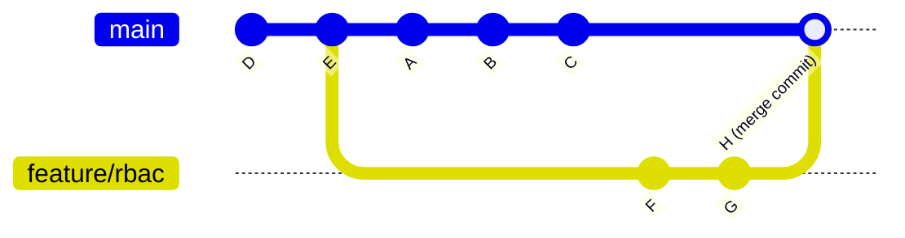
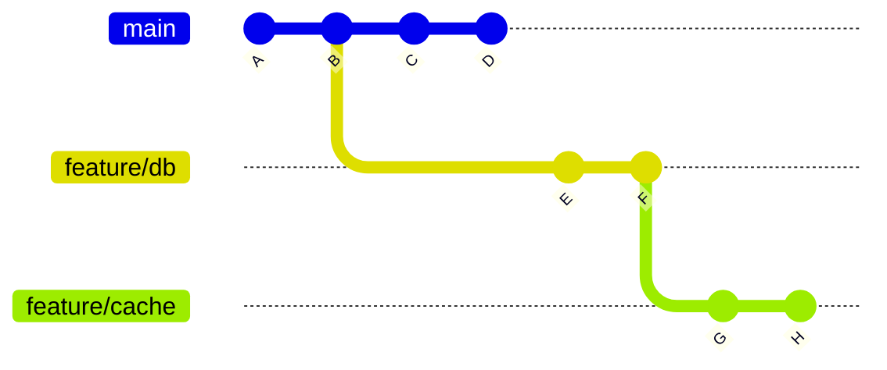
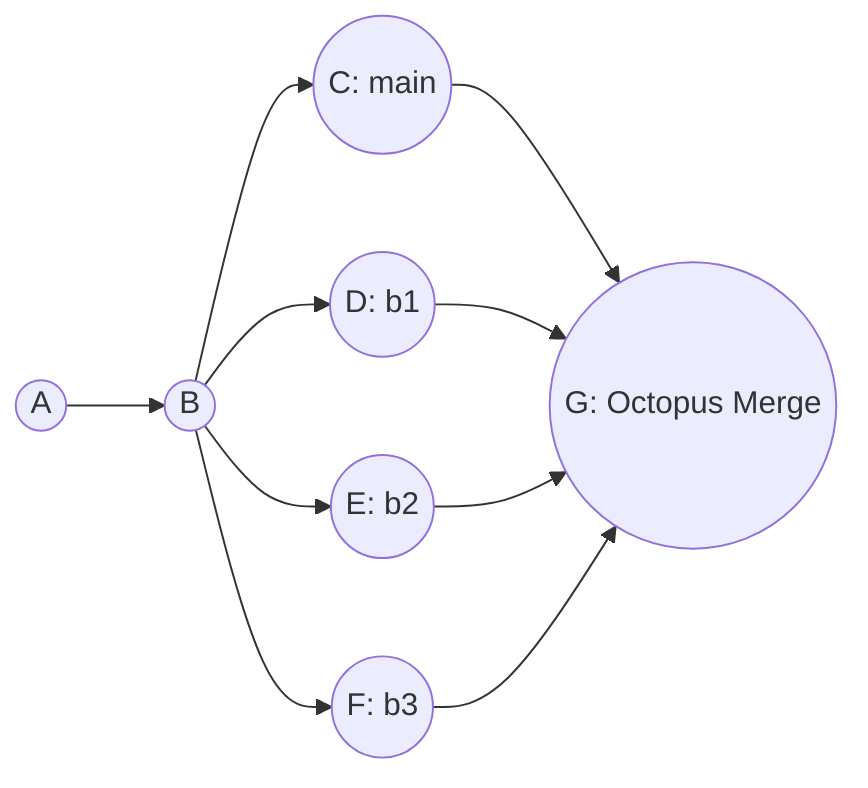
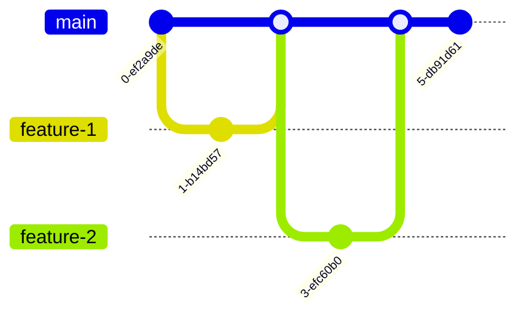

> **Complexity**: `[MEDIUM]`
>
> **Time to Complete**: 100–130 minutes (long-form read + hands-on exercise)
>
> **Prerequisites**: Module 1, Git Internals. This module assumes you can read a commit graph, create branches, and commit small changes, but it does not assume you have already handled a production-grade Kubernetes merge conflict under pressure.

---

## Learning Outcomes
- **Diagnose** the root cause of complex merge conflicts within Kubernetes manifest files by analyzing the merge base and divergent commit histories.
- **Implement** fast-forward, three-way, and octopus merges strategically to maintain a clean, navigable project history.
- **Resolve** intricate multi-file conflicts during infrastructure-as-code integration without introducing YAML syntax errors or regression bugs.
- **Evaluate** branching strategies (Trunk-based, GitFlow, GitHub Flow) against a platform team's release cadence, supported versions and validation needs.
- **Diagnose** merge-base and strategy behavior using the graph, installed Git version and diff evidence.

## Why This Module Matters

On October 21, 2018, routine optical hardware maintenance severed the US East Coast network hub from the primary US East Coast data center for 43 seconds. An automated failover promoted the US-West hub to primary, but the US-East hub continued to accept writes. Both sites held authoritative-looking records for the same rows. The incident caused more than 24 hours of degraded service; engineers had to manually reconcile the records that both sites had accepted during the brief split before consistency could be restored, and approximately 200,000 webhook payloads were permanently dropped. The incident demonstrated that divergent timelines can each appear correct in isolation while creating massive conflict at infrastructure scale. The same problem exists in source control every time long-lived branches are reconciled. Advanced Git merging is the practiced skill that keeps that reconciliation from becoming an outage.

For Kubernetes platform work, merging is more than a repository housekeeping task because the merged text often becomes a desired-state contract consumed by controllers, admission policies, scanners, and deployment automation. A clean-looking merge can still leave a selector pointing at the wrong labels, a generated Secret missing from a Kustomize overlay, or a release branch carrying assumptions that are no longer true for Kubernetes 1.35 clusters. This module treats merging as an operational design skill: you will inspect graph shape, choose the right integration method, resolve conflicts by synthesizing intent, and validate that the resulting manifests still describe a coherent system.

## Core Content

### The Geometry of Integration: Fast-Forward vs. Three-Way Merges

When you issue a `git merge` command, Git does not blindly smash files together line by line. Instead, it performs a rigorous geometric analysis of your repository's commit history graph to determine the safest mathematical way to integrate the disparate changes. Understanding this underlying geometry is the fundamental difference between dictating your project's history and being a victim of it.

#### The Fast-Forward Merge

Imagine you are laying bricks to build a straight wall. You stop to take a break. While you are resting, a colleague continues laying bricks starting exactly where you left off, continuing in the exact same straight line. When you return, integrating their new work into your view of the wall requires no complex decisions or architectural changes; you simply walk to the end of their newly laid bricks and consider that the new end of the wall. 

This conceptual model perfectly describes a **fast-forward merge**. It occurs when the current branch tip is a direct, linear ancestor of the branch you are attempting to merge. Git simply moves your current branch pointer forward to point to the exact same commit as the incoming branch. Because the history is entirely linear and hasn't diverged, no new "merge commit" is created.

```bash
# Setting up a fast-forward scenario
git init cluster-config
cd cluster-config
echo "apiVersion: v1" > config.yaml
git add config.yaml
git commit -m "Initialize cluster config"

# Create a new branch and add a commit
git checkout -b feature/add-metadata
echo "kind: ConfigMap" >> config.yaml
git commit -am "Add ConfigMap kind"

# Switch back to main and merge
git checkout main
git merge feature/add-metadata
```

The command output is intentionally boring, and that boredom is the entire point of a fast-forward integration. Git reports that it updated one commit range to another, then shows only the file-level change summary because no second parent and no merge commit were needed.
```text
Updating a1b2c3d..e4f5g6h
Fast-forward
 config.yaml | 1 +
 1 file changed, 1 insertion(+)
```

Because the `main` branch had not diverged—meaning no new commits were added to `main` while the `feature/add-metadata` branch was being actively developed—Git simply moved the `main` pointer forward to catch up. 

If you want to force Git to create a merge commit anyway (often done to preserve the historical context that a specific feature branch existed at all), you can use the `git merge --no-ff` flag, which always creates a merge commit even when a fast-forward would be perfectly possible. Conversely, running `git merge --ff-only` succeeds only if a clean fast-forward is mathematically possible; otherwise, it exits immediately with a non-zero status and refuses to merge. It is also worth noting a specific edge case: a fast-forward merge is automatically suppressed, and Git behaves as if `--no-ff` was passed, when merging an annotated tag that is not stored within the standard `refs/tags/` hierarchy.

This distinction matters in automation because a protected branch can use `--ff-only` as a guardrail rather than as a style preference. If a pipeline expects a deployment branch to be a strict descendant of a reviewed release branch, a failed fast-forward tells you the graph no longer matches the release process you thought you were following. That failure is useful evidence. It says that someone introduced independent history and that the team now needs a deliberate integration decision instead of a silent pointer move.

**Pause and predict:** Before running `git log --oneline --graph` after this merge, sketch out what you think the history graph will look like. Will there be a fork and a merge commit?

<details>
<summary>Check your prediction</summary>

Because this was a fast-forward merge, `main` simply moved to the tip of `feature/add-metadata`. There is no fork and no merge commit. `git log --oneline --graph` will show a single straight line of commits ending with "Add ConfigMap kind".

</details>

Sketch the graph before you continue. The next section explains what changes when both sides have new commits. It does not draw this history.

#### The Three-Way Merge

Real-world platform development is rarely perfectly linear. While your colleague was extending the brick wall, you started building a completely parallel wall right next to it. Now, you need to architecturally connect them. A **three-way merge** happens when the history of the repository has fundamentally diverged. Both the current branch and the incoming branch share a common ancestor deep in the past, but both have advanced independently since that point.



To resolve this divergence algorithmically, Git looks at the common ancestor (commit `E`), compares it against your current state (`C`) to see exactly what you changed, and then compares the ancestor against the incoming state (`G`) to see exactly what they changed. Git then attempts to synthesize and apply both sets of changes to the baseline `E` simultaneously. If the modifications do not overlap on the exact same lines of code, Git successfully creates a new **merge commit** (represented as `H` in the diagram) that mathematically binds the two parallel timelines together.

**Pause and predict:** What do you think happens if both branch `main` and branch `feature/rbac` modified the exact same `subjects` list in a RoleBinding manifest, but added different users? How will Git's three-way merge handle this specific scenario?

<details>
<summary>Check your prediction</summary>

Overlapping edits to the same lines do not auto-merge. Git stops and marks a conflict because it cannot tell which user list should survive. Non-overlapping edits on different lines can still apply together.

</details>

Write conflict or auto-merge before you continue. The table below names several change shapes. Read your own prediction before you use that table as a lookup.

| Change Type | Branch A (main) vs Base | Branch B (feature) vs Base | Git's Action during Merge |
| :--- | :--- | :--- | :--- |
| File added | Not present | Added | File is added |
| File modified | Unchanged | Modified | Modification applied |
| File deleted | Deleted | Unchanged | File remains deleted |
| File modified | Modified (Line 10) | Modified (Line 50) | Both modifications applied |
| File modified | Modified (Line 20) | Modified (Line 20) | **CONFLICT** |

### Merge Bases, Strategies, and Git's Internal Engines

Git identifies best common ancestors as merge bases. In a complex history there may be more than one, so inspecting the graph and the candidates helps explain the inputs to a merge. Start with the following command, then use `--all` when you need to check for multiple best bases:

```bash
git merge-base main feature/ingress-update
```

Without `--all`, `git merge-base` prints one best common ancestor; when several exist, which one it prints is unspecified. Use `git merge-base --all` to list them. The [merge strategy documentation](https://git-scm.com/docs/git-merge) explains that `ort` can merge multiple common ancestors into a reference tree before the three-way merge. Thus the single printed commit is not necessarily the strategy's actual reference tree. See [git-merge-base](https://git-scm.com/docs/git-merge-base) for the criss-cross example.

**Pause and predict:** Look at the following branch topology. If you are on `main` and run `git merge feature/cache`, which commit is the merge base?



<details>
<summary>Check your prediction</summary>

The merge base is commit `B`. To find it, trace backwards from `main` (commit D) and `feature/cache` (commit H) until their paths intersect. They first meet at `B`, making it the common ancestor used for the three-way merge.

</details>

Write the commit letter before you continue. The next paragraph names merge strategies. It does not identify the base of this topology.

Git provides several merge strategies that govern how files are combined: `ort`, `recursive`, `resolve`, `octopus`, `ours`, and `subtree`. The installed Git version matters when interpreting a strategy name.

The current [Git merge documentation](https://git-scm.com/docs/git-merge) specifies `ort` as the default strategy when merging a single head and `octopus` for multiple heads, unless a strategy is chosen explicitly. `ort` uses the histogram diff algorithm by default for merge comparisons. `recursive` was a separate implementation through Git 2.49; starting with 2.50, the name is a synonym for `ort`. Check the installed version before comparing strategy behavior, and do not infer a universal speed or accuracy ranking from the strategy name.

The other available strategies serve highly specialized use cases. The `resolve` strategy uses a very traditional three-way merge algorithm but explicitly does NOT handle file renames, whereas `ort` detects and handles renames gracefully. The `ours` strategy (invoked via `git merge -s ours`) aggressively discards ALL changes from the other branch entirely—the resulting tree is always mathematically identical to the current branch's HEAD tree. It is crucial to understand that this is fundamentally different from the strategy option (invoked via `git merge -X ours`), which still performs a standard three-way merge but automatically favors the current branch's code only when resolving overlapping conflicting hunks.

#### The Resolution Process

When Git encounters overlapping changes that it cannot mathematically resolve, it halts the automated merge process. You must manually intervene. The manual resolution process follows five strict, sequential steps:

1. **Identify the Conflict:** Git stops the merge execution and marks the files as conflicted in the index. Run `git status` to see the exact list of files requiring your immediate attention.
2. **Locate the Markers:** Open the conflicted file in your text editor and search for the standard conflict markers: `<<<<<<<` (which marks the beginning of your current branch's changes), `=======` (the dividing line separating the two diverging realities), and `>>>>>>>` (which marks the end of the incoming branch's changes).
3. **Analyze the Divergence:** Carefully read the code within the markers. Understand exactly what the `HEAD` version was trying to accomplish architecturally versus what the incoming branch was attempting to do.
4. **Synthesize the Intent:** Delete the conflict markers entirely and manually edit the raw code so that both intended changes are combined harmoniously, ensuring you do not introduce YAML syntax errors or semantic logical bugs.
5. **Finalize the Resolution:** Save the file, run `git add <file>` to instruct Git that the conflict has been successfully resolved, and finally run `git commit` to securely finalize the overarching merge operation.

### Conflict Resolution in Infrastructure-as-Code: Multi-File Complexity

Conflicts are not compiler errors; they are simply Git pausing its execution to ask for human judgment because its mathematical models cannot safely guess developer intent. When a conflict occurs, Git's internal index becomes a highly complex, multi-dimensional workspace. During a three-way merge, Git physically stores up to three distinct versions of each conflicted file directly within the index structure: stage 1 (the common ancestor base), stage 2 (the current HEAD version), and stage 3 (the incoming MERGE_HEAD version). You can inspect these internal stages directly by running `git ls-files -u`. Furthermore, when using the modern `ort` merge strategy, Git intelligently writes an `AUTO_MERGE` reference pointing to a tree that exactly matches the current working tree content, complete with all the inline conflict markers.

Consider a complex real-world platform scenario. Team Alpha is working on branch `feature/ha-redis` to increase redundancy. Team Beta is simultaneously working on branch `feature/redis-auth` to lock down security. Both teams heavily modify the core `redis-deployment.yaml` and the overarching `kustomization.yaml` file that orchestrates the deployment logic.

Team Alpha's changes on `feature/ha-redis`:
```yaml
spec:
  replicas: 3
  template:
    spec:
      containers:
      - name: redis
        image: redis:7.2.4-alpine
```
```yaml
resources:
- redis-deployment.yaml
commonLabels:
  high-availability: "true"
```

Team Beta's divergent changes on `feature/redis-auth`:
```yaml
spec:
  replicas: 1
  template:
    spec:
      containers:
      - name: redis
        image: redis:7.2.4
        env:
        - name: REDIS_PASSWORD
          valueFrom:
            secretKeyRef:
              name: redis-secret
              key: password
```
```yaml
resources:
- redis-deployment.yaml
secretGenerator:
- name: redis-secret
  literals:
  - password=supersecret
```

When the lead platform engineer attempts to merge `feature/redis-auth` into `feature/ha-redis`, Git evaluates the text, detects the severe overlap, and violently halts the process across multiple files:

```bash
git checkout feature/ha-redis
git merge feature/redis-auth
# Auto-merging redis-deployment.yaml
# CONFLICT (content): Merge conflict in redis-deployment.yaml
# Auto-merging kustomization.yaml
# CONFLICT (content): Merge conflict in kustomization.yaml
# Automatic merge failed; fix conflicts and then commit the result.
```

If you panic upon seeing massive multi-file infrastructure conflicts, remember that running `git merge --abort` is functionally equivalent to running `git reset --merge` when a `MERGE_HEAD` is present, but only when your working tree and index are clean enough for Git to unwind the merge safely. If you have unstaged edits outside the conflict, stash or commit them first, or use `git merge --abort` only after understanding what will be discarded. When `merge.autostash` is enabled, Git may temporarily stash local changes during the merge and restore them on abort via `MERGE_AUTOSTASH`. If you choose to proceed instead of aborting, you must synthesize the conflicting configurations accurately, ensuring no YAML structures are broken.

To successfully resolve this specific scenario, we must determine the desired outcome across all files: we want High Availability (replicas: 3) AND authentication (env vars). For the infrastructure to actually work, the Kustomization file must include BOTH the `commonLabels` AND the `secretGenerator` so that the `redis-secret` referenced in the deployment actually exists.

The correctly synthesized deployment configuration:
```yaml
spec:
  replicas: 3
  template:
    spec:
      containers:
      - name: redis
        image: redis:7.2.4-alpine
        env:
        - name: REDIS_PASSWORD
          valueFrom:
            secretKeyRef:
              name: redis-secret
              key: password
```

The correctly synthesized kustomization configuration:
```yaml
resources:
- redis-deployment.yaml
commonLabels:
  high-availability: "true"
secretGenerator:
- name: redis-secret
  literals:
  - password=supersecret
```

Always comprehensively validate the structural integrity of your infrastructure-as-code files before committing the final resolution. Once verified, add both files to the index and commit to finalize the complex multi-file merge.

After finalizing a merge, inspect the result from more than one perspective. By default, `git show <merge-commit-hash>` uses a dense combined diff for a merge, subject to options such as `--first-parent`. A combined diff lists files modified from all parents; the dense form omits uninteresting hunks where the parents have only two variants and the result picks one without modification. It is therefore not a complete list of changes or a record of human actions. For a two-parent merge, `git show --remerge-diff <merge-commit-hash>` reconstructs a temporary tree, potentially containing conflict markers, and compares it with the recorded result. It can help investigate differences, but is not a transcript of how the merge was resolved. Its output and option interactions may change except where explicitly documented. See [git-show](https://git-scm.com/docs/git-show) and compare parent-specific diffs where needed.

```bash
kubectl kustomize . | kubeconform -summary -

# If successful:
git add redis-deployment.yaml kustomization.yaml
git commit -m "Merge redis-auth, resolving multi-file replicas, image, and secret generator conflicts"
```

Hypothetical scenario: a platform engineer resolves the core Deployment YAML manually but, feeling overwhelmed, runs `git checkout --ours kustomization.yaml` to bypass the second conflict. Git accepts the command and allows the merge to finish, yet the Deployment now expects a password Secret that the Kustomization file no longer generates. In a GitOps flow, that kind of text-level success can become a runtime failure as soon as the controller applies the reconciled tree. The lesson is not that `--ours` is forbidden; it is that whole-file conflict shortcuts must be justified against the complete resource graph, not against the file that looks most annoying in the editor.

When you review this kind of merge, read the final configuration as a set of relationships rather than as two independent files. The Deployment's `env` block refers to a Secret by name, the Kustomization file decides whether that Secret is produced, and the image tag choice can alter runtime assumptions about authentication behavior. A good resolution preserves the useful intent from both branches and then proves that the references still connect. That is why the validation command comes before `git add`: once you stage the result, it becomes easy to treat the merge as finished even though the platform object has not yet been checked.

To aid in visualizing these complex situations, you can utilize `git mergetool`, which launches a specialized external visual diffing tool presenting the BASE, LOCAL, and REMOTE versions side-by-side, and then automatically writes your final resolved result directly to the MERGED file. You can also significantly alter how Git presents conflicts natively in your editor. Three distinct merge conflict styles are available via the `merge.conflictStyle` configuration: `merge` shows only the two diverging sides, `diff3` adds a `|||||||` block showing the original ancestor code to provide critical context on why the conflict happened, and `zdiff3` is functionally identical to diff3 but trims matching, unchanged lines from the outer edges of the conflict block to reduce visual noise. The highly efficient `zdiff3` conflict style was introduced in Git 2.35.0.

If your team constantly encounters the exact same identical conflicts repeatedly due to long-lived branches, Git's `rerere` (Reuse Recorded Resolution) feature is an absolute lifesaver. It is globally enabled by setting the configuration `rerere.enabled = true`. When enabled, Git mathematically fingerprints the conflict and observes your manual resolution, storing the mapping in a hidden cache. If that exact conflict ever arises again during a future merge or rebase, Git automatically applies your previous resolution without halting.

### The Auto-Merge Phenomenon: A Historical Case Study

To deeply understand how Git's context windows operate, it is highly instructive to look at a legacy exercise. In earlier versions of this course, students were given the following exact sequence of commands to intentionally create a merge conflict.

The first part of the legacy exercise created a tiny repository and a Kubernetes Deployment that was deliberately small enough for students to inspect by eye. Older classroom versions sometimes used a short interactive alias for Kubernetes validation, but the runnable examples here keep the full `kubectl` command so every block can be copied into a non-interactive shell or CI job without relying on local shell setup.
```bash
mkdir k8s-merge-lab && cd k8s-merge-lab
git init --initial-branch=main
```
```yaml
apiVersion: apps/v1
kind: Deployment
metadata:
  name: api-server
spec:
  replicas: 2
  selector:
    matchLabels:
      app: api
  template:
    metadata:
      labels:
        app: api
    spec:
      containers:
      - name: api
        image: nginx:1.27.0
```
```bash
git add deployment.yaml
git commit -m "chore: initial api deployment"
```

The second part created two diverging branches that changed different fields in the same Deployment. One branch changed desired capacity, while the other changed the container image, and the teaching intent was to make those independent intentions collide inside one manifest.
```bash
git checkout -b feature/scale-up
sed -i.bak 's/replicas: 2/replicas: 5/g' deployment.yaml && rm deployment.yaml.bak
git add deployment.yaml
git commit -m "feat: scale api to 5 replicas"
```
```bash
git checkout main
git checkout -b feature/update-image
sed -i.bak 's/image: nginx:1.27.0/image: nginx:1.27.1/g' deployment.yaml && rm deployment.yaml.bak
git add deployment.yaml
git commit -m "chore: update nginx to 1.27.1"
```

The third part asked students to merge the image branch into the scale branch and observe the result. In the original classroom version, the expectation was a visible conflict, which made the next resolution step easy to explain and easy to grade.
```bash
git checkout feature/scale-up
git merge feature/update-image
# Output will show CONFLICT (content)
```

The strict pedagogical expectation was that this sequence would produce the following dramatic conflict markers in the file, because the older exercise treated nearby edits in the same YAML object as though they would always overlap:
```text
apiVersion: apps/v1
kind: Deployment
metadata:
  name: api-server
spec:
<<<<<<< HEAD
  replicas: 5
  selector:
    matchLabels:
      app: api
  template:
    metadata:
      labels:
        app: api
    spec:
      containers:
      - name: api
        image: nginx:1.27.0
=======
  replicas: 2
  selector:
    matchLabels:
      app: api
  template:
    metadata:
      labels:
        app: api
    spec:
      containers:
      - name: api
        image: nginx:1.27.1
>>>>>>> feature/update-image
```

The student would then manually resolve the file to this final state, preserving the scale decision from one branch and the patched image decision from the other branch:
```yaml
apiVersion: apps/v1
kind: Deployment
metadata:
  name: api-server
spec:
  replicas: 5
  selector:
    matchLabels:
      app: api
  template:
    metadata:
      labels:
        app: api
    spec:
      containers:
      - name: api
        image: nginx:1.27.1
```

The exercise then required validation before committing, because a syntactically broken Deployment is still a failed merge even when the Git conflict markers have been removed:
```bash
kubeconform -summary deployment.yaml
# Expect output confirming the Deployment schema is valid
```
```bash
git add deployment.yaml
git commit -m "Merge branch 'feature/update-image' into feature/scale-up resolving replicas and image"
```

The legacy solution key provided to students looked exactly like this, and it is worth preserving because it shows the intended operational sequence even though modern Git usually handles this particular example automatically:
<details>
<summary>View Solutions</summary>

**Task 1: Create the Scale Branch**
```bash
git checkout -b feature/scale-up
sed -i.bak 's/replicas: 2/replicas: 5/g' deployment.yaml && rm deployment.yaml.bak
git add deployment.yaml
git commit -m "feat: scale api to 5 replicas"
```

**Task 2: Create the Image Update Branch**
```bash
git checkout main
git checkout -b feature/update-image
sed -i.bak 's/image: nginx:1.27.0/image: nginx:1.27.1/g' deployment.yaml && rm deployment.yaml.bak
git add deployment.yaml
git commit -m "chore: update nginx to 1.27.1"
```

**Task 3: Trigger the Conflict**
```bash
git checkout feature/scale-up
git merge feature/update-image
# Output will show CONFLICT (content)
```

**Task 4: Resolve the Conflict**
Open `deployment.yaml` in your editor. It will look similar to this:
```text
apiVersion: apps/v1
kind: Deployment
metadata:
  name: api-server
spec:
<<<<<<< HEAD
  replicas: 5
  selector:
    matchLabels:
      app: api
  template:
    metadata:
      labels:
        app: api
    spec:
      containers:
      - name: api
        image: nginx:1.27.0
=======
  replicas: 2
  selector:
    matchLabels:
      app: api
  template:
    metadata:
      labels:
        app: api
    spec:
      containers:
      - name: api
        image: nginx:1.27.1
>>>>>>> feature/update-image
```

Edit the file to remove markers and combine the desired state:
```yaml
apiVersion: apps/v1
kind: Deployment
metadata:
  name: api-server
spec:
  replicas: 5
  selector:
    matchLabels:
      app: api
  template:
    metadata:
      labels:
        app: api
    spec:
      containers:
      - name: api
        image: nginx:1.27.1
```

**Task 5: Validate the YAML**
```bash
kubeconform -summary deployment.yaml
# Expect output confirming the Deployment schema is valid
```

**Task 6: Finalize the Merge**
```bash
git add deployment.yaml
git commit -m "Merge branch 'feature/update-image' into feature/scale-up resolving replicas and image"
```

</details>

However, if you attempt to run this legacy exercise today using a modern Git version equipped with the highly optimized `ort` strategy, it seamlessly auto-merges without generating any conflict whatsoever. This fascinating phenomenon occurs because the modifications to `replicas` (line 6) and `image` (line 17) are separated by exactly ten unchanged lines. This gap provides Git's internal algorithms with just enough unambiguous textual context to safely apply both discrete hunks independently. The "overlapping context illusion" in older tutorials often fails to account for the increasing sophistication of modern Git diff engines.

That does not make the legacy exercise useless; it makes it a useful warning about relying on intuition instead of observing the actual merge engine. Older teaching material often describes conflicts as if nearby conceptual changes must collide, but Git's decision is based on the diff hunks it can derive from the merge base and both tips. Two changes may feel related to a human because they live inside one Kubernetes object, yet still be mechanically independent enough for `ort` to combine them without asking. The opposite is also true: two changes that look harmless in separate reviews can collide if they alter the same small YAML region, especially when generated blocks or repeated keys reduce context.

### The Octopus Merge: Taming Multiple Branches

Occasionally, a Kubernetes platform team needs to orchestrate a massive integration of several entirely independent feature branches into a final release candidate branch all at the exact same time. Attempting to do this sequentially through a long chain of individual two-branch merges creates an unnecessarily messy, stair-stepped history. Git provides the powerful `octopus` strategy specifically for this scenario. It is automatically selected as the default strategy when you instruct Git to merge more than two branches simultaneously.



```bash
git checkout release-v1.35
git merge feature/ingress feature/autoscaling feature/network-policies
```

**Pause and predict:** What do you think happens if Git successfully merges `feature/ingress` and `feature/autoscaling`, but then detects a complex conflict when attempting to merge `feature/network-policies`? Will it pause and ask you to resolve it like a standard three-way merge?

<details>
<summary>Check your prediction</summary>

Unlike a standard two-branch three-way merge, which pauses mid-flight and leaves interactive conflict markers in your working directory while keeping the branch pointer unchanged, an octopus merge stops as soon as it hits a conflict it cannot resolve automatically. Git prints `Automatic merge failed; fix conflicts and then commit the result.`, does **not** move the branch ref, and leaves the working tree and index in a conflicted or partially merged state. Run `git merge --abort` to discard that in-progress merge and return to the pre-merge snapshot.

</details>

Write pause or stop before you continue. The next prompt asks which recovery you would choose after that failure. It does not describe the failure itself.

> **Stop and think**: If an octopus merge fails due to a conflict between `feature/autoscaling` and `feature/network-policies`, which approach would you choose:
> A) Abandon the octopus merge entirely and merge all three sequentially.
> B) Merge the two conflicting branches into each other first, resolve the conflict, and then retry the octopus merge with the updated branches.
> Why is your chosen approach safer for maintaining a clean history?

### Advanced History Rewriting and Cherry-Picking

Before integrating a branch, consider whether its commits communicate independent changes clearly. Cleaning up unpublished work can help review, but rewriting a shared branch requires coordination with its collaborators.

The `git rebase --interactive` command is the ultimate tool for historical surgery. It supports a wide array of powerful commit-editing commands, including `pick`, `edit`, `reword` (to change a message without altering code), `drop` (to erase a commit entirely), `squash` (to meld a commit into the previous one while combining messages), `fixup`, `fixup -c/-C`, `break`, and `exec` (which runs a shell script against every commit to ensure tests pass). By default, `git rebase --interactive` strictly excludes merge commits from the generated instruction list to flatten the history.

Additionally, you can use `git rebase --onto <newbase>` to physically transplant a sequence of commits onto a completely different base than their original upstream, allowing a topic branch to be detached and moved to a different parent entirely.

If your team uses rebasing for unpublished local work, `git pull --rebase origin main` fetches remote changes and replays your local commits on top. Check your current branch and worktree first, and follow the repository's review policy before pushing. Conflicts can still stop the replay; rebasing does not validate the resulting manifests or authorize rewriting shared history.

If you only need to integrate a single, highly specific commit from another divergent branch without merging the whole timeline, use `git cherry-pick`. Running `git cherry-pick -x` automatically appends a highly useful '(cherry picked from commit ...)' traceability line directly to the commit message. Running `git cherry-pick -n` (or `--no-commit`) applies the underlying changes to the working tree and index without actually creating a new commit, allowing you to manually tweak the code before committing.

Another powerful mechanism is `git merge --squash`. This command executes the integration logic of a merge but deliberately does not create a commit and does not record the `MERGE_HEAD` pointer, leaving the heavily combined result purely staged in your index for a subsequent, manually crafted mega-commit.

To effectively audit how merges have structurally impacted your repository over time, you can query the timeline using `git log --merges` (which prints only merge commits and is functionally equivalent to passing `--min-parents=2`) or use `git log --no-merges` (which completely excludes all merge commits and is equivalent to passing `--max-parents=1`).

### Branching Strategies & Platform Configurations

A branching model sets where work is reviewed, integrated and released; a merge strategy combines particular histories. Choose the model around release cadence, supported versions and validation capacity. [Git's own workflow](https://git-scm.com/docs/gitworkflows) uses topic, integration and maintenance branches, while warning that its full process is rarely needed for smaller projects.

> **Stop and think**: Imagine you are advising a new platform team. They have 12 engineers, deploy to production twice a week, and have automated test coverage but it sometimes produces false positives. Which branching strategy would you recommend and why? Keep your answer in mind as you read the following models.

#### 1. GitFlow: Release and Development Branches
GitFlow separates a release-history branch from `develop`, where features are integrated. Release branches prepare a version for release, and hotfix branches handle urgent corrections. The [model's author](https://nvie.com/posts/a-successful-git-branching-model/) recommends a simpler workflow for continuous delivery, while retaining GitFlow as an option for explicitly versioned software or multiple supported versions. A branch name alone does not prove what is deployed.

- **Tradeoff:** Separate stabilization and maintenance work can help manage releases, but fixes need a clear route back to the other affected branches. Delayed integration increases the amount of divergent work to reconcile; conflicts and deployment failures are risks to manage, not inevitable consequences of the model.

#### 2. GitHub Flow: Branch, Review and Merge
[GitHub flow](https://docs.github.com/en/get-started/using-github/github-flow) gives each change a branch, then uses a pull request for feedback before merging into the default branch. Required checks and review rules depend on repository configuration. Merging and deployment are separate actions: the workflow does not require every merge to deploy immediately.

- **Tradeoff:** A small review branch keeps the change focused, but tests and review can miss defects. Choose deployment approval and recovery procedures for the risk involved; no branching model requires infallible tests or guarantees a healthy production cluster.

#### 3. Trunk-Based Development: Frequent Integration
[Trunk-based development](https://trunkbaseddevelopment.com/) centers development on one shared trunk and avoids long-lived development branches. It can use direct commits or short-lived review branches; bypassing review is not part of the definition. The diagram below illustrates the review-branch variant rather than prescribing a repository's access policy.



- **Tradeoff:** Frequent integration limits the work accumulated between integrations, but conflicts remain possible. Keep the shared build usable and changes small. Incomplete behavior needs a deliberate release boundary, which may use feature flags; flags are a technique, not a requirement for every change.

For a GitOps repository, inspect the controller's configured revision and sync policy before predicting a deployment. [Argo CD supports branch or symbolic-reference tracking, tag tracking and commit pinning](https://argo-cd.readthedocs.io/en/stable/user-guide/tracking_strategies/); it does not require `main`. Confirm that the revision resolves to the intended reference, especially when a branch and tag share a name. A merge to an untracked branch does not by itself change the manifests selected by that Application. Automatic synchronization is configurable, and parameter overrides can affect desired manifests.

**Worked decision:** In a hypothetical team deploying twice a week, production is pinned to a reviewed commit and QA tracks a release branch. A new commit on `main` does not advance that production pin. Name who promotes the revision, which checks gate promotion and how fixes reach both branches. Short-lived review branches may simplify integration, while a maintenance branch may serve a separate supported version. Defend either choice from these needs rather than ranking teams by their branching model.

#### Platform Merge Methods

Repository merge restrictions determine which integration operations are allowed. Choose these rules alongside the branching model; enabling a particular merge method does not itself enforce release cadence, testing or deployment approval.

GitHub offers three distinct pull request merge methods: 'Create a merge commit' (which forces `--no-ff`), 'Squash and merge', and 'Rebase and merge'. It is critical to understand that GitHub's 'Rebase and merge' feature does not operate exactly like a local rebase; it always aggressively updates the committer information and creates entirely new commit SHAs, which can confuse local clients if not managed properly.

GitLab similarly offers three formal merge request methods: 'Merge commit' (the `--no-ff` equivalent), 'Merge commit with semi-linear history', and 'Fast-forward merge'. GitLab added automatic rebase before merge for both the semi-linear and fast-forward methods starting in GitLab 18.0.

## Patterns & Anti-Patterns

Advanced merging becomes safer when a team treats every integration as a design decision instead of a keyboard shortcut. The Git command is only the last visible action; the real work is deciding whether the branch is fresh enough to merge, whether the affected files are schema-sensitive, whether the review surface can be understood by another engineer, and whether the resulting history will help the next incident responder reconstruct intent. A platform repository is not a scrapbook of commits, because every merge can become an input to a controller, an audit trail for a production incident, or a rollback boundary during a failed release.

One useful pattern is small, frequent integration against a protected trunk. A short-lived review branch can reduce accumulated divergence, although conflict size still depends on which changes overlap. For Kubernetes manifests, that distinction matters: a small change might ask whether `replicas` should be three or five, while a larger integration may also require reconciling probes, selectors, container names and network policy labels. Maintenance branches remain useful when they have an explicit supported-version purpose and fix-propagation policy.

Another durable pattern is schema-aware validation immediately after conflict resolution. Git knows that two lines of YAML text differ, but it does not know whether a `secretKeyRef` points at a Secret that Kustomize still generates, whether a selector matches the labels inside a Pod template, or whether an API field is valid in Kubernetes 1.35. The resolver therefore has to move from text reconciliation to platform reconciliation. Running `kubeconform -summary <manifest.yaml>` (offline schema validation), `kubectl kustomize`, or an admission-style validation tool is the engineering step that converts "Git accepted the file" into "this configuration still represents a coherent cluster object."

A third pattern is to keep merge commits reviewable and explain any additional changes. A combined diff offers one view of the result, but omits some changes and cannot identify who made an edit or why. Compare each parent and, for a two-parent merge, consider a remerge diff alongside the recorded result and review notes. Those views help investigate unexpected additions without claiming to reconstruct a person's actions.

| Pattern | Use When | Why It Works | Scaling Consideration |
| :--- | :--- | :--- | :--- |
| **Short-lived review branches** | Engineers want frequent integration with review before merge. | Limits accumulated divergence without guaranteeing conflict-free merges. | Keep checks fast and define how incomplete behavior stays out of releases; use flags when appropriate. |
| **Schema-aware conflict validation** | The merge touches Kubernetes YAML, Helm output, Kustomize overlays, or policy-as-code. | Git validates text ancestry, while Kubernetes tooling validates object shape and API compatibility. | Validation must be fast enough to run locally and in CI, or engineers will skip it under pressure. |
| **Reviewable merge commits** | A three-way merge needed synthesis. | Parent-specific and remerge comparisons provide complementary views of the result. | Record intent and validation; no diff proves which edits were manual. |
| **Recorded recurring resolutions** | The same branch family repeatedly conflicts during release preparation. | `rerere` can reuse a previously accepted resolution, reducing repeated manual work. | The cache should be trusted only after the team has validated the first resolution carefully. |

The corresponding anti-patterns usually arise from understandable pressure. A release is late, an environment is unhealthy, or a senior engineer is away, so someone chooses the fastest-looking button in an IDE. The problem is that Git conflict tools optimize for completing the merge operation, while production safety depends on preserving both branches' intent. Accepting "ours" across an entire file may remove conflict markers quickly, but it also discards the incoming branch's design without forcing the resolver to state that decision explicitly. If a security branch added a NetworkPolicy and the release branch changed only image tags, a blind "ours" resolution can silently erase the control that mattered most.

The second trap is leaving a release branch without an owner or a fix-propagation policy. Isolation can serve stabilization or maintenance, but missed fixes can leave supported branches inconsistent. In a GitOps repository, compare the branch with the actual tracked revision, not an assumed `main`. A risky integration may combine hotfixes, chart updates and policy changes under release pressure; inspect those changes and their intended environments before choosing how to integrate them.

The third anti-pattern is treating automatic merge success as proof of semantic correctness. The auto-merge case study above demonstrates why this is dangerous. Modern `ort` can correctly combine far-apart hunks, and that is usually a benefit, but a clean merge can still produce a Deployment whose labels no longer match its selector or an overlay whose generated Secret name changed while the consuming environment variable stayed fixed. Before running this in your own repository, pause and predict: if Git reports "Automatic merge went well" on a Kubernetes manifest, what separate validations would prove that the cluster object is still meaningful rather than merely parseable?

## Decision Framework

Choosing a merge approach starts with the shape of the graph, but it should not end there. First ask whether your current branch tip is an ancestor of the incoming branch tip. If it is, a fast-forward or `--ff-only` merge preserves the cleanest history and avoids inventing a merge commit that does not carry extra information. If the graph has diverged, ask whether the branch is fresh enough for a normal three-way merge and whether the files are simple enough for line-based resolution. If the branch is stale, the safer move may be to abandon the old branch shape, inspect its intent with `git diff <merge-base>..branch`, and transplant selected commits onto a fresh branch.

The next decision is whether history shape or review shape matters more for this change. A merge commit preserves the fact that a feature branch existed and can make release audits easier when a branch represents a coherent body of work. Squash merge creates a cleaner linear history, but it erases internal commit boundaries and can make `git bisect` less precise if the squashed branch mixed unrelated changes. Rebase and merge creates a linear story with individual commits preserved, yet it rewrites commit identities and can confuse collaborators who have based work on the old branch. None of these choices is universally correct; the right answer depends on how your team debugs incidents, reviews changes, and rolls back failed releases.

Use the following decision matrix as a practical guide when you are under pressure. It deliberately combines graph facts with operational facts, because a Kubernetes platform repository is judged by the behavior it produces after merge, not by the elegance of its commit graph alone.

| Situation | Preferred Move | Why | Validation Before Commit |
| :--- | :--- | :--- | :--- |
| Current branch is behind and has no unique commits | `git merge --ff-only incoming` | The branch pointer can move without creating a synthetic merge commit. | Run the relevant tests or render manifests if the incoming branch was not already validated. |
| Two fresh branches touched different files | Normal three-way merge with `ort` | Git can synthesize independent file changes cleanly while preserving both parents. | Review the merge commit and run targeted CI for changed areas. |
| Two branches touched the same Kubernetes manifest | Manual conflict resolution with schema validation | Human intent matters more than text adjacency when selectors, probes, and generated resources interact. | Run `kubeconform -summary` on rendered manifests, `kubectl kustomize`, and any policy checks your repo requires. |
| Several independent branches need one release branch | Octopus merge only if conflicts are unlikely | The history stays compact, but the operation refuses manual conflicts. | Pre-merge each branch against trunk and retry only when every pair is clean. |
| Old branch has a stale merge base | Recreate from current `main` and cherry-pick intent | The old graph encodes obsolete assumptions about the platform. | Test each selected commit after replay, especially migrations and API changes. |
| Pull request contains noisy local commits | Interactive rebase before review | Reviewers see a coherent story instead of temporary savepoints. | Re-run tests after rewriting and force-push only to branches you own. |

There is one final question that experienced maintainers ask before approving any non-trivial merge: "Could I explain this result to the on-call engineer at 3 a.m.?" If the answer is no, the branch is too large, the resolution is too clever, or the validation evidence is too thin. That question is especially useful for GitOps work because the repository is both documentation and control plane input. A reviewer who can trace the merge base, the conflicting intent, the chosen resolution, and the validation command has enough context to trust the change or reject it with specifics.

For day-to-day work, a compact flow helps prevent panic decisions. Start with `git status` to make sure your workspace is clean, inspect the graph with `git log --oneline --graph --decorate --all`, identify the merge base when the branch has been alive for more than a short review cycle, then choose the least surprising integration method that preserves the information your team will need later. After resolution, validate the rendered platform object and inspect the merge commit rather than only the final file. This sequence is slower than clicking a button, but it is much faster than debugging a cluster that accepted a syntactically valid yet semantically broken configuration.

## Did You Know?

1. Current Git documentation names `ort` as the default for merging one head and `octopus` for multiple heads; `recursive` names `ort` starting in Git 2.50.
2. Running the maintenance command `git rerere gc` prunes unresolved conflict records older than 15 days and resolved conflict records older than 60 days, which keeps repeated-resolution caches from growing without bound.
3. Octopus merges fit the Linux-style maintainer workflow of bundling many topic branches into a single integration history without a long sequence of two-parent merge commits.
4. The conflict marker symbols (`<<<<<<<`, `=======`, `>>>>>>>`) predate Git by decades and were established by earlier merge tooling in the RCS era, which is why they appear familiar across many version control systems.

## Common Mistakes

| Mistake | Why It Happens | How to Fix It |
| :--- | :--- | :--- |
| **Panic committing unresolved markers** | Engineer feels overwhelmed, attempts to save work mid-conflict by running `git commit -a`, thereby committing `<<<<<<<` directly into the codebase. | Run `git merge --abort` immediately to reset the working directory to the pre-merge state, take a breath, and start over. |
| **Breaking YAML indentation** | Manually deleting conflict markers and inadvertently shifting blocks of YAML, creating invalid structural relationships. | Always use `kubectl diff` or `kubeconform -summary` on the modified file before finalizing the merge commit. |
| **"Ostrich merging" (ignoring upstream)** | Keeping a feature branch alive for 6 weeks without pulling from main, resulting in a monolithic, unresolvable conflict later. | Merge `main` into your feature branch (or rebase against it) daily. Conflict resolution should be a continuous, small-scale tax, not a massive end-of-project penalty. |
| **Resolving logic, breaking syntax** | Focusing so hard on getting both sets of configuration into the file that you create duplicate keys (e.g., two `spec` blocks in a pod definition). | Understand the schema of the file you are editing. Use IDE plugins with Kubernetes schema validation enabled during conflict resolution. |
| **Accidental "Evil Merges"** | While resolving a conflict, the engineer sneaks in an unrelated fix or typo correction that was not part of either branch. | A merge commit should *only* contain the resolution of the conflict. Make unrelated fixes in a separate, discrete commit afterward. |
| **Deleting the wrong side** | Misunderstanding `HEAD` vs the incoming branch, and blindly choosing "Accept Current Change" when the incoming branch contained critical security patches. | Read the code inside the markers. Never trust automated UI buttons in IDEs without verifying what exact lines will survive the merge. |

> **Stop and think**: Review the mistakes in the table above. Which of these would cause the most catastrophic failure in your current team's specific context? Rank them by potential severity based on your deployment pipeline's safeguards (or lack thereof).

## Quiz

<details>
<summary>Question 1: Your team is practicing Trunk-Based Development. You have been working on a new Kubernetes network policy for about 4 hours on a local branch. When you attempt to push to main, Git rejects it, stating the remote contains work you do not have. What is the safest sequence of actions to integrate your work?</summary>

Check which branch you are on, whether the worktree is clean and whether anyone shares the commits you would rewrite. For unpublished local work under a rebase policy, `git pull --rebase origin main` fetches the remote commits and replays your local commits on top; resolve any conflicts deliberately, then review and validate the result. Submit through the required review path. A shared branch may instead need a coordinated merge: frequent integration does not require bypassing protection or universally linear history.

</details>

<details>
<summary>Question 2: You trigger an automated pipeline that attempts an octopus merge, integrating four different microservice deployment updates into a staging branch. Git halts and reports a conflict between two of the branches. What happens to the staging branch in this exact moment, and how is the pipeline affected?</summary>

In this exact moment, the staging branch ref does not move because an octopus merge stops when it cannot finish automatically. Git reports `Automatic merge failed; fix conflicts and then commit the result.` Unlike a standard two-branch merge that pauses with conflict markers while leaving the merge in progress, an octopus merge does not advance the branch pointer, but it **does** leave the working tree and index dirty with conflict markers or partial merge results until you run `git merge --abort` (or resolve and commit). Pipelines must treat this as a failed merge attempt that needs cleanup, not as a no-op that left the workspace pristine.

</details>

<details>
<summary>Question 3: A two-parent merge resolves a large StatefulSet and ConfigMap conflict. Which views help review the recorded result, what can they not prove, and what version detail matters when comparing the recursive strategy?</summary>

Inspect the merge with `git show`, remembering that its default dense combined view omits files not modified from every parent and some hunks. Compare the result with each parent for a fuller view. `git show --remerge-diff <merge-commit-hash>` reconstructs a temporary tree, potentially containing conflict markers, and shows its difference from the recorded result; output and option interactions may change except where documented. Neither view proves which changes a person made manually, so use branch intent, review notes and validation evidence as well. Record the installed Git version: `recursive` was a separate implementation through 2.49 and names `ort` starting with 2.50.

</details>

<details>
<summary><span>Question 4: An incident occurs in production because a <code>ConfigMap</code> update was inexplicably lost during a recent deployment. Looking at the Git history, you see a merge commit connecting a feature branch to main. The file changed on both branches, but the feature branch's changes are completely missing in the final merge commit. What likely happened during the conflict resolution?</span></summary>

The engineer performing the merge likely encountered a complex conflict within the `ConfigMap`, became overwhelmed, and mistakenly opted to completely overwrite the incoming changes. They probably used a command like `git checkout --ours configmap.yaml` or blindly clicked "Accept Current Changes" in their IDE's conflict resolution interface. By doing so, they entirely discarded the valid configuration updates from the feature branch while keeping their own, and then finalized the merge commit without realizing the loss of data. This scenario underscores exactly why a visual inspection and validation of the final merged files (such as using `kubectl diff`) is absolutely mandatory before committing a resolved conflict.

</details>

<details>
<summary><span>Question 5: QA tracks a release branch in Argo CD, while production is pinned to a commit. A colleague merges a fix into <code>main</code> and expects both environments to update. What must you inspect, and does keeping a release branch guarantee deployment failures?</span></summary>

Inspect each Application's repository, configured revision, parameter overrides and sync policy; confirm that the revision resolves to the intended reference. With QA uniquely tracking the release branch, it selects that branch's manifests; production selects its pinned commit. A merge into `main` alone advances neither selection. Trace how the fix reaches the release branch and how a reviewed production revision is promoted, then verify the sync result separately. Release branches can serve stabilization, while maintenance branches serve supported versions; missing fix propagation and delayed integration create risks, but the branch model alone proves neither failure nor live drift.

To evaluate the branching strategy, ask whether the team supports multiple released versions or continuously delivers one version. GitFlow's release separation may serve the former; GitHub Flow or trunk-based development may simplify the latter. The scenario alone does not establish either requirement, so ask for that evidence before recommending a workflow, and retain review and validation gates in either case.

</details>

<details>
<summary><span>Question 6: You are tasked with taking over a legacy <code>feature/database-migration</code> branch that was abandoned by a former employee. Before attempting to integrate it, you run <code>git merge-base main feature/database-migration</code> and find that the common ancestor is a commit from over a year ago. What is the safest sequence of actions to rescue this work without breaking the current cluster state, and why?</span></summary>

Attempting a direct three-way merge with a year-old base is extremely dangerous, as Git will try to mathematically reconcile hundreds of conflicting architectural changes simultaneously. Instead, you should first examine the original intent by running `git diff <merge-base-hash>..feature/database-migration` to isolate exactly what the former employee changed. Once the isolated logic is understood, the safest approach is to create a fresh branch off the current `main` and use `git cherry-pick` to selectively bring over only the relevant database migration commits. This strategy completely abandons the deeply diverged history and ensures you are manually adapting the legacy logic to the modern, real-time state of the infrastructure.

</details>

## Hands-On Exercise

In this lab you will create a small Kubernetes manifest repository, force a real conflict that modern Git cannot safely auto-merge, inspect the merge base, resolve the conflict by synthesizing intent, and validate the final object before committing. The exercise uses a Deployment and a ConfigMap because they reveal the two failure modes you will see in platform work: one conflict is about competing runtime behavior, while the other is about a dependency between files. The goal is not to memorize conflict markers; the goal is to practice slowing down enough to identify what each branch was trying to accomplish.

Work in a scratch directory outside any production repository. The commands below assume a Unix-like shell and Git with the default `ort` merge engine. They also assume `kubeconform` is installed and available on your `PATH` (for example `brew install kubeconform` on macOS). `kubeconform -summary` validates manifest shape against Kubernetes OpenAPI schemas without contacting a cluster, which is enough for this exercise because the point is to catch broken YAML and object references before committing the merge.

- [ ] Create the repository, add the baseline Deployment and ConfigMap, and commit the initial state.
- [ ] Create `feature/harden-api` to add a health probe and stricter ConfigMap setting.
- [ ] Create `feature/scale-api` to change replicas and a competing ConfigMap setting.
- [ ] Merge `feature/scale-api` into `feature/harden-api`, inspect the merge base, review the auto-merged `deployment.yaml`, and resolve the conflict in `configmap.yaml`.
- [ ] Validate the resolved manifests with `kubeconform -summary` before committing the merge.
- [ ] Inspect the final merge with `git show`, compare each parent and explain what the diff views can and cannot establish about the resolution.

<details>
<summary>Setup and task solutions</summary>

Create the repository and baseline files:

```bash
mkdir k8s-advanced-merge-lab
cd k8s-advanced-merge-lab
git init --initial-branch=main
```

```yaml
apiVersion: v1
kind: ConfigMap
metadata:
  name: api-settings
data:
  LOG_LEVEL: "info"
  FEATURE_MODE: "standard"
```

Save that YAML as `configmap.yaml`, then create the Deployment:

```yaml
apiVersion: apps/v1
kind: Deployment
metadata:
  name: api-server
spec:
  replicas: 2
  selector:
    matchLabels:
      app: api
  template:
    metadata:
      labels:
        app: api
    spec:
      containers:
      - name: api
        image: nginx:1.27.1
        envFrom:
        - configMapRef:
            name: api-settings
```

Save that YAML as `deployment.yaml`, then commit:

```bash
git add configmap.yaml deployment.yaml
git commit -m "chore: add baseline api manifests"
```

Create the hardening branch:

```bash
git checkout -b feature/harden-api
perl -0pi -e 's/FEATURE_MODE: "standard"/FEATURE_MODE: "strict"/' configmap.yaml
perl -0pi -e 's/image: nginx:1.27.1/image: nginx:1.27.1\n        readinessProbe:\n          httpGet:\n            path: \\/\n            port: 80\n          initialDelaySeconds: 5\n          periodSeconds: 10/' deployment.yaml
git add configmap.yaml deployment.yaml
git commit -m "feat: harden api readiness behavior"
```

Create the scale branch from `main`:

```bash
git checkout main
git checkout -b feature/scale-api
perl -0pi -e 's/replicas: 2/replicas: 5/' deployment.yaml
perl -0pi -e 's/FEATURE_MODE: "standard"/FEATURE_MODE: "burst"/' configmap.yaml
git add configmap.yaml deployment.yaml
git commit -m "feat: scale api for burst traffic"
```

Merge and inspect the merge base:

```bash
git checkout feature/harden-api
git merge-base main feature/scale-api
git merge feature/scale-api
git status
```

Review `deployment.yaml`. Git should auto-merge it cleanly, combining the readiness probe from `feature/harden-api` with the scaled replica count from `feature/scale-api`. Confirm the file matches this expected result:

```yaml
apiVersion: apps/v1
kind: Deployment
metadata:
  name: api-server
spec:
  replicas: 5
  selector:
    matchLabels:
      app: api
  template:
    metadata:
      labels:
        app: api
    spec:
      containers:
      - name: api
        image: nginx:1.27.1
        readinessProbe:
          httpGet:
            path: /
            port: 80
          initialDelaySeconds: 5
          periodSeconds: 10
        envFrom:
        - configMapRef:
            name: api-settings
```

Resolve `configmap.yaml` by making an explicit product decision. In this example, the release owner chooses strict mode because hardening matters more than burst behavior until the feature flag is redesigned:

```yaml
apiVersion: v1
kind: ConfigMap
metadata:
  name: api-settings
data:
  LOG_LEVEL: "info"
  FEATURE_MODE: "strict"
```

Validate and commit:

```bash
kubeconform -summary configmap.yaml
kubeconform -summary deployment.yaml
git add configmap.yaml deployment.yaml
git commit -m "Merge scale-api into harden-api resolving replicas and feature mode"
git show --stat --summary HEAD
git show HEAD
```

To complete the comparison task for this recorded two-parent merge, use `git show --diff-merges=separate -p HEAD` for each parent's view and `git show --remerge-diff HEAD` for the reconstructed-tree comparison. Explain the omissions and reconstruction limits in your audit; neither output identifies a person's actions. Check the installed Git version before interpreting the `recursive` strategy name.

</details>

**Card A: A fast-forward is drawn as a merge commit.** After `feature/add-metadata` lands on an undiverged `main`, someone expects `git log --graph` to show a fork.

<details>
<summary>Check your prediction</summary>

Failure layer: pointer move versus a new commit. Next action: look for a single line ending at the feature tip. A merge commit appears only when you force `--no-ff` or the histories had already diverged.

</details>

**Card B: The same `subjects` lines auto-merge.** Both branches added a different user on the same RoleBinding list. The merge is expected to keep both names without a stop.

<details>
<summary>Check your prediction</summary>

Failure layer: overlapping hunks. Next action: expect a conflict, not a combined list. Different lines can still apply; the same lines cannot be guessed.

</details>

**Card C: The merge base is a tip.** On `main`, merging `feature/cache` from the topology above, someone names commit `D` or commit `H` as the base.

<details>
<summary>Check your prediction</summary>

Failure layer: the common ancestor, not either tip. Next action: walk both histories backward until they meet. In that diagram the meeting point is `B`.

</details>

**Card D: An octopus conflict pauses like a two-branch merge.** `feature/network-policies` conflicts after two other branches merged cleanly. The plan is to edit markers and commit.

<details>
<summary>Check your prediction</summary>

Failure layer: all-or-nothing versus a paused two-parent merge. Next action: do not treat the partial result as a commit to finish. Abort and integrate the conflicting pair first.

</details>

The success criteria are intentionally broader than "Git says the merge is complete." You should be able to point to the merge base, describe each branch's intent, explain why one ConfigMap value survived, show that the Deployment still references an existing ConfigMap, and demonstrate that `kubeconform -summary` accepts both objects. If you cannot explain those facts from the final commit, the merge may be mechanically complete but operationally unreviewable.

## Sources

- [Git workflow manual: topic, integration and maintenance branches](https://git-scm.com/docs/gitworkflows)
- [GitFlow's original model and author's reflection on applicability](https://nvie.com/posts/a-successful-git-branching-model/)
- [GitHub flow: branch, pull request and merge](https://docs.github.com/en/get-started/using-github/github-flow)
- [Trunk-based development: shared trunk and short-lived branches](https://trunkbaseddevelopment.com/)
- [Argo CD tracking strategies: branches, tags and commit pinning](https://argo-cd.readthedocs.io/en/stable/user-guide/tracking_strategies/)
- [Git merge documentation](https://git-scm.com/docs/git-merge)
- [Git merge-base documentation](https://git-scm.com/docs/git-merge-base)
- [Git show documentation: merge-diff formats](https://git-scm.com/docs/git-show)
- [Git rerere documentation](https://git-scm.com/docs/git-rerere)
- [Git rebase documentation](https://git-scm.com/docs/git-rebase)
- [Git cherry-pick documentation](https://git-scm.com/docs/git-cherry-pick)
- [Git log documentation](https://git-scm.com/docs/git-log)
- [Git attributes documentation for merge drivers](https://git-scm.com/docs/gitattributes)
- [Kubernetes kubectl apply reference](https://kubernetes.io/docs/reference/kubectl/generated/kubectl_apply/)
- [Kubernetes Kustomize documentation](https://kubernetes.io/docs/tasks/manage-kubernetes-objects/kustomization/)
- [GitHub October 21 2018 post-incident analysis](https://github.blog/news-insights/company-news/oct21-post-incident-analysis/)
- [GitHub pull request merge methods](https://docs.github.com/en/repositories/configuring-branches-and-merges-in-your-repository/configuring-pull-request-merges/about-merge-methods-on-github)
- [GitLab merge request methods](https://docs.gitlab.com/user/project/merge_requests/methods/)

## Next Module

Continue to [Module 3: History as a Choice](../module-3-interactive-rebasing/) to practice interactive rebasing, commit surgery, and deliberate history design before changes reach shared branches.
