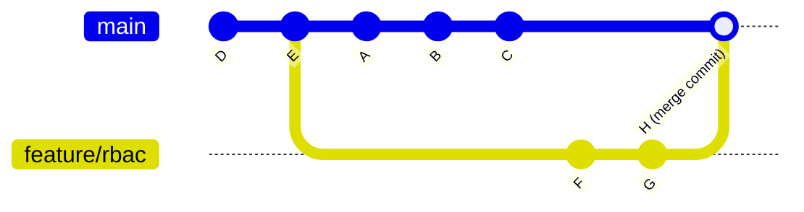
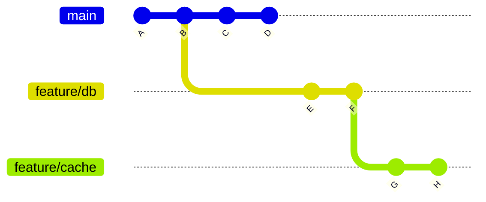
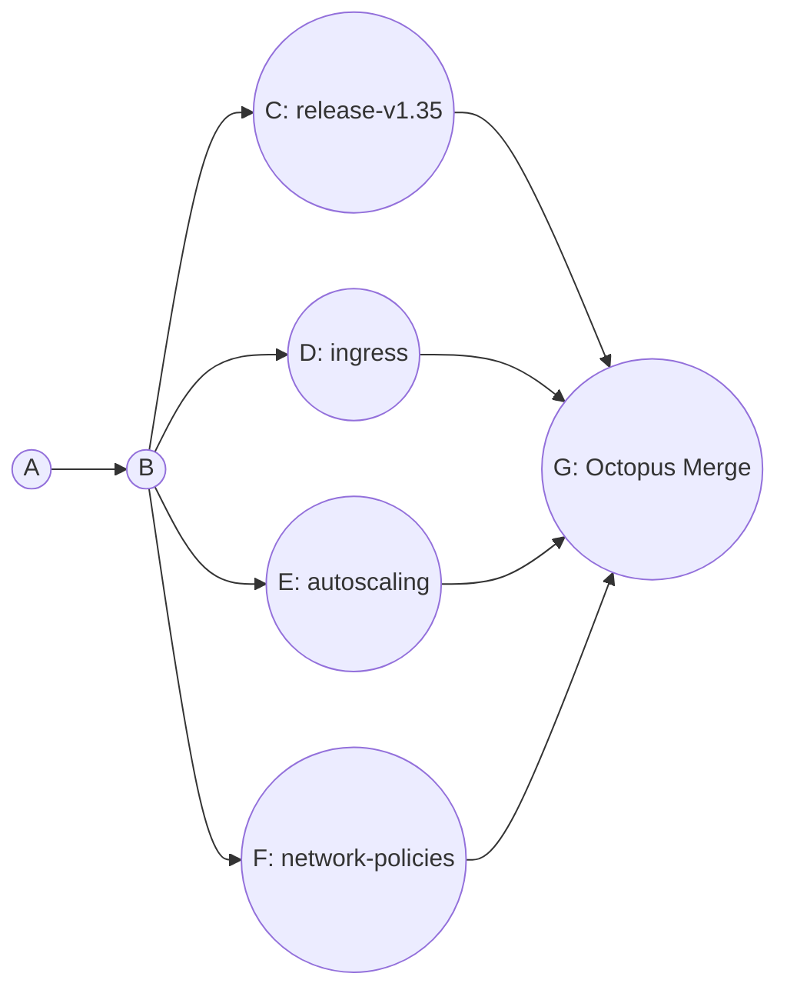
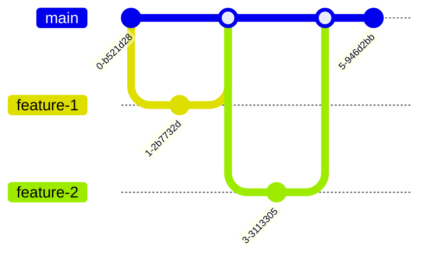

> **Complexity**: `[MEDIUM]`
>
> **Planning estimate**: 100–130 minutes for reading and practice; this estimate has not been measured.
>
> **Prerequisites**: Module 1, Git Internals. This module assumes you can read a commit graph, create branches, and commit small changes, but it does not assume you have already handled a production-grade Kubernetes merge conflict under pressure.

---

## Learning Outcomes
- **Diagnose** the root cause of complex merge conflicts within Kubernetes manifest files by analyzing the merge base and divergent commit histories.
- **Choose and explain** fast-forward, three-way, and octopus merges for a given history.
- **Resolve** multi-file conflicts in infrastructure-as-code and validate syntax and intended relationships.
- **Evaluate** branching strategies (Trunk-based, GitFlow, GitHub Flow) against a platform team's release cadence, supported versions and validation needs.
- **Diagnose** merge-base and strategy behavior using the graph, installed Git version and diff evidence.

## Why This Module Matters

In its [October 2018 incident report](https://github.blog/news-insights/company-news/oct21-post-incident-analysis/), GitHub describes a 43-second network interruption followed by database failover, divergent writes across sites, and 24 hours and 11 minutes of degraded service. Recovery used backup restoration and replica synchronization; manual reconciliation of some writes was still in progress when the report was published. About 200,000 webhook payloads were dropped after their internal time-to-live expired. This illustrates the need to reconcile divergent state, but database replication is not a Git merge: its mechanisms and recovery constraints differ.

For Kubernetes platform work, merging is more than a repository housekeeping task because the merged text often becomes a desired-state contract consumed by controllers, admission policies, scanners, and deployment automation. A clean-looking merge can still leave a selector pointing at the wrong labels, a generated Secret missing from a Kustomize overlay, or a release branch carrying assumptions that are no longer true for Kubernetes 1.35 clusters. This module treats merging as an operational design skill: you will inspect graph shape, choose the right integration method, resolve conflicts by synthesizing intent, and validate that the resulting manifests still describe a coherent system.

## Core Content

### The Geometry of Integration: Fast-Forward vs. Three-Way Merges

Git uses the commit graph to identify the histories and merge base, then attempts to combine their changes. Understanding that graph helps you select an integration method and investigate a conflict.

#### The Fast-Forward Merge

Imagine you are laying bricks to build a straight wall. You stop to take a break. While you are resting, a colleague continues laying bricks starting exactly where you left off, continuing in the exact same straight line. When you return, integrating their new work into your view of the wall requires no complex decisions or architectural changes; you simply walk to the end of their newly laid bricks and consider that the new end of the wall. 

This conceptual model perfectly describes a **fast-forward merge**. It occurs when the current branch tip is a direct, linear ancestor of the branch you are attempting to merge. Git simply moves your current branch pointer forward to point to the exact same commit as the incoming branch. Because the history is entirely linear and hasn't diverged, no new "merge commit" is created.

```bash
# Setting up a fast-forward scenario
ff_dir=$(mktemp -d "${TMPDIR:-/tmp}/cluster-config.XXXXXX")
cd "$ff_dir" || exit
git init --initial-branch=main
git config --local user.name "Example Learner"
git config --local user.email "learner@example.invalid"
git config --local commit.gpgsign false
git config --local tag.gpgsign false
echo "apiVersion: v1" > config.yaml
git add config.yaml
git commit -m "Initialize cluster config"

# Create a new branch and add a commit
git checkout -b feature/add-metadata
echo "kind: ConfigMap" >> config.yaml
git commit -am "Add ConfigMap kind"

# Switch back to main and merge
git checkout main
git merge feature/add-metadata
```

Illustrative output follows; commit IDs differ in your repository. A fast-forward moves the branch pointer without creating a merge commit.
```text
Updating a1b2c3d..e4f5a6b
Fast-forward
 config.yaml | 1 +
 1 file changed, 1 insertion(+)
```

Because the `main` branch had not diverged—meaning no new commits were added to `main` while the `feature/add-metadata` branch was being actively developed—Git simply moved the `main` pointer forward to catch up. 

When a fast-forward is possible but you want a merge commit to retain branch context, use `git merge --no-ff`. Divergent histories already need a merge commit. If the incoming tip is already an ancestor of the current tip, Git reports that it is already up to date; `--no-ff` does not create a redundant merge. `git merge --ff-only` permits a fast-forward or an already-up-to-date no-op and refuses a divergent history. An annotated tag outside `refs/tags/` also suppresses fast-forward by default.

This distinction matters in automation because a protected branch can use `--ff-only` as a guardrail rather than as a style preference. If a pipeline expects a deployment branch to be a strict descendant of a reviewed release branch, a failed fast-forward tells you the graph no longer matches the release process you thought you were following. That failure is useful evidence. It says that someone introduced independent history and that the team now needs a deliberate integration decision instead of a silent pointer move.

**Pause and predict:** Before running `git log --oneline --graph` after this merge, sketch out what you think the history graph will look like. Will there be a fork and a merge commit?

<details>
<summary>Check your prediction</summary>

Because this was a fast-forward merge, `main` simply moved to the tip of `feature/add-metadata`. There is no fork and no merge commit. `git log --oneline --graph` will show a single straight line of commits ending with "Add ConfigMap kind".

</details>

Sketch the resulting graph and mark where each branch name points. Keep that drawing to compare with the next example, where both branches advance independently.

#### The Three-Way Merge

Real-world platform development is rarely perfectly linear. While your colleague was extending the brick wall, you started building a completely parallel wall right next to it. Now, you need to architecturally connect them. A **three-way merge** happens when the history of the repository has fundamentally diverged. Both the current branch and the incoming branch share a common ancestor deep in the past, but both have advanced independently since that point.



In this simple example Git compares the common ancestor `E` with each tip, `C` and `G`, and combines the changes. If the changes can be merged cleanly, the result records a merge commit with both tips as parents. Different changes to the same lines can conflict, while identical changes can be combined; inspect the actual result.

**Pause and predict:** What do you think happens if both branch `main` and branch `feature/rbac` modified the exact same `subjects` list in a RoleBinding manifest, but added different users? How will Git's three-way merge handle this specific scenario?

<details>
<summary>Check your prediction</summary>

In this example the branches add different users at the same location, so a conflict is possible. Identical changes to the same lines can merge cleanly. Inspect the merge result instead of assuming all overlap behaves alike.

</details>

Record your prediction and the assumptions behind it. Compare it with the change shapes below, then check the actual merge result before deciding whether manual resolution is needed.

| Change Type | Branch A (main) vs Base | Branch B (feature) vs Base | Git's Action during Merge |
| :--- | :--- | :--- | :--- |
| File added | Not present | Added | File is added |
| File modified | Unchanged | Modified | Modification applied |
| File deleted | Deleted | Unchanged | File remains deleted |
| File modified | Modified (Line 10) | Modified (Line 50) | Often both apply; inspect the result |
| File modified | Different change (Line 20) | Different change (Line 20) | Can conflict; identical changes can merge |

### Merge Bases, Strategies, and Git's Internal Engines

Git identifies best common ancestors as merge bases. In a complex history there may be more than one, so inspecting the graph and the candidates helps explain the inputs to a merge. Start with the following command, then use `--all` when you need to check for multiple best bases:

```bash
git merge-base main feature/ingress-update
```

Without `--all`, `git merge-base` prints one best common ancestor; when several exist, which one it prints is unspecified. Use `git merge-base --all` to list them. The [merge strategy documentation](https://git-scm.com/docs/git-merge) explains that `ort` can merge multiple common ancestors into a reference tree before the three-way merge. Thus the single printed commit is not necessarily the strategy's actual reference tree. See [git-merge-base](https://git-scm.com/docs/git-merge-base) for the criss-cross example.

**Pause and predict:** Look at the following branch topology. If you are on `main` and run `git merge feature/cache`, which commit is the merge base?



<details>
<summary>Check your prediction</summary>

The merge base is commit `B`. To find it, trace backwards from `main` (commit D) and `feature/cache` (commit H) until their paths intersect. They first meet at `B`, making it the common ancestor used for the three-way merge.

</details>

Record the commit letter and trace both ancestry paths back to that point. Then explain why choosing a strategy is a separate decision from identifying the merge inputs.

Git provides several merge strategies that govern how files are combined: `ort`, `recursive`, `resolve`, `octopus`, `ours`, and `subtree`. The installed Git version matters when interpreting a strategy name.

The current [Git merge documentation](https://git-scm.com/docs/git-merge) specifies `ort` as the default strategy when merging a single head and `octopus` for multiple heads, unless a strategy is chosen explicitly. `ort` uses the histogram diff algorithm by default for merge comparisons. `recursive` was a separate implementation through Git 2.49; starting with 2.50, the name is a synonym for `ort`. Check the installed version before comparing strategy behavior, and do not infer a universal speed or accuracy ranking from the strategy name.

The `resolve` strategy does not handle file renames; `ort` can detect them. `git merge -s ours` records the current tree as the result of the entire merge. In contrast, `git merge -X ours` favors the current side for conflicting hunks while retaining non-conflicting changes from both sides; for a binary conflict it selects the entire current-side content. Review the resulting tree in either case.

#### The Resolution Process

When Git cannot combine changes automatically, inspect the index and decide how to resolve them. This workflow covers a text conflict; other conflict types, such as delete/modify, may have no inline markers.

1. **Identify the Conflict:** Git stops the merge execution and marks the files as conflicted in the index. Run `git status` to see the exact list of files requiring your immediate attention.
2. **Locate the Markers:** For a text conflict, inspect `<<<<<<<`, `=======`, and `>>>>>>>` in the file. For markerless conflicts, use `git status` and `git ls-files -u` to inspect the unmerged paths and stages.
3. **Analyze the Divergence:** Carefully read the code within the markers. Understand exactly what the `HEAD` version was trying to accomplish architecturally versus what the incoming branch was attempting to do.
4. **Synthesize the Intent:** Remove any markers and edit the file to preserve the intended changes. Validate syntax and behavior separately.
5. **Record the Resolution:** Save and validate the chosen content, run `git add <file>` to stage it, inspect any remaining unmerged paths, and use `git commit` to record the active merge. Staging records a choice; validation must establish whether it meets the intended requirements.

### Conflict Resolution in Infrastructure-as-Code: Multi-File Complexity

In a three-way conflict, the index can hold stage 1 (base), stage 2 (current side), and stage 3 (incoming side); inspect them with `git ls-files -u`. With `ort`, `AUTO_MERGE` records a tree snapshot of the conflicted working tree as Git initially wrote it, not a live view of subsequent edits.

**Worked diagnosis:** Suppose `deployment.yaml` has a text conflict during a two-parent merge. Start with `git status --short`: a `UU` entry indicates both sides modified the path and Git has not recorded a resolution. Then run `git ls-files -u -- deployment.yaml` to inspect the unmerged index entries. The stage numbers identify the base and each side, while the object IDs identify the stored file versions. This makes the index useful even when a working-tree file has already been edited.

For a path with all three stages, `git show :1:deployment.yaml` prints the base, `git show :2:deployment.yaml` prints the current side, and `git show :3:deployment.yaml` prints the incoming side. Compare each side against the base to understand what changed, then compare those intentions against the file you intend to stage. These are whole-file versions, not isolated conflicting lines. For example, the base might request two replicas, the current side five, and the incoming side three; selecting a value requires a product decision, not a Git command that can infer capacity needs.

Not every conflict has all three entries: an add/add conflict has no base for that path, and a delete/modify conflict lacks the deleted side. A missing stage is evidence about the conflict shape, so check `git ls-files -u` before trying to show it. Choosing `git checkout --ours -- deployment.yaml` selects the entire current-side file, which can discard unrelated incoming edits as well as the disputed hunk. Instead, edit deliberately and inspect the resulting diff.

After resolving, `git add deployment.yaml` replaces its unmerged entries with the staged result; rerun `git ls-files -u` to check whether any paths remain unmerged. Staging records your choice, but does not establish that a selector matches its labels, a reference exists, or the workload behaves correctly. Validate the complete rendered configuration and its relationships, then finish an active merge with `git commit` after review. If you decide to abort instead, first inspect what work must be preserved.

Hypothetical scenario: teams change two Redis-related files. The snippets below are illustrative fragments, not complete runnable resources or an HA or authentication configuration. The image tag stands in for a hypothetically approved base image; it is not a universal recommendation. Three replicas alone do not establish Redis high availability, and setting `REDIS_PASSWORD` alone does not establish server authentication. The password is a dummy value shown in plaintext; do not store real secrets this way.

Team Alpha's changes on `feature/ha-redis`:
```yaml
spec:
  replicas: 3
  template:
    spec:
      containers:
      - name: redis
        image: redis:7.2.4-alpine
```
```yaml
resources:
- redis-deployment.yaml
commonLabels:
  high-availability: "true"
```

Team Beta's divergent changes on `feature/redis-auth`:
```yaml
spec:
  replicas: 1
  template:
    spec:
      containers:
      - name: redis
        image: redis:7.2.4
        env:
        - name: REDIS_PASSWORD
          valueFrom:
            secretKeyRef:
              name: redis-secret
              key: password
```
```yaml
resources:
- redis-deployment.yaml
secretGenerator:
- name: redis-secret
  literals:
  - password=supersecret
```

For a synthetic base chosen to make both files conflict, a merge may report output like the following. The commands and output are illustrative; the fragments above do not create the branches or base:

```bash
git checkout feature/ha-redis
git merge feature/redis-auth
# Auto-merging redis-deployment.yaml
# CONFLICT (content): Merge conflict in redis-deployment.yaml
# Auto-merging kustomization.yaml
# CONFLICT (content): Merge conflict in kustomization.yaml
# Automatic merge failed; fix conflicts and then commit the result.
```

Before starting a merge, commit or stash unrelated changes so they can be recovered. If a merge is in progress, `git merge --abort` attempts to reconstruct the pre-merge state; pre-existing uncommitted changes can make that reconstruction unreliable. With `MERGE_AUTOSTASH`, abort applies the saved stash, which may itself conflict. Inspect and preserve work before recovery; do not assume a conflicted index can be stashed safely.

For this illustration, preserve the intended replica count and Secret reference together with the generator. These fragments do not establish a working service, authentication, or high availability. `commonLabels` is deprecated and can add labels to selectors; changing an existing Deployment's immutable selector can prevent an update. Consider `labels` with `includeSelectors: false` where appropriate, and inspect rendered selectors and Pod labels before migrating.

Illustrative combined Deployment fragment:
```yaml
spec:
  replicas: 3
  template:
    spec:
      containers:
      - name: redis
        image: redis:7.2.4-alpine
        env:
        - name: REDIS_PASSWORD
          valueFrom:
            secretKeyRef:
              name: redis-secret
              key: password
```

Illustrative combined Kustomization fragment:
```yaml
resources:
- redis-deployment.yaml
commonLabels:
  high-availability: "true"
secretGenerator:
- name: redis-secret
  literals:
  - password=supersecret
```

For a complete runnable configuration, validate the rendered manifests and references before staging and committing the resolution. Compare the generated Secret name with the Deployment reference as well as checking schema shape; the illustrative fragments alone do not prove that relationship works.

Once the merge is committed, inspect its result from more than one perspective. By default, `git show <merge-commit-hash>` uses a dense combined diff for a merge, subject to options such as `--first-parent`. A combined diff lists files modified from all parents; the dense form omits uninteresting hunks where the parents have only two variants and the result picks one without modification. It is therefore not a complete list of changes or a record of human actions. Git 2.36's release notes introduce `git log --remerge-diff`. In Git 2.56, `git show --remerge-diff` also reconstructs a temporary tree for a two-parent merge, potentially containing conflict markers, and compares it with the recorded result. It can help investigate differences, but is not a transcript of how the merge was resolved. Its output and option interactions may change except where explicitly documented. Compare parent-specific diffs where needed.

The following commands are illustrative for a complete repository; the fragments above do not supply all required files. Rendering and schema validation do not prove the generated Secret exists in a cluster.

```bash
kubectl kustomize . | kubeconform -strict -kubernetes-version 1.35.0 -summary -

# If successful:
git add redis-deployment.yaml kustomization.yaml
git commit -m "Merge redis-auth, synthesizing replica, image, and Secret reference intent"
```

Hypothetical scenario: a platform engineer resolves the Deployment manually, then uses `git checkout --ours kustomization.yaml`, stages that file and commits the merge. The Deployment fragment references a password Secret that the chosen Kustomization no longer generates. Inspect the rendered resources to expose that missing relationship. Choosing a whole file can be deliberate, but the decision needs review against the complete resource graph before anyone considers deployment.

When you review this kind of merge, read the final configuration as a set of relationships rather than as two independent files. Rendering with `kubectl kustomize` produces manifests; kubeconform checks their schema shape. Neither proves that a referenced Secret exists in the target namespace or that a container uses its value correctly. Inspect the rendered names and references separately, then use authorized server and runtime checks for the intended environment. Keep these checks distinct before treating the merge as ready for deployment.

`git mergetool` invokes an external merge tool, selected by configuration or from Git's available defaults. For a custom `mergetool.<tool>.cmd`, Git sets `BASE` (the common base, when available), `LOCAL`, `REMOTE` and `MERGED`; interfaces and behavior vary by tool. Git's `merge.conflictStyle` controls text markers: `diff3` includes the base, while `zdiff3` also trims matching lines at conflict edges. Check the installed Git version and tool configuration.

Git's `rerere` records and reuses conflict resolutions when enabled with `rerere.enabled`; an existing `rr-cache` directory also enables it by default. Its cache belongs to that repository's Git directory. Reuse is not validation: inspect the result, stage the resolved files if needed, and complete the merge. Whether reuse also stages files depends on the autoupdate setting.

### Predict and Observe a Merge

Predict whether Git will combine two changes to different fields in the same Deployment. Then run this experiment and inspect the result: a clean text merge still needs a review of the combined configuration.

Use one Unix-like shell with Git and kubeconform on `PATH`. Record `git --version` and `kubeconform -v`; schema validation below targets Kubernetes 1.35.0 and may download schemas, but needs no cluster. The setup creates a fresh scratch directory with a fictional repository-local identity and signing disabled.

```bash
git --version
kubeconform -v
mkdir -p "${TMPDIR:-/tmp}"
lab_dir=$(mktemp -d "${TMPDIR:-/tmp}/k8s-merge-lab.XXXXXX")
cd "$lab_dir" || exit
git init --initial-branch=main
git config user.name "Example Learner"
git config user.email "learner@example.invalid"
git config commit.gpgsign false
git config tag.gpgsign false
```

Save the following as `deployment.yaml` in the scratch directory:
```yaml
apiVersion: apps/v1
kind: Deployment
metadata:
  name: api-server
spec:
  replicas: 2
  selector:
    matchLabels:
      app: api
  template:
    metadata:
      labels:
        app: api
    spec:
      containers:
      - name: api
        image: nginx:1.27.0
```
```bash
git add deployment.yaml
git commit -m "chore: initial api deployment"
```

Create two branches from the same base. One changes desired capacity; the other updates the image. Before merging, predict whether Git will combine them or ask for help, and explain what evidence would distinguish those outcomes.
```bash
git checkout -b feature/scale-up
sed -i.bak 's/replicas: 2/replicas: 5/g' deployment.yaml && rm deployment.yaml.bak
git add deployment.yaml
git commit -m "feat: scale api to 5 replicas"
```
```bash
git checkout main
git checkout -b feature/update-image
sed -i.bak 's/image: nginx:1.27.0/image: nginx:1.27.1/g' deployment.yaml && rm deployment.yaml.bak
git add deployment.yaml
git commit -m "chore: update nginx to 1.27.1"
```

Merge the image branch into the scale branch and inspect the result:
```bash
git checkout feature/scale-up
git merge feature/update-image
git status --short
git ls-files -u
```

A recorded run of this exact fixture with Git 2.56.0 completed a clean merge, retained both changes, and left no unmerged entries or working-tree changes. The edits affect separate regions, which Git can combine; this fixture establishes no universal line-gap threshold. Results can differ with Git version, configuration, or changed inputs; inspect your own output. If a conflict occurs, use `git status` to identify the affected file and resolve its markers before continuing.

Compare the combined file with this intended result:
```yaml
apiVersion: apps/v1
kind: Deployment
metadata:
  name: api-server
spec:
  replicas: 5
  selector:
    matchLabels:
      app: api
  template:
    metadata:
      labels:
        app: api
    spec:
      containers:
      - name: api
        image: nginx:1.27.1
```

Check that both decisions survived, then validate the manifest's schema:

```bash
git status --short
git ls-files -u
grep -nE 'replicas:|image:' deployment.yaml
kubeconform -strict -kubernetes-version 1.35.0 -summary deployment.yaml
```

Expect replicas `5`, image `nginx:1.27.1`, empty output from `git status --short` and `git ls-files -u`, and a valid Deployment schema. If Git opens an editor for the merge message, save and close it to finish that merge commit. Once the clean merge command succeeds, no additional commit is needed. If your run conflicts, remove markers while retaining both intended changes, stage the resolution, and complete the merge with `git commit`.

A clean text merge is not proof that the combined configuration works in a target environment. Schema validation checks shape, not deployment behavior. Compare the branch changes and review their combined intent before applying any configuration.

### The Octopus Merge: Taming Multiple Branches

An octopus merge combines multiple incoming heads in one merge commit. Git selects the `octopus` strategy by default when merging more than one incoming head; it is suitable for bundling topic branches when the merge can be handled automatically. The diagram's arrows point from parent commits toward their child.



```bash
git checkout release-v1.35
git merge feature/ingress feature/autoscaling feature/network-policies
```

**Pause and predict:** What do you think happens if Git successfully merges `feature/ingress` and `feature/autoscaling`, but then detects a complex conflict when attempting to merge `feature/network-policies`? Will it pause and ask you to resolve it like a standard three-way merge?

<details>
<summary>Check your prediction</summary>

It can leave a hand-resolvable merge when the final incoming head conflicts. In the recorded Git 2.56 control, the branch ref stayed unchanged while `MERGE_HEAD`, unmerged index entries and partial work remained; stage 2 contained an intermediate octopus result. The pinned implementation permits this only for the final head: an earlier unresolved conflict prevents processing later heads. Inspect status rather than assuming one universal failure state. I recommend aborting an active attempt before retrying integration pairwise, with validation after each merge and on the combined result.

</details>

Record the branch, index and working-tree state you would inspect after a failed attempt. Use that evidence to choose recovery rather than assuming a failed command left the workspace unchanged.

> **Stop and think**: If the octopus attempt fails, how would you use a dedicated integration branch and pairwise merges to identify and resolve the conflict without modifying either topic branch? Inspect the failed state first, abort an in-progress attempt if appropriate, then merge and validate each topic into the integration branch in turn. Explain how this preserves the topic branches and why the final result still needs review.

### Advanced History Rewriting and Cherry-Picking

Before integrating a branch, consider whether its commits communicate independent changes clearly. Cleaning up unpublished work can help review, but rewriting a shared branch requires coordination with its collaborators.

Interactive rebase supports `pick`, `edit`, `reword`, `drop`, `squash`, `fixup`, `break`, and `exec`. An `exec` instruction runs at its position in the instruction list; `--exec` inserts commands after commit-creating instructions. With autosquash, inserted commands appear at the end of a squash/fixup series, not after every original commit. By default the instruction list omits merge commits.

Use `git rebase --onto <newbase> <upstream> <branch>` to select a commit range and replay it onto another base. Inspect the upstream boundary and graph first, because choosing the wrong range can omit required changes or replay unrelated work.

If your team uses rebasing for unpublished local work, `git pull --rebase origin main` fetches remote changes and replays your local commits on top. Check your current branch and worktree first, and follow the repository's review policy before pushing. Conflicts can still stop the replay; rebasing does not validate the resulting manifests or authorize rewriting shared history.

Use `git cherry-pick` to apply selected commits without merging the entire branch. `git cherry-pick -x` adds a source line for conflict-free picks; conflicts may require recording provenance manually. `git cherry-pick -n` applies changes without creating a commit. Either form can conflict and needs review and validation.

`git merge --squash` prepares a merge result without creating a commit or recording `MERGE_HEAD`. After a clean squash merge, review the working tree and staged changes before making a single commit. Inspect conflicts deliberately if integration fails; squash does not establish that the combined changes are valid.

To effectively audit how merges have structurally impacted your repository over time, you can query the timeline using `git log --merges` (which prints only merge commits and is functionally equivalent to passing `--min-parents=2`) or use `git log --no-merges` (which completely excludes all merge commits and is equivalent to passing `--max-parents=1`).

### Branching Strategies & Platform Configurations

A branching model sets where work is reviewed, integrated and released; a merge strategy combines particular histories. Choose the model around release cadence, supported versions and validation capacity. [Git's own workflow](https://git-scm.com/docs/gitworkflows) uses topic, integration and maintenance branches, while warning that its full process is rarely needed for smaller projects.

> **Stop and think**: Imagine you are advising a new platform team. They have 12 engineers, deploy to production twice a week, and have automated test coverage but it sometimes produces false positives. Which branching strategy would you recommend and why? Keep your answer in mind as you read the following models.

#### 1. GitFlow: Release and Development Branches
GitFlow separates a release-history branch from `develop`, where features are integrated. Release branches prepare a version for release, and hotfix branches handle urgent corrections. The [model's author](https://nvie.com/posts/a-successful-git-branching-model/) recommends a simpler workflow for continuous delivery, while retaining GitFlow as an option for explicitly versioned software or multiple supported versions. A branch name alone does not prove what is deployed.

- **Tradeoff:** Separate stabilization and maintenance work can help manage releases, but fixes need a clear route back to the other affected branches. Delayed integration increases the amount of divergent work to reconcile; conflicts and deployment failures are risks to manage, not inevitable consequences of the model.

#### 2. GitHub Flow: Branch, Review and Merge
[GitHub flow](https://docs.github.com/en/get-started/using-github/github-flow) gives each change a branch, then uses a pull request for feedback before merging into the default branch. Required checks and review rules depend on repository configuration. Merging and deployment are separate actions: the workflow does not require every merge to deploy immediately.

- **Tradeoff:** A small review branch keeps the change focused, but tests and review can miss defects. Choose deployment approval and recovery procedures for the risk involved; no branching model requires infallible tests or guarantees a healthy production cluster.

#### 3. Trunk-Based Development: Frequent Integration
[Trunk-based development](https://trunkbaseddevelopment.com/) centers development on one shared trunk and avoids long-lived development branches. It can use direct commits or short-lived review branches; bypassing review is not part of the definition. The diagram below illustrates the review-branch variant rather than prescribing a repository's access policy.



- **Tradeoff:** Frequent integration limits the work accumulated between integrations, but conflicts remain possible. Keep the shared build usable and changes small. Incomplete behavior needs a deliberate release boundary, which may use feature flags; flags are a technique, not a requirement for every change.

For a GitOps repository, inspect the controller's configured revision and sync policy before predicting a deployment. [Argo CD supports branch or symbolic-reference tracking, tag tracking and commit pinning](https://argo-cd.readthedocs.io/en/stable/user-guide/tracking_strategies/); it does not require `main`. Confirm that the revision resolves to the intended reference, especially when a branch and tag share a name. A merge to an untracked branch does not by itself change the manifests selected by that Application. Automatic synchronization is configurable, and parameter overrides can affect desired manifests.

**Worked decision:** In a hypothetical team deploying twice a week, production is pinned to a reviewed commit and QA tracks a release branch. A new commit on `main` does not advance that production pin. Name who promotes the revision, which checks gate promotion and how fixes reach both branches. Short-lived review branches may simplify integration, while a maintenance branch may serve a separate supported version. Defend either choice from these needs rather than ranking teams by their branching model.

#### Platform Merge Methods

Repository merge restrictions determine which integration operations are allowed. Choose these rules alongside the branching model; enabling a particular merge method does not itself enforce release cadence, testing or deployment approval.

GitHub offers merge commit, squash, and rebase merge methods. GitHub's rebase-and-merge creates new commit SHAs and updates committer information; account for that difference when reconciling local history.

GitLab offers merge commit, semi-linear, and fast-forward merge methods. Its automatic rebase feature was introduced behind a disabled flag in 18.0, enabled on GitLab.com in 18.11, had the flag removed in 19.0, and became generally available in 19.2. Check the installed version and configuration before relying on it.

## Patterns & Anti-Patterns

Advanced merging becomes safer when a team treats every integration as a design decision instead of a keyboard shortcut. The Git command is only the last visible action; the real work is deciding whether the branch is fresh enough to merge, whether the affected files are schema-sensitive, whether the review surface can be understood by another engineer, and whether the resulting history will help the next incident responder reconstruct intent. A platform repository is not a scrapbook of commits, because every merge can become an input to a controller, an audit trail for a production incident, or a rollback boundary during a failed release.

One useful pattern is small, frequent integration against a protected trunk. A short-lived review branch can reduce accumulated divergence, although conflict size still depends on which changes overlap. For Kubernetes manifests, that distinction matters: a small change might ask whether `replicas` should be three or five, while a larger integration may also require reconciling probes, selectors, container names and network policy labels. Maintenance branches remain useful when they have an explicit supported-version purpose and fix-propagation policy.

Another durable pattern is layered validation immediately after conflict resolution. Git combines text, `kubectl kustomize` renders resources, and [kubeconform validates schema shape](https://github.com/yannh/kubeconform#limits-of-kubeconform-validation). A schema pass does not establish referenced-object existence, admission acceptance or workload behavior. Kubeconform normally retrieves schemas remotely; cluster-free does not mean network-free. For reproducibility, choose the Kubernetes schema version explicitly, record the tool version and schema source, and configure complete local schemas when working offline. Its cache stores downloaded schemas but is not proof that every required schema is available.

A third pattern is to keep merge commits reviewable and explain any additional changes. A combined diff offers one view of the result, but omits some changes and cannot identify who made an edit or why. Compare each parent and, for a two-parent merge, consider a remerge diff alongside the recorded result and review notes. Those views help investigate unexpected additions without claiming to reconstruct a person's actions.

| Pattern | Use When | Why It Works | Scaling Consideration |
| :--- | :--- | :--- | :--- |
| **Short-lived review branches** | Engineers want frequent integration with review before merge. | Limits accumulated divergence without guaranteeing conflict-free merges. | Keep checks fast and define how incomplete behavior stays out of releases; use flags when appropriate. |
| **Layered conflict validation** | The merge touches Kubernetes YAML, Helm output, Kustomize overlays, or policy-as-code. | Rendering, schema validation, reference inspection and runtime checks answer different questions. | Record versions and schema sources; keep applicable checks available locally and in CI. |
| **Reviewable merge commits** | A three-way merge needed synthesis. | Parent-specific and remerge comparisons provide complementary views of the result. | Record intent and validation; no diff proves which edits were manual. |
| **Recorded recurring resolutions** | The same branch family repeatedly conflicts during release preparation. | `rerere` can reuse a previously recorded resolution, reducing repeated manual work. | The cache is local to each repository; review every reused result against current intent and tests. |

The corresponding anti-patterns can arise under release pressure: a resolver chooses an IDE shortcut to finish the merge without inspecting the selected content. Accepting "ours" across an entire file can discard incoming changes outside the disputed hunk. In a hypothetical Deployment conflict, both branches change the image while the security branch also adds a container security context elsewhere in that same file. Selecting the release branch's whole file can discard that added context. Compare both versions and the intended result before staging it.

The second trap is leaving a release branch without an owner or a fix-propagation policy. Isolation can serve stabilization or maintenance, but missed fixes can leave supported branches inconsistent. In a GitOps repository, compare the branch with the actual tracked revision, not an assumed `main`. A risky integration may combine hotfixes, chart updates and policy changes under release pressure; inspect those changes and their intended environments before choosing how to integrate them.

The third anti-pattern is treating automatic merge success as proof of semantic correctness. The diagnostic exercise combines the scale and image edits correctly; a different combination can still violate a resource relationship. For example, independent changes to a Deployment's selector and Pod labels may merge cleanly while leaving those values inconsistent. Kustomize rewrites recognized generated-resource references, so inspect its rendered output rather than assuming a name change broke every reference. Pause and predict: after a successful text merge, which checks establish schema shape, local relationships and behavior in the intended target environment?

## Decision Framework

Choosing a merge approach starts with the shape of the graph, but it should not end there. First ask whether your current branch tip is an ancestor of the incoming branch tip. If it is, a fast-forward or `--ff-only` merge preserves the cleanest history and avoids inventing a merge commit that does not carry extra information. If the graph has diverged, ask whether the branch is fresh enough for a normal three-way merge and whether the files are simple enough for line-based resolution. If the branch is stale, the safer move may be to abandon the old branch shape, inspect its intent with `git diff <merge-base>..branch`, and transplant selected commits onto a fresh branch.

The next decision is whether history shape or review shape matters more for this change. A merge commit preserves the fact that a feature branch existed and can make release audits easier when a branch represents a coherent body of work. Squash merge creates a cleaner linear history, but it erases internal commit boundaries and can make `git bisect` less precise if the squashed branch mixed unrelated changes. Rebase and merge creates a linear story with individual commits preserved, yet it rewrites commit identities and can confuse collaborators who have based work on the old branch. None of these choices is universally correct; the right answer depends on how your team debugs incidents, reviews changes, and rolls back failed releases.

Use the following decision matrix as a practical guide when you are under pressure. It deliberately combines graph facts with operational facts, because a Kubernetes platform repository is judged by the behavior it produces after merge, not by the elegance of its commit graph alone.

| Situation | Preferred Move | Why | Validation Before Commit |
| :--- | :--- | :--- | :--- |
| Current branch is behind and has no unique commits | `git merge --ff-only incoming` | The branch pointer can move without creating a synthetic merge commit. | Run the relevant tests or render manifests if the incoming branch was not already validated. |
| Two fresh branches touched different files | Normal three-way merge with `ort` | Git can synthesize independent file changes cleanly while preserving both parents. | Review the merge commit and run targeted CI for changed areas. |
| Two branches touched the same Kubernetes manifest | Resolve intent, then validate in layers | Text adjacency cannot establish resource relationships. | Render first, validate against the chosen schema version, inspect references, and run applicable policy/server/runtime checks. |
| Several independent branches need one release branch | Consider octopus when conflicts are unlikely | A difficult conflict may stop the operation and leave partial work. | Inspect status; abort an in-progress attempt if appropriate and integrate conflicting changes separately. |
| Old branch has a stale merge base | Inspect intent, then compare merge and selective cherry-pick | Old assumptions may need adaptation, but age alone does not predict conflicts. | Review dependencies and test selected changes after replay, especially migrations and API changes. |
| Pull request contains noisy local commits | Interactive rebase before review | Reviewers see a coherent story instead of temporary savepoints. | Re-run tests after rewriting and force-push only to branches you own. |

One useful review heuristic is: "Could I explain this result to the on-call engineer?" If the explanation is unclear, investigate whether the scope, resolution or validation evidence needs improvement. That question is useful for GitOps work because the repository is both documentation and control plane input. Trace the merge base, each branch's intent, the chosen resolution and the relevant validation before deciding whether the evidence supports integration.

For day-to-day work, a compact flow helps prevent panic decisions. Start with `git status` to make sure your workspace is clean, inspect the graph with `git log --oneline --graph --decorate --all`, identify the merge base when the branch has been alive for more than a short review cycle, then choose the least surprising integration method that preserves the information your team will need later. After resolution, validate the rendered platform object and inspect the merge commit rather than only the final file. This sequence is slower than clicking a button, but it is much faster than debugging a cluster that accepted a syntactically valid yet semantically broken configuration.

## Did You Know?

1. Git 2.50 made `recursive` a synonym for `ort`; earlier versions used a separate implementation.
2. `git rerere gc` uses configurable default expiry periods of 15 days for unresolved and 60 days for resolved records.
3. Git documents three conflict styles: `merge`, `diff3`, and `zdiff3`. Git 2.35's release notes announce the added "zealous diff3" presentation; that release's configuration manual names the setting `zdiff3`.
4. A three-way conflict can store up to three index stages: base, current side and incoming side.

## Common Mistakes

| Mistake | Why It Happens | How to Fix It |
| :--- | :--- | :--- |
| **Committing unresolved markers** | Markers were staged as ordinary text. | If the merge is still in progress, inspect and resolve it or abort deliberately. If already committed, fix forward or use the team's approved history-recovery process; `git merge --abort` cannot undo a completed merge. |
| **Breaking YAML indentation** | Deleting conflict markers shifts YAML blocks or introduces duplicate keys. | Run strict schema validation on rendered manifests; separately check references and behavior. A schema pass is not deployment proof. |
| **Ignoring upstream** | Work diverges without checking how related changes interact. | Inspect the graph and changes, and integrate or rebase according to the team's policy; resolve and validate any conflicts. |
| **Resolving logic, breaking syntax** | Focusing so hard on getting both sets of configuration into the file that you create duplicate keys (e.g., two `spec` blocks in a pod definition). | Understand the schema of the file you are editing. Use IDE plugins with Kubernetes schema validation enabled during conflict resolution. |
| **Unexplained extra merge changes** | A resolver adds an unrelated fix while combining the branches. | As a stricter review policy, keep unrelated fixes in separate commits. Git permits additional fixups; explain any such changes rather than assuming they came from a parent or conflict. |
| **Deleting the wrong side** | Misunderstanding `HEAD` vs the incoming branch, and blindly choosing "Accept Current Change" when the incoming branch contained critical security patches. | Read the code inside the markers. Never trust automated UI buttons in IDEs without verifying what exact lines will survive the merge. |

> **Stop and think**: Which failure in the table would matter most in your team's context? Rank the consequences and name the review or validation check that would expose each failure before deployment.

## Quiz

<details>
<summary>Question 1: Your team is practicing Trunk-Based Development. You have been working on a new Kubernetes network policy for about 4 hours on a local branch. When you attempt to push to main, Git rejects it, stating the remote contains work you do not have. What is the safest sequence of actions to integrate your work?</summary>

Check which branch you are on, whether the worktree is clean and whether anyone shares the commits you would rewrite. For unpublished local work under a rebase policy, `git pull --rebase origin main` fetches the remote commits and replays your local commits on top; resolve any conflicts deliberately, then review and validate the result. Submit through the required review path. A shared branch may instead need a coordinated merge: frequent integration does not require bypassing protection or universally linear history.

</details>

<details>
<summary>Question 2: You trigger an automated pipeline that attempts an octopus merge, integrating four different microservice deployment updates into a staging branch. Git halts and reports a conflict between two of the branches. What happens to the staging branch in this exact moment, and how is the pipeline affected?</summary>

The branch ref does not move on a failed merge. Inspect `git status` and the index: depending on when and how the attempt failed, partial changes or an in-progress merge may remain. A pipeline should fail and perform appropriate cleanup, not assume a pristine workspace.

</details>

<details>
<summary>Question 3: A two-parent merge resolves a large StatefulSet and ConfigMap conflict. Which views help review the recorded result, what can they not prove, and what version detail matters when comparing the recursive strategy?</summary>

Inspect the merge with `git show`, remembering that its default dense combined view omits files not modified from every parent and some hunks. Compare the result with each parent for a fuller view. `git show --remerge-diff <merge-commit-hash>` reconstructs a temporary tree, potentially containing conflict markers, and shows its difference from the recorded result; output and option interactions may change except where documented. Neither view proves which changes a person made manually, so use branch intent, review notes and validation evidence as well. Record the installed Git version: `recursive` was a separate implementation through 2.49 and names `ort` starting with 2.50.

</details>

<details>
<summary><span>Question 4: An incident occurs in production because a <code>ConfigMap</code> update was inexplicably lost during a recent deployment. Looking at the Git history, you see a merge commit connecting a feature branch to main. The file changed on both branches, but the feature branch's changes are completely missing in the final merge commit. What likely happened during the conflict resolution?</span></summary>

Choosing the current side during conflict resolution is one possible cause, but the history alone does not establish the command, intent, or motive. Compare the merge result with each parent and the original change, then inspect review evidence. Validate the local result; `kubectl diff` compares against a live target and requires appropriate access, so it answers a separate question.

</details>

<details>
<summary><span>Question 5: QA tracks a release branch in Argo CD, while production is pinned to a commit. A colleague merges a fix into <code>main</code> and expects both environments to update. What must you inspect, and does keeping a release branch guarantee deployment failures?</span></summary>

Inspect each Application's repository, configured revision, parameter overrides and sync policy; confirm that the revision resolves to the intended reference. With QA uniquely tracking the release branch, it selects that branch's manifests; production selects its pinned commit. A merge into `main` alone advances neither selection. Trace how the fix reaches the release branch and how a reviewed production revision is promoted, then verify the sync result separately. Release branches can serve stabilization, while maintenance branches serve supported versions; missing fix propagation and delayed integration create risks, but the branch model alone proves neither failure nor live drift.

To evaluate the branching strategy, ask whether the team supports multiple released versions or continuously delivers one version. GitFlow's release separation may serve the former; GitHub Flow or trunk-based development may simplify the latter. The scenario alone does not establish either requirement, so ask for that evidence before recommending a workflow, and retain review and validation gates in either case.

</details>

<details>
<summary><span>Question 6: You are tasked with taking over a legacy <code>feature/database-migration</code> branch that was abandoned by a former employee. Before attempting to integrate it, you run <code>git merge-base main feature/database-migration</code> and find that the common ancestor is a commit from over a year ago. What is the safest sequence of actions to rescue this work without breaking the current cluster state, and why?</span></summary>

Age alone does not determine conflict size. Inspect the graph, the base-to-branch diff, and current requirements, then compare a merge with selectively cherry-picking relevant commits onto a new branch. Cherry-picks can also conflict and may depend on omitted commits. Resolve and test the chosen result before any deployment; neither method guarantees cluster safety.

</details>

## Hands-On Exercise

In this local lab you will create a small manifest repository, inspect a merge base and resolve competing ConfigMap settings. The Deployment auto-merges, so review whether it retained both the replica and probe changes. Then separate schema validity from the Deployment's reference to the ConfigMap. This exercise inspects files and Git history; it does not create cluster resources or demonstrate runtime behavior.

Use a Unix-like shell with Git, Perl and kubeconform on `PATH` (for example `brew install kubeconform` on macOS). Run `git --version` and `kubeconform -v` and retain those versions with your notes. Keep the commands in one shell. The setup creates a fresh scratch directory and sets a fictional Git identity only in that repository. Schema checks below target Kubernetes 1.35.0 and may download schemas; they need no cluster. A different target environment requires its own version and applicability check.

- [ ] Create the repository, add the baseline Deployment and ConfigMap, and commit the initial state.
- [ ] Create `feature/harden-api` to add a health probe and stricter ConfigMap setting.
- [ ] Create `feature/scale-api` to change replicas and a competing ConfigMap setting.
- [ ] Merge `feature/scale-api` into `feature/harden-api`, inspect the merge base, review the auto-merged `deployment.yaml`, and resolve the conflict in `configmap.yaml`.
- [ ] Validate both resolved manifests against the chosen schemas, then inspect the ConfigMap reference and explain why a schema pass cannot prove that reference exists in a cluster.
- [ ] Inspect the final merge with `git show`, compare each parent and explain what the diff views can and cannot establish about the resolution.

<details>
<summary>Hint 1: Separate the decisions</summary>

Identify what each branch intended before choosing the ConfigMap value. If `git status` shows `UU`, both sides modified that file: inspect both versions and the base before selecting the result. A clean Deployment merge still needs review to confirm both intended changes survived.
</details>

<details>
<summary>Hint 2: Locate the conflict</summary>

Use Git's status and unmerged index entries to find the affected file. If there is no `MERGE_HEAD`, do not assume a merge is still active or run abort blindly; inspect the branch and working tree to determine the actual state before choosing recovery.
</details>

<details>
<summary>Hint 3: Check the relationship</summary>

If schema validation fails, inspect the reported file and field against the selected Kubernetes schema version, repair the manifest, and rerun the check. Once it passes, compare the Deployment's ConfigMap reference name with the ConfigMap's metadata name; explain what that local comparison cannot prove.
</details>

<details>
<summary>Setup and task solutions</summary>

Create the repository and baseline files:

```bash
lab_dir=$(mktemp -d "${TMPDIR:-/tmp}/k8s-advanced-merge.XXXXXX")
cd "$lab_dir" || exit
git init --initial-branch=main
git config --local user.name "Merge practice"
git config --local user.email "practice@example.invalid"
git config --local commit.gpgsign false
printf 'Practice repository: %s\n' "$lab_dir"
```

```yaml
apiVersion: v1
kind: ConfigMap
metadata:
  name: api-settings
data:
  LOG_LEVEL: "info"
  FEATURE_MODE: "standard"
```

Save that YAML as `configmap.yaml`, then create the Deployment:

```yaml
apiVersion: apps/v1
kind: Deployment
metadata:
  name: api-server
spec:
  replicas: 2
  selector:
    matchLabels:
      app: api
  template:
    metadata:
      labels:
        app: api
    spec:
      containers:
      - name: api
        image: nginx:1.27.1
        envFrom:
        - configMapRef:
            name: api-settings
```

Save that YAML as `deployment.yaml`, then commit:

```bash
git add configmap.yaml deployment.yaml
git commit -m "chore: add baseline api manifests"
```

Create the hardening branch:

```bash
git checkout -b feature/harden-api
perl -0pi -e 's/FEATURE_MODE: "standard"/FEATURE_MODE: "strict"/' configmap.yaml
perl -0pi -e 's|image: nginx:1.27.1|image: nginx:1.27.1\n        readinessProbe:\n          httpGet:\n            path: /\n            port: 80\n          initialDelaySeconds: 5\n          periodSeconds: 10|' deployment.yaml
git add configmap.yaml deployment.yaml
git commit -m "feat: harden api readiness behavior"
```

Create the scale branch from `main`:

```bash
git checkout main
git checkout -b feature/scale-api
perl -0pi -e 's/replicas: 2/replicas: 5/' deployment.yaml
perl -0pi -e 's/FEATURE_MODE: "standard"/FEATURE_MODE: "burst"/' configmap.yaml
git add configmap.yaml deployment.yaml
git commit -m "feat: scale api for burst traffic"
```

Merge and inspect the merge base:

```bash
git checkout feature/harden-api
git merge-base main feature/scale-api
git merge feature/scale-api
git status
```

Review `deployment.yaml`. Git should auto-merge it cleanly, combining the readiness probe from `feature/harden-api` with the scaled replica count from `feature/scale-api`. Confirm the file matches this expected result:

```yaml
apiVersion: apps/v1
kind: Deployment
metadata:
  name: api-server
spec:
  replicas: 5
  selector:
    matchLabels:
      app: api
  template:
    metadata:
      labels:
        app: api
    spec:
      containers:
      - name: api
        image: nginx:1.27.1
        readinessProbe:
          httpGet:
            path: /
            port: 80
          initialDelaySeconds: 5
          periodSeconds: 10
        envFrom:
        - configMapRef:
            name: api-settings
```

Resolve `configmap.yaml` by making an explicit product decision. In this example, the release owner chooses strict mode because hardening matters more than burst behavior until the feature flag is redesigned:

```yaml
apiVersion: v1
kind: ConfigMap
metadata:
  name: api-settings
data:
  LOG_LEVEL: "info"
  FEATURE_MODE: "strict"
```

Validate the schemas, then inspect `deployment.yaml`'s `envFrom[].configMapRef.name` alongside the ConfigMap's `metadata.name`. Both should be `api-settings`; neither manifest sets a namespace, so they must be used in the same namespace if deployed. This file comparison establishes the intended local reference, not an existing cluster object. Only after recording that distinction should you commit:

```bash
kubeconform -strict -kubernetes-version 1.35.0 -summary configmap.yaml deployment.yaml
git diff --check
git add configmap.yaml deployment.yaml
git commit -m "Merge scale-api into harden-api resolving replicas and feature mode"
git show --stat --summary HEAD
git show HEAD
```

To complete the comparison task for this recorded two-parent merge, use `git show --diff-merges=separate -p HEAD` for each parent's view and `git show --remerge-diff HEAD` for the reconstructed-tree comparison. Explain the omissions and reconstruction limits in your audit; neither output identifies a person's actions. Check the installed Git version before interpreting the `recursive` strategy name.

</details>

**Card A: A fast-forward is drawn as a merge commit.** After `feature/add-metadata` lands on an undiverged `main`, someone expects `git log --graph` to show a fork.

<details>
<summary>Check your prediction</summary>

Failure layer: pointer move versus a new commit. In this fixture, look for a single line ending at the feature tip. A forced `--no-ff` would instead record a merge commit; inspect ancestry and merge options before generalizing to another history.

</details>

**Card B: The same `subjects` lines auto-merge.** Both branches added a different user on the same RoleBinding list. The merge is expected to keep both names without a stop.

<details>
<summary>Check your prediction</summary>

Failure layer: differing edits to the same hunk can conflict. Inspect the result; identical edits can merge cleanly.

</details>

**Card C: The merge base is a tip.** On `main`, merging `feature/cache` from the topology above, someone names commit `D` or commit `H` as the base.

<details>
<summary>Check your prediction</summary>

Failure layer: the common ancestor, not either tip. Next action: walk both histories backward until they meet. In that diagram the meeting point is `B`.

</details>

**Card D: A failed octopus attempt left a pristine workspace.** `feature/network-policies` conflicts after two other branches merged cleanly. The pipeline plans to start another integration without inspecting status.

<details>
<summary>Check your prediction</summary>

Failure layer: a failed octopus attempt can leave partial state. Inspect status, abort an in-progress merge if appropriate, and integrate the conflicting changes separately.

</details>

**Check the boundary:** Before changing a file, predict whether replacing only the Deployment's reference with `absent-settings` would fail schema validation. Create a separate diagnostic file in the practice directory:

```bash
sed 's/name: api-settings/name: absent-settings/' deployment.yaml > missing-reference.yaml
kubeconform -strict -kubernetes-version 1.35.0 -summary missing-reference.yaml
```

Expect a schema pass: the reference is still a string of the permitted shape. Compare that name with the ConfigMap definition to identify the broken relationship yourself. Keep this diagnostic file uncommitted. Server-side validation and runtime observation answer further questions; neither was performed by this local exercise.

Success means recording the merge base, both branches' intent, five replicas, the retained probe, the chosen strict ConfigMap value, a schema pass and the matching local reference names. Explain why the negative reference control still passes schema validation, and distinguish those results from admission acceptance, object existence in a target namespace and a functioning workload. Keep the scratch path and evidence for review; no production repository or cluster was changed.

**Transfer challenge:** Consider two branches changing a Deployment selector and its Pod labels. How would you inspect and validate their relationship after merging, and what evidence would still require a target environment?

## Sources

- [Kubeconform: validation limits, schema locations, cache and version selection](https://github.com/yannh/kubeconform)
- [Kubernetes ConfigMap references from Pods](https://kubernetes.io/docs/concepts/configuration/configmap/#configmaps-and-pods)
- [Git workflow manual: topic, integration and maintenance branches](https://git-scm.com/docs/gitworkflows)
- [GitFlow's original model and author's reflection on applicability](https://nvie.com/posts/a-successful-git-branching-model/)
- [GitHub flow: branch, pull request and merge](https://docs.github.com/en/get-started/using-github/github-flow)
- [Trunk-based development: shared trunk and short-lived branches](https://trunkbaseddevelopment.com/)
- [Argo CD tracking strategies: branches, tags and commit pinning](https://argo-cd.readthedocs.io/en/stable/user-guide/tracking_strategies/)
- [Git merge documentation](https://git-scm.com/docs/git-merge)
- [Git merge-base documentation](https://git-scm.com/docs/git-merge-base)
- [Git show documentation: merge-diff formats](https://git-scm.com/docs/git-show)
- [Git rerere documentation](https://git-scm.com/docs/git-rerere)
- [Git rebase documentation](https://git-scm.com/docs/git-rebase)
- [Git pull: fetch, then rebase or merge](https://git-scm.com/docs/git-pull)
- [Git cherry-pick documentation](https://git-scm.com/docs/git-cherry-pick)
- [Git log documentation](https://git-scm.com/docs/git-log)
- [Kubernetes Kustomize documentation](https://kubernetes.io/docs/tasks/manage-kubernetes-objects/kustomization/)
- [GitHub October 21 2018 post-incident analysis](https://github.blog/news-insights/company-news/oct21-post-incident-analysis/)
- [GitHub pull request merge methods](https://docs.github.com/en/repositories/configuring-branches-and-merges-in-your-repository/configuring-pull-request-merges/about-merge-methods-on-github)
- [GitLab merge request methods](https://docs.gitlab.com/user/project/merge_requests/methods/)
- [Redis security and authentication](https://redis.io/docs/latest/operate/oss_and_stack/management/security/)
- [Redis Sentinel high availability](https://redis.io/docs/latest/operate/oss_and_stack/management/sentinel/)
- [Git 2.56 merge strategies](https://github.com/git/git/blob/a018953688f1b10bddf91bff8747068f5f4746a4/Documentation/merge-strategies.adoc)
- Git release history: [2.35](https://github.com/git/git/blob/a018953688f1b10bddf91bff8747068f5f4746a4/Documentation/RelNotes/2.35.0.adoc), [2.36](https://github.com/git/git/blob/a018953688f1b10bddf91bff8747068f5f4746a4/Documentation/RelNotes/2.36.0.adoc), [2.50](https://github.com/git/git/blob/a018953688f1b10bddf91bff8747068f5f4746a4/Documentation/RelNotes/2.50.0.adoc).
- [Git mergetool manual](https://git-scm.com/docs/git-mergetool)
- [Git index entries and unmerged stages](https://git-scm.com/docs/git-ls-files)
- [Kustomize labels and selectors](https://kubectl.docs.kubernetes.io/references/kustomize/kustomization/labels/)
- Kubernetes relationships: [Deployment selectors and immutable updates](https://kubernetes.io/docs/concepts/workloads/controllers/deployment/#label-selector-updates), [kubectl diff against live configuration](https://kubernetes.io/docs/reference/kubectl/generated/kubectl_diff/).
- Git path and index operations: [checkout](https://git-scm.com/docs/git-checkout), [add](https://git-scm.com/docs/git-add), [short status](https://git-scm.com/docs/git-status), [stash conflicts](https://git-scm.com/docs/git-stash).
- Git configuration: [merge conflict styles](https://github.com/git/git/blob/a018953688f1b10bddf91bff8747068f5f4746a4/Documentation/config/merge.adoc), [rerere and local cache](https://github.com/git/git/blob/a018953688f1b10bddf91bff8747068f5f4746a4/Documentation/config/rerere.adoc), [rerere expiry defaults](https://github.com/git/git/blob/a018953688f1b10bddf91bff8747068f5f4746a4/Documentation/config/gc.adoc).
- [Official Redis image entrypoint snapshot](https://github.com/redis/docker-library-redis/blob/76c393fd8ac537201fe4bc4f200b4b5daee03f24/7.2/alpine/docker-entrypoint.sh)
- [Git 2.35 conflict-style configuration](https://github.com/git/git/blob/89bece5c8c96f0b962cfc89e63f82d603fd60bed/Documentation/config/merge.txt)

## Next Module

Continue to [Module 3: History as a Choice](../module-3-interactive-rebasing/) to practice interactive rebasing, commit surgery, and deliberate history design before changes reach shared branches.
