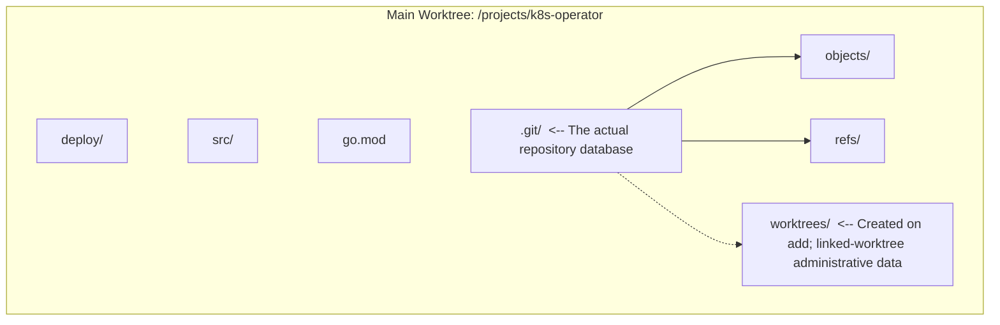
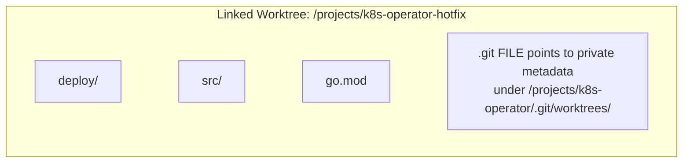

> **Complexity**: `[MEDIUM]`
>
> **Time to Complete**: 80–110 minutes (unmeasured planning estimate for reading and local practice)
>
> **Prerequisites**: Module 4 of Git Deep Dive

---

## What You'll Be Able to Do

By the end of this module, you will be able to:

- Implement `git worktree` to manage concurrent development efforts across multiple branches without disrupting your primary working directory.
- Diagnose and resolve orphaned or disconnected worktrees using lifecycle commands like `prune` and `remove`.
- Evaluate the precise technical trade-offs between `git stash`, `git worktree`, and multiple repository clones to select the optimal context-switching strategy for a given scenario.
- Execute advanced stash operations, including isolating untracked files, applying specific stashes from the stack, and recovering stashed changes into isolated branches.
- Design a resilient local development workflow that prevents uncommitted state loss during critical, time-sensitive production interruptions.

## Why This Module Matters

Hypothetical scenario: it is late afternoon at a regional payments company during a planned Kubernetes platform upgrade. A senior engineer is halfway through refactoring an ingress controller deployment, with modified YAML files, half-written Go tests for a custom admission webhook, and a local cluster tuned to reproduce a routing edge case. Then security pages the team: a vulnerable production image has to be replaced immediately, before the next merchant settlement window opens. The change itself is tiny, but the operational risk is not tiny at all, because a broken hotfix could block payment authorization and put revenue at risk during a narrow production window.

In that hypothetical, the engineer reaches for `git stash`, switches to the production branch, makes the image update, and pushes the hotfix. That first part looks successful, but the return trip is painful. The stash does not include a newly created manifest because the file is still untracked, and `git stash pop` collides with the same deployment block that the emergency patch changed. The fix prevents customer-visible impact, yet the team pays for the rushed context switch with hours of conflict resolution, repeated local cluster resets, and a delayed review of the original ingress refactor.

This module addresses that interruption problem. A normal clone gives you one working directory, and another task may arrive before your current edits are ready to commit. You will compare a stash, a linked worktree, and a separate clone by the state each one preserves or shares. The practical goal is to handle an interruption in a clean directory and verify the unfinished work when you return.

## The Context Switch Problem

A standard Git clone has two pieces that matter during daily development: the repository database and the working tree. The repository database stores objects, refs, branch names, remote-tracking state, and configuration. The working tree is the visible directory where your editor, tests, linters, and local tools interact with files. In the simplest setup, those two pieces feel inseparable because the `.git` directory sits beside the files you edit, but Git treats them as distinct layers.

When you run `git switch` or `git checkout`, Git updates the working tree for the target commit while preserving compatible local edits. If tracked modifications, staged changes, or untracked paths would be overwritten, Git can refuse the switch. If the changes are compatible, Git can carry them forward instead. Switching branches therefore does not by itself separate unfinished feature edits from the files you intend to change for a hotfix.

The practical lesson is that a branch is not the same thing as a workspace. A branch names a line of history; a workspace includes a directory, an index, editor state, test artifacts, environment variables, and your own mental context. Naming another branch does not create another directory or index. Use a linked worktree or another clone when you need a second checked-out file view.

Compare two possible workarounds. One is to clone the repository again for a new task, release check, or urgent review. Another is to save uncommitted work in a stash, switch branches, handle the interruption, switch back, and restore it. Both are options rather than universal defaults: consider which repository state and runtime resources each approach actually separates before choosing one.

Multiple clones give you separate repository-local refs, configuration, working trees, and indexes. That can be useful when repository-level settings must differ, but a clone does not automatically isolate global credential helpers, hooks selected by global configuration, or runtime services. Local clones may also share object storage through hardlinks or explicit alternates. The cost is another repository to maintain: each clone needs its own fetches, and a local branch in one does not automatically exist in another. Choose the required boundary deliberately; a clone is not a hermetic test environment.

There is also a coordination cost that does not show up in disk usage. In a multi-clone workflow, each directory can quietly develop its own local branches, remotes, ignored files, hook state, and unpushed commits. When a teammate asks which directory contains the fix, the answer may depend on memory rather than repository state. Linked worktrees remain attached to one repository database, and `git worktree list` inventories registered worktrees, including records whose directories are missing.

Stash saves local Git file state rather than creating another directory. A stash entry records tracked modifications and, with the appropriate flags, untracked or ignored files. It does not preserve your open terminals, database state, running cluster, or editor context. Changes to the target branch can cause conflicts when you restore the saved work; returning to a stash therefore needs inspection rather than an assumption that the patch still applies cleanly.

Ask what state you need to preserve. A named stash can suit a small tracked edit before a pull. A half-built feature with new files, a failing test, and a running cluster needs a separate decision about both source state and runtime resources. Make those boundaries explicit before switching tasks; neither a stash entry nor a new directory records every part of the surrounding environment.

**Pause and predict:** What do you think happens if you run `git stash` while a new file exists in your directory but has never been added with `git add`? Write kept or stashed before opening the answer.

<details>
<summary>Check your prediction</summary>

By default, `git stash` saves tracked modifications and staged changes while leaving untracked files alone. A dirty `git status` can therefore show more paths than the plain command saves. If an untracked file does not collide with the target branch, it remains visible after the switch; if it collides with a tracked target path, Git can refuse the switch. Inspect which kind of state each path represents before choosing stash flags.

</details>

## Mastering Git Stash for Micro-Interruptions

Stash is useful when you need to save a small file change without creating another directory. Before a pull, formatter run, or brief branch inspection, decide which edits belong in the saved state and give the entry a meaningful message. Restore it deliberately and inspect the result before dropping the saved entry; a successful application alone is not a review of the restored work.

Use `git stash push -m` when the entry needs task context. The default message includes branch and base-commit information, but it does not explain your unfinished task. A message naming the relevant change helps you distinguish entries when inspecting the stack. Inspect again before restoring: positions shift as entries are added or removed, so an index you remembered is not a permanent identifier.

```bash
# Bad practice
git stash

# Good practice
git stash push -m "Mid-refactor of deployment.yaml resource limits"
```

When your work includes new files, add `-u` or `--include-untracked` if those files belong in the saved state. For example, an unfinished feature might introduce a manifest, values file, migration, or test fixture before you stage it. The flag includes tracked modifications and untracked files together. Ignored files, such as ignored build outputs, still remain outside that entry unless you use `-a`.

```bash
# Stashes tracked modifications AND untracked new files
git stash push -u -m "Added new redis-deployment.yaml and modified configmap"
```

The `-a` or `--all` flag includes ignored files too. That can help when you intentionally need to clear ignored artifacts from a directory, but those files also become Git objects in the saved state. Choose `-u` when you need untracked source files while leaving ignored caches and build directories in place; use `-a` only when including those ignored files is intentional.

Every stash entry goes onto a stack, with the newest entry at `stash@{0}`. You can inspect the stack before applying anything, and you should do that whenever more than one entry exists. The command below is not just a convenience; it is a guard against applying the wrong patch to the wrong branch. A stash message that looked obvious yesterday may be ambiguous after two incident calls and a review rotation.

```bash
git stash list
```

The output will look something like this:

```text
stash@{0}: On feature-auth: Added new redis-deployment.yaml and modified configmap
stash@{1}: On main: Mid-refactor of deployment.yaml resource limits
```

Before applying a stash, inspect it as a patch. The `show -p --include-untracked` options let you review tracked and saved untracked content without changing your working directory. Plain `show -p` omits untracked content unless configured otherwise. This distinction matters when stashes contain migrations or manifests with similar names across environments: inspect the complete saved content before restoring it.

```bash
git stash show -p --include-untracked stash@{1}
```

**Pause and predict:** What do you expect if you apply `stash@{1}` rather than pop it? Write whether the stash stack changes before opening the answer; then compare your prediction with `git stash list`.

<details>
<summary>Check your prediction</summary>

Use `git stash apply` when you want to retain the saved entry during restoration. It attempts to put changes into the current working tree while leaving the entry on the stack. If it conflicts, stop and inspect `git status`; there is no `git stash --abort`. Preserve any unrelated edits before resolving or discarding the failed replay. The saved stash remains available for recovery from a clean directory. Add `--index` when you also intend to restore the original staged state; conflicts can prevent that restoration.

</details>

```bash
# Applies the most recent stash
git stash apply

# Applies a specific stash from the stack
git stash apply stash@{1}
```

**Worked staging comparison:** Suppose a tracked file has a staged edit on its first line and an unstaged edit on its second line. Save that state, then restore it into a clean checkout. Under the default configuration, plain `apply` restores the file edits without requesting the original index. `apply --index` also attempts to restore which edit was staged. Conflicts can prevent that attempt from succeeding.

Compare `git diff --cached`, which describes staged changes, with `git diff`, which describes working-file changes relative to the index. In this example, restoring the original split puts the first edit in the cached diff and the second in the ordinary diff. Checking only the final file contents would miss that distinction. The `stash.index` configuration setting can request index restoration by default, so account for configuration when comparing results with these explicitly selected modes.

`git stash pop` is convenient, but convenience is not the same as safety. Pop applies the stash and, when the application succeeds, drops the entry from the stack. That behavior is fine for trivial edits, but it becomes risky when you are tired, on the wrong branch, or dealing with configuration files whose conflicts are subtle. For critical infrastructure work, apply first, inspect and test the result, and only then drop the stash intentionally.

```bash
# Drop a specific stash
git stash drop stash@{1}

# Clear the entire stash stack (use with extreme caution)
git stash clear
```

For an old or conflict-prone stash, consider `git stash branch` from a clean working tree. It creates a branch at the original base, restores the working tree and index, and drops the entry on success when you supply a `stash@{…}` reference or omit the stash argument (which selects the latest entry). Passing a raw stash commit ID does not drop an entry from the list. This reconstructs the patch's original context. It cannot switch successfully through unresolved conflicts from a previous apply; preserve that state and use a separate clean worktree if needed. Commit the recovered work before normal integration.

```bash
git stash branch recovered-auth-work stash@{0}
```

Here is a small practice workflow for the untracked-file trap. Use a fresh temporary directory and a fictional repository-local identity; signing is disabled only in this disposable repository. Setting `core.excludesFile` to `/dev/null` prevents global ignore patterns from affecting this practice. The new `draft-config.txt` contains harmless placeholder content. Never use real credentials in stash practice: stashed files become Git objects, including files captured with `-u` or `-a`.

```bash
stash_practice_root=$(mktemp -d)
cd "$stash_practice_root"
mkdir stash-practice && cd stash-practice
git init -b main
git config user.name "Practice Learner"
git config user.email "learner@example.invalid"
git config commit.gpgsign false
git config core.excludesFile /dev/null
```

Create an initial commit so the repository has a clean baseline. Git stash depends on a repository with commits because it needs a `HEAD` commit as the reference point for the saved changes. In a brand-new repository with no commit, many normal history operations do not yet have a stable anchor.

```bash
echo "v1" > config.txt
git add config.txt
git commit -m "Initial commit"
```

Now create one tracked modification and one untracked file. This gives you two kinds of local state to distinguish: an edit to a tracked path and a new path outside the index. Inspect both before choosing flags; plain stash saves the tracked edit, while including the new path requires `-u` in this example.

```bash
echo "v2" > config.txt
echo "example-local-value" > draft-config.txt
```

Stash both pieces together with `-u`. After this command, the working tree should return to a clean state and the untracked file should disappear from the directory because it has been saved inside the stash entry. This is the behavior you want before switching into a review or a tiny branch inspection.

```bash
git stash push -u -m "WIP on tracked and draft config"
```

Inspect the stash stack and the complete saved patch before restoring. The explicit `--include-untracked` flag shows `draft-config.txt` as well as the tracked change to `config.txt`. Check both contents so you can distinguish a saved file from a file merely left behind in the working directory.

```bash
git stash list
git stash show -p --include-untracked stash@{0}
```

Finally, restore with `apply`. Confirm that `config.txt` contains `v2`, `draft-config.txt` has returned, and the entry remains in `git stash list`. This separates restoration from deletion. Keep the stash until you have checked the contents; the cleanup below intentionally deletes the entire disposable practice repository, including its saved entry.

```bash
git stash apply stash@{0}
git status --short
cat config.txt draft-config.txt
git stash list
```

When you are finished experimenting, remove only the generated disposable root and its contents. Do not use this command for a real worktree or repository:

```bash
cd / && rm -rf -- "${stash_practice_root:?}"
```

## The Power of Git Worktrees

If stash is a temporary shelf, a worktree is a separate desk connected to the same filing cabinet. Git introduced linked worktrees so one repository database can support multiple working directories, each with its own checked-out branch and index. The main advantage is that you do not have to clean, stash, or commit unfinished work before opening a clean directory for another task. Your feature branch can remain dirty in one terminal while a hotfix branch is clean in another.

Linked worktrees share the object database and ordinary refs, including branch and remote-tracking refs; `HEAD` and certain special refs remain per-worktree. A linked worktree stores checked-out files plus small administrative metadata rather than duplicating repository history. Fetching in one updates shared remote-tracking refs, but does not update the other worktrees' checked-out files. This gives you independent file views with a shared repository inventory.

The isolation is not absolute, and that distinction matters. Each worktree has its own working directory and index, so staged changes and uncommitted file edits do not bleed between them. However, global services such as a single local database, fixed ports, shared Docker networks, and editor-wide settings can still collide. A team running two Kubernetes test environments from two worktrees must still choose separate namespaces, ports, or clusters. Worktrees solve Git workspace contention; they do not automatically isolate every tool outside Git.

Index isolation lets you stage a patch in the feature directory while the hotfix directory has a different staged patch. Each directory's `git diff --cached` describes its own index. A stash also records the index separately, but restoring without `--index` can lose the staged and unstaged split. Choose whether you need to restore that split instead of treating file restoration and staging restoration as the same operation.

Use a named branch for temporary work: create `hotfix/image-patch`, commit the fix, and push it when you need backup or review. Removing the linked directory leaves its branch and commits available. A branch name may later be deleted, so preserve the relevant commit or pull-request reference rather than treating a temporary directory name as a permanent audit trail.

When you run `git clone`, you create the main worktree. Inside that directory, the `.git` directory stores objects, refs, configuration, and, once linked worktrees are added, their administrative metadata. The diagram marks the directory created for linked worktrees as conditional.



When you add a linked worktree, Git creates a new directory with normal project files, but the `.git` entry inside that directory is a file rather than a full repository directory. That file points back to metadata under the main repository's `.git/worktrees/` directory. The linked worktree gets its own `HEAD`, its own index, and its own administrative state, while the actual object database remains shared.



The creation command is `git worktree add`: provide a new path and the branch or commit to check out. Add `-b` to create a branch at the same time, using the explicit starting point you supply. This lets you leave a dirty feature directory untouched while opening a clean hotfix branch from committed `main` in a sibling directory.

```bash
# Usage: git worktree add <path> <branch>

# Create a new directory alongside your current one,
# create a new branch called 'hotfix-cve',
# and check it out starting from 'main'
git worktree add -b hotfix-cve ../k8s-operator-hotfix main
```

Illustrative output; your commit ID and subject will differ:

```text
Preparing worktree (new branch 'hotfix-cve')
HEAD is now at 8f3a9b2 Update ingress documentation
```

At this point you have two separate directories connected to one repository database. Your original directory can contain uncommitted feature work, while `../k8s-operator-hotfix` starts clean on the hotfix branch. You can open a new terminal, run tests, commit, and push from the hotfix worktree. When the emergency ends, you remove the temporary worktree and return to the original terminal without replaying a stash or reconstructing your thought process.

By default, Git refuses to check out a branch already checked out in another worktree. This prevents competing updates to one branch pointer. Force options can override the protection, so treat it as a guardrail rather than an absolute invariant. Prefer a new branch name or a deliberately detached worktree for the same starting point; named branches make new work easier to retain.

**Pause and predict:** What do you expect if you try to create a worktree for a branch already checked out in another worktree? Write the result before opening the answer.

<details>
<summary>Check your prediction</summary>

By default the command fails. In a Git 2.56 run, the message was `fatal: 'hotfix-cve' is already used by worktree at '…'`. Two directories updating that branch would share its pointer while retaining different indexes and local files. The default guard prevents those competing checkouts; inspect the worktree inventory before considering any override.

</details>

```bash
git worktree list
```

The output gives you the path, commit, and branch or detached state for each worktree. Before deleting branches or cleaning directories, inspect this inventory and each relevant directory's status. The paths and IDs below are illustrative; listing worktrees does not establish that their edits or unpushed commits have been preserved.

```text
/projects/k8s-operator         8f3a9b2 [feature-auth]
/projects/k8s-operator-hotfix  2c9b4e1 [hotfix-cve]
```

When you finish with a worktree, remove it through Git. The command deletes the directory and matching administrative metadata; ordinary removal refuses a dirty worktree. Before removal, inspect valuable local edits and commits, and preserve the refs or backups you need. Removing the checkout is separate from preserving its history: a successful cleanup command is not evidence that the work was pushed or reviewed.

```bash
# Removes the linked directory and its metadata; keeps its branch and commits
git worktree remove ../k8s-operator-hotfix
```

Deleting a linked directory outside Git, for example with `rm -rf`, can leave administrative metadata marking its branch as in use. That stale record can block another checkout until manually pruned or eventually removed by garbage collection after expiry. The distinction is between files on disk and Git's registered inventory: removing one does not necessarily update the other.

```bash
git worktree prune
```

`git worktree prune` removes stale administrative records, not lost files. Inspect `git worktree prune -n -v` first, and confirm the directory was deleted rather than temporarily unmounted. Lock portable worktrees before they become unavailable. If a directory was moved, use `git worktree repair <new-path>` to reconnect it instead. Normal cleanup uses `git worktree remove`, which protects dirty directories without requiring force.

## Kubernetes Interruption Workflow

Worktrees become especially valuable in Kubernetes repositories because the source files are only part of the local state. A change to a Deployment may be tied to a running cluster, a port-forward, generated manifests, and a failing integration test. Stashing the source files does not reset those external systems, and carrying dirty YAML into a production hotfix branch can produce misleading tests. A separate worktree gives the hotfix a clean file view while allowing you to decide separately how to isolate the cluster.

Suppose you are developing a reliability upgrade for a Deployment. Git operations and manifest validation are separate activities: a clean checkout establishes file state, while workload validation needs the appropriate Kubernetes checks. Decide which evidence the interruption requires rather than treating a clean directory as proof that a manifest or application works.

For a local test, the unfinished feature might include probes, resource requests, and image changes. Those are exactly the fields an emergency hotfix might also need to touch. If you stash the feature, switch to `main`, update the image, and return later, you are betting that the same manifest regions did not drift in incompatible ways. If you create a worktree from `main`, the hotfix starts from the production file while the feature file stays physically open in the original directory. That physical separation is useful when your editor has multiple tabs open, your terminal history is full of feature-specific commands, and your local notes refer to paths in the original directory.

The worktree does not automatically give you a second Kubernetes cluster, so design that part deliberately. For a deeper controller change, you might use a separate cluster or a separate namespace so hotfix validation does not share resources with the feature branch. The Git decision and the runtime-environment decision are related, but they are not the same decision.

Consider recording this separation in a runbook: "Create a worktree from the verified production base, choose the required runtime isolation, validate the hotfix diff, and remove the worktree after preserving the fix." This is a workflow recommendation, not a measured incident-response improvement. Its purpose is to make the source and runtime boundaries explicit before an interruption; `main` is suitable only when it represents the production base you intend to patch.

Exercise scenario: a realistic operator team can use this split during incident response. Alice is building automated backup support for a database operator, with many modified Go files, new CustomResourceDefinition manifests, and a local cluster configured to test backup scheduling. Production then reports a leader-election crash. The stash approach asks Alice to package a complex feature as a patch, change branch context, run a different investigation in the same directory, and later reapply the patch over a branch that may have moved. The worktree approach asks Alice to open a clean sibling directory from `main`, fix the leader-election code there, and leave the backup work untouched.

The difference is not merely comfort. During an incident, reducing accidental coupling is an operational control. A clean hotfix worktree makes it easier to see which files changed, easier to run focused tests, and easier to produce a reviewable commit. The original feature directory remains dirty, but that dirtiness is contained. When the incident ends, Alice does not need to remember whether a local manifest belonged to the feature or the hotfix; the directory boundary preserves that answer.

## Patterns & Anti-Patterns

The first durable pattern is the sibling-directory worktree. Keep the main clone in a stable location and create temporary worktrees beside it with names that explain their purpose, such as `../operator-hotfix-leader-election` or `../site-review-pr-812`. The path name becomes operational documentation when `git worktree list` is printed during a busy day. This pattern scales well because every worktree shares fetched refs, while the directory name communicates why it exists.

This naming discipline sounds minor until a team has several temporary directories open during a release week. A directory named `../tmp2` tells you nothing about whether it can be deleted, while `../operator-hotfix-leader-election` tells you the branch purpose before you even run Git. When the name, branch, pull request, and test namespace line up, cleanup becomes a simple verification step instead of an archeology project.

The second pattern is apply-before-drop for stash recovery. Use `git stash apply`, inspect status and the diff, and validate the restored work before dropping the entry. This keeps the saved copy available while you check the result. Once the restored work is committed or deliberately abandoned, decide whether the saved entry is still needed rather than deleting it as part of restoration.

The third pattern is branch-from-stash for old work. If a stash is more than a short interruption old, assume its original context matters. `git stash branch` reconstructs that context better than a direct apply against a branch that has evolved. This pattern turns a risky patch replay into a normal branch integration problem, which is easier to review and easier to undo.

The fourth pattern is environment naming that follows the worktree. If a worktree exists for `hotfix/image-patch`, give its local namespace, database, or cluster a matching name when practical. The exact command depends on the tool, but the principle is stable: directory isolation should be paired with runtime isolation when tests mutate external state. Otherwise two worktrees can still compete for port bindings, test databases, or Kubernetes resources.

One anti-pattern is using unnamed stash entries as long-term task storage. The entries retain file state, but their positions can change and their default messages do not describe the intended task. Consider a WIP commit on a named branch when you need history you can reference and push, or a worktree when another task needs a separate directory.

Another anti-pattern is force-removing a worktree before inspecting its local state. `git worktree remove -f` bypasses the normal dirty-worktree protection. If valuable edits remain, preserve them in a commit or named stash, or deliberately discard them after inspection. Use a cleanup checklist: inventory the worktrees, inspect status and retained history, preserve what matters, then remove the intended directory.

A subtler anti-pattern is assuming that worktrees replace branches. They do not. A worktree is a directory attached to a branch, detached commit, or new branch. The branch still carries history, review identity, and push behavior. If you use detached worktrees casually, you can create commits that are easy to lose because no branch name points at them. For normal team work, create a named branch with `-b` and push it like any other branch.

The last anti-pattern is using worktrees to avoid committing for too long. Worktrees let you keep tasks separate, but they do not remove the need for small commits and reviewable history. If three worktrees each contain days of uncommitted work, you have traded one crowded directory for three hidden risk piles. Commit meaningful checkpoints, push branches that need backup or review, and remove temporary directories when their purpose ends.

## Decision Framework

Choose the tool by asking what isolation you need and how long the interruption will last. For simple dirty edits, a named stash can be appropriate. For a separate file view and index, use a worktree. For per-worktree settings, consider `extensions.worktreeConfig` and `git config --worktree`; for independent repository-local refs, consider another clone. In either case, configure credentials, hooks and runtime services separately when those boundaries matter; directory creation alone does not provide that isolation.

**Pause and predict:** Which approach would you choose here and why? Your colleague asks you to review a pull request that changes two files, you have no uncommitted work, and you expect the review to take ten minutes. Write stash, worktree, or branch switch before opening the answer.

<details>
<summary>Check your prediction</summary>

If your working tree is clean and the review is tiny, switching branches in the current directory is reasonable. A worktree is still a good option when you want to preserve editor context, keep your current branch visible, or run tests without disturbing local artifacts. The important point is that worktrees are not mandatory for every branch switch; they are valuable when the cost of mixing contexts exceeds the cost of another directory.

</details>

| Scenario | Recommended Strategy | Technical Rationale |
| :--- | :--- | :--- |
| **Pulling latest changes** with a small dirty edit. | Named stash, if needed | Inspect and save the intended files first. Pull and later stash application can both conflict; with a clean tree no stash is needed. |
| **Emergency production hotfix** while mid-feature. | `git worktree` | A separate working tree and index let you leave dirty feature files in place while editing the committed hotfix base. Runtime resources still need separate planning. |
| **Reviewing a colleague's massive pull request** while working on your own code. | `git worktree` | A review that requires running code, editing configuration, or tests benefits from a separate file view and index. Runtime resources still need deliberate isolation. |
| **Testing another Kubernetes version** with different repository settings. | Per-worktree config or `git clone` | Worktree-specific config can separate settings; a clone also separates refs. Both require deliberate runtime and credential isolation. |
| **Trying a speculative refactor that you might throw away.** | `git branch` in the current tree | If your tree is clean, a normal branch and a WIP commit may be enough. Stash is unnecessary when you can preserve the experiment in history. |

One way to operationalize the framework is to set team conventions. For incident response, consider a worktree. For a small pull-before-push interruption, consider a named stash. If a reproduction needs a fresh clone, configure credentials and hooks at the intended scope as well. Document the chosen boundaries so teammates can identify which local directory and runtime resources belong to the task.

Plan the return path as well as the interruption. A saved stash may need conflict resolution when restored. A worktree leaves the original files in place, but shared runtime resources may still have changed. Another clone has separate refs and needs its own fetches. Compare those state boundaries and cleanup requirements rather than assuming one command is always quickest. On return, inspect the original directory and any external services before continuing the unfinished task.

## Did You Know?

1. Git 2.5 (July 2015) introduced linked worktrees experimentally as a replacement for `contrib/workdir/git-new-workdir`. The old helper is historical context; the practice below uses `git worktree`.
2. A stash entry is built from internal commits that record the working tree and the index; it is not just a loose diff file tucked away on disk.
3. Without force, Git rejects a second checkout of the same branch in another worktree, protecting its pointer from competing directory updates.
4. The `git worktree prune` command removes stale metadata when a linked worktree directory was deleted outside Git, but it is not a substitute for normal `git worktree remove` cleanup.

## Common Mistakes

| Mistake | Why It Happens | How to Fix It |
| :--- | :--- | :--- |
| **Losing new files in a stash** | Running `git stash` without `-u` leaves newly created untracked files in the working directory, so they follow you into the next branch. | Use `git stash push -u -m "clear context"` when the dirty state includes new source files. |
| **Stash stack amnesia** | Bare `git stash` creates generic messages that do not explain why the entry exists once more work has happened. | Always use `git stash push -m "specific task and file context"` and inspect with `git stash list`. |
| **Orphaned worktree directories** | Deleting a worktree folder with `rm -rf` removes files but can leave metadata marking the branch as in use. | Prefer `git worktree remove <path>`; inspect and prune stale records, or repair a moved worktree. |
| **Popping onto the wrong branch** | `git stash pop` applies and then deletes the entry after a clean application, leaving little room to reconsider. | Default to `git stash apply`, verify the result, and then run `git stash drop` deliberately. |
| **Trying to check out a branch in use** | By default Git rejects a branch already checked out in another worktree. | Run `git worktree list`, switch or remove the other worktree, or create a new branch for the second directory. |
| **Ignoring environment bleed** | Worktrees isolate Git files and indexes, but shared ports, databases, clusters, and credentials can still collide. | Pair worktree isolation with separate namespaces, ports, clusters, or local configuration when tests mutate external state. |
| **Using detached worktrees casually** | Checking out a commit without a branch can make new commits harder to find and push. | Use `git worktree add -b <branch> <path> <start-point>` for normal team work. |

## Quiz

<details>
<summary>Question 1: You are deep into modifying a Helm chart for a reliability upgrade when an urgent production image patch must be made on `main`. Your current directory has uncommitted YAML and generated test fixtures. What workflow should you choose, and why?</summary>

Use `git worktree add -b hotfix/image-patch ../project-hotfix main` and make the production patch in that new directory. The hotfix needs a clean working tree, and the feature includes state you want to leave in place. A separate index lets you commit only hotfix changes while keeping the unfinished feature edits in the original directory. Return there and verify those edits without reapplying a stash.
</details>

<details>
<summary>Question 2: You stashed work before helping a colleague, then returned two days later after the target branch had changed heavily. A direct apply produces painful conflicts. What should you try next, and what problem does it solve?</summary>

First inspect and preserve the conflicted working tree; a direct `git stash branch` cannot switch through unresolved index entries. One recovery route is `git worktree add --detach ../stash-recovery HEAD`, followed by `git -C ../stash-recovery stash branch recovered-work stash@{0}` using the entry you inspected. The clean directory lets Git restore the stash at its original base without deleting the failed replay. Successful branch recovery drops the shared stash entry, so commit the recovered work and inspect both directories before cleanup.
</details>

<details>
<summary>Question 3: A teammate deleted `../testing-env` with the file manager. Now Git refuses to check out `test-deployment`, saying it "is already used by worktree at" that path. How do you diagnose and repair the state?</summary>

Run `git worktree list` and `git worktree prune -n -v`. Confirm the path was actually deleted, rather than moved or temporarily unmounted, then run `git worktree prune`. Prune removes stale metadata; it cannot recover deleted uncommitted files. Use `repair <new-path>` for a moved directory and lock portable worktrees before disconnection. Future cleanup should use `git worktree remove` so Git can protect dirty files and update metadata together.
</details>

<details>
<summary>Question 4: You created a new Python script but did not run `git add`. After `git stash` and a branch switch, the script is still present in the new branch. Why did that happen, and how would you avoid it?</summary>

Plain `git stash` does not include untracked files. The new script had no index entry, so Git left it in the working directory during the stash operation. If the target branch did not have a tracked file at the same path, the file remained visible after the switch. Use `git stash push -u -m "message"` when new source files are part of the temporary state.
</details>

<details>
<summary>Question 5: You need to compare behavior against a different Kubernetes version and also use different credentials and hooks. A teammate suggests a worktree because it saves disk space. What concern should you raise?</summary>

A worktree isolates the working directory and index, but it still shares the repository database and may share global Git configuration, hooks strategy, credentials, editor settings, and local services. Per-worktree configuration can separate settings; a clone can separate refs and repository-local configuration. Neither automatically isolates credentials or runtime services. The right decision depends on what must be isolated.
</details>

<details>
<summary>Question 6: You have three stashes and suspect `stash@{1}` contains database migration work. Your current branch is clean, but applying the wrong stash would waste time. What should you do before restoring it?</summary>

Run `git stash list`, then `git stash show -p --include-untracked stash@{1}`. These inspection commands leave your working files unchanged. The explicit flag includes saved untracked files, which plain `show -p` normally omits. Confirm the intended files and contents, apply the inspected entry, and verify the result before dropping it. Add `--index` if restoring its staging state matters.
</details>

<details>
<summary>Question 7: Your team uses worktrees for every incident, but two incident worktrees keep failing tests because both try to bind the same local port and use the same namespace in a shared cluster. Did Git worktrees fail here?</summary>

No. Git worktrees solved the source-directory and index isolation problem, but they did not isolate external runtime resources. Shared ports, shared databases, shared clusters, and shared namespaces can still collide across directories. The fix is to pair each worktree with environment isolation such as separate namespaces, dynamic ports, or separate clusters. Treat worktree creation as one part of the incident workspace, not the whole workspace.
</details>

## Hands-On Exercise: The Mid-Flight Hotfix

In this local Git simulation, you will leave a reliability upgrade uncommitted, create a clean hotfix worktree from `main`, commit an image-tag edit there, and return. You need Git, a POSIX shell, `mktemp`, and file utilities including `mkdir`, `cat`, `sed`, and `mv`; the commands were tested with Git 2.56. Kubernetes tools, a cluster, and network access are not required. The `fleet-api` images and health endpoint are fictional placeholders: this exercise proves file/history separation, not image availability, manifest acceptance, security remediation, or application health.

Start in a temporary directory so the practice repository can be deleted when you are done. The first repository represents your normal development workspace. It begins with a stable production Deployment so there is a clean `main` branch to patch during the interruption.

```bash
worktree_practice_root=$(mktemp -d)
cd "$worktree_practice_root"
mkdir k8s-fleet-manager && cd k8s-fleet-manager
git init -b main
git config user.name "Practice Learner"
git config user.email "learner@example.invalid"
git config commit.gpgsign false
```

Create the stable base state. This manifest is intentionally minimal so the difference between production and unfinished feature work is easy to see. Commit it before starting the feature branch because the hotfix worktree needs a real `main` commit as its starting point.

```bash
cat << 'EOF' > deployment.yaml
apiVersion: apps/v1
kind: Deployment
metadata:
  name: fleet-api
spec:
  replicas: 2
  selector:
    matchLabels:
      app: fleet-api
  template:
    metadata:
      labels:
        app: fleet-api
    spec:
      containers:
      - name: api
        image: fleet-api:v1.0.0
EOF
git add deployment.yaml
git commit -m "Initial production release v1.0.0"
```

Create and check out a new feature branch. This branch represents a normal medium-sized change, not an emergency. You are going to leave it dirty on purpose so you can see that worktrees do not require a clean starting directory.

```bash
git checkout -b feature/reliability-upgrade
```

Begin the unfinished reliability work by replacing the Deployment with a more complex version. Do not commit these changes. The dirty working tree is the point of the exercise, because it models the moment when an interruption arrives while you are mid-thought.

```bash
cat << 'EOF' > deployment.yaml
apiVersion: apps/v1
kind: Deployment
metadata:
  name: fleet-api
spec:
  replicas: 2
  selector:
    matchLabels:
      app: fleet-api
  template:
    metadata:
      labels:
        app: fleet-api
    spec:
      containers:
      - name: api
        image: fleet-api:v1.1.0-rc1
        resources:
          requests:
            memory: "64Mi"
            cpu: "250m"
          limits:
            memory: "128Mi"
            cpu: "500m"
        livenessProbe:
          httpGet:
            path: /healthz
            port: 8080
          initialDelaySeconds: 3
          periodSeconds: 3
EOF
```

Your interruption is a production bug in `fleet-api:v1.0.0`. You need to patch the image version to `v1.0.1` on `main`, but you cannot lose the reliability upgrade and you do not want to apply a stash later. Use the checklist below as your success path.

- [ ] Create a new worktree named `fleet-manager-hotfix` in the parent directory, creating a new branch `hotfix/image-patch` based on `main`.
- [ ] Navigate to the new worktree directory.
- [ ] Verify that `deployment.yaml` in this new directory is the clean original production version with `fleet-api:v1.0.0`.
- [ ] Update the image tag in the hotfix directory to `fleet-api:v1.0.1`.
- [ ] Commit the hotfix in the hotfix worktree.
- [ ] Safely remove the hotfix worktree using Git commands rather than deleting the directory directly.
- [ ] Return to your original directory and verify your reliability upgrades are still exactly as you left them.

<details>
<summary>Hints: choose the boundary, then inspect it</summary>

1. Keep the dirty feature directory in place; the interruption needs files from the committed `main`, not from your index.
2. Use `git worktree add -b <new-branch> <sibling-path> main`. If Git says the branch is already used by a worktree, inspect `git worktree list` rather than forcing it.
3. In the hotfix directory, inspect `git status --short` and the image before editing. If removal refuses a dirty directory, preserve and inspect those edits instead of adding `-f`.

</details>

<details>
<summary>Solution</summary>

Create the worktree while leaving your dirty feature directory exactly as it is. This command makes a sibling directory, creates a new branch, and starts that branch from `main`.

```bash
git worktree add -b hotfix/image-patch ../fleet-manager-hotfix main
```

Move into the new directory and inspect the manifest. It should show the original `v1.0.0` image and none of the resource or probe changes from the feature branch.

```bash
cd ../fleet-manager-hotfix
cat deployment.yaml
```

Apply and commit the hotfix. Write the changed manifest to a temporary file before replacing the original.

```bash
sed 's/fleet-api:v1\.0\.0/fleet-api:v1.0.1/' deployment.yaml > deployment.yaml.tmp && mv deployment.yaml.tmp deployment.yaml

git add deployment.yaml
git commit -m "Hotfix: update API image to v1.0.1"
```

Clean up through Git. Move out of the hotfix directory first, then remove the linked worktree so Git deletes both the directory and its metadata.

```bash
cd ../k8s-fleet-manager
git worktree remove ../fleet-manager-hotfix
```

Verify that the original feature work is still present and uncommitted. You should see the resource requests, limits, liveness probe, and release-candidate image exactly where you left them.

```bash
cat deployment.yaml
git status
git show hotfix/image-patch:deployment.yaml
git worktree list
git stash list
```
</details>

Read the checks as separate questions. In the feature directory, `git status` reports this exercise's unfinished tracked edit. Reading the hotfix branch's committed manifest asks what the emergency commit contains. The worktree inventory asks whether the temporary checkout remains registered. A clean hotfix directory alone cannot establish that the original feature edits survived, because its status describes a different index and working tree.

After attempting the exercise, close the solution and write the expected state for each check. Include one diagnostic step you would take if the result disagreed, then open the feedback below. Keep the directories and branch while investigating a mismatch; removing a checkout does not establish that its branch was pushed or reviewed.

<details>
<summary>Check the states and choose a diagnostic step</summary>

- **Feature directory:** expect `deployment.yaml` to remain modified. If status is clean, confirm you are in the original directory and inspect whether the edit was committed, shelved, or discarded before assuming it survived.
- **Hotfix commit:** expect the committed image to be `fleet-api:v1.0.1`. If it still shows the old tag, compare the working file, staged changes, and committed file to locate which state differs from your intention.
- **Worktree inventory:** expect the removed sibling path to be absent. If it remains listed, read the removal error and inspect that directory's status. Git refuses ordinary removal of a dirty worktree; preserve its tracked or untracked edits instead of forcing removal.

</details>

Success criteria:

- [ ] The hotfix commit exists on `hotfix/image-patch`.
- [ ] The hotfix worktree was removed with `git worktree remove`.
- [ ] `git worktree list` no longer shows `fleet-manager-hotfix`.
- [ ] The original `feature/reliability-upgrade` directory still has uncommitted reliability changes.
- [ ] No stash entry was required to survive the interruption.

Use these cards to retrieve and transfer the module's ideas. Read each mistaken expectation, identify the failure layer, and then open the reveal.

**Card A: The plain stash captured the new file.** An engineer expects a never-added manifest to disappear from the working tree after `git stash`, with no `-u` flag. They expect every dirty path to move onto the stack.

<details>
<summary>Check your prediction</summary>

Failure layer: tracked state versus untracked files. Next action: look for the new file still in the directory. Plain `git stash` saves tracked and staged edits only. Use `-u` only when you meant to shelve untracked files too.

</details>

**Card B: `apply` dropped the stash.** `git stash apply stash@{1}` put the patch into the tree. The next `git stash list` is expected to be missing that entry, the way `pop` behaves after a clean apply.

<details>
<summary>Check your prediction</summary>

Failure layer: restore versus delete. Next action: expect the entry to remain. Drop it only after the tree is tested. `pop` is the command that removes a successful entry.

</details>

**Card C: The second worktree reused the branch.** `feature/auth-refresh` is already checked out. A second `git worktree add` uses that same branch name so both directories share one pointer.

<details>
<summary>Check your prediction</summary>

Failure layer: one checkout per branch name. Next action: expect the command to fail. Create a new branch name, or detach on purpose, and list worktrees before forcing anything.

</details>

**Card D: The ten-minute review required a worktree.** The tree is clean. The pull request changes two files. The review should take about ten minutes. A new directory is treated as the only safe move.

<details>
<summary>Check your prediction</summary>

Failure layer: interruption cost. Next action: switch branches in the current directory. Use a worktree when you must keep the current context, not because every review is an emergency.

</details>

**Transfer challenge:** Keep the dirty feature work and create another named worktree from `main` for a documentation-only review. Explain which committed image it sees, why its index is independent, and which ports or clusters would still be shared. Inspect the review directory before removing it with Git. Keep the original practice repository until you have inspected the retained hotfix commit; remove the temporary parent only when you intentionally want to discard all practice history.

**Lifecycle stretch:** Create another clean review worktree, then move its directory with `mv`. Predict which path `git worktree list` will report before repairing the connection with `git worktree repair <new-path>`. Verify the inventory and status from both directories, then remove the review worktree through Git. Explain why pruning its record would be the wrong response while the moved files still exist. This extends the interruption workflow into diagnosing a filesystem change rather than repeating branch creation.

<details>
<summary>Check the lifecycle diagnosis</summary>

Compare the registered path with the directory you actually moved. A stale path in the inventory does not establish that the files disappeared. Repair reconnects the moved worktree; verify the updated inventory and status from both directories before removal. If you reused a branch name from the transfer challenge, `-b` refuses to create it again because removing that checkout kept its branch. Inspect the retained branch or choose an unused name rather than forcing the operation.

</details>

After checking the results and deciding to discard all practice history and unfinished feature edits, remove only the generated hotfix-practice parent with `cd / && rm -rf -- "${worktree_practice_root:?}"`. The variable must still identify the temporary root created for this exercise; the guard rejects an unset or empty value, not an incorrectly reassigned nonempty path.

## Sources

Git behavior was checked against the [Git 2.56 documentation snapshot](https://github.com/git/git/tree/a018953688f1b10bddf91bff8747068f5f4746a4/Documentation); the 2.5 links provide historical context.

- [Git documentation: git-worktree](https://git-scm.com/docs/git-worktree)
- [Git documentation: git-clone](https://git-scm.com/docs/git-clone)
- [Git documentation: git-stash](https://git-scm.com/docs/git-stash)
- [Git documentation: git-switch](https://git-scm.com/docs/git-switch)
- [Git documentation: git-checkout](https://git-scm.com/docs/git-checkout)
- [Git documentation: git-branch](https://git-scm.com/docs/git-branch)
- [Git documentation: git-config](https://git-scm.com/docs/git-config)
- [Git documentation: gitcredentials](https://git-scm.com/docs/gitcredentials)
- [Git documentation: git-fetch](https://git-scm.com/docs/git-fetch)
- [Git documentation: git-init](https://git-scm.com/docs/git-init)
- [Git documentation: git-diff](https://git-scm.com/docs/git-diff)
- [Git documentation: git-show](https://git-scm.com/docs/git-show)
- [Git documentation: git-status](https://git-scm.com/docs/git-status)
- [Git documentation: git-clean](https://git-scm.com/docs/git-clean)
- [Git documentation: gitrepository-layout](https://git-scm.com/docs/gitrepository-layout)
- [Git 2.5 release notes](https://github.com/git/git/blob/v2.5.0/Documentation/RelNotes/2.5.0.txt)
- [Git 2.5 worktree documentation](https://github.com/git/git/blob/v2.5.0/Documentation/git-worktree.txt)
- [Pro Git book: Stashing and Cleaning](https://git-scm.com/book/en/v2/Git-Tools-Stashing-and-Cleaning)
- [Pro Git book: Advanced Merging](https://git-scm.com/book/en/v2/Git-Tools-Advanced-Merging)
- [Pro Git book: Branches in a Nutshell](https://git-scm.com/book/en/v2/Git-Branching-Branches-in-a-Nutshell)
- [Kubernetes documentation: Deployments](https://kubernetes.io/docs/concepts/workloads/controllers/deployment/)
- [Kubernetes documentation: Liveness, readiness, and startup probes](https://kubernetes.io/docs/tasks/configure-pod-container/configure-liveness-readiness-startup-probes/)
- [Kubernetes documentation: Namespaces](https://kubernetes.io/docs/concepts/overview/working-with-objects/namespaces/)
- [Kubernetes documentation: Resource management](https://kubernetes.io/docs/concepts/configuration/manage-resources-containers/)
- [POSIX shell language](https://pubs.opengroup.org/onlinepubs/9799919799/utilities/V3_chap02.html)
- [POSIX sed](https://pubs.opengroup.org/onlinepubs/9799919799/utilities/sed.html)
- [POSIX mv](https://pubs.opengroup.org/onlinepubs/9799919799/utilities/mv.html)
- [POSIX rm](https://pubs.opengroup.org/onlinepubs/9799919799/utilities/rm.html)
- [GNU coreutils: mktemp manual source](https://github.com/coreutils/coreutils/blob/9e804edddb8a0c9d45da87519ae6274c35793ce0/doc/coreutils.texi#L14370)

## Next Module

Continue to [Module 6: The Digital Detective](../module-6-troubleshooting/) to learn how to diagnose broken history, failed merges, and repository states that do not match your expectations.
