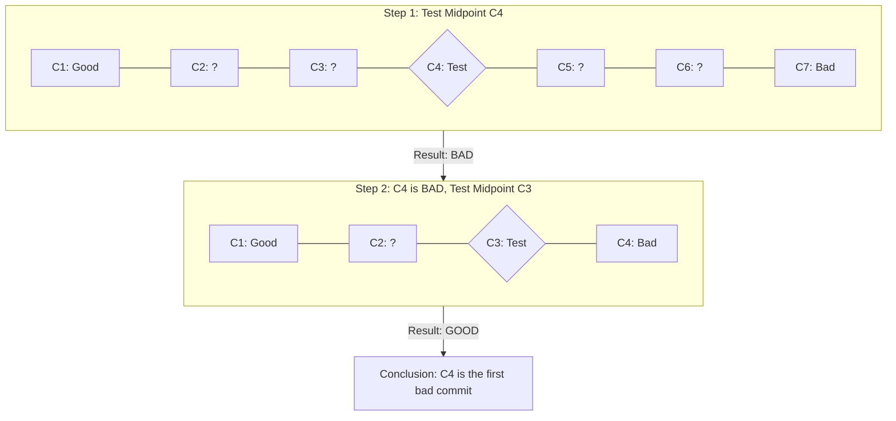

> **Complexity**: `[MEDIUM]`
>
> **Time to Complete**: Approximately 90–120 minutes (estimate for reading and the exercise)
>
> **Prerequisites**: [Module 5 of Git Deep Dive](../module-5-worktrees-stashing/) and a local Bash shell with Git installed. In a repository, check that `git log --since-as-filter=now -1` is accepted by your Git before using this option.

---

## Learning Outcomes

After completing this module, you will be able to:

- **Diagnose** the first bad commit in a selected good-to-bad range by combining `git bisect run` with a deterministic validation script.
- **Evaluate** Git's line attribution across whitespace-only rewrites, file movement, and refactors by applying advanced `git blame` options and checking their heuristic limits.
- **Compare** historical diff search, snapshot search, and filtered log queries so you can choose the right troubleshooting tool for a live incident.
- **Design** targeted audit trails for Kubernetes manifests that report recorded authors, timestamps, paths, and diffs for comparison with deployment and review records.
- **Implement** a repeatable Git troubleshooting workflow that preserves search commands, test results, and the identified boundary for follow-up investigation.

## Why This Module Matters

Hypothetical scenario: at 3:14 AM on a holiday retail weekend, a payment platform that had been stable for months started dropping a measurable slice of checkout traffic with `503 Service Unavailable` responses. The Kubernetes control plane was healthy, the nodes were ready, and the application images had passed their normal checks, yet the customer-facing path was failing often enough that revenue dashboards turned into incident evidence. The latest revert did not help, because the release also contained compliance patches that could not be rolled back casually, and the only visible clue was that the `payment-gateway` manifests had been touched by several teams across hundreds of commits.

In that kind of incident, Git is no longer a place where finished work is stored. It becomes a queryable timeline of operational decisions, and the team that can interrogate that timeline calmly has a different outage experience from the team that scrolls through pull requests in panic. A YAML edit can change a Service's `targetPort`, remove a readiness gate, broaden a `NetworkPolicy` rule, or hide a resource limit change behind a formatting commit. The practical skill is not memorizing more commands; it is learning how to turn an unreliable symptom into a narrow historical question that Git can answer.

This module teaches that investigative workflow using the same tools you already have installed. You will use binary search to find a first bad commit, automate its exit-status classifications with a validated test, inspect line attribution through refactors, search deleted history with Pickaxe queries, scan current and historical snapshots with `git grep`, and preserve an evidence trail that reviewers can reproduce and compare with deployment records. For Kubernetes examples, assume a current cluster target of Kubernetes 1.35 or newer, and use the full `kubectl` command in runnable examples so every command can be copied into a script without depending on an interactive shell alias.

The lesson also changes how you think about time during troubleshooting. A live cluster shows the present, dashboards show recent symptoms, and Git shows the sequence of intended state changes that led there. The strongest investigators move between those views deliberately instead of letting one view dominate the story. If the cluster says a service is broken, Git can tell you when the intended service definition changed; if Git says nothing changed, the cluster can reveal deployment drift, controller lag, or an out-of-band edit. Treating those timelines as separate but comparable records keeps the investigation grounded.

## Section 1: Turning Symptoms into a Search Space with `git bisect`

When a system fails but you do not know when the failure was introduced, reviewing commits one by one is a slow way to create false confidence. If there are five hundred commits between a known working release tag and the current broken state, a linear review asks engineers to keep a fragile mental model across many unrelated changes. The more urgent the incident feels, the more tempting it becomes to blame the last visible change, even though the actual regression may have landed days earlier and only surfaced when traffic patterns changed.

`git bisect` exists because this problem has a mathematical shape. You provide Git with two anchors: one commit that is definitely bad and one commit that is definitely good. Git then checks out a midpoint commit and asks you to classify it. Each answer discards roughly half of the remaining history, just like finding a word in a dictionary by opening near the middle instead of reading every page from the front. The result is not magic; it is disciplined narrowing of a search space that would otherwise overwhelm human attention.

Bisection assumes a repeatable classification with a good-to-bad transition in the selected history. With fixes and reintroductions, the selected boundary need not be the earliest appearance of the bug anywhere in history; merges and skipped commits can also complicate or leave the boundary ambiguous. Inspect the relevant parents and rerun the test before concluding causation. A good commit must be a state where the specific behavior under investigation truly worked, not merely a date when nobody remembers complaints. A bad commit must reproduce the target failure, not a general feeling that `main` is unhealthy. Sloppy anchors make the search answer the wrong question.

Good anchors often come from operational records rather than memory. A release tag tied to a successful deployment, a commit recorded by a GitOps controller, or a build artifact linked to a passing smoke test is better than "sometime before lunch." Bad anchors should be equally concrete: the commit currently deployed to a failing environment, the branch tip whose rendered manifests fail validation, or the exact revision that reproduces a unit test failure. When you cannot establish both sides, spend time improving observability before starting bisection, because a precise algorithm cannot repair imprecise evidence.



Imagine a `Deployment` manifest that suddenly fails server-side validation after a sequence of infrastructure-as-code changes. The cluster is available, the API server is responding, and your working theory is that a schema field, indentation block, or API version changed at some point after the last release. Before you begin, preserve unrelated local work and create a clean state: conflicting uncommitted changes can block historical checkout, while changes carried into a checkout can contaminate its test.

```bash
git bisect start
```

That command begins the session, but it does not yet know your boundaries. The current commit is normally the bad side when you are investigating a live regression from the tip of your branch. You can be explicit and mark `HEAD` as bad, or omit the hash when you are already checked out at the broken state.

```bash
git bisect bad
```

The other boundary is the most recent known-good state. In a mature release process, this might be a version tag, a production deployment commit, or the merge commit for a previous release train. In this example, `v1.2.0` represents the point where the manifest deployed successfully.

```bash
git bisect good v1.2.0
```

After those anchors are set, Git checks out a midpoint commit and reports roughly how many revisions remain. The repository is now in a detached `HEAD` state, which is expected during bisection. You are not on your normal branch; you are visiting a historical snapshot so you can classify it as good or bad for this one behavior.

Illustrative output:

```text
Bisecting: 125 revisions left to test after this (roughly 7 steps)
[a1b2c3d4a1b2c3d4a1b2c3d4a1b2c3d4a1b2c3d4] Update resource requests
```

**Pause and predict:** If you run a Kubernetes validation against this checked-out commit and it succeeds, what should you tell Git next, and what does that answer mean for the remaining history?

<details>
<summary>Check your prediction</summary>

The correct answer is `git bisect good` if this validation faithfully detects the target regression. Under the single-transition assumption, a passing midpoint places the introduction later in the selected range. Git excludes that commit and its ancestors, then continues toward the bad anchor; one passing test alone does not establish the whole regression history.

</details>

Write the bisect subcommand before you continue. The validation command below checks the manifest. It does not mark the midpoint.

```bash
kubectl apply --dry-run=server -f deployment.yaml
```

If the same validation fails with the exact symptom you are investigating, mark the midpoint as bad instead. Be precise here: a failure caused by missing local dependencies is not the same as the Kubernetes schema regression you are hunting. Manual bisection works only when each classification reflects the target behavior, not any possible inconvenience at that historical commit.

```bash
git bisect bad
```

After several rounds, Git may identify a first bad commit in the selected history. Its significance depends on the accuracy of the classifications and the shape of that history. That commit becomes your main evidence artifact for deeper investigation, review, or rollback planning.

Illustrative output:

```text
b9c8d7e6f5a4b3c2d1e0f9a8b7c6d5e4f3a2b1c0 is the first 'bad' commit
commit b9c8d7e6f5a4b3c2d1e0f9a8b7c6d5e4f3a2b1c0
Author: Alex Engineer <alex@example.com>
...

    chore: update apiVersion for HorizontalPodAutoscaler
...
```

End the session deliberately after recording its result. An investigation can leave the repository checked out somewhere in the past, so confirm the checkout before doing further work. `git bisect reset` restores the pre-bisect checkout, which prevents later commands from accidentally running against an unintended historical snapshot.

```bash
git bisect reset
```

Hypothetical scenario: a platform team managing tenant onboarding uses this workflow when default `NetworkPolicy` objects stop rendering from a Helm chart. The pipeline is green, the chart still installs, and a visual diff of recent pull requests does not reveal the missing indentation inside a helper template. A manual bisection using `helm template` as the classification test can narrow more than two hundred commits to a single chart refactor in eight checks, which gives the incident channel a specific commit, author, and rationale instead of another hour of speculative review.

This scenario illustrates a useful principle: bisection is most useful when the test can be run against historical code without requiring the whole production system. Rendering a chart, validating a manifest, running a focused unit test, or starting a small local service gives Git something repeatable to classify. If the only way to observe the bug is to wait for production traffic, the first task is to design a smaller reproduction. That reproduction becomes the bridge between operational symptoms and historical proof.

## Section 2: Automating the Investigation with `git bisect run`

Manual bisection teaches the concept, while automation lets one classifier run at each historical checkout. Manual classification can be slow when each midpoint requires building an artifact, rendering manifests, starting a local test cluster, or reading noisy validation output. An investigator might mark a commit bad because setup failed, or good because a flaky test passed once. `git bisect run` consistently interprets a script's exit codes, but the script must still distinguish the target behavior from unrelated failures.

The exit-code contract is simple and strict. When your command exits `0`, Git marks the commit good. Statuses `1` through `124` and `126` through `127` map to bad; `125` means untestable, so Git skips that revision without treating it as proof of the bug. Statuses of `128` or greater abort. On the first `126` or `127` result in a run, Git retries the command on a known-good revision and rejects the run if it returns the same code there. Preflight the command rather than relying on that safeguard to identify unrelated failures.

Suppose a `StatefulSet` manifest began failing Kubernetes API server validation after many changes to storage templates. A useful bisect script should perform only the smallest test that proves or disproves the target behavior at the currently checked-out commit. The following classifier is an incomplete illustration: it skips a missing or unreadable file, but still treats every `kubectl` failure as bad. It cannot distinguish the target schema failure from missing context, authentication, connectivity, or admission failures. Implement and verify error-specific handling before using it in a bisect; do not rely on this illustration as a safe classifier. Place the script outside the repository so historical checkouts cannot replace it.

```bash
#!/usr/bin/env bash
# Location: /tmp/test-manifest.sh

# We do NOT use 'set -e' because we want to capture the failure exit code manually,
# rather than having the script abort immediately.

echo "Testing commit: $(git rev-parse --short HEAD)"

# A missing or unreadable file cannot classify this revision.
[ -r k8s/production/statefulset.yaml ] || exit 125

# Run a dry-run apply against the API server to validate the YAML schema
kubectl apply -f k8s/production/statefulset.yaml --dry-run=server > /dev/null

# Capture the exit code of the kubectl command
EXIT_CODE=$?

# Evaluate the exit code and communicate with git bisect
if [ $EXIT_CODE -eq 0 ]; then
    echo "Validation passed. Returning GOOD."
    exit 0 # Tells Git this commit is Good
else
    echo "Validation failed; cause not classified. Returning BAD."
    exit 1 # Tells Git this commit is Bad
fi
```

Make the script executable before starting the run. This is a mundane step, but it is worth doing explicitly because a permission error during bisection is not evidence that the target commit is bad. When your test harness is not executable, you have an environment problem, not a Kubernetes regression.

```bash
chmod +x /tmp/test-manifest.sh
```

Before starting a real run, preflight the finished classifier against the known-good and known-bad anchors and representative error cases. A missing cluster context, stale credentials, or an overly broad test can make a result misleading. Passing both anchors does not make every midpoint safe: an unrelated failure can still occur later, so the classifier must distinguish it from the target failure at each revision.

The following is an **invocation template only**. Do not run it with the illustrative all-errors-as-bad classifier above. Once error-specific handling has been implemented and verified, define the boundaries and let Git drive the loop.

```bash
# Invocation template: use only a verified classifier
# 1. Initialize
git bisect start

# 2. Define the current broken state
git bisect bad HEAD

# 3. Define the last known working release
git bisect good v2.4.0

# 4. Hand over control to the script
git bisect run /tmp/test-manifest.sh
```

The following output is illustrative; actual commits and step counts will differ. An unclassified BAD makes the reported boundary untrustworthy: investigate the failure and rerun with a verified classifier. Git interprets the test's exit status, so the test must faithfully answer the historical question.

```text
running '/tmp/test-manifest.sh'
Testing commit: 7a8b9c0
Validation passed. Returning GOOD.
Bisecting: 67 revisions left to test after this (roughly 6 steps)
...
running '/tmp/test-manifest.sh'
Testing commit: 1d2e3f4
Validation failed; cause not classified. Returning BAD.
Bisecting: 33 revisions left to test after this (roughly 5 steps)
...
f8e7d6c5b4a3c2d1e0f9a8b7c6d5e4f3a2b1c0d9 is the first 'bad' commit
...
```

One failure mode is treating every non-zero result as the target bug. Consider a range where one historical commit temporarily broke the `Makefile`, while your actual investigation concerns ingress routing. If `make test` fails at that commit and your script exits `1`, Git marks the commit bad for the routing bug even though routing was never tested. That false classification can eliminate the half of history containing the real regression.

```bash
#!/usr/bin/env bash
# /tmp/robust-test.sh

# Step 1: Attempt to compile the binary
make build
if [ $? -ne 0 ]; then
    echo "Compilation failed! This commit is untestable."
    # Exit 125 tells git bisect: "Skip this commit and find another midpoint"
    exit 125 
fi

# Step 2: Run the actual test for the bug
./bin/app-tester --run-integration
if [ $? -eq 0 ]; then
    exit 0 # Good
else
    exit 1 # Bad
fi
```

Exit `125` is not a way to ignore inconvenient evidence; it is a way to preserve the meaning of the evidence. Use it when the commit cannot answer the question because the test harness cannot run. Do not use it when the application runs and exhibits the bug, because that would hide a real bad commit from the search.

A useful production-grade bisect script usually has three layers. First, it prepares only the dependencies needed for the test, avoiding broad rebuilds when a narrow manifest render is enough. Second, it checks whether the test environment itself is valid and exits `125` if it is not. Third, it runs one deterministic assertion that maps directly to the incident symptom. That structure makes the final first-bad commit easier to defend in a post-incident review.

It is also worth logging the commit under test, the command being run, and the reason for each exit code. Those messages may feel verbose while the command is streaming, but they become valuable when someone asks why a specific midpoint was skipped or why a commit was marked bad. Keep the log human-readable and avoid hiding all output behind `/dev/null` until the script is stable. Once the classification is proven, you can quiet noisy tools while still printing the key evidence line for each commit.

For Kubernetes validation, prefer tests that do not mutate shared environments. A server-side dry run can catch schema and admission failures without persisting objects, while a local render plus a static policy check can run even when a cluster is unavailable. If the regression concerns runtime behavior, consider a disposable local cluster or namespace created by the script and destroyed afterward. The principle is the same in every case: each historical checkout must produce the artifact being tested, and the test must observe that artifact rather than a stale deployment.

## Section 3: Reading Lineage with `git blame` Instead of Blaming People

Finding the first bad commit answers when a regression entered the selected range, but it does not always explain the surrounding intent. You still need to know whether a suspicious line was a typo, a deliberate tradeoff, a copied block from another service, or the residue of a mass formatting change. `git blame` is valuable because it annotates each current line with the commit that last changed it, but the name of the command can mislead teams into treating it as a tool for personal accusation. Use it as a lineage reader, not as a way to embarrass an author.

The raw form is intentionally simple. It prints a revision, author, date, and line content for every line in the file. On a small manifest, that may be enough. On a large generated chart, a raw blame is a wall of noise, especially if the suspicious block is only a few lines inside a template with hundreds of unrelated lines.

```bash
git blame k8s/deployment.yaml
```

Illustrative output:

```text
^e2f3a4b (Alice     2024-01-10 09:00:00 -0400   1) apiVersion: apps/v1
^e2f3a4b (Alice     2024-01-10 09:00:00 -0400   2) kind: Deployment
b9c8d7e6 (Bob       2024-02-15 14:30:00 -0400   3) metadata:
b9c8d7e6 (Bob       2024-02-15 14:30:00 -0400   4)   name: payment-gateway
... (800 more lines)
```

Targeted blame is the practical version. If a readiness probe, `resources` block, or `securityContext` stanza looks suspicious, restrict the command to that range instead of making yourself parse the entire file. You can select fixed lines when you know them, or use a regular expression plus an offset when the file shifts often.

```bash
git blame -L 45,50 k8s/deployment.yaml
```

The regular-expression form is especially helpful in Kubernetes manifests because the same concepts appear repeatedly across containers, init containers, sidecars, and templates. The command below finds the first `resources:` line and annotates ten lines total, beginning with that match, which is often enough to cover requests and limits without manually counting from the top of the file.

```bash
git blame -L '/resources:/',+10 k8s/deployment.yaml
```

Whitespace-only rewrites are where naive blame becomes actively misleading. A formatter commit can make every line appear to have been authored by a CI user or a cleanup branch, hiding the original design decision you are trying to evaluate. The `-w` option tells Git to ignore whitespace changes while resolving blame, so it can look past indentation-only changes and report the commit that changed the actual text.

```bash
git blame -w k8s/deployment.yaml
```

A repository can share a `.git-blame-ignore-revs` file. If the team performed a repository-wide YAML reformat, put its full, unabbreviated commit object name on a line in the file and configure Git to skip it during blame. The command below writes clone-local configuration; ensure the file exists because a missing ignore file causes an error. A global setting can affect other repositories that lack that file.

```bash
git config blame.ignoreRevsFile .git-blame-ignore-revs
```

Movement is the second trap. Standard blame automatically follows whole-file renames, but it may credit the person who moved a block into a new file rather than the person who designed the block. That distinction matters when a Helm helper, storage stanza, or security policy was copied during a refactor and later becomes suspicious during an outage.

```bash
git blame -C -C k8s/charts/payment/_ingress.tpl
```

The `-C` option asks Git to detect copied or moved lines. One `-C` examines other files modified in the same commit; a second also considers other files when the target was created, and a third considers other files in any commit. These are similarity heuristics, not guaranteed provenance. Choose the scope that matches the suspected refactor, then inspect the attributed source commit before treating the result as an explanation.

Illustrative comparison (only the last line shown; hashes vary):

```text
# Standard blame:
...
8458a05 (Bob 2024-03-01 10:00:00 -0400 12) {{ include "mychart.labels" . | nindent 4 }}

# With -C -C:
...
^4f5866d k8s/charts/payment/_helpers.tpl (Alice 2023-11-15 09:15:00 -0400 12) {{ include "mychart.labels" . | nindent 4 }}
```

When blame attributes a line to a different file, its default output includes that source path. The extra path column identifies where Git traced the line; inspect that source commit before drawing a conclusion.

**Pause and predict:** You are auditing a `securityContext` block that appears to allow a container to run with more privilege than expected. Standard blame names a Jenkins user, and the commit message says it converted YAML indentation from four spaces to two. Which approach would you choose here and why?

<details>
<summary>Check your prediction</summary>

A defensible answer combines `git blame -w` with `-C` when movement is possible, because `-w` ignores whitespace-only formatter changes and copy detection may trace the block through refactors; inspect the candidate commits.

</details>

Write the flags before you continue. The next paragraph is about what to do after you have a commit id. It does not choose those flags.

The outcome you want from blame is a better next question. Once you identify the original commit, read the commit message, inspect the surrounding diff, and look for the linked issue or pull request. A suspicious line may have been a legitimate emergency workaround that never received a cleanup issue, or it may reveal a misunderstanding that deserves a test. Blame gives you coordinates in history; engineering judgment decides what to do with them.

Blame also benefits from path awareness. Plain blame follows whole-file renames automatically; copied or moved portions between files require additional heuristics such as `-C`. Log commands with `--follow` can provide further clues about rename boundaries. In review conversations, present blame output with humility: "this line last changed here" is a fact, but "this person caused the outage" is a much larger claim. The goal is to recover design intent, not to reduce a complex system failure to a name beside a line.

## Section 4: Searching Ghost Changes with Pickaxe Queries

Sometimes the line you need to investigate no longer exists. A configuration value may have been removed from a manifest, a policy exception may have disappeared and reappeared, or a secret-like placeholder may have been committed and then deleted. `git blame` cannot annotate a line that is absent from the current file, and `git grep` searches snapshots rather than the lifecycle of a string. For deleted or fluctuating text, you need `git log -S` and `git log -G`, commonly known as Pickaxe searches.

The `-S` option searches historical diffs for commits where the number of occurrences of a string changed. That detail is important because it is not asking whether a commit contains the string somewhere; it is asking whether the commit added or removed an occurrence. If an environment variable vanished from a `Deployment`, `-S` can show the add commit and the remove commit even when the current file contains nothing.

```bash
git log -S "DB_MAX_CONNECTIONS" --oneline
```

Illustrative output:

```text
f9a8b7c Remove legacy database connection limits
a1b2c3d Add explicit connection limits for stability
```

That result gives you a concise timeline, but an incident investigator usually needs the patch as well. Pairing Pickaxe with `--patch` or following up with `git show` reveals the exact context. The goal is not only to know who removed `DB_MAX_CONNECTIONS`, but to understand whether the removal was part of a planned connection-pooling change, an accidental cleanup, or a risky attempt to reduce resource pressure.

The `-G` option answers a different question. Instead of counting occurrences of one exact string, it matches added or removed diff lines with a regular expression; unchanged context lines do not select a commit. Use a pattern when investigating changing values such as CPU limits, memory quantities, port numbers, hostnames, or API versions.

`git log -G` uses POSIX extended regular expressions (ERE), so use `[[:space:]]` instead of `\s` for whitespace. `-S` searches a literal string by default; `--pickaxe-regex` changes it to an extended regular expression.

```bash
git log -G "cpu:[[:space:]]*[0-9]+m" --oneline -p
```

Illustrative output snippet:

```diff
06984f7 feat: scale up frontend resources for holiday traffic
diff --git a/k8s/frontend-deployment.yaml b/k8s/frontend-deployment.yaml
index 32f6435..e432064 100644
--- a/k8s/frontend-deployment.yaml
+++ b/k8s/frontend-deployment.yaml
@@ -46,4 +46,4 @@
   requests:
     cpu: 100m
   limits:
-    cpu: 200m
+    cpu: 500m
...
```

**Pause and predict:** If `git grep "DB_MAX_CONNECTIONS"` returns no matches, does that prove the repository never contained the variable?

<details>
<summary>Check your prediction</summary>

It does not. It proves only that the searched tracked working-tree files lack the string. A Pickaxe query against history is the right tool when the suspected evidence may have been added and removed before you looked. A snapshot search answers whether the text exists in a selected tree. `-S` selects occurrence-count changes, while `-G` selects matching added or removed lines.

</details>

Write yes or no before you continue. Two search questions can sound alike during an incident, and chasing the wrong evidence costs time you do not have. The next section does not grade this prediction.

| Command | What it Searches | Use Case |
| :--- | :--- | :--- |
| **`git log -S "password"`** | Searches diffs reachable from the selected revision (HEAD by default); merge diffs are not shown by default. | "Find me the commit where this string was added or removed." |
| **`git grep "password"`** | Searches tracked working-tree files by default, or a specified tree object. | "Does this string exist in the codebase right now?" |

Security investigations make this difference concrete. Suppose the synthetic token `EXAMPLE_ONLY_CREDENTIAL` was committed in a tutorial manifest and removed later. `git grep` may return nothing from tracked working files, while `git log -S "EXAMPLE_ONLY_CREDENTIAL"` can reveal add and remove commits reachable from the selected revision. This placeholder is not a live credential. If actual credentials were exposed, investigate their validity and remediation separately; deleting text from the current branch does not erase earlier commits.

Pickaxe queries become even more powerful when you combine them with path limits and date filters. If a deprecated API version appears in old Kubernetes overlays, searching the entire repository history may return too much noise. Adding `-- k8s/prod/` or narrowing the date range makes the result closer to the operational question you need answered. Start broad when you are not sure where the evidence lives, then narrow only after you see enough matches to understand the shape of the history.

## Section 5: Scanning Snapshots Quickly with `git grep`

When the evidence exists in the current tree, use `git grep` to search tracked working-tree files by default. Untracked build output, dependency directories, and virtual environments are excluded from that default search; tracked generated files are still included. Check this scope before interpreting an empty result, because it says nothing about untracked files or earlier snapshots.

`git grep` also searches arbitrary Git tree objects without checking them out. That ability is valuable when a teammate asks you to review a branch, when you need to compare a release tag with `main`, or when you want to search a remote tracking branch while keeping your local changes untouched. You are searching Git's stored snapshots directly rather than rearranging your working directory.

Suppose a teammate says they added a `PodDisruptionBudget` on their feature branch but cannot remember the path. A remote-tracking ref can be stale: fetch the relevant remote first, then search the updated local ref without switching branches.

```bash
git grep "kind: PodDisruptionBudget" origin/feature-ha-setup
```

Illustrative output:

```text
origin/feature-ha-setup:k8s/infra/pdb-frontend.yaml:kind: PodDisruptionBudget
```

`git grep --and` combines expressions on the same line. To find files containing both patterns on possibly different lines, use `--all-match` with `-l` and separate `-e` patterns. The `-w` option avoids matching `ServiceAccount` as `Service`; this is text search, so inspect whether both fields belong to the same Service.

```bash
git grep --all-match -l -w -e "kind: Service" -e "type: LoadBalancer"
```

You can push the idea further by asking Git for every commit and searching those trees. The command below searches commits reachable from all refs for the historical `policy/v1beta1` API spelling. A large revision list can exceed the shell's argument-length limit; prefer a bounded revision list when investigating a specific release. PodDisruptionBudget stopped being served at `policy/v1beta1` in Kubernetes 1.25; searching history does not establish current release readiness.

```bash
git grep "apiVersion: policy/v1beta1" $(git rev-list --all)
```

**Pause and predict:** Which approach would you choose here and why: a current release readiness check for deprecated APIs, or a historical compliance investigation into when deprecated APIs were introduced?

<details>
<summary>Check your prediction</summary>

For the current release, search the relevant branch or tag with `git grep` as a text screen, then validate rendered manifests against the target API. For introduction history, use `git log -S` or `-G` so the result points to commits rather than merely showing present-day files.

</details>

Write the command family before you continue. The next paragraph pairs repository search with cluster checks. It does not choose between a present-day scan and a history scan.

In Kubernetes work, pair `git grep` with cluster checks when you need both intended state and observed state. A repository can show what should be deployed, while `kubectl get` and `kubectl describe` show what the API server currently knows. Use the full command in shared documentation, scripts, and copied examples so the evidence-gathering sequence does not depend on a local alias that only exists in one engineer's interactive shell.

```bash
kubectl get deploy,svc,pdb -n payments
kubectl describe deploy payment-gateway -n payments
```

Do not confuse repository search with cluster truth. A manifest branch may contain a `PodDisruptionBudget` that was never applied. Automatic sync might be disabled in Argo CD, or the deployment's Kustomize configuration might not include that manifest among its resources. Compare the rendered configuration, synchronization settings, and current API objects to locate where the intended state stopped reaching the cluster.

The reverse is also true: a cluster can contain resources that the current repository no longer describes. Someone may have applied a hotfix manually, or deletion of an owner object may have explicitly orphaned its dependents. Kubernetes ownership here means API owner references, not which repository maintains a manifest. When Git search and cluster inspection disagree, ask which reconciliation mechanism should connect them, then inspect that mechanism's logs, commit references, and applied revision metadata.

## Section 6: Building Audit Trails with Filtered History

Troubleshooting often ends with a broader accountability question: what changed in the production manifests during the period when risk increased? Git's log filters let you answer that question without exporting the whole repository history into a spreadsheet first. You can filter by author, date, path, and output format, then combine those filters into a report that is narrow enough for an auditor or incident lead to read.

Author and date filters are straightforward when the question is about a person or team. The command below asks for commits by a contractor account since the beginning of a month in UTC. In real environments, remember that author names are not identity proof by themselves; they are useful Git metadata that should be correlated with pull request review, signed commits, deployment logs, or access-control records when the stakes are high.

```bash
git log --author="contractor.name" --since-as-filter="2024-10-01T00:00:00+00:00" --oneline
```

Path filters keep the report focused on the files that matter. If the production incident concerns `config/settings.yaml`, the application source commits are distracting even if they happened in the same week. The double dash separates revision options from paths, which prevents ambiguous names from being interpreted as branches or flags.

```bash
git log --oneline -- config/settings.yaml
```

For a compliance report, commit messages are rarely enough. You often need the changed file list so reviewers can see which manifests were modified, added, or deleted. `--name-status` appends that file-level detail to each matching commit, which turns a vague timeline into an actionable audit trail.

```bash
git log \
  --since-as-filter="2023-12-20T00:00:00+00:00" \
  --until="2024-01-02T23:59:59+00:00" \
  --name-status \
  -- k8s/prod/
```

Illustrative output:

```text
commit d4c3b2a1d4c3b2a1d4c3b2a1d4c3b2a1d4c3b2a1
Author: DevOps Bot <bot@example.com>
Date:   Tue Jan 2 14:05:00 2024 +0000

    Automated image tag update for frontend

A	k8s/prod/frontend-configmap.yaml
M	k8s/prod/frontend-deployment.yaml
```

For a readable report, format the selected metadata directly from Git rather than hand-copying terminal output. The `--pretty=format` placeholders below produce short hash, author name, author date, and subject separated by commas. This is a display format, not escaped CSV: names and subjects can themselves contain commas. For automated ingestion, define an unambiguous record format and parser instead of splitting this display on commas.

```bash
git log --since-as-filter="2024-01-01T00:00:00+00:00" --pretty=format:"%h,%an,%ad,%s" --date=short -- k8s/
```

Illustrative output:

```text
a1b2c3d,Alice Engineer,2024-01-15,Update ingress rules
e4f5a6b,Bob Developer,2024-01-12,Fix typo in deployment
```

A strong audit trail usually includes the question, the command, the boundaries, and the interpretation. For example, "all commits touching `k8s/prod/` during the holiday change freeze" is stronger than "recent manifest changes" because it defines a path and a date range. If the team later challenges the result, you can rerun the exact command and discuss whether the boundary was right instead of arguing from memory.

Hypothetical scenario: after a platform outage, the team discovers a missing readiness probe and asks whether its removal bypassed review. Without a readiness probe, the kubelet's readiness check treats a started, running container as ready. A filtered log identifies an overlay patch file in a commit labeled as an image tag update. Inspecting the patch establishes the removed field; deployment evidence and application tests must establish its role in the outage. The review can then address automation write paths and manifest field removal.

Filtered history should use explicit timestamp and timezone boundaries that match the operational policy. Git documents `--since` as more recent than its date and `--until` as older than its date. These filters compare committer timestamps; the default log's `Date:` line displays the author timestamp. Unlike `--since`, which can stop traversal at an older commit, `--since-as-filter` visits the whole range before filtering. Use it for exhaustive audits when timestamps may be out of order. Inspect both dates with `git show --no-patch --format=fuller <commit>` when checking boundaries. Record the intended interval, verify the resolved boundary, and restrict paths and inspect patches when the policy applies only to production overlays.

## Patterns & Anti-Patterns

The strongest Git troubleshooting workflows combine a narrow symptom, a deterministic test, and a historical query that matches the shape of the evidence. A team should not start with every command it knows. It should start by deciding whether the evidence exists now, existed in the past, or needs to be proven through repeated historical checkouts.

| Pattern | When to Use It | Why It Works | Scaling Consideration |
| :--- | :--- | :--- | :--- |
| Bisect with a single failing assertion | The system was good at one known point and bad at another. | It narrows the history using the classifier's labels. | Preflight both anchors and representative error cases; anchors alone do not make midpoints safe. |
| Targeted blame after finding a suspicious line | You need context for a current line in a manifest or template. | It connects text to the commit that last changed it, then lets you inspect intent. | Use `-w`, `-C`, and ignore-revs files when formatting or movement obscures authorship. |
| Pickaxe for vanished or fluctuating text | A variable, policy exception, limit, or secret-like string is gone now. | It searches diffs, so deleted evidence still leaves a historical trail. | Prefer `-G` for patterns and `-S` for exact lifecycle changes. |
| Filtered log for incident reports | Stakeholders need a timeline of specific paths, people, or dates. | It turns commit history into a bounded report rather than a narrative guess. | Store the exact command with the report so reviewers can reproduce the boundary. |

Anti-patterns usually come from using a familiar command for the wrong evidence type. Searching the current snapshot with `git grep` cannot explain when deleted text changed; searching a historical tree can find its old contents. `git blame` is useful for current lines, but misleading after a mass reformat unless you account for whitespace. `git bisect run` is powerful, but dangerous when the script confuses "the test could not run" with "the bug exists."

| Anti-pattern | What Goes Wrong | Better Alternative |
| :--- | :--- | :--- |
| Searching current files for deleted evidence | The result is empty, and the team wrongly concludes the value never existed. | Use `git log -S` or `git log -G` to search historical diffs. |
| Curling live production inside a bisect script | Every historical checkout tests the same deployed system, so the labels are meaningless. | Build or render from the checked-out commit and test an isolated local artifact. |
| Treating blame output as personal proof | The apparent author may be a formatter, mover, or automation account. | Read the commit, use movement and whitespace options, and correlate with review context. |
| Writing broad validation scripts | Flaky or unrelated failures mark commits bad and corrupt the search. | Separate setup failures from target failures, and exit `125` when a commit is untestable. |

## Decision Framework

Choose the tool by asking where the evidence lives. If the symptom reproduces only when you check out historical commits and run a test, use bisection. If the suspicious line exists now, use targeted blame. If the text is missing now but may have existed before, use Pickaxe. If the question is who touched a path during a window, use filtered log queries.

```text
  +-----------------------------------------------+
  | What question are you investigating?          |
  +-----------------------------------------------+
       |              |              |              |
  Current line   Vanished text   Historical     Bounded timeline
       |              |          reproduction       |
  git blame -L   git log -S/-G       |          filtered git log
                                git bisect run   --name-status
```

| Investigation Question | Primary Tool | Confirmation Step |
| :--- | :--- | :--- |
| "Which commit introduced this reproducible failure?" | `git bisect run` | Inspect `git show` for the first bad commit and rerun the test around its parent. |
| "Who last changed this current manifest line?" | `git blame -L` | Use `-w` or `-C` if formatting or movement may hide the original author. |
| "When was this deleted variable removed?" | `git log -S` | Add `--patch` or inspect the removal commit directly. |
| "Which manifests changed during the freeze?" | `git log --since-as-filter --until --name-status -- path/` | Compare the Git timeline with deployment and review records. |
| "Does a teammate's branch contain this resource?" | `git grep pattern branch` | Fetch the relevant remote ref first, then confirm whether it was deployed or merged. |

The framework is intentionally simple because incident response rewards repeatable decisions. Do not start with the most impressive command; start with the question that eliminates the most uncertainty. When the answer shifts the evidence type, change tools rather than forcing one command to do every job.

In practice, investigations loop through this framework more than once. A Pickaxe search may reveal a removal commit, then blame may explain the current replacement line, then a filtered log may show that both commits happened during a freeze. That loop is healthy as long as each step narrows or validates the story. Write down the command that produced each claim, because reproducibility is what separates a forensic timeline from an incident-room anecdote.

## Did You Know?

1. **Bisect has a reserved skip code**: a test exit status of `125` tells `git bisect run` that the current revision cannot be classified.
2. **Bisect checks executable failures**: `128` or greater aborts `git bisect run`. The first `126` or `127` triggers a known-good check; the same code there rejects the run, while ordinary classification maps `126` and `127` to bad.
3. **Blame has three copy-search scopes**: repeating `-C` up to three times broadens the commits and files considered for copied lines; inspect the heuristic result.
4. **A blame range has a count**: `-L` with `+10` selects ten lines including its starting line, rather than ten additional lines.

## Common Mistakes

| Mistake | Why It Happens | How to Fix It |
| :--- | :--- | :--- |
| Forgetting `git bisect reset` | After finding the bug, engineers celebrate and leave the repository in a detached historical checkout. | Run `git bisect reset` after recording the first bad commit to restore the pre-bisect checkout; that is a branch only if you started on one. |
| Testing dirty working trees | Uncommitted changes can obstruct historical checkout or contaminate the test. | Preserve unrelated local work before starting the bisection session. |
| Using `git grep` to find deleted code | The command searches snapshots, so removed text is invisible in the current tree. | Use `git log -S` for exact strings or `git log -G` for regular-expression changes in historical diffs. |
| Trusting blame on reformatted files | A formatter commit can appear to author every line even though it changed only whitespace. | Use `git blame -w`, configure `.git-blame-ignore-revs`, and inspect the underlying commit before drawing conclusions. |
| Writing bisect scripts that exit `1` on compile errors | The script treats an untestable commit as proof of the target regression. | Detect setup or build failures separately and exit `125` when the commit cannot answer the investigation question. |
| Curling live production during bisection | Historical checkouts do not affect the already deployed production system. | Build, render, or deploy an isolated artifact from the checked-out commit before testing behavior. |
| Blaming the wrong branch | The local checkout may be stale or pointed at a feature branch without the relevant history. | Confirm the target branch first, or pass the intended revision explicitly to Git commands. |

## Quiz

<details><summary><strong>Question 1</strong>: You are running an automated <code>git bisect run ./test.sh</code> to locate a routing bug in Kubernetes ingress manifests. One midpoint commit cannot build because of an unrelated Makefile syntax error. What must the script do, and why?</summary>

**Answer**: The script must detect that the build failure prevents the routing test from running and exit with code `125`. That code tells Git the commit is untestable for this investigation, so Git should skip it instead of marking it bad. If the script exits `1`, Git treats the unrelated Makefile problem as evidence of the routing regression and may discard the half of history that contains the true culprit. The important reasoning is that bisection labels must describe the target behavior, not every possible historical failure.
</details>

<details><summary><strong>Question 2</strong>: A security scan shows a `NetworkPolicy` exception exists now, but you suspect it was temporarily removed last month and then restored. Which Git search should you use to prove or disprove that lifecycle?</summary>

**Answer**: Use `git log -S "specific-policy-string"` when you can identify exact text from the exception, or `git log -G "regex-pattern"` if the shape is known but values changed. These commands search historical diffs, so they can reveal commits where the text was removed and later re-added. `git grep` would only tell you whether the current snapshot contains the exception, which cannot prove the temporary removal. After finding candidate commits, inspect their patches and review context before concluding intent.
</details>

<details><summary><strong>Question 3</strong>: `git blame` attributes a dangerous storage stanza to an engineer who says they copied it between files during a reorganization. How do you investigate the attribution?</summary>

**Answer**: Plain blame follows whole-file renames. If a block was copied from an unchanged file, try `-C -C` when the target file was created in that commit, or `-C -C -C` for a broader search. Git may trace the text to an earlier commit; inspect that commit and its context because heuristic attribution alone does not establish whether the stanza was correct.
</details>

<details><summary><strong>Question 4</strong>: Your API is broken at `HEAD` and stable at tag `v2.0`. You automate bisection with a script that curls the live production health endpoint at `https://api.example.com/health`. Why will this not find the Git regression?</summary>

**Answer**: Bisection changes the local repository checkout, but it does not redeploy each historical commit to production. The script would keep testing the same live system regardless of which commit Git checked out, so every classification would describe current production rather than the historical tree. A valid script must build, render, or run an isolated artifact from the currently checked-out commit and test that artifact. For Kubernetes manifests, that might mean rendering the chart and running a server-side dry run against a safe validation cluster.
</details>

<details><summary><strong>Question 5</strong>: You need to investigate the synthetic token `EXAMPLE_ONLY_CREDENTIAL` that may have been committed and later removed. `git grep` returns nothing. What does that result prove, and what command should come next?</summary>

**Answer**: The empty `git grep` result proves only that the searched tracked working-tree files do not contain the string. It does not prove the string never existed in repository history. The next command should be `git log -S "EXAMPLE_ONLY_CREDENTIAL"` so Git searches diffs where the occurrence count changed. If matches appear, inspect the add and remove commits within that revision's reachable history; this synthetic example establishes no real credential exposure.
</details>

<details><summary><strong>Question 6</strong>: An auditor asks for all commits by `platform-team` that modified files in `k8s/networking/`, including whether each file was added, modified, or deleted. What command produces that report?</summary>

**Answer**: Use `git log --author="platform-team" --name-status -- k8s/networking/`. The author filter matches a regular expression against the author header, including longer headers containing `platform-team`; it does not authenticate an identity. The pathspec after `--` limits the report to the networking directory, and `--name-status` adds each file's change type. For a real compliance packet, record the exact command and time window so the report can be reproduced.
</details>

<details><summary><strong>Question 7</strong>: A teammate says their remote branch contains a new `PodDisruptionBudget`, but you have local work you do not want to stash. How can you find the file path without checking out their branch?</summary>

**Answer**: Fetch the relevant remote first, for example `git fetch origin`, then run `git grep "kind: PodDisruptionBudget" origin/their-branch` with the actual remote-tracking branch. `git grep` can search Git tree objects without changing your working directory. The result includes the branch, file path, and matching line; confirm whether it was deployed before treating it as cluster truth.
</details>

## Hands-On Exercise: The Case of the Broken Manifest

Exercise scenario: a release manifest passed a text assertion at `v1.0`, but its current tip fails. The supplied fixture creates a fresh repository and places the change at an unannounced position among routine commits. Your task is to design the classifier, find the boundary, and assemble evidence without using a commit-message clue. This local simulation needs no cluster: changing `containerPort` alone does not change a process's listening port or establish a schema or runtime failure.

### Step 1: Scenario Setup

First start a disposable child Bash shell with this command by itself. Wait for its prompt before pasting the complete grouped setup in the next block; stay in this child for all later practice, including the optional reference.

```bash
bash --noprofile --norc
```

The grouped setup stops this child if a setup command fails. If it exits, **STOP: do not paste later commands into the parent shell**. Preserve any partially created directory, fix the cause, and start a fresh child to retry. The fixture uses Bash's `RANDOM` variable and arithmetic to choose an interior change position, suppresses commit summaries, and discards the position variable afterward. Treat its history as investigation input; do not trace the setup before attempting the diagnosis. The assertion is that the declared port is exactly `80`.

```bash
{
set -e
trap 'printf "%s\n" "STOP: lab shell ended; do not continue in the parent shell."' EXIT
unset GIT_DIR GIT_WORK_TREE GIT_INDEX_FILE GIT_OBJECT_DIRECTORY GIT_COMMON_DIR
lab_dir=$(mktemp -d "${TMPDIR:-/tmp}/k8s-forensics.XXXXXXXX")
case "$lab_dir" in /*) ;; *) exit 1 ;; esac
cd "$lab_dir"
lab_dir=$(pwd -P)
git init
test "$(git rev-parse --show-toplevel)" = "$lab_dir"
test "$(git rev-parse --absolute-git-dir)" = "$lab_dir/.git"
git config --local user.name "Lab Learner"
git config --local user.email "lab@example.invalid"
git config --local commit.gpgSign false
original_branch=$(git branch --show-current)

# Create the initial synthetic manifest
cat << 'EOF' > deployment.yaml
apiVersion: apps/v1
kind: Deployment
metadata:
  name: web-server
spec:
  replicas: 3
  selector:
    matchLabels:
      app: web
  template:
    metadata:
      labels:
        app: web
    spec:
      containers:
      - name: nginx
        image: nginx:1.27.0
        ports:
        - containerPort: 80
EOF
git add deployment.yaml
git commit -q -m "Initial commit: working deployment"
git tag v1.0

# Build a history without announcing where the assertion starts failing.
change_at=$((5 + RANDOM % 41))
for i in {1..50}; do
  if [ "$i" -eq "$change_at" ]; then
    sed -i.bak 's/containerPort: 80/containerPort: 8080/' deployment.yaml
    rm deployment.yaml.bak
  fi
  echo "# Comment $i" >> deployment.yaml
  git commit -q -am "chore: synthetic update $i"
done
unset change_at
test "$(git rev-parse --show-toplevel)" = "$lab_dir"
test -z "$(git status --short)"
printf '%s\n' "Lab ready: continue in this child shell."
set +e
}
```

After successful setup, ordinary diagnostic failures leave the child open so you can inspect their exit statuses. If a later command fails unexpectedly, stop that task and resolve the error inside this child before proceeding. Clearing the five Git location selectors protects this directory-based setup from those inherited overrides; it is not a general environment sandbox.

### Step 2: Verify the Problem

Inspect the current file to confirm the changed text exists at `HEAD`. This is your bad anchor. In a real Kubernetes workflow, this step might be a failed `kubectl apply --dry-run=server` or a failing integration test, but here a direct text check keeps the exercise portable.

```bash
cat deployment.yaml | grep containerPort
```

Expected output:

```text
        - containerPort: 8080
```

### Step 3: Design and Preflight a Classifier

Create your own executable Bash script outside the repository. It must read `deployment.yaml` from its working directory and classify the required assertion: exit `0` for a match, `1` for a confirmed non-match, and `125` when the file cannot be tested. Decide how to prevent `8080` from matching `80`. Before trusting automation, demonstrate all three statuses, including a missing-file control, and preflight both `v1.0` and the saved bad tip with this same script.

- [ ] Save the bad tip hash and original branch outside tracked files.
- [ ] Record each preflight's revision or fixture, observed status, and interpretation.
- [ ] Explain why a missing file must not become evidence of the target regression.

### Step 4: Find and Verify the Boundary

Use automated bisection to find the first bad commit in the selected range. Choose the commands that establish the two verified anchors and run your classifier. Preserve the bisect log outside the repository before resetting. Do not accept the reported hash merely because the command finished: test the candidate's file and its parent's file with the same classifier, and inspect their diff to connect the status change to the asserted text.

- [ ] Record the candidate hash, both status results, and the relevant patch.
- [ ] Explain what each anchor and midpoint classification permits Git to exclude.
- [ ] Distinguish the tested text boundary from a claim about application behavior.

### Step 5: Connect Attribution and Restore State

Restore the original branch and verify a clean working tree. Then use narrowed line attribution to inspect only the port declaration, compare its attributed commit with your candidate, and retain the command sequence as an investigation record. Explain why an attribution or a commit message alone would not prove the observed runtime symptom. Open the hints only when needed, and compare with the reference after making your own attempt.

- [ ] Verify that the restored branch and tip match your saved starting state.
- [ ] Record the one-line blame output and its agreement or disagreement with the boundary evidence.

<details>
<summary>Hint 1: Separate the assertion from the search</summary>

First decide what makes a single checked-out snapshot good. A midpoint's position in history does not classify it. Your script should answer only the text question; Git uses that answer to narrow the range. Revisit Section 2's exit-status contract if a tool error looks like a failed assertion.

</details>

<details>
<summary>Hint 2: Test the classifier before Git trusts it</summary>

Grep distinguishes a match, no match, and an error. Capture its status before another command overwrites it, then map those cases explicitly. Anchor the pattern at the end of the line. Export the tag's file to a temporary directory to test it without changing your current checkout; use an empty directory to test the error path.

</details>

<details>
<summary>Hint 3: Preserve evidence at each boundary</summary>

The needed command families are `git show revision:path`, `git bisect start/bad/good/run/log/reset`, and `git blame -L`. Save the reported candidate hash before resetting; the last checked-out midpoint need not be the reported first bad commit. Its parent is named by appending `^`; inspect both snapshots, not just the commit subject. If Git reports several possible commits after skips, preserve that uncertainty rather than choosing one arbitrarily.

</details>

<details>
<summary>Optional reference solution: compare after your attempt</summary>

This is one implementation of the evidence contract. The script stays outside the repository so historical checkouts cannot replace it. Its end-of-line anchor rejects `8080`, and explicit status mapping keeps an unreadable file separate from a confirmed assertion failure.

```bash
{
bad_tip=$(git rev-parse HEAD) || { echo "STOP: cannot read bad tip"; exit 1; }
test_script="$lab_dir-test-port.sh"
cat > "$test_script" <<'EOF'
#!/usr/bin/env bash
grep "containerPort: 80$" deployment.yaml > /dev/null
status=$?
case "$status" in
  0) exit 0 ;;
  1) exit 1 ;;
  *) exit 125 ;;
esac
EOF
chmod +x "$test_script"

# Preflight the same classifier against both anchors and an error fixture.
anchor_dir=$(mktemp -d "${TMPDIR:-/tmp}/git-anchor.XXXXXXXX") || { echo "STOP: cannot create anchor directory"; exit 1; }
git show v1.0:deployment.yaml > "$anchor_dir/deployment.yaml" || { echo "STOP: missing good anchor"; exit 1; }
(cd "$anchor_dir" && "$test_script") || { echo "STOP: good anchor did not pass"; exit 1; }
if "$test_script"; then echo "STOP: unexpected good tip"; exit 1; else
  test "$?" -eq 1 || { echo "STOP: bad tip untestable"; exit 1; }
fi
error_dir=$(mktemp -d "${TMPDIR:-/tmp}/git-error.XXXXXXXX") || { echo "STOP: cannot create error directory"; exit 1; }
if (cd "$error_dir" && "$test_script"); then echo "STOP: unexpected match"; exit 1; else
  test "$?" -eq 125 || { echo "STOP: missing file was not skipped"; exit 1; }
fi
echo "Preflight checks passed."

git bisect start || { echo "STOP: bisect start failed"; exit 1; }
git bisect bad "$bad_tip" || { echo "STOP: bad anchor failed"; exit 1; }
git bisect good v1.0 || { echo "STOP: good anchor failed"; exit 1; }
git bisect run "$test_script" || { echo "STOP: bisect inconclusive"; exit 1; }
candidate=$(git rev-parse refs/bisect/bad) || { echo "STOP: missing boundary"; exit 1; }
evidence_log="$lab_dir-bisect.log"
git bisect log > "$evidence_log" || { echo "STOP: could not save bisect log"; exit 1; }

git show "$candidate:deployment.yaml" > "$anchor_dir/deployment.yaml" || { echo "STOP: missing candidate"; exit 1; }
if (cd "$anchor_dir" && "$test_script"); then echo "STOP: unexpected good candidate"; exit 1; else
  test "$?" -eq 1 || { echo "STOP: candidate untestable"; exit 1; }
fi
git show "$candidate^:deployment.yaml" > "$anchor_dir/deployment.yaml" || { echo "STOP: missing parent"; exit 1; }
(cd "$anchor_dir" && "$test_script") || { echo "STOP: parent did not pass"; exit 1; }
git --no-pager show --stat --patch "$candidate" || { echo "STOP: cannot inspect candidate patch"; exit 1; }

git bisect reset || { echo "STOP: bisect reset failed"; exit 1; }
test "$(git branch --show-current)" = "$original_branch" || { echo "STOP: wrong branch"; exit 1; }
test "$(git rev-parse HEAD)" = "$bad_tip" || { echo "STOP: wrong tip"; exit 1; }
test -z "$(git status --short)" || { echo "STOP: working tree is not clean"; exit 1; }
echo "Restoration checks passed."
git blame -L '/containerPort/',+1 deployment.yaml
}
```

After a successful unambiguous search, `refs/bisect/bad` names the bad boundary; reading `HEAD` instead can capture the final tested midpoint. Expected evidence: the candidate fails while its parent passes, and the patch changes the port declaration alongside a routine comment. The narrowed blame output attributes the port line to that same candidate. Hashes, neutral update numbers, and midpoint selections vary with the fixture. These observations establish this synthetic text boundary; they do not establish a running service's behavior.

</details>

**Card A: A passing midpoint is marked bad.** The dry-run succeeds on the checked-out commit. The bisect is told `bad` anyway, because the regression is "somewhere in this history."

<details>
<summary>Check your prediction</summary>

Failure layer: recorded bisect state. The mistaken `bad` mark may have moved the checkout or ended the search with a wrong boundary; do not label an untested checkout. This is a separate scenario, not the next step after the reference reset: use these blocks only while a bisection is active and you know the passing midpoint's hash. Run them in the disposable lab child; outside the lab, first start a disposable child Bash in the relevant repository. The failure guards exit that child, so do not paste the blocks into your top-level terminal.

```bash
{
recovery_log=$(mktemp "${TMPDIR:-/tmp}/git-bisect-log.XXXXXXXX") || { echo "STOP: cannot create recovery log"; exit 1; }
git bisect log > "$recovery_log" || { echo "STOP: cannot capture bisect log; path: $recovery_log"; exit 1; }
printf 'Recovery log: %s\n' "$recovery_log"
}
```

Record the printed path outside the child. Edit that file to remove only the `git bisect bad <commit>` command whose hash matches the passing midpoint; preserve the anchors and other correct marks. Then rebuild the search state:

```bash
{
test -s "$recovery_log" || { echo "STOP: recovery log is empty or missing"; exit 1; }
git bisect reset || { echo "STOP: bisect reset failed; log: $recovery_log"; exit 1; }
git bisect replay "$recovery_log" || { echo "STOP: bisect replay failed; log: $recovery_log"; exit 1; }
}
```

If replay fails, preserve the printed log path, correct the cause, and run `git bisect replay <path>` in the repository again. Retest the selected checkout before marking it. A passing target test can now justify `good`; repairing the log does not test any commit for you.

</details>

**Card B: Whitespace blame is trusted.** `securityContext` looks too privileged. Blame names a Jenkins user whose message only says the YAML indent changed from four spaces to two.

<details>
<summary>Check your prediction</summary>

Failure layer: the formatter commit, not the author of the privilege. Next action: rerun with `git blame -w`, and add `-C` if the block may have moved. Then read the commit that still owns the meaning.

</details>

**Card C: No grep hits means the variable never existed.** `git grep "DB_MAX_CONNECTIONS"` is empty on the current tree. The incident note says the setting was removed last week.

<details>
<summary>Check your prediction</summary>

Failure layer: this snapshot versus history. Next action: do not close the search. Use a Pickaxe query (`git log -S` or `-G`) for commits that added or removed the string.

</details>

**Card D: A release check is run as history.** The question is whether the branch you are about to ship still contains `policy/v1beta1`. The command chosen is `git log -S`.

<details>
<summary>Check your prediction</summary>

Failure layer: present files versus introduction commits. Next action: use `git grep` on the release branch or tag as a text screen, then validate rendered manifests against the target API. Use `git log -S` when the question is when the API was introduced.

</details>

### Success Criteria

- [ ] You created a local repository with a known-good `v1.0` tag and a bad `HEAD`.
- [ ] Your script exits `0` for the matching text, `1` for a non-match, and `125` for a grep error.
- [ ] Automated bisection found a candidate whose file fails while its parent's file passes the same classifier; your patch explains the difference.
- [ ] You saved the bisect log outside the repository and restored the original branch and tip with a clean working tree.
- [ ] You annotated only the `containerPort` line and compared its attribution with the candidate rather than relying on a commit-message clue.

### Transfer Challenge

Suppose a different repository has a known-good tag and a bad tip, but an intermediate revision cannot be read by your test. Design a classifier for a different text assertion and explain how you would distinguish a missing match from an unreadable file. Predict what a skipped revision means for the certainty of the reported boundary before inspecting the answer.

<details><summary>Hint 1</summary>Identify the exit statuses of the search command before mapping them to Git's classifications.</details>
<details><summary>Hint 2</summary>Map a confirmed passing assertion to good, a confirmed failing assertion to bad, and an untestable revision to skip. Decide whether presence or absence is the passing condition.</details>
<details><summary>Hint 3</summary>Preflight both anchors; save the reported candidates and bisect log before resetting, then inspect each candidate and its parents.</details>
<details><summary>Self-check</summary>If presence is the passing condition, a classifier may map grep statuses 0, 1, and other errors to 0, 1, and 125 respectively; reverse the first two for an absence assertion. Skipping can leave several possible first bad commits, so investigate skipped revisions before asserting an exact boundary.</details>

## Sources

- [Git documentation: git-bisect](https://git-scm.com/docs/git-bisect)
- [Git documentation: git-blame](https://git-scm.com/docs/git-blame)
- [Git documentation: git-log](https://git-scm.com/docs/git-log)
- [Git documentation: git-grep](https://git-scm.com/docs/git-grep)
- [Git documentation: git-show](https://git-scm.com/docs/git-show)
- [Git documentation: git-rev-list](https://git-scm.com/docs/git-rev-list)
- [Git documentation: git-config](https://git-scm.com/docs/git-config) and [Git environment variables](https://git-scm.com/docs/git)
- [Git 2.56 implementation: bisect exit safeguards](https://github.com/git/git/blob/a018953688f1b10bddf91bff8747068f5f4746a4/builtin/bisect.c), [revision filtering](https://github.com/git/git/blob/a018953688f1b10bddf91bff8747068f5f4746a4/revision.c), and [committer-date parsing](https://github.com/git/git/blob/a018953688f1b10bddf91bff8747068f5f4746a4/commit.c)
- [Git revision/date parsing](https://git-scm.com/docs/git-rev-parse), [date input formats](https://git-scm.com/docs/git-commit#_date_formats), and [Helm local template rendering](https://helm.sh/docs/helm/helm_template/)
- [Git pickaxe internals](https://git-scm.com/docs/gitdiffcore), [branch inspection](https://git-scm.com/docs/git-branch), and [historical checkout](https://git-scm.com/docs/git-checkout)
- [Bash maintainer: reference manual](https://tiswww.case.edu/php/chet/bash/bashref.html)
- [FreeBSD grep manual: matches and exit status](https://man.freebsd.org/cgi/man.cgi?query=grep&sektion=1&format=html)
- [FreeBSD regular expression syntax](https://man.freebsd.org/cgi/man.cgi?query=re_format&sektion=7&format=html), [sed](https://man.freebsd.org/cgi/man.cgi?query=sed&sektion=1&format=html), and [mktemp](https://man.freebsd.org/cgi/man.cgi?query=mktemp&sektion=1&format=html)
- [Git book: Debugging with Git](https://git-scm.com/book/en/v2/Git-Tools-Debugging-with-Git)
- [Kubernetes documentation: kubectl](https://kubernetes.io/docs/reference/kubectl/)
- [Kubernetes documentation: kubectl apply](https://kubernetes.io/docs/reference/kubectl/generated/kubectl_apply/)
- [Kubernetes documentation: API overview](https://kubernetes.io/docs/reference/using-api/)
- [Kubernetes documentation: API dry-run](https://kubernetes.io/docs/reference/using-api/api-concepts/#dry-run) and [kubectl describe](https://kubernetes.io/docs/reference/kubectl/generated/kubectl_describe/)
- [Kubernetes API: container port fields](https://kubernetes.io/docs/reference/kubernetes-api/workload-resources/pod-v1/#Container)
- [Kubernetes API deprecation guide](https://kubernetes.io/docs/reference/using-api/deprecation-guide/) and [kubectl get reference](https://kubernetes.io/docs/reference/kubectl/generated/kubectl_get/)
- [Kubernetes Services](https://kubernetes.io/docs/concepts/services-networking/service/) and [NetworkPolicy](https://kubernetes.io/docs/concepts/services-networking/network-policies/)
- [Kubernetes controllers](https://kubernetes.io/docs/concepts/architecture/controller/) and [orphaned dependents](https://kubernetes.io/docs/concepts/architecture/garbage-collection/#orphaned-dependents)
- [Kubernetes manifest organization](https://kubernetes.io/docs/concepts/configuration/overview/) and [Kustomize resources](https://kubernetes.io/docs/tasks/manage-kubernetes-objects/kustomization/)
- [Argo CD automatic synchronization](https://github.com/argoproj/argo-cd/blob/stable/docs/user-guide/auto_sync.md) and [Kubernetes readiness probes](https://kubernetes.io/docs/concepts/workloads/pods/pod-lifecycle/#container-probes)
- [Kubelet v1.35.0 readiness default when no probe exists](https://github.com/kubernetes/kubernetes/blob/v1.35.0/pkg/kubelet/prober/prober_manager.go)

## Next Module

Now that you can dissect history to locate regressions and build forensic audit trails, look outward to collaboration workflows. Examine remote-tracking branches, fetch versus pull, and pull request workflows in [Module 7: Professional Collaboration - Remotes and PRs](../module-7-remotes-prs/).
