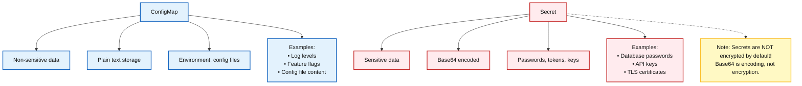
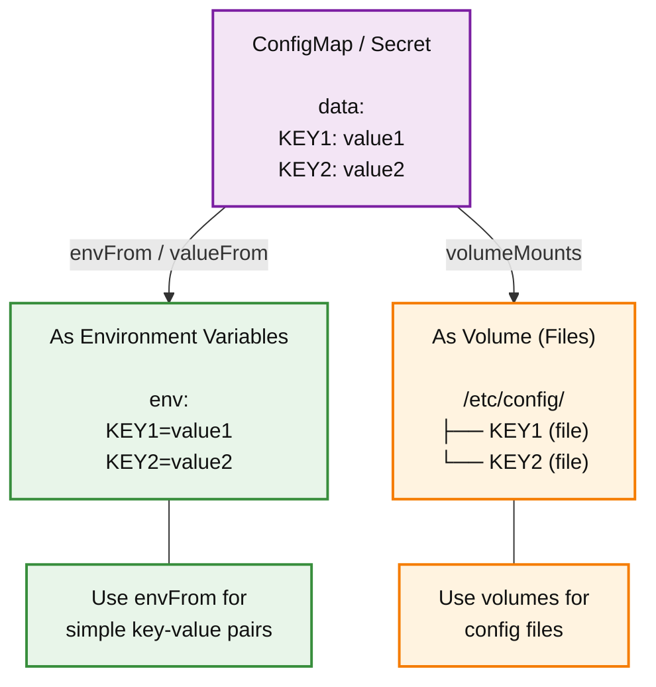

> **Complexity**: `[MEDIUM]` - Essential configuration management
>
> **Time to Complete**: 60–90 minutes (long-form read)
>
> **Prerequisites**: [Module 1.3: Pods](../module-1.3-pods/) and [Module 1.4: Deployments](../module-1.4-deployments/)

---

This module targets Kubernetes 1.35 and examines configuration delivery, credential visibility, and update behavior. Earlier examples are reference material: check their required files, object names, permissions, and request scope before trying them in a disposable lab.

For Pod startup problems, revisit [diagnosing Pod failures](../module-1.3-pods/#diagnosing-pod-failures-without-guessing). For changes that require replacing Pods, review [Deployment rolling updates](../module-1.4-deployments/#rolling-updates-and-rollbacks).

For hands-on practice, run setup once in a fresh Bash terminal and keep that terminal for every `cfg_lab` command and cleanup. The helper supplies the recorded context and namespace; the exercise blocks depend on that setup.

## What You'll Be Able to Do

After completing this module, you will be able to:

- **Design** decoupled deployment architectures that move environment-specific settings out of container images and into ConfigMaps or Secrets.
- **Implement** runtime configuration delivery with environment variables, mounted files, and projected volumes while predicting which changes require a Pod restart.
- **Diagnose** failed configuration and credential rollouts caused by base64 mistakes, namespace boundaries, missing keys, static Pod limits, or `subPath` mounts.
- **Compare** ConfigMap and Secret security boundaries, including RBAC exposure, etcd encryption at rest, and the KMS v2 provider available in modern Kubernetes.
- **Evaluate** when immutable ConfigMaps and Secrets reduce control-plane load and when versioned replacement objects create safer production rollouts.

## Why This Module Matters

A credential that should have lived as runtime configuration becomes part of an application artifact the moment it is baked into a container image, committed into source control, or hardcoded in a deployment manifest. Once that happens, rotation is no longer a single operation — the team must find every copy, invalidate every leaked credential, rebuild every artifact that contains it, retest every deployment that uses it, and hope no old image is still running in a forgotten environment. The CKS-track module on [secrets management](/k8s/cks/part4-microservice-vulnerabilities/module-4.3-secrets-management/) explores this failure mode further for exam-focused security work. <!-- incident-xref: uber-2022-hardcoded-creds --> Externalizing a credential can avoid rebuilding the image, but rotation still requires updating the credential and rolling or reloading its consumers.

Kubernetes gives you two built-in resources for avoiding that trap: ConfigMaps for non-sensitive configuration and Secrets for sensitive data. They let the same container image run in development, staging, and production while the cluster supplies the values that vary between those environments. That design is powerful, but it also creates a new responsibility: you must know exactly how those resources are stored, delivered, refreshed, and protected, because moving a password into a Secret does not automatically make the surrounding workflow secure.

## Separation of Configuration and Code

The core idea behind ConfigMaps and Secrets is separation of concerns. Container images should contain application code, dependencies, and default behavior that is safe to promote unchanged through a pipeline. Deployment-specific values should be supplied at runtime, because they change for reasons that are independent of the application release cycle. A logging level changes during an incident, a database endpoint changes during a migration, a feature flag changes during a gradual launch, and a credential changes when it is rotated or compromised.

The Third Factor of the influential "Twelve-Factor App" methodology states: store config in the environment. In Kubernetes, that principle becomes more flexible than plain shell variables, because the platform can deliver configuration as environment variables, files, command arguments, or API objects. The application still reads ordinary process environment values or local filesystem paths; it does not need to know that a kubelet placed those values there. The operational benefit is that you can change a Deployment manifest, a ConfigMap, or a Secret without rebuilding the image.

Think about artifact promotion as a chain of custody. If a web application image is built once and promoted unchanged from a developer namespace to staging and then production, every environment is testing the same executable payload. If the production database URL is hardcoded into the image, the chain breaks, because production now needs a different build. That difference makes debugging harder because a staging success no longer proves that the production artifact behaves the same way.

ConfigMaps and Secrets are both core `v1` Kubernetes API resources, but they are not interchangeable. A ConfigMap is appropriate for non-sensitive values such as log levels, feature flags, application properties, Nginx snippets, or JSON configuration files. A Secret is appropriate for passwords, private keys, API tokens, TLS private material, and image pull credentials. Secrets have specialized types and receive additional handling: Kubernetes sends a Secret only to nodes whose Pods need it, and [Linux nodes](https://v1-35.docs.kubernetes.io/docs/concepts/security/linux-security/#protection-for-secret-data-on-nodes) use memory-backed volumes for mounted Secret data. [Encryption at rest](https://v1-35.docs.kubernetes.io/docs/tasks/administer-cluster/encrypt-data/) can be configured for Secrets and other API resources, including ConfigMaps.

**Pause and predict:** if a team changes only a ConfigMap key used by a Deployment, should the container image digest change? Write yes or no before opening the answer.

<details>
<summary>Check your prediction</summary>

No. If the digest changes, the configuration is still coupled to the artifact. The design Kubernetes is trying to support keeps the image fixed while the runtime object changes.

</details>

There is also a practical incident-response reason to separate configuration from code. If a leaked database password is baked into an image, the response path includes a new build, a registry push, a Deployment update, and cleanup of any Pods still running the old image. If the password is externalized into a Secret, the team can rotate the credential, update the Secret object, and restart the consuming Pods without changing the application binary. That difference does not remove the need for disciplined rollout automation, but it shortens the path between detection and containment.



This diagram captures the first decision boundary, but it is only the beginning. The same value can be operationally sensitive in one environment and harmless in another, so classification is contextual. A log level is usually safe in a ConfigMap, but an internal endpoint that reveals private topology may deserve tighter handling. A TLS certificate file may be public material, while its matching private key must be treated as a Secret. The safest habit is to classify by consequence: if disclosure would create a security, compliance, or customer-impacting problem, use a Secret and restrict the surrounding access path.

## Object Anatomy and API Boundaries

ConfigMaps and Secrets are namespaced objects. A Pod can reference only a ConfigMap or Secret in its own namespace through ordinary environment variable or volume configuration. That boundary is deliberate because namespace-scoped RBAC, resource quotas, and application ownership often line up with team or environment boundaries. If a frontend Pod in the `web` namespace could mount a Secret from the `payments` namespace by accident, a small YAML mistake could become a cross-team credential leak.

ConfigMap data and Secret payloads each have a 1 MiB limit. ConfigMaps are not designed for large data, and the Secret limit discourages very large objects that could exhaust API server and kubelet memory. When a configuration file grows beyond that limit, consider a different delivery mechanism, such as an image layer, object store, persistent volume, or initialization workflow, rather than splitting it into dozens of fragile keys. See the [ConfigMap](https://v1-35.docs.kubernetes.io/docs/concepts/configuration/configmap/) and [Secret](https://v1-35.docs.kubernetes.io/docs/concepts/configuration/secret/#restriction-data-size) documentation.

A ConfigMap has two payload fields. The `data` field stores UTF-8 strings, which is what you use for normal application settings and text configuration files. The `binaryData` field stores base64-encoded binary payloads for non-UTF-8 bytes. Kubernetes validates that a key does not appear in both fields.

A Secret has a similar `data` field, but every value in that field must be base64-encoded. This is a serialization requirement, not encryption. Anyone who can read the Secret object can decode those bytes. Kubernetes also offers `stringData`, a write-only convenience field that accepts plaintext values during create or update and stores them under `data` after encoding. When you read the Secret back, `stringData` is gone, which is why GitOps tools and server-side apply workflows sometimes need careful handling around field ownership.

The built-in Secret types add validation and intent. The default `Opaque` type is a generic key-value container, while specialized types represent service account tokens, Docker registry credentials, basic authentication credentials, SSH keys, TLS certificate pairs, and bootstrap tokens. Those types do not replace access control; they tell Kubernetes and operators what shape of credential the object is supposed to hold. For example, a TLS Secret has conventional `tls.crt` and `tls.key` keys, making it easier for Ingress controllers and other components to consume it consistently.

Static Pods are an exception to ordinary Pod configuration. A static Pod is defined directly on a node and managed by the kubelet rather than created through the normal API server workflow. Its spec cannot reference API objects such as ConfigMaps, Secrets, or ServiceAccounts. If a node-level component needs sensitive material, use a different secure delivery mechanism and review it as node administration. See [static Pod restrictions](https://v1-35.docs.kubernetes.io/docs/tasks/configure-pod-container/static-pod/).

Optional references are another boundary worth designing deliberately. Kubernetes lets you mark some ConfigMap or Secret references as optional, which can be helpful during phased rollouts when a value may not exist in every environment yet. The risk is that optional references can hide a real deployment error until application startup, where the symptom looks like a confusing missing file or empty variable. Use optional references for planned compatibility windows, not as a way to silence manifest validation.

When a required ConfigMap or key is missing, a Pod cannot start with that reference; a missing required Secret or Secret key can also prevent startup. Inspect the Pod's events and compare the object name, key and namespace before changing anything. A missing reference is one possible cause, not a conclusion from the waiting state alone. Revisit [Pod diagnosis](../module-1.3-pods/#diagnosing-pod-failures-without-guessing).

Before trying the `stringData` manifest in the next section, what output do you expect when you read the Secret back? Write your prediction before opening the answer.

<details><summary>Check your prediction</summary>

A later `kubectl get secret -o yaml` will not show `stringData`; it will show base64 values under `data`. Encoded text is not protected from disclosure.

</details>

## Creating ConfigMaps and Secrets

Kubernetes supports both imperative creation and declarative manifests. Imperative commands are useful for learning, quick experiments, and generating initial YAML from local files. Declarative manifests are better for repeatable environments because they can be reviewed, versioned, diffed, and applied through the same delivery pipeline as the rest of the application. The professional habit is to understand both, then use declarative workflow for anything you expect to recreate.

```bash
# From literal values
kubectl create configmap app-config \
  --from-literal=LOG_LEVEL=debug \
  --from-literal=ENVIRONMENT=staging

# From file
kubectl create configmap nginx-config --from-file=default.conf

# From directory (regular files with valid key names become keys)
kubectl create configmap configs --from-file=./config-dir/

# View ConfigMap
kubectl get configmap app-config -o yaml
```

The commands above show literal keys, a single file, a directory, and a YAML inspection step. For a directory, kubectl packages regular files whose basenames are valid keys; it ignores subdirectories, symlinks, devices, and pipes. Inspect the command status and resulting keys before using the object. Review the directory first: a validly named backup or local override can still be included. The [ConfigMap task](https://v1-35.docs.kubernetes.io/docs/tasks/configure-pod-container/configure-pod-configmap/#create-configmaps-from-directories) describes these rules. Here `default.conf` is an Nginx server-block snippet, not a complete `nginx.conf`.

```yaml
apiVersion: v1
kind: ConfigMap
metadata:
  name: app-config
data:
  LOG_LEVEL: "debug"
  ENVIRONMENT: "staging"
  config.json: |
    {
      "database": "localhost",
      "port": 5432
    }
```

The YAML representation shows why ConfigMaps are often used for application files, not just small variables. The `config.json` key becomes a file when mounted as a volume, and the pipe character preserves multiline formatting. That is useful for Nginx snippets, application properties, JSON, YAML, or INI files, but it also means normal configuration review rules apply. If a multiline block contains a password, it is still visible ConfigMap data and should be moved into a Secret.

```bash
# From literal values
kubectl create secret generic db-creds \
  --from-literal=username=admin \
  --from-literal=password=secret123

# From file
kubectl create secret generic api-token \
  --from-file=token.txt

# View secret (base64 encoded)
kubectl get secret db-creds -o yaml

# Decode a value
kubectl get secret db-creds -o jsonpath='{.data.password}' | base64 -d
```

The Secret example demonstrates the workflow that causes many early mistakes. The CLI accepts literal values and stores encoded bytes, so the YAML view looks different from what the application will receive. Decoding with `base64 -d` is a debugging technique, not an authorization boundary. If a user, service account, or process can run that get command successfully, it can recover the original value.

```yaml
apiVersion: v1
kind: Secret
metadata:
  name: db-creds
type: Opaque              # Generic secret type
data:                     # Base64 encoded
  username: YWRtaW4=      # echo -n 'admin' | base64
  password: c2VjcmV0MTIz  # echo -n 'secret123' | base64
```

```yaml
# Or use stringData for plain text (K8s encodes it)
apiVersion: v1
kind: Secret
metadata:
  name: db-creds
type: Opaque
stringData:               # Plain text, auto-encoded
  username: admin
  password: secret123
```

The two Secret manifests produce the same practical result for a consuming Pod, but they create different review experiences. With `data`, the author must encode values correctly and avoid accidental newline characters from commands such as plain `echo`. With `stringData`, the author writes readable plaintext and lets the API server encode it. Neither style is safe to commit to a public repository, and neither style replaces a proper external secret workflow when Git is part of the delivery path.

A useful review trick is to read a manifest from the perspective of the future operator who gets paged. Can they tell which values are safe to print in a ticket, which values require rotation if exposed, and which values need a rollout to take effect? If the answer is no, the manifest may be technically valid while still being operationally unclear. Names like `app-settings`, `app-secrets`, and stable keys such as `DB_PASSWORD` are simple, but they teach the reader where to look during an outage.

## Consuming Values in Pods

A Pod can consume ConfigMaps and Secrets through command arguments, individual environment variables, `envFrom`, read-only volumes, projected volumes, or direct API access from application code. The choice should follow how the application expects to read configuration and how often the value needs to change. Environment variables are simple and familiar, but they are captured when the container starts. Files are a better fit for structured config and can be refreshed by the kubelet for normal ConfigMap and Secret volumes.

```yaml
apiVersion: v1
kind: Pod
metadata:
  name: app
spec:
  containers:
  - name: app
    image: myapp
    env:
    - name: LOG_LEVEL
      valueFrom:
        configMapKeyRef:
          name: app-config
          key: LOG_LEVEL
    # Or all keys at once:
    envFrom:
    - configMapRef:
        name: app-config
```

You can combine `env` and `envFrom` in the same container when you need one key addressed explicitly and the rest imported in bulk — they are not mutually exclusive.

This environment variable pattern is easy to read and works well for values that are naturally scalar, such as `LOG_LEVEL`, `ENVIRONMENT`, or a feature flag. Its limitation is just as important: changing the ConfigMap later does not mutate the environment of a running process. Linux processes receive their environment at start time, and Kubernetes does not rewrite it under the process. To pick up a new value, you delete the Pod, trigger a Deployment rollout, or use a controller pattern that changes a Pod template annotation when config changes.

```yaml
apiVersion: v1
kind: Pod
metadata:
  name: app
spec:
  containers:
  - name: app
    image: nginx
    volumeMounts:
    - name: config
      mountPath: /etc/nginx/conf.d
  volumes:
  - name: config
    configMap:
      name: nginx-config
```

Mounted ConfigMaps and Secrets behave differently because the kubelet manages files on the node. When the API object changes, the kubelet eventually updates files for regular volume mounts. The delay can be as long as the kubelet sync period plus a cache propagation delay. The default cache strategy is Watch; TTL-based caching and direct API reads have different delays. A one-minute sync period plus a one-minute TTL is an example for a TTL cache, not a typical Watch timing. Applications must reread or reload the file to use the new value. See [mounted ConfigMap updates](https://v1-35.docs.kubernetes.io/docs/concepts/configuration/configmap/#mounted-configmaps-are-updated-automatically).

The `nginx-config` example assumes `default.conf` contains an appropriate server-block snippet. Mounting over `/etc/nginx/conf.d` hides any files already present in that image directory, so include the configuration the container needs. A complete main `nginx.conf` is a different file, not this snippet.

The `subPath` option is the major exception. Teams often use `subPath` to mount a single ConfigMap key into a directory without hiding the rest of the directory contents. A container using a ConfigMap or Secret through `subPath` does not receive updates to that mount. If dynamic refresh matters, mount a directory without `subPath` and arrange the application path accordingly. See [volumes and subPath](https://v1-35.docs.kubernetes.io/docs/concepts/storage/volumes/#using-subpath).

**Pause and predict:** your application takes five minutes to start and you need to temporarily change logging from `info` to `debug` during an incident. The file is already mounted in the running Pod. Which delivery method lets you change that level without waiting through another full start, if the application can reload a file but cannot reload environment variables? Write your choice before opening the answer.

<details>
<summary>Check your prediction</summary>

The mounted-file design is operationally better when the application can reload a file and cannot reload environment variables. If the application reads configuration only once at startup, both delivery methods still require a restart, so the deciding factor becomes readability, leak risk, and application convention.

</details>

```yaml
apiVersion: v1
kind: Pod
metadata:
  name: app
spec:
  containers:
  - name: app
    image: myapp
    env:
    - name: DB_USER
      valueFrom:
        secretKeyRef:
          name: db-creds
          key: username
    - name: DB_PASS
      valueFrom:
        secretKeyRef:
          name: db-creds
          key: password
```

Secret environment variables are common but deserve extra caution. Some diagnostics, crash tooling, or process-inspection tools can capture environment variables. A password may therefore leak into logs or diagnostics even when RBAC around the Secret object is correct. A file mount may avoid an environment-specific exposure path, but check the actual tooling and remember that a process with access to the file can still read it.

```yaml
apiVersion: v1
kind: Pod
metadata:
  name: app
spec:
  containers:
  - name: app
    image: myapp
    volumeMounts:
    - name: secrets
      mountPath: /etc/secrets
      readOnly: true
  volumes:
  - name: secrets
    secret:
      secretName: db-creds
```

On Linux nodes, mounted Secret data uses a memory-backed `tmpfs` volume; node configuration can still affect persistence. On Windows, Secret data is written to local storage. See the Kubernetes guidance for [Linux](https://v1-35.docs.kubernetes.io/docs/concepts/security/linux-security/#protection-for-secret-data-on-nodes) and [Windows](https://v1-35.docs.kubernetes.io/docs/concepts/security/windows-security/#protection-for-secret-data-on-nodes). Neither delivery method protects the data from a compromised container that can read it: an attacker with a shell has the same filesystem access the application uses.



This flow explains why a rollout plan must include both the Kubernetes delivery mechanism and the application reload mechanism. Kubernetes can update a file, but it cannot force arbitrary application code to reread that file. Kubernetes can create an environment variable, but it cannot change a process environment after startup. Make that behavior explicit with versioned object names, reload sidecars, or application-native reload endpoints according to the application's needs.

Tools can automate the restart side of this problem by changing the Pod template when a referenced object changes. For example, [Kustomize's ConfigMap generator](https://v1-35.docs.kubernetes.io/docs/tasks/configure-pod-container/configure-pod-configmap/#generate-configmaps-from-files) adds a content hash to the generated name. Updating a workload reference to the new name makes the dependency visible in its Pod template. The tradeoff is that configuration edits can restart workloads, so decide whether a value needs live reload, a rollout, or a maintenance window.

## Worked Example: Refactoring Hardcoded Config

Imagine a small web service that was originally built for a single developer laptop. It connects to a database at `localhost:5432`, uses a cache time-to-live of `3600`, and reads a password from a checked-in file. That design might work for a demo, but it fails the moment the same image needs to run in separate namespaces or clusters. The database location changes by environment, the cache policy may change during troubleshooting, and the password must rotate without producing a new application image.

The first step is to classify the values by sensitivity and update behavior. The cache TTL is not confidential, so it belongs in a ConfigMap. The database password is confidential, so it belongs in a Secret. A database host might be non-sensitive in a small lab but sensitive in a production environment where topology disclosure matters; this module keeps the example simple, but production teams should classify that value deliberately rather than by habit.

```yaml
# ConfigMap
apiVersion: v1
kind: ConfigMap
metadata:
  name: app-settings
data:
  CACHE_TTL: "3600"
```

```yaml
# Secret
apiVersion: v1
kind: Secret
metadata:
  name: app-secrets
stringData:
  DB_PASSWORD: "supersecret"
```

These two objects decouple the release artifact from the runtime environment. The ConfigMap can be reviewed by application owners, and the Secret can be managed by a narrower operational path. In a GitOps setup, you would normally avoid committing plaintext Secret manifests and instead use a sealed, encrypted, or externally synchronized representation. The conceptual separation still matters because the Pod spec should communicate which values are configuration and which values are credentials.

```yaml
# Pod using both
apiVersion: v1
kind: Pod
metadata:
  name: myapp
spec:
  containers:
  - name: app
    image: myapp:v1
    envFrom:
    - configMapRef:
        name: app-settings
    env:
    - name: DB_PASSWORD
      valueFrom:
        secretKeyRef:
          name: app-secrets
          key: DB_PASSWORD
```

This Pod keeps the original application interface simple: the process receives the cache setting and password as environment variables. That is acceptable for many beginner labs, but a production review should ask whether the password could appear in crash output, thread dumps, or debugging bundles. If the application supports reading a credential file, a mounted Secret is often preferable. If the application can reload configuration files, a mounted ConfigMap may reduce restart pressure during incident response.

The operational win is that the image `myapp:v1` can move through environments without being rebuilt. A staging namespace can provide one ConfigMap and Secret, while production provides different objects with the same keys. If the production password rotates, update the Secret and intentionally roll the workload so its environment-based credential is refreshed; changing the Secret alone does not start a rollout. The application image remains the same.

When an application expects several files in one directory, a projected volume can combine ConfigMaps, Secrets, service account tokens, and downward API data into a single mounted path. The source objects remain separate API resources, but a process that can read the projected Secret file can read its contents. Combining sources does not make that file safe to expose. This layout can serve software that expects configuration and credential files side by side.

This reference Pod combines three sources into one directory. It assumes the synthetic `app-config` with key `LOG_LEVEL` and `app-secret` with key `DB_PASS` from Task 1 already exist in the same exercise namespace. The distinct paths avoid overwriting one another: `log-level` comes from the ConfigMap, `password` from the placeholder Secret, and `pod-name` from the Pod's own metadata. Use only the lab's non-real placeholder; access to the mounted file exposes it.

```yaml
apiVersion: v1
kind: Pod
metadata:
  name: projection-demo
spec:
  containers:
  - name: demo
    image: busybox:1.36.1
    command: ['sh', '-c', 'sleep 3600']
    volumeMounts:
    - name: settings
      mountPath: /etc/demo-settings
      readOnly: true
  volumes:
  - name: settings
    projected:
      sources:
      - configMap:
          name: app-config
          items:
          - key: LOG_LEVEL
            path: log-level
      - secret:
          name: app-secret
          items:
          - key: DB_PASS
            path: password
      - downwardAPI:
          items:
          - path: pod-name
            fieldRef:
              fieldPath: metadata.name
```

After Task 1 and before cleanup, you can save the exact manifest above as `projection-demo.yaml` in a directory you control and apply it with `cfg_lab apply -f projection-demo.yaml` in the same lab terminal. The [projected-volume documentation](https://v1-35.docs.kubernetes.io/docs/concepts/storage/projected-volumes/) describes the supported sources and namespace boundary. Seeing a file shows what is available to the container; it does not show that an application has reread it.

## Security Reality: Secrets Are a Boundary, Not a Vault

The most important sentence in this module is simple: base64 is not encryption. Kubernetes uses base64 in Secret `data` fields so arbitrary bytes can fit cleanly into JSON and YAML API payloads. Base64 does not hide data from anyone who can read the object, list Secrets in the namespace, create a Pod that mounts the Secret, or compromise a running container that already has the Secret mounted. Treat a Secret as a Kubernetes access-controlled object, not as a complete secret-management system by itself.

Encryption at rest addresses a different threat: the exposure of stored API data in etcd or backups. Cluster administrators can configure the API server with `--encryption-provider-config`, causing selected resource data such as Secrets to be encrypted before being written to disk. Providers include `identity`, which performs no encryption; local encryption providers such as `aescbc`, `aesgcm`, and `secretbox`; and KMS providers that integrate with an external key-management system.

The KMS story matters for Kubernetes 1.35. KMS v1 was deprecated in Kubernetes v1.28 and disabled by default beginning in v1.29. KMS v2 reached stable status in v1.29 and offers significantly better performance than v1. See the [KMS provider documentation](https://v1-35.docs.kubernetes.io/docs/tasks/administer-cluster/kms-provider/).

Encryption at rest does not protect plaintext manifests before they reach the API server. If a team commits a Secret YAML with `stringData` into a public repository, KMS v2 cannot help; the leak happened in Git, not in etcd. If a developer sends a Secret manifest through an unprotected chat channel, the cluster storage provider never gets a chance to reduce that exposure. Encryption at rest protects selected persisted API data; authentication, authorization, and admission are separate controls.

RBAC is the second major boundary, and it is easy to underestimate. Granting `get` on a named Secret allows direct retrieval of that Secret. Granting `list` on Secrets in a namespace is broader because list responses include full object payloads, not just names. Granting a user permission to create Pods in a namespace can also become indirect Secret access, because the user can create a Pod that mounts a Secret and then read it from inside the container.

That last point changes how you should review access requests. A role that cannot read Secrets directly may still be too powerful if it can run arbitrary workloads in the same namespace as valuable credentials. Admission policies, namespace design, service account scoping, and workload identity all help narrow that blast radius. In production, the question is not merely "who can read Secret objects?" but also "who can cause a workload to run with access to those Secret objects?"

**Pause and predict:** an attacker has a shell inside your application container, and the application reads its database password from `/etc/secrets/password`. Will the attacker be stopped because the value came from a Secret rather than a ConfigMap? Write yes or no before opening the answer.

<details>
<summary>Check your prediction</summary>

No. Once the workload is compromised, the credential is available through the same path the workload uses. The stronger controls are runtime hardening, least privilege, short-lived credentials, network policy, and rapid rotation.

</details>

This is why Secret design should be paired with credential design. A long-lived database password mounted into every replica creates a larger blast radius than a short-lived token scoped to one service account and rotated automatically. Kubernetes can deliver either value, but it cannot decide whether the credential itself is overpowered. Good teams review the consumer, the namespace, the service account, the network path, the database permissions, and the rotation mechanism as one system.

## Projected Volumes, Immutability, and Rollout Strategy

Configuration delivery becomes more interesting as clusters grow. A single namespace might contain many Deployments that share common settings. Kubernetes documents a performance benefit from immutable objects for clusters with at least tens of thousands of unique ConfigMap-to-Pod mounts: kubelets can close watches for objects that cannot change.

Setting `immutable: true` on a ConfigMap or Secret prevents changes to its data. The kubelet can stop watching for updates to that object, reducing API server load in large clusters. To change the data, delete and recreate the object; Kubernetes recommends recreating existing consuming Pods because they maintain a mount point to the deleted object. A versioned replacement name and workload update is another pattern that preserves the old object for a controlled rollout. See [immutable ConfigMaps](https://v1-35.docs.kubernetes.io/docs/concepts/configuration/configmap/#configmap-immutable) and [immutable Secrets](https://v1-35.docs.kubernetes.io/docs/concepts/configuration/secret/#secret-immutable).

Immutable ConfigMaps and Secrets became stable in Kubernetes v1.21. In Kubernetes 1.35, immutability is a stable feature. It can be useful for global constants, application defaults, certificate bundles, and config that should change only through a controlled rollout.

Versioned names are the practical companion to immutability. Instead of editing `app-config`, create `app-config-2026-05-03` or another release-specific name, update the Deployment, and let the rollout controller replace Pods gradually. The old object can stay in place while old Pods drain, and cleanup can happen after the rollout is complete. This makes rollback easier because the previous object still exists and has not been overwritten.

There is a tradeoff between dynamic update behavior and rollout clarity. A mutable mounted ConfigMap can update files in running Pods, which is useful for software that safely reloads configuration. A versioned immutable ConfigMap forces a rollout, which is more predictable when a bad configuration could break every replica at once. Senior operators choose based on blast radius: dynamic reload is convenient for low-risk toggles, while versioned rollouts are safer for settings that change connection pools, authorization behavior, or startup assumptions.

Use this decision as a small design review habit. If a value changes frequently and the application can validate and reload it safely, a mounted mutable ConfigMap may be right. If a value defines startup behavior, authentication, or critical routing, favor a versioned object and a Deployment rollout. If a value is sensitive, start with a Secret and then decide whether file or environment delivery creates fewer accidental leak paths for that specific application.

Rollout history also matters after the incident is over. If a mutable object was edited in place several times during troubleshooting, reconstructing which Pods saw which value becomes difficult unless audit logs and deployment events are complete. Versioned objects leave a clearer trail because the object name appears in the Pod template. That extra clarity can be the difference between a quick post-incident review and hours spent guessing which configuration was active during a customer-impacting window.

## Patterns & Anti-Patterns

The strongest pattern is to make configuration ownership explicit. Application teams can own non-sensitive ConfigMaps that describe behavior, while platform or security teams own Secret creation, synchronization, and rotation. This does not mean every team needs a separate tool, but it does mean review paths should reflect consequence. A typo in a feature flag is not the same class of problem as a leaked database credential, and the workflow should not pretend they are equal.

Another reliable pattern is to use stable keys with versioned object names. Applications should not need to change from `DB_PASSWORD` to `DATABASE_PASSWORD_V2` during ordinary rotation; the key contract should stay stable. The object name can change to represent a new version, and the Deployment rollout can point at that new object. Stable keys reduce application churn, while versioned names give operators a clean rollback surface.

A third pattern is to prefer file mounts for complex structured configuration. JSON, YAML, certificates, and multi-line properties are easier to validate as files than as long environment variables. File mounts also allow applications or sidecars to watch for changes when dynamic reload is safe. Environment variables remain useful for small scalar values, but they become awkward when values contain whitespace, nested structure, or sensitive data that crash tooling might expose.

The most common anti-pattern is treating Secrets as a complete vault. Kubernetes Secrets are API objects protected by Kubernetes controls; they are not a replacement for credential lifecycle management, short-lived tokens, access review, or external key management. Another anti-pattern is granting broad namespace permissions because a CI job or developer "just needs to deploy." If that role can create Pods, it may be able to extract Secrets indirectly. The better alternative is scoped service accounts, admission constraints, and separate namespaces for workloads with different credential sensitivity.

These patterns scale because they reduce ambiguity. A new engineer can inspect a Deployment and infer whether a value is safe configuration, sensitive credential material, dynamically refreshed file data, or versioned rollout input. That readability is not cosmetic; it lowers operational risk. During an outage, teams make fewer mistakes when the YAML expresses intent clearly enough that the next action is obvious.

| Pattern or Anti-Pattern | When It Appears | Operational Consequence | Better Practice |
|---|---|---|---|
| Pattern: stable keys with versioned object names | Teams rotate credentials or config while keeping application code stable. | Rollbacks are simpler because old Pods can keep using the old object until they drain. | Keep key names consistent and change object names during controlled rollouts. |
| Pattern: file mounts for structured config | Applications read JSON, YAML, certificates, or multiline settings. | Validation and reload behavior are clearer than long environment variables. | Mount a directory and avoid `subPath` when updates must appear in running Pods. |
| Pattern: immutable shared config | Many Pods consume a value that rarely changes. | Kubelet and API server watch pressure decreases in large clusters. | Set `immutable: true` and replace the object with a new version when needed. |
| Anti-pattern: plaintext Secrets in Git | Teams want declarative manifests but skip secret-specific tooling. | Repository access becomes credential access, and history keeps old leaked values. | Use sealed, external, or operator-synchronized secret workflows. |
| Anti-pattern: broad Pod creation rights | A user or job needs deployment convenience in a shared namespace. | Pod creation can become indirect access to mounted Secrets. | Scope RBAC, separate namespaces, and enforce admission policies. |
| Anti-pattern: `subPath` for live config | A team wants one file mounted into an existing directory. | The mounted file does not receive updates in the running container. | Mount the whole directory or roll Pods intentionally after updates. |

## Decision Framework

Choosing between a ConfigMap, Secret, environment variable, mounted file, projected volume, or immutable object should be a design decision, not a reflex. Start by asking what happens if the value is disclosed. If disclosure is harmful, use a Secret and design the surrounding RBAC and delivery path carefully. If disclosure is harmless but incorrect values could break production, use a ConfigMap with the same rollout discipline you would apply to code.

Next, ask how the application reads the value. If it expects process environment variables and reads them only at startup, environment injection is simple, but every change means a Pod restart. If it expects files or can be adapted to files, volume mounts often produce cleaner behavior for structured data and reduce accidental logging of sensitive values. If it expects a single directory that mixes several sources, projected volumes let Kubernetes compose that directory while keeping source objects separate.

Finally, ask how often the value changes and how dangerous a bad change would be. High-risk changes deserve versioned objects and controlled rollouts even if Kubernetes could update a mounted file automatically. Low-risk toggles may benefit from dynamic file refresh if the application validates them safely. Rarely changing shared values are good candidates for immutability because they reduce platform overhead and prevent accidental edits.

```text
+-----------------------------+
| Is disclosure harmful?      |
+--------------+--------------+
               |
        yes    |    no
               |
      Secret   |   ConfigMap
               |
               v
+-----------------------------+
| Does the app need a file?   |
+--------------+--------------+
        yes    |    no
               |
  volume mount | environment
               |
               v
+-----------------------------+
| Should updates be dynamic?  |
+--------------+--------------+
        yes    |    no
               |
 avoid subPath | version name
+-----------------------------+
```

| Choice | Use It When | Avoid It When | Main Tradeoff |
|---|---|---|---|
| ConfigMap environment variable | The value is non-sensitive, scalar, and read only at startup. | The value must update in running Pods. | Simple startup injection in exchange for restart-based updates. |
| ConfigMap volume | The value is structured text or a file the app can reload. | The application cannot tolerate eventual refresh timing. | Better file semantics with asynchronous propagation. |
| Secret environment variable | The application only supports env-based credentials and logs are controlled. | Crash dumps or diagnostics expose environment values. | Compatibility in exchange for higher accidental leak risk. |
| Secret volume | The application can read credential files. | A legacy app cannot be configured for file paths. | Lower accidental environment exposure with filesystem access inside the Pod. |
| Projected volume | Multiple sources must appear in one directory. | Ownership boundaries would become confusing to operators. | Unified app view while preserving source object separation. |
| Immutable object | Values rarely change or require controlled versioned rollout. | You need live mutation of the same object name. | Lower control-plane overhead and safer history in exchange for replacement workflow. |

## Did You Know?

- **1 MiB Payload Limit**: ConfigMaps are not designed for large data, and the Secret limit discourages objects that could exhaust API server and kubelet memory.
- **KMS v2 GA Date**: KMS v2 became stable in Kubernetes v1.29; KMS v1 was disabled by default in that release.
- **Immutability GA Timeline**: Immutable ConfigMaps and Secrets reached stable status in Kubernetes v1.21.
- **Propagation Depends on Strategy**: A mounted update can take the kubelet sync period plus cache propagation time. Watch is the default strategy; a one-minute sync plus a one-minute TTL is a TTL-cache example.

## Common Mistakes

| Mistake | Why It Happens | How to Fix It |
|---|---|---|
| Committing secrets to Git | Teams want declarative delivery and forget that base64 or `stringData` values remain recoverable from repository history. | Use sealed, external, or operator-managed secret workflows and rotate any credential that was committed. |
| Thinking base64 means encrypted | Secret YAML displays encoded values, which looks unfamiliar enough to feel protected. | Treat base64 as serialization only, restrict Secret RBAC, and enable encryption at rest for stored API data. |
| Encoding newline characters | Plain `echo` adds a newline, so the decoded password does not match what the application expects. | Prefer `stringData` for hand-written manifests or use `echo -n` when you intentionally prepare `data` values. |
| Hardcoding config in images | A value starts as a demo default and becomes a hidden deployment dependency. | Move environment-specific values into ConfigMaps or Secrets and promote the same image across environments. |
| Mounting live config with `subPath` | A team wants one file in an existing directory without masking other files. | Mount the whole directory when dynamic refresh matters, or accept that a Pod restart is required. |
| Granting broad Secret `list` access | Operators think listing is safer than reading individual objects. | Remember that list responses include payload data and grant named `get` access only where practical. |
| Ignoring Pod creation as Secret access | A role cannot read Secrets directly, so it appears harmless. | Treat arbitrary Pod creation in a namespace as potential indirect access to Secrets mounted in that namespace. |

## Quiz

<details><summary>Your team updates a ConfigMap key used as an environment variable, but the running application still reports the old value. What should you check first?</summary>

Environment variables are captured when the container starts, so the first check is whether the value was delivered through `env`, `envFrom`, or a file mount. If it was an environment variable, the behavior is expected and the Pod must be recreated or rolled by a controller. If the team expected dynamic updates, the design should move the setting to a mounted file and ensure the application actually reloads that file. This diagnoses the delivery mechanism instead of blaming the ConfigMap object itself.

</details>

<details><summary>A developer stores a production API token in a ConfigMap because it is "only internal." How do you evaluate and correct the design?</summary>

The value belongs in a Secret because disclosure would create a security incident regardless of whether the cluster is internal. Moving it to a Secret is only the first correction; RBAC must also restrict who can read it, list it, or create Pods that mount it. If the manifest is stored in Git, the team should use an encrypted or external secret workflow rather than committing plaintext `stringData`. The better design classifies by consequence, not by the network location of the cluster.

</details>

<details><summary>A Secret mounted with `subPath` does not update after rotation, and the application keeps using the old credential. What is happening?</summary>

A Secret mounted through `subPath` does not receive updates in the running container. The Secret object may be updated correctly in the API server, but the mounted file inside the existing container remains static. Restart or roll the Pod to pick up the changed value. For future live refresh, mount a directory without `subPath`, or use versioned Secrets with intentional rollouts.

</details>

<details><summary>A review finds this manifest, and the application cannot authenticate. What is the likely configuration error?</summary>

```yaml
apiVersion: v1
kind: Secret
metadata:
  name: db-creds
data:
  password: mysecretpassword
```

The author put the intended plaintext directly in `data` instead of encoding those bytes. This particular string is also syntactically valid base64: the API can accept it, but decoding it yields different bytes, so the application will not receive the intended password. Other invalid base64 strings are rejected. Use `stringData` for plaintext input, or encode the exact intended value for `data` without an accidental trailing newline. See the [Secret data fields](https://v1-35.docs.kubernetes.io/docs/concepts/configuration/secret/#restriction-names-data).

</details>

<details><summary>Your security team enables KMS v2 encryption at rest. Can developers now commit plaintext Secret YAML to a public repository?</summary>

No. KMS v2 protects selected API data after the API server persists it to storage; it does not protect files before they enter the cluster. A plaintext Secret committed to a public repository is already leaked, even if the cluster later stores it encrypted in etcd. The correct workflow keeps plaintext credentials out of Git by using sealed secrets, external synchronization, or another approved secret-management process. Encryption at rest is an important layer, not permission to weaken source-control hygiene.

</details>

<details><summary>A platform team has tens of thousands of unique ConfigMap-to-Pod mounts, including a shared ConfigMap that almost never changes. What design change should they evaluate to reduce API server load?</summary>

They should evaluate marking the ConfigMap as immutable and moving to a versioned replacement workflow. Immutability lets kubelets stop watching or polling for updates to that object, reducing control-plane load in large clusters. When the value needs to change, the team creates a new ConfigMap and updates the workload reference, which triggers a controlled rollout. This fits stable shared configuration better than repeatedly editing one mutable object.

</details>

<details><summary>A user cannot read Secrets directly but can create Pods in the same namespace as a database credential. Why might this still be a security concern?</summary>

Pod creation can become indirect Secret access. The user can create a Pod that references the Secret as an environment variable or mounted file, then read the credential from inside that Pod. RBAC reviews should therefore consider workload creation rights alongside direct Secret permissions. Stronger namespace boundaries, scoped service accounts, and admission controls reduce that lateral movement path.

</details>

<details><summary>A legacy application needs a 5 MiB configuration file. Should you store it in a standard ConfigMap?</summary>

No. ConfigMap data and Secret payloads each have a 1 MiB limit, and pushing multi-mebibyte payloads through the Kubernetes API harms the wrong components. A better design uses an image layer, persistent volume, object-store download, init container, or another delivery mechanism built for larger artifacts. The deciding factor is whether the file is code-like, data-like, environment-specific, or sensitive. ConfigMaps are for configuration state, not bulk file distribution.

</details>

## Apply the Concepts

Use these checks to practice diagnosing references and composing a projected volume.

<details><summary>A Pod remains waiting after a configuration change. What should you inspect before deciding what to change?</summary>

Inspect the Pod's events and compare its referenced object and key with the ConfigMap in the Pod's namespace. If the key is missing and the reference is required, correct the reference or restore the intended key after confirming ownership. A waiting Pod alone does not prove that this is the cause.

</details>

<details><summary>A Pod in namespace A needs a ConfigMap that exists only in namespace B. Would a cross-namespace reference work? Would making this a static Pod solve it?</summary>

Ordinary Pod ConfigMap references use an object in the Pod's own namespace. Provide the intended configuration in namespace A through an authorized workflow. A static Pod is not a workaround: its spec cannot reference API objects such as ConfigMaps or Secrets. Choose a compatible node-level delivery design if a static Pod is required.

</details>

<details><summary>Configure one projected directory with `LOG_LEVEL` as `log-level`, `DB_PASS` as `password`, and the Pod name as `pod-name`. Which source and field belongs in each entry? Does seeing an updated file prove the application reloaded it?</summary>

Use a `configMap` item for key `LOG_LEVEL` at path `log-level`, a `secret` item for key `DB_PASS` at path `password`, and a `downwardAPI` item with `fieldRef.fieldPath: metadata.name` at path `pod-name`. The paths are separate within the same mount. Reading a changed file does not prove the application reread or applied it.

</details>

## Hands-On Exercise

In this synthetic incident, a team needs to change a logging level without rebuilding its image and explain where a placeholder credential is visible. Start with an empty disposable namespace: Task 1 creates the objects and Pod you will investigate. Compare the API value, the running process environment, and a mounted file before deciding what each observation proves. Use only the non-real placeholder shown here: environment values and the Pod's startup logs expose plaintext, so never use real credentials in this exercise.

Use a context you have independently confirmed is a dedicated disposable lab, and set `KUBEDOJO_LAB_CONTEXT` to its name before setup; the literal name `default` is refused. Use one fresh Bash terminal for setup, every task, and cleanup. The guard cannot prove ownership or disposability; do not share the exercise namespace with another writer.

```bash
CFG_READY=no CFG_NEW=no
readonly CFG_CONTEXT="${KUBEDOJO_LAB_CONTEXT:-}" CFG_NS="config-lab-$(date +%s)-$$" && { CFG_NEW=yes; CFG_UID=; }
cfg_lab() {
  [ "$CFG_READY" = yes ] || { echo 'Setup incomplete; stop' >&2; return 1; }
  command kubectl --context "$CFG_CONTEXT" --namespace "$CFG_NS" "$@"
}
if [ "$CFG_NEW" = yes ] && [ -n "$CFG_CONTEXT" ] && [ "$CFG_CONTEXT" != default ] && CFG_CURRENT="$(command kubectl config current-context)" && [ "$CFG_CURRENT" = "$CFG_CONTEXT" ]; then
  printf 'Exercise context/namespace: %s / %s\n' "$CFG_CONTEXT" "$CFG_NS"
  if CFG_CREATED_UID="$(command kubectl --context "$CFG_CONTEXT" create namespace "$CFG_NS" -o jsonpath='{.metadata.uid}')" && [ -n "$CFG_CREATED_UID" ]; then
    CFG_UID="$CFG_CREATED_UID"; CFG_READY=yes
  fi
fi
[ "$CFG_READY" = yes ] || echo 'Setup failed; stop and inspect the error before continuing' >&2
```

Continue only after setup succeeds. `cfg_lab` pins requests to the recorded context and namespace without changing kubeconfig preferences. Run setup once: re-pasting disables the helper while preserving the earlier UID for cleanup. Stop on a failed task command and clean up before retrying in a fresh terminal. If creation fails or returns no UID, inspect the printed namespace manually: cleanup has no ownership evidence to delete it.

Record the printed context and namespace and the successful creation UID (`printf '%s\n' "$CFG_UID"`) somewhere you can retrieve if the terminal closes. If the shell is lost, the helper and its receipt are lost too: do not re-paste setup as a recovery procedure. Independently verify the intended context, namespace and saved creation UID against the live namespace before arranging deletion. If the saved UID or ownership is uncertain, do not delete it; ask the lab owner to investigate. This comparison still assumes no concurrent replacement and is not atomic with deletion.

### Task 1: Create the configuration objects

Before looking at the commands, choose how you would create and inspect the settings and placeholder credential. What would the YAML view and Pod logs expose? Write your reasoning, then use the hints if needed. The following block is one possible solution, not a production credential pattern.

<details><summary>Hint 1: Concept</summary>

Encoding a value does not make it confidential; consider each place a value is displayed.

</details>

<details><summary>Hint 2: Component</summary>

Compare the Secret object, the Pod's environment and its startup logs.

</details>

<details><summary>Hint 3: Command</summary>

After creating the objects, inspect them with `cfg_lab get secret app-secret -o yaml` and `cfg_lab logs config-test`.

</details>

```bash
# 1. Create ConfigMap
cfg_lab create configmap app-config \
  --from-literal=LOG_LEVEL=debug \
  --from-literal=APP_NAME=myapp

# 2. DECISION POINT: Create the secret.
# Will you use --from-literal or create a YAML file with stringData? 
# We'll use the CLI for speed here:
cfg_lab create secret generic app-secret \
  --from-literal=DB_PASS=secretpassword

# 3. Create pod using both
cat << 'EOF' | cfg_lab apply -f -
apiVersion: v1
kind: Pod
metadata:
  name: config-test
spec:
  containers:
  - name: test
    image: busybox:1.36.1
    command: ['sh', '-c', 'env && sleep 3600']
    envFrom:
    - configMapRef:
        name: app-config
    env:
    - name: DB_PASSWORD
      valueFrom:
        secretKeyRef:
          name: app-secret
          key: DB_PASS
EOF

# 4. Verify env vars are present
cfg_lab wait --for=condition=Ready pod/config-test --timeout=60s
cfg_lab logs config-test | grep -E "LOG_LEVEL|APP_NAME|DB_PASSWORD"
```

<details><summary>Solution notes for Task 1</summary>

The commands create one ConfigMap, one Secret, and one Pod in the exercise namespace. Useful inspection commands are `cfg_lab get configmap app-config -o yaml`, `cfg_lab get secret app-secret -o yaml`, and `cfg_lab logs config-test`. The Pod logs show plaintext environment values from startup; that visibility is risky for real credentials.

</details>

### Task 2: Inspect the Secret encoding boundary

Read the stored Secret and decode the single value so you can see exactly where base64 applies. This step builds the habit of distinguishing Kubernetes serialization from actual confidentiality.

```bash
cfg_lab get secret app-secret -o yaml
cfg_lab get secret app-secret -o jsonpath='{.data.DB_PASS}' | base64 -d && printf '\n'
```

<details><summary>Solution notes for Task 2</summary>

The YAML view shows encoded data under `.data.DB_PASS`, while the decode command prints the original lab value. That proves base64 is reversible by anyone with read access. In a production review, this is the point where you verify RBAC, encryption at rest, and whether the Secret manifest itself was ever committed in plaintext.

</details>

### Task 3: Prove environment variables are static

The Pod is running with the objects from Task 1. If `LOG_LEVEL` changes in the ConfigMap, what would you inspect first, and what do you predict the running process will report? Write your prediction before opening the hints or using the commands.

<details><summary>Hint 1: Concept</summary>

Distinguish the stored object from values captured when a container starts.

</details>

<details><summary>Hint 2: Component</summary>

Compare the ConfigMap's current value, the existing container environment and its startup log snapshot.

</details>

<details><summary>Hint 3: Command</summary>

Use `cfg_lab get configmap`, `cfg_lab exec ... printenv` and `cfg_lab logs` as shown below.

</details>

Update the ConfigMap and compare those observations. The API should show the new value while the already-started container reports the old one.

```bash
cfg_lab create configmap app-config \
  --from-literal=LOG_LEVEL=info \
  --from-literal=APP_NAME=myapp \
  --dry-run=client -o yaml | cfg_lab apply -f -
cfg_lab get configmap app-config -o jsonpath='{.data.LOG_LEVEL}{"\n"}'
cfg_lab exec config-test -- printenv LOG_LEVEL
cfg_lab logs config-test | grep LOG_LEVEL
```

<details><summary>Solution notes for Task 3</summary>

The ConfigMap object changes, but `printenv` in the existing container still shows `debug`; the log records the startup snapshot. This is expected because the container runtime does not rewrite process environments after startup. A Deployment rollout, Pod deletion, or file-based configuration design is required when the running application must observe a changed value.

The first `apply` may warn that the ConfigMap lacks its last-applied-configuration annotation because you created it imperatively; kubectl adds that annotation automatically.

</details>

### Task 4: Rework the Pod to mount the ConfigMap as files

Delete the original Pod and recreate it with the ConfigMap mounted at `/etc/app-config`. Then inspect the directory to see how keys become files.

```bash
cfg_lab delete pod config-test
cat << 'EOF' | cfg_lab apply -f -
apiVersion: v1
kind: Pod
metadata:
  name: config-test
spec:
  containers:
  - name: test
    image: busybox:1.36.1
    command: ['sh', '-c', 'ls -l /etc/app-config && cat /etc/app-config/LOG_LEVEL && sleep 3600']
    volumeMounts:
    - name: app-config
      mountPath: /etc/app-config
  volumes:
  - name: app-config
    configMap:
      name: app-config
EOF
cfg_lab wait --for=condition=Ready pod/config-test --timeout=60s
cfg_lab exec config-test -- ls -l /etc/app-config
cfg_lab exec config-test -- cat /etc/app-config/LOG_LEVEL && printf '\n'
```

<details><summary>Solution notes for Task 4</summary>

Each ConfigMap key appears as a file under `/etc/app-config`. This layout is better for applications that read configuration files or can reload them. If you update the ConfigMap, the file may refresh after kubelet propagation delay, but the application must still reread the file to act on the new value.

</details>

### Observe a mounted file update

Task 4 created a Pod that mounts the ConfigMap as files. Predict what changes in the API and the mounted file when you update the object, and whether that alone proves an application reloaded it. The check below records the Pod UID, API values, file reads and UTC times. After its baseline read, the loop makes at most 30 reads with five-second waits; a timeout is an inconclusive observation, not proof that propagation cannot happen. On any error or timeout, stop and use the same-shell cleanup below.

```bash
observe_cfg_file() {
  local uid current before after value attempt
  uid="$(cfg_lab get pod config-test -o jsonpath='{.metadata.uid}')" || return 1
  [ -n "$uid" ] || { echo 'Missing Pod UID; stop' >&2; return 1; }
  before="$(cfg_lab get configmap app-config -o jsonpath='{.data.LOG_LEVEL}')" || return 1
  value="$(cfg_lab exec config-test -- cat /etc/app-config/LOG_LEVEL)" || return 1
  current="$(cfg_lab get pod config-test -o jsonpath='{.metadata.uid}')" || return 1
  [ "$current" = "$uid" ] && [ "$before" = info ] && [ "$value" = info ] || { echo 'Unexpected starting state; stop' >&2; return 1; }
  printf 'Before: %s Pod UID=%s API=%s file=%s\n' "$(date -u '+%Y-%m-%dT%H:%M:%SZ')" "$uid" "$before" "$value"
  cfg_lab patch configmap app-config --type=merge -p '{"data":{"LOG_LEVEL":"trace"}}' || return 1
  after="$(cfg_lab get configmap app-config -o jsonpath='{.data.LOG_LEVEL}')" || return 1
  [ "$after" = trace ] || { echo 'API value did not update; stop' >&2; return 1; }
  printf 'After: %s API=%s\n' "$(date -u '+%Y-%m-%dT%H:%M:%SZ')" "$after"
  for attempt in {1..30}; do
    current="$(cfg_lab get pod config-test -o jsonpath='{.metadata.uid}')" || return 1
    [ "$current" = "$uid" ] || { echo 'Pod changed; stop' >&2; return 1; }
    value="$(cfg_lab exec config-test -- cat /etc/app-config/LOG_LEVEL)" || return 1
    current="$(cfg_lab get pod config-test -o jsonpath='{.metadata.uid}')" || return 1
    [ "$current" = "$uid" ] || { echo 'Pod changed; stop' >&2; return 1; }
    printf 'Read: %s Pod UID=%s file=%s\n' "$(date -u '+%Y-%m-%dT%H:%M:%SZ')" "$current" "$value"
    [ "$value" = trace ] && return 0
    sleep 5 || return 1
  done
  echo 'Inconclusive: file update not observed in 30 reads' >&2
  return 1
}
observe_cfg_file
```

The repeated `cat` reads the file in the same Pod; it does not prove that an application reread or applied it. After a successful check, you can compare `cfg_lab get pod config-test -o jsonpath='{.metadata.uid}'` with the recorded UID and, if it still matches, reread the file with `cfg_lab exec config-test -- cat /etc/app-config/LOG_LEVEL` before cleanup. Do not rerun the check: its starting-value guard expects `info`. A file update can lag behind the API update, and an application that reads only at startup may still need a rollout.

### Task 5: Clean up and record success criteria

Run cleanup in the same terminal, including after an interruption. It compares the live namespace UID with the successful creation response before deleting the namespace and its resources. Failed cleanup retains the receipt for a same-shell retry. This check is not atomic with deletion and assumes no concurrent namespace replacement.

```bash
cleanup_cfg_lab() {
  [ -n "${CFG_UID:-}" ] && [ -n "${CFG_CONTEXT:-}" ] && [ "$CFG_CONTEXT" != default ] && [ -n "${CFG_NS:-}" ] || { echo 'No recorded exercise namespace; stop' >&2; return 1; }
  local live_uid
  live_uid="$(command kubectl --context "$CFG_CONTEXT" get namespace "$CFG_NS" --ignore-not-found=true -o jsonpath='{.metadata.uid}')" || return 1
  if [ -n "$live_uid" ]; then
    [ "$live_uid" = "$CFG_UID" ] || { echo 'Namespace UID changed; refusing deletion' >&2; return 1; }
    command kubectl --context "$CFG_CONTEXT" delete namespace "$CFG_NS" --ignore-not-found=true --wait=true --timeout=120s || return 1
  fi
  CFG_READY=no
  echo 'Exercise namespace is gone; kubeconfig preferences were unchanged'
}
cleanup_cfg_lab
```

<details><summary>Solution notes for Task 5</summary>

Cleanup deletes the owned exercise namespace after the UID check. If it is already absent, cleanup succeeds without issuing a delete; a read error or changed UID stops deletion.

</details>

**Transfer:** A different application reads a mounted certificate only at startup. The Secret file later changes. What could you observe in the file, what would that leave unknown about the application, and how would you plan a safe rotation?

<details><summary>Check your transfer reasoning</summary>

An updated file is evidence of delivery, not that the process loaded it. Verify the application's reload behavior and use a controlled restart or rollout if it only reads the certificate at startup.

</details>

**Card A: The image was rebuilt for a log level.** A team changes one ConfigMap key. The pipeline also publishes a new image digest and rolls the Deployment onto it. What should the team change in its workflow?

<details>
<summary>Check your prediction</summary>

Failure layer: configuration is still coupled to the artifact. Next action: keep the image digest fixed and change the ConfigMap, then restart only if the process cannot reload.

</details>

**Card B: Debug logging cannot wait five minutes.** The current Pod receives `LOG_LEVEL` through `envFrom` and has no ConfigMap volume. The process takes five minutes to start and can reread a config file, but cannot reload environment variables. You need `debug` for this incident only. Can changing delivery avoid the startup delay now?

<details>
<summary>Check your prediction</summary>

Changing the ConfigMap does not update this process's environment. Adding a file mount requires a replacement Pod and its startup delay; reusing the image avoids a rebuild, not a restart. With the stated capabilities, plan that restart rather than promise an immediate file-based fix. For future incidents, design a normal ConfigMap volume mount and application reread path before they are needed.

</details>

**Card C: A shell reads `/etc/secrets/password`.** The container is compromised. The password was mounted from a Secret. Someone argues the attacker is stuck because Secrets are protected. Can the attacker read the credential?

<details>
<summary>Check your prediction</summary>

Failure layer: the workload is already inside the trust boundary. Next action: treat the credential as exposed, rotate it, and harden the runtime. Do not rely on the Secret object type.

</details>

**Card D: The ConfigMap changed and the Pod did not.** `app-config` is updated. `kubectl exec` still prints the old environment value. The Pod was not recreated. Why does the old value remain?

<details>
<summary>Check your prediction</summary>

Failure layer: environment variables are a snapshot from container start, not a live file. Next action: confirm the new value in the object, then recreate the Pod. Do not expect the running process to notice.

</details>

Success criteria:

- [ ] ConfigMap `app-config` was created and inspected successfully.
- [ ] Secret `app-secret` was created and decoded without confusing base64 for encryption.
- [ ] Pod `config-test` reached the Running state and displayed the expected environment values.
- [ ] Updating the ConfigMap did not change the already-running environment variable.
- [ ] The ConfigMap was mounted as files under `/etc/app-config`.
- [ ] The mounted-file check recorded the Pod UID, times and API/file observations, or reported an inconclusive timeout.
- [ ] The owned exercise namespace and its resources were removed after verification.

## Sources

- [Kubernetes v1.35 documentation: ConfigMaps](https://v1-35.docs.kubernetes.io/docs/concepts/configuration/configmap/)
- [Kubernetes v1.35 documentation: Secrets](https://v1-35.docs.kubernetes.io/docs/concepts/configuration/secret/)
- [Kubernetes v1.35: request namespaces](https://v1-35.docs.kubernetes.io/docs/concepts/overview/working-with-objects/namespaces/#setting-the-namespace-for-a-request) and [object UIDs](https://v1-35.docs.kubernetes.io/docs/concepts/overview/working-with-objects/names/#uids)
- [Kubernetes v1.35: Configure a Pod to use a ConfigMap](https://v1-35.docs.kubernetes.io/docs/tasks/configure-pod-container/configure-pod-configmap/)
- [Kubernetes v1.35: Distribute credentials using Secrets](https://v1-35.docs.kubernetes.io/docs/tasks/inject-data-application/distribute-credentials-secure/)
- [Kubernetes v1.35: Encrypt data at rest](https://v1-35.docs.kubernetes.io/docs/tasks/administer-cluster/encrypt-data/) and [KMS provider](https://v1-35.docs.kubernetes.io/docs/tasks/administer-cluster/kms-provider/)
- [Kubernetes v1.35: RBAC authorization](https://v1-35.docs.kubernetes.io/docs/reference/access-authn-authz/rbac/)
- [Kubernetes v1.35: Projected volumes](https://v1-35.docs.kubernetes.io/docs/concepts/storage/projected-volumes/) and [volumes](https://v1-35.docs.kubernetes.io/docs/concepts/storage/volumes/)
- [Kubernetes v1.35 API: ConfigMap](https://v1-35.docs.kubernetes.io/docs/reference/kubernetes-api/config-and-storage-resources/config-map-v1/) and [Secret](https://v1-35.docs.kubernetes.io/docs/reference/kubernetes-api/config-and-storage-resources/secret-v1/)
- [Kubernetes v1.35: Managing Secrets using kubectl](https://v1-35.docs.kubernetes.io/docs/tasks/configmap-secret/managing-secret-using-kubectl/)
- [Kubernetes v1.35: Immutable Secrets](https://v1-35.docs.kubernetes.io/docs/concepts/configuration/secret/#secret-immutable) and [ConfigMap details](https://v1-35.docs.kubernetes.io/docs/concepts/configuration/configmap/#configmap-object)
- [Kubernetes v1.35: Static Pods](https://v1-35.docs.kubernetes.io/docs/tasks/configure-pod-container/static-pod/) and [kubelet](https://v1-35.docs.kubernetes.io/docs/reference/command-line-tools-reference/kubelet/)
- [Kubernetes v1.35: Linux node security](https://v1-35.docs.kubernetes.io/docs/concepts/security/linux-security/) and [Windows node security](https://v1-35.docs.kubernetes.io/docs/concepts/security/windows-security/)
- [Kubernetes v1.35: kubectl create configmap](https://v1-35.docs.kubernetes.io/docs/reference/kubectl/generated/kubectl_create/kubectl_create_configmap/) and [create secret generic](https://v1-35.docs.kubernetes.io/docs/reference/kubectl/generated/kubectl_create/kubectl_create_secret_generic/)
- [The Twelve-Factor App: Config](https://12factor.net/config)

## Next Module

[Module 1.7: Namespaces and Labels](../module-1.7-namespaces-labels/) - Ready to organize the chaos? Learn how to logically partition your cluster to prevent massive workloads from colliding, and how Labels act as the fundamental connective tissue of Kubernetes architecture.
