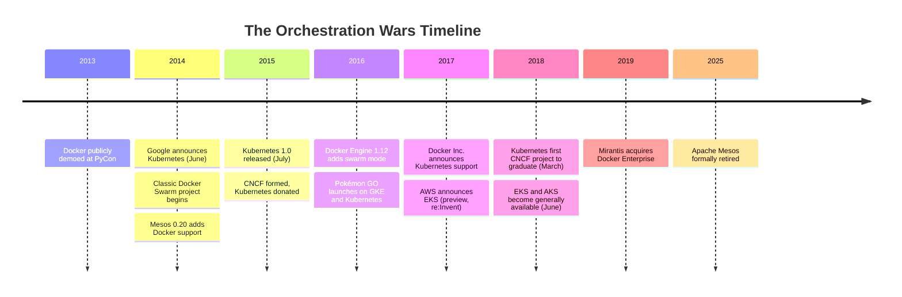
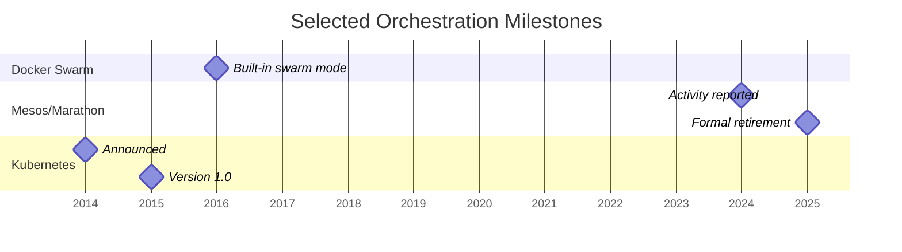

> **Complexity**: `[MEDIUM]` - Long-form conceptual foundation with a practical evaluation exercise
>
> **Time to Complete**: 80–110 minutes (long-form read + hands-on exercise)
>
> **Prerequisites**: [Cloud Native 101](/prerequisites/cloud-native-101/) and [Kubernetes Basics](/prerequisites/kubernetes-basics/) — you should already understand containers, orchestration at a high level, and hands-on `kubectl` workflows before examining why Kubernetes won and how its design shapes operations.

---

## Learning Outcomes

After this module, you will be able to:

- **Compare** Kubernetes with Docker Swarm, Apache Mesos plus Marathon, and HashiCorp Nomad using concrete technical and ecosystem tradeoffs.
- **Evaluate** infrastructure technology claims by testing whether the project has declarative operation, extensibility, neutral governance, and broad provider adoption.
- **Diagnose** why manually managed or proprietary orchestration approaches fail as workloads, teams, and failure modes scale.
- **Design** a short adoption argument that explains when Kubernetes is the right platform choice and when a simpler alternative is more appropriate.

---

## Why This Module Matters

Hypothetical scenario: it is the morning of a high-traffic launch, and an on-call developer is staring at terminal windows across a fleet of Linux servers. Demand has gone far beyond the forecast, containers are crashing as traffic shifts between overloaded hosts, and every attempted manual restart creates another question about capacity, ports, logs, and whether the replacement process landed on a healthy machine. By the incident review, the team has learned the deeper lesson: it tried to operate a distributed system as if it were a collection of pets.

That kind of incident is why the orchestration wars mattered. Docker made containers approachable, but approachability did not answer the harder operational questions: where should each container run, what happens when a machine disappears, how does a rollout happen without downtime, and who remembers the intended shape of the system after several emergency commands have changed production? This module's explanation of Kubernetes adoption considers persistent control loops alongside governance, provider support, and ecosystem choices; it does not claim those factors alone prove a single cause.

This module is not a nostalgia tour through old infrastructure brands. It is a decision-making lesson about why some platforms become durable standards while others become historical footnotes, respectable niches, or maintenance burdens. As you move into Kubernetes 1.35 and later modules, you will see controllers, manifests, labels, Deployments, Services, Custom Resource Definitions, and managed clusters; the history explains why those pieces exist and why they are arranged around an API-driven, declarative control loop instead of a pile of remote commands.

Before we go further, set the command-language expectation for the rest of the path. KubeDojo examples use the full `kubectl` command in runnable shell blocks because copied exercises should work in non-interactive terminals, scripts, and classroom environments without relying on local aliases. Many engineers shorten the command interactively on their own machines, but the curriculum treats explicit commands as part of the learning contract. When the next module starts using Kubernetes objects directly, you should be able to focus on the API behavior rather than wondering whether a shell shortcut changed the command semantics.

---

## The Problem: Containers Solved Packaging, Not Operations

Docker [describes its 2013 technology](https://www.docker.com/resources/what-container/) as using existing Linux cgroups and namespaces. A container [image packages application files and dependencies](https://docs.docker.com/get-started/docker-concepts/the-basics/what-is-an-image/) into a reusable artifact; packaging alone does not establish how an application will behave under every runtime configuration. With a package to distribute, the next operational question is how to place, update and recover the running workloads.

The first operational trap was placement. If ten services each need memory, CPU, storage, ports, and low-latency network paths to dependencies, someone has to decide where each replica belongs. On one host, that decision is easy enough to make by looking at `docker ps`, but across a large fleet it becomes a scheduling problem with constraints, competing priorities, and constant change. A system that places containers once and then forgets about them will slowly decay as machines fill up, workloads spike, disks fail, or teams deploy new versions with different resource profiles.

The second trap was failure recovery. Containers made processes cheap to replace, but cheap replacement is only useful when the platform can notice failure, choose a safe destination, restart the workload, and reconnect traffic without waiting for a person to read a dashboard. A human operator can restart one container after one crash; a platform has to handle node failure, image pull errors, bad releases, partial network outages, and noisy neighbor effects while preserving the intended service shape. That is why orchestration is not just a convenience layer over containers; it is the difference between "we can run a container" and "the service keeps running after reality changes."

The third trap was coordination between teams. Application developers, security engineers, network teams, storage teams, and operations teams may need a shared contract. Without one, different deployment scripts, environment conventions, service discovery habits, and emergency procedures can make shared tooling or migration harder. Identify those assumptions before moving workloads between environments.

**Pause and predict:** if you had to update one hundred running containers by hand with zero downtime, which part would fail first: choosing hosts, routing traffic, rolling back a bad version, or proving afterward what actually happened?

<details>
<summary>Check your prediction</summary>

A challenge in this scenario is preserving intent while many small actions happen under pressure, because imperative actions leave the operator responsible for remembering the desired final state. Your answer can identify another failure point and explain why it matters.

</details>

Write which part fails first before you continue. The next paragraph names the orchestration category. It does not pick the failure.

That pressure produced a category called container orchestration. An orchestrator can schedule work, monitor health, replace failed workloads, scale replicas, connect services, and coordinate rollouts. The contenders made different choices about simplicity, scope, extensibility, and governance. This module treats those choices as an explanatory framework for comparing their outcomes, not as a measured ranking of causes.

---

## The Contenders and Their Tradeoffs

Docker Swarm offered teams familiar with Docker a route from local container commands to clustered service management. Docker announced integrated Swarm mode in Engine 1.12 in 2016; its [current documentation](https://docs.docker.com/engine/swarm/) describes declarative services, scaling, networking, and reconciliation. [Docker's 1.12 announcement](https://www.docker.com/blog/docker-1-12-built-in-orchestration/) provides the historical point of reference; current capabilities should not be assumed to describe every earlier release.

```text
Documented capabilities:
- Integrated with Docker Engine
- Declarative services and reconciliation
- Service scaling and multi-host networking

Questions to evaluate:
- Assess the Docker Engine dependency and existing deployment tooling
- Compare required integrations, provider support, and operational fit
```

For a real decision, compare the integrations, provider offerings, governance, and operations your team actually needs. Swarm mode's Docker Engine integration can be convenient for a Docker-based workflow, but it is still a dependency to assess alongside alternatives. Docker describes its orchestration layer as built on [SwarmKit](https://docs.docker.com/engine/swarm/key-concepts/); the project's [source](https://github.com/moby/swarmkit/blob/074508be6b394a83397ac7896054a481c5b663ba/README.md) and [license](https://github.com/moby/swarmkit/blob/074508be6b394a83397ac7896054a481c5b663ba/LICENSE) provide a concrete way to check its open-source status. Engine integration alone does not establish vendor lock-in, poor multi-cloud support, or a specific scaling ceiling.

For example, suppose a hypothetical team needs three replicas of one web service and replacement after a worker fails. That requirement alone does not distinguish Kubernetes from Swarm: Docker documents [how Swarm replaces failed replicas on available workers](https://docs.docker.com/engine/swarm/#desired-state-reconciliation). To make the comparison useful, add the team's actual constraints: a required storage integration, an existing deployment workflow, or a provider support requirement. Check each against the intended platform version, then test the critical failure path in a disposable environment. The resulting recommendation should identify which requirement changes the choice; naming a capability shared by both systems is insufficient.

Apache Mesos took a broader approach to datacenter resource management. Its [architecture](https://mesos.apache.org/documentation/architecture/) describes resource offers and framework schedulers, so the platform could support different workload models. [Marathon](https://github.com/d2iq-archive/marathon/blob/90619da70d79a2ecf19368a21c6a695ea981bd74/README.md) and [Chronos](https://github.com/mesos/chronos/blob/c1348ddfd80eb8f888418805005066c230fc6ad2/README.md) are examples of workload-specific frameworks, rather than components every Mesos deployment required.

```text
Documented capabilities:
- Resource offers to framework schedulers
- Frameworks can support different workload types

Questions to evaluate:
- Evaluate the framework and operational components needed for each workload
- Account for the team's experience with resource offers and framework schedulers
```

Mesos illustrates a question in platform competition: how much framework choice and operational work can a team support? Its resource offers and framework model give different workloads flexibility, while Kubernetes offers a different API and integration model. Those are tradeoffs to evaluate, not evidence that every team found one approach easier. Apache's board [retired Mesos in August 2025](https://www.apache.org/foundation/board/minutes/2025/board_minutes_2025_08_20.html); the [move to the Attic completed in October](https://attic.apache.org/projects/mesos.html).

HashiCorp Nomad is another alternative for mixed workloads. Its [current documentation](https://developer.hashicorp.com/nomad/docs/what-is-nomad) describes a single-binary scheduler; its [task driver documentation](https://developer.hashicorp.com/nomad/docs/job-declare/task-driver) lists Docker, Java, QEMU, Isolated Fork/Exec, and Raw Fork/Exec. These current capabilities are useful evaluation inputs, not evidence of a historical market ranking or a universal overhead advantage.

```text
Documented capabilities:
- Single-binary design
- Task drivers for container and non-container workloads

Questions to evaluate:
- Evaluate integrations and operational responsibilities for your workload
```

The comparison prevents a lazy conclusion: Kubernetes is not automatically the best answer for every workload. For mixed workload scheduling, compare Nomad and Kubernetes against the team's required drivers, integrations, deployment model, and operational capacity. Measure the actual operational burden in the intended environment instead of assuming a universal winner.

Kubernetes entered the contest with a history of related systems at Google. The [Borg, Omega, and Kubernetes research record](https://research.google/pubs/borg-omega-and-kubernetes/) describes lessons from three container-management systems over a decade, and the [Kubernetes project history](https://kubernetes.io/blog/2024/06/06/10-years-of-kubernetes/) discusses Borg's influence on the open-source project. This module interprets that lineage as one possible contributor to Kubernetes's appeal, not proof of how every adopter made its decision.

```text
Pros:
- Google's decade of experience
- Declarative model (desired state)
- Extensible API and ecosystem integrations
- Cloud-native foundation
- Documented community governance

Cons:
- Complex
- Steep learning curve
- "Too much" for simple deployments
```

The honest version of the Kubernetes story includes that last disadvantage. A cluster brings API servers, etcd, controllers, schedulers, networking plugins, storage integrations, RBAC and admission control. Operating it also requires attention to [certificates](https://v1-35.docs.kubernetes.io/docs/setup/best-practices/certificates/), [node lifecycle](https://v1-35.docs.kubernetes.io/docs/concepts/architecture/nodes/#node-controller) and [upgrade planning](https://v1-35.docs.kubernetes.io/docs/tasks/administer-cluster/cluster-upgrade/). One explanation for accepting that complexity is that a shared control plane can address distributed-systems problems a team would otherwise solve itself. Evaluate that tradeoff against the actual workload and operational capacity.

---

## The Declarative Model Changed the Job

The deepest difference between Kubernetes and many early approaches is the move from imperative commands to declarative desired state. Imperative operation tells the system exactly which steps to perform: start this container here, restart that process there, add two more replicas when traffic grows, and run this rollback command if a release fails. Declarative operation records the intended final condition and lets controllers continuously compare that intent with the actual cluster. This is the mental model behind Deployments, Services, ConfigMaps, Secrets, custom resources, and almost every advanced Kubernetes pattern you will meet later.

```text
Imperative (manual Docker/SSH scripts):
"Start 3 nginx containers on server-1"
"If one dies, start another"
"If traffic increases, start 2 more"

Declarative (Kubernetes):
"I want 3 nginx replicas running. Always."
(Kubernetes figures out the rest)
```

Docker Swarm mode also offered declarative desired-state reconciliation, so Kubernetes did not win simply because Swarm lacked that behavior. This module considers API extensibility, CNCF governance, managed-provider offerings, and ecosystem breadth as possible factors, not a proven causal ranking.

The phrase "Kubernetes figures out the rest" should not be read as magic. It means the API server stores desired state, controllers watch that state, the scheduler selects nodes, kubelets run workloads, and status flows back into the control plane. Each controller owns a narrow reconciliation loop: observe reality, compare it with the desired object, and take the next safe step toward convergence. If a pod disappears but the Deployment still declares three replicas, the system does not need a human to remember that the missing pod was supposed to exist.

**Pause and predict:** if a Deployment declares three replicas and someone manually deletes two matching pods, what should a declarative system do after it observes the mismatch?

<details>
<summary>Check your prediction</summary>

It creates replacements until the observed state matches the desired state again, subject to scheduling capacity and policy. That behavior was a shift from treating deployment as a one-time command sequence.

</details>

Write the system's next action before you continue. The next paragraph is about accountability. It does not say what happens to the missing pods.

Declarative design also changes accountability. In an imperative system, the record of production may be a shell history, a runbook, and a set of people who remember what was done during an incident. In a declarative system, the intended configuration can live in version-controlled manifests, reviewed changes, and auditable API objects. That does not eliminate mistakes, but it gives teams a stable source of truth to inspect when something drifts.

The tradeoff is that declarative systems require learners to become comfortable with indirect action. When you change a Deployment, you are not personally starting each replacement pod; you are changing the desired object and letting controllers execute the rollout. Beginners sometimes interpret that indirection as unnecessary YAML ceremony, especially when a direct `docker run` command feels faster. The platform's value appears when the third replica fails at midnight, a node drains during maintenance, or a rollout needs to pause, resume, and report status without inventing custom control logic.

This is why Kubernetes concepts can feel philosophical at first. A Deployment and a Service expose API contracts that controllers and tools can use. A configured [Flux GitOps controller](https://fluxcd.io/flux/flux-e2e/) can apply manifests through that API; [operators](https://v1-35.docs.kubernetes.io/docs/concepts/extend-kubernetes/api-extension/custom-resources/) combine custom resources with controllers, and the [Horizontal Pod Autoscaler](https://v1-35.docs.kubernetes.io/docs/concepts/workloads/autoscaling/horizontal-pod-autoscale/) adjusts workload scale from metrics. Integrations have their own requirements: for example, an [Istio external control plane](https://istio.io/latest/docs/setup/install/external-controlplane/) uses Kubernetes API access for service and workload discovery. These examples do not mean every extension or service mesh works identically.

---

## Experience Became an Open Platform

Google's role mattered, but "Google built it, so everyone followed" is too simple. The [Google Research record](https://research.google/pubs/borg-omega-and-kubernetes/) describes lessons from Borg, Omega, and Kubernetes over a decade. Kubernetes's controllers and API are useful concepts for examining the resulting project, but shared history does not establish a one-to-one origin for every design feature.

The first Kubernetes commit landed in June 2014, the public announcement followed at DockerCon, and version 1.0 arrived in July 2015 alongside donation to the newly formed Cloud Native Computing Foundation. The [project history](https://kubernetes.io/blog/2024/06/06/10-years-of-kubernetes/) records those events. Foundation governance and provider support are factors a team can investigate when evaluating portability; the dates alone do not prove what motivated each provider.

Consider a counterfactual: if Kubernetes had remained a tightly controlled Google Cloud feature, other providers might have made different choices. We cannot establish that alternate outcome from the project chronology. For a real platform decision, examine governance, supported implementations, portability requirements, and the costs of leaving a provider.

Managed Kubernetes offerings gave teams an option to use the API without operating every control-plane component themselves. A possible feedback loop is that provider offerings, users, and integrations reinforce one another; the dated product announcements below establish that offerings existed, not the size or cause of that effect. A managed control plane also leaves operational responsibilities that teams should examine.

Which approach would you choose here and why: a proprietary orchestrator tied to one vendor, or an open platform with multiple providers? Compare the features alongside exit options, training, third-party integrations, and the practical cost of a migration. Neither label alone proves which option is best for a particular organization.

The [CNCF projects directory](https://www.cncf.io/projects/) lists projects including Prometheus, Envoy, Fluentd, containerd, Helm, and OpenTelemetry. Their origins differ: [Prometheus began at SoundCloud in 2012](https://prometheus.io/docs/introduction/overview/#what-is-prometheus), before Kubernetes's 2014 announcement. A shared API and conventions can make integrations easier to evaluate; check each project's actual interface rather than assuming foundation membership means it depends on Kubernetes.

The [CNCF Spotify case study](https://www.cncf.io/case-studies/spotify/) reports that Spotify used its homegrown Helios orchestrator and that its engineering team wanted the support of a larger community. The migration ran alongside Helios and was still in progress when the case study was published. This is one organization's account, not proof that every internal platform has the same costs; compare the maintenance and integration work for your own requirements.

---

## Extensibility Turned Kubernetes into a Platform for Platforms

One possible contributor to Kubernetes's adoption is its extensible API model. Custom Resource Definitions, controllers, admission webhooks, storage interfaces, networking interfaces, and metadata allow teams to build around core Kubernetes. The [custom resources documentation](https://v1-35.docs.kubernetes.io/docs/concepts/extend-kubernetes/api-extension/custom-resources/) supports the mechanism; it does not prove that extensibility alone caused adoption.

Custom Resource Definitions are a clear example. A CRD lets a team define a new API type that the Kubernetes API server can store and serve, such as a certificate request, database cluster, backup policy, rollout strategy, or machine-learning inference service. A controller can watch those custom objects and reconcile resources toward the declared state. The [custom resources documentation](https://v1-35.docs.kubernetes.io/docs/concepts/extend-kubernetes/api-extension/custom-resources/) describes how custom resources and controllers combine in this pattern.

Extensibility provides room for different networking, storage, ingress, and deployment approaches. In this module's interpretation, that choice can help teams adapt a platform to different requirements, but it also asks them to evaluate compatibility and ownership. Kubernetes offers interfaces and extension mechanisms rather than prescribing one tool for every workflow.

That flexibility can create a selection burden. A learner may encounter several ways to expose traffic, install applications, collect metrics, manage certificates, or run policy checks. Instead of memorizing every project, use the core control model to evaluate whether an extension fits the intended workflow and ownership boundaries.

The API-first approach gives automation an explicit interface. Tools can read and write Kubernetes objects through the API: a deployment tool can update an object, the [HPA](https://v1-35.docs.kubernetes.io/docs/concepts/workloads/autoscaling/horizontal-pod-autoscale/) can adjust a supported workload's replica count from metrics, and an admission webhook can reject creation or update requests. Shared API conventions can help integration, but version compatibility, permissions, and ownership still require testing.

The same extensibility is why Kubernetes can feel "too much" for tiny applications. A two-container hobby project may not need CRDs, admission control, autoscaling, storage classes, multi-zone scheduling, or service meshes. For that project, Docker Compose, a small platform-as-a-service, or a managed container app service may be the better engineering decision. Kubernetes wins when its ecosystem and control loops solve problems the team actually has, not when the team wants a fashionable architecture diagram.

---

## Timeline and Market Outcome

The timeline places several orchestration projects and product events in the same period. Docker offered container packaging, Swarm extended Docker workflows into clustering, Mesos provided resource management, Nomad supported mixed workloads, and Kubernetes combined container-oriented abstractions with an extensible API. The dates do not measure why a particular organization selected one of them.



Docker recounts its [2013 public demo](https://www.docker.com/blog/docker-nine-years-young/). Its [archived Classic Swarm README](https://github.com/docker-archive/classicswarm/blob/3cc018dc2cd0af0880330bd75bd351bbf54fde9c/README.md#swarm-disambiguation) distinguishes that project, begun in 2014, from Engine swarm mode; the [1.12 announcement](https://www.docker.com/blog/docker-1-12-built-in-orchestration/) describes the latter. Apache's [Mesos 0.20 announcement](https://mesos.apache.org/blog/mesos-0-20-0-released/) documents Docker support in September 2014. The [Kubernetes project history](https://kubernetes.io/blog/2024/06/06/10-years-of-kubernetes/) records its 2014 announcement and 2015 release. Docker's [2018 beta announcement](https://www.docker.com/blog/docker-mac-kubernetes/) refers to its 2017 Kubernetes announcement; AWS documented the [EKS preview](https://aws.amazon.com/about-aws/whats-new/2017/11/introducing-amazon-elastic-container-service-for-kubernetes/) and later [general availability](https://aws.amazon.com/blogs/aws/amazon-eks-now-generally-available/), while Microsoft announced [AKS general availability](https://azure.microsoft.com/en-us/blog/azure-kubernetes-service-aks-ga-new-regions-new-features-new-productivity/). Docker's [retired products page](https://docs.docker.com/retired/) records the 2019 acquisition. The AWS general-availability account also places the preview at re:Invent 2017. Those announcements do not by themselves measure adoption or define a threshold for an industry-wide standard.

Timelines can make an outcome look inevitable, but they do not establish one decisive factor. The course's interpretation is that control loops, Google's experience, CNCF governance, provider offerings, and extensibility are useful factors to consider together. Their relative influence on adoption would require evidence beyond the sequence of events shown here.

In a 2016 [account prepared with Niantic](https://cloud.google.com/blog/products/containers-kubernetes/bringing-pokemon-go-to-life-on-google-cloud), Google Cloud reported that Pokémon GO traffic reached 50 times its initial target and that the game's application logic ran on GKE powered by Kubernetes. This is a visible case study, not universal proof that one platform solves every scaling problem. Use it to ask what the team learned about operating under pressure, then assess other systems against their own requirements.

The chart below marks selected years with documented events; it does not measure adoption or maintenance intervals. Docker [announced built-in orchestration in 2016](https://www.docker.com/blog/docker-1-12-built-in-orchestration/). The Mesos [February 2024 board report](https://whimsy.apache.org/board/minutes/Mesos.html) described merged pull requests and a relatively active community. The [Apache board retired the project](https://www.apache.org/foundation/board/minutes/2025/board_minutes_2025_08_20.html) in August 2025, citing inactivity; the earlier activity report does not describe its state at retirement. The Kubernetes announcement and release years follow the project history linked above.



The [CNCF 2025 annual survey announcement](https://www.cncf.io/announcements/2026/01/20/kubernetes-established-as-the-de-facto-operating-system-for-ai-as-production-use-hits-82-in-2025-cncf-annual-cloud-native-survey/) reports that 82% of container users in its respondent population run Kubernetes in production. That finding describes the surveyed group, not every server or organization, and does not establish when experimentation ended. Managed offerings also give teams an option to use the API without operating the full control plane themselves.

One way to interpret the history is to consider Kubernetes as a control-plane pattern for more than web services: platform teams can use its API for automation around security policy, data infrastructure, and AI workloads. This course perspective is a prompt for evaluation, not a measured claim about an industry-wide shift. The opportunity is shared automation; the risk is treating Kubernetes as a universal answer and ignoring simpler deployment models that meet a team's needs with less operational burden.

Another decision factor is hiring and training. Familiarity with shared abstractions may help a team onboard engineers, while a private orchestrator may require more local documentation and integration work. These are costs to assess for the team and labor market in question, not a measured universal advantage.

A shared vocabulary can help an incident conversation: "rollout stuck," "pod pending," or "Service has no endpoints" points participants toward a component to inspect. Whether it speeds diagnosis depends on training, tooling, and the incident; an organization should test its runbooks rather than assume a speed improvement.

---

## Patterns & Anti-Patterns

The first durable pattern is to separate the platform decision from the packaging decision. Containers answer how an application artifact is built and run; orchestration addresses how many copies should exist, where they should run, how they recover, how they receive traffic, and how teams coordinate changes. A team evaluating a technology should ask whether it only improves packaging convenience or also addresses the control-loop problems relevant to its workloads.

The second pattern is to prefer APIs over hidden procedures. Kubernetes resources are not perfect documentation, but they are inspectable objects with metadata, status, ownership relationships, and declarative specs. That makes the system legible to controllers and humans at the same time. When teams build platform workflows around scripts that mutate servers directly, they often lose that shared record; when they build around API objects, other tools can observe, validate, and extend the workflow.

The third pattern is to evaluate governance and provider options for foundational layers. An orchestration layer can touch networking, storage, identity, deployment, monitoring, cloud contracts, and team training. Neutral governance and multiple implementations may reduce some dependency concerns, but a team should check actual support, exit costs, and compatibility.

A possible anti-pattern is the heroic internal orchestrator. Imagine a team starts with a script that restarts containers and then adds placement, health checks, deployments, service discovery, secrets handling, logs, rollback, and audit requirements. Each addition has maintenance and testing costs; the team should compare those responsibilities with a platform it could adopt rather than assuming the custom option remains cheaper.

Another anti-pattern is Kubernetes maximalism: assuming every workload should move there immediately. The lesson is that ecosystem fit and operational needs matter. If a team has one small service, no autoscaling need, no multi-team platform contract, and no reason to standardize around Kubernetes APIs, a simpler service may be a better first move.

A further learning trap is ecosystem shopping without core understanding. A learner can install charts, service meshes, dashboards, and policy engines before understanding why a Deployment recreates a pod or how a Service selects endpoints. Learn the underlying abstractions first, then evaluate extensions against them.

The preserved misconception table below captures three useful corrections. Keep it nearby when you hear simplified origin stories, because each row warns against reducing a complex platform outcome to a single cause.

| Misconception | Reality |
|---------------|---------|
| "K8s won because Google" | Google experience and neutral governance are factors to investigate; the chronology alone does not establish each adopter's reasons. |
| "Swarm has no declarative model" | Swarm mode also reconciles declarative services. Compare required integrations and operational fit. |
| "Mesos was inferior technology" | Mesos used resource offers and frameworks for different workloads. Evaluate the operational model against the team's needs. |

---

## Decision Framework

Use Kubernetes when the operational problem has grown beyond simple container startup. Good signals include multiple services, multiple teams, rolling updates, self-healing requirements, horizontal scaling, service discovery, policy enforcement, and a need for shared tooling across environments. The platform starts to pay for itself when the same API can support deployment, observability, security, and automation workflows that would otherwise be rebuilt separately. In that world, Kubernetes is not merely running containers; it is giving the organization a common contract for production change.

Use a simpler alternative when the workload is small, the team is early, or the operational surface does not justify a cluster. Docker Compose, a managed platform-as-a-service, a serverless container service, or Nomad may be the more responsible choice when the business needs speed with fewer moving parts. Choosing something simpler is not a failure to appreciate Kubernetes. It is applying the same historical lesson correctly: platform choices should fit the coordination and failure problems you actually face.

Consider Nomad or another scheduler when mixed workloads matter. Compare the task drivers, integrations, training, and operating responsibilities available to your team rather than assuming a particular hiring market or lower overhead. That tradeoff can be worthwhile when it is explicit and matched to real constraints.

Evaluate a proprietary orchestrator's integration boundary before making it a foundational dependency. A cloud-specific scheduler may fit an organization with a deliberate provider commitment; compare its operating responsibilities, support and exit costs against the alternatives. If portability, independent tooling or long-lived platform knowledge matters, test those requirements explicitly. Multiple providers supporting Kubernetes is a fact in the chronology; how much that influenced adoption is this module's interpretation, not a measured causal result.

When evaluating a new foundational infrastructure technology today, apply this survival checklist. It is not a guarantee, but it forces the right conversation before a team mistakes a polished demo for a durable platform.

- [ ] **Declarative State Management**: Does it rely on continuous reconciliation rather than imperative commands?
- [ ] **Extensible Architecture**: Can users add their own custom resources without modifying the core codebase?
- [ ] **Neutral Governance**: Is it hosted by a foundation (like CNCF) rather than controlled by a single vendor?
- [ ] **Pluggable Interfaces**: Can the networking, storage, and runtimes be easily swapped out?
- [ ] **Cloud Provider Buy-in**: Are multiple competing cloud providers offering it as a managed service?

Before running this decision framework in a real team meeting, write down the strongest argument against your preferred answer. If you prefer Kubernetes, describe the operational burden honestly. If you prefer a simpler platform, describe the migration trigger that would make Kubernetes worth revisiting. Good platform decisions include their own expiration conditions.

---

## Did You Know?

- **Kubernetes means "helmsman" or "pilot" in Greek.** The abbreviation **K8s** counts the 8 letters between the "K" and the "s". [Kubernetes overview](https://v1-35.docs.kubernetes.io/docs/concepts/overview/).

- **Kubernetes was publicly announced at DockerCon on June 10, 2014.** The project had begun days earlier with an initial GitHub commit that included 250 files, then reached version 1.0 in July 2015. [Kubernetes project history](https://kubernetes.io/blog/2024/06/06/10-years-of-kubernetes/)

- **The logo's seven spokes are a Star Trek reference.** The project's original codename, *Project Seven*, referred to Seven of Nine; the spokes are a related nod, as described in a [Kubernetes release interview](https://v1-33.docs.kubernetes.io/blog/2022/04/29/frontiers-fsgroups-and-frogs-the-kubernetes-1.23-release-interview/).

- **Apache Mesos became an Apache top-level project in June 2013 and retired in August 2025; its Attic move completed in October.** The [Apache Attic record](https://attic.apache.org/projects/mesos.html) distinguishes these dates. That history is a useful reminder that serious, proven infrastructure can still lose platform momentum.

---

## Common Mistakes

When learning about container orchestration history and applying its lessons, beginners often make these conceptual errors:

| Mistake | Why It Happens | How to Fix It |
|---------|----------------|---------------|
| Treating K8s as just "Docker Swarm but bigger" | A container-starting comparison can obscure differences in APIs and integrations. | Compare each platform's declarative service model, extension points, and operational fit. |
| Choosing K8s for a simple 2-container app | A familiar platform may be chosen before workload and operating needs are compared. | Compare Docker Compose, a managed app platform, or another simpler option against the actual orchestration requirements. |
| Believing vendor-locked orchestrators are safer | A polished single-vendor service can feel safer than a broad open ecosystem when the first demo is smooth. | Prioritize open governance and exit options for foundational infrastructure that will shape hiring, tooling, and architecture. |
| Ignoring the CNCF ecosystem | Beginners sometimes rebuild logging, monitoring, policy, and delivery workflows without noticing that standard integrations already exist. | Evaluate mature ecosystem tools before creating custom platform components that your team must maintain alone. |
| Focusing only on Google's role | The origin story can overshadow documented governance and provider announcements. | Use those facts as evaluation inputs; distinguish an explanation of adoption from evidence of each provider's motives. |
| Assuming Kubernetes replaces Docker | Container images, runtimes, and orchestrators solve different parts of the system and are often discussed together loosely. | Differentiate image building, runtime execution, and orchestration so each tool's responsibility stays clear. |
| Trying to learn K8s without understanding the "Why" | Jumping straight into YAML can make Kubernetes feel like arbitrary ceremony rather than a control-system design. | Learn the history and declarative philosophy first, then connect each object to the operational problem it solves. |

---

## Quiz

<details><summary>1. Your startup is moving from one server to several nodes, and the lead developer proposes a Python script that SSHes into hosts, starts Docker containers, checks them every few minutes, and restarts failed processes. Based on orchestration history, what risk should you diagnose first?</summary>

The first risk is that the team may be building an orchestrator without planning for its maintenance. The script may need placement, health checks, rollout safety, node failure behavior, logging, auditability, and conflict handling. Kubernetes records desired state and delegates reconciliation to controllers, as described in the [controller documentation](https://v1-35.docs.kubernetes.io/docs/concepts/architecture/controller/). This is a useful design comparison, not proof of a single cause of adoption. The argument is not "never automate"; it is "account for the control plane you build."

</details>

<details><summary>2. A cloud vendor releases a proprietary orchestrator that benchmarks faster than Kubernetes but only runs on that vendor's platform. How should you evaluate the claim using the Kubernetes survival checklist?</summary>

Separate technical speed from platform survivability. A faster scheduler may matter for some workloads, but a foundational orchestrator also needs an evaluation of governance, extension points, provider support, and integration options. A proprietary single-cloud tool may fit an organization that accepts its dependency; compare exit costs and support rather than inferring a universal ranking from a benchmark.

</details>

<details><summary>3. Your team is comparing Docker Swarm and Kubernetes for an enterprise application that may run across AWS and on-premises servers. One engineer argues for Swarm because setup is simpler. Which requirements should you compare before deciding?</summary>

Swarm mode's Docker integration may fit the team's existing workflow. Compare the specific AWS and on-premises deployment support, desired integrations, governance, and operational responsibilities for each platform rather than assuming either system cannot span environments. Consider future coordination costs as well as day-one setup, and verify the available options for the versions being evaluated.

</details>

<details><summary>4. During an incident review, someone says the Deployment YAML is "just documentation" because operators can always run commands directly. How do you explain the declarative model?</summary>

The YAML is not merely documentation; it is the desired state consumed by the Kubernetes API and controllers. Direct commands can be useful during investigation, but they do not automatically create a durable record of what production should converge toward. A Deployment spec tells the system how many replicas should exist and gives controllers a target to restore after drift or failure. That is why declarative configuration is central to Kubernetes rather than a stylistic preference.

</details>

<details><summary>5. A platform team wants to build an internal orchestrator because Kubernetes feels complex. Which lesson from Spotify's Helios migration should shape your response?</summary>

The [Spotify case study](https://www.cncf.io/case-studies/spotify/) reports that its engineers wanted support from a larger community and migrated alongside the existing Helios system. That account does not prove every internal platform is wrong. Compare the specific maintenance, integration, and training responsibilities of each option, as well as the cost of adopting and operating Kubernetes.

</details>

<details><summary>6. A CTO likes Mesos's resource-offer architecture and proposes it for a new system. What should a platform comparison establish beyond that technical preference?</summary>

Compare the workload-specific frameworks, integrations, and operating responsibilities the system would need. Distinguish historical capabilities from current project status: [Apache retired Mesos in 2025](https://www.apache.org/foundation/board/minutes/2025/board_minutes_2025_08_20.html), so any proposal for a new deployment must explain how maintenance and support would be handled. A feature preference alone does not establish a suitable platform, and the retirement does not prove why every organization chose another tool.

</details>

<details><summary>7. Your organization is evaluating a new Kubernetes operator that defines several CRDs. What should you check before treating it as an ecosystem-aligned choice?</summary>

You should check whether the operator follows Kubernetes patterns rather than merely installing custom complexity into the cluster. Look for clear CRD schemas, controller behavior that reconciles status predictably, RBAC scoped to the required resources, upgrade guidance, and compatibility with your Kubernetes version. CRDs are powerful because they extend the API model, but they also add new operational responsibilities. The safe choice is not "anything with a CRD"; it is a tool whose extension points are understandable and maintainable.

</details>

---

## Hands-On Exercise: Orchestration Architecture Reflection

This module is conceptual, but the learning should still produce an artifact you can use in an engineering conversation. Imagine your company's CTO wants to build a proprietary internal orchestration system for microservices because Kubernetes "feels too complex." Your task is to prepare a short technical argument that uses the orchestration wars as evidence without pretending Kubernetes is free of tradeoffs.

Start by writing three sentences that define the operational problem, not the preferred tool. Your argument should mention placement, failure recovery, rollout safety, and shared APIs because those are the problems that appear after basic container packaging succeeds. Then write two sentences evaluating the maintenance, testing and coordination costs a script or proprietary scheduler could create as teams and failure modes grow. Identify assumptions rather than presuming every internal platform is uneconomic.

Next, compare at least two historical contenders. Use Docker Swarm to discuss Engine integration and the integrations a team needs, and use Mesos to discuss resource offers and framework choices. If you include Nomad, evaluate its workload drivers and operational fit rather than treating it as a failed Kubernetes clone. The goal is to show judgment, not brand loyalty.

Then make the Kubernetes case with both strengths and limits. Mention declarative reconciliation, extensibility through the API, CNCF governance, managed cloud-provider adoption, and the availability of standard integrations. Also include one sentence describing when Kubernetes would be too much for the current workload. A persuasive platform argument is stronger when it admits the boundary where a simpler option would be better.

Finally, turn your notes into a brief recommendation. It should be short enough for an architecture review comment, specific enough to survive follow-up questions, and grounded enough that another engineer can see the historical evidence behind it. Treat this as practice for the platform conversations you will have later when choosing between native Kubernetes, managed services, operators, GitOps tools, and simpler deployment systems.

### Worked Example: From Sources to a Recommendation

Suppose the CTO in the exercise asks for a decision between building an internal orchestrator and adopting an existing one. The stated concern is that Kubernetes feels complex; the organization wants to run microservices and already has container images. That is enough to frame a decision, but it is not enough to calculate the cost of either option. The number of services, availability target, team skills, budget, and operating environment remain unknown in this hypothetical. A useful recommendation should name those gaps instead of quietly filling them in.

Start with a documented historical fact. In the [CNCF Spotify case study](https://www.cncf.io/case-studies/spotify/), the **Challenge** section reports that Spotify used a homegrown orchestrator named Helios. It quotes an engineering leader explaining that a small team developing Helios features was less efficient for Spotify than adopting software supported by a larger community. The **Solution** section says the migration ran alongside Helios. This is evidence of Spotify's reported motivation and approach; it is not evidence that the migration was complete when the case study was published.

The distinction matters when writing an argument. A tempting claim is, "Spotify proved all companies save money by replacing a custom orchestrator with Kubernetes." The case study cannot establish that conclusion. It describes one organization's situation and includes its own account of why the team moved. It does not compare the lifetime costs of every internal system with every Kubernetes deployment, nor does it measure the hypothetical CTO's team. The case is useful precisely because it supplies a concrete question to investigate: who will maintain the capabilities the team chooses to build?

Now add a source for the technical mechanism. The Kubernetes 1.35 [controller documentation](https://v1-35.docs.kubernetes.io/docs/concepts/architecture/controller/), **Controller pattern**, explains that a controller tracks resources whose spec records desired state and works to move current state toward it. **Desired versus current state** also explains that control loops depend on controllers running and being able to make useful changes. A [Deployment and its ReplicaSets](https://v1-35.docs.kubernetes.io/docs/concepts/workloads/controllers/deployment/) use this general pattern for their responsibilities; the existence of a controller does not mean a broken image, insufficient capacity, or a network failure will repair itself.

Those two sources answer different questions. Spotify's account describes a historical decision made by one organization. The controller documentation describes a Kubernetes mechanism that a team can inspect and test. Neither source says that the hypothetical company's services need a particular replica count, that its operators have Kubernetes experience, or that a managed control plane will be cheaper. Separating the source's scope from the decision you want to make is part of technical due diligence: a true fact can still be insufficient evidence for a much broader conclusion.

**Inference:** if this hypothetical team expects to add placement, health handling, rollout controls, and service discovery to its own scripts, it may take on a continuing maintenance responsibility. Spotify's experience makes that risk worth examining, and Kubernetes controllers demonstrate one existing approach to reconciliation. The inference is not a claim that Spotify's costs equal this team's costs or that Kubernetes would eliminate them. The team must identify which capabilities its services actually need and who will operate and maintain each option.

**Bounded recommendation:** evaluate an existing platform before committing to a proprietary orchestrator. Compare a small representative service on a dedicated disposable environment using the same desired replica count, health checks, rollout expectations, and ownership model for each option. Record the components that must be configured and maintained, the permissions required, and what happens when a worker or application process fails. If Kubernetes is among the candidates, inspect the Deployment and Pod status as well as the result of the command that submitted the desired state.

A reasonable counterargument is that Kubernetes may introduce more operational responsibility than this team currently needs. If the service is small, runs on a single host, and does not require distributed replacement or multi-team policy, a simpler container workflow or managed application platform may meet the immediate requirement. That is a condition to check, not an assumed fact about the CTO's organization. Conversely, if requirements change, the team can revisit the decision using the same list of capabilities and operating responsibilities.

Before approving either path, collect local evidence. Ask the service owners which failures must be tolerated, how long recovery may take, what rollout and rollback mean for their application, and whether data dependencies constrain replacement. Ask the operations team to estimate ongoing upgrade, monitoring, incident response, access-control, and integration work for each candidate. Exercise the selected failure paths and record observed results with their environment and version. The historical sources make the questions better; they cannot substitute for this local test or turn a successful demonstration into an availability guarantee.

The final review comment can therefore be concise: cite the Spotify **Challenge** and **Solution** sections for the reported historical example; cite the Kubernetes **Controller pattern** for the reconciliation mechanism; label the expected maintenance risk as an inference; and recommend a comparison tied to the team's actual requirements. Include the simpler-option condition and the unanswered operating-cost questions. This lets a reviewer check which statements came from sources and which conclusions the team still needs to validate.

**Card A: One hundred containers, updated by hand.** The first replacements start. Traffic is split across old and new processes. Nobody can say which version is supposed to be live.

<details>
<summary>Check your prediction</summary>

Failure layer: intent was never stored, so each action depends on memory. Next action: write the desired state before the next host is touched. Do not treat the first successful start as the job.

</details>

**Card B: Two of three pods are gone.** A Deployment still says three replicas. An operator deleted two matching pods during an incident. No one has typed a create command since.

<details>
<summary>Check your prediction</summary>

Failure layer: observed state no longer matches the declared count. Next action: watch for replacements and inspect the owning workload's status and events if they do not become ready; capacity and configuration can both block progress. Do not recreate managed Pods by hand.

</details>

**Card C: The CTO wants a private orchestrator.** Kubernetes "feels too complex," so the proposal is a proprietary scheduler for a handful of services. The team already has container images.

<details>
<summary>Check your prediction</summary>

Failure layer: packaging was solved; placement, recovery, and a shared API were not. Next action: name those operational problems before comparing products, and include one case where Kubernetes would be too much.

</details>

**Card D: The only record is shell history.** After the incident, the intended replica count lives in one engineer's terminal, not in a reviewed manifest.

<details>
<summary>Check your prediction</summary>

Failure layer: intended configuration was not maintained in a reviewed manifest. Next action: confirm the intended state with the service owner, record or correct the maintained declaration, and verify the result through the chosen workflow. Shell history is evidence of actions, not proof that a reviewed desired object already exists.

</details>

### Success Criteria

- [ ] You identified at least one ecosystem risk related to building a custom orchestrator, referencing CNCF governance or Kubernetes integrations.
- [ ] You explained the difference between imperative commands and declarative reconciliation in your argument.
- [ ] You explained a documented lesson from the Borg, Omega, and Kubernetes research record or the Kubernetes controller model.
- [ ] You provided a reported migration example and distinguished its state at publication from a completed migration.
- [ ] You stated one condition where Kubernetes would be the wrong first choice for a small workload.
- [ ] You cited at least two primary sources with the claims or dates they support and labeled at least one point as your own inference.

<details><summary>Solution notes</summary>

A strong answer compares the responsibility for scheduling, reconciliation, rollout behavior, service discovery, security, observability, and maintenance with the team's needs. It cites primary evidence for Swarm and Mesos capabilities, and uses the [Spotify case study](https://www.cncf.io/case-studies/spotify/) as one reported migration rather than a universal cost estimate. It labels its causal explanation as an inference and considers when Kubernetes, Docker Compose, a managed app platform, or Nomad fits the workload.

</details>

---

## Sources

- [Kubernetes Blog: 10 Years of Kubernetes](https://kubernetes.io/blog/2024/06/06/10-years-of-kubernetes/)
- [Kubernetes Blog: 4 Years of K8s](https://kubernetes.io/blog/2018/06/06/4-years-of-k8s/)
- [Google Research: Borg, Omega, and Kubernetes](https://research.google/pubs/borg-omega-and-kubernetes/)
- [Kubernetes Documentation: Components](https://kubernetes.io/docs/concepts/overview/components/)
- [Kubernetes Documentation: Controllers](https://kubernetes.io/docs/concepts/architecture/controller/)
- [Kubernetes Documentation: Custom Resources](https://kubernetes.io/docs/concepts/extend-kubernetes/api-extension/custom-resources/)
- [Kubernetes Documentation: Declarative Management of Objects](https://kubernetes.io/docs/tasks/manage-kubernetes-objects/declarative-config/)
- [Docker Docs: Swarm Mode](https://docs.docker.com/engine/swarm/)
- [Docker: Containers and Existing Linux Primitives](https://www.docker.com/resources/what-container/)
- [Docker Docs: Image Packaging](https://docs.docker.com/get-started/docker-concepts/the-basics/what-is-an-image/)
- [Docker Docs: SwarmKit Orchestration Layer](https://docs.docker.com/engine/swarm/key-concepts/)
- [SwarmKit: Pinned Source and License](https://github.com/moby/swarmkit/tree/074508be6b394a83397ac7896054a481c5b663ba)
- [Prometheus: Project Origins](https://prometheus.io/docs/introduction/overview/#what-is-prometheus)
- [Kubernetes 1.35: Horizontal Pod Autoscaling](https://v1-35.docs.kubernetes.io/docs/concepts/workloads/autoscaling/horizontal-pod-autoscale/)
- [Kubernetes 1.35: PKI Requirements](https://v1-35.docs.kubernetes.io/docs/setup/best-practices/certificates/)
- [Kubernetes 1.35: Node Controller](https://v1-35.docs.kubernetes.io/docs/concepts/architecture/nodes/#node-controller)
- [Kubernetes 1.35: Cluster Upgrade Planning](https://v1-35.docs.kubernetes.io/docs/tasks/administer-cluster/cluster-upgrade/)
- [Flux: Controller Reconciliation Through the Kubernetes API](https://fluxcd.io/flux/flux-e2e/)
- [Istio: External Control Plane API Access](https://istio.io/latest/docs/setup/install/external-controlplane/)
- [Apache Attic: Apache Mesos](https://attic.apache.org/projects/mesos.html)
- [Apache Mesos Project Site](https://mesos.apache.org/)
- [CNCF Announcement: 2025 Annual Cloud Native Survey](https://www.cncf.io/announcements/2026/01/20/kubernetes-established-as-the-de-facto-operating-system-for-ai-as-production-use-hits-82-in-2025-cncf-annual-cloud-native-survey/)
- [Google Cloud Blog: Bringing Pokemon Go to Life on Google Cloud](https://cloud.google.com/blog/products/containers-kubernetes/bringing-pokemon-go-to-life-on-google-cloud)
- [CNCF: Spotify's Helios-to-Kubernetes Case Study](https://www.cncf.io/case-studies/spotify/)
- [CNCF: Annual Cloud Native Survey](https://www.cncf.io/reports/the-cncf-annual-cloud-native-survey/)
- [HashiCorp Nomad Documentation](https://developer.hashicorp.com/nomad/docs)
- [Apache Mesos: Resource Offers and Framework Architecture](https://mesos.apache.org/documentation/architecture/)
- [Marathon: Mesos Application Framework](https://github.com/d2iq-archive/marathon/blob/90619da70d79a2ecf19368a21c6a695ea981bd74/README.md)
- [Chronos: Scheduled and Dependency-based Mesos Jobs](https://github.com/mesos/chronos/blob/c1348ddfd80eb8f888418805005066c230fc6ad2/README.md)
- [HashiCorp: Introduction to Nomad](https://developer.hashicorp.com/nomad/docs/what-is-nomad)
- [HashiCorp: Nomad Task Drivers](https://developer.hashicorp.com/nomad/docs/job-declare/task-driver)
- [Kubernetes 1.35 Overview: Name and Abbreviation](https://v1-35.docs.kubernetes.io/docs/concepts/overview/)
- [ASF Mesos Board Reports: February 2024 Activity](https://whimsy.apache.org/board/minutes/Mesos.html)
- [ASF Board Minutes: August 2025 Mesos Termination, Special Order 7C](https://www.apache.org/foundation/board/minutes/2025/board_minutes_2025_08_20.html)
- [Docker: Built-in Orchestration, 2016](https://www.docker.com/blog/docker-1-12-built-in-orchestration/)
- [Docker: First Public Demo in 2013](https://www.docker.com/blog/docker-nine-years-young/)
- [Docker Classic Swarm: Archived README](https://github.com/docker-archive/classicswarm/blob/3cc018dc2cd0af0880330bd75bd351bbf54fde9c/README.md#swarm-disambiguation)
- [Apache Mesos: 0.20.0 Release](https://mesos.apache.org/blog/mesos-0-20-0-released/)
- [Kubernetes: 1.23 Release Interview](https://v1-33.docs.kubernetes.io/blog/2022/04/29/frontiers-fsgroups-and-frogs-the-kubernetes-1.23-release-interview/)
- [Docker: Kubernetes Beta, Recalling the 2017 Announcement](https://www.docker.com/blog/docker-mac-kubernetes/)
- [AWS: EKS Preview, 2017](https://aws.amazon.com/about-aws/whats-new/2017/11/introducing-amazon-elastic-container-service-for-kubernetes/)
- [AWS: EKS General Availability, 2018](https://aws.amazon.com/blogs/aws/amazon-eks-now-generally-available/)
- [Microsoft: AKS General Availability, 2018](https://azure.microsoft.com/en-us/blog/azure-kubernetes-service-aks-ga-new-regions-new-features-new-productivity/)
- [Docker: Retired Products and the 2019 Enterprise Acquisition](https://docs.docker.com/retired/)

---

## Next Module

[Module 1.2: Declarative vs Imperative](../module-1.2-declarative-vs-imperative/) - The next module turns the philosophy from this lesson into hands-on Kubernetes behavior, showing how desired state changes what you do at the command line.
