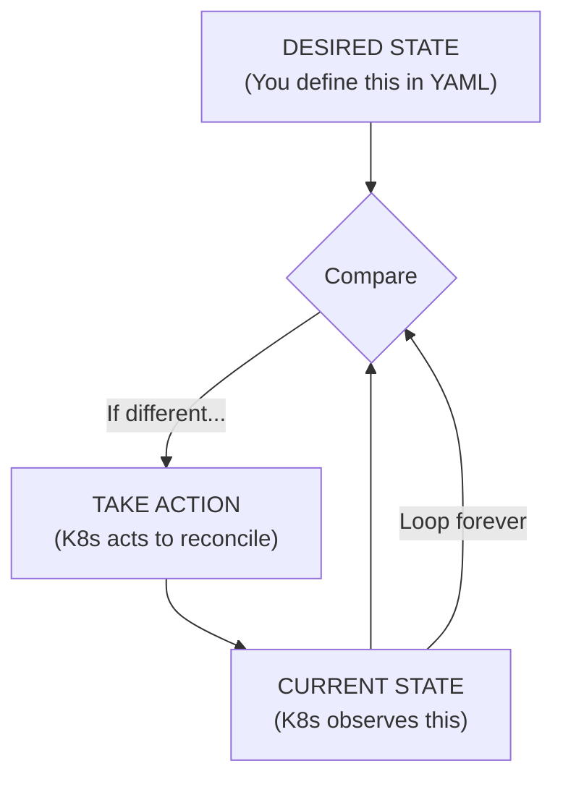
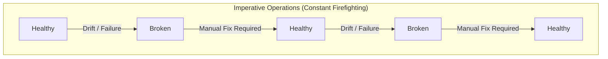
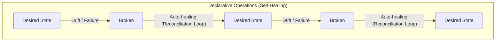

> **Complexity**: `[MEDIUM]` - Long-form conceptual understanding with production consequences
>
> **Time to Complete**: 80–110 minutes (long-form read + hands-on exercise)
>
> **Prerequisites**: Module 1.1 (Why Kubernetes Won)
>
> **Kubernetes Version**: 1.35+

---

## What You'll Be Able to Do

After this module, you will be able to:

- **Compare** imperative and declarative approaches using concrete Kubernetes workload examples.
- **Predict** how Kubernetes reconciles a managed object after manual drift, deletion, or failure.
- **Design** a production-safe workflow that turns one-off commands into reviewed declarative manifests.
- **Diagnose** outages caused by imperative thinking, configuration drift, and multiple sources of truth.

---

## Why This Module Matters

Imagine an on-call engineer is paged at 2 AM because a revenue-critical checkout service is crash-looping during a regional promotion. She repeatedly deletes the failing Deployment-managed pod, hoping a restart will fix it. The Deployment's ReplicaSet creates replacements from the unchanged template, which still contains the broken environment variable. The replacements fail too, and the incident stretches for 45 minutes while customers abandon carts and the incident channel fills with contradictory theories.

Nothing in that story requires Kubernetes to be broken. The cluster was doing exactly what it was built to do: compare the declared desired state with the observed current state and move reality back toward the declaration. The operational failure came from using imperative instincts inside a declarative control system. When the engineer finally changed the Deployment YAML, committed the fix, and applied the corrected manifest, the next rollout converged in seconds because she stopped fighting the controller and started changing the source of truth.

That difference is not academic. Kubernetes rewards operators who ask, "What state should exist?" before asking, "What command should I run?" A controller works on the resources and fields within its responsibility; it does not automatically undo every manual API edit. For example, a [Deployment's ReplicaSet](https://v1-35.docs.kubernetes.io/docs/concepts/workloads/controllers/deployment/) works to maintain the declared Pod count. This module connects Deployments, Services, GitOps, drift detection, and self-healing to that control model.

You will also practice a habit that becomes more valuable as systems grow: separating investigation from durable change. Investigation can be quick, interactive, and messy because its job is to expose evidence. Durable change must be explicit, reviewed, repeatable, and owned because its job is to survive the next rollout, teammate, cluster replacement, and incident review. That separation is the difference between using commands as tools and letting commands become hidden infrastructure.

---

## The Two Approaches

The short shell and YAML examples before the Hands-On section illustrate management methods. Practice begins with the dedicated lab procedure in that section.

Imperative operations are direct instructions to perform steps now. In the illustrated shell workflow, an operator runs a command, inspects the output, and chooses the next command until the system looks right. In a small environment, this style can give immediate feedback and let the operator adapt as information appears. A cost to consider is who watches the state, remembers the steps, and repeats a correction if no separate automation owns that work.

The simplest imperative deployment story looks like this. The commands are easy to read, but the operational burden is buried in the comments: someone must check, decide, repeat, and document every correction.

```bash
# Imperative approach
ssh server1
docker run -d nginx
docker run -d nginx
docker run -d nginx
# Check if they're running
docker ps
# If one dies, start another
# If traffic increases, run more
# If server fails, SSH somewhere else and repeat
```

**Pause and predict:** if this server reboots while the operator is asleep, what component notices that three `nginx` containers are required, and where is that requirement recorded?

<details>
<summary>Check your prediction</summary>

If the answer depends on a person remembering the desired count, or on a shell history still being available, nothing in the system was given the intent. A declarative record is an API object stored by the control plane. Controllers observe that object and act when the live cluster drifts.

</details>

Write the component and the record before you continue. The next paragraph introduces a different conversation. It does not name who notices the missing containers.

Declarative operations change the conversation from a transcript of steps into a description you can review. The manifest that follows is an example of that description, not the answer to the reboot question. Read the fields, then decide whether anything in that file could still be true after the operator's laptop is closed. The rest of the section builds on whatever you wrote down.

```yaml
# Declarative approach
apiVersion: apps/v1
kind: Deployment
metadata:
  name: nginx
spec:
  replicas: 3
  selector:
    matchLabels:
      app: nginx
  template:
    metadata:
      labels:
        app: nginx
    spec:
      containers:
      - name: nginx
        image: nginx
```

A local alias can shorten interactive typing, but this training material uses the full `kubectl` command so examples do not depend on that shortcut in terminals, scripts, CI jobs, or incident notes. A typing shortcut does not change the intended API request or the operational model, and it should not become a hidden prerequisite for understanding the lesson.

```bash
kubectl version --client
```

The following apply command captures the important idea: submit the declaration, then observe the ongoing controller work. This module uses the full `kubectl` command in runnable examples so the command does not rely on a local alias when pasted into a shell, script, or CI job.

```bash
kubectl apply -f nginx-deployment.yaml
# Done. Kubernetes handles the rest.
```

```bash
kubectl apply -f nginx-deployment.yaml
```

**Pause and predict:** if you run the same `kubectl apply -f nginx-deployment.yaml` command a second time without changing the file, what should Kubernetes create, update, or leave alone?

<details>
<summary>Check your prediction</summary>

The expectation is not "run the deployment again." Compare the declaration with the stored object and converge only if something differs. That property, called idempotency, is one reason declarative configuration works in automated pipelines.

</details>

Write create, update, or leave alone before you continue. The next paragraph is about where long-term intent lives. It does not say what the second apply does.

The distinction between the two styles is not that imperative commands are evil and declarative files are always good. The distinction is where long-term intent lives. Imperative work can be useful for exploration, diagnosis, and temporary emergency action. A declarative workflow can make intent reviewable and repeatable when the team records it, validates changes, manages permissions and ownership, and verifies that the relevant controllers can reconcile it.

| Operating Question | Imperative Thinking | Declarative Thinking |
|---|---|---|
| Primary question | What command should I run next? | What state should the system maintain? |
| Source of truth | Human memory, runbook, shell history, ticket notes | Versioned manifests and API objects |
| Failure response | Human observes, decides, and acts | Controller observes, compares, and reconciles |
| Repeated execution | Can duplicate work or hit "already exists" errors | Should converge on the same state |
| Auditability | Depends on external logging and discipline | Changes can flow through review and Git history |

Hypothetical scenario: a platform team investigates a memory-limit change that appears in production during an incident but cannot be found in Git, the deployment pipeline, or the service repository. The change was made with a live edit at the end of a long call, fixed the immediate symptom, and then disappeared when the next normal release applied the old manifest. The incident review is not mainly about the memory limit itself; it is about the dangerous gap between live state and declared state.

---

## The Reconciliation Loop

Kubernetes is built around reconciliation. A controller watches desired state from the API server, observes current state from the cluster, compares the two, and takes action when they differ. This pattern appears in Deployments, ReplicaSets, StatefulSets, Jobs, Services, Nodes, and many extension controllers. It can help recover from pod deletion, node failure, or partial rollout progress without re-running the original command, but recovery depends on the responsible controller, failure detection, capacity, scheduling constraints, and valid configuration.



The important word in that diagram is "forever." `kubectl apply` is not the deployment itself in the way a shell script might be the deployment. Applying a manifest sends desired state to the API server; controllers continue the work after the command exits. If a node fails five minutes later, the Deployment controller still knows the desired replica count because the desired state is stored in the Kubernetes API, not in the terminal that ran the command.

This is why manual changes to managed objects often feel like Kubernetes is being stubborn. Imagine deleting one pod from a Deployment because you want to "restart" it. The Deployment controller does not interpret that deletion as a new desired state of fewer pods. It observes that the ReplicaSet now has fewer available pods than requested, creates a replacement, and keeps moving toward the declared count. From the controller's point of view, it is repairing damage, not arguing with the operator.

```yaml
# You say: "I want 3 replicas"
spec:
  replicas: 3
```

Before running this in a lab, predict the controller's behavior: if you manually delete a pod managed by a Deployment with `spec.replicas: 3`, will Kubernetes preserve the deletion, create a replacement, or wait for the next `kubectl apply`? The key is ownership. A managed pod is not the source of truth; the Deployment and its ReplicaSet are higher-level declarations that explain how many matching pods should exist.

The reconciliation model also explains why Kubernetes does not need every failure mode encoded in your deployment pipeline. You do not write separate pipeline steps for "if a container exits, start another," "if a node disappears, reschedule elsewhere," or "if a rollout stalls, expose status." You declare a workload shape, and controllers perform narrow, repeated corrections. The platform is powerful because each controller has a small responsibility and can keep performing it after the original change request is long gone.

There is still a boundary to respect. Controllers are not magic recovery agents that can infer a correct business configuration from a broken declaration. If you declare the wrong image, wrong Secret name, or impossible resource request, Kubernetes will faithfully converge toward the wrong target and surface symptoms through status, events, and conditions. Declarative systems reduce toil; they do not remove the need to make accurate declarations.

---

## Real-World Analogy: The Thermostat

A thermostat is the classic analogy because it separates desired state from manual action. In an imperative room, you feel cold, turn on the heater, wait, feel warm, turn it off, and repeat. You are constantly observing the environment and issuing commands. This model can work for one person in one room, but it collapses when the room is unattended, the weather changes overnight, or several people keep touching the switch with different preferences.

```text
You: "It's cold. Turn on the heater."
[Time passes]
You: "It's hot now. Turn off the heater."
[Time passes]
You: "Cold again. Turn on the heater."
[Repeat forever, or give up and suffer]
```

In the declarative version, you choose a target temperature and let a control loop handle the repeated measurement and correction. The thermostat does not ask you whether the furnace should turn on at every minute. It compares current temperature with target temperature and acts according to the rules built into the system. The value is not that the thermostat is smarter than you; the value is that the target remains explicit while the repetitive adjustment becomes automated.

```text
You: "I want it to be 72 degrees F."
Thermostat: [Continuously monitors and adjusts]
```

Kubernetes applies the same shape of reasoning to infrastructure. A Deployment is not a heater switch; it is a target condition for a controller. A Service is not a hand-edited load balancer rule; it is a stable networking intent that the system implements through cluster mechanisms. A ConfigMap is not a note to an operator; it is an API object that can be consumed by pods and updated through controlled change.

The analogy also shows a common mistake. If someone stands next to the thermostat and manually toggles the heater switch every few seconds, the room may briefly feel right, but the person is fighting the automation. The correct fix is to change the set point, repair the sensor, or adjust the controller's policy. In Kubernetes, the equivalent is updating the manifest, fixing labels and selectors, or changing the controller-owned resource rather than editing a pod by hand.

Which approach would you choose here and why: during a production traffic spike, should an engineer run `kubectl scale deployment web --replicas=10` and leave the manifest unchanged, or update the declarative replica setting through the normal release path? A practical answer can include an emergency manual scale, but only if the team records the decision and follows immediately with a manifest change. Otherwise the next routine apply may undo the emergency capacity and create a second incident.

---

## Why Declarative Wins

Declarative infrastructure expresses a relationship between intent, observation, and correction. A team can use a recorded manifest for repeated applies, review before merge, GitOps reconciliation, comparison with live state, and rebuilding an environment. Those benefits depend on the workflow: validate the manifest, assign field ownership, restrict permissions, and check rollout status. Imperative actions may be useful during diagnosis, but unrecorded changes can be difficult to reproduce later.

Self-healing is the first visible benefit. When an application container in a Deployment-managed Pod exits, the kubelet normally restarts it within the same Pod according to the Pod's restart policy. When a managed Pod is deleted or marked for deletion, the ReplicaSet can create a replacement Pod to restore its desired count. After a node failure, placement and readiness of replacements depend on detection, suitable capacity, and configuration; the desired count alone does not guarantee recovery. See [Pod lifecycle](https://v1-35.docs.kubernetes.io/docs/concepts/workloads/pods/pod-lifecycle/) and [Deployments](https://v1-35.docs.kubernetes.io/docs/concepts/workloads/controllers/deployment/).

Idempotency is the second benefit, and it matters more than beginners expect. Pipelines retry. Humans double-submit commands. GitOps agents reconcile in loops. Reapplying a valid manifest for the same object identity is intended to converge without creating a second object, but permissions, validation, and API availability can still cause errors. The flagless command below uses [client-side apply](https://v1-35.docs.kubernetes.io/docs/tasks/manage-kubernetes-objects/declarative-config/). With [server-side apply](https://v1-35.docs.kubernetes.io/docs/reference/using-api/server-side-apply/#conflicts), changing a field owned by another manager can also report a conflict.

```bash
# Run this 100 times
kubectl apply -f deployment.yaml

# Same valid object identity: no second Deployment is created
# Requests can still fail on validation, permissions, or API availability
```

```bash
# Repeating the full command remains copy-paste safe
kubectl apply -f deployment.yaml
```

Version control can make declarative configuration reviewable like application code. If the team commits a replica increase, memory-limit fix, or readiness probe change, those commits can document its intended change. A manifest does not commit itself or guarantee that every live change was recorded; the team must maintain the repository and review process for that history to be useful.

```bash
# Your infrastructure is code
git log --oneline
a1b2c3d feat: scale web to 5 replicas
d4e5f6g fix: increase memory limit
g7h8i9j feat: add health checks

# Roll back infrastructure with git
git revert a1b2c3d
kubectl apply -f .
```

The `git revert` example is intentionally simple. Real rollbacks may require database migrations, compatibility checks, image availability, or staged traffic movement. Declarative infrastructure does not guarantee a safe rollback or a complete record. When changes are committed and preserved, the history gives a team material to discuss, test, and replay instead of relying only on a person's memory.

Drift means live reality no longer matches the chosen source of truth. An unrecorded manual change can remain unnoticed until a rebuild fails or a release overwrites it. A recorded desired state gives a tool something to compare against live state. A configured GitOps controller can reconcile Git-sourced configuration with cluster objects according to its settings; Kubernetes workload controllers separately act on API objects.

```text
Imperative world:
- Someone SSH'd in and made changes
- Documentation doesn't match reality
- "It works on my machine"
- Fear of touching production

Declarative world:
- Git is the source of truth
- A configured GitOps controller reconciles Git with API objects
- Kubernetes workload controllers reconcile API desired state
- Teams may require PR review as policy
```

The diagram assumes a configured GitOps workflow. Kubernetes controllers reconcile desired state stored in API objects; Kubernetes does not itself read Git continuously. A GitOps controller can separately compare Git with cluster state and apply changes, subject to its configuration and permissions. See the [Kubernetes controller model](https://v1-35.docs.kubernetes.io/docs/concepts/architecture/controller/) and [Flux Kustomization documentation](https://fluxcd.io/flux/components/kustomize/kustomizations/).

There is a tradeoff. Declarative systems can feel indirect when you are debugging because the object you edit may not be the object that actually runs. A Deployment creates ReplicaSets, which create pods. For a [selector-backed Service](https://v1-35.docs.kubernetes.io/docs/concepts/services-networking/service/), a controller finds matching Pods and updates EndpointSlices; selectorless Services use separately managed endpoints. An Ingress may be implemented by a controller outside the core API. The price of self-healing is that you must learn ownership chains and status fields instead of assuming the first visible process is the right place to edit.

---

## The Imperative Trap

Kubernetes includes imperative commands because operators need fast ways to explore, debug, and handle exceptional situations. `kubectl run` can create a temporary pod, `kubectl logs` can inspect symptoms, `kubectl describe` can surface events, and `kubectl scale` can buy time during an incident. The trap appears when a temporary command becomes the unrecorded production source of truth. A live change that is not represented in the manifest is a loan from the future; eventually a controller, pipeline, or teammate will collect it.

```bash
# These work, but...
kubectl run nginx --image=nginx
kubectl scale deployment nginx --replicas=5
kubectl set image deployment/nginx nginx=nginx:1.27
```

```bash
# Equivalent examples written without shell aliases
kubectl run nginx --image=nginx
kubectl scale deployment nginx --replicas=5
kubectl set image deployment/nginx nginx=nginx:1.27
```

The danger is not that those commands fail. The danger is that they succeed outside the review path. A manual scale can stabilize traffic, but if the manifest still says three replicas, the next apply can reduce capacity. A manual image update can test a fix, but if the Deployment file still references the old image, the next rollout can restore the bug. A live edit can unblock a team, but if no one knows which field changed, the root cause becomes harder to diagnose.

A recommended pattern is to use imperative tooling to generate or inspect declarations, then move the lasting change into a file. A command-line generator can help you start without memorizing every YAML field; review, commit, and apply the manifest through the team's workflow. The command helps you write the declaration, but the file is only a source of truth if the team maintains and uses it.

```bash
# Generate YAML, don't apply directly
kubectl create deployment nginx --image=nginx --dry-run=client -o yaml > deployment.yaml

# Review, commit, then apply
kubectl apply -f deployment.yaml
```

```bash
# Same workflow repeated with full commands for scripts and runbooks
kubectl create deployment nginx --image=nginx --dry-run=client -o yaml > deployment.yaml
kubectl apply -f deployment.yaml
```

When an emergency demands a direct command, treat it like a production hotfix, not like a normal workflow. Write down the command in the incident channel, explain why the normal path was too slow, and create the follow-up manifest change before the incident is considered closed. This discipline matters because an imperative change can be operationally correct for the next ten minutes while still being organizationally dangerous for the next release.

The strongest diagnostic question is simple: "If we rebuild this environment from Git tomorrow, will this change still exist?" If the answer is no, the current live state is not reproducible. You may accept that temporarily during a severe incident, but you should never pretend it is stable. Declarative work is how teams convert emergency action into durable system behavior.

---

## Visualization: State Over Time

State over time reveals one operational tradeoff. If a workflow depends on a person to detect each failure and repeat a repair, the team must provide that observation and response as services, regions, and responsibilities grow. Consider what happens outside working hours, how a repair is recorded, and which failures a controller or other automation can address. Automation still needs accurate configuration and monitoring.



Declarative operation does not mean failures disappear. Nodes still fail, bad images still ship, and humans still write incorrect YAML. The difference is that the system has a durable target and a controller assigned to move toward it. When reality drifts for a reason the controller can handle, recovery starts without waiting for an operator to remember a command.



The practical lesson is to debug at the level where intent is declared. If a pod keeps reappearing, inspect the Deployment or StatefulSet that owns it. If a label keeps changing, find the controller or pipeline that applies the resource. If a Service does not route traffic, compare its selector with the pod labels rather than editing endpoints by hand. Declarative systems reward upstream diagnosis because downstream symptoms are often just the controller doing its job.

Worked example: suppose `web-abc123` is crash-looping. An imperative instinct says to exec into the container, edit a file, and restart the process. A declarative diagnosis first asks which object owns that pod, whether the pod template references the correct image and configuration, whether the referenced ConfigMap or Secret exists, and whether recent Git changes explain the drift. The fix may still involve a quick command for inspection, but the durable correction belongs in the owning manifest.

---

## Reading Ownership in a Declarative Failure

The fastest way to stop fighting Kubernetes is to ask which object owns the symptom you are staring at. A pod name is often the most visible thing in an alert, but a pod is usually not the most meaningful place to make a durable change. Deployments own ReplicaSets, ReplicaSets own pods, StatefulSets own ordered pods, Jobs own completion behavior, and GitOps controllers may own the manifests that create all of them. If you edit the bottom of that chain while a higher object still declares a different target, the higher object will eventually win.

This ownership chain is why `kubectl describe pod` is more than a wall of text. It gives you events, scheduling messages, image pull status, restart counts, labels, and owner references. Those details help you connect the symptom to the declaration that produced it. A pod stuck in `ImagePullBackOff` may point to a bad image name in the Deployment template. A pod that never becomes ready may point to a probe declaration that does not match the application. A pod that keeps returning after deletion points to a controller doing its assigned work.

The same reasoning applies to Services. A beginner may see a Service that does not route traffic and try to recreate it by hand. A declarative operator checks the selector, then checks whether any pod labels match that selector, then checks whether the owning workload template sets those labels. The durable fix may be a label correction in the Deployment, not a Service rewrite. The Service object expresses desired networking intent, but the endpoint population depends on other declared state being consistent with that intent.

ConfigMaps and Secrets create another common ownership puzzle. A team may update a ConfigMap and expect every running process to behave differently instantly. Regular mounted volume data can update eventually, but `subPath` mounts do not receive automatic updates; environment variables stay fixed for the existing container. Even when a file changes, the application must reread or reload it to act on the new value. See the Kubernetes 1.35 [ConfigMap](https://v1-35.docs.kubernetes.io/docs/concepts/configuration/configmap/) and [Secret](https://v1-35.docs.kubernetes.io/docs/concepts/configuration/secret/) guides and the explicit [Secret environment-update behavior](https://v1-35.docs.kubernetes.io/docs/tasks/inject-data-application/distribute-credentials-secure/#define-container-environment-variables-using-secret-data).

Managed fields and server-side apply add even more nuance in advanced workflows, but the beginner rule is enough for now: one resource should have one clear owner for each important field. If a GitOps controller, a Helm release, and a human all update the same Deployment, the live object becomes a battlefield. The problem is not that declarative tools are weak. The problem is that several actors are declaring incompatible truths without a process that resolves the conflict before it reaches the API server.

Think of a Kubernetes object as a contract between a team and a controller. The team promises to express intent accurately, and the controller promises to keep working toward that intent within its responsibility. If the contract says three replicas, the controller should not guess that a deleted pod means you secretly wanted two replicas. If the contract says an image tag, the controller should not infer a safer tag from a ticket comment. Reliable automation depends on this narrowness, even when it feels rigid during a bad night.

This is also why status matters. A declarative object usually has a `spec`, which describes desired state, and a `status`, which describes observed state. Operators change `spec`; controllers update `status`. When troubleshooting, compare the two instead of looking only at whether the command succeeded. A successful apply means the API accepted the declaration, not necessarily that the workload is healthy. A rollout condition, event, or unavailable replica count tells you how far reality still is from the desired state.

**Pause and predict:** if a Deployment's `spec.replicas` is five but its status reports two available replicas, is the declaration wrong, the cluster wrong, or the system still converging?

<details>
<summary>Check your prediction</summary>

The answer depends on the surrounding evidence. It may be a normal rollout in progress, a scheduling shortage, failing readiness probes, or a bad image. Start with the gap between spec and status, then follow events and ownership until the reason becomes concrete.

</details>

Write which of the three you choose, and what evidence would change your mind, before you continue. The next paragraph is about the operator's habit. It does not pick one of those three.

A useful diagnostic sequence moves from symptom to owner to declaration to status. Logs can show why a container exits, events can show why a pod cannot schedule, and status can show whether a rollout is progressing. If the declaration is wrong, correct it and verify the outcome; if the blocker is capacity or an external dependency, changing YAML alone may not restore health.

---

## The Mindset Shift

Consider an individually managed server as an example. A deployment might involve logging into the host, pulling code, starting a process, editing a web server config, opening firewall rules, and testing manually. If those changes are not recorded, replacing the server can require the next operator to reconstruct them. A maintained declaration and runbook give the team a way to inspect and reproduce intended configuration.

```text
Old Thinking (Imperative)
"I need to deploy my app"
-> SSH to server
-> Pull code
-> Build
-> Start process
-> Configure nginx
-> Update firewall
-> Test
-> Document what I did
```

The Kubernetes mindset treats the cluster as a reconciliation platform rather than a collection of pets. You still care deeply about reliability, but you care less about preserving one particular container or node. The important artifact is the declared system shape: workloads, labels, probes, resource requests, configuration references, policies, and rollout strategy. If the cluster can recreate that shape from versioned declarations, failure becomes an expected input instead of a personal emergency.

```text
New Thinking (Declarative)
"I need to deploy my app"
-> Define desired state in YAML
-> Commit to Git
-> kubectl apply (or let GitOps do it)
-> Workload controllers reconcile API objects
-> GitOps reconciliation requires a configured controller
-> Git records committed intent; review is team policy
```

This mindset shift changes troubleshooting language. Instead of asking only, "How do I restart the thing?" a declarative operator asks, "Why does the controller believe this is the thing that should exist?" Instead of asking, "Who changed the server?" the team asks, "Which commit or controller changed the declared state?" Instead of treating Kubernetes as an obstacle that undoes manual fixes, the team treats it as a persistent worker that needs accurate instructions.

The shift also changes how you design processes. Production changes should flow through manifests, reviews, automated checks, and reconciliation. Debugging commands should be temporary and observable. Emergency commands should create follow-up work. Shared resources need clear ownership: competing writes can overwrite values or encounter field-ownership conflicts depending on the management method. Server-side apply can reject a conflicting field change rather than silently choosing the last writer. [Server-side apply](https://v1-35.docs.kubernetes.io/docs/reference/using-api/server-side-apply/#conflicts) documents that distinction.

A runbook can combine both styles. For example, list commands for inspection, then ask the operator to confirm the owner, compare desired and observed state, change the appropriate declaration, and verify the result. Commands remain useful, but the runbook also records why each step is relevant and what evidence should guide the next action.

Declarative thinking also changes how teams review each other's work. A reviewer should not only ask whether the YAML is syntactically valid. The reviewer should ask whether the declaration matches the operational promise the service needs to keep. Does the replica count match expected load? Do labels match Service selectors? Do probes describe real readiness? Do resource requests leave the scheduler enough information? These questions are practical because Kubernetes will enforce whatever the team declares, including mistakes that pass basic syntax checks.

When teaching a new engineer, pair commands with questions: what object declares the desired state, what controller reconciles it, what current state is observed, and what evidence explains the gap? Ask the learner to identify an owner and read events or status before making a change, then compare the observed result with the prediction. This is a practice sequence, not a measured claim about incident outcomes.

Teams can choose to record intent in shared artifacts and review changes before production. That process depends on people maintaining the files and following the workflow; a declarative API does not create the record by itself. After an emergency command, record what changed, decide whether the declaration should change too, and verify the resulting live state before closing the follow-up.

Finally, remember that declarative does not mean passive. You are still responsible for designing the target, validating the rollout, watching status, and correcting bad assumptions. Kubernetes automates convergence, not wisdom. The skill you are building is the ability to express intent precisely enough that controllers can do repetitive work safely, while you focus on diagnosing whether the intent itself is correct.

That balance is the philosophy behind this module. You should leave with respect for commands, but more respect for declarations that can be reviewed, repeated, reconciled, and explained after the immediate pressure has passed.

---

## When This Doesn't Apply

For an introductory module, the useful pattern is not "never use imperative commands." The useful pattern is "do not let imperative commands become untracked desired state." Use direct commands when you are learning the API, inspecting live symptoms, generating starter YAML, running a temporary debug pod, or taking a documented emergency action. Convert the lasting change back into a manifest before the cluster and the repository drift apart.

A risk in command-first production management is that a successful live change may never reach the maintained declaration. Teams can reduce that risk by preparing templates, examples, review procedures, and a configured reconciliation path before an incident. Provide an emergency path too, with an explicit follow-up to record the change and reconcile the intended state.

| Pattern or Anti-Pattern | When Teams Reach For It | Operational Result | Better Habit |
|---|---|---|---|
| Generate then review YAML | A learner knows the command but not every field | Fast start without losing declarative ownership | Use `--dry-run=client -o yaml`, then commit the file |
| Git as source of truth | Multiple people deploy the same service | Reviews and history explain production state | Keep manifests close to the service or in a platform repo |
| Temporary imperative debug | A live symptom needs fast inspection | Useful evidence without pretending it is permanent | Record the command and remove temporary objects |
| Live edits as normal deployment | The release path feels too slow | Drift, missing audit trail, and surprise rollbacks | Fix the release path and apply reviewed manifests |
| Multiple tools own one object | Teams combine Helm, raw apply, and GitOps casually | Updates may overwrite values or encounter server-side field conflicts | Assign one owner and one reconciliation path per resource |
| Unencrypted secrets in Git | Teams want every object declarative | Sensitive values spread through history | Use External Secrets, SOPS, or Sealed Secrets with review |

Scaling consideration: as services and teams grow, untracked state can become harder to find and reproduce. A manual fix may depend on one person's notes; several such fixes across clusters require a reliable way to identify and reconstruct them. Record the desired configuration and verify the rebuild path so the next operator has evidence to work from.

---

## When You'd Use This vs Alternatives

Choose declarative management for production workloads, shared environments, repeatable infrastructure, and any change that must survive a rebuild. Choose imperative commands for exploration, one-time inspection, temporary debug objects, and emergency actions that are immediately followed by a declarative update. Choose GitOps when you want a controller to continuously compare the cluster with Git rather than relying on a human or CI job to run `kubectl apply` at the right time.

```text
Decision path

Need a durable production change?
  yes -> Put it in a manifest, review it, and apply or reconcile from Git.
  no  -> Is it only inspection or temporary debugging?
          yes -> Use an imperative command and clean it up.
          no  -> Generate YAML, review the result, and keep the file.

Did an emergency require a direct live change?
  yes -> Record the command, open a follow-up change, and reconcile Git with reality.
  no  -> Keep the normal declarative path as the source of truth.
```

Use this decision path to make the incident follow-up explicit. A manual command may be the right first action when customers are affected, but it should not be the last action. Once the immediate risk is reduced, ask what declaration must change, record the decision, and verify that the responsible controller can maintain the intended state.

| Situation | Best First Move | Why |
|---|---|---|
| Learning a new resource type | Generate a manifest with `--dry-run=client -o yaml` | You learn the schema while keeping the durable result reviewable |
| Production rollout | Commit and apply a manifest or let GitOps reconcile | The change is reviewed, repeatable, and auditable |
| Pod crash investigation | Use `kubectl describe`, `kubectl logs`, and owner references | Inspection is temporary; the fix belongs in the owning declaration |
| Sudden traffic spike | Scale quickly if needed, then update the manifest | Emergency capacity should not disappear on the next apply |
| Competing changes to a namespace | Stop and assign one source of truth | Kubernetes will not negotiate conflicting desired states for you |

The framework is deliberately conservative because Kubernetes itself is conservative about declared state. Controllers do not ask whether a manual change was clever, urgent, or made by a senior engineer. They compare current state with desired state. A mature team designs workflows that make the right desired state easy to declare and hard to bypass accidentally.

---

## Did You Know?

- **Kubernetes controllers are reconciliation loops by design.** The official controller documentation describes each controller as tracking at least one resource type and moving current state toward desired state, which is why the same idea appears across Deployments, Jobs, Nodes, and extensions.
- **Creating an object imperatively does not change its API type.** A Pod or Deployment created by a command is still a [Kubernetes API object](https://v1-35.docs.kubernetes.io/docs/concepts/overview/working-with-objects/kubernetes-objects/). Distinguish how you submitted a change from the API object and any controller that reconciles it.
- **GitOps grew from the same control-loop idea.** Configured Flux or Argo CD controllers can reconcile Git-sourced configuration with the cluster. Current product behavior depends on settings: for example, Argo CD's automated live-state self-healing requires its `selfHeal` option. See [Flux Kustomizations](https://fluxcd.io/flux/components/kustomize/kustomizations/) and [Argo CD automated sync](https://argo-cd.readthedocs.io/en/stable/user-guide/auto_sync/).
- **Terraform uses a related model outside Kubernetes.** An invoked `terraform plan` refreshes state by default, compares configuration and state, and proposes changes; `apply` executes planned changes, ordinarily after approval. The ordinary CLI workflow is invoked, not a continuously running Kubernetes controller. [Terraform plan](https://developer.hashicorp.com/terraform/cli/commands/plan) and [apply](https://developer.hashicorp.com/terraform/cli/commands/apply) references.

---

## Common Mistakes

| Mistake | Why It Happens | How to Fix It |
|---|---|---|
| Using imperative commands as the normal production release path | A release workflow may lack a convenient reviewed manifest path | Use `kubectl create ... --dry-run=client -o yaml` to generate manifests, then review, commit, and apply them |
| Editing live resources with `kubectl edit` and never updating Git | A live edit may solve a symptom while leaving the recorded intent stale | Record the edit, decide the intended manifest change, and complete the follow-up before closure |
| Assuming Kubernetes "undoing" a manual change is a bug | The operator focuses on the visible object and misses its owner controller | Inspect owner references and change the higher-level declaration that owns the object |
| Mixing Helm, raw `kubectl apply`, and GitOps on the same resource | Each tool seems declarative in isolation, so ownership boundaries are ignored | Assign exactly one tool and one repository path as the source of truth for each managed resource |
| Forgetting to prune resources removed from files | Applying a changed file updates known objects but does not always delete old named objects | Plan deliberate deletion or GitOps pruning. In Kubernetes 1.35, `kubectl apply --prune` modes are alpha; allowlist-based pruning depends on selector, namespace, allowlist, and discovery, so incorrect scope can unexpectedly delete objects or retain ones intended for removal. Review the [pruning warnings](https://v1-35.docs.kubernetes.io/docs/tasks/manage-kubernetes-objects/declarative-config/#how-to-delete-objects) before use. |
| Storing sensitive values directly in plain YAML | Teams want all configuration in Git and confuse declarative with unencrypted | Use External Secrets, SOPS, Sealed Secrets, or another approved secret-management workflow |
| Believing `kubectl apply` makes a multi-resource release perfectly atomic | Declarative convergence can involve several controllers and partial progress | Design readiness probes, rollout checks, and rollback plans around eventual convergence |

---

## Quiz

<details><summary>Your team deploys a web application with three replicas. A node hosting two pods loses power, and the application returns to three replicas without a human running a command. What mechanism should you name in the incident review, and how does it work?</summary>

The mechanism is the reconciliation loop, implemented by controllers that compare desired state with current state. The Deployment declares the desired replica count, while Kubernetes observes that fewer matching pods are currently available after the node failure. The controller acts by creating replacement pods that can be scheduled on healthy nodes. The key reasoning is that the desired state lived in the API object, not in the command that originally created the workload.

</details>

<details><summary>During a traffic spike, an engineer runs `kubectl scale deployment web --replicas=10`. Two days later, a normal release applies the manifest and the workload drops back to three replicas. What caused the outage?</summary>

The manual scale changed live state without changing the declarative source of truth. When the normal release applied the manifest, Kubernetes reconciled the Deployment back to the replica count declared in that file. The trap was not the emergency scale itself; it was leaving the repository and the cluster with different stories about desired capacity. A proper follow-up would commit the new replica target or a more appropriate autoscaling configuration.

</details>

<details><summary>Your pipeline runs `kubectl apply -f deployment.yaml` several times in a row after a retry bug. The file does not change. What result should you expect, and which checks are still needed?</summary>

For the same valid manifest and object identity, successful repeated client-side applies should not create another Deployment. Controllers still need to bring the workload toward its declared shape. The command can fail on validation, permissions, or API availability, so check the command result and workload readiness separately. A pipeline using `--server-side` must also handle conflicts when it tries to change another manager's field.

</details>

<details><summary>An engineer deletes a pod managed by a Deployment because it looks unhealthy. A replacement pod appears almost immediately. What should the engineer inspect next?</summary>

The engineer should inspect the owning Deployment, ReplicaSet, pod events, and recent manifest changes rather than trying to preserve the deletion. The replacement appeared because the controller observed that the current number of matching pods was below the declared desired count. If the new pod is unhealthy too, the durable problem is probably in the pod template, image, configuration, probes, or dependencies. Deleting pods can reset symptoms, but it rarely fixes the declaration that produced them.

</details>

<details><summary>Your team uses a GitOps controller. An administrator manually edits a configuration file inside a running pod, sees the bug disappear, and then sees it return later. Why did the fix not stick?</summary>

The edit happened inside live runtime state rather than in the declared configuration that creates the pod. A replacement Pod or new rollout can recreate workload state from its declared image and configuration; a GitOps controller reconciles configured API resources, not arbitrary files inside a running container. The manual edit may have been useful evidence, but it was not a durable production fix. Change the ConfigMap, Secret reference, image, or application configuration in the repository that the controller reconciles.

</details>

<details><summary>You misspell a Secret name in YAML, apply it, correct the name, and apply again. Later you see both Secret objects. Why did idempotency not remove the misspelled object?</summary>

Idempotency applies to repeating the same object identity, not to guessing that a differently named object was a mistake. Kubernetes treats the corrected Secret name as a new object because kind, namespace, and name identify resources. A normal apply updates or creates the objects you present; it does not automatically prune every older object that vanished from your file. You need a deliberate deletion, a controlled prune workflow, or a GitOps tool configured to remove obsolete resources.

</details>

<details><summary>Two teams apply competing labels to the same shared namespace through separate pipelines. One declares `environment: production`, and the other declares `environment: staging`. What happens, and what design flaw does this expose?</summary>

The outcome depends on the update method and field ownership: one update may overwrite another, or server-side apply may report a conflict. Kubernetes does not resolve the teams' business disagreement. The design flaw is competing sources of truth for a shared field. Assign ownership, centralize the namespace declaration, and resolve disagreements in review before changes reach the API.

</details>

---

## Hands-On Exercise

This synthetic exercise uses an independently confirmed dedicated disposable Kubernetes 1.35+ lab. Set `KUBEDOJO_LAB_CONTEXT` to that context name before setup; the literal name `default` is refused. Use one fresh Bash terminal for setup, all steps, and cleanup. The guard cannot prove cluster ownership or disposability; do not share the exercise namespace with another writer. The goal is to see reconciliation, idempotency, and drift with a tiny Deployment.

First, create a fresh namespace and record its UID. The helper sends requests to the recorded context and namespace without changing saved kubeconfig preferences. It refuses commands until creation succeeds with a nonempty UID.

```bash
DECL_READY=no DECL_NEW=no
readonly DECL_CONTEXT="${KUBEDOJO_LAB_CONTEXT:-}" DECL_NS="declarative-lab-$(date +%s)-$$" && { DECL_NEW=yes; DECL_UID=; }
decl_lab() {
  [ "$DECL_READY" = yes ] || { echo 'Setup incomplete; stop' >&2; return 1; }
  command kubectl --context "$DECL_CONTEXT" --namespace "$DECL_NS" "$@"
}
if [ "$DECL_NEW" = yes ] && [ -n "$DECL_CONTEXT" ] && [ "$DECL_CONTEXT" != default ] && DECL_CURRENT="$(command kubectl config current-context)" && [ "$DECL_CURRENT" = "$DECL_CONTEXT" ]; then
  printf 'Exercise context/namespace: %s / %s\n' "$DECL_CONTEXT" "$DECL_NS"
  if DECL_CREATED_UID="$(command kubectl --context "$DECL_CONTEXT" create namespace "$DECL_NS" -o jsonpath='{.metadata.uid}')" && [ -n "$DECL_CREATED_UID" ]; then
    DECL_UID="$DECL_CREATED_UID"; DECL_READY=yes
  fi
fi
[ "$DECL_READY" = yes ] || echo 'Setup failed; stop and inspect the error before continuing' >&2
```

Continue only after setup succeeds. If creation failed or returned no UID, inspect the printed namespace manually; cleanup has no ownership evidence to delete it. Stop on a failed task command and clean up before retrying in a fresh terminal.

Create and enter a fresh scratch directory before writing the manifest so you do not overwrite existing files such as `namespace.yaml` or `web-deployment.yaml`. If this fails, stop and run cleanup; the namespace receipt remains available. Keep the directory for inspection and remove it manually when no longer needed.

```bash
DECL_DIR="$(mktemp -d "${TMPDIR:-/tmp}/declarative-lab.XXXXXXXX")" && cd "$DECL_DIR" && printf 'Manifest directory: %s\n' "$DECL_DIR"
```

Now write the Deployment. Its explicit label selector identifies the pods that belong to its desired state. Read the file before applying it and predict how many pods should exist after convergence.

```bash
cat <<'EOF' > web-deployment.yaml
apiVersion: apps/v1
kind: Deployment
metadata:
  name: web
spec:
  replicas: 3
  selector:
    matchLabels:
      app: web
  template:
    metadata:
      labels:
        app: web
    spec:
      containers:
      - name: nginx
        image: nginx:1.27
        ports:
        - containerPort: 80
EOF
```

Apply the Deployment from the file, then inspect what Kubernetes created. The helper supplies the namespace. You apply one higher-level object, but the controller creates lower-level pods to satisfy it.

```bash
decl_lab apply -f web-deployment.yaml
decl_lab rollout status deployment/web --timeout=90s
decl_lab get deployment web
decl_lab get pods -l app=web
```

Now deliberately create drift by deleting one pod. Do not immediately reapply the manifest. Watch the pod list until the replacement appears, stop the watch with <kbd>Ctrl</kbd>+<kbd>C</kbd>, and connect the behavior back to the reconciliation loop from the diagram.

```bash
if POD_NAME="$(decl_lab get pods -l app=web -o jsonpath='{.items[0].metadata.name}')" && [ -n "$POD_NAME" ]; then
  decl_lab delete pod "$POD_NAME" && decl_lab get pods -l app=web --watch
else
  echo 'No pod selected; stop' >&2
fi
```

Next, test idempotency by applying the same Deployment again. The expected result is not an additional Deployment and not six pods. The expected result is convergence to the same declared shape.

```bash
decl_lab apply -f web-deployment.yaml
decl_lab apply -f web-deployment.yaml
decl_lab get deployment web
```

Finally, create a temporary imperative scale and then correct it declaratively. This is the incident pattern in miniature: a manual command changes live state, and the durable fix is to update the manifest so the source of truth matches the desired capacity.

```bash
decl_lab scale deployment web --replicas=5
decl_lab get deployment web
```

Edit `web-deployment.yaml` so `spec.replicas` is `5`, apply it, and explain in your notes why this is different from leaving the manual scale alone. Wait for rollout before checking the result, then clean up after recording your observations.

```bash
decl_lab apply -f web-deployment.yaml
decl_lab rollout status deployment/web --timeout=90s
decl_lab get deployment web
```

Run cleanup in the same terminal, including after an interruption. It checks the live namespace UID against the successful creation response before deleting the namespace and its resources. Failed cleanup retains the receipt for a same-shell retry. The check is not atomic with deletion and assumes no concurrent namespace replacement. The scratch directory remains for manual inspection.

```bash
cleanup_decl_lab() {
  [ -n "${DECL_UID:-}" ] && [ -n "${DECL_CONTEXT:-}" ] && [ "$DECL_CONTEXT" != default ] && [ -n "${DECL_NS:-}" ] || { echo 'No recorded exercise namespace; stop' >&2; return 1; }
  local live_uid
  live_uid="$(command kubectl --context "$DECL_CONTEXT" get namespace "$DECL_NS" --ignore-not-found=true -o jsonpath='{.metadata.uid}')" || return 1
  if [ -n "$live_uid" ]; then
    [ "$live_uid" = "$DECL_UID" ] || { echo 'Namespace UID changed; refusing deletion' >&2; return 1; }
    command kubectl --context "$DECL_CONTEXT" delete namespace "$DECL_NS" --ignore-not-found=true --wait=true --timeout=120s || return 1
  fi
  DECL_READY=no
  echo 'Exercise namespace is gone; kubeconfig preferences were unchanged'
}
cleanup_decl_lab
```

**Card A: The server rebooted at 03:00.** Three `nginx` containers were started from a shell before the operator went home. In the morning the host is up and the containers are gone. The shell history was not saved.

<details>
<summary>Check your prediction</summary>

Failure layer: the desired count was never stored as an object. Next action: look for an API object that still says three, and do not reconstruct the count from memory.

</details>

**Card B: The same file is applied twice.** `nginx-deployment.yaml` did not change. The second `kubectl apply` returns quickly. A teammate asks how many new Deployments that created.

<details>
<summary>Check your prediction</summary>

Failure layer: treating apply as "run it again." Next action: compare the file with the stored object. Leave the Deployment alone when nothing differs.

</details>

**Card C: Desired five, available two.** `spec.replicas` is 5. Status says 2 available. The apply command exited 0 ten minutes ago.

<details>
<summary>Check your prediction</summary>

Failure layer: the gap between spec and status, not the apply exit code. Next action: read events and readiness before you decide the declaration is wrong.

</details>

**Card D: The manual scale is the only record.** `kubectl scale` set replicas to 5 during an incident. The manifest in Git still says 3. The next apply is about to run from Git.

<details>
<summary>Check your prediction</summary>

Failure layer: live state and declared intent disagree, and Git is the durable record. Next action: change the manifest if 5 is the new intent, then apply. Do not leave the scale command as the contract.

</details>

- [ ] You created a namespace and applied a Deployment from declarative YAML.
- [ ] You deleted a managed pod and observed Kubernetes create a replacement.
- [ ] You applied the same manifest more than once and confirmed the workload did not duplicate.
- [ ] You performed a temporary imperative scale and then updated the manifest to match.
- [ ] You cleaned up the lab namespace after recording the reconciliation behavior.

<details><summary>Solution notes</summary>

After the first apply, the Deployment should report three desired replicas and the pod list should show three matching pods once scheduling finishes. When you delete one pod, the pod disappears briefly and a replacement is created because the Deployment controller still sees `spec.replicas: 3` as the desired state. Reapplying the same file should not double the workload because the object identity and desired fields are the same. The manual scale to five replicas is acceptable as a temporary observation, but the durable correction is changing `web-deployment.yaml` so Git and the cluster agree.

</details>

---

## Sources

- [Kubernetes 1.35: Components](https://v1-35.docs.kubernetes.io/docs/concepts/overview/components/)
- [Kubernetes 1.35: Declarative Management and Pruning](https://v1-35.docs.kubernetes.io/docs/tasks/manage-kubernetes-objects/declarative-config/)
- [Kubernetes 1.35: Server-Side Apply and Field Ownership](https://v1-35.docs.kubernetes.io/docs/reference/using-api/server-side-apply/)
- [Kubernetes 1.35: Controller Model](https://v1-35.docs.kubernetes.io/docs/concepts/architecture/controller/)
- [Kubernetes 1.35: Pod Lifecycle and Container Restarts](https://v1-35.docs.kubernetes.io/docs/concepts/workloads/pods/pod-lifecycle/)
- [Kubernetes 1.35: Deployments](https://v1-35.docs.kubernetes.io/docs/concepts/workloads/controllers/deployment/)
- [Kubernetes 1.35: Services and EndpointSlices](https://v1-35.docs.kubernetes.io/docs/concepts/services-networking/service/)
- [Kubernetes 1.35: ConfigMaps](https://v1-35.docs.kubernetes.io/docs/concepts/configuration/configmap/)
- [Kubernetes 1.35: Secrets](https://v1-35.docs.kubernetes.io/docs/concepts/configuration/secret/)
- [Kubernetes 1.35: Secret Environment Updates](https://v1-35.docs.kubernetes.io/docs/tasks/inject-data-application/distribute-credentials-secure/)
- [Kubernetes 1.35: API Objects](https://v1-35.docs.kubernetes.io/docs/concepts/overview/working-with-objects/kubernetes-objects/)
- [Flux: Kustomization Reconciliation](https://fluxcd.io/flux/components/kustomize/kustomizations/)
- [Argo CD: Automated Sync Policy](https://argo-cd.readthedocs.io/en/stable/user-guide/auto_sync/)
- [Terraform: Plan Command](https://developer.hashicorp.com/terraform/cli/commands/plan)
- [Terraform: Apply Command](https://developer.hashicorp.com/terraform/cli/commands/apply)
- [Kubernetes 1.35: Imperative Management Using Configuration Files](https://v1-35.docs.kubernetes.io/docs/tasks/manage-kubernetes-objects/imperative-config/)
- [Kubernetes 1.35: Imperative Commands](https://v1-35.docs.kubernetes.io/docs/tasks/manage-kubernetes-objects/imperative-command/)
- [Kubernetes 1.35: kubectl apply](https://v1-35.docs.kubernetes.io/docs/reference/kubectl/generated/kubectl_apply/)
- [Kubernetes 1.35: Object Management](https://v1-35.docs.kubernetes.io/docs/concepts/overview/working-with-objects/object-management/)
- [Kubernetes 1.35: Labels and Selectors](https://v1-35.docs.kubernetes.io/docs/concepts/overview/working-with-objects/labels/)
- [GNU Bash: Readonly and Other Bourne Shell Builtins, Current Manual](https://www.gnu.org/software/bash/manual/html_node/Bourne-Shell-Builtins.html)
- [GNU Bash: Command and Other Bash Builtins, Current Manual](https://www.gnu.org/software/bash/manual/html_node/Bash-Builtins.html)
- [GNU Bash 3.2: Historical Release and Reference Manual](https://ftp.gnu.org/gnu/bash/bash-3.2.tar.gz)
- [OpenSSH: ssh Command Manual, Current Development Version](https://man.openbsd.org/ssh.1)
- [Git: Commit Log](https://git-scm.com/docs/git-log)
- [Git: Reverting Commits](https://git-scm.com/docs/git-revert)
- [Docker: Running a Container](https://docs.docker.com/reference/cli/docker/container/run/)
- [Docker: Listing Containers](https://docs.docker.com/reference/cli/docker/container/ls/)

---

## Next Module

[Module 1.3: What We Don't Cover (and Why)](../module-1.3-what-we-dont-cover/) - You will learn how KubeDojo draws boundaries so you can focus on Kubernetes fundamentals without confusing adjacent topics for core platform behavior.
