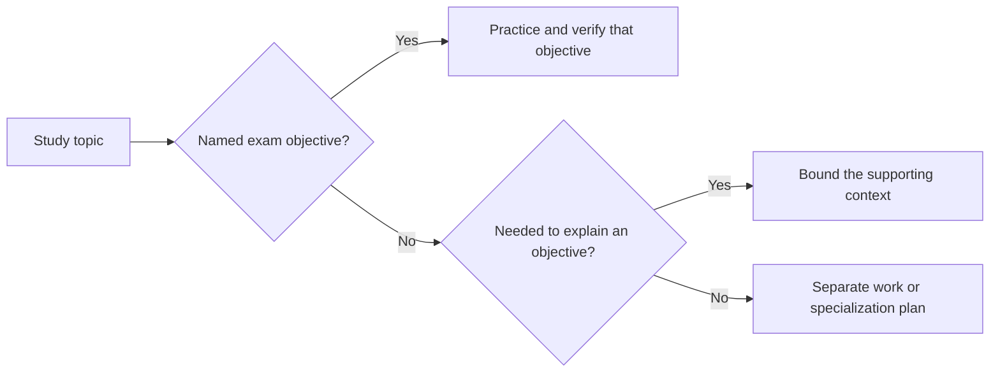
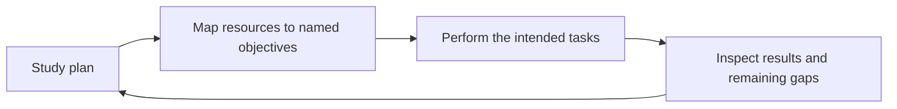
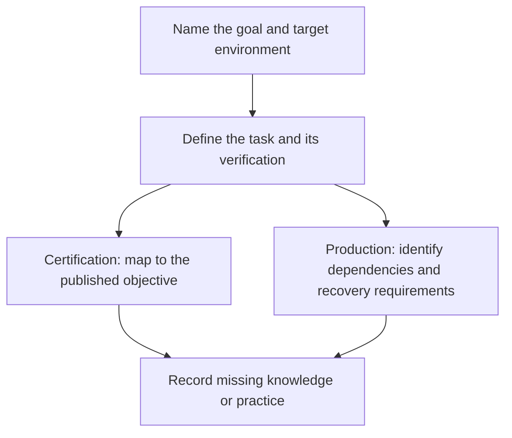
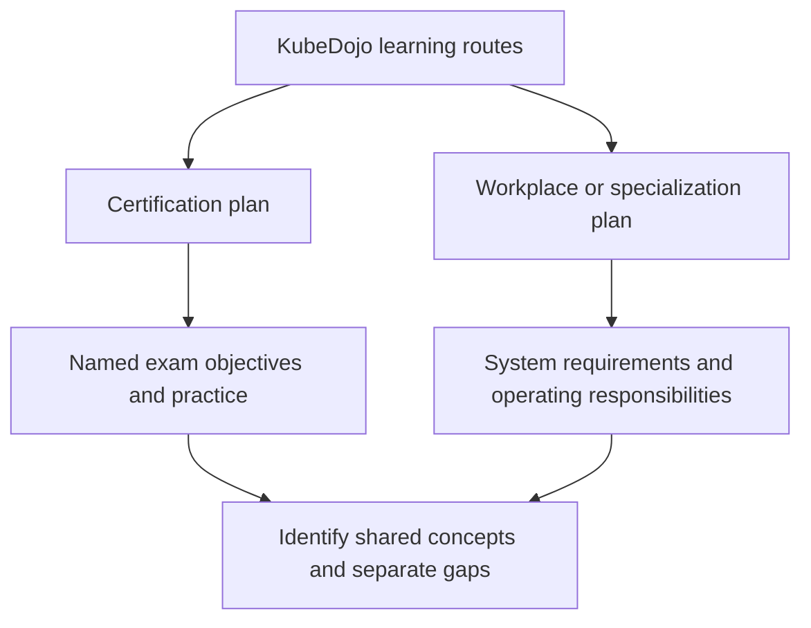

> **Complexity**: `[MEDIUM]` - Long-form module for setting expectations
>
> **Time to Complete**: 80–110 minutes (author's planning estimate for reading and exercise)
>
> **Prerequisites**: Module 1.1, Module 1.2

---

## Learning Outcomes

After this module, you will be able to:

- **Evaluate** certification study materials by separating exam scope from post-exam specialization.
- **Compare** a resource's task and depth with the chosen exam's objectives, including named tools and interfaces.
- **Design** a time-boxed learning plan that protects core Kubernetes practice from scope creep.
- **Diagnose** scope creep when team pressure, curiosity, or production tooling pulls you away from the exam.
- **Implement** a personal boundary that retains required practice and gives unrelated depth a separate learning goal.

---

## Why This Module Matters

Hypothetical scenario: a platform team is preparing three engineers for Kubernetes certification. Its production environment includes a managed cloud platform, a service mesh, GitOps delivery, cloud identity integration, and monitoring dashboards. The team proposes a study plan that mirrors those tools. Before adopting it, compare each activity with the published objectives for the intended certification. Provider onboarding may be necessary for work while leaving a workload, networking, or troubleshooting objective without practice; record that gap rather than assuming every Kubernetes-related activity serves the same goal.

That scenario asks you to inspect what a study plan leaves unpracticed. Reading about etcd quorum, eBPF datapaths, CNI plugin design, GitOps sync waves or cloud identity can serve a useful goal, but a resource's subject alone does not establish coverage of an exam objective. Record the intended task and the evidence it produces. Certification preparation and workplace specialization can then share relevant context without being treated as interchangeable learning goals or measured improvements in exam performance.

This module offers a planning boundary for certification study alongside work and other learning goals. Decide which activities practice the selected objectives, which supply necessary context, and which serve a separate purpose. Work obligations may require specialization before an exam; record that choice and any displaced practice.

---

## Our Philosophy: Exam-Focused, Not Exhaustive

For certification study, choose a bounded route through KubeDojo's wider curriculum. Start with the [official CNCF curriculum for your exam](https://github.com/cncf/curriculum), then map each objective to an activity and a result you can check. Related material can provide supporting context or belong in a separate work-learning plan. This is a planning method, not a measured claim that a fixed fraction of topics accounts for a fixed fraction of the exam or guarantees a pass.



The diagram classifies study activities; it does not predict question frequency or score. An objective can name a tool or extension mechanism as well as a native object. For example, the [CKA curriculum](https://github.com/cncf/curriculum/blob/bad74bf40372cdb6fb93f0eb1a6758b59b5a2909/CKA_Curriculum_v1.37.pdf) explicitly includes Helm and Kustomize for installing cluster components, plus understanding CRDs and installing and configuring operators. Classifying all third-party tools as out of scope would therefore produce an incomplete plan. Check the intended task and depth before deciding what to defer.

Think of a driving test as an analogy for selecting practice: an operating task and designing a vehicle call for different depth. The analogy stops there: a Kubernetes curriculum can explicitly name tools, interfaces and implementation tasks, and it does not establish what any particular exam question will ask. Use the selected exam's actual objectives to decide the depth.

KubeDojo's exam-track pin remains Kubernetes 1.35; its separate Release Radar includes other minors. Check the [Linux Foundation exam-environment FAQ](https://docs.linuxfoundation.org/tc-docs/certification/faq-cka-ckad-cks#what-application-version-is-running-in-the-exam-environment) before timed preparation. As checked on October 27, 2026, it lists CKA/CKAD 1.37 and CKS 1.35. The existing pin is not proof of current exam parity. We write the full `kubectl` command so examples do not require a local alias; server queries still require an appropriate configured cluster and permissions.

```bash
kubectl version --client
kubectl get pods --all-namespaces
kubectl auth can-i list pods --all-namespaces
```

**Pause and predict:** compare an evening practicing `kubectl describe`, `kubectl logs`, `kubectl auth can-i` and events with an evening reading a provider's managed node group guide. Which named exam objective or workplace responsibility would each activity practice, and what result would you inspect?

<details>
<summary>Check your prediction</summary>

For a chosen exam, map each activity to its actual objective and expected result. A provider guide may also serve a workplace goal; its title alone does not establish either match.

</details>

Write the goal and a checkable result for each evening before you continue. The next paragraph is about the discomfort of a narrow curriculum. It does not pick the evening.

A focused certification route and production onboarding have different goals, although they may share tasks. Check the chosen route for gaps against the current objectives, and use role-specific sources whenever work requires that depth.

---

## What We Deliberately Skip

Classify the actual task rather than treating every adjacent topic as equally urgent or automatically excluded. The checked curricula name native APIs, operational and application tasks, security controls, tools and interfaces at different depths. The categories below help separate additional specialization from required practice. Check the specific objective before deferring a resource, especially when the same product supports both a named task and a much wider feature set.

### Cloud Provider Specifics

| Topic | Planning boundary to check | Where to Learn |
|-------|-------------|----------------|
| AWS EKS details | Compare the actual task with the chosen objective and environment | AWS documentation, eksctl docs |
| GKE features | Separate the resource's task from additional provider features | Google Cloud documentation |
| AKS specifics | Check the task and its verification against the chosen objective | Azure documentation |
| Cloud IAM integration | Map the identity task and its depth before deferring it | Provider documentation |

For a provider resource, inspect its identity, networking and cluster-operation assumptions. Identify the Kubernetes task and any provider-specific steps, then compare both with the chosen curriculum and environment. A provider workflow may serve a work obligation even when its relation to an exam objective needs further investigation. Record the actual steps rather than inferring coverage from the service's name.

For example, compare a cloud load balancer annotation with the purpose of a Service of type `LoadBalancer`, or compare a cloud identity workflow with ServiceAccounts and RBAC. Use provider documentation for its specific integration and record which part, if any, supports the chosen exam task. KubeDojo has other learning tracks as well as certification routes.

### Production Operations at Scale

| Topic | Planning boundary to check | Where to Learn |
|-------|-------------|----------------|
| Multi-cluster federation | Compare the proposed task with the chosen objective | Project documentation |
| Cluster autoscaling | Compare node provisioning with workload replica scaling and the chosen objective | Cluster Autoscaler and provider documentation |
| Organization-wide disaster recovery design | Separate service requirements from named exam tasks | SRE books, your company runbooks |
| Cost optimization | Identify the cost model, system requirements and intended task | FinOps resources, cloud calculators |

For a production-planning activity, write down its operating context. A recovery exercise might ask about data stores, recovery objectives, backup tooling and incident roles. A cost investigation might inspect billing, capacity policies and business priorities. A multi-cluster proposal might examine latency, tenancy, traffic management and operating permissions. These are suggested questions, not a complete design checklist or evidence that a particular system meets its requirements. Inspect the actual resource and local acceptance criteria before assigning depth; retain any task that also maps to the chosen exam objective.

Choose the operational task from the curriculum you actually intend to study. The checked CKA curriculum includes preparing cluster infrastructure, creating and managing clusters with kubeadm, managing their lifecycle and implementing and configuring a highly available control plane. A full organizational recovery program adds service-specific responsibilities, but that distinction does not remove the named control-plane task. Map a proposed backup or recovery exercise to the chosen objective and state what it verifies; do not assume the same task is required by CKA, CKAD and CKS.

### Deep Networking

| Topic | Depth boundary to check | Where to Learn |
|-------|-------------|----------------|
| BGP configuration | Compare the configuration task with the chosen objective | Network engineering resources |
| Service mesh internals | Retain the CKS encryption task naming Istio; classify other mesh depth separately | Project documentation |
| eBPF/Cilium internals | Retain the CKS encryption task naming Cilium; classify unrelated datapath internals separately | Cilium documentation |
| Custom CNI development | Distinguish plugin authorship from the CKA interface objective | CNI specification |

For a networking resource, identify the task it supports before choosing its depth. A Service connectivity exercise can involve labels, selectors, ports, endpoints, DNS, NetworkPolicy and troubleshooting. An implementation guide may address a different objective or additional specialization. Those connections do not establish one networking syllabus for every certification; compare the exact activity with the chosen curriculum and record how you will verify its result.

The distinction matters during practice. If a NetworkPolicy blocks traffic, inspect labels, selectors, rules and the intended source and destination. The checked CKA curriculum's cluster-architecture domain explicitly names understanding extension interfaces such as CNI, CSI and CRI. Plugin authorship is a different activity from understanding an interface or implementing the named task. A product name alone cannot decide whether a resource belongs in the plan: the checked CKS curriculum names Cilium and Istio for Pod-to-Pod encryption.

### Specific Tools and Projects

| Tool | Depth boundary to check | Where to Learn |
|------|-------------|----------------|
| ArgoCD | Separate tool-specific sync workflows from the chosen objective | ArgoCD documentation |
| Istio | Retain the named CKS encryption task; classify other features separately | Istio documentation |
| Terraform | Separate infrastructure provisioning from the named Kubernetes task | HashiCorp Learn |
| Prometheus/Grafana | Map the proposed monitoring activity to the exact objective | Project documentation |

Separate a product's full curriculum from the specific task a certification names. The checked [CKS curriculum](https://github.com/cncf/curriculum/blob/bad74bf40372cdb6fb93f0eb1a6758b59b5a2909/CKS_Curriculum%20v1.34.pdf), Minimize Microservice Vulnerabilities, names Cilium and Istio for implementing Pod-to-Pod encryption. Blanket advice to postpone both products would therefore omit relevant CKS practice. Record the required behavior, the environment and how you will verify it, then classify unrelated features deliberately; the outline does not describe the products' entire feature sets. This retrieved curriculum file is named v1.34; the separately checked FAQ lists the CKS exam environment as 1.35. A curriculum-file label and an exam runtime are distinct evidence, so recheck both before preparation.

Helm is explicit in both the [CKA](https://github.com/cncf/curriculum/blob/bad74bf40372cdb6fb93f0eb1a6758b59b5a2909/CKA_Curriculum_v1.37.pdf) and [CKAD](https://github.com/cncf/curriculum/blob/bad74bf40372cdb6fb93f0eb1a6758b59b5a2909/CKAD_Curriculum_v1.37.pdf) curricula checked on October 27, 2026. CKA names Helm and Kustomize for installing cluster components; CKAD names deploying existing packages with Helm. Practice the named tasks rather than treating Helm as either universally optional or a reason to master every chart-authoring workflow. Apply the same objective-by-objective check to your chosen exam instead of transferring exclusions from another certification.

Worked planning example: suppose your bookmark list contains a Helm chart-authoring course, a lab that deploys an existing package with Helm, and a guide to installing a cluster component. Write the exact objective beside each resource before assigning study time. For the checked CKAD curriculum, verify that the lab actually uses the Helm package manager to deploy an existing package before classifying it under that objective. For CKA, the objective names Helm and Kustomize for installing cluster components; inspect which tasks the guide practices and what remains uncovered. A resource's title alone does not establish that all its material is required by either objective.

Now write the evidence you would want from the selected lab: identify the package and target environment, explain the configuration you selected, inspect the deployed resources, and verify the intended result. Record any setup or permissions the lab assumes. This is a hypothetical plan, not an observed installation or proof of exam readiness. If you cannot explain which objective the exercise demonstrates, investigate that gap before labeling the resource essential. The method preserves relevant tool practice while giving additional chart-development material a deliberate place in the wider learning plan.

**Pause and predict:** if your company uses Istio heavily, should you study it for the CKA?

<details>
<summary>Check your prediction</summary>

Learn enough at work to avoid being dangerous in production. Do not spend certification study blocks on service mesh internals unless your immediate goal has changed. Name the goal of each study session before you start.

</details>

Write yes or no, and which hours you would use, before you continue. The next section is about why the curriculum makes these cuts. It does not answer the Istio question.

---

## Why We Make These Choices

One reason is to allocate limited study time deliberately. A plan can reserve sessions for named tasks and their verification while recording other goals separately. Practice might include reading manifests, inspecting events, or fixing a configuration when those activities support the chosen objective; this is a planning recommendation, not a measured speed or pass-rate claim.



The second reason is exam relevance. CKA, CKAD and CKS have separate published curricula; use the exact objective as the planning reference rather than assuming a shared native-only syllabus. A KubeDojo route still needs verification against that objective and the current environment. Record a concrete gap when a route omits required practice, and give unrelated material a separate learning goal. Popularity in production does not establish an exam requirement, and a third-party name does not establish an exclusion.

The third reason is maintainability. Review each route for version drift, deprecated behavior, changed defaults, and objective updates. Additional topics create additional material to check; this is a maintenance consideration, not a measured relationship between breadth and error rates. Compare the stated target with current provider requirements and versioned technical sources; a narrow scope alone does not establish that its content is current. Record the date and unresolved differences beside the plan rather than assuming a familiar resource still matches it.

Use the required action as a check on the resource you choose. Reading a broad product tour and implementing a named task produce different evidence. For a NetworkPolicy exercise, write the intended traffic rule and test its result; for an encryption objective, identify and verify the required behavior. Do not infer question frequency or a universal backup requirement from those examples. The three captured outlines do not explicitly name an etcd snapshot-and-restore workflow; classify such practice against the selected cluster objective and environment instead of asserting that every exam rewards it.

Before another study session, name the expected output and the objective it supports. A corrected manifest or explained troubleshooting result can provide evidence of the particular task practiced; a bookmark alone does not demonstrate that task. Neither result proves exam readiness by itself.

---

## The "Just Enough" Principle

"Just enough" does not mean shallow. Match depth to the chosen task and its verification. For example, the checked CKA outline names implementing and configuring a highly available control plane, while CKAD names application deployments and health checks. Keep that distinction when planning practice. A production recovery plan also needs service-specific dependencies, validation and operating responsibilities; a cluster exercise alone does not establish that complete plan. Do not use the depth of the broader topic to exclude a task the curriculum actually names.



**Pause and predict:** why does a successful backup command alone leave unanswered questions about recovery of a production service?

<details>
<summary>Check your prediction</summary>

A command result does not establish whether the service's data dependencies, recovery procedure, access requirements, and acceptable recovery time have been tested together. Identify what the chosen exam objective requires separately from what the actual service needs. The diagram assigns no numerical difficulty, study hours, or relative importance to either goal.

</details>

Write the missing recovery evidence before you continue. Then compare it with the bounded task in your chosen curriculum; keep the scope and verification criteria explicit for each goal.

This principle also helps you avoid false equivalence. NetworkPolicy practice requires inspecting selectors and testing intended traffic, while enforcement depends on a network plugin that supports it. HPA adjusts a workload's replica count using metrics; Cluster Autoscaler adjusts node capacity through supported infrastructure. Compare the actual task and depth with the selected objective instead of inferring an exclusion or question frequency from either mechanism.

A useful study question is not "Could this ever matter?" Ask which part of the resource serves the named objective and which part adds another learning goal. Retain required practice even when it uses a specific tool or needs substantial work. Give unrelated depth a separate plan with an explicit reason; the resource's size or vendor-specific label alone does not establish that it belongs after the exam.

Hypothetical planning example: a Service exercise checks selectors, endpoints and ports, while a provider guide explains controller annotations and cost. Record the objective and expected result for the first activity and the workplace purpose for the second; inspect each resource before deciding whether any part also supports the selected exam.

---

## Where We Suggest Going Deeper

Specialization can run alongside or follow certification study, depending on your work and learning goals. A platform engineer, application developer, security engineer and SRE may choose different areas of depth. The following paths are examples to investigate, not a required sequence or a claim about exam outcomes.

For platform engineers, a possible separate goal is platform design: evaluate Cluster API, GitOps with ArgoCD or Flux, multi-tenancy patterns, developer portals, or policy controls against a particular team's requirements. Ask about ownership, upgrade paths, tenancy, and how much Kubernetes detail to expose to users. Treat these as candidate study activities, with project documentation and a defined verification task for each. A certification record alone does not establish that a proposed internal product meets its users' needs.

For developers, a possible goal is application architecture on Kubernetes. Compare a sidecar, ambassador, or adapter exercise with the application behavior you intend to study. Before choosing operator, CRD, plugin, or client development, record the relevant API and reconciliation assumptions and what normal workload objects already provide. Then define a check for the proposed extension's behavior and failure handling. This is suggested preparation, not evidence that a learning sequence makes software safer or that every developer needs these activities.

For security-focused learners, candidate activities include policy authoring, runtime detection, supply chain verification, NetworkPolicy design, admission control, and threat modeling for a stated environment. Inspect project documentation before choosing a tool-specific exercise. Compare its actual task with the CKS objectives before calling it post-exam material. Separately record the system's operational controls, logging, incident-response responsibilities, and evidence requirements; an exam objective does not by itself define the complete security acceptance criteria for a production system.

For SRE and operations work, consider a separate plan for SLO-based alerting, capacity planning, controlled failure experiments, backup validation, incident response, upgrades, and incident review. Choose activities against the service's requirements and local procedures. Record expected behavior, operating assumptions, failure boundaries, and the evidence still missing. The checked certification curricula name particular tasks; they do not establish that passing an exam verifies all of these service responsibilities or replaces evidence from operating the particular system.

Compare two hypothetical plans: one mixes certification tasks and workplace-tool study in each session; the other separates those goals into scheduled blocks. Either plan needs an objective and a result to inspect. Choose based on your available time, current gaps and work obligations, then review what the sessions actually covered. This is planning advice, not evidence that one schedule produces faster certification or a particular pass rate.

---

## Visualization: KubeDojo Scope

The scope diagram distinguishes two learning goals. A certification plan follows its named objectives; a workplace plan follows the responsibilities of a particular system. They can share concepts and practice, but neither is a complete substitute for the other. KubeDojo also has separate cloud, Linux, platform and other learning tracks, so this module's study boundary is not a description of everything the site covers.



Use this diagram when work relevance and exam relevance compete for the same study time. Map the resource to an objective or an operating responsibility and decide which goal has priority now. Keep deferred material visible with its reason and a review date. This records your planning choice without claiming that a tool is universally irrelevant or that a particular allocation guarantees a better score.

Use the diagram to justify a decision about a particular ArgoCD or BGP activity, rather than excluding a whole product or topic. An omitted keyword in an outline does not prove a task is forbidden; record uncertainty when the relationship to an objective is unclear.

---

## How to Classify a Topic Before It Steals a Week

The most practical skill in this module is classification. When a new topic appears, do not ask whether it is interesting, modern, or used by serious teams, because those questions are too easy to answer with yes. Ask what role the topic plays in your current goal. A topic can be exam scope, supporting context, post-exam specialization, or workplace urgency. Those categories let you make a decision without arguing about whether the topic has value in some abstract sense.

For exam-scope topics, practice the action and depth stated by the selected objective. The checked outlines include understanding and knowledge as well as implementation and configuration. Match the evidence accordingly: an explained interface role, a configured workload, or a troubleshooting record answer different tasks. Identify what the artifact demonstrates and what it leaves unverified. A familiar command or an explanation without notes can be a practice result, but neither alone establishes competence across every objective or predicts an exam score.

Supporting context helps explain a named task without becoming a separate goal. For example, a mental model of reconciliation can support understanding Deployments, and plugin behavior can explain NetworkPolicy enforcement. Compare a custom-controller or CNI-development activity with the chosen objective before allocating time; the CKA explicitly names understanding extension interfaces.

Specialization can preserve a separate learning goal. If an ArgoCD sync-wave activity or Cilium eBPF internals tour does not practice your selected objective or supply needed context, record why you deferred it and when to revisit it. A different activity using the same product may map to an objective, such as CKS Pod-to-Pod encryption.

Workplace urgency can override an exam plan consciously. If an on-call responsibility requires a provider incident runbook, record the tradeoff and reschedule displaced exam practice. Inspect the runbook's actual tasks before deciding whether any also support a CKA objective.

A useful classification habit is to write one sentence before opening any long resource: "I am reading this because it will help me do X for this published objective." Fill in X with the named task, including a tool or interface when specified. Then identify the evidence you expect to produce. If the connection is missing, investigate it before assigning study time; a product name, a native object or an advanced label is not the scope decision.

### Worked classifications before you plan

The following are **authored hypothetical resource cards**, not published courses or executed labs. They show planning decisions using page 2 of the linked curricula at revision `bad74bf`; the evidence described is expected or still missing, never an observed installation or result. The categories are provisional: inspecting an actual resource could change any decision.

**Card 1 — CKA availability and interfaces.** The Cluster Architecture, Installation and Configuration objectives distinguish activities: implement and configure a highly available control plane, and understand extension interfaces such as CNI, CSI and CRI. Imagine a resource whose stated activity is to configure a highly available control plane and check whether the control plane remains usable when a component is unavailable. Place that activity in `Exam Scope` provisionally: its intended task maps to the availability objective. The planned evidence is a description of the configuration and an availability check with its assumptions and result recorded. No such check has been performed here, and the outline does not specify that this hypothetical check is the exam's marking scheme.

Now imagine a second resource that explains where CNI, CSI and CRI fit and asks the reader to explain their roles. Map that activity to the separate interface objective; record the explanation as its expected evidence. A third resource teaches writing a plugin from scratch. Its extra development depth does not by itself demonstrate either interface understanding or control-plane availability, so place that activity in a separate goal unless inspection shows a relevant component. Revisit if its actual exercise includes the interface explanation or if the selected objective changes. None of these descriptions establishes that a single-control-plane lab satisfies the availability task.

**Card 2 — CKAD existing packages.** Application Deployment names using the Helm package manager to deploy existing packages. Imagine an activity that selects an existing package and deploys it with Helm in a stated environment. Record the objective's verb and tool, the package and configuration the activity actually uses, and the expected evidence: a deployment result, an inspection of its resources, and a check of the intended package behavior. Record which behavior that check covers and what remains unverified. The planned classification is `Exam Scope` because the described task maps to that objective; the actual resource, environment, permissions and outcome remain unverified. A list of Helm commands, a chart title, or resource presence alone would not establish that the intended behavior works.

Contrast an imagined tutorial devoted to authoring a new chart. Record its actual authoring task and defer that extra depth to a separate goal if it does not also practice deploying an existing package. The revisit condition is discovery of a relevant deployment activity or a changed objective, not a conclusion that chart authoring is forbidden. Transfer the same resource to CKA only after checking its task: CKA names using Helm and Kustomize to install cluster components. A CKAD application-package activity does not automatically demonstrate that CKA component-installation task, even though both mention Helm.

**Card 3 — CKS encryption.** Minimize Microservice Vulnerabilities names implementing Pod-to-Pod encryption (Cilium, Istio). Imagine an activity that practices encryption using Cilium. Mark the described activity provisionally `Exam Scope` and inspect whether it covers the named objective and what remains to be practiced, including the other named tool; do not infer full coverage from one activity. Plan evidence that identifies the communicating Pods, the tool and the check used to distinguish encrypted from unencrypted traffic. Record the expected result and the limits of that check; this card reports no setup, traffic capture or observed encryption. A general mesh traffic-routing tour or an eBPF internals overview is a different actual activity. Classify its relevant context separately, and defer unrelated depth with a reason and a condition to revisit after inspecting the resource.

**Version and uncertainty record.** The captured CKA and CKAD curriculum files are labeled v1.37, while the captured CKS curriculum file is labeled v1.34. The separately checked FAQ on October 27, 2026 lists CKA/CKAD runtime 1.37 and CKS runtime 1.35. For CKS, record this label/runtime mismatch and recheck both sources and the intended resource's compatibility before scheduling the exercise; the mismatch does not prove either that the objective is absent or that a particular resource works. Do the same for other exams when versions or objectives change. A provisional map is a planning artifact, not evidence of completion, compatibility or a future question.

Consider a learner who asks why one Pod cannot reach another. Define the intended traffic and inspect the relevant objects and events. For CKA, retain the named extension-interface and networking work. For CKS, retain the named encryption task rather than filing every Cilium resource under specialization. An unrelated implementation tour can belong in a separate plan, while a live production incident follows its local runbook. The symptom alone does not determine which depth serves the selected objective.

Apply the same classification to security. Example RBAC practice can include Roles and RoleBindings, permission checks with `kubectl auth can-i`, and explanations of namespace-scoped versus cluster-scoped grants; select the depth from the chosen objective. ServiceAccounts provide identities for processes in Pods. Inspect policy authoring, admission control, workload identity, or signing activities individually before assigning a category. A work obligation may also require an emergency-access procedure independently of the exam plan; record that purpose and any assumptions it makes.

Classification can help you notice when an interesting advanced topic has displaced a named task. For example, compare a service mesh architecture reading with a Service selector troubleshooting exercise: record what each activity demonstrates against the chosen objective before assigning study time. This comparison does not rank candidates or predict exam performance.

Check the opposite planning error too: an activity without a demonstrated exam match can still serve a work or personal goal. Record that separate purpose instead of treating it as worthless. "This is worth investigating later" should include a reason and a revisit condition. For example, a provider-controller topic might return to the active plan when a new work responsibility requires it. This is a suggested planning habit, not a claim about learner health or later production performance.

When you classify a resource, also classify the expected output. Exam-scope work should end in practice results, such as solved labs or commands you can repeat. Supporting context can end in a short explanation or a diagram. Post-exam specialization can end in a bookmark plus a reason to return. Workplace urgency can end in a runbook note or an incident action. If every category ends in the same pile of notes, you have not really made a decision.

A boundary can be a queue rather than a rejection of curiosity. Order activities by the immediate goal, retain their separate purposes, and revisit the order when an objective, resource, or work obligation changes. The queue records a choice; it does not establish competence or predict workplace outcomes.

---

## When This Doesn't Apply

When preparing for a certification, try this classification as a planning aid, particularly when a date or study hours are constrained. A team can use the same labels to discuss scope, while retaining a separate workplace goal where necessary. KubeDojo also offers routes for goals beyond certification.

The anti-pattern is equally simple: do not use an exam-focused path as your only production training plan. If you are on call for a real cluster tomorrow, you may need provider-specific runbooks, company incident procedures, backup validation, dashboards, logging conventions, and tool-specific safety checks before you finish a certification track. Exam focus is not an excuse to ignore operational risk. It is a way to keep one learning goal from swallowing another.

Keep curiosity visible in the plan. Capture a separate topic with its source, why it matters, and a condition for revisiting it; if it becomes urgent for work, adjust the schedule explicitly rather than assuming it practices the exam task.

Here is a worked example you can reuse when a team study group starts drifting. Imagine the group is preparing for the CKA and one member suggests a session on managed cloud load balancer annotations because their production ingress depends on them. The facilitator should not argue that annotations are useless. Instead, they should ask what native task the session improves. If the answer is "understanding Services," the group can spend ten minutes explaining the provider layer, then return to Service types, selectors, endpoints, ports, and troubleshooting. If the answer is "learning our cloud platform," the session belongs in a separate workplace track.

Suppose someone proposes replacing an RBAC drill with a policy-engine deep dive for a workplace adoption. Compare each activity with the chosen exam's security objectives and identify its expected result. Record the work goal separately, retain any required exam practice, and revisit the classification if the resource contains a relevant named task.

In a hypothetical group, a senior colleague may recommend a topic from an incident while another learner hesitates to question it. Ask what that resource would demonstrate and whether its task also serves the selected objective. One possible response is: "What result would we check, and which goal does it serve?" Record the incident context without inventing it, preserve any work obligation, and reschedule displaced practice explicitly. This example does not establish how frequently such conversations occur or which wording changes learning outcomes.

Try the boundary when studying alone: inspect several open resources and write the actual activity, selected objective, and expected result for each. A resource might remain supporting context, move to a separate goal, or need further inspection. Explain the decision before closing or moving it, and keep a revisit condition where useful. This exercise is intended to make the allocation visible; moving a tab does not demonstrate that the selected practice happened or that study time became more effective.

You can record temporary incompleteness explicitly: "I do not yet know this provider controller's internals; I will check the object it watches and the symptom before deciding what to study next." This makes the uncertainty and next action visible without claiming expertise.

---

## When You'd Use This vs Alternatives

Use the KubeDojo scope boundary when the immediate outcome is certification readiness. Use vendor documentation when the immediate outcome is operating a specific managed service. Use project documentation when the immediate outcome is adopting or debugging a specific tool. Use SRE books, company runbooks, and incident reviews when the immediate outcome is production reliability. These alternatives are not competitors; they answer different questions.

| Learning Goal | Best Primary Source | Why This Source Fits |
|---------------|---------------------|----------------------|
| Prepare for a chosen certification | Official curriculum and environment requirements, plus a checked KubeDojo route | Map the exact tasks and identify gaps; this packet checks CKA, CKAD and CKS outlines, not every certification. |
| Operate EKS, GKE, or AKS | Provider documentation and company runbooks | Check the specific service's identity, upgrades, networking, storage, and support boundaries. |
| Adopt ArgoCD, Istio, Terraform, or Prometheus | Project documentation and a focused lab | Check the selected project's model, commands, assumptions, and failure handling. |
| Design multi-cluster production reliability | SRE practice, architecture reviews, and incident history | The right answer depends on risk, traffic, data, staffing, and business constraints. |

Name the job before choosing the resource. "Practice the checked CKAD deployment objective," "debug our Istio ingress path," and "investigate cloud spend" need their own expected evidence. Inspect the resource against that stated job rather than assuming that general usefulness establishes a match. Check a KubeDojo route in the same way: record its target, covered activity, verification, and any missing practice. The plan is a proposal to inspect, not proof that a site or resource prepares every learner.

---

## Did You Know?

- **CNCF publishes separate exam curricula.** Use the [official curriculum repository](https://github.com/cncf/curriculum) to check the objectives for the certification you intend to take; inclusion in a broader landscape is a different question.
- **The checked CKA curriculum includes tools and extension mechanisms.** Its Cluster Architecture, Installation and Configuration domain names Helm, Kustomize, CRDs and operators; native-versus-third-party is therefore insufficient as a scope rule.
- **The checked curricula have version labels.** Record the official revision and recheck it before scheduling practice; an old course outline or a coworker's memory is not a substitute for inspecting the selected objectives.
- **"Expert" is context-dependent.** A networking expert, security expert, developer platform engineer, and SRE may all be strong at Kubernetes while having different deep specialties.

---

## Common Mistakes When Studying for Kubernetes Certifications

| Mistake | Why It Happens | How to Fix It |
|---------|----------------|---------------|
| **Classifying a network tool by name alone** | Plugin development, interface knowledge and security tasks can appear in adjacent documentation. | Map the task: CKA names extension interfaces; CKS names Cilium/Istio for Pod-to-Pod encryption. Separate those activities from unrelated internals. |
| **Memorizing YAML syntax** | A blank editor can encourage memorizing fields without checking their meaning. | Practice `kubectl run` and `kubectl create` with `--dry-run=client -o yaml`, then inspect, edit and verify the generated manifest. |
| **Studying cloud-specific IAM** | Your company uses AWS IRSA, EKS Pod Identity, GKE Workload Identity, or AKS integrations, so it feels like core Kubernetes. | Focus first on ServiceAccounts, Roles, ClusterRoles, RoleBindings, ClusterRoleBindings, and `kubectl auth can-i` in vanilla Kubernetes. |
| **Choosing a lab by hardware alone** | Hands-on hardware can distract from the intended task. | Choose an environment that supports the selected objective and its verification; check its setup and limitations. |
| **Treating Helm as universally optional or exhaustive** | A workplace chart workflow can obscure the specific task named in a curriculum. | Practice the Helm tasks named by your exam; both the checked CKA and CKAD curricula include Helm. Keep unrelated chart-authoring depth in a separate plan. |
| **Classifying a GitOps guide by name** | A product guide can contain several different activities. | Inspect the sync task and compare it with the chosen objective; record a separate work goal or uncertainty where appropriate. |
| **Assuming one etcd study rule fits every exam** | Cluster operation and application development are different goals. | Map the specific task to your exam's objective and environment; distinguish demonstrated cluster mechanics from a complete service recovery plan. |

---

## Quiz

<details>
<summary>Your manager wants you to spend the next two weeks learning Terraform and EKS because your team uses them in production. How should you protect your CKA study plan?</summary>

Compare the actual Terraform and EKS activities with the chosen CKA objectives and record the work requirement. Schedule both obligations where possible; if work takes priority, identify and reschedule the named exam practice displaced. The product names alone do not settle the classification.
</details>

<details>
<summary>You are studying NetworkPolicies and find a long Cilium eBPF tutorial that looks excellent. Should it become part of this week's CKAD plan?</summary>

Inspect the tutorial's actual task and compare it with the checked CKAD objectives. If it only explores eBPF internals and does not practice the selected policy task or needed context, give it a separate goal and plan policy scenarios with predicted and checked traffic. Revisit the decision if the resource contains a relevant task; its Cilium title alone cannot decide it.
</details>

<details>
<summary>Your study calendar gives equal time to ArgoCD setup and standard Deployments and Services. What is wrong with that allocation?</summary>

Identify the objective each allocation serves. Studying ArgoCD sync behavior does not itself demonstrate the checked curricula's workload, Service or troubleshooting tasks. If the resource does not practice a named objective or supply needed context, give it a separate learning goal and restore the missing task practice. That decision depends on the resource's actual activity; it is not a rule that every third-party product belongs outside certification study.
</details>

<details>
<summary>A colleague failed a practice exam after relying on the AWS Console for node operations at work. How would you diagnose the scope creep in their preparation?</summary>

The practice result alone does not establish the cause. Compare the missed practice tasks with the CKA objectives and the console walkthrough's actual steps, then plan exercises for any missing tasks and their verification. Keep the managed-service workflow for its work purpose and revisit this diagnosis with more evidence.
</details>

<details>
<summary>You see Horizontal Pod Autoscaler and Cluster Autoscaler in the same documentation session. Which one deserves exam focus, and how do you compare the two?</summary>

HPA adjusts workload replicas using metrics; Cluster Autoscaler adjusts node capacity through supported infrastructure. Identify the task in each resource and map it to the chosen curriculum and environment, then reserve time for named practice and verification. Neither mechanism nor an omitted keyword proves an exam exclusion or predicts question frequency.
</details>

<details>
<summary>You plan to build a highly available bare-metal cluster with external etcd before taking the CKA next week. Is that a good design for a time-boxed learning plan?</summary>

Do not defer high availability merely because it sounds advanced: the checked CKA curriculum explicitly includes implementing and configuring a highly available control plane. Break the proposal into that named task and additional hardware or organizational requirements. Choose a lab where you can perform and verify the required task with your available preparation time; park extra complexity with a reason. A single-control-plane lab can serve other objectives, but it does not itself demonstrate this availability objective. The curriculum does not supply a prediction of next week's questions.
</details>

<details>
<summary>You have a bookmark list full of Istio, ArgoCD, Cilium, provider IAM, and etcd articles. How would you implement a personal boundary without losing those resources?</summary>

Use the exercise's three categories: exam scope, supporting context and post-exam specialization. Classify each resource's actual task against the chosen curriculum. A CKS resource practicing Pod-to-Pod encryption may belong in exam scope even if its title says Istio or Cilium; a tour of unrelated internals can belong elsewhere. For CKA, retain the named control-plane and extension-interface practice. Record why a resource is deferred and what evidence would change the classification. Do not use the presence of a product name as the rule.
</details>

---

## Hands-On Exercise: Audit Your Study Materials

This exercise is a planning lab rather than a cluster lab because the skill you need is scope control. Open your current study bookmarks, playlists, notes, company wiki pages, or training backlog. Your job is to turn an unfocused pile of useful resources into a certification plan that has a clear boundary and a separate post-exam roadmap.

### Setup

Create a short document with three headings: `Exam Scope`, `Supporting Context`, and `Post-Exam Specialization`. If you already have a study tracker, add those labels there instead of creating a new file. The tool does not matter; the decision quality matters.

### Tasks

1. Inventory at least twelve resources, recording the chosen exam and official curriculum revision and page or section. For each, describe the actual activity and depth after inspecting it, not just its title.
2. Map each activity to the exact objective and expected evidence or result, then assign `Exam Scope`, `Supporting Context`, or `Post-Exam Specialization`. Record uncertainty, any defer reason, and a condition for revisiting the decision; investigate a missing match instead of treating a product name or omitted keyword as proof of exclusion.
3. Compare the advanced items with the native Kubernetes tasks they might be replacing. For example, compare an Istio traffic policy tutorial with Service and NetworkPolicy practice, or compare a cloud IAM guide with RBAC drills.
4. Design a one-week time-boxed learning plan around the named tasks and their verification, including tools or interfaces where specified. Give supporting context and unrelated depth an explicit purpose instead of assuming a native-only time allocation.
5. Diagnose one likely pressure point that could pull you off plan, such as a manager asking for provider knowledge, a coworker recommending a tool, or your own curiosity about internals.
6. Write a boundary sentence naming an activity, its reason, and the condition that would make you revisit it, including a work obligation if applicable.

<details><summary>Hint 1: Concept</summary>
An objective names an intended task; a product name does not tell you which part of a resource practices it.
</details>
<details><summary>Hint 2: Approach</summary>
Write one row with exam, revision and page, resource task and depth, objective, expected evidence, uncertainty, and revisit condition before classifying it.
</details>
<details><summary>Hint 3: Example</summary>
For CKAD, compare an activity deploying an existing package with Helm to the Application Deployment objective. Inspect the activity before deciding whether it actually provides that practice.
</details>

<details>
<summary>Solution guidance</summary>

Compare your records with the worked classifications above: each needs an inspected task, objective mapping, expected evidence, uncertainty and a revisit condition. Check whether your chosen resources actually support the planned task, and record missing evidence rather than treating the hypothetical cards as results.
</details>

**Card A: Two evenings, one exam next week.** One evening is `kubectl describe`, logs, `auth can-i`, and events. The other is a cloud provider's managed node group guide. A friend says both are "Kubernetes" so they count the same.

<details>
<summary>Check your prediction</summary>

For a chosen exam, map the command activities and the guide's actual task to its objectives and expected results. Schedule the missing practice, and retain or defer the guide according to its demonstrated purpose and any work obligation.

</details>

**Card B: Istio is the production mesh.** The company runs Istio. The learner's next exam is the CKA. The study block this week is booked for VirtualService internals.

<details>
<summary>Check your prediction</summary>

Compare the VirtualService activity with the selected CKA objective and record its workplace purpose. Keep any named tool or interface practice that the objective requires; defer unrelated internals with a reason and revisit condition.

</details>

**Card C: A backup command succeeded.** Someone treats that result as proof both of exam readiness and of a production recovery plan.

<details>
<summary>Check your prediction</summary>

Failure layer: a command result was substituted for the intended acceptance criteria. Next action: check the published exam objective and identify the service-level recovery evidence still missing. Neither goal follows automatically from that one result.

</details>

**Card D: The mesh tutorial replaced the policy drill.** A CKAD plan has an Istio traffic-policy video and no practice for its selected NetworkPolicy objective. The video has not yet been inspected.

<details>
<summary>Check your prediction</summary>

Inspect the video's actual task and restore practice for the selected CKAD objective if it is missing. A separate CKS plan must retain its named Pod-to-Pod encryption task (Cilium, Istio); the product name alone cannot classify either resource or establish full coverage.

</details>

### Success Criteria

- [ ] You have evaluated at least twelve study materials and assigned each one to `Exam Scope`, `Supporting Context`, or `Post-Exam Specialization`.
- [ ] Your record names the exam and curriculum revision and page or section, actual resource task and depth, objective mapping, expected evidence or result, uncertainty, and any defer reason and revisit condition. At least two decisions cite exact objectives and retain named tool practice.
- [ ] You have compared at least one advanced topic with the native Kubernetes task it was displacing.
- [ ] You have designed a one-week time-boxed learning plan that retains the named tasks and their required verification, including specified tools and interfaces.
- [ ] You have diagnosed one realistic scope-creep pressure point and written how you will respond.
- [ ] You have written a boundary sentence with a reason and a condition for revisiting it.

---

## Sources

- [CNCF CKA curriculum, inspected revision: Cluster Architecture, Installation and Configuration](https://github.com/cncf/curriculum/blob/bad74bf40372cdb6fb93f0eb1a6758b59b5a2909/CKA_Curriculum_v1.37.pdf)
- [CNCF CKAD curriculum, inspected revision: Application Deployment](https://github.com/cncf/curriculum/blob/bad74bf40372cdb6fb93f0eb1a6758b59b5a2909/CKAD_Curriculum_v1.37.pdf)
- [CNCF CKS curriculum, inspected v1.34 file: Minimize Microservice Vulnerabilities](https://github.com/cncf/curriculum/blob/bad74bf40372cdb6fb93f0eb1a6758b59b5a2909/CKS_Curriculum%20v1.34.pdf)
- [Linux Foundation FAQ: current exam environments](https://docs.linuxfoundation.org/tc-docs/certification/faq-cka-ckad-cks#what-application-version-is-running-in-the-exam-environment)
- [Kubernetes documentation: Concepts overview](https://kubernetes.io/docs/concepts/)
- [Kubernetes documentation: Tasks](https://kubernetes.io/docs/tasks/)
- [Kubernetes documentation: kubectl reference](https://kubernetes.io/docs/reference/kubectl/)
- [Kubernetes 1.35 documentation: Network Policies](https://v1-35.docs.kubernetes.io/docs/concepts/services-networking/network-policies/)
- [Kubernetes 1.35 documentation: Role-Based Access Control](https://v1-35.docs.kubernetes.io/docs/reference/access-authn-authz/rbac/)
- [Kubernetes 1.35 documentation: Horizontal Pod Autoscaling](https://v1-35.docs.kubernetes.io/docs/concepts/workloads/autoscaling/horizontal-pod-autoscale/)
- [Kubernetes Cluster Autoscaler: introduction](https://github.com/kubernetes/autoscaler/blob/a2d4bf06c3b734b824d476b63efae39753e610c7/cluster-autoscaler/README.md#introduction)
- [Kubernetes documentation: Operating etcd clusters for Kubernetes](https://kubernetes.io/docs/tasks/administer-cluster/configure-upgrade-etcd/)
- [Linux Foundation Training: Certified Kubernetes Administrator](https://training.linuxfoundation.org/certification/certified-kubernetes-administrator-cka/)
- [Linux Foundation Training: Certified Kubernetes Application Developer](https://training.linuxfoundation.org/certification/certified-kubernetes-application-developer-ckad/)
- [Linux Foundation Training: Certified Kubernetes Security Specialist](https://training.linuxfoundation.org/certification/certified-kubernetes-security-specialist/)
- [Container Network Interface specification](https://github.com/containernetworking/cni)
- [Argo CD documentation](https://argo-cd.readthedocs.io/en/stable/)
- [Istio documentation](https://istio.io/latest/docs/)

---

## Next Module

[Module 1.4: Dead Ends - Technologies We Skip](../module-1.4-dead-ends/) - Distinguish project retirement from deployment fit and justify retaining or replacing a component.
