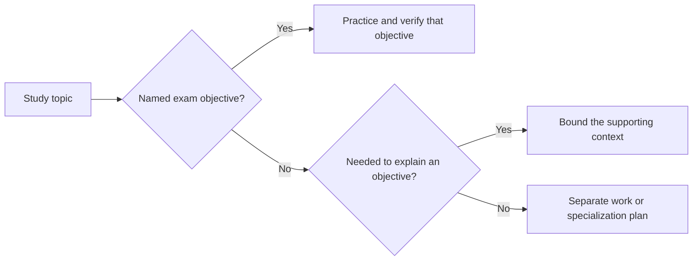
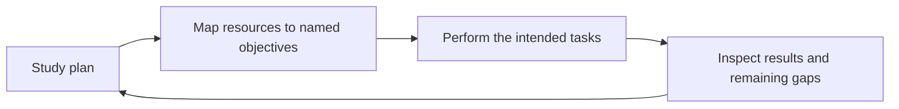
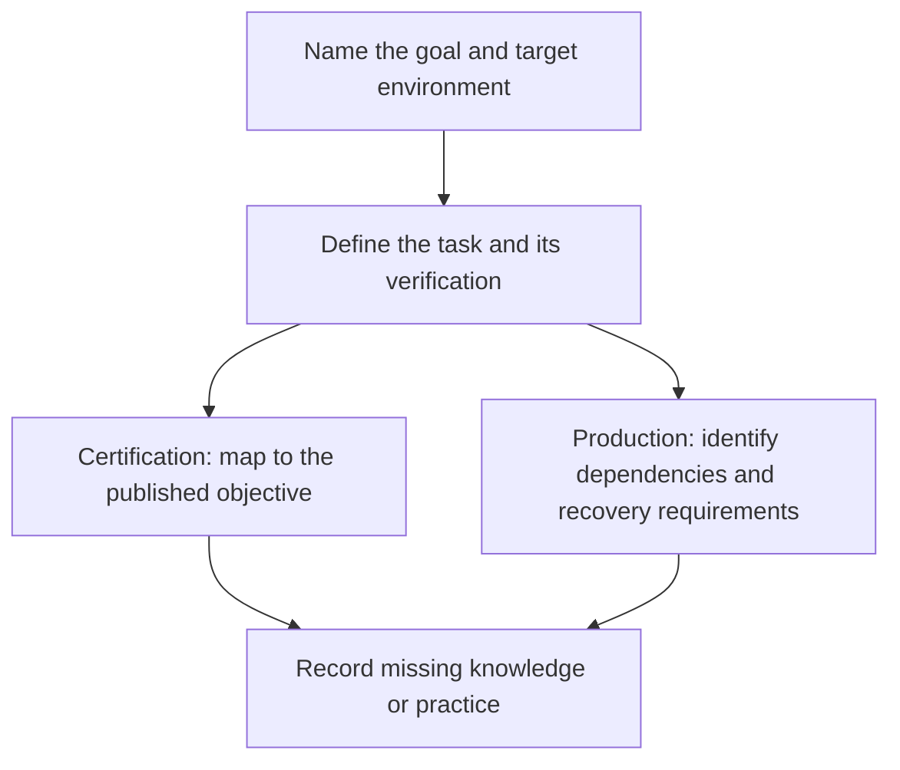
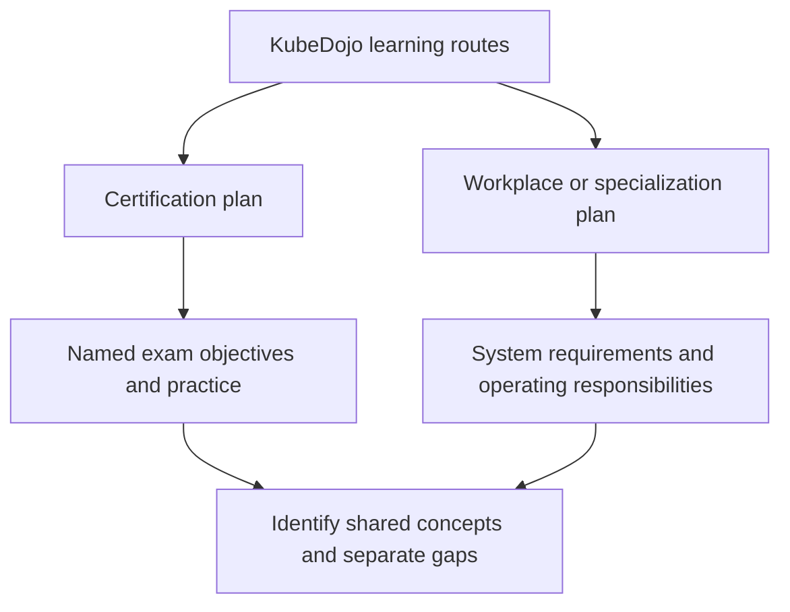

> **Complexity**: `[MEDIUM]` - Long-form module for setting expectations
>
> **Time to Complete**: 80–110 minutes (long-form read + hands-on exercise)
>
> **Prerequisites**: Module 1.1, Module 1.2

---

## Learning Outcomes

After this module, you will be able to:

- **Evaluate** certification study materials by separating exam scope from post-exam specialization.
- **Compare** a resource's task and depth with the chosen exam's objectives, including named tools and interfaces.
- **Design** a time-boxed learning plan that protects core Kubernetes practice from scope creep.
- **Diagnose** scope creep when team pressure, curiosity, or production tooling pulls you away from the exam.
- **Implement** a personal boundary that retains required practice and gives unrelated depth a separate learning goal.

---

## Why This Module Matters

Hypothetical scenario: a platform team is preparing three engineers for Kubernetes certification. Its production environment includes a managed cloud platform, a service mesh, GitOps delivery, cloud identity integration, and monitoring dashboards. The team proposes a study plan that mirrors those tools. Before adopting it, compare each activity with the published objectives for the intended certification. Provider onboarding may be necessary for work while leaving a workload, networking, or troubleshooting objective without practice; record that gap rather than assuming every Kubernetes-related activity serves the same goal.

That scenario asks you to inspect what a study plan leaves unpracticed. Reading about etcd quorum, eBPF datapaths, CNI plugin design, GitOps sync waves or cloud identity can serve a useful goal, but a resource's subject alone does not establish coverage of an exam objective. Record the intended task and the evidence it produces. Certification preparation and workplace specialization can then share relevant context without being treated as interchangeable learning goals or measured improvements in exam performance.

This module teaches the discipline behind that boundary. We are not telling you to ignore production realities forever, and we are not pretending that exam objectives cover every skill a strong engineer needs. We are showing you how to protect certification study from attractive distractions, how to decide when a topic belongs in the main path, and how to park advanced material without feeling like you are abandoning it. The goal is not a smaller understanding of Kubernetes; the goal is the right sequence, with exam fundamentals first and specialization after the credential no longer competes for your attention.

---

## Our Philosophy: Exam-Focused, Not Exhaustive

For certification study, choose a bounded route through KubeDojo's wider curriculum. Start with the [official CNCF curriculum for your exam](https://github.com/cncf/curriculum), then map each objective to an activity and a result you can check. Related material can provide supporting context or belong in a separate work-learning plan. This is a planning method, not a measured claim that a fixed fraction of topics accounts for a fixed fraction of the exam or guarantees a pass.



The diagram classifies study activities; it does not predict question frequency or score. An objective can name a tool or extension mechanism as well as a native object. For example, the [CKA curriculum](https://github.com/cncf/curriculum/blob/bad74bf40372cdb6fb93f0eb1a6758b59b5a2909/CKA_Curriculum_v1.37.pdf) explicitly includes Helm and Kustomize for installing cluster components, plus understanding CRDs and installing and configuring operators. Classifying all third-party tools as out of scope would therefore produce an incomplete plan. Check the intended task and depth before deciding what to defer.

Think of the exam like a driving test rather than a mechanical engineering degree. The examiner cares whether you can operate the vehicle safely, interpret road conditions, recover from common problems, and follow the rules under pressure. They do not ask you to design a transmission, tune a racing suspension, or compare every commercial GPS system. Those deeper topics can make you a better specialist later, but studying them before you can pass the road test is a sequencing error.

KubeDojo's exam-track pin remains Kubernetes 1.35; its separate Release Radar includes other minors. Check the [Linux Foundation exam-environment FAQ](https://docs.linuxfoundation.org/tc-docs/certification/faq-cka-ckad-cks#what-application-version-is-running-in-the-exam-environment) before timed preparation. As checked on October 27, 2026, it lists CKA/CKAD 1.37 and CKS 1.35. The existing pin is not proof of current exam parity. We write the full `kubectl` command so examples do not require a local alias; server queries still require an appropriate configured cluster and permissions.

```bash
kubectl version --client
kubectl get pods --all-namespaces
kubectl auth can-i list pods --all-namespaces
```

**Pause and predict:** compare an evening practicing `kubectl describe`, `kubectl logs`, `kubectl auth can-i` and events with an evening reading a provider's managed node group guide. Which named exam objective or workplace responsibility would each activity practice, and what result would you inspect?

<details>
<summary>Check your prediction</summary>

Cloud infrastructure is not unimportant. The exam can directly measure your native troubleshooting workflow, while provider-specific infrastructure knowledge belongs to a different learning objective.

</details>

Write the goal and a checkable result for each evening before you continue. The next paragraph is about the discomfort of a narrow curriculum. It does not pick the evening.

The tradeoff is real. A focused curriculum can feel incomplete when your workplace uses tools we deliberately do not teach in depth, and it can feel conservative when a new project becomes popular faster than exam objectives change. We accept that discomfort because certification learning has a different job than production onboarding. KubeDojo teaches the portable layer first, then points you toward credible sources for role-specific depth after the exam pressure is gone.

---

## What We Deliberately Skip

Classify the actual task rather than treating every adjacent topic as equally urgent or automatically excluded. The checked curricula name native APIs, operational and application tasks, security controls, tools and interfaces at different depths. The categories below help separate additional specialization from required practice. Check the specific objective before deferring a resource, especially when the same product supports both a named task and a much wider feature set.

### Cloud Provider Specifics

| Topic | Why We Skip | Where to Learn |
|-------|-------------|----------------|
| AWS EKS details | Exam uses generic K8s, not cloud-specific | AWS documentation, eksctl docs |
| GKE features | Same reason | Google Cloud documentation |
| AKS specifics | Same reason | Azure documentation |
| Cloud IAM integration | Provider-specific | Provider documentation |

Cloud providers add valuable layers around Kubernetes, but those layers are not the same as Kubernetes itself. EKS, GKE, and AKS each make different choices about node provisioning, identity, load balancers, storage classes, upgrade channels, and control plane ownership. If you study those choices before you can reason about a Pod, Service, Deployment, Secret, RoleBinding, and node condition in a plain cluster, you are learning the wrapper before the object it wraps. That can make your production environment feel familiar while leaving you slow in an exam shell where the wrapper is absent.

Our approach is to teach Kubernetes first. When you understand the platform, provider documentation becomes easier because you can separate the native object from the provider integration. For example, a cloud load balancer annotation is meaningful only after you understand what a Service of type `LoadBalancer` is trying to accomplish. A cloud identity feature is easier to reason about after you understand ServiceAccounts and RBAC. KubeDojo covers the native foundation and leaves provider-specific workflows to the provider's own documentation.

### Production Operations at Scale

| Topic | Why We Skip | Where to Learn |
|-------|-------------|----------------|
| Multi-cluster federation | Beyond certification scope | K8s docs, KubeFed project |
| Cluster autoscaling | Cloud-specific implementations | Provider docs |
| Organization-wide disaster recovery design | Separate service requirements from named exam tasks | SRE books, your company runbooks |
| Cost optimization | Cloud-specific | FinOps resources, cloud calculators |

Production operations at scale are where Kubernetes becomes deeply contextual. A disaster recovery plan depends on data stores, recovery objectives, organizational risk tolerance, cloud regions, backup tooling, incident roles, and the team's appetite for operational complexity. Cost optimization depends on billing models, reserved capacity, autoscaling policies, workload seasonality, and business priorities. Multi-cluster design depends on latency, tenancy, compliance, traffic management, and who is allowed to operate the platform. Those topics are important, but they cannot be reduced to a portable certification checklist without losing the context that makes them useful.

Choose the operational task from the curriculum you actually intend to study. The checked CKA curriculum includes preparing cluster infrastructure, creating and managing clusters with kubeadm, managing their lifecycle and implementing and configuring a highly available control plane. A full organizational recovery program adds service-specific responsibilities, but that distinction does not remove the named control-plane task. Map a proposed backup or recovery exercise to the chosen objective and state what it verifies; do not assume the same task is required by CKA, CKAD and CKS.

### Deep Networking

| Topic | Depth boundary to check | Where to Learn |
|-------|-------------|----------------|
| BGP configuration | Beyond certification scope | Network engineering resources |
| Service mesh internals | Retain the CKS encryption task naming Istio; classify other mesh depth separately | Project documentation |
| eBPF/Cilium internals | Retain the CKS encryption task naming Cilium; classify unrelated datapath internals separately | Cilium documentation |
| Custom CNI development | Developer topic, not admin | CNI specification |

For a networking resource, identify the task it supports before choosing its depth. A Service connectivity exercise can involve labels, selectors, ports, endpoints, DNS, NetworkPolicy and troubleshooting. An implementation guide may address a different objective or additional specialization. Those connections do not establish one networking syllabus for every certification; compare the exact activity with the chosen curriculum and record how you will verify its result.

The distinction matters during practice. If a NetworkPolicy blocks traffic, inspect labels, selectors, rules and the intended source and destination. The checked CKA curriculum's cluster-architecture domain explicitly names understanding extension interfaces such as CNI, CSI and CRI. Plugin authorship is a different activity from understanding an interface or implementing the named task. A product name alone cannot decide whether a resource belongs in the plan: the checked CKS curriculum names Cilium and Istio for Pod-to-Pod encryption.

### Specific Tools and Projects

| Tool | Depth boundary to check | Where to Learn |
|------|-------------|----------------|
| ArgoCD | Separate tool-specific sync workflows from the chosen objective | ArgoCD documentation |
| Istio | Retain the named CKS encryption task; classify other features separately | Istio documentation |
| Terraform | Separate infrastructure provisioning from the named Kubernetes task | HashiCorp Learn |
| Prometheus/Grafana | Map the proposed monitoring activity to the exact objective | Project documentation |

Separate a product's full curriculum from the specific task a certification names. The checked [CKS curriculum](https://github.com/cncf/curriculum/blob/bad74bf40372cdb6fb93f0eb1a6758b59b5a2909/CKS_Curriculum%20v1.34.pdf), Minimize Microservice Vulnerabilities, names Cilium and Istio for implementing Pod-to-Pod encryption. Blanket advice to postpone both products would therefore omit relevant CKS practice. Record the required behavior, the environment and how you will verify it, then classify unrelated features deliberately; the outline does not describe the products' entire feature sets. This retrieved curriculum file is named v1.34; the separately checked FAQ lists the CKS exam environment as 1.35. A curriculum-file label and an exam runtime are distinct evidence, so recheck both before preparation.

Helm is explicit in both the [CKA](https://github.com/cncf/curriculum/blob/bad74bf40372cdb6fb93f0eb1a6758b59b5a2909/CKA_Curriculum_v1.37.pdf) and [CKAD](https://github.com/cncf/curriculum/blob/bad74bf40372cdb6fb93f0eb1a6758b59b5a2909/CKAD_Curriculum_v1.37.pdf) curricula checked on October 27, 2026. CKA names Helm and Kustomize for installing cluster components; CKAD names deploying existing packages with Helm. Practice the named tasks rather than treating Helm as either universally optional or a reason to master every chart-authoring workflow. Apply the same objective-by-objective check to your chosen exam instead of transferring exclusions from another certification.

Worked planning example: suppose your bookmark list contains a Helm chart-authoring course, a lab that deploys an existing package with Helm, and a guide to installing a cluster component. Write the exact objective beside each resource before assigning study time. For the checked CKAD curriculum, verify that the lab actually uses the Helm package manager to deploy an existing package before classifying it under that objective. For CKA, inspect whether the cluster-component guide practices installing that component with Helm or Kustomize. A resource's title alone does not establish that all its material is required by either objective.

Now write the evidence you would want from the selected lab: identify the package and target environment, explain the configuration you selected, inspect the deployed resources, and verify the intended result. Record any setup or permissions the lab assumes. This is a hypothetical plan, not an observed installation or proof of exam readiness. If you cannot explain which objective the exercise demonstrates, investigate that gap before labeling the resource essential. The method preserves relevant tool practice while giving additional chart-development material a deliberate place in the wider learning plan.

**Pause and predict:** if your company uses Istio heavily, should you study it for the CKA?

<details>
<summary>Check your prediction</summary>

Learn enough at work to avoid being dangerous in production. Do not spend certification study blocks on service mesh internals unless your immediate goal has changed. Name the goal of each study session before you start.

</details>

Write yes or no, and which hours you would use, before you continue. The next section is about why the curriculum makes these cuts. It does not answer the Istio question.

---

## Why We Make These Choices

The first reason is time efficiency. Kubernetes certification study is usually squeezed into evenings, weekends, or a short training window between project commitments. A broad plan can look ambitious on paper and still fail because it does not create enough repetitions on the tasks that actually appear in the exam environment. A focused plan may feel less impressive, but it builds speed where speed matters: reading manifests, generating YAML, checking events, fixing misconfigurations, and choosing the right native object under time pressure.



The second reason is exam relevance. CKA, CKAD and CKS have separate published curricula; use the exact objective as the planning reference rather than assuming a shared native-only syllabus. A KubeDojo route still needs verification against that objective and the current environment. Record a concrete gap when a route omits required practice, and give unrelated material a separate learning goal. Popularity in production does not establish an exam requirement, and a third-party name does not establish an exclusion.

The third reason is maintainability. Kubernetes moves quickly enough that even a focused curriculum needs regular review for version drift, deprecated behavior, changed defaults, and exam objective updates. The more optional topics a course includes, the more likely some of them become stale, misleading, or shallow. For each route, check its stated target against current provider requirements and versioned technical sources; a narrow scope alone does not establish that its content is current.

Use the required action as a check on the resource you choose. Reading a broad product tour and implementing a named task produce different evidence. For a NetworkPolicy exercise, write the intended traffic rule and test its result; for an encryption objective, identify and verify the required behavior. Do not infer question frequency or a universal backup requirement from those examples. The three captured outlines do not explicitly name an etcd snapshot-and-restore workflow; classify such practice against the selected cluster objective and environment instead of asserting that every exam rewards it.

Before running another study session, ask yourself this: what output do you expect from the session, and how would you know it improved exam readiness? If the output is a bookmark folder, a collection of notes about a third-party tool, or a vague sense that you "covered networking," the session may not be aligned. If the output is a solved troubleshooting scenario, a faster command workflow, or a corrected manifest you can explain, the session is much closer to the certification target.

---

## The "Just Enough" Principle

"Just enough" does not mean shallow. Match depth to the chosen task and its verification. For example, the checked CKA outline names implementing and configuring a highly available control plane, while CKAD names application deployments and health checks. Keep that distinction when planning practice. A production recovery plan also needs service-specific dependencies, validation and operating responsibilities; a cluster exercise alone does not establish that complete plan. Do not use the depth of the broader topic to exclude a task the curriculum actually names.



**Pause and predict:** why does a successful backup command alone leave unanswered questions about recovery of a production service?

<details>
<summary>Check your prediction</summary>

A command result does not establish whether the service's data dependencies, recovery procedure, access requirements, and acceptable recovery time have been tested together. Identify what the chosen exam objective requires separately from what the actual service needs. The diagram assigns no numerical difficulty, study hours, or relative importance to either goal.

</details>

Write the missing recovery evidence before you continue. Then compare it with the bounded task in your chosen curriculum; keep the scope and verification criteria explicit for each goal.

This principle also helps you avoid false equivalence. A topic can be simple to name and still require deep expertise, while another topic can look complex and still require only a practical slice for the exam. "NetworkPolicy" sounds like one object, but real network isolation requires careful label design, namespace boundaries, plugin behavior, default-deny posture, and testing. "Cluster Autoscaler" sounds like an operational basics topic, but it depends heavily on infrastructure providers and node provisioning behavior, so it belongs outside the generic certification path for most learners.

A useful study question is not "Could this ever matter?" Ask which part of the resource serves the named objective and which part adds another learning goal. Retain required practice even when it uses a specific tool or needs substantial work. Give unrelated depth a separate plan with an explicit reason; the resource's size or vendor-specific label alone does not establish that it belongs after the exam.

Worked example: suppose you are studying Services and discover that your production cluster uses a cloud load balancer controller with many annotations. The exam-relevant slice is to know how Service types behave, how selectors map to endpoints, how ports and targetPorts relate, and how to troubleshoot a Service that has no endpoints. The post-exam slice is to study the provider controller, external traffic policy behavior in that environment, annotation-specific features, and cost implications. Those are connected, but they are not the same learning task.

---

## Where We Suggest Going Deeper

After you pass the certification, specialization becomes the right move. The difference is that you will be choosing depth from a stable foundation instead of using advanced topics to compensate for missing basics. A platform engineer, application developer, security engineer, and SRE all need Kubernetes, but they do not need the same second layer. The exam gives you shared vocabulary; the post-exam path gives you role-specific leverage.

For platform engineers, the natural next step is platform design: Cluster API, GitOps with ArgoCD or Flux, multi-tenancy patterns, developer portals, policy controls, and the tradeoffs of building abstractions for application teams. That work asks you to think about ownership, upgrade paths, paved roads, tenancy, and how much Kubernetes detail to expose to users. The certification helps because it gives you the raw primitives, but platform engineering asks a different question: how do you package those primitives into a reliable internal product?

For developers, the next layer is application architecture on Kubernetes. Sidecar, ambassador, and adapter patterns become more interesting once you understand pods and containers. Operators and CRD development become safer once you understand the API server, reconciliation, and what normal workload objects already provide. Kubectl plugins and client programming become useful when you can distinguish a convenience wrapper from the underlying API behavior.

For security-focused learners, the post-exam path can include OPA or Gatekeeper policy, Falco runtime detection, supply chain security with Sigstore-style workflows, advanced NetworkPolicy design, admission control, and threat modeling for multi-tenant clusters. CKS covers some security primitives, but production security requires broader evidence, operational controls, logging, incident response, and organizational accountability. You should know where the exam stops so you can plan that deeper path deliberately.

For SRE and operations work, the next layer is reliability engineering: SLO-based alerting, capacity planning, chaos experiments, backup validation, incident response, upgrade strategy, and post-incident learning. Kubernetes gives you objects and controllers, but reliability comes from feedback loops and disciplined operations. A certification can verify that you can operate the platform at a foundational level; it cannot replace the repeated practice of running real services through real failure modes.

Compare two hypothetical plans: one mixes certification tasks and workplace-tool study in each session; the other separates those goals into scheduled blocks. Either plan needs an objective and a result to inspect. Choose based on your available time, current gaps and work obligations, then review what the sessions actually covered. This is planning advice, not evidence that one schedule produces faster certification or a particular pass rate.

---

## Visualization: KubeDojo Scope

The scope diagram distinguishes two learning goals. A certification plan follows its named objectives; a workplace plan follows the responsibilities of a particular system. They can share concepts and practice, but neither is a complete substitute for the other. KubeDojo also has separate cloud, Linux, platform and other learning tracks, so this module's study boundary is not a description of everything the site covers.



Use this diagram when work relevance and exam relevance compete for the same study time. Map the resource to an objective or an operating responsibility and decide which goal has priority now. Keep deferred material visible with its reason and a review date. This records your planning choice without claiming that a tool is universally irrelevant or that a particular allocation guarantees a better score.

The diagram also explains why KubeDojo can be opinionated without being dismissive. We can say "do not study ArgoCD for the CKA" and still respect ArgoCD as a production tool. We can say "do not learn BGP configuration for CKAD" and still respect networking specialists. A curriculum that refuses to draw boundaries eventually becomes a map of everything, and a map of everything is hard to use when you have a timed exam in front of you.

---

## How to Classify a Topic Before It Steals a Week

The most practical skill in this module is classification. When a new topic appears, do not ask whether it is interesting, modern, or used by serious teams, because those questions are too easy to answer with yes. Ask what role the topic plays in your current goal. A topic can be exam scope, supporting context, post-exam specialization, or workplace urgency. Those categories let you make a decision without arguing about whether the topic has value in some abstract sense.

Exam-scope topics are the ones you should be able to perform, not merely recognize. If the objective expects workload configuration, you should create and modify workloads until the commands feel ordinary. If the objective expects troubleshooting, you should inspect events, logs, selectors, node conditions, and rollout state until you can move from symptom to hypothesis quickly. Exam-scope work produces visible practice artifacts: fixed manifests, working commands, corrected policies, and explanations you can give without notes.

Supporting context is different. Supporting context helps a tested topic make sense, but it does not become a new destination. For example, you may need a basic mental model of how controllers reconcile desired state so Deployments and ReplicaSets stop feeling magical. You do not need to write a custom controller before the CKAD. You may need to know that a CNI plugin provides pod networking so NetworkPolicy behavior has somewhere to happen. You do not need to implement a CNI plugin before the CKA.

Post-exam specialization is where many excellent topics belong. This category should feel respectful rather than dismissive because it preserves future learning. If you put "ArgoCD sync waves" in the post-exam list, you are saying that GitOps deserves focused attention after native Deployments, Services, ConfigMaps, Secrets, and rollout troubleshooting are solid. If you put "Cilium eBPF internals" there, you are saying that datapath expertise deserves a separate study block after you can already reason about standard Services and NetworkPolicies.

Workplace urgency is the category that can override the exam plan, but it should do so consciously. If you are on call for a production cluster tomorrow and your team needs you to understand a provider-specific incident runbook, then operational safety may matter more than certification progress that evening. The mistake is pretending that the provider runbook also counts as CKA study. It may be the right work for the day, but you should record the tradeoff honestly and reschedule the native practice you displaced.

A useful classification habit is to write one sentence before opening any long resource: "I am reading this because it will help me do X for this published objective." Fill in X with the named task, including a tool or interface when specified. Then identify the evidence you expect to produce. If the connection is missing, investigate it before assigning study time; a product name, a native object or an advanced label is not the scope decision.

Consider a learner who asks why one Pod cannot reach another. Define the intended traffic and inspect the relevant objects and events. For CKA, retain the named extension-interface and networking work. For CKS, retain the named encryption task rather than filing every Cilium resource under specialization. An unrelated implementation tour can belong in a separate plan, while a live production incident follows its local runbook. The symptom alone does not determine which depth serves the selected objective.

The same classification works for security. Exam-scope RBAC means creating Roles and RoleBindings, checking permissions with `kubectl auth can-i`, and understanding the difference between namespace-scoped and cluster-scoped grants. Supporting context might include why least privilege matters and how ServiceAccounts attach identity to Pods. Post-exam specialization could include OPA policy authoring, admission control design, workload identity federation, or supply chain signing. Workplace urgency might require learning your company's emergency access procedure before the next on-call shift.

Classification also protects you from the prestige trap. Advanced topics often feel like proof that you are becoming a real Kubernetes engineer, while repetitive native drills can feel basic. In reality, timed certification work rewards fast access to fundamentals. A candidate who can rapidly diagnose a Service selector mismatch, fix a broken RoleBinding, and recover from a misconfigured Deployment is better prepared than a candidate who can describe service mesh architecture but hesitates at `kubectl describe pod`.

There is a second trap in the opposite direction: treating everything outside the exam as a waste. That attitude can make a learner pass the exam and then become brittle in production. The better posture is sequence, not contempt. You are allowed to say, "This is worth learning, and not now." That sentence is one of the healthiest habits in technical education because it separates respect for the topic from commitment to the current goal.

When you classify a resource, also classify the expected output. Exam-scope work should end in practice results, such as solved labs or commands you can repeat. Supporting context can end in a short explanation or a diagram. Post-exam specialization can end in a bookmark plus a reason to return. Workplace urgency can end in a runbook note or an incident action. If every category ends in the same pile of notes, you have not really made a decision.

This is why KubeDojo keeps returning to deliberate boundaries. The boundary is not a wall around your curiosity; it is a queue. The first items in the queue are the ones that make you competent in the exam environment. Later items make you more useful in your team, stronger in your specialty, and better prepared for real incidents. A queue is more humane than a denial because it lets you keep the future without sacrificing the present.

---

## When This Doesn't Apply

Because this is an orientation module, the main pattern is simple: use KubeDojo as an exam path when your primary goal is passing a Kubernetes certification in the near term. The pattern works best when you have a fixed exam date, limited study hours, and enough discipline to keep advanced topics in a separate backlog. It also works well for teams because it creates shared language around scope. Instead of arguing whether a topic is interesting, the team can ask whether it is exam scope, supporting context, or post-exam specialization.

The anti-pattern is equally simple: do not use an exam-focused path as your only production training plan. If you are on call for a real cluster tomorrow, you may need provider-specific runbooks, company incident procedures, backup validation, dashboards, logging conventions, and tool-specific safety checks before you finish a certification track. Exam focus is not an excuse to ignore operational risk. It is a way to keep one learning goal from swallowing another.

Another anti-pattern is deleting advanced curiosity entirely. Some of the best Kubernetes engineers become strong because they follow curiosity deeply after they have the basics. The problem is not curiosity; the problem is letting curiosity interrupt a constrained study plan without making an explicit tradeoff. A better pattern is to capture advanced topics in a post-exam list, add the source you want to revisit, and write one sentence explaining why it matters for your role.

Here is a worked example you can reuse when a team study group starts drifting. Imagine the group is preparing for the CKA and one member suggests a session on managed cloud load balancer annotations because their production ingress depends on them. The facilitator should not argue that annotations are useless. Instead, they should ask what native task the session improves. If the answer is "understanding Services," the group can spend ten minutes explaining the provider layer, then return to Service types, selectors, endpoints, ports, and troubleshooting. If the answer is "learning our cloud platform," the session belongs in a separate workplace track.

The same technique works for a security tangent. Suppose someone wants to replace an RBAC drill with a deep dive into a policy engine because the company plans to adopt admission control. A useful response is to split the topic into layers. The exam layer is ServiceAccounts, Roles, RoleBindings, ClusterRoles, ClusterRoleBindings, and permission checks. The policy-engine layer is post-exam or workplace specialization. By naming the layers, the group can respect the production roadmap without sacrificing the certification skill that must be practiced first.

This approach is especially helpful when the person suggesting the tangent is senior. Senior engineers often recommend topics from real incidents, and those recommendations carry weight because they are grounded in painful experience. A junior learner may feel irresponsible for saying no. The better move is to say, "That sounds important, and I want it on our post-exam list. For this CKA session, what native Kubernetes task should we practice first?" That wording accepts the senior engineer's context while defending the study objective.

You can also use the boundary when studying alone. When you notice that you have opened five browser tabs and none of them describes a task you could perform in the exam shell, stop and classify the tabs. One may become supporting context, two may move to post-exam specialization, and one may be irrelevant to your current role. The act of closing or moving tabs is not a loss of knowledge. It is a recovery from accidental scope expansion before it consumes the rest of the evening.

The strongest learners become comfortable with temporary incompleteness. They can say, "I do not know the internals of this provider controller yet, but I can explain the Kubernetes object it watches and the symptom I need to troubleshoot." That sentence is honest and useful. It avoids pretending to be an expert while still demonstrating real competence. Certification study should build that kind of grounded confidence, not a fragile feeling that you must know every layer before touching the platform.

---

## When You'd Use This vs Alternatives

Use the KubeDojo scope boundary when the immediate outcome is certification readiness. Use vendor documentation when the immediate outcome is operating a specific managed service. Use project documentation when the immediate outcome is adopting or debugging a specific tool. Use SRE books, company runbooks, and incident reviews when the immediate outcome is production reliability. These alternatives are not competitors; they answer different questions.

| Learning Goal | Best Primary Source | Why This Source Fits |
|---------------|---------------------|----------------------|
| Prepare for a chosen certification | Official curriculum and environment requirements, plus a checked KubeDojo route | Map the exact tasks and identify gaps; this packet checks CKA, CKAD and CKS outlines, not every certification. |
| Operate EKS, GKE, or AKS | Provider documentation and company runbooks | Managed services differ in identity, upgrades, networking, storage, and support boundaries. |
| Adopt ArgoCD, Istio, Terraform, or Prometheus | Project documentation and a focused lab | Third-party tools have their own models, commands, and failure modes. |
| Design multi-cluster production reliability | SRE practice, architecture reviews, and incident history | The right answer depends on risk, traffic, data, staffing, and business constraints. |

The decision test is to name the job before choosing the resource. "I need to pass the CKAD" leads to a different source mix than "I need to debug our Istio ingress path" or "I need to reduce cloud spend in a production platform." When learners skip that step, they often confuse a useful resource with a useful resource for right now. KubeDojo is useful for right now when the "right now" is exam readiness.

---

## Did You Know?

- **CNCF publishes separate exam curricula.** Use the [official curriculum repository](https://github.com/cncf/curriculum) to check the objectives for the certification you intend to take; inclusion in a broader landscape is a different question.
- **The checked CKA curriculum includes tools and extension mechanisms.** Its Cluster Architecture, Installation and Configuration domain names Helm, Kustomize, CRDs and operators; native-versus-third-party is therefore insufficient as a scope rule.
- **Certification curricula change over time.** A study plan should track the current official objectives instead of relying on an old course outline or a coworker's memory.
- **"Expert" is context-dependent.** A networking expert, security expert, developer platform engineer, and SRE may all be strong at Kubernetes while having different deep specialties.

---

## Common Mistakes When Studying for Kubernetes Certifications

| Mistake | Why It Happens | How to Fix It |
|---------|----------------|---------------|
| **Classifying a network tool by name alone** | Plugin development, interface knowledge and security tasks can appear in adjacent documentation. | Map the task: CKA names extension interfaces; CKS names Cilium/Istio for Pod-to-Pod encryption. Separate those activities from unrelated internals. |
| **Memorizing YAML syntax** | A blank editor can encourage memorizing fields without checking their meaning. | Practice `kubectl run` and `kubectl create` with `--dry-run=client -o yaml`, then inspect, edit and verify the generated manifest. |
| **Studying cloud-specific IAM** | Your company uses AWS IRSA, EKS Pod Identity, GKE Workload Identity, or AKS integrations, so it feels like core Kubernetes. | Focus first on ServiceAccounts, Roles, ClusterRoles, RoleBindings, ClusterRoleBindings, and `kubectl auth can-i` in vanilla Kubernetes. |
| **Building a Raspberry Pi cluster** | Hands-on hardware feels more authentic than a local lab. | Use kind, minikube, or a simple VM lab because the exam tests Kubernetes operation, not hardware quirks or ARM image issues. |
| **Treating Helm as universally optional or exhaustive** | A workplace chart workflow can obscure the specific task named in a curriculum. | Practice the Helm tasks named by your exam; both the checked CKA and CKAD curricula include Helm. Keep unrelated chart-authoring depth in a separate plan. |
| **Studying GitOps with ArgoCD or Flux too early** | GitOps is a modern production norm, and it feels like the natural next step after Deployments. | Understand declarative state conceptually, then postpone tool-specific sync behavior until after native workload and troubleshooting fluency. |
| **Assuming one etcd study rule fits every exam** | Cluster operation and application development are different goals. | Map the specific task to your exam's objective and environment; distinguish demonstrated cluster mechanics from a complete service recovery plan. |

---

## Quiz

<details>
<summary>Your manager wants you to spend the next two weeks learning Terraform and EKS because your team uses them in production. How should you protect your CKA study plan?</summary>

You should acknowledge that Terraform and EKS matter for the job, then separate that goal from certification preparation. The CKA tests portable Kubernetes administration, so two weeks of provider-specific infrastructure work would mostly displace native practice with pods, nodes, RBAC, troubleshooting, and control plane tasks. A good response is to propose a boundary: finish the certification-focused block first, then schedule a post-exam provider onboarding block. This protects exam readiness without dismissing the team's real production needs.
</details>

<details>
<summary>You are studying NetworkPolicies and find a long Cilium eBPF tutorial that looks excellent. Should it become part of this week's CKAD plan?</summary>

It should be bookmarked for later, not added to the current CKAD plan. CKAD requires you to work with standard Kubernetes objects and reason about application behavior, while eBPF implementation detail belongs to deep networking specialization. The tutorial may be valuable after the exam, especially if your workplace uses Cilium, but it will not improve the immediate skill of writing and validating NetworkPolicies under time pressure. The better study move is to create several policy scenarios and predict which traffic should pass.
</details>

<details>
<summary>Your study calendar gives equal time to ArgoCD setup and standard Deployments and Services. What is wrong with that allocation?</summary>

Identify the objective each allocation serves. Studying ArgoCD sync behavior does not itself demonstrate the checked curricula's workload, Service or troubleshooting tasks. If the resource does not practice a named objective or supply needed context, give it a separate learning goal and restore the missing task practice. That decision depends on the resource's actual activity; it is not a rule that every third-party product belongs outside certification study.
</details>

<details>
<summary>A colleague failed a practice exam after relying on the AWS Console for node operations at work. How would you diagnose the scope creep in their preparation?</summary>

The scope creep came from confusing a managed-service workflow with vanilla Kubernetes administration. A console can hide kubelet behavior, node conditions, systemd services, certificates, and control plane mechanics that the CKA may expect you to inspect directly. The fix is not to abandon managed services at work; it is to practice the lower-level Kubernetes and Linux tasks that the exam can test. Their next plan should include native commands, node troubleshooting, and cluster component inspection instead of more console walkthroughs.
</details>

<details>
<summary>You see Horizontal Pod Autoscaler and Cluster Autoscaler in the same documentation session. Which one deserves exam focus, and how do you compare the two?</summary>

Horizontal Pod Autoscaler deserves more exam focus because it is a Kubernetes API-driven workload scaling feature, while Cluster Autoscaler interacts with the infrastructure layer that provides nodes. The exact Cluster Autoscaler behavior depends heavily on the cloud or node provisioning environment, which makes it less portable as certification study. Comparing them this way prevents a common mistake: treating all scaling topics as equally exam-relevant. Study the native object deeply enough for the exam, then learn infrastructure scaling when you work on a real platform.
</details>

<details>
<summary>You plan to build a highly available bare-metal cluster with external etcd before taking the CKA next week. Is that a good design for a time-boxed learning plan?</summary>

Do not defer high availability merely because it sounds advanced: the checked CKA curriculum explicitly includes implementing and configuring a highly available control plane. Break the proposal into that named task and additional hardware or organizational requirements. Choose a lab where you can perform and verify the required task with your available preparation time; park extra complexity with a reason. A single-control-plane lab can serve other objectives, but it does not itself demonstrate this availability objective. The curriculum does not supply a prediction of next week's questions.
</details>

<details>
<summary>You have a bookmark list full of Istio, ArgoCD, Cilium, provider IAM, and etcd articles. How would you implement a personal boundary without losing those resources?</summary>

Use the exercise's three categories: exam scope, supporting context and post-exam specialization. Classify each resource's actual task against the chosen curriculum. A CKS resource practicing Pod-to-Pod encryption may belong in exam scope even if its title says Istio or Cilium; a tour of unrelated internals can belong elsewhere. For CKA, retain the named control-plane and extension-interface practice. Record why a resource is deferred and what evidence would change the classification. Do not use the presence of a product name as the rule.
</details>

---

## Hands-On Exercise: Audit Your Study Materials

This exercise is a planning lab rather than a cluster lab because the skill you need is scope control. Open your current study bookmarks, playlists, notes, company wiki pages, or training backlog. Your job is to turn an unfocused pile of useful resources into a certification plan that has a clear boundary and a separate post-exam roadmap.

### Setup

Create a short document with three headings: `Exam Scope`, `Supporting Context`, and `Post-Exam Specialization`. If you already have a study tracker, add those labels there instead of creating a new file. The tool does not matter; the decision quality matters.

### Tasks

1. Inventory at least twelve resources you were planning to use, including videos, docs pages, internal runbooks, and practice labs. Mark each one with the certification you are pursuing and the reason you thought it belonged in the plan.
2. Evaluate each resource's task against your exam's official objectives and move it into `Exam Scope`, `Supporting Context`, or `Post-Exam Specialization`. Check named tools and cluster-availability tasks before deferring them; do not transfer an exclusion from another exam.
3. Compare the advanced items with the native Kubernetes tasks they might be replacing. For example, compare an Istio traffic policy tutorial with Service and NetworkPolicy practice, or compare a cloud IAM guide with RBAC drills.
4. Design a one-week time-boxed learning plan around the named tasks and their verification, including tools or interfaces where specified. Give supporting context and unrelated depth an explicit purpose instead of assuming a native-only time allocation.
5. Diagnose one likely pressure point that could pull you off plan, such as a manager asking for provider knowledge, a coworker recommending a tool, or your own curiosity about internals.
6. Implement a personal boundary by writing one sentence that starts with: `I will not study ... until after I pass because ...`.

<details>
<summary>Solution guidance</summary>

A strong answer should not delete advanced topics. It should move them into a visible post-exam roadmap so you can return to them without letting them compete with the current certification. Your `Exam Scope` list should contain native Kubernetes practice such as workloads, Services, RBAC, scheduling, storage, troubleshooting, security primitives, and any tool explicitly named by the objective for your exam. Your `Supporting Context` list should be small and should explain a tested concept rather than introduce a new toolchain. Your `Post-Exam Specialization` list should contain provider details, GitOps tools, service mesh depth, deep CNI internals, production cost optimization, and role-specific reliability work.
</details>

**Card A: Two evenings, one exam next week.** One evening is `kubectl describe`, logs, `auth can-i`, and events. The other is a cloud provider's managed node group guide. A friend says both are "Kubernetes" so they count the same.

<details>
<summary>Check your prediction</summary>

Failure layer: mixing a measured exam workflow with a different objective. Next action: give the exam evening to the native commands. Park the node-group guide until the exam pressure is gone.

</details>

**Card B: Istio is the production mesh.** The company runs Istio. The learner's next exam is the CKA. The study block this week is booked for VirtualService internals.

<details>
<summary>Check your prediction</summary>

Failure layer: work usefulness was treated as the certification goal. Next action: keep a short production safety note, and spend the certification block on native tasks unless the goal itself changed.

</details>

**Card C: A backup command succeeded.** Someone treats that result as proof both of exam readiness and of a production recovery plan.

<details>
<summary>Check your prediction</summary>

Failure layer: a command result was substituted for the intended acceptance criteria. Next action: check the published exam objective and identify the service-level recovery evidence still missing. Neither goal follows automatically from that one result.

</details>

**Card D: The mesh tutorial replaced the policy drill.** The backlog has an Istio traffic-policy video and no NetworkPolicy practice. The exam objectives name NetworkPolicy, not the mesh.

<details>
<summary>Check your prediction</summary>

Failure layer: an adjacent tool displaced the tested object. Next action: move the video to the post-exam list and put NetworkPolicy reps in this week's plan.

</details>

### Success Criteria

- [ ] You have evaluated at least twelve study materials and assigned each one to `Exam Scope`, `Supporting Context`, or `Post-Exam Specialization`.
- [ ] You have justified at least two scope decisions using exact objectives and resource tasks, retaining named practice even when it involves a third-party tool. If an item is deferred, its reason and separate learning goal are recorded.
- [ ] You have compared at least one advanced topic with the native Kubernetes task it was displacing.
- [ ] You have designed a one-week time-boxed learning plan that retains the named tasks and their required verification, including specified tools and interfaces.
- [ ] You have diagnosed one realistic scope-creep pressure point and written how you will respond.
- [ ] You have implemented a hard boundary sentence that says what you will not study until after you pass.

---

## Sources

- [CNCF CKA curriculum, inspected revision: Cluster Architecture, Installation and Configuration](https://github.com/cncf/curriculum/blob/bad74bf40372cdb6fb93f0eb1a6758b59b5a2909/CKA_Curriculum_v1.37.pdf)
- [CNCF CKAD curriculum, inspected revision: Application Deployment](https://github.com/cncf/curriculum/blob/bad74bf40372cdb6fb93f0eb1a6758b59b5a2909/CKAD_Curriculum_v1.37.pdf)
- [CNCF CKS curriculum, inspected v1.34 file: Minimize Microservice Vulnerabilities](https://github.com/cncf/curriculum/blob/bad74bf40372cdb6fb93f0eb1a6758b59b5a2909/CKS_Curriculum%20v1.34.pdf)
- [Linux Foundation FAQ: current exam environments](https://docs.linuxfoundation.org/tc-docs/certification/faq-cka-ckad-cks#what-application-version-is-running-in-the-exam-environment)
- [Kubernetes documentation: Concepts overview](https://kubernetes.io/docs/concepts/)
- [Kubernetes documentation: Tasks](https://kubernetes.io/docs/tasks/)
- [Kubernetes documentation: kubectl reference](https://kubernetes.io/docs/reference/kubectl/)
- [Kubernetes documentation: Network Policies](https://kubernetes.io/docs/concepts/services-networking/network-policies/)
- [Kubernetes documentation: Role-Based Access Control](https://kubernetes.io/docs/reference/access-authn-authz/rbac/)
- [Kubernetes documentation: Operating etcd clusters for Kubernetes](https://kubernetes.io/docs/tasks/administer-cluster/configure-upgrade-etcd/)
- [Linux Foundation Training: Certified Kubernetes Administrator](https://training.linuxfoundation.org/certification/certified-kubernetes-administrator-cka/)
- [Linux Foundation Training: Certified Kubernetes Application Developer](https://training.linuxfoundation.org/certification/certified-kubernetes-application-developer-ckad/)
- [Linux Foundation Training: Certified Kubernetes Security Specialist](https://training.linuxfoundation.org/certification/certified-kubernetes-security-specialist/)
- [Container Network Interface specification](https://github.com/containernetworking/cni)
- [Argo CD documentation](https://argo-cd.readthedocs.io/en/stable/)
- [Istio documentation](https://istio.io/latest/docs/)

---

## Next Module

[Module 1.4: Dead Ends - Technologies We Skip](../module-1.4-dead-ends/) - Distinguish project retirement from deployment fit and justify retaining or replacing a component.
