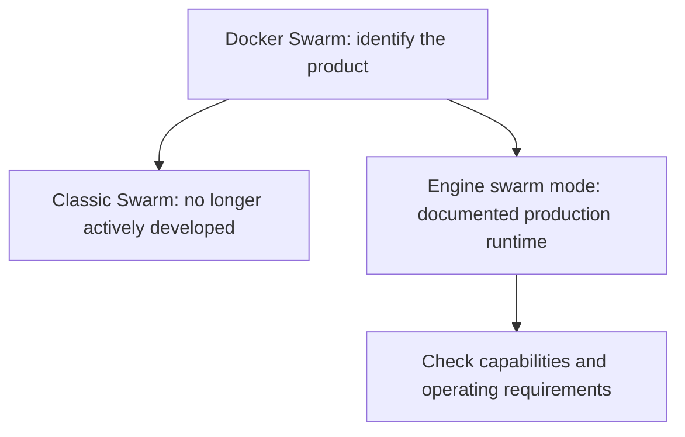
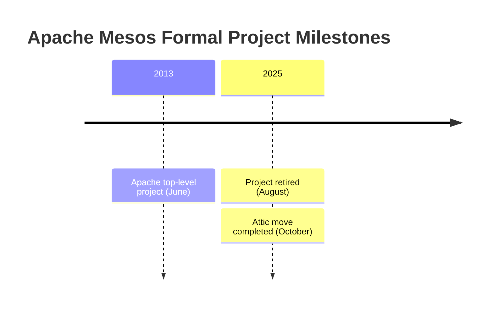
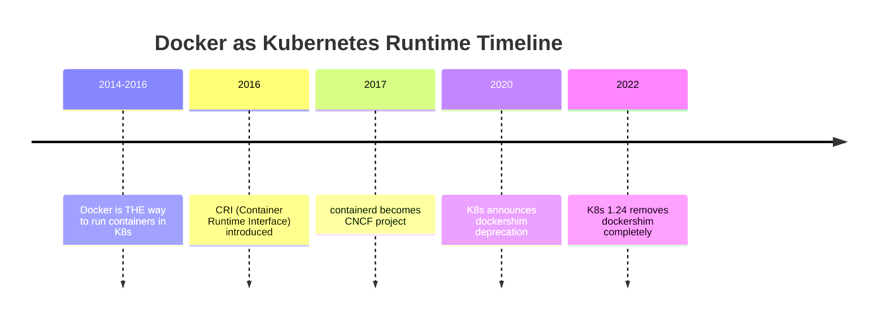
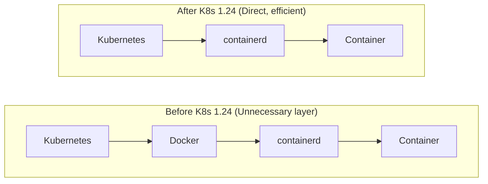
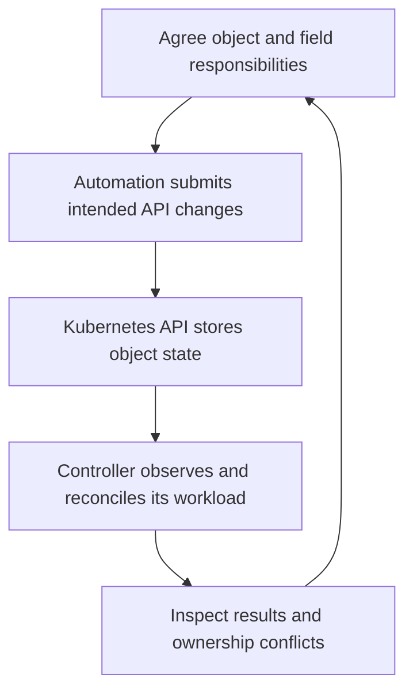
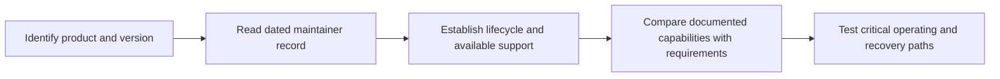

> **Complexity**: `[MEDIUM]` - Long-form guidance on what not to learn.
>
> **Time to Complete**: 80–110 minutes (long-form read + hands-on exercise)
>
> **Prerequisites**: Module 1.1, Module 1.2, Module 1.3.

---

## What You'll Be Able to Do

After this module, you will be able to:

- **Evaluate** container orchestration technologies using governance, ecosystem, cloud-provider support, and adoption signals.
- **Diagnose** the difference between formal project retirement and a deployment model that does not meet a workload's requirements.
- **Compare** Docker as an image-building workflow with Docker as a Kubernetes runtime removed after dockershim.
- **Design** a modernization plan that justifies which tools to retain or replace against documented capabilities and operating requirements.

## Why This Module Matters

Hypothetical scenario: a retailer is reviewing an existing container platform before expanding it. Its engineers need to determine which components remain supported, what happens when a host fails, how application changes are rolled out, and who maintains the integrations. They are considering Kubernetes, but neither a migration nor keeping the current platform is automatically the right answer. The audit needs a dated maintainer record, documented capabilities for the intended version, and tests of the failures the service must tolerate. This scenario supplies decision questions, not a real company's spending, hiring history, incident or measured migration outcome.

The opening scenario asks you to check evidence before selecting a replacement. A dated maintainer record can establish project retirement, while capability documentation describes a deployment model. Neither identifies the requirements of every organization. For a learning or engineering decision, state which product and version you mean, which responsibilities the team must support, and what information is missing. That keeps the audit useful without pretending a tool name determines the answer.

This module examines technologies and deployment choices in relation to Kubernetes. Docker Swarm, Apache Mesos, Cloud Foundry, Chef, Puppet, Ansible, and Docker Compose have different purposes and lifecycle states; their names alone do not determine whether a particular use is obsolete. Practice checking documented status, operational fit, ownership, and missing evidence before proposing a change.

## Start With the Shape of a Dead End

A technology becomes a dead end when its learning value, operational value, and ecosystem value fall out of alignment. It may still run. It may still have loyal users. It may even have a few job postings that pay well because legacy systems need care. The warning sign is that new teams no longer choose it for new work, adjacent tools stop integrating with it first, and community energy moves somewhere else. When that happens, every month of investment buys less future portability.

Cloud-native dead ends usually share three forces. First, the abstraction stops matching the workload. Second, the governance model fails to attract competitors, cloud providers, and independent vendors. Third, the ecosystem around the winner becomes so large that alternatives must be dramatically better to justify their isolation. Kubernetes won not because it was simple, but because it became the common integration target for runtimes, networking, storage, policy, observability, security, and managed cloud services.

**Pause and predict:** if your team finds a tool that is easier than Kubernetes for one narrow deployment path, what would have to be true before you would recommend it for a five-year platform bet?

<details>
<summary>Check your prediction</summary>

The answer should include more than feature checklists. You would need credible governance, a healthy contributor base, support from more than one cloud provider, a migration story, a security model, and evidence that the tool's abstraction will still fit when workloads become stateful, regulated, or globally distributed.

</details>

Write the conditions you would require before you continue. The next paragraph is a city-map model. It does not list those conditions.

The useful mental model is a city map. A tool can be a lovely side street, but a platform needs roads, utilities, emergency services, maintenance crews, and businesses that expect the address to exist. Kubernetes is not only an orchestrator; it is the address system used by a large part of modern infrastructure. Dead ends often failed because they remained excellent side streets while the industry finished building the city somewhere else.

Before looking at individual tools, separate four questions. Is the technology obsolete, or is only one usage pattern obsolete? Is the concept still valuable even if the product declined? Is there a modern replacement with better ecosystem alignment? Is your team solving a production problem or chasing an attractive tutorial? These questions keep you from making the two common beginner mistakes: throwing away Docker entirely because dockershim was removed, or learning Docker Swarm because it appears next to Compose in old Docker material.

## Diagnose Orchestration Dead Ends

Container orchestration is where the most visible dead ends appeared because the industry could not support many competing control planes forever. Orchestration is not just starting containers. A production orchestrator schedules work across nodes, tracks health, rolls out new versions, routes traffic, handles secrets, coordinates storage, integrates with identity, and exposes APIs that other tools can extend. Once organizations need those capabilities, the platform with the largest ecosystem becomes safer than the platform with the cleanest first demo.

Docker Swarm is the simplest example because it was attached to the company that made Docker famous. Swarm felt natural for teams already using Docker locally: it used Docker language, Docker commands, and a friendly path from a single machine to a cluster. That simplicity was its attraction, but it also limited the room for the ecosystem to grow. Kubernetes was harder, yet it offered a more general API model, stronger extension points, and a neutral home that made it easier for cloud providers and vendors to support without strengthening a direct competitor.

**What it was**: Docker's native orchestration solution.

**Status, checked October 27, 2026**: Docker's [Swarm mode documentation](https://docs.docker.com/engine/swarm/) describes a production runtime built into current Docker Engine versions. It distinguishes Engine swarm mode from Classic Swarm, which is no longer actively developed. That distinction does not establish market share, hiring prospects, or whether Swarm meets a particular team's requirements.



The Swarm lesson is not that vendor-built tools are automatically bad. The lesson is that infrastructure platforms need trust from organizations that compete with one another. When a single vendor controls the roadmap, every other vendor asks whether deep integration helps the platform owner more than the customer. Kubernetes avoided that trap by moving under the CNCF and becoming a neutral target. That governance shift gave the ecosystem a place to cooperate while still competing on managed services, networking, storage, and developer experience.

For this Kubernetes learning route, prioritize the Kubernetes concepts used by the later modules. If work requires Swarm, use documentation for the intended Engine version and inspect its service, networking, update and recovery behavior. A production tutorial is not obsolete merely because it uses Swarm; check its version, requirements and assumptions. Learning priorities for this course are recommendations, not measured career outcomes or evidence that another platform is unusable.

Apache Mesos and Marathon are more subtle because Mesos was technically impressive. Mesos came from UC Berkeley and targeted large-scale resource sharing before Kubernetes reached dominance. It offered a two-level scheduling model where Mesos managed cluster resources and frameworks such as Marathon decided how to run workloads. That made sense for organizations running mixed workloads at high scale, but it made the developer and operator experience harder to standardize. Kubernetes narrowed the interface, made the workload API more approachable, and let the ecosystem build around pods, services, controllers, and declarative manifests.

**What it was**: Two-level resource scheduler (Mesos) with container orchestration (Marathon).

**Status, checked October 27, 2026**: The [Apache Attic record](https://attic.apache.org/projects/mesos.html) identifies Mesos as retired in August 2025, with its Attic move completed in October 2025. This is a formal project-lifecycle fact, rather than a claim that new usage reached zero in an earlier year. Marathon's repository and any distribution support require their own checks; Mesos's status does not establish a separate Marathon retirement date.



Mesos shows that technically powerful systems can lose when the surrounding model asks too much from ordinary teams. Two-level scheduling is elegant if you have platform specialists who can reason about frameworks, resource offers, and custom schedulers. Most product teams wanted a consistent way to deploy services, attach storage, expose endpoints, and get logs without becoming scheduler experts. Kubernetes still has complexity, but its complexity created a shared vocabulary that vendors, educators, and hiring markets could reinforce.

Cloud Foundry is a different kind of dead end because the product did not simply disappear. Its original model was a highly opinionated Platform-as-a-Service for stateless twelve-factor applications. For the right application, `cf push` was magical: developers pushed code, the platform staged it, routed traffic, collected logs, and hid infrastructure details. That high abstraction became a weakness when teams needed stateful systems, custom networking, GPUs, sidecars, service meshes, and workload-specific operators. The platform hid infrastructure so well that advanced teams could not reach the knobs they needed.

**What it was**: A heavily opinionated Platform-as-a-Service (PaaS) that predated Kubernetes, designed primarily for stateless 12-factor apps.

**Status, checked October 27, 2026**: [Cloud Foundry's Diego architecture documentation](https://docs.cloudfoundry.org/concepts/diego/diego-architecture.html) describes Diego as the system managing application containers, including scheduling Tasks and Long-Running Processes. This source does not establish the previous blanket claim that Diego was deprecated in favor of Kubernetes. Evaluate the intended distribution, version and workload rather than treating every Cloud Foundry deployment as one lifecycle state.

**Pause and predict:** if a platform handles routing, logging, and deployment perfectly for stateless web apps, why would users leave it for something harder like Kubernetes?

<details>
<summary>Check your prediction</summary>

The answer is control surface. Kubernetes exposes lower-level primitives that can be composed into many shapes, while a PaaS exposes a beautiful path for a narrower class of workloads. Teams left because their workloads outgrew the path, not because the old path had never been useful.

</details>

Write why users would leave before you continue. The next paragraph asks where an abstraction breaks. It does not give this reason.

The practical diagnosis is to name the break in writing before you read the product history. A portfolio can stay on one path for years and then grow a workload that path was never built to host. The later paragraphs name products. Use them to check the reason you already wrote, not to discover it.

Do not learn BOSH, Diego, Mesos architecture, Marathon configuration, or Swarm service definitions as core cloud-native career skills unless a current employer pays you to maintain them. Learn the ideas they reveal: orchestration requires scheduling, health management, rollout control, and ecosystem trust. Those ideas transfer. The old product-specific workflows mostly do not.

## Separate Docker Images From the Kubernetes Runtime

The Docker story causes more confusion than any other dead end because people use the word Docker to mean several different things. Docker can mean Dockerfiles, the Docker CLI, Docker Desktop, the Docker Engine, the Docker image format, Docker Hub, or Docker as the node-level runtime behind Kubernetes. Kubernetes removed only the dockershim path that let kubelet talk to Docker Engine as a runtime. It did not remove OCI container images, Dockerfiles, local image builds, or the everyday developer workflow of packaging software into containers.

**What it was**: The original container runtime for Kubernetes.

**Status**: Removed from Kubernetes in version 1.24 (May 2022).

**Pause and predict:** if Docker was the first major container runtime, why did the Kubernetes community build the CRI, the Container Runtime Interface, instead of hardcoding Docker support forever?

<details>
<summary>Check your prediction</summary>

A stable interface lets Kubernetes talk to runtimes such as containerd and CRI-O without treating one full developer platform as special. That interface reduced coupling, removed an unnecessary layer, and let node operators use leaner runtimes designed for orchestration rather than desktop convenience.

</details>

Write why the interface exists before you continue. The next figure is a timeline, and the paragraph after it is about Dockerfiles. Neither one explains why the interface was built.



The dockershim removal is a perfect example of evaluating a usage pattern instead of condemning a whole tool. Docker as an image-building workflow is still worth knowing because developers need repeatable image builds, local test loops, and clear Dockerfiles. Docker as the Kubernetes runtime is the obsolete part because kubelet can now talk directly to containerd or CRI-O through CRI. The old path asked Kubernetes to call Docker Engine, which then called containerd, which then created containers. The modern path removes the middle layer.



When a junior engineer says "Kubernetes removed Docker, so we must rewrite every Dockerfile," your response should be calm and precise. Kubernetes runs OCI images. Docker builds OCI-compatible images. The node runtime changed; the image contract did not. In a Kubernetes 1.35 cluster, you should expect containerd or CRI-O underneath kubelet, but your build pipeline may still run `docker build`, BuildKit, Buildah, Kaniko, or another image builder depending on your security and platform constraints.

Here is the operator-facing habit this module expects in later Kubernetes labs. Use explicit `kubectl` commands in shared notes, runbooks, and copy-paste examples so the command still works in non-interactive shells and on a teammate's machine. Many engineers use shorter personal shell conveniences interactively, but production documentation should show the full binary because clarity beats keystroke savings when someone is debugging under pressure.

```bash
kubectl get nodes
kubectl get pods --all-namespaces
```

The deeper lesson is that technology evaluation requires vocabulary hygiene. "Docker is dead" is false. "Docker Engine as the Kubernetes runtime path is gone after dockershim" is true. "Docker Compose is bad" is false. "Docker Compose is insufficient as a single-node production orchestrator for a multi-service system that needs self-healing and failover" is true. Precise language prevents teams from overcorrecting and throwing away useful tools while still avoiding obsolete platform bets.

## Define Configuration and Workload Ownership

Configuration management and Kubernetes can address different parts of an operating environment, and their responsibilities can overlap. A team may use configuration management for host settings, cluster provisioning, or Kubernetes API objects. Kubernetes controllers observe state and act to move it toward their desired state. The planning question is which workflow owns each intended change and how that workflow interacts with the controllers managing the workload.

**What they are**: Configuration management and automation tools with capabilities that depend on the product and integration.

**Status**: Evaluate the actual workflow and its ownership boundaries; a tool name alone does not establish a conflict.

| Task | Ownership question |
|------|--------------------|
| Configure a host or provision a cluster | Which automation owns the host settings, and who reviews changes to them? |
| Manage a Kubernetes API object | Which workflow supplies the intended object or fields, and how are changes reviewed? |
| Reconcile a workload | Which Kubernetes controller acts on the desired state, and what does it manage? |
| Coordinate multiple writers | Are their objects or fields deliberately assigned, and how will conflicting changes be resolved? |
| Inspect a node | Which components are involved? Kubernetes documents kubelet and a container runtime on nodes. |

For example, the [Ansible `kubernetes.core.k8s` module](https://docs.ansible.com/projects/ansible/latest/collections/kubernetes/core/k8s_module.html), checked October 27, 2026 at collection 6.6.0, uses the Kubernetes API for object creation, reading, updates and deletion. It accepts object definitions; its client-side `apply` option is distinct from `server_side_apply`, which requires `apply: true`. A playbook creating or updating a Pod is not automatically a conflict; identify its owner and subsequent changes. Distinguish a Deployment's desired state from a separate attempt to repair its controller-managed Pods.

The figure is a planning workflow, not a serialized API execution trace. Inspect the write response for conflicts before assuming a requested change was stored; controllers can run concurrently with these inspection steps.



Multiple declarative managers can coexist when their responsibilities are explicit. For example, a team might assign one workflow the application configuration and another a separate operational field. Kubernetes [Server-Side Apply](https://v1-35.docs.kubernetes.io/docs/reference/using-api/server-side-apply/) records field managers and can report a conflict when an apply operation attempts to change a field another manager owns. This mechanism is not a general guarantee that every write or every competing controller will raise a conflict. Inspect the actual write methods and agree how to resolve a disagreement before overriding another manager's claim.

Hypothetical planning example: an Ansible workflow and a GitOps workflow both propose different image values for the same Deployment field. Record which workflow should own the image, which applies it, and how the other workflow will stop asserting a conflicting value. If both use Server-Side Apply, an attempted conflicting change can be rejected; inspect the managers and agree on the intended owner before choosing a resolution. If either uses a different write method, check its behavior rather than assuming the same conflict protection. The example describes a plan, not an observed deployment or a reason to prohibit either tool.

For Compose, distinguish a documented production deployment from an unsupported assumption about availability. Starting several services on one host can meet a bounded deployment need, but a successful local startup does not test recovery after losing that host. Evaluate the data, update and failure requirements of the intended environment. The same requirement check should precede adopting a cluster: adding an orchestrator creates operating responsibilities that also need an owner and verification.

**What it is**: A tool for defining and running multi-container Docker applications using a simple YAML file.

**Status, checked October 27, 2026**: Docker explicitly documents [using Compose in production](https://docs.docker.com/compose/how-tos/production/), including deployment on a single server and production-specific configuration. A single-host deployment needs an explicit answer for host failure, data recovery, updates, access and monitoring. Production use alone does not establish that Compose is unsuitable, and Kubernetes alone does not establish that those requirements are satisfied.

**Pause and predict:** a Compose application starts on a laptop. Which production configuration and failure-recovery questions remain unanswered by that result?

<details>
<summary>Check your prediction</summary>

A local startup does not establish what happens when the production host fails, where durable data is recovered, or whether an update meets the service's availability target. Docker documents Compose production use and possible configuration changes; compare that model with the actual requirements. Identify which failures still need tests before recommending retention, a configuration change, an additional component, or migration.

</details>

Write the unanswered requirements and the evidence you would collect before continuing. The next block is an illustrative service definition, not a completed recovery plan.

Consider a typical `docker-compose.yml`:

```yaml
version: '3'
services:
  api:
    image: myapi:v1
    ports:
      - "8080:8080"
  db:
    image: postgres:13
    volumes:
      - db-data:/var/lib/postgresql/data
```

Read the example as a service definition. It does not state a recovery-time target, identify off-host backups, or show a host-loss test. Write the missing operating questions before choosing a deployment platform. The comparison should explain which requirements each candidate would satisfy and which observations are still needed.

Docker's production guide lists possible configuration changes involving code mounts, ports, environment variables, restart policy and logging, and explains rebuilding and recreating a service for deployment changes. Those steps do not by themselves demonstrate an availability target or successful recovery from host failure. State which failures the application must tolerate and test the actual design. Requirements for access control, secrets, traffic management and observability depend on the system; identify them explicitly instead of assuming that either a Compose file or a Kubernetes manifest supplies them automatically.

Translation tools such as Kompose can help people see rough Kubernetes equivalents, but one-to-one translation is rarely a good final architecture. A Compose service does not automatically imply a production Deployment with readiness probes, resource requests, PodDisruptionBudgets, network policies, service accounts, and environment-specific configuration. The modernization task is to redesign using Kubernetes primitives, not to mechanically convert syntax and hope the missing operational requirements appear.

## Evaluate Technology Bets With Governance, Ecosystem, and Cloud-Provider Signals

The dead-end pattern becomes clearer when you compare what lost with what remains current. Kubernetes did not win every technical argument. It won the coordination argument. Once cloud providers, tooling vendors, educators, security products, storage drivers, service meshes, and hiring pipelines treated Kubernetes as the shared target, alternatives had to offer overwhelming value to overcome isolation. Most did not.

Keep project lifecycle, capability and decision criteria separate. Apache's Mesos record establishes formal retirement; Docker's Swarm and Compose documentation describes deployment models; Cloud Foundry's documentation explains Diego's architecture. These records do not measure why organizations adopted or left each product. Governance, operating effort and integration requirements are questions for the actual team to investigate, alongside which failure paths its design can tolerate.

| Category | Current/Relevant |
|----------|-----------------|
| Orchestration | Kubernetes |
| Runtime | containerd, CRI-O |
| Images | Docker/Buildah for building |
| Config | Helm, Kustomize, native YAML |
| GitOps | ArgoCD, Flux |
| Service Mesh | Istio, Linkerd, Cilium |
| Monitoring | Prometheus, Grafana |
| Logging | Fluentd, Loki |

The table is intentionally not a shopping list to memorize. It is a map of where ecosystem energy currently lives. A platform team designing for Kubernetes 1.35 should expect Kubernetes for orchestration, containerd or CRI-O for runtime, OCI images built by Docker or Buildah-family tools, Helm or Kustomize for packaging and overlays, GitOps for continuous reconciliation, and Prometheus-style observability. The exact product can vary, but the direction of travel should not surprise anyone interviewing for modern infrastructure roles.



Use a simple evaluation routine whenever a new deployment tool appears. Ask what problem it solves that Kubernetes does not solve well enough. Check whether it is controlled by one vendor or governed in a way that competitors can trust. Look at cloud-provider support, not just GitHub stars. Read the release history and issue tracker to see whether maintainers respond to security and compatibility work. Then ask the harsh question: if this company disappeared, could your team still operate the system, hire for it, and migrate away from it?

Before running a pilot, what output do you expect from that evaluation? A healthy result should name the operational problem, the risk being reduced, the ecosystem dependencies, the exit strategy, and the compatibility path with Kubernetes rather than simply saying "the demo was faster." If the proposed tool replaces the whole platform, the evidence bar should be high. If it complements Kubernetes, such as a controller, policy engine, or packaging helper, the adoption risk is smaller but still real.

A useful distinction is replacement versus integration. Ask which component a proposed change replaces, which interfaces it uses, and which operating responsibilities remain. Cloud Foundry's documented Diego system is one concrete architecture to inspect; do not infer that every distribution has moved to Kubernetes. Likewise, an integration with Kubernetes establishes an interface to evaluate, not proof of why a product succeeded or that a migration is necessary.

## Worked Example: Project Phoenix Assessment

Imagine that Project Phoenix is a medium-sized SaaS product with an API, a worker fleet, a PostgreSQL database, a Redis cache, and a small internal dashboard. The production environment runs on three virtual machines managed by Puppet. Docker is installed on each host, Swarm schedules containers, and a third-party conversion script turns the local Compose file into production service definitions. Nothing about this stack is imaginary in spirit; many teams built similar systems because each step felt reasonable when taken alone.

The first diagnostic move is to separate incident risk from modernization preference. A Swarm cluster can run containers today, so saying "Swarm is old" is not enough for an engineering decision. The stronger argument is operational: if a node fails, if a security patch requires coordinated rollout, if the team needs cloud load balancer integration, or if a new engineer must debug production, the organization receives less help from the modern ecosystem than it would on Kubernetes. The age of the tool matters because it predicts support friction.

Next, examine the Puppet role with care. Its [agent applies a configuration catalog to a managed node](https://help.puppet.com/core/current/Content/PuppetCore/architecture.htm); its presence does not itself establish a workload conflict. In this hypothetical plan, if a Puppet workflow, a Swarm service definition, and a converted Compose file each assert different API replica counts, identify which one actually writes the value and which owns the intended setting. Record how the team will detect and resolve disagreement before choosing a change.

The Compose file deserves the same requirements check. Keep a useful local workflow when it serves the team, and inspect the production configuration separately. Docker documents production-specific configuration and deployment changes with Compose. Decide whether that model meets the service's recovery, update and access requirements. If Kubernetes is a candidate, compare its proposed resources and operating responsibilities against the same criteria; choosing a different YAML format does not itself satisfy them.

A useful assessment memo separates a source-backed fact, a requirement, and the missing local evidence. For example: Apache records Mesos as retired in August 2025, so a deployment that still runs Mesos needs an explicit support and maintenance plan. Docker documents single-server production use with Compose; the hypothetical service still needs evidence of data recovery and acceptable behavior after host loss. Engine swarm mode has documented orchestration capabilities, but its name alone does not establish whether the required integrations exist. Each conclusion identifies something another engineer can check instead of inventing a deprecation, hiring comparison, or universal production ban.

Now map responsibilities before selecting replacements. For each component, record what it owns, its documented lifecycle, and any operating requirement the current design cannot satisfy. The result can justify retention, a configuration change, an additional component, or migration. A Kubernetes proposal should explain who owns its infrastructure, workload declarations, upgrades, data and verification. Keep Docker image building and host-management responsibilities distinct from the decision about application orchestration.

The next decision is whether to operate Kubernetes directly or use a managed service. For most teams, managed Kubernetes is the conservative choice because the control plane is not where application teams usually create business value. Running Kubernetes the hard way can be educational in a lab, but production control planes require upgrades, backups, certificates, API availability, audit configuration, and security response. If Project Phoenix lacks a platform team, EKS, GKE, AKS, or another managed offering reduces the number of sharp edges during migration.

The migration should start with a non-critical service, not the database. Pick the internal dashboard or a stateless worker with modest traffic and clear rollback behavior. Package it as an OCI image, define a Deployment with resource requests and readiness probes, expose it through a Service, and manage the manifest through Git review. The purpose of the first migration is not raw scale. It is teaching the organization the new operating rhythm: desired state in Git, reconciliation in the cluster, and observable rollout status.

After one stateless service works, the team should build the platform minimums before moving the core API. That minimum includes namespaces, RBAC, secret management, ingress, logging, metrics, image scanning, base resource policies, and a GitOps controller if the organization chooses that model. Skipping these pieces makes Kubernetes look deceptively easy during the pilot and painfully incomplete during the first serious incident. Dead-end migrations often fail because teams replace the scheduler but postpone the operating model.

Data services need a separate conversation. Moving PostgreSQL from a Compose volume to Kubernetes persistent storage may be possible, but it may not be the best first move. A managed database often gives stronger backup, failover, patching, and operational support than a self-managed database inside the cluster. The dead-end analysis does not require every workload to run in Kubernetes. It requires each workload to have an intentional home with clear ownership, recovery behavior, and support expectations.

Security review is where the old stack usually reveals hidden cost. A converted Compose file may rely on broad environment variables, host-mounted paths, and implicit network trust. Kubernetes gives better primitives, but only if the team uses them: service accounts, namespace boundaries, network policies, secret handling, admission control, and workload identity where the cloud supports it. A rushed migration that ignores these controls simply moves weak assumptions into YAML.

For the hypothetical Project Phoenix audit, identify where logs, metrics, events and alerts are collected and who responds to them. A host-local log can be unavailable after that host fails, whatever deployment tool created the container. Check the actual collection and retention design before recommending a change. Neither Compose nor Swarm use alone proves that the organization lacks centralized observability; neither a Kubernetes cluster nor a product name proves that the required evidence will be available during an incident.

Training should target concepts before tools. Engineers need to learn what a Deployment controls, how a Service gives stable discovery, why readiness differs from liveness, how resource requests influence scheduling, and how rollouts interact with health checks. Helm and Kustomize are useful only after those primitives make sense. GitOps is useful only when the team agrees that Git is the desired-state source. Otherwise, new tools become decoration on top of old habits.

The team should also plan for coexistence. A migration rarely moves every service in one weekend, and trying to force that schedule creates avoidable risk. For a period, Swarm and Kubernetes may both exist, with routing, DNS, secrets, and observability crossing the boundary. That coexistence is not a failure if it has a retirement date, ownership, and clear criteria for when new services stop landing on the old platform. Dead ends become dangerous when "temporary" becomes permanent without review.

Success metrics should be operational, not cosmetic. Count reduced recovery time, successful rolling updates without user-visible downtime, fewer manual host repairs, clearer audit trails, and the number of services owned through declarative review. A migration that only changes the orchestrator name in a slide deck has not solved the dead-end problem. A migration that changes how the team reasons about desired state, failure, and support has created durable value.

The final recommendation for Project Phoenix should read like a risk-managed modernization plan rather than an accusation against the past. The old stack was a reasonable accumulation of decisions made under earlier constraints. The new stack should keep the useful parts, such as OCI image builds and local Compose convenience, while retiring production dependencies that isolate the team from the current ecosystem. That tone matters because migrations are social systems as much as technical ones.

The assessment should distinguish Mesos's documented retirement from the deployment-fit questions for Engine swarm mode, Diego and Compose. Explain what the sources establish, what the hypothetical workload requires, and which tests or support information are still missing. A recommendation can retain a component or propose migration. Its value comes from that checked argument, rather than from selecting Kubernetes in advance or treating every older product as formally retired.

## Patterns & Anti-Patterns

Patterns help you repeat the good decisions behind the current ecosystem, while anti-patterns help you detect when old thinking is sneaking into new platforms. Treat these as operating habits rather than trivia. A team that can explain why a tool fits the platform model is less likely to be captured by a slick demo or by nostalgia for a workflow that worked in a different era.

| Pattern | When to Use It | Why It Works |
|---------|----------------|--------------|
| Prefer neutral infrastructure governance | Choosing core orchestration, runtime, networking, or policy layers | Competitors, vendors, and cloud providers are more willing to integrate when no single company controls the center. |
| Separate concepts from products | Evaluating Docker, Compose, Cloud Foundry, or any older tool | You keep useful ideas such as image builds and developer workflows without inheriting obsolete production patterns. |
| Design for declarative reconciliation | Managing Kubernetes workloads, policy, and configuration | Desired state in an API gives controllers a stable contract for healing, rollout, audit, and automation. |
| Keep an exit strategy | Piloting any new platform component | Migration paths, data ownership, and open standards reduce the cost of being wrong. |

The strongest pattern is preserving portable concepts while retiring obsolete control planes. You should still learn container images, health checks, service discovery, rollout strategy, resource isolation, and declarative configuration. Those ideas matter across tools. You should not spend scarce beginner time memorizing Swarm service syntax, Mesos framework behavior, Diego internals, or Compose production tricks unless a specific maintenance role requires them.

| Anti-Pattern | What Goes Wrong | Better Alternative |
|--------------|-----------------|--------------------|
| Choosing a single-vendor orchestrator for core platform work | Ecosystem support narrows when competitors avoid strengthening the owner | Use Kubernetes or another neutrally governed standard with broad provider support. |
| Translating local Compose files directly into production | Missing probes, policies, scheduling, rollout controls, and secret boundaries stay hidden | Redesign the workload using Kubernetes objects, Helm, Kustomize, and GitOps review. |
| Multiple workflows asserting incompatible workload state | A controller or another writer may change a value a separate workflow expects to control | Identify the controller and field owners; inspect the actual writes and agree how to resolve conflicts. |
| Treating legacy expertise as future proof | Hiring and integration markets move away while maintenance burden grows | Convert legacy knowledge into transferable concepts and current platform practice. |

These patterns also explain why Kubernetes itself should not be treated as untouchable forever. A future platform could displace it if it solved real pain, offered trustworthy governance, preserved compatibility or migration paths, attracted cloud-provider support, and created an ecosystem large enough to justify the switch. Until those signals exist, "simpler than Kubernetes" is not enough. Simpler for the first day can become harder for the fifth year.

## Decision Framework

Use this framework when your team considers whether to learn, adopt, maintain, or retire a cloud-native technology. The point is not to produce a perfect score. The point is to force the conversation out of vibes and into operational evidence. If the tool is core infrastructure, a weak answer in any category should slow adoption because core platforms are expensive to replace after teams build habits around them.

| Question | Green Signal | Red Signal | Decision Guidance |
|----------|--------------|------------|-------------------|
| What problem does it solve? | Clear operational pain with measurable impact | Mostly novelty, aesthetic preference, or tutorial convenience | Pilot only when the problem is real and named. |
| Who governs it? | Neutral foundation, multi-company maintainers, open roadmap | Single startup controls roadmap and trademarks | Avoid core dependency unless exit path is strong. |
| Who integrates with it? | Major clouds, security vendors, observability tools, storage providers | Integrations are mostly first-party or community scripts | Prefer ecosystem standards for production platforms. |
| What happens if it fails? | Data and workloads can migrate through open interfaces | Migration requires a rewrite of platform habits and tooling | Keep blast radius small or stay with current standards. |
| Does it align with Kubernetes? | Extends, automates, or secures Kubernetes primitives | Requires replacing the cluster model without strong evidence | Treat replacement claims as high-risk architecture choices. |

For a beginner, the simplest rule is this: learn the dominant standard deeply enough to understand why alternatives are attractive, then evaluate alternatives from that foundation. If you have never operated a Deployment, Service, ConfigMap, Secret, Ingress, and basic rollout, you cannot fairly judge a tool that claims to replace them. You may be reacting to the pain of being new rather than to an actual platform deficiency.

For a working team, the decision framework should end in one of four actions. Adopt when the tool solves a real problem, aligns with the ecosystem, and has a credible support model. Layer when it adds developer experience or policy on top of Kubernetes without replacing the core. Contain when a legacy system must be maintained but should not spread into new services. Retire when the tool creates hiring risk, migration drag, or operational fragility beyond the value it still provides.

## Did You Know?

- **Mesos powered major production systems** at companies such as Twitter and Airbnb before Kubernetes became the common target for new container platforms.
- **Docker Engine was not the container image format** removed from Kubernetes; Kubernetes 1.24 removed dockershim, while OCI images and Dockerfiles remained usable.
- **Kubernetes moved fast because multiple competitors could still cooperate** through CNCF governance, which made it easier for clouds and vendors to support the same API surface.
- **Ansible can manage Kubernetes API objects** using definitions supplied to its `kubernetes.core.k8s` module. Check the intended task and ownership rather than treating all configuration management as a competing controller.

## Common Mistakes

| Mistake | Why It Happens | How to Fix It |
|---------|----------------|---------------|
| **Learning Docker Swarm as a new orchestration skill** | Old Docker tutorials make Swarm look like the natural next step after Compose. | Skip Swarm tutorials unless you maintain an existing Swarm cluster; focus on Kubernetes orchestration. |
| **Assuming a local deployment proves production fit** | A successful startup can obscure host-failure and recovery requirements. | Compare the actual availability, update, data and access requirements; Docker documents Compose production use, so justify retention or replacement with evidence. |
| **Leaving workload ownership ambiguous** | Multiple workflows can propose changes to the same object or field without an agreed owner. | Identify each writer and controller, assign responsibilities, and check how the actual write methods expose and resolve conflicts. |
| **Ignoring managed Kubernetes services** | Teams confuse learning value with production ownership and try to operate control planes too early. | Use EKS, GKE, AKS, or another managed service unless you have a dedicated platform team. |
| **Translating Compose to Kubernetes one-to-one** | Conversion tools make syntax migration look equivalent to architecture migration. | Design Kubernetes manifests intentionally with probes, resources, RBAC, configuration boundaries, and rollout strategy. |
| **Chasing abandoned or isolated projects** | Hype, old case studies, or impressive demos hide weak maintenance and governance signals. | Check foundation status, release cadence, maintainer diversity, cloud-provider support, and issue health before adopting. |
| **Assuming Docker is dead** | Dockershim removal is confused with removal of Dockerfiles and OCI images. | Continue learning image builds; only Docker Engine as the Kubernetes runtime path is obsolete. |

## Quiz

<details>
<summary>1. Your startup wants to run production microservices with Docker Compose on one large virtual machine because it works on laptops. How should you diagnose the risk?</summary>

Start with the requirements that the laptop demonstration did not test. What happens when the VM fails, where is durable data stored, how are updates performed, and what recovery time is acceptable? Docker documents Compose production use, so the deployment label alone is not a rejection criterion. Retaining a single-server design may be reasonable for some requirements; distributed replacement or stricter availability needs require a design and observed tests that address those failures. Compare candidates against the same criteria before recommending one.
</details>

<details>
<summary>2. A recruiter offers a highly paid contract for Apache Mesos and Marathon administration. How should you evaluate the career tradeoff?</summary>

Legacy work can be rational when the pay and scope are explicit, but Mesos and Marathon are weak long-term learning investments for new platform skills. The ecosystem has moved toward Kubernetes, and Marathon-specific knowledge does not transfer as cleanly as broader scheduling, reliability, and migration concepts. If you accept the role, treat it as legacy maintenance and deliberately convert the experience into Kubernetes migration, platform risk, and operational design stories.
</details>

<details>
<summary>3. During a Kubernetes 1.35 upgrade, a junior engineer says all Dockerfiles must be rewritten because Kubernetes removed Docker. What do you explain?</summary>

You should compare Docker as an image-building workflow with Docker as a Kubernetes runtime. Kubernetes removed dockershim in 1.24, which ended the special path where kubelet used Docker Engine as the node runtime, but OCI images built from Dockerfiles still run through containerd or CRI-O. The build pipeline may remain unchanged while the node runtime changes, so the migration plan should focus on runtime compatibility and operational testing rather than rewriting application images unnecessarily.
</details>

<details>
<summary>4. A team uses Ansible and a GitOps workflow for the same Kubernetes workload. How would you determine whether their responsibilities conflict?</summary>

Inspect which objects and fields each workflow changes, which controller manages the workload, and what each workflow considers the intended state. Ansible's Kubernetes module can apply object definitions through the API, so its use alone does not establish a conflict. If both workflows assert different values for the same field, agree who owns it and how to reconcile the disagreement. Server-Side Apply can signal a conflict for an apply request against another manager's field; other write methods require their own checks. Verify the actual workflow rather than assuming every competing write is rejected.
</details>

<details>
<summary>5. Your team finds a new orchestrator from one startup with no neutral governance and little cloud-provider support. What adoption signal worries you most?</summary>

The governance and ecosystem signals are the main concern because core infrastructure needs broad trust. If one company controls the roadmap, competitors and cloud providers have weaker incentives to integrate deeply, and your team may inherit vendor lock-in if the company pivots or fails. A small pilot may still be acceptable for a contained problem, but replacing Kubernetes would require much stronger evidence, a credible exit strategy, and proof that the ecosystem can sustain the platform.
</details>

<details>
<summary>6. Your company uses Cloud Foundry successfully for stateless web apps, then needs stateful data pipelines with GPUs and custom networking. Why might Kubernetes fit better?</summary>

Cloud Foundry's original value was a high-level developer abstraction for a narrower class of applications. Stateful systems, specialized hardware, custom scheduling, and complex networking require more control over infrastructure primitives than the original PaaS model wanted to expose. Kubernetes is harder on day one, but its lower-level API, controllers, storage model, and extensibility make it a better substrate for diverse workloads that outgrow a pure `cf push` workflow.
</details>

<details>
<summary>7. A migration proposal mechanically converts a large Compose file into Kubernetes YAML and calls the platform modernized. What should you challenge?</summary>

You should challenge the assumption that syntax conversion equals architecture design. A production Kubernetes workload needs readiness and liveness probes, resource requests, service accounts, network policies, configuration boundaries, rollout strategy, and often GitOps ownership. The right modernization plan should redesign the workload using Kubernetes primitives rather than simply preserving local Compose assumptions in a different file format.
</details>

## Hands-On Exercise: Technology Radar Audit

In this exercise, you will audit an imaginary legacy stack and propose a modernization plan based on the patterns in this module. Project Phoenix uses Docker Swarm for production orchestration, Puppet to manage node configuration, and a monolithic `docker-compose.yml` translated into production by a third-party script. Your job is to separate what should be retained, changed, or redesigned, and identify what needs further evidence before deciding.

Start by writing a short risk memo with a source and applicability boundary for each lifecycle or capability claim. Separate a confirmed project retirement from a possible mismatch with this hypothetical workload. Identify the requirements and failure observations still needed before recommending retention or migration. If you recommend Kubernetes or another platform, explain which evidenced gap it addresses and what operating responsibilities the recommendation introduces.

### Tasks

- [ ] **Evaluate container orchestration technologies** by writing dated maintainer, capability and integration notes for Swarm versus Kubernetes.
- [ ] **Distinguish project lifecycle from deployment fit** using Mesos's documented retirement, Engine swarm mode, Diego's documented architecture and Compose production guidance.
- [ ] **Compare Docker image-building workflow with Kubernetes runtime dockershim removal** and state which Docker skills remain useful.
- [ ] **Design a modernization plan** that explains which components to retain or replace and what evidence supports each decision.
- [ ] **Explain ownership and reconciliation** in one paragraph: distinguish host configuration, API-object changes, and controller-managed workload state.

### Suggested Workspace

Use a plain text file or notebook for your audit. If you have access to a disposable Kubernetes cluster, you can also inspect the cluster shape with explicit `kubectl` commands, but the exercise is primarily architectural judgment rather than command memorization.

```bash
kubectl get nodes
kubectl get deploy --all-namespaces
```

### Solution Guide

<details>
<summary>Show one possible modernization plan</summary>

A strong plan cites Apache's formal Mesos retirement, distinguishes Classic Swarm from Engine swarm mode, and uses the Diego and Compose guides for the deployment models they actually describe. It does not invent a hiring-market comparison or require replacing every working tool. For Project Phoenix, it names unanswered questions about host failure, application rollout, data recovery, ownership and support, then recommends collecting the evidence needed to compare candidates. Its ownership paragraph assigns host configuration, intended API-object fields and controller-managed workload state separately, with actual writers and disagreement checks named. A Kubernetes proposal is one possible result, with its own configuration and operating work to assess.
</details>

**Card A: The easier tool looks like the platform.** It deploys one stateless service with less YAML than Kubernetes. A team wants to bet the next five years on it because the demo was faster.

<details>
<summary>Check your prediction</summary>

Failure layer: a feature checklist stood in for governance and fit. Next action: ask who governs it, which clouds support it, and whether the abstraction still works when the workload is stateful.

</details>

**Card B: The PaaS path is perfect, until it is not.** Routing, logs, and deploys are smooth for web apps. The new workload is a database plus a custom controller. Users are leaving for Kubernetes.

<details>
<summary>Check your prediction</summary>

Failure layer: the control surface, not a broken old path. Next action: name the workload that no longer fits before you call the PaaS a failure.

</details>

**Card C: "Kubernetes removed Docker."** A junior engineer wants every Dockerfile rewritten because dockershim is gone. The build pipeline still produces OCI images.

<details>
<summary>Check your prediction</summary>

Failure layer: the node runtime was coupled to one developer platform. Next action: keep the image build, and expect containerd or CRI-O under kubelet. Do not rewrite Dockerfiles for this reason.

</details>

**Card D: `docker-compose up` on the production host.** The same command that works on a laptop is the deploy step for a user-facing service. There is one server.

<details>
<summary>Check your prediction</summary>

Failure layer: the startup demonstration did not test host failure or recovery. Next action: write the availability and data-recovery requirements, then test the actual design. Docker documents production Compose use; retaining or replacing it requires that requirements comparison, not the production label alone.

</details>

### Success Criteria

- [ ] Your audit identifies at least three operating requirements or support questions, with the evidence needed to assess them.
- [ ] Your component decision map distinguishes retention, migration and concepts to preserve, including the separate role of image building.
- [ ] Your modernization plan justifies retention or migration against documented capabilities, support and explicit operating requirements.
- [ ] Your configuration plan identifies which tool owns each intended state and how conflicting changes will be detected and resolved.
- [ ] Your final paragraph evaluates Compose against explicit production requirements instead of assuming production use is always an anti-pattern.

## Sources

- [Apache Attic: Mesos formal retirement and move dates](https://attic.apache.org/projects/mesos.html)
- [Cloud Foundry: Diego components and architecture](https://docs.cloudfoundry.org/concepts/diego/diego-architecture.html)
- [Docker: Use Compose in production](https://docs.docker.com/compose/how-tos/production/)
- [Kubernetes Dockershim Removal FAQ](https://kubernetes.io/blog/2020/12/02/dockershim-faq/)
- [Kubernetes Dockershim Historical Context](https://kubernetes.io/blog/2022/05/03/dockershim-historical-context/)
- [Kubernetes Container Runtimes](https://kubernetes.io/docs/setup/production-environment/container-runtimes/)
- [Kubernetes RuntimeClass](https://kubernetes.io/docs/concepts/containers/runtime-class/)
- [Docker Swarm Mode Documentation](https://docs.docker.com/engine/swarm/)
- [Apache Mesos Project](https://mesos.apache.org/)
- [Marathon Repository](https://github.com/mesosphere/marathon)
- [Cloud Foundry and Kubernetes](https://www.cloudfoundry.org/blog/cloud-foundry-and-kubernetes/)
- [CNCF containerd Project](https://www.cncf.io/projects/containerd/)
- [CRI-O Project](https://cri-o.io/)
- [Kubernetes Declarative Management](https://kubernetes.io/docs/tasks/manage-kubernetes-objects/declarative-config/)
- [Ansible `kubernetes.core.k8s` module](https://docs.ansible.com/projects/ansible/latest/collections/kubernetes/core/k8s_module.html)
- [Kubernetes 1.35: Components](https://v1-35.docs.kubernetes.io/docs/concepts/overview/components/)
- [Kubernetes 1.35: Server-Side Apply](https://v1-35.docs.kubernetes.io/docs/reference/using-api/server-side-apply/)
- [Kubernetes 1.35: Controllers](https://v1-35.docs.kubernetes.io/docs/concepts/architecture/controller/)
- [Docker Compose Documentation](https://docs.docker.com/compose/)

## Next Module

[Git Deep Dive: Git Internals](/prerequisites/git-deep-dive/module-1-git-internals/) continues the prerequisites path with professional Git workflows—the foundation for IaC, GitOps, and team delivery in the next section.
