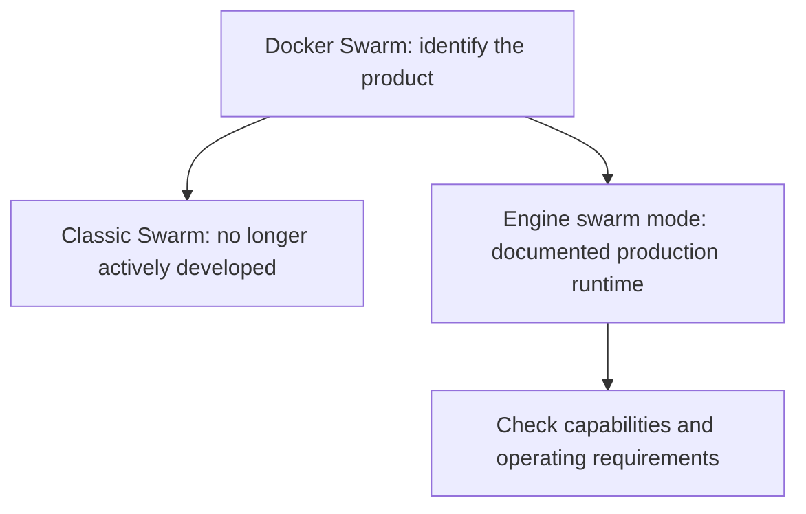
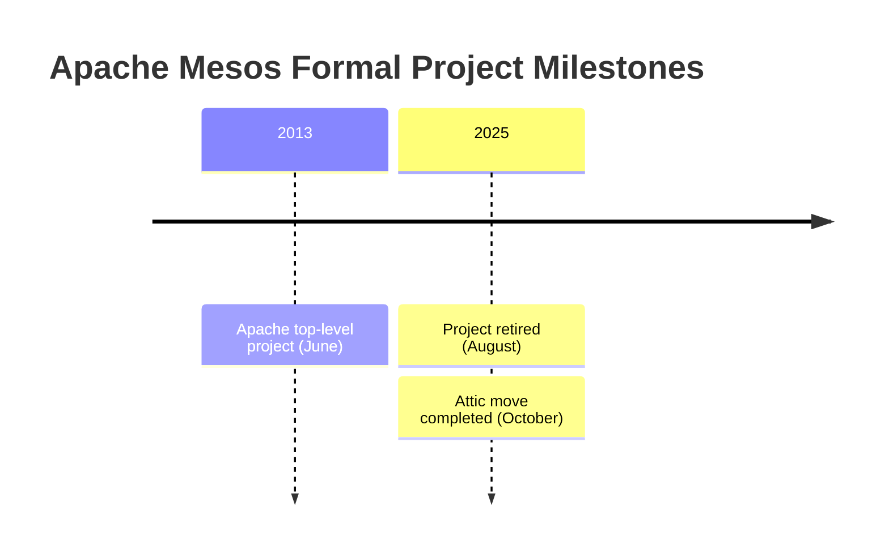
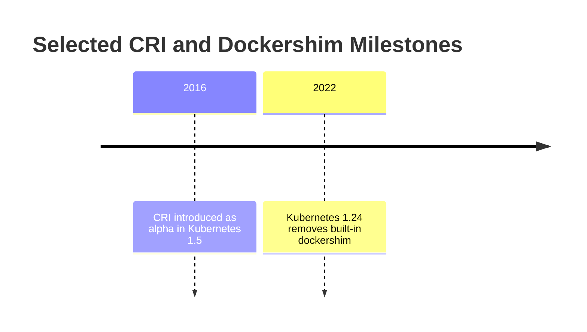
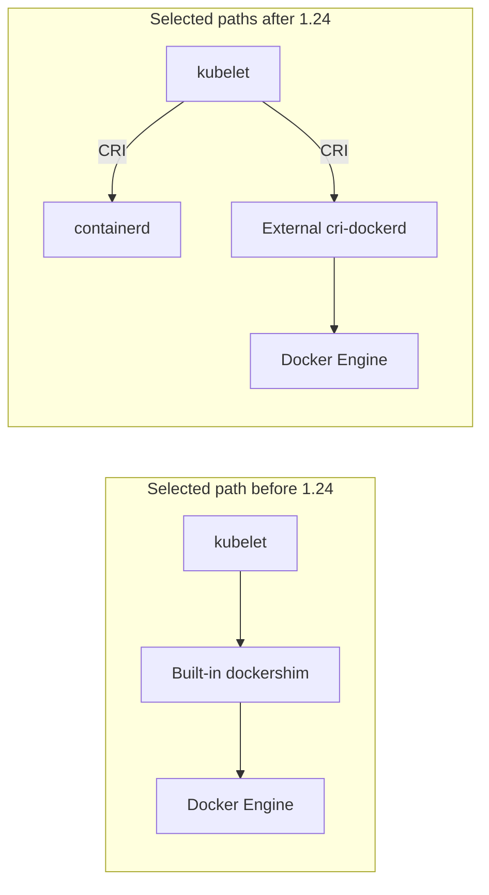
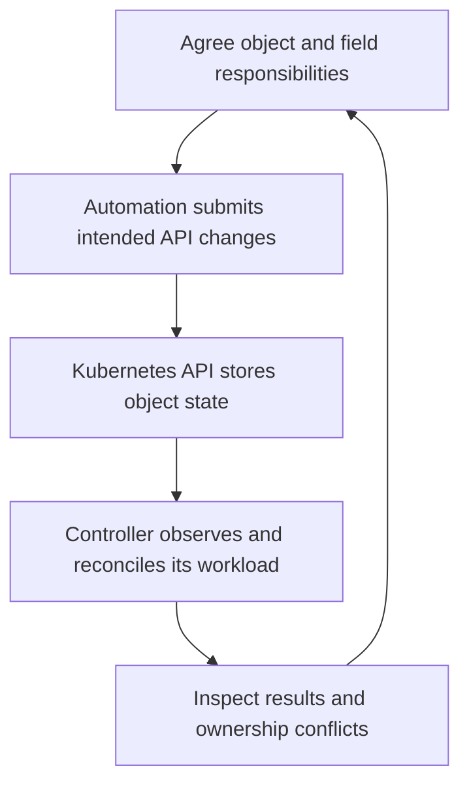
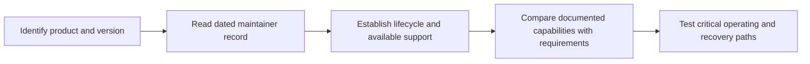

> **Complexity**: `[MEDIUM]` - Long-form guidance on what not to learn.
>
> **Time to Complete**: 80–110 minutes (long-form read + hands-on exercise)
>
> **Prerequisites**: Module 1.1, Module 1.2, Module 1.3.

---

## What You'll Be Able to Do

After this module, you will be able to:

- **Evaluate** container orchestration technologies using governance, ecosystem, cloud-provider support, and adoption signals.
- **Diagnose** the difference between formal project retirement and a deployment model that does not meet a workload's requirements.
- **Compare** Docker image-building workflows with Kubernetes runtime integrations before and after built-in dockershim removal.
- **Design** a modernization plan that justifies which tools to retain or replace against documented capabilities and operating requirements.

## Why This Module Matters

Hypothetical scenario: a retailer is reviewing an existing container platform before expanding it. Its engineers need to determine which components remain supported, what happens when a host fails, how application changes are rolled out, and who maintains the integrations. They are considering Kubernetes, but neither a migration nor keeping the current platform is automatically the right answer. The audit needs a dated maintainer record, documented capabilities for the intended version, and tests of the failures the service must tolerate. This scenario supplies decision questions, not a real company's spending, hiring history, incident or measured migration outcome.

The opening scenario asks you to check evidence before selecting a replacement. A dated maintainer record can establish project retirement, while capability documentation describes a deployment model. Neither identifies the requirements of every organization. For a learning or engineering decision, state which product and version you mean, which responsibilities the team must support, and what information is missing. That keeps the audit useful without pretending a tool name determines the answer.

This module examines technologies and deployment choices in relation to Kubernetes. Docker Swarm, Apache Mesos, Cloud Foundry, Chef, Puppet, Ansible, and Docker Compose have different purposes and lifecycle states; their names alone do not determine whether a particular use is obsolete. Practice checking documented status, operational fit, ownership, and missing evidence before proposing a change.

## Start With the Shape of a Dead End

A "dead end" is a question to investigate, not a status supplied by a product name. A project may be formally retired, a supported deployment may fail a particular requirement, or a team may need a different learning goal. Record the exact product and version, the decision being made, and the evidence that would change it. A lifecycle record alone does not measure job demand, operational suitability, or the future value of learning a tool.

Investigate three separate questions: does the documented abstraction support the intended workload, who maintains the product and its integrations, and can the team operate and recover it? Governance and ecosystem support are useful evidence to seek, but they do not establish why organizations chose a product or whether it meets this team's requirements. Mark those claims unknown until appropriate evidence exists.

**Pause and predict:** if your team finds a tool that is easier than Kubernetes for one narrow deployment path, what would have to be true before you would recommend it for a five-year platform bet?

<details>
<summary>Check your prediction</summary>

Consider the team's required support, security, data recovery, integrations and exit path, then identify which claims can be checked in documentation and which need tests. Multiple providers or contributors may matter to a particular plan, but their number alone cannot prove suitability. State the workload and operating constraints before judging the tool.

</details>

Write the conditions you would require before you continue. The next paragraph is a city-map model. It does not list those conditions.

Think of a platform as a map of dependencies: workloads need paths to storage, network access, recovery and operators who maintain them. The analogy stops at the planning question; a city map cannot establish a product's actual integrations, lifecycle or market adoption. Inspect those facts for the specific version and environment.

Before looking at individual tools, separate four questions. What lifecycle state is documented? Which capabilities does the intended version provide? Which operating requirements remain unverified? What learning or engineering task are you trying to complete? Use those answers to choose the depth of study. Older Swarm material may serve a specific maintenance or comparison task; its age or position beside Compose does not establish relevance. Likewise, dockershim removal alone does not justify abandoning Docker image builds.

## Diagnose Orchestration Dead Ends

Orchestration involves more than starting containers. For a proposed deployment, list the required scheduling, health, rollout, traffic, storage, identity and recovery responsibilities, then check which components actually provide them. A larger ecosystem or a shorter demo does not by itself establish the safer choice for a particular service.

Docker documents swarm mode as part of Docker Engine. To assess it, identify the Engine version and the service, update, networking and failure behavior required by the actual deployment. Comparing a feature with Kubernetes requires documentation for both candidates and a common set of requirements; these sources do not establish comparative adoption or the reasons a team chose either one.

**What it was**: Docker's native orchestration solution.

**Status, checked October 27, 2026**: Docker's [Swarm mode documentation](https://docs.docker.com/engine/swarm/) describes a production runtime built into current Docker Engine versions. It distinguishes Engine swarm mode from Classic Swarm, which is no longer actively developed. That distinction does not establish market share, hiring prospects, or whether Swarm meets a particular team's requirements.



For either candidate, check who maintains the release, which integrations and support agreements the team depends on, and what happens if that support changes. A governance model is one input to the decision, not proof of competitors' motives or an automatic prediction of integration quality. Record the support questions that remain unanswered.

For this Kubernetes learning route, prioritize the Kubernetes concepts used by the later modules. If work requires Swarm, use documentation for the intended Engine version and inspect its service, networking, update and recovery behavior. A production tutorial is not obsolete merely because it uses Swarm; check its version, requirements and assumptions. Learning priorities for this course are recommendations, not measured career outcomes or evidence that another platform is unusable.

The [Mesos architecture documentation](https://mesos.apache.org/documentation/architecture/) describes a master offering resources to frameworks, whose schedulers choose offers and launch tasks through executors. The [archived Marathon README](https://github.com/d2iq-archive/marathon/blob/90619da70d79a2ecf19368a21c6a695ea981bd74/README.md) describes Marathon as a Mesos framework for container orchestration. This explains the division of responsibilities; it does not establish comparative ease of use or the reasons organizations adopted or left either system.

**What it was**: Two-level resource scheduler (Mesos) with container orchestration (Marathon).

**Status, checked October 27, 2026**: The [Apache Attic record](https://attic.apache.org/projects/mesos.html) identifies Mesos as retired in August 2025, with its Attic move completed in October 2025. This is a formal project-lifecycle fact, rather than a claim that new usage reached zero in an earlier year. Marathon's repository and any distribution support require their own checks; Mesos's status does not establish a separate Marathon retirement date.



For an existing Mesos deployment, identify the frameworks in use, their maintenance arrangements, and how the service handles scheduling, storage, updates and recovery. Apache's retirement record is relevant to an ownership and support plan, but does not establish that a particular installation has failed or that migration is the only defensible decision. Check distribution support independently.

Cloud Foundry's [application deployment guide](https://docs.cloudfoundry.org/devguide/deploy-apps/deploy-app.html) describes deploying applications with `cf push`; its Diego documentation describes Tasks and Long-Running Processes. Those are starting points for assessing a particular distribution, not evidence that all workloads fit or that users migrated for a specific reason. Check version-specific capabilities and the team's required controls before comparing it with another platform.

**What it is**: A platform with documented application deployment workflows and a Diego container management architecture.

**Status, checked October 27, 2026**: [Cloud Foundry's Diego architecture documentation](https://docs.cloudfoundry.org/concepts/diego/diego-architecture.html) describes Diego as the system managing application containers, including scheduling Tasks and Long-Running Processes. This source does not establish the previous blanket claim that Diego was deprecated in favor of Kubernetes. Evaluate the intended distribution, version and workload rather than treating every Cloud Foundry deployment as one lifecycle state.

**Pause and predict:** if a platform serves a web application and a team proposes a new database workload, what evidence would you need before deciding whether to retain or change the platform?

<details>
<summary>Check your prediction</summary>

Name the intended distribution and version, data and recovery requirements, operating ownership, and documented capabilities. Compare those with an alternative using the same criteria and test the unresolved behavior. A new workload suggests questions to investigate; it does not prove a mismatch or explain anyone's migration.

</details>

Write the evidence needed before you continue, including the behavior that has not yet been tested.

The practical diagnosis is to state a possible gap as a hypothesis. Identify the actual requirement and compare it with documentation and observations; a product's historical description does not prove a particular deployment cannot support it.

Choose learning depth according to your goals and the systems you maintain. Mesos offers a concrete way to study resource offers and framework scheduling; Swarm and Diego documentation can inform work on those deployments. Broader concepts such as scheduling, rollout and recovery can also be compared across systems, without claiming a particular job-market outcome.

## Separate Docker Images From the Kubernetes Runtime

Docker can mean Dockerfiles, the Docker CLI, Docker Desktop, Docker Engine, image builds, or Docker Hub. Separate the build workflow from the node runtime integration: Kubernetes 1.24 removed the built-in dockershim that connected kubelet to Docker Engine. That removal did not remove Dockerfiles or image builds, and an external CRI adapter can still connect kubelet to Docker Engine. The precise impact depends on the runtime, build process and workloads in the environment being upgraded.

**What it was**: Dockershim was the built-in integration between kubelet and Docker Engine.

**Status**: Kubernetes removed built-in dockershim in version 1.24; `cri-dockerd` is an external adapter for Docker Engine.

**Pause and predict:** what does a container runtime interface let kubelet do when a cluster uses a different runtime?

<details>
<summary>Check your prediction</summary>

CRI defines a communication interface between kubelet and a container runtime. The [2016 Kubernetes 1.5 announcement](https://kubernetes.io/blog/2016/12/container-runtime-interface-cri-in-kubernetes/) described an alpha plugin interface intended to let kubelet use different runtimes without recompilation. For current version requirements, consult the corresponding versioned documentation rather than treating the 2016 announcement as current setup guidance.

</details>

Write the interface's role before you continue. The timeline identifies two documented milestones; it does not predict which runtime a particular cluster uses.



The [Kubernetes 1.35 runtime documentation](https://v1-35.docs.kubernetes.io/docs/setup/production-environment/container-runtimes/) requires a CRI-conformant runtime and documents containerd and CRI-O among its examples. The [CRI reference](https://v1-35.docs.kubernetes.io/docs/concepts/containers/cri/) states that kubelet requires the v1 CRI API for Kubernetes 1.26 and later. Docker Engine does not implement CRI itself, but the [dockershim FAQ](https://kubernetes.io/blog/2022/02/17/dockershim-faq/) describes the external `cri-dockerd` adapter connecting kubelet to it. Check the intended version and integration rather than assuming a closed list of runtimes.

The following is a schematic of selected paths, not a complete inventory or an observed cluster. Before removal, the built-in dockershim connected kubelet to Docker Engine. After removal, a CRI-compatible runtime such as containerd is one option; Docker Engine with the external adapter is another. The diagram does not describe every internal component or establish which path an exam or workplace uses.



When someone says "Kubernetes removed Docker, so we must rewrite every Dockerfile," distinguish image building from kubelet's runtime connection. The FAQ explains that images built with Docker remain usable with other runtimes; removal of the built-in shim alone does not require rewriting Dockerfiles. Still check the actual images, workload dependencies and target runtime when planning a migration rather than promising that every workload will behave identically. A build pipeline and node runtime can be evaluated separately.

For a migration review, inventory the node's existing runtime integration and the CRI API supported by the proposed replacement. The FAQ identifies logging configuration, monitoring and any scripts or workloads that depend on the Docker Engine API as areas to examine. Record which checks your environment needs and the results when they are actually run; a documentation comparison alone is not a runtime compatibility test. If keeping Docker Engine, check the external adapter's compatibility and operational support for the chosen versions as part of that plan.

Here is the operator-facing habit this module expects in later Kubernetes labs. Use explicit `kubectl` commands in shared notes, runbooks, and copy-paste examples to avoid depending on personal shell aliases. Record the required context, permissions and versions separately; writing the binary's full name alone does not establish that a command will succeed in another environment.

```bash
kubectl get nodes
kubectl get pods --all-namespaces
```

Use precise boundaries: built-in dockershim was removed, while an external adapter can connect Docker Engine to kubelet. Docker documents Compose production use, including a single-server deployment. That deployment alone does not provide cross-host failover when its host is lost; assess any restart behavior and additional recovery mechanisms in the actual configuration rather than assuming no process can be restarted.

## Define Configuration and Workload Ownership

Configuration management and Kubernetes can address different parts of an operating environment, and their responsibilities can overlap. A team may use configuration management for host settings, cluster provisioning, or Kubernetes API objects. Kubernetes controllers observe state and act to move it toward their desired state. The planning question is which workflow owns each intended change and how that workflow interacts with the controllers managing the workload.

**What they are**: Configuration management and automation tools with capabilities that depend on the product and integration.

**Status**: Evaluate the actual workflow and its ownership boundaries; a tool name alone does not establish a conflict.

| Task | Ownership question |
|------|--------------------|
| Configure a host or provision a cluster | Which automation owns the host settings, and who reviews changes to them? |
| Manage a Kubernetes API object | Which workflow supplies the intended object or fields, and how are changes reviewed? |
| Reconcile a workload | Which Kubernetes controller acts on the desired state, and what does it manage? |
| Coordinate multiple writers | Are their objects or fields deliberately assigned, and how will conflicting changes be resolved? |
| Inspect a node | Which components are involved? Kubernetes documents kubelet and a container runtime on nodes. |

For example, the [Ansible `kubernetes.core.k8s` module](https://docs.ansible.com/projects/ansible/latest/collections/kubernetes/core/k8s_module.html), checked October 27, 2026 at collection 6.6.0, uses the Kubernetes API for object creation, reading, updates and deletion. It accepts object definitions; its client-side `apply` option is distinct from `server_side_apply`, which requires `apply: true`. A playbook creating or updating a Pod is not automatically a conflict; identify its owner and subsequent changes. Distinguish a Deployment's desired state from a separate attempt to repair its controller-managed Pods.

The figure is a planning workflow, not a serialized API execution trace. Inspect the write response for conflicts before assuming a requested change was stored; controllers can run concurrently with these inspection steps.



Multiple declarative managers can coexist when their responsibilities are explicit. For example, a team might assign one workflow the application configuration and another a separate operational field. Kubernetes [Server-Side Apply](https://v1-35.docs.kubernetes.io/docs/reference/using-api/server-side-apply/) records field managers and can report a conflict when an apply operation attempts to change a field another manager owns. This mechanism is not a general guarantee that every write or every competing controller will raise a conflict. Inspect the actual write methods and agree how to resolve a disagreement before overriding another manager's claim.

Hypothetical planning example: an Ansible workflow and a GitOps workflow both propose different image values for the same Deployment field. Record which workflow should own the image, which applies it, and how the other workflow will stop asserting a conflicting value. If both use Server-Side Apply, an attempted conflicting change can be rejected; inspect the managers and agree on the intended owner before choosing a resolution. If either uses a different write method, check its behavior rather than assuming the same conflict protection. The example describes a plan, not an observed deployment or a reason to prohibit either tool.

For Compose, distinguish a documented production deployment from an unsupported assumption about availability. Starting several services on one host can meet a bounded deployment need, but a successful local startup does not test recovery after losing that host. Evaluate the data, update and failure requirements of the intended environment. The same requirement check should precede adopting a cluster: adding an orchestrator creates operating responsibilities that also need an owner and verification.

**What it is**: A tool for defining and running multi-container Docker applications using a simple YAML file.

**Status, checked October 27, 2026**: Docker explicitly documents [using Compose in production](https://docs.docker.com/compose/how-tos/production/), including deployment on a single server and production-specific configuration. A single-host deployment needs an explicit answer for host failure, data recovery, updates, access and monitoring. Production use alone does not establish that Compose is unsuitable, and Kubernetes alone does not establish that those requirements are satisfied.

**Pause and predict:** a Compose application starts on a laptop. Which production configuration and failure-recovery questions remain unanswered by that result?

<details>
<summary>Check your prediction</summary>

A local startup does not establish what happens when the production host fails, where durable data is recovered, or whether an update meets the service's availability target. Docker documents Compose production use and possible configuration changes; compare that model with the actual requirements. Identify which failures still need tests before recommending retention, a configuration change, an additional component, or migration.

</details>

Write the unanswered requirements and the evidence you would collect before continuing. The next block is an illustrative service definition, not a completed recovery plan.

Consider a typical `docker-compose.yml`:

```yaml
services:
  api:
    image: myapi:v1
    ports:
      - "8080:8080"
  db:
    image: postgres:13
    volumes:
      - db-data:/var/lib/postgresql/data
volumes:
  db-data:
```

Read the example as a service definition. It does not state a recovery-time target, identify off-host backups, or show a host-loss test. Write the missing operating questions before choosing a deployment platform. The comparison should explain which requirements each candidate would satisfy and which observations are still needed.

Docker's production guide lists possible configuration changes involving code mounts, ports, environment variables, restart policy and logging, and explains rebuilding and recreating a service for deployment changes. Those steps do not by themselves demonstrate an availability target or successful recovery from host failure. State which failures the application must tolerate and test the actual design. Requirements for access control, secrets, traffic management and observability depend on the system; identify them explicitly instead of assuming that either a Compose file or a Kubernetes manifest supplies them automatically.

If a team considers translating Compose configuration, compare the resulting resources with its actual availability, security and recovery requirements. A translated service definition alone does not establish that probes, access controls, data recovery or rollout behavior meet those requirements. Retention, revision and migration all need an explicit assessment.

## Evaluate Technology Bets With Governance, Ecosystem, and Cloud-Provider Signals

When comparing technologies, distinguish a documented lifecycle event from a statement about adoption or the cause of a migration. The supplied records can establish particular statuses and capabilities, but they cannot rank all platforms or explain the decisions of an entire industry. Collect separate evidence for each claim the decision requires.

Keep project lifecycle, capability and decision criteria separate. Apache's Mesos record establishes formal retirement; Docker's Swarm and Compose documentation describes deployment models; Cloud Foundry's documentation explains Diego's architecture. These records do not measure why organizations adopted or left each product. Governance, operating effort and integration requirements are questions for the actual team to investigate, alongside which failure paths its design can tolerate.

| Category | Evidence to collect for the proposed design |
|----------|-----------------|
| Orchestration | Required scheduling, rollout and recovery behavior, plus the components responsible |
| Runtime | Intended versions, CRI conformance and API support; any external adapter and its support |
| Images | Build inputs, target image/workload compatibility and verification results |
| Config | Intended objects and fields, their writers and disagreement handling |
| GitOps | Which desired state the proposed workflow owns and how changes are reviewed |
| Service Mesh | Required traffic or encryption behavior and how the proposed implementation would be tested |
| Monitoring | Required signals, collection paths, alert owners and retention |
| Logging | Required records, collection and access paths, retention and host-loss behavior |

The table prompts an investigation rather than prescribing a product stack. For Kubernetes 1.35, check CRI conformance and the CRI API requirement for the chosen runtime integration. Select image-building, configuration, delivery and observability tools against the team's actual operating needs, support and compatibility evidence.



Use an evaluation routine whenever a deployment tool appears. Name the problem and required behavior, identify maintainers and relevant support, and inspect version-specific integrations and security responses. Ask how the team would operate or migrate the system if support changed. Record unanswered questions rather than using a star count or a governance label as a substitute for those checks.

Before a pilot, record the operational problem, dependencies, expected result, rollback and evidence needed for the proposed scope. A plugin can also introduce material risk; assess its permissions, failure modes and support instead of assuming that integration is safer than replacement. A faster demo alone does not answer those questions.

A useful distinction is replacement versus integration. Ask which component a proposed change replaces, which interfaces it uses, and which operating responsibilities remain. Cloud Foundry's documented Diego system is one concrete architecture to inspect; do not infer that every distribution has moved to Kubernetes. Likewise, an integration with Kubernetes establishes an interface to evaluate, not proof of why a product succeeded or that a migration is necessary.

## Worked Example: Project Phoenix Assessment

Hypothetical scenario: Project Phoenix is a SaaS product with an API, workers, a PostgreSQL database, a Redis cache, and an internal dashboard. Three virtual machines use Puppet for host management, Docker and Swarm for containers, and a conversion script for service definitions. This authored example supplies a configuration to assess; it does not report a real deployment, incident, market pattern or result.

The first diagnostic move is to separate a documented capability from the service's actual requirements. Ask what should happen when a node fails, how patches are rolled out, which load balancer integration is required, and who can debug the system. Neither the age of Swarm nor its product name establishes the answers. Gather version-specific support records and test the relevant failure and recovery paths before recommending a change.

Next, examine the Puppet role with care. Its [agent applies a configuration catalog to a managed node](https://help.puppet.com/core/current/Content/PuppetCore/architecture.htm); its presence does not itself establish a workload conflict. In this hypothetical plan, if a Puppet workflow, a Swarm service definition, and a converted Compose file each assert different API replica counts, identify which one actually writes the value and which owns the intended setting. Record how the team will detect and resolve disagreement before choosing a change.

The Compose file deserves the same requirements check. Keep a useful local workflow when it serves the team, and inspect the production configuration separately. Docker documents production-specific configuration and deployment changes with Compose. Decide whether that model meets the service's recovery, update and access requirements. If Kubernetes is a candidate, compare its proposed resources and operating responsibilities against the same criteria; choosing a different YAML format does not itself satisfy them.

A useful assessment memo separates a source-backed fact, a requirement, and the missing local evidence. For example: Apache records Mesos as retired in August 2025, so a deployment that still runs Mesos needs an explicit support and maintenance plan. Docker documents single-server production use with Compose; the hypothetical service still needs evidence of data recovery and acceptable behavior after host loss. Engine swarm mode has documented orchestration capabilities, but its name alone does not establish whether the required integrations exist. Each conclusion identifies something another engineer can check instead of inventing a deprecation, hiring comparison, or universal production ban.

### Worked claim audit

Here is an authored planning example, not a report of a real assessment. A reviewer proposes three statements for Project Phoenix: "Mesos is retired," "Compose cannot be used in production," and "the team must migrate because Kubernetes has more support." Before accepting any statement, record the product, source, scope and date, and then separate what that source says from what the team needs to find out. The scenario does not say that Phoenix actually runs Mesos; the first statement is a comparison exercise, not an inventory finding.

For the first statement, the [Apache Attic record](https://attic.apache.org/projects/mesos.html) supports Mesos's formal retirement in August 2025 and the completed move to the Attic in October 2025. That is a lifecycle fact. It does not establish the support terms for an individual distribution, prove that an installation has failed, or specify a migration deadline. If an actual team uses Mesos, the next evidence would include its installed version, support agreement, current maintainers and recovery obligations. The disposition remains open until those facts are compared with the team's requirements.

For the second statement, Docker's [Compose production guide](https://docs.docker.com/compose/how-tos/production/) describes production deployment, including a single-server option, so a universal production ban does not follow. For Phoenix, the guide still does not establish how the team's data is backed up, whether a host-loss recovery meets its target, or which production settings are actually deployed. Record those as unknown and plan to inspect the configuration and test recovery. A successful startup on a laptop would be a different observation and would not answer the host-loss question.

For the third statement, neither the Mesos retirement record nor the Compose guide measures comparative support for Phoenix's integrations. Write down the required versions, support response, network and storage interfaces, and operating responsibilities; request current agreements and documentation for each candidate. If a required integration is undocumented, record that gap rather than assuming that either platform provides or lacks it. A proposed migration can then name the requirement it addresses, the evidence for the gap, the cost and owner of the proposed replacement, and the test that would justify proceeding. Until those checks exist, both retention and change remain possible outcomes.

Transfer the same method to Cloud Foundry: the [Diego architecture guide](https://docs.cloudfoundry.org/concepts/diego/diego-architecture.html) describes Tasks and Long-Running Processes, while the [deployment guide](https://docs.cloudfoundry.org/devguide/deploy-apps/deploy-app.html) describes `cf push`. Neither source establishes why users left, whether a particular database is supported, or whether Kubernetes is a better fit for it. Name the intended distribution and workload, then gather version-specific capability and recovery evidence. The skill is to match the strength of the conclusion to the evidence, not to force every candidate into a retain or retire category before the comparison.

Now map responsibilities before selecting replacements. For each component, record what it owns, its documented lifecycle, and any operating requirement the current design cannot satisfy. The result can justify retention, a configuration change, an additional component, or migration. A Kubernetes proposal should explain who owns its infrastructure, workload declarations, upgrades, data and verification. Keep Docker image building and host-management responsibilities distinct from the decision about application orchestration.

If Kubernetes is a candidate, compare self-managed and managed offerings against the required support, cost, control, recovery and security responsibilities. Document which party handles upgrades, backups, certificates, API availability and incident response under the actual service agreement. A managed control plane may change the division of work, but its name alone does not establish lower risk or a successful migration.

If the assessment supports a pilot, a dashboard or worker could be a candidate after the team checks dependencies, impact, rollback and success criteria. A proposed Kubernetes design might use a Deployment and Service, but those object names do not establish that the application works or that recovery is acceptable. Specify what would be observed and who would make the decision to proceed or stop.

Before expanding a pilot, assess access control, secrets, networking, observability, image handling and operational ownership against the service requirements. A team can consider namespaces, RBAC, logging and other controls as candidates, but a fixed list or a GitOps controller is not proof that the requirements are met. Document unresolved gaps and test the proposed operating model.

Data services need a separate comparison. For PostgreSQL, assess data consistency, backups, restoration, failover, patching, cost and support for each candidate, including retaining the current service. A managed database and a self-managed deployment have different agreements and responsibilities; neither label alone proves stronger recovery. Record the evidence and a restoration test before deciding.

Review security assumptions in both the current and proposed designs. Inspect access, secrets, network boundaries and host mounts where used, then map each requirement to an implemented control and its verification. Kubernetes documents [RBAC](https://v1-35.docs.kubernetes.io/docs/reference/access-authn-authz/rbac/) and [NetworkPolicy](https://v1-35.docs.kubernetes.io/docs/concepts/services-networking/network-policies/), but a manifest alone does not demonstrate that a particular policy is enforced or sufficient.

For the hypothetical Project Phoenix audit, identify where logs, metrics, events and alerts are collected and who responds to them. A host-local log can be unavailable after that host fails, whatever deployment tool created the container. Check the actual collection and retention design before recommending a change. Neither Compose nor Swarm use alone proves that the organization lacks centralized observability; neither a Kubernetes cluster nor a product name proves that the required evidence will be available during an incident.

Training can connect the selected tools to the responsibilities they manage. If the proposed design uses Deployments and Services, study their behavior alongside the team's rollout, access and recovery checks. If GitOps is proposed, decide which intended state it owns and how conflicting changes are handled. The sequence can reflect existing knowledge and workplace needs rather than a universal prerequisite order.

If the plan includes coexistence, identify routing, DNS, secrets and observability across both environments, plus an owner and review condition for each dependency. A deadline can support planning, but the right duration depends on the workload and evidence. Record rollback and ongoing support responsibilities even if the final decision is to retain the existing deployment.

Define success criteria before comparing candidates: for example, an acceptable restoration time, an update behavior, and who can inspect the relevant audit trail. Measure the current and proposed designs using comparable conditions where possible. No recovery improvement or reduced workload has been observed in this hypothetical scenario.

The final recommendation for Project Phoenix should connect each proposed action to a requirement and evidence. Retain useful components where they satisfy the need; identify the costs, ownership and tests for any change. The scenario gives no evidence of prior decision makers' motives or a requirement to replace every production dependency.

The assessment should distinguish Mesos's documented retirement from the deployment-fit questions for Engine swarm mode, Diego and Compose. Explain what the sources establish, what the hypothetical workload requires, and which tests or support information are still missing. A recommendation can retain a component or propose migration. Its value comes from that checked argument, rather than from selecting Kubernetes in advance or treating every older product as formally retired.

## Patterns & Anti-Patterns

These patterns are prompts for investigation, not guarantees of a better outcome. Apply them to the proposed service, its operating responsibilities and the evidence available. A convincing demo or a familiar workflow still needs to be compared with the actual requirements.

| Pattern | When to Use It | Why It Works |
|---------|----------------|--------------|
| Examine governance and support | Choosing an infrastructure dependency | Identify maintainers, release and security responsibilities, relevant integrations and the team's exit options. |
| Separate concepts from products | Evaluating Docker, Compose, Cloud Foundry, or another tool | Compare image builds and deployment workflows against the actual environment and its requirements. |
| Design for declarative reconciliation | Managing Kubernetes workloads, policy, and configuration | Desired state in an API gives controllers a stable contract for healing, rollout, audit, and automation. |
| Plan an exit strategy | Piloting any new platform component | Identify data ownership, migration dependencies and the evidence needed to assess a change. |

Preserve concepts while checking the status and fit of the particular implementation. Container images, health checks, service discovery, rollout strategy and declarative configuration provide comparison points, while product-specific details may be essential to maintaining a real system. Choose study depth from your goals and the evidence needed for your work.

| Anti-Pattern | What Goes Wrong | Better Alternative |
|--------------|-----------------|--------------------|
| Treating a governance label as proof of fit | It does not establish the actual integrations or support terms | Check the required integrations, maintenance, exit path and workload behavior. |
| Treating a syntax translation as an operational assessment | A converted file alone does not prove recovery or access requirements are met | Compare the resulting deployment against explicit requirements and tests. |
| Multiple workflows asserting incompatible workload state | A controller or another writer may change a value a separate workflow expects to control | Identify the controller and field owners; inspect the actual writes and agree how to resolve conflicts. |
| Assuming a tool's name predicts career value | The documents here do not measure job markets or individual opportunities | Compare the role, learning goals and current evidence available for the decision. |

Apply the same questions to Kubernetes and alternatives. A candidate's easier first demonstration is one observation; longer-term operations, security, support and migration require their own evidence. The choice remains conditional on the service and the team's constraints.

## Decision Framework

Use this framework when your team considers whether to learn, adopt, maintain, or retire a cloud-native technology. The point is not to produce a perfect score. The point is to force the conversation out of vibes and into operational evidence. If the tool is core infrastructure, a weak answer in any category should slow adoption because core platforms are expensive to replace after teams build habits around them.

| Question | Green Signal | Red Signal | Decision Guidance |
|----------|--------------|------------|-------------------|
| What problem does it solve? | Clear operational pain with measurable impact | Mostly novelty, aesthetic preference, or tutorial convenience | Pilot only when the problem is real and named. |
| Who governs it? | Named maintainers and support commitments for the intended version | Ownership or support terms are unclear | Examine governance alongside the actual support and exit requirements. |
| Who integrates with it? | Required integrations are documented for the intended version | A required integration or its support is unknown | Verify the integrations the workload actually needs. |
| What happens if it fails? | Recovery and exit paths meet stated requirements in tests | Recovery or migration behavior is untested | Identify the missing evidence and assess the proposed scope. |
| What does it change? | Interfaces and responsibilities meet the required behavior | A required capability or operating owner is missing | Assess integration and replacement against the same criteria. |

For this Kubernetes route, practice its workload and networking primitives, then compare the task each alternative must perform. When a capability is unfamiliar, use versioned documentation and an appropriate test to fill the gap. A learner need not master every platform before asking a well-scoped question about fit.

For a working team, possible dispositions include adopt, integrate, retain, change or retire. Justify each against the requirement, capability, support and ownership evidence; record uncertainty where a test or agreement is missing. An integration can also have costs and failure modes, and retention may be justified when the existing system meets the stated need.

## Did You Know?

- **Mesos describes resource offers** to framework schedulers, which choose offered resources for tasks. That architectural model is separate from the project's retirement status.
- **Kubernetes 1.24 removed built-in dockershim**, not Dockerfiles or image building. The external `cri-dockerd` adapter provides a separate path to Docker Engine; check the chosen versions and workload compatibility.
- **A maintainer's lifecycle record and a capability guide answer different questions.** Apache's Mesos retirement record does not establish whether a specific workload has a tested migration path.
- **Ansible can manage Kubernetes API objects** using definitions supplied to its `kubernetes.core.k8s` module. Check the intended task and ownership rather than treating all configuration management as a competing controller.

## Common Mistakes

| Mistake | Why It Happens | How to Fix It |
|---------|----------------|---------------|
| **Assuming a product name determines relevance** | Old and current documentation can describe different products and versions. | Identify the intended Swarm mode and version, learning goal and operating requirements before deciding what to study. |
| **Assuming a local deployment proves production fit** | A successful startup can obscure host-failure and recovery requirements. | Compare the actual availability, update, data and access requirements; Docker documents Compose production use, so justify retention or replacement with evidence. |
| **Leaving workload ownership ambiguous** | Multiple workflows can propose changes to the same object or field without an agreed owner. | Identify each writer and controller, assign responsibilities, and check how the actual write methods expose and resolve conflicts. |
| **Assuming a managed service removes all operating work** | Provider and customer responsibilities vary by offering and agreement. | Compare the actual support, security, recovery, control and cost responsibilities with self-management. |
| **Treating conversion as proof of fit** | Syntax conversion does not verify application or recovery behavior. | Compare the deployment and its controls against the stated requirements and tests. |
| **Chasing abandoned or isolated projects** | Hype, old case studies, or impressive demos hide weak maintenance and governance signals. | Check foundation status, release cadence, maintainer diversity, cloud-provider support, and issue health before adopting. |
| **Assuming Kubernetes removed all Docker use** | Built-in dockershim removal is confused with removal of image builds or every Docker Engine integration. | Separate image building from the node runtime; inspect CRI compatibility and the external adapter option. |

## Quiz

<details>
<summary>1. Your startup wants to run production microservices with Docker Compose on one large virtual machine because it works on laptops. How should you diagnose the risk?</summary>

Start with the requirements that the laptop demonstration did not test. What happens when the VM fails, where is durable data stored, how are updates performed, and what recovery time is acceptable? Docker documents Compose production use, so the deployment label alone is not a rejection criterion. Retaining a single-server design may be reasonable for some requirements; distributed replacement or stricter availability needs require a design and observed tests that address those failures. Compare candidates against the same criteria before recommending one.
</details>

<details>
<summary>2. You are considering a contract maintaining Apache Mesos and Marathon. How would you evaluate the work and learning tradeoff?</summary>

Apache records Mesos as retired; the archived Marathon repository is separate evidence about that repository, not a complete support assessment. Ask the prospective client about the actual distribution, maintenance arrangements, responsibilities and contract terms, then compare them with your learning goals. The available sources do not establish pay, hiring demand or the career outcome of accepting the role.
</details>

<details>
<summary>3. During a Kubernetes 1.35 upgrade, a junior engineer says all Dockerfiles must be rewritten because Kubernetes removed Docker. What do you explain?</summary>

Kubernetes 1.24 removed the built-in dockershim integration, not Dockerfiles or image building. Docker Engine can still connect through the external `cri-dockerd` adapter; containerd and CRI-O are other documented runtime examples. The existing build pipeline may remain useful, but check the target CRI integration, image and workload dependencies, and operational behavior before concluding that any particular migration is compatible. Rewriting every Dockerfile does not follow from shim removal alone.
</details>

<details>
<summary>4. A team uses Ansible and a GitOps workflow for the same Kubernetes workload. How would you determine whether their responsibilities conflict?</summary>

Inspect which objects and fields each workflow changes, which controller manages the workload, and what each workflow considers the intended state. Ansible's Kubernetes module can apply object definitions through the API, so its use alone does not establish a conflict. If both workflows assert different values for the same field, agree who owns it and how to reconcile the disagreement. Server-Side Apply can signal a conflict for an apply request against another manager's field; other write methods require their own checks. Verify the actual workflow rather than assuming every competing write is rejected.
</details>

<details>
<summary>5. Your team finds a new orchestrator from one startup with no neutral governance and little cloud-provider support. What adoption signal worries you most?</summary>

Investigate the specific support and integrations the team needs, the maintainer's commitments, data ownership and an exit path. A single vendor and limited provider support are reasons to ask questions, not proof of other companies' motives or of a failure. Compare a pilot or replacement against the same workload, security and recovery requirements, and record what is unknown.
</details>

<details>
<summary>6. Your company uses Cloud Foundry successfully for stateless web apps, then needs stateful data pipelines with GPUs and custom networking. Why might Kubernetes fit better?</summary>

The workload gives the team a reason to investigate, not proof that either platform is a better fit. Check the intended Cloud Foundry distribution and Kubernetes environment for the required data recovery, GPU access, networking, support and operating responsibilities. Compare documented capabilities and test unresolved behavior before recommending retention or migration.
</details>

<details>
<summary>7. A migration proposal mechanically converts a large Compose file into Kubernetes YAML and calls the platform modernized. What should you challenge?</summary>

Challenge the assumption that syntax conversion proves the requirements are met. Identify the actual availability, security, data and update requirements; inspect the resulting configuration and verify the behavior each requires. Some designs may use probes, resource settings, service accounts or network policies, but neither those object names nor GitOps alone demonstrate a successful migration.
</details>

## Hands-On Exercise: Technology Radar Audit

In this exercise, you will audit an imaginary legacy stack and propose a modernization plan based on the patterns in this module. Project Phoenix uses Docker Swarm for production orchestration, Puppet to manage node configuration, and a monolithic `docker-compose.yml` translated into production by a third-party script. Your job is to separate what should be retained, changed, or redesigned, and identify what needs further evidence before deciding.

Start by writing a short risk memo with a source and applicability boundary for each lifecycle or capability claim. Separate a confirmed project retirement from a possible mismatch with this hypothetical workload. Identify the requirements and failure observations still needed before recommending retention or migration. If you recommend Kubernetes or another platform, explain which evidenced gap it addresses and what operating responsibilities the recommendation introduces.

### Tasks

- [ ] **Evaluate container orchestration technologies** by writing dated maintainer, capability and integration notes for Swarm versus Kubernetes.
- [ ] **Distinguish project lifecycle from deployment fit** using Mesos's documented retirement, Engine swarm mode, Diego's documented architecture and Compose production guidance.
- [ ] **Compare Docker image building with node runtime integration**: explain built-in dockershim removal, the external adapter option and the compatibility checks still needed.
- [ ] **Design a modernization plan** that explains which components to retain or replace and what evidence supports each decision.
- [ ] **Explain ownership and reconciliation** in one paragraph: distinguish host configuration, API-object changes, and controller-managed workload state.

<details><summary>Hint 1: Separate the claims</summary>
Which statement concerns formal lifecycle, which describes a documented capability, and which depends on the hypothetical team's requirements?
</details>
<details><summary>Hint 2: Find the boundary</summary>
For each claim, name the source and version or date, then write what it does not establish about Phoenix's deployment or support.
</details>
<details><summary>Hint 3: Plan the missing evidence</summary>
Choose a concrete requirement such as host-loss recovery, identify the configuration and test needed, and leave the disposition open until the evidence is available.
</details>

### Suggested Workspace

Use a plain text file or notebook for your audit. If you have access to a disposable Kubernetes cluster, you can also inspect the cluster shape with explicit `kubectl` commands, but the exercise is primarily architectural judgment rather than command memorization.

```bash
kubectl get nodes
kubectl get deploy --all-namespaces
```

### Solution Guide

<details>
<summary>Show one possible modernization plan</summary>

A strong plan cites Apache's formal Mesos retirement, distinguishes Classic Swarm from Engine swarm mode, and uses the Diego and Compose guides for the deployment models they actually describe. It does not invent a hiring-market comparison or require replacing every working tool. For Project Phoenix, it names unanswered questions about host failure, application rollout, data recovery, ownership and support, then recommends collecting the evidence needed to compare candidates. Its ownership paragraph assigns host configuration, intended API-object fields and controller-managed workload state separately, with actual writers and disagreement checks named. A Kubernetes proposal is one possible result, with its own configuration and operating work to assess.
</details>

**Card A: The easier tool looks like the platform.** It deploys one stateless service with less YAML than Kubernetes. A team wants to bet the next five years on it because the demo was faster.

<details>
<summary>Check your prediction</summary>

The demonstration tested one deployment path. Next, identify required workloads, support, recovery and integrations; check the intended version and test uncertain behavior. Governance and provider support are inputs to that assessment, not a predetermined verdict.

</details>

**Card B: A new PaaS workload.** A hypothetical team uses a PaaS for web apps and is considering a database plus a custom controller. The intended distribution and its capabilities have not yet been checked.

<details>
<summary>Check your prediction</summary>

The evidence does not yet establish a failure or a migration cause. Name the requirements, check the actual distribution and alternatives, and test the uncertain behavior before deciding whether the workload fits.

</details>

**Card C: "Kubernetes removed Docker."** A junior engineer wants every Dockerfile rewritten because dockershim is gone. The build pipeline still produces OCI images.

<details>
<summary>Check your prediction</summary>

The built-in dockershim was removed, but that fact alone does not require rewriting Dockerfiles. Identify the actual node runtime and CRI integration, including whether an external adapter is used, then check the target images and workload dependencies. Treat compatibility as a result to verify rather than an assumption.

</details>

**Card D: `docker-compose up` on the production host.** The same command that works on a laptop is the deploy step for a user-facing service. There is one server.

<details>
<summary>Check your prediction</summary>

Failure layer: the startup demonstration did not test host failure or recovery. Next action: write the availability and data-recovery requirements, then test the actual design. Docker documents production Compose use; retaining or replacing it requires that requirements comparison, not the production label alone.

</details>

### Success Criteria

- [ ] Your audit identifies at least three operating requirements or support questions, with the evidence needed to assess them.
- [ ] Your component decision map distinguishes retention, migration and concepts to preserve, including the separate role of image building.
- [ ] Your modernization plan justifies retention or migration against documented capabilities, support and explicit operating requirements.
- [ ] Your configuration plan identifies which tool owns each intended state and how conflicting changes will be detected and resolved.
- [ ] Your final paragraph evaluates Compose against explicit production requirements instead of assuming production use is always an anti-pattern.
- [ ] Your claim audit cites a primary source and its applicability boundary, identifies missing local evidence, and states what would change a provisional decision.

## Sources

- [Apache Attic: Mesos formal retirement and move dates](https://attic.apache.org/projects/mesos.html)
- [Cloud Foundry: Diego components and architecture](https://docs.cloudfoundry.org/concepts/diego/diego-architecture.html)
- [Docker: Use Compose in production](https://docs.docker.com/compose/how-tos/production/)
- [Kubernetes Dockershim Removal FAQ, updated 2022](https://kubernetes.io/blog/2022/02/17/dockershim-faq/)
- [Kubernetes 1.35 Container Runtimes](https://v1-35.docs.kubernetes.io/docs/setup/production-environment/container-runtimes/)
- [Kubernetes 1.35 Container Runtime Interface](https://v1-35.docs.kubernetes.io/docs/concepts/containers/cri/)
- [Kubernetes 1.5: Introducing CRI](https://kubernetes.io/blog/2016/12/container-runtime-interface-cri-in-kubernetes/)
- [Docker Swarm Mode Documentation](https://docs.docker.com/engine/swarm/)
- [Apache Mesos architecture: resource offers](https://mesos.apache.org/documentation/architecture/)
- [Archived Marathon README, inspected revision](https://github.com/d2iq-archive/marathon/blob/90619da70d79a2ecf19368a21c6a695ea981bd74/README.md)
- [Cloud Foundry: deploying with cf push](https://docs.cloudfoundry.org/devguide/deploy-apps/deploy-app.html)
- [Ansible `kubernetes.core.k8s` module](https://docs.ansible.com/projects/ansible/latest/collections/kubernetes/core/k8s_module.html)
- [Kubernetes 1.35: Components](https://v1-35.docs.kubernetes.io/docs/concepts/overview/components/)
- [Kubernetes 1.35: Server-Side Apply](https://v1-35.docs.kubernetes.io/docs/reference/using-api/server-side-apply/)
- [Kubernetes 1.35: Controllers](https://v1-35.docs.kubernetes.io/docs/concepts/architecture/controller/)
- [Puppet: agent and catalog architecture](https://help.puppet.com/core/current/Content/PuppetCore/architecture.htm)
- [Kubernetes 1.35: RBAC authorization](https://v1-35.docs.kubernetes.io/docs/reference/access-authn-authz/rbac/)
- [Kubernetes 1.35: NetworkPolicy](https://v1-35.docs.kubernetes.io/docs/concepts/services-networking/network-policies/)

## Next Module

[Git Deep Dive: Git Internals](/prerequisites/git-deep-dive/module-1-git-internals/) continues the prerequisites path with professional Git workflows—the foundation for IaC, GitOps, and team delivery in the next section.
