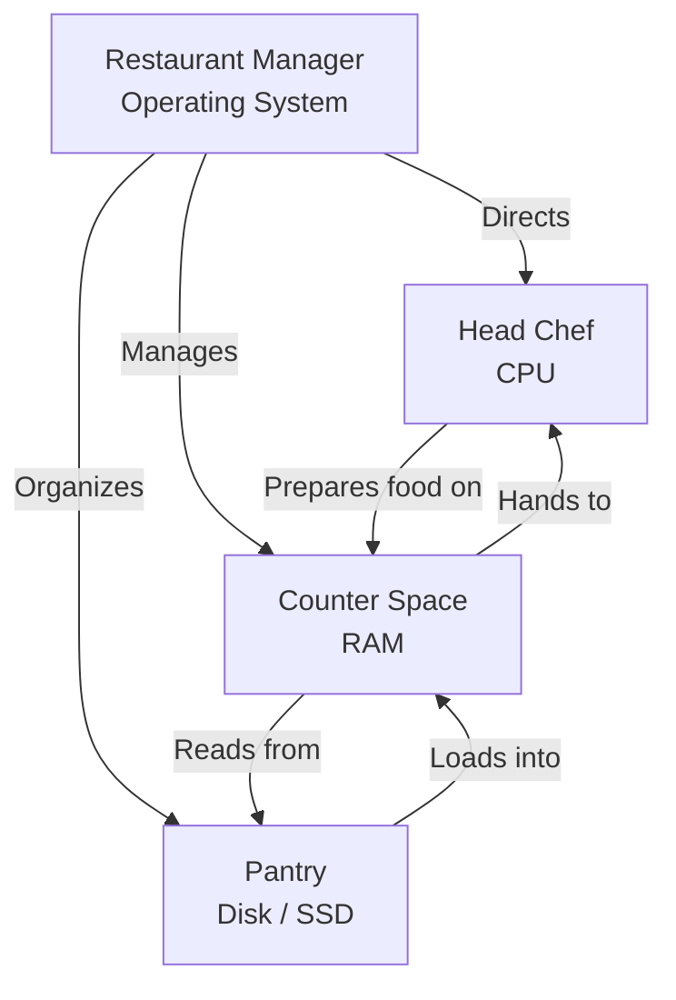

> **Complexity**: `[MEDIUM]` - Long-form foundational read; no technical experience needed
>
> **Time to Complete**: 90–120 minutes (long-form beginner read + inventory practice)
>
> **Prerequisites**: None.

---

## What You'll Be Able to Do

After this module, you will be able to:

- **Diagnose** whether a slow computer is more likely constrained by CPU, RAM, disk, or operating-system and program behavior, and identify what evidence is still missing.
- **Compare** RAM and storage using the kitchen model, then predict what is lost or preserved when power disappears.
- **Evaluate** whether a Windows or macOS laptop can follow later Linux-based Kubernetes examples, distinguishing the local OS from cluster node requirements.
- **Implement** a personal spec inventory that records your CPU, RAM, disk capacity, operating system, and current resource pressure.
- **Predict** what happens when RAM, disk space, or CPU time is exhausted during everyday and server-side workloads.

---

## Why This Module Matters

Hypothetical scenario: an app is down. One person suggests the server is out of memory, another says its disk is full, and a third suggests restarting it. Knowing the roles of memory, storage, processing, and the operating system helps you choose what to check before taking action.

The systems in this curriculum run on computers. In the laptop and server environments discussed here, instructions need a processor, active work needs memory, durable information needs storage, and an operating system coordinates access. The vocabulary changes as systems get larger, but the physical constraints do not disappear.

These distinctions also help when you encounter container memory limits or disk pressure on a Kubernetes node. The next module introduces the terminal and the shell that interprets commands entered through it.

---

## The Kitchen Model: A Whole Computer Before the Parts

Imagine a restaurant kitchen with a manager, a chef, counter space, and a pantry. These stand for a computer's coordination, processing, temporary workspace, and long-term storage. The analogy describes their roles, not their internal workings.

CPU, RAM, disk, and operating system can sound like separate vocabulary words until you watch them cooperate. Use the restaurant model to connect each term to a responsibility, then check that explanation against the technical descriptions below. The analogy helps organize questions; measurements from the actual computer are still needed to diagnose a problem.



The restaurant manager is the operating system. The manager does not personally chop onions, but the kitchen becomes chaos without someone assigning work, controlling access to counter space, and deciding where ingredients belong. In a computer, the operating system performs that coordination for programs, hardware devices, files, memory, network connections, screens, keyboards, and background tasks.

The head chef is the CPU, which stands for Central Processing Unit. The chef is the part that actually follows instructions and transforms inputs into outputs. If the recipe says slice, mix, heat, compare, copy, or calculate, the chef is responsible for doing that work. A chef can only work with ingredients that are close enough to reach, which is why the counter matters.

The counter space is RAM, which stands for Random Access Memory. In the modern laptop and server examples here, RAM is volatile working memory: it needs power to retain its contents. The counter analogy describes that temporary workspace, not every historical memory technology; the magnetic-core example later shows that memory has been implemented in different ways.

The pantry is storage, such as an SSD or hard disk drive. It keeps photos, documents, programs, operating-system files and logs after the machine is turned off. It provides durable capacity rather than the temporary workspace of RAM. A kitchen pantry is a useful comparison for those roles, but durability still requires backups because devices and files can be lost.

Programs are recipes. A web browser is a recipe for requesting pages, decoding data, drawing tabs, storing cookies, playing media, and responding to your clicks. A text editor is a recipe for displaying characters, saving changes, and tracking cursor movement. A terminal provides a text interface for a shell, which interprets typed commands and starts programs that can ask the operating system for work.

Pause and predict: if a chef has plenty of recipes and ingredients in the pantry but almost no counter space, what happens during a busy dinner service? Commit to an answer in your own words before opening the reveal.

<details>
<summary>Check your prediction</summary>

The chef may still be skilled, and the pantry may still be full, but work slows down because every task requires constant shuffling. That is the shape of a computer that has enough storage but not enough RAM for the programs currently open. The bottleneck is the counter, not the chef's skill or the pantry's contents, which is why adding more storage would not speed this kitchen up.
</details>

```
Think of it this way:

  Order comes in: "Make a sandwich"
  Chef reads the recipe:
    Step 1: Get bread         done
    Step 2: Add lettuce       done
    Step 3: Add tomato        done
    Step 4: Serve             done
```

The sandwich example separates a task from the instructions used to perform it. A processor executes machine instructions rather than interpreting a recipe as a person would. The operating system and programs coordinate those operations into tasks such as displaying a photo or saving a document; the analogy describes their roles, not their internal implementation.

The kitchen model also helps explain failure. If orders pile up while the chef is constantly busy, CPU capacity may be the bottleneck. If the chef keeps clearing and reloading the counter, RAM may be the bottleneck. If ingredients are missing or the pantry is overflowing, disk storage may be the bottleneck. If nobody knows which order should be handled next, the operating system or program behavior may be the bottleneck.

For a slow computer, ask which resource may be under pressure, what is waiting on it, and what changed recently. The analogy suggests possibilities; observations help distinguish them.

## CPU and RAM: Active Work and Temporary Space

The CPU executes instructions: arithmetic, comparisons, data movement, and decisions about which instructions run next. Opening a browser tab, compressing a file, and running a script all involve CPU work. Whether another processor completes that work faster depends on the workload and processor design, not a single specification.

Modern CPUs are usually described by brand names, model families, clock speeds, and core counts. You might see "Intel Core Ultra," "Apple Silicon M-series," or "AMD Ryzen 5" on a laptop description. Those names are not skills you need to memorize today. Several cores can handle parallel work if the software can use them. Thinking of a core as one chef is only a starting point: as the scheduling section explains, some cores share their resources among multiple hardware threads.

Clock speed is often measured in gigahertz, which means billions of cycles per second, but clock speed is not the whole story. A newer CPU can sometimes do more useful work per cycle than an older one, and a CPU with more cores can keep many tasks moving even if one task is busy. That is why "four gigahertz" is not automatically better than "three gigahertz" in every situation. Architecture, cores, power limits, cooling, and workload shape the real result.

RAM holds active program code and data. The operating system can bring needed portions into RAM as they are used; opening a program does not require loading every instruction or every file at once. This working memory needs power to retain its contents, so unsaved changes held only in RAM are at risk if power disappears.

When RAM fills up, the operating system has several unpleasant choices. It can compress memory, discard cached data that can be recreated, move less active data to disk, or in severe cases terminate programs. Moving data between RAM and disk is called swapping or paging, depending on the system. Swapping can keep a machine alive, but it is much slower than working directly in RAM, especially if the disk is also busy.

> **Pause and predict**: You have 8 GB of RAM and you open a web browser with 30 tabs, a video editor, and a music player all at once. What do you think happens? Make a specific guess about what the operating system does next.

<details>
<summary>Check your prediction</summary>

The result depends on how much memory those programs actually need; tab count alone does not establish a bottleneck. If their active data exceeds the available workspace, the OS may reclaim caches, compress memory, or move data to disk, and switching applications may slow down. Check memory pressure and ongoing swap activity before concluding that RAM is the cause.
</details>

A slow video edit can justify checking CPU activity alongside other resources; editing software may use several cores. If a laptop slows after opening many applications, check memory pressure or available memory and ongoing paging. If opening files is slow, check storage activity. These checks help distinguish hypotheses; a symptom alone does not establish the cause.

Before running this, what output do you expect from your own machine: a CPU model name, a large byte count for memory, or a percentage of current usage? These commands report processor and memory information and filesystem space, not a complete live performance diagnosis. Task 3 introduces observations of current activity.

```bash
# See your CPU info on macOS
sysctl -n machdep.cpu.brand_string

# See your RAM on macOS, in bytes
sysctl -n hw.memsize

# See your disk space on macOS
df -h /
```

The first command asks macOS for the CPU brand string, which is a human-readable description of the processor. The second prints memory size in bytes, so a large number is expected. The third command shows filesystem usage in a readable format, including the root filesystem mounted at `/`. You do not need to memorize these commands today; you need to notice that CPU, RAM, and disk can be inspected separately.

On Linux, `lscpu` summarizes the processor, `free -h` summarizes memory, and `df -h` summarizes filesystem space. They answer the same three inventory questions using Linux tools.

```bash
# See your CPU info on Linux
lscpu

# See your RAM
free -h

# See your disk space
df -h
```

On Windows, `Get-CimInstance Win32_Processor` reports the processor name, and `Get-PSDrive -PSProvider FileSystem` lists filesystem drives with used and free space. `Get-CimInstance Win32_ComputerSystem` reports physical memory in bytes, but firmware reservations can make that figure differ from installed RAM. Use **Settings > System > About** for your installed-RAM inventory; the command gives another reported view of the machine.

```powershell
# See your CPU info on Windows (PowerShell)
Get-CimInstance Win32_Processor | Select-Object -ExpandProperty Name

# See Windows-reported physical memory, in bytes
Get-CimInstance Win32_ComputerSystem | Select-Object -ExpandProperty TotalPhysicalMemory

# See your disk space on Windows
Get-PSDrive -PSProvider FileSystem
```

These commands describe the machine; they do not fix it or establish a bottleneck. Use activity and pressure observations before choosing a change.

## Disk, SSD, and Files: Permanent Storage

The disk is the durable pantry. It stores the operating system, applications, photos, documents, downloads, source code, cached files, logs, configuration, and many things you never see directly. If RAM is cleared when the power goes out, disk storage is the opposite: it is built to remember. That difference is the reason saving matters. Saving copies work from temporary counter space into durable pantry space.

People often use several words for storage. "Disk" is the generic word you will hear in operations conversations, even when the storage device is not a spinning disk. "Hard drive" usually means an HDD, a device with spinning platters and moving mechanical parts. "SSD" means Solid State Drive, which stores data in electronic memory chips with no moving arm. "Storage" is the everyday word for the amount of durable space available.

```
Two types of pantry:

  HDD (Hard Disk Drive):
    - Like a big walk-in pantry
    - Capacity and price depend on the model
    - Moving parts add seek time when locating data

  SSD (Solid State Drive):
    - Like a well-organized shelf right outside the kitchen
    - No mechanical seek time when locating data
    - Compare capacity and measured performance
    - Check your own device's storage type
```

Keep units with the values in your inventory, because tools can use different scales. In decimal units, one gigabyte (GB) is one billion bytes and one terabyte is 1,000 GB. A gibibyte (GiB) is 1,073,741,824 bytes, so it is larger than a GB. [NIST's unit comparison](https://physics.nist.gov/cuu/Units/binary.html) explains the distinction; a different displayed number does not necessarily mean storage disappeared.

The difference between RAM and storage becomes obvious during a power failure. Suppose you are writing a document and the power goes out before autosave runs. The previously saved file will normally remain on storage, while unsaved changes held in RAM are at risk. A failed or interrupted write, storage damage, or another fault can still affect saved data; backups matter.

When disk space fills up, failures look different from RAM pressure. You may be unable to save files, install updates, download packages, write logs, create temporary files, or let the operating system swap memory to disk. The system may still have a fast CPU and enough RAM for current work, but the pantry has no free shelf. That is why a full disk can break programs that seem unrelated to file storage.

The same idea appears in Kubernetes as "disk pressure" on a node. A node is just a computer running Kubernetes components and workloads. If container images, logs, temporary files, and application data fill the node's storage, the node cannot safely keep accepting work. Kubernetes has mechanisms to notice and respond, but the underlying problem is still the pantry: durable storage has become too full for reliable operation.

Storage also teaches an important lesson about speed versus capacity. A pantry can be enormous and still badly organized, far away from the cook, or slow to access during a rush. In computer terms, a large HDD may hold many files but still feel slow when opening applications, searching directories, or loading many small files. A smaller SSD can feel faster because access time is much lower, even if its total capacity is not as impressive on a product label.

Before choosing an upgrade, check which resource is limiting the work. Failed saves may justify checking space on the relevant filesystem; slow file access may justify investigating storage performance. Pauses when switching applications may justify checking memory pressure and paging. These are starting hypotheses: none of those symptoms alone establishes that buying hardware or deleting files will help.

Backups add one more layer to the pantry idea. Durable storage survives a normal shutdown, but it is not indestructible. A laptop can be stolen, an SSD can fail, a file can be deleted by mistake, and ransomware can encrypt data. A backup is a second pantry in another location, not just a larger shelf in the same kitchen. This module does not teach backup design, but it should make clear why "saved to disk" and "safe forever" are not the same statement.

```
1. You double-click "vacation.jpg"

2. The OS (manager) sees your request

3. The OS makes the viewer's needed code available in RAM (counter)

4. The viewer reads image data from vacation.jpg into RAM

5. The CPU (chef) processes the image data

6. The result appears on your screen
```

The sequence is a simplified walkthrough, not a rule that the entire program and image must be loaded together. Program code and image data can be brought into RAM in portions as needed. Displaying the result also involves graphics and the operating system; the CPU does not act alone.

> **Stop and think**: Which approach would you choose here and why: deleting old downloads, buying more RAM, or replacing an HDD with an SSD?

<details>
<summary>Check your prediction</summary>

Each fix matches a different bottleneck, which is why the diagnosis has to come before the purchase. If the disk is full, deleting or moving files addresses the immediate problem. If the disk is not full but everything pauses while many programs are open, more RAM may help. If the machine has an older HDD and file operations are slow, an SSD can improve responsiveness even when capacity is unchanged.
</details>

A server with 256 GB of storage and 8 GB of RAM does not have "256 GB of memory" in the sense Kubernetes means when it schedules a workload. Kubernetes memory limits concern working memory, not file-storage capacity. Keep those two resources separate when reading specifications or choosing a resource check.

Use "RAM" for temporary working memory and "disk" or "storage" for durable file space. This distinction makes it easier to match an observation to a resource.

## Operating Systems and Programs: The Coordination Layer

The operating system is the restaurant manager. It does not cook your photo, write your document, or render your web page by itself, but it makes those activities possible. It starts programs, allocates memory, schedules CPU time, handles input from keyboard and mouse, sends output to the display, organizes files, enforces permissions, manages network connections, and keeps many programs from trampling over each other.

```
Examples of desktop and server operating systems:

  Windows  -> Microsoft's operating system family
  macOS    -> Apple's system, used on Macs
  Linux    -> The operating-system family required for Kubernetes control planes
```

The operating system helps programs share the machine through process memory boundaries, scheduling, file permissions, and common services. These mechanisms have different jobs: a memory boundary separates processes unless they share memory, while file permissions govern access to files. A program's access also depends on the identity and privileges it runs with.

That coordination is why a restart can fix some temporary problems. Restarting clears RAM, stops processes, reloads the operating system, and gives background services a clean starting point. It does not make a weak CPU stronger or a small disk larger, but it can remove accumulated temporary state. The important point is to treat restart as a diagnostic and recovery tool, not as a substitute for understanding the underlying resource pressure.

A program, also called an application or app, is a set of instructions. When you open a web browser, you ask the operating system to start the browser program, reserve memory for it, load its code from disk, give it CPU time, and connect it to input, display, storage, and network services. The browser then follows its own recipe for handling tabs, pages, images, extensions, and media playback.

```
Some "recipes" you use every day:

  Web browser (Chrome, Firefox)  -> Recipe for displaying web pages
  Text editor (Word, Notepad)    -> Recipe for editing text
  Terminal                       -> Text interface that hosts a command shell
```

The next module introduces the terminal. A graphical interface lets you ask for work through windows, menus, icons, and buttons. A terminal hosts a shell that interprets text commands; programs launched through it can request operating-system services. Text commands are useful for automation, precise documentation, and work without a graphical desktop.

Linux matters in this curriculum because Kubernetes control-plane components run on Linux and many of the later exercises use Linux tools. Kubernetes also supports Windows worker nodes for Windows workloads. The operating system on your learning laptop and the operating system running a cluster workload are separate choices.

Many Kubernetes examples assume Linux commands, paths, process behavior, and container images. You can learn from a macOS or Windows laptop using Linux-like environments, remote shells, containers, or virtual machines.

The [Kubernetes 1.35 Windows documentation](https://v1-35.docs.kubernetes.io/docs/concepts/windows/intro/#windows-nodes-in-kubernetes) supports that Linux-control-plane/Windows-worker distinction. It does not require your learning laptop to use the same operating system as a cluster node; keep the local desktop and server environment separate in your reasoning.

The operating system also decides how hardware is presented to programs. A program usually does not talk directly to the storage chips or network card. It asks the OS to open a file, allocate memory, create a network connection, or start another process. That indirection is valuable because it keeps programs simpler and lets the operating system enforce rules.

Permissions are one example of those rules. When a program asks to read a file, the operating system can allow or deny the request based on ownership, user identity, and security settings. When a program asks for more memory, the operating system decides whether that request can be satisfied without harming the rest of the machine. This is why the OS is more than a friendly launcher; it is also the referee that keeps shared resources from becoming a free-for-all.

Scheduling is another example. Many programs may want CPU time at once, and the operating system shares the available processing capacity among runnable tasks. Some processors also let a physical core handle more than one hardware thread through simultaneous multithreading; those threads share the core's resources. More runnable work does not create unlimited capacity, so CPU contention can still delay a task.

Hypothetical scenario: your browser freezes while a music player keeps playing and your mouse still moves. That symptom tells you the entire computer may not be dead. One program may be stuck, while the operating system and other programs are still making progress. If the whole screen stops updating, input stops responding, and audio loops or cuts out, the problem may be broader than one application.

The distinction between a program problem and an operating-system problem becomes important on servers. A single application can crash while the machine remains healthy. A machine can also become unhealthy because memory, disk, CPU, or kernel-level services are under pressure. Operators learn to ask whether the recipe failed, the manager failed, or the kitchen ran out of a shared resource.

## Optional Preview: From One Laptop to Kubernetes Nodes

For a first pass, you may continue to [Reading Symptoms Like an Operator](#reading-symptoms-like-an-operator) and return here later. This preview connects the same resources to a future platform; the local spec inventory does not require a cluster or Kubernetes commands.

Kubernetes sounds much larger than one laptop, but it does not escape the kitchen model. A Kubernetes cluster is a collection of computers, usually called nodes, coordinated to run workloads. Each node has CPU, RAM, disk, an operating system, networking, and background agents. Kubernetes adds a scheduling and reconciliation layer above those computers, but it still depends on their ordinary hardware limits.

Cloud virtual machines also offer combinations of resources: a type might advertise vCPUs, memory, local storage, network performance, and sometimes specialized hardware. Choosing an instance involves matching those resources to the workload.

Containers also do not remove these limits. A container packages a program and its dependencies so it can run predictably, but it still consumes CPU time, memory, disk, and network resources from the host computer. If ten containers share one node, they share one kitchen. Kubernetes can set rules about how much each container may request or consume, but the total still has to fit within the node's physical and virtual capacity.

When you later read about Kubernetes requests and limits, you will see CPU and memory again. A workload may request enough CPU and memory to run properly, and Kubernetes uses those requests when choosing a node. If a workload exceeds its memory limit, it may be terminated. Requests guide placement; limits constrain consumption.

Storage also reappears in Kubernetes: images, logs, and application files consume capacity even when CPU and RAM are available. Storage lifetime is a separate question. Ephemeral volumes have lifetimes tied to a Pod, while persistent volumes can outlive an individual Pod. The word "storage" alone does not promise that Kubernetes will retain the data.

The operating system also remains central. Kubernetes does not run directly on bare metal without an OS layer doing ordinary OS work. Linux nodes run Linux processes, use Linux filesystems, and rely on Linux networking behavior. Windows worker nodes exist for Windows workloads, but Kubernetes control plane components are Linux-based. This is why the curriculum moves from "what is a computer" to "what is a terminal" and then toward Linux fundamentals.

```bash
# A later Kubernetes command will look like this when you inspect nodes.
# You do not need to run it yet.
kubectl get nodes
```

The command is only a preview. A node is a computer known to the cluster, with finite resources that workloads consume.

Pause and predict: if a Kubernetes node has plenty of CPU available but almost no free memory, should a scheduler place a memory-hungry workload there? Decide before you open the reveal.

<details>
<summary>Check your prediction</summary>

CPU capacity cannot substitute for memory capacity. In Kubernetes, however, the scheduler normally compares declared resource requests with node allocatable capacity and existing requests, rather than simply reading a live free-memory percentage. Reported memory pressure also affects scheduling through node taints. Distinguish the workload's needs, its declared requests, and the node's observed condition before predicting placement.
</details>

## Reading Symptoms Like an Operator

If a computer is slow, ask when the delay occurs: starting programs, switching apps, saving files, editing video, or loading websites. Each symptom suggests different checks.

Slow application startup can involve disk and operating-system work because the program must be loaded from storage into RAM. Slow switching between many open applications can involve RAM pressure because the OS may be moving inactive data out of memory and back in again. Slow video editing and game calculations justify inspecting CPU activity too. Slow web pages may involve network latency, browser CPU use, DNS, remote servers, or local memory pressure.

The goal is not to guess perfectly on the first try. The goal is to form a testable hypothesis. If you suspect RAM pressure, open the system's resource monitor and look for memory usage and swap activity. If you suspect disk fullness, check free storage. If you suspect CPU pressure, look for a process consuming processor time. If you suspect one program is broken, compare it with other programs that are still healthy.

A good hypothesis includes both a resource and a reason. "It is slow because computers are annoying" cannot be tested. "It is slow because memory is full and the OS is swapping" can be checked with a monitor. "The update failed because the disk is full" can be checked with free-space tools. Precise hypotheses keep troubleshooting calm because every next step either supports the idea or rules it out.

| Symptom | Likely First Check | Why That Check Fits |
|---|---|---|
| Many apps open and everything pauses | RAM and swap usage | The counter may be full, causing disk shuffling |
| File saves fail or updates will not install | Free disk space | The pantry may have no shelf space left |
| Video editing is slow | System-wide and editor CPU activity, plus memory pressure | Editing can use multiple cores; check whether CPU saturation matches the delay |
| One app freezes but others work | Application process state | One recipe may be stuck while the OS continues |
| Website loads slowly on all devices | Network path or remote service | The local computer may not be the bottleneck |

This table is a decision aid, not a law of nature. Real incidents can involve several resources at once. A browser can consume CPU, RAM, disk cache, and network bandwidth in the same session. A full disk can make memory pressure worse by limiting swap. Keep asking which resource is constrained and what evidence supports that claim.

Hypothetical scenario: your laptop has 16 GB of RAM and a large SSD, but becomes sluggish during a video export. Across repeated samples, the system-wide CPU summary is almost fully busy and the editor accounts for most CPU time; memory pressure is low. CPU contention is the leading hypothesis. Compare responsiveness when the export is paused before considering an upgrade.

Hypothetical scenario: switching windows slows after you open several applications. The system monitor shows high memory use and increasing swap usage. Suspect RAM pressure, then check available memory or the pressure indicator and ongoing paging where observable. Reducing memory-heavy work and comparing responsiveness tests that hypothesis; these observations alone do not justify a purchase.

## Patterns & Anti-Patterns

Keep the resources distinct and map symptoms to possible causes before choosing an action.

| Pattern | When to Use It | Why It Works |
|---|---|---|
| Name the resource before naming the fix | Any time a computer is slow, full, hot, or unreliable | It forces diagnosis before spending time or money |
| Compare RAM and storage explicitly | Any time someone says "memory" ambiguously | It prevents confusing temporary workspace with durable files |
| Inspect first, then change | Before upgrades, restarts, deletions, or scaling decisions | Evidence reduces guesswork and protects unrelated work |

| Anti-Pattern | What Goes Wrong | Better Alternative |
|---|---|---|
| "Just restart it" as the only strategy | Temporary relief hides recurring CPU, RAM, disk, or program problems | Restart when useful, then inspect what pressure returns |
| "Buy a bigger hard drive" for every slow machine | Storage capacity may not affect CPU or RAM bottlenecks | Check CPU, memory, disk fullness, and disk type separately |
| "Linux is only for experts" | Kubernetes control-plane components run on Linux | Learn basic Linux commands through the guided exercises |

## When You'd Use This vs Alternatives

Use the kitchen model to organize an initial diagnosis or interpret unfamiliar resource terms. It does not require knowledge of CPU caches, kernel internals, or distributed scheduling.

Use more detailed models when an initial resource check cannot answer your question. The comparison below identifies situations that need deeper investigation. The kitchen analogy can help you choose a first check, but it cannot explain every mechanism or establish a diagnosis.

| If the question is... | Use this model | Move beyond it when... |
|---|---|---|
| "Why is my laptop slow?" | CPU, RAM, disk, OS, program | You need precise profiling or hardware-level tuning |
| "Why did my unsaved work disappear?" | RAM is temporary, disk is durable | You need filesystem recovery or backup design |
| "Why does Kubernetes care about memory?" | Nodes have finite counter space | You need cgroups, limits, eviction, and QoS classes |
| "Why learn Linux?" | The Kubernetes control plane runs on Linux | You need kernel, networking, or security internals |

## Did You Know?

- **Historical memory counts need context.** The [Apollo Guidance Computer's logical-design description](https://ntrs.nasa.gov/api/citations/19660019469/downloads/19660019469.pdf#page=120) lists 36,864 words of fixed, read-only memory and 2,048 words of erasable memory. Those are word counts: check the word format and memory role before comparing them with a modern machine's byte-based RAM figure.

- **Memory has used magnetic rings.** The [Computer History Museum](https://www.computerhistory.org/revolution/memory-storage/8/253) describes core memory in MIT's Whirlwind in 1953. Each ring stored one bit through its magnetization. This is a different implementation from the modern volatile RAM used in the laptop examples above.

- **SSDs avoid spinning mechanisms.** [Sandisk's comparison](https://www.sandisk.com/solutions/ssd-vs-hdd) distinguishes NAND flash cells in SSDs from the spinning platters and moving mechanisms of HDDs. That explains an important access-time and mechanical-shock difference; it does not guarantee that every SSD will outperform every HDD for every workload or survive every failure.

- **A famous early computer "bug" was a literal bug.** In 1947, engineers on the Harvard Mark II found a moth in the machine and taped it into the logbook. The [Smithsonian's artifact record](https://americanhistory.si.edu/collections/object/nmah_334663) explains that engineers had already used “bug” for faults long before this incident; the moth did not originate the term.

## Common Mistakes

| Mistake | Why It Happens | How to Fix It |
|---|---|---|
| Confusing RAM and storage | Using "memory" without distinguishing working space from file storage | Say RAM for temporary counter space and storage or disk for durable pantry space |
| Buying more storage to fix every slow computer | A bigger pantry does not make the chef cook faster | Check CPU use, RAM pressure, disk fullness, and disk type before upgrading |
| Ignoring RAM when many apps are open | Free disk space does not establish that working memory is sufficient | Check available memory or pressure and ongoing paging, then compare responsiveness after reducing work |
| Blaming CPU speed for internet lag | Slow pages feel local even when the delay is network or remote-service related | Compare other devices, check network quality, and inspect CPU only if local work is heavy |
| Judging a CPU only by clock speed | Clock speed is only one factor in performance | Consider cores, generation, cooling, power limits, and the kind of work being done |
| Treating Linux as optional trivia | Kubernetes control-plane components run on Linux | Distinguish your laptop OS from the cluster-node OS and learn the commands each exercise uses |

## Quiz

<details>
<summary>1. Your computer has a fast CPU and 512 GB of free storage, but it slows down whenever you open a browser with many tabs, a meeting app, and a code editor. What resource do you diagnose first, and why?</summary>

Diagnose RAM first because the symptom appears when many active programs need counter space at the same time. The large amount of free storage tells you the pantry is not full, but it does not prove the counter is large enough. A fast CPU can still sit idle while the operating system swaps data between RAM and disk. The next step is to inspect memory and swap usage rather than buying a bigger drive.
</details>

<details>
<summary>2. A teammate says their unsaved document disappeared after a power outage, but older saved files are still present. How do you compare RAM and storage in this situation?</summary>

The unsaved changes were likely in RAM, which is temporary and requires power to hold active work. Older files saved to storage normally remain after shutdown or power loss, but an interrupted write or storage failure can still damage data. The kitchen comparison is counter space versus pantry space. Saving and autosave reduce the window of unsaved work; backups protect against other losses.
</details>

<details>
<summary>3. Optional preview: a future Kubernetes node reports that it has CPU available but is under memory pressure. What else do you need to predict placement of a memory-heavy workload?</summary>

Do not decide from CPU availability alone. Compare the Pod's declared memory request with the node's allocatable memory and existing requests, and inspect the node's memory-pressure condition and taints. Kubernetes scheduling is not a direct comparison with current free RAM: a low request can understate a workload's eventual use. The resource distinction still matters, but a prediction needs those additional facts.
</details>

<details>
<summary>4. Your video editor slows while processing a clip. You have plenty of free storage but have not checked CPU or memory activity. Which checks would distinguish CPU pressure from memory pressure?</summary>

Compare repeated system-wide and editor CPU readings with memory pressure or available memory and ongoing paging. Editing software can use multiple cores, but that does not show that CPU is the limiting resource in this case. Free storage does not establish that RAM is sufficient. Use observations that coincide with the delay before choosing a change.
</details>

<details>
<summary>5. Two otherwise comparably capable, supported laptops both have enough free storage for your intended beginner Kubernetes lab. One has a small SSD and 16 GB of RAM; the other has a large HDD and 4 GB of RAM. Your measured workload needs more than 4 GB of available memory. Which tradeoff matters for running it?</summary>

Under those assumptions, the 16 GB machine has more room for the memory-demanding workload; the larger HDD does not replace RAM. Check the actual tools' CPU, memory, disk and environment requirements before choosing. If either machine lacks sufficient free storage or compatible virtualization, the comparison changes; 16 GB is not a universal lab requirement.
</details>

<details>
<summary>6. A learner says Linux is unrelated to Kubernetes because they use Windows on their laptop. How would you evaluate that claim?</summary>

The Kubernetes control plane runs on Linux, and Windows worker nodes support Windows workloads. A Windows laptop can still be a learning machine through terminals, remote systems, WSL, containers, or cloud labs. Learn the Linux commands required by an exercise while keeping your local OS choice separate from the cluster's.
</details>

## Hands-On Exercise: Check Your Computer's Specs

Hypothetical scenario: someone recommends upgrading a computer because an app feels slow. Your task is to decide what evidence you would need before agreeing. Inventory your own machine, inspect its current activity, then practice with the supplied profiles. Your machine need not be slow: an honest result may be that the available observations do not justify a change. Do not change settings, install software, or induce a slowdown.

Use the instructions for your operating system. If you are on a managed school or work computer, some screens may be restricted, but the read-only commands are safe. If one command is unavailable, use the graphical path instead and keep moving. The important result is a short spec inventory that you can explain in plain language.

### Task 1: Implement a personal spec inventory

- [ ] Record your CPU model or processor name.
- [ ] Record how much RAM your computer has.
- [ ] Record total and approximate free space for a filesystem or volume, and its mount point, drive letter, or volume name shown by the GUI.
- [ ] Record your operating system name and version.

<details>
<summary>Solution guidance for Task 1</summary>

On current macOS, open **System Settings > General > About** for computer and OS details. For storage, use **System Settings > General > Storage** on macOS Ventura 13 or later; on earlier versions, use **About This Mac > Storage**. On Windows, use **Settings > System > About** for device and Windows details and **Settings > System > Storage** for storage. Screens can differ by version or access permissions.

On Linux, use your system settings panel or run `lscpu`, `free -h`, `df -h /`, and `cat /etc/os-release` in a terminal. In the last output, look for `PRETTY_NAME` and `VERSION` or `VERSION_ID`; version fields may be absent, and `PRETTY_NAME` may omit the version. Record an unavailable field as unknown. If a command or screen is unavailable, record that rather than guessing.

For example: "CPU: model shown; RAM: 16 GB; Linux root filesystem `/`: 460 GB total, 210 GB available; OS: name and version shown." This is illustrative, not output from a measured computer. A filesystem or logical volume is a way to organize and access files; its displayed capacity does not by itself identify the physical drive's type or full capacity. Record those separately only if your system reports them.
</details>

### Task 2: Compare RAM and storage on your machine

- [ ] Write one sentence explaining which number is RAM.
- [ ] Write one sentence explaining which number is storage.
- [ ] Predict what would be lost if power disappeared before saving an open document.

<details>
<summary>Solution guidance for Task 2</summary>

Use the labels and roles, not which number is larger: installed memory or RAM is the temporary workspace; filesystem or volume capacity and free space describe file storage. Unsaved document changes are at risk because they live in active memory until saved, while previously saved files normally remain on storage, subject to failures and interrupted writes.
</details>

### Task 3: Diagnose current pressure

- [ ] Open Activity Monitor on macOS, Task Manager on Windows, or `top` on Linux.
- [ ] Identify one process using noticeable CPU.
- [ ] Identify one process using noticeable memory.
- [ ] Use the observations to suggest CPU or memory pressure, or record that the evidence is insufficient. Do not label the machine disk-bound without relevant I/O evidence.

<details>
<summary>Hints: choosing a resource check</summary>

1. Start with the symptom: what is delayed, and when does it happen? A busy process alone does not establish that the machine lacks capacity.
2. Compare the process with the system summary. Look for CPU activity over several samples, or memory pressure and available memory. Record metrics your tool cannot show.
3. Before choosing an action, write: "I suspect ___ because ___. I would check ___ next." If the observations do not distinguish possible causes, say what evidence is missing.
</details>

<details>
<summary>Solution guidance for Task 3</summary>

On macOS, Activity Monitor has CPU and Memory tabs. On Windows, Task Manager has Processes and Performance views. On Linux, `top` shows CPU and memory activity. A busy process or high used-memory number is a clue, not proof of a bottleneck. Check sustained system-wide CPU activity against available capacity, and memory pressure or available memory alongside ongoing paging when your tools expose it. A swap-usage total in `top` does not by itself establish ongoing paging; if you cannot observe ongoing activity, record that gap. Cached data and allocated swap can remain when applications are responsive. Filesystem fullness is not evidence of slow disk I/O; record insufficient evidence if the observations do not explain the slowdown.
</details>

### Task 4: Predict an upgrade correctly

- [ ] Write a hypothetical symptom for a CPU bottleneck.
- [ ] Write a hypothetical symptom for a RAM bottleneck.
- [ ] Write a hypothetical symptom for a disk-space bottleneck.
- [ ] For each symptom, name a confirming observation and a possible matching action; do not perform cleanup for this exercise.

<details>
<summary>Solution guidance for Task 4</summary>

A slow video export could suggest CPU contention: check sustained system-wide CPU use, then consider rescheduling CPU-heavy work. Slow window switching after opening many apps could suggest RAM pressure: check memory pressure or available memory and, if observable, ongoing paging; then consider reducing memory-heavy work. Failed updates or saves could suggest a space shortage: check available space on the relevant filesystem, then consider moving data or expanding it. These are hypothetical checks and actions, not instructions to change your machine.
</details>

### Task 5 (optional preview): Connect your laptop to Kubernetes language

- [ ] Rewrite your CPU as "compute capacity" in one sentence.
- [ ] Rewrite your RAM as "memory capacity" in one sentence.
- [ ] Rewrite your disk as "storage capacity" in one sentence.
- [ ] Explain why a Kubernetes node still has ordinary computer limits.

<details>
<summary>Solution guidance for Task 5</summary>

Example: "My laptop has compute capacity provided by its CPU, memory capacity provided by 16 GB of RAM, and storage capacity provided by a 512 GB SSD." A Kubernetes node is also a computer, so it has finite CPU, memory, and storage. Kubernetes can schedule and manage workloads, but it cannot ignore the physical limits of the node.
</details>

### Task 6: Diagnose three telemetry profiles

These profiles are synthetic exercises, not measurements from real machines. For each profile, identify the leading bottleneck hypothesis, name the supporting evidence, and choose one matching action. Write down what you would check before applying that action; a snapshot can suggest a cause without proving that every other resource is healthy.

- **Profile A: The midnight shuffle.** A laptop has 8 GB of RAM and 400 GB of free disk space. After the owner opens a browser with 40 tabs, a video call, and a code editor, switching windows takes several seconds. The system monitor shows memory at 97% and swap usage climbing steadily, while CPU usage stays near 20%.
- **Profile B: The runaway export.** A desktop has 32 GB of RAM and 1 TB of free storage. During a video export, the desktop becomes sluggish. Across repeated samples, the system-wide CPU summary shows 98% busy and 2% idle across all logical CPUs; the export process accounts for most CPU time. Memory pressure is low and no new swapping is observed.
- **Profile C: The silent pantry.** A small server has 4 CPU cores at 10% usage and half its RAM free. Application logs stopped growing, package installs fail with "no space left" errors, and `df -h` reports the root filesystem at 99% used.

<details>
<summary>Check your diagnosis for Profile A</summary>

RAM pressure is the leading hypothesis because the slowdown coincides with high memory use and growing swap. Check the memory-pressure indicator or available memory and ongoing paging before calling it proven; used memory can include caches. Try closing a memory-heavy program and compare responsiveness. Extra storage capacity would not address this hypothesis because free disk space is already ample.
</details>

<details>
<summary>Check your diagnosis for Profile B</summary>

CPU contention is the leading hypothesis because the system-wide summary stays almost fully busy during the slowdown, and the export accounts for most CPU time. One process at 100% would not establish whole-machine saturation: some tools count 100% per logical CPU. Try pausing or rescheduling the export and compare responsiveness. Extra cores help only if the work can use them; these observations do not justify buying hardware yet.
</details>

<details>
<summary>Check your diagnosis for Profile C</summary>

Filesystem space pressure is a leading hypothesis: root is 99% used and writes are failing, but the failing paths may be on a different filesystem and fullness alone does not prove the cause. For a hypothetical GNU/Linux check, use `df -h PATH` for space and `df -i PATH` for inode availability, which is relevant to creating files. Replace `PATH` with an existing file or directory on the relevant filesystem; for a failed file creation, use its existing containing directory. Describe these checks rather than running them: this fictional profile supplies no real path. If pressure is confirmed, a possible action is to move data or expand that filesystem after checking what is safe to change. Do not delete files as part of this exercise.
</details>

### Success Criteria

- [ ] Transfer check: choose a different hypothetical symptom, name two possible causes, and describe one observation that would help distinguish them. Explain what result would change your first hypothesis; do not perform a repair.
- [ ] You can name your CPU, RAM, storage capacity, free storage, and operating system.
- [ ] You can explain why RAM and storage are different without using the word "memory" ambiguously.
- [ ] You can diagnose whether one simple symptom points first toward CPU, RAM, disk, network, or a single stuck program.
- [ ] You can identify a likely bottleneck from a telemetry profile, name the evidence and any needed confirmation, and suggest a matching remediation.
- [ ] Optional preview: you can explain why Kubernetes nodes are still computers with finite resources.

## Sources

- [Kingston glossary: RAM and predominant volatility in modern memory](https://www.kingston.com/en/memory/kingston-glossary)
- [NIST: Decimal and binary units](https://physics.nist.gov/cuu/Units/binary.html)
- [Sandisk: SSD and HDD storage mechanisms](https://www.sandisk.com/solutions/ssd-vs-hdd)
- [Apple: View memory usage and Memory Pressure](https://support.apple.com/guide/activity-monitor/view-memory-usage-actmntr1004/mac)
- [procps: free — available memory and reclaimable cache](https://man7.org/linux/man-pages/man1/free.1.html)
- [procps: top — CPU percentages and Irix/Solaris modes](https://man7.org/linux/man-pages/man1/top.1.html)
- [Intel: Hyper-Threading and shared physical cores](https://www.intel.com/content/www/us/en/gaming/resources/hyper-threading.html)
- [Kubernetes 1.35: Scheduling resource requests](https://v1-35.docs.kubernetes.io/docs/concepts/configuration/manage-resources-containers/#how-pods-with-resource-requests-are-scheduled)
- [Kubernetes 1.35: Memory-pressure node conditions and taints](https://v1-35.docs.kubernetes.io/docs/concepts/scheduling-eviction/node-pressure-eviction/#node-conditions)
- [Smithsonian: Log Book With Computer Bug](https://americanhistory.si.edu/collections/object/nmah_334663)
- [Kubernetes 1.35: Linux control plane and Windows worker nodes](https://v1-35.docs.kubernetes.io/docs/concepts/windows/intro/#windows-nodes-in-kubernetes)
- [AWS Well-Architected Framework: Select the correct resource type, size, and number](https://docs.aws.amazon.com/wellarchitected/latest/cost-optimization-pillar/select-the-correct-resource-type-size-and-number.html)
- [Apple Support: Find out how much storage is available on your Mac](https://support.apple.com/en-us/102624)
- [Microsoft Support: Find information about your Windows device](https://support.microsoft.com/en-us/windows/experience/find-information-about-your-windows-device)
- [systemd: os-release fields](https://www.freedesktop.org/software/systemd/man/latest/os-release.html)
- [GNU df: Filesystem space and inode information](https://man7.org/linux/man-pages/man1/df.1.html)
- [Microsoft: Get-PSDrive filesystem drives](https://learn.microsoft.com/en-us/powershell/module/microsoft.powershell.management/get-psdrive?view=powershell-7.5)
- [Microsoft: Win32_Processor Name property](https://learn.microsoft.com/en-us/windows/win32/cimwin32prov/win32-processor)
- [Microsoft: Win32_ComputerSystem TotalPhysicalMemory property](https://learn.microsoft.com/en-us/windows/win32/cimwin32prov/win32-computersystem)
- [The Open Group POSIX.1-2024: Shell introduction](https://pubs.opengroup.org/onlinepubs/9799919799/utilities/V3_chap02.html)
- [Microsoft: The difference between a shell and a terminal](https://learn.microsoft.com/en-us/windows/terminal/faq#what-is-the-difference-between-a-shell-and-a-terminal)
- [Linux write(2): Limits of a successful write](https://man7.org/linux/man-pages/man2/write.2.html)
- [Microsoft: Working sets and bringing memory pages into RAM](https://learn.microsoft.com/en-us/windows/win32/memory/working-set)
- [Apple: System capabilities and RAM size in bytes](https://developer.apple.com/documentation/kernel/1387446-sysctlbyname/determining_system_capabilities)
- [util-linux: lscpu processor information](https://man7.org/linux/man-pages/man1/lscpu.1.html)
- [Microsoft: Task Manager Processes and Performance views](https://support.microsoft.com/en-au/accessibility/windows/use-a-screen-reader-to-navigate-windows-support-tools)
- [Microsoft: Private process address spaces](https://learn.microsoft.com/en-us/windows/win32/memory/virtual-address-space)
- [Microsoft: File permissions and process access](https://learn.microsoft.com/en-us/windows/win32/fileio/file-security-and-access-rights)
- [Intel: Clock speed, processor design, and workload](https://www.intel.com/content/www/us/en/gaming/resources/cpu-clock-speed.html)
- [Kubernetes 1.35: Ephemeral and persistent volume lifetimes](https://v1-35.docs.kubernetes.io/docs/concepts/storage/volumes/#how-volumes-work)
- [Computer History Museum: Magnetic Core Memory](https://www.computerhistory.org/revolution/memory-storage/8/253)
- [NASA: Apollo Guidance Computer logical design, Chapter VI-2, PDF page 120](https://ntrs.nasa.gov/api/citations/19660019469/downloads/19660019469.pdf#page=120)

## Next Module

In [Module 0.2: What is a Terminal?](../module-0.2-what-is-a-terminal/), you will learn what the terminal is, why it exists alongside the graphical interface, and how a shell interprets commands entered through it.
