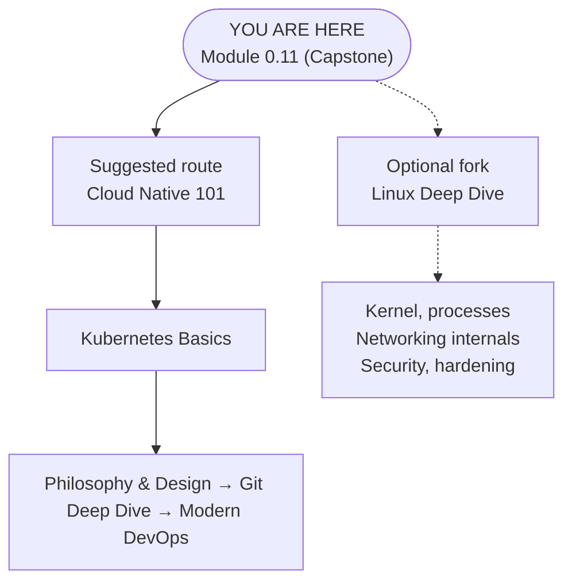

> **Complexity**: `[MEDIUM]` - Capstone project
>
> **Time to Complete**: 90–120 minutes (long-form beginner read + server drills)
>
> **Prerequisites**: [Module 0.1](../module-0.1-what-is-a-computer/) through [Module 0.10](/prerequisites/zero-to-terminal/module-0.10-what-is-the-cloud/) -- all of them

---

## What You'll Be Able to Do

After this module, you will be able to:

- **Deploy** a terminal-driven web server using either a local container or a cloud VM, then explain which process is listening for requests.
- **Trace** an HTTP request from a browser through ports, networking, nginx, the filesystem, and the response path back to the user.
- **Diagnose** common first-server failures with `curl`, `docker ps`, `systemctl`, and careful path inspection.
- **Compare** local Docker deployment and cloud VM deployment, choosing the safer option for a learning goal, a demo, or a real public test.

---

## Why This Module Matters

Hypothetical scenario: you have just finished the first ten modules in this track, and a friend asks whether all that terminal work can actually produce something visible. You could describe files, ports, SSH, packages, and cloud VMs one topic at a time, but the stronger answer is to put a page on a server and let them open it. This capstone turns abstract skills into a running system, which is why the module is about deploying, testing, breaking, and fixing a tiny website rather than reading one more definition.

This exercise uses a pattern found in larger systems: a program receives an HTTP request and returns a response. Production deployments can add layers such as TLS, monitoring and load balancing.

Option A uses an authorized local container with deliberate loopback publication, subject to the Engine and routing caveats below. Option B uses a disposable cloud VM to practice SSH, packages, public addressing, and firewalls. Both teach the request flow; neither a container nor a cloud label alone establishes isolation or correct configuration.

---

## The Skills You've Built

This module is a capstone because it asks earlier concepts to work together at the same time. A web server is not separate from files, commands, networking, cloud, or SSH; it is where those ideas meet in a concrete workflow. If any earlier module felt isolated, this is the place where it should start to feel connected, because one browser refresh depends on almost every skill you have practiced so far.

| Module | Skill | How You'll Use It |
|--------|-------|-------------------|
| 0.1 | How computers work | Understanding what the server is actually doing |
| 0.2 | The terminal | Running commands locally and on the VM |
| 0.3 | Commands | Navigating, creating files, checking status |
| 0.4 | Files and directories | Creating your website's HTML file |
| 0.5 | Editing files | Writing your web page with nano |
| 0.6 | Git basics | Saving versions of your page so a broken edit is easy to undo |
| 0.7 | Networking | Understanding ports, IPs, and how browsers find servers |
| 0.8 | Servers and SSH | Knowing what a server is and connecting to one in Option B |
| 0.9 | Packages | Installing software on a server |
| 0.10 | The cloud | Understanding where your server lives in Option B |

The table is also a diagnostic map. When the browser cannot load your page, you can ask which layer is failing instead of guessing randomly. A file-path problem points back to Modules 0.4 and 0.5, a port problem points back to Module 0.7, a remote-login problem points back to Module 0.8, and an installation problem points back to Module 0.9. Good troubleshooting is often just disciplined memory: name the layer, test that layer, then move to the next one.

Before you continue, pick a path. Choose the local container path to practice on your own machine, or the cloud VM path to practice remote administration and public access. Both require an authorized environment and appropriate configuration.

---

## What a Web Server Actually Does

A web server is a program that waits for network requests and sends back responses. That sounds almost too simple, but the simplicity is the point: the web works because browsers and servers agree on a common protocol, HTTP, for asking and answering. Your browser does not magically read files from another computer. It opens a network connection, sends a structured request, and waits for a server program to decide what response should be returned.

nginx, pronounced "engine-X," is the server program used here. In this exercise it listens for HTTP requests and serves a configured HTML file.

The restaurant analogy from earlier modules still helps, as long as you do not stretch it too far. The browser is the customer asking for a dish, nginx is the waiter receiving the order, the filesystem is the kitchen shelf where prepared dishes are stored, and the HTML file is the dish served to the table. The important detail is that the waiter must be actively on duty. A beautiful HTML file sitting on disk is not a website until a server process is listening for requests and returning it.

For these direct HTTP examples, a browser resolves a domain name if needed, connects to the selected address and port, and sends a request such as `GET /`. The default port is 80 for HTTP and 443 for HTTPS; an explicit port overrides the default. Proxies and other HTTP versions can change the path.

Pause and predict: if nginx is running but the expected file is missing, what might the browser show? Distinguish an HTTP response from a failed connection, while remembering that each symptom can have several causes.

<details>
<summary>Check your prediction</summary>

An HTTP error establishes a response; inspect content and configuration to diagnose a missing file. See [Reading Server Symptoms](#reading-server-symptoms-like-an-operator) for other observations.

</details>

The request path for your first server looks like this. Notice that every arrow has a test you can run later, which is why diagrams are not decoration in operations work. If a system is confusing, draw the path, write the expected handoff at each step, and test the handoffs one at a time.

| Step | Component | Question to Ask | First Test |
|------|-----------|-----------------|------------|
| 1 | Browser | Did I request the correct host and port? | Recheck the URL and port number |
| 2 | Network | Can traffic reach that IP and port? | Use browser error details or `curl` |
| 3 | Server process | Is nginx actually running? | Use `docker ps` or `systemctl status` |
| 4 | Filesystem | Is the file in the path nginx serves? | Inspect the configured web root |
| 5 | Response | Did the server return the expected HTML? | Use `curl` before blaming the browser |

This request model is the same whether nginx runs in a local container or on a cloud VM. The local path adds Docker's port mapping between your host and the container. The cloud path adds SSH, a public IP address, a provider firewall, and a package-managed nginx service. Those additions matter, but they do not change the central idea that an HTTP request must reach a listening process and that process must know which file to serve.

---

## Option A: Local Server with Docker

The local option runs nginx in a Docker container rather than installing nginx directly on the host. Container isolation depends on its configuration; this example publishes a host port to the container.

Use an up-to-date, preconfigured Docker Engine on a local machine you are authorized to use, with a local Docker context; a remote context changes which machine receives containers and published ports. The alternatives below illustrate runtime choices, but this exercise uses Docker's behavior. If no authorized runtime is available, read the examples or ask your instructor for a disposable environment rather than changing a shared machine.

Runtime options include [Docker Desktop](https://www.docker.com/products/docker-desktop/), [OrbStack](https://orbstack.dev/), [Podman Desktop](https://podman-desktop.io/), and [Rancher Desktop](https://rancherdesktop.io/). Check their current terms.

Optional Linux setup belongs only in an authorized disposable VM with a console and a teardown plan. Docker-group membership grants root-level privileges and persists beyond this lesson; starting the daemon also changes host state. Prefer the preconfigured runtime above. The following setup commands are illustrative, not instructions to modify your everyday or shared host.

```text
# Runtime choice 1: Docker
sudo apt update && sudo apt install docker.io -y
sudo systemctl start docker
sudo usermod -aG docker $USER
```

**Important:** After an authorized group change, log out and back in or use `newgrp docker` before relying on the new membership. After practice, tear down the disposable VM through its owner-approved process. Removing the lesson container does not undo installed packages, daemon state, or group privileges; do not blindly remove groups or disable services that other users rely on.

```text
# Runtime choice 2: Podman (no daemon, no root needed)
sudo apt update && sudo apt install podman -y
```

Podman supports many similar commands, but its behavior and configuration can differ. This exercise uses Docker; consult Podman's documentation before adapting it.

These commands use a Bash-compatible shell; on Windows, use an authorized WSL or lab shell rather than pasting them into PowerShell. Check the client, active context, [endpoint details](https://docs.docker.com/reference/cli/docker/context/inspect/), and [Server version](https://docs.docker.com/reference/cli/docker/version/) before creation. `docker --version` reports only the client. Confirm the endpoint belongs to your authorized local runtime and the Server Engine is at least 28.0.0; stop and ask the lab owner if either is unknown or unsuitable. These checks do not eliminate the routing caveat below.

```bash
docker --version
docker context show
docker context inspect
docker version
```

Now run nginx in the background, publishing port 8080 on the local host's IPv4 loopback address. Docker otherwise publishes on all host addresses by default. Use a current Engine: versions older than 28.0.0 have a documented same-L2-network reachability caveat even for localhost publication. Loopback binding is not a substitute for checking custom routing and firewall policy; do not treat this example as an absolute isolation guarantee.

The assignment records the ID returned by successful creation and clears it on failure. Keep this shell and context for copy and cleanup; never populate the variable with an existing container's ID. A collision means choose an unused name, not adopt or delete the existing container. This records your creation result, not a general ownership guarantee. In the command, `$(...)` captures the creation output, while `||` runs the clearing assignment if creation fails. The later `test -n` checks that the captured value is nonempty, and `&&` connects the dependent operation to that check. These guards prevent a failed create from falling through to a familiar default name. They do not verify arbitrary IDs, authorize another person's container, or preserve context across terminal sessions. If you lose this shell or change Docker contexts, stop and recover the creation evidence with your instructor instead of guessing which container to remove.

```bash
lesson_container=$(docker run -d -p 127.0.0.1:8080:80 --name my-website nginx) || lesson_container=''
```

The `-p 127.0.0.1:8080:80` mapping names the host address, host port, and container port. Your browser contacts host port 8080; the image's default configuration listens on container port 80. The untagged `nginx` image uses the mutable `latest` tag, so its contents can change. Use `http://127.0.0.1:8080` if `localhost` resolves to IPv6 on your machine, since this example explicitly binds IPv4.

> **Stop and think**: Consider the concept of network ports from Module 0.7. If a port acts as a dedicated receiving dock for network traffic on your machine, what happens at the operating system level when Docker attempts to bind to port 8080 while another background application is already actively listening on that exact same port?

The bind can fail because the port is already allocated. Choose another unused host port and update the URL. If a failed run may have left a container behind, stop and ask the lab owner to verify its ownership and remove it before reusing the name; do not adopt an unverified container.

Use the browser only after you have a reason to believe the process started. A browser is a friendly interface, but it compresses many different failures into a few vague messages. When you visit the local URL, you are asking the host side of Docker's port mapping to forward an HTTP request into nginx inside the container.

```
http://127.0.0.1:8080
```

You should see an nginx welcome page. That confirms an HTTP response at the URL you requested, not every detail of the deployment. Corroborate it with `docker ps` for your lesson container and its published address/port. Later, serving your distinctive custom page supplies stronger evidence that this request reached the document you intended.

For example, `docker ps` may show this synthetic `PORTS` entry; other columns and values vary:

```text
PORTS
127.0.0.1:8080->80/tcp
```

Before customizing the page, predict what a refresh will show after the copy. Configuration and caches can affect what a client receives, so compare the response with the saved file if the result differs.

Create a fresh disposable workspace under your exclusive control. Run the whole connected block: `&&` runs the next command only after success, so failed creation or navigation prevents opening the editor. Listings display context and the editor opens automatically. Leave existing names untouched and choose an unused name for later paths; do not use `mkdir -p`. Unexpected contents or uncertain ownership mean exit without saving and start fresh.

```bash
cd ~ &&
mkdir kubedojo-first-server &&
cd kubedojo-first-server &&
pwd &&
ls -a &&
nano index.html
```

Paste this page into nano, then save with `Ctrl + O`, press Enter, and exit with `Ctrl + X`. The HTML is intentionally plain so the lesson stays focused on the server path rather than front-end design. You can customize colors and text later after you have confirmed the deployment mechanics.

```html
<!DOCTYPE html>
<html>
<head>
    <title>My First Server</title>
    <style>
        body {
            font-family: Arial, sans-serif;
            max-width: 600px;
            margin: 80px auto;
            text-align: center;
            background-color: #1a1a2e;
            color: #eee;
        }
        h1 { color: #00d4ff; }
        p { font-size: 1.2em; line-height: 1.6; }
        .badge {
            display: inline-block;
            background: #00d4ff;
            color: #1a1a2e;
            padding: 8px 20px;
            border-radius: 20px;
            font-weight: bold;
            margin-top: 20px;
        }
    </style>
</head>
<body>
    <h1>Hello, Internet!</h1>
    <p>This page is running on a server that I set up myself,
       using nothing but the terminal.</p>
    <p>I went from "what is a computer" to "I deployed a website"
       in ten modules.</p>
    <div class="badge">Zero to Terminal: Complete</div>
</body>
</html>
```

Copy the file into the running lesson container using its captured creation ID in the same shell and Docker context. The destination path is not arbitrary: the official nginx Docker image serves static content from `/usr/share/nginx/html/` unless its configuration is changed. Do not substitute an unrelated name or ID when recovering from a failed creation.

```bash
test -n "$lesson_container" && docker cp index.html "$lesson_container:/usr/share/nginx/html/index.html"
```

Refresh `http://127.0.0.1:8080` after the copy completes. Your distinctive page shows that the tested URL returned that content. Corroborate the container and file separately. If the welcome page still appears, check the copy destination and browser URL.

Keep the container running for the Hands-On Exercise. Use this cleanup block when Task 3 requests it and after the exercise. Stop and remove only the container you created for this lesson. If the name was already occupied or creation failed, stop rather than adopting or removing another container. Your workspace's `index.html` remains on the host; container removal does not remove it or undo host runtime setup. If the variable is empty, the guard does nothing; stop and recover the creation evidence with your instructor.

```bash
test -n "$lesson_container" && docker stop "$lesson_container" && docker rm "$lesson_container" && lesson_container=''
```

You can repeat the local exercise with a different port, copying the page again after creating the replacement container. Compare the URL, published port and response each time.

---

## Option B: Cloud Server with SSH and nginx

The cloud option deliberately adds a public endpoint, unlike Option A's intended loopback publication. Use only an authorized disposable VM: SSH, package installation, firewall policy, and billing each introduce decisions that the local path does not teach.

Free tiers change over time, so check the provider's current pricing and eligibility before creating anything. Use only an authorized disposable lab VM, record its related resources, and agree on teardown first. Stopping compute is not complete cleanup: retained resources may remain billable, so follow the inventory and verification steps below rather than assuming a free-tier label guarantees no charges.

This path requires an instructor-provisioned authorized disposable Ubuntu VM, or one you create using your provider's official quickstart, such as the [EC2 getting-started guide](https://docs.aws.amazon.com/AWSEC2/latest/UserGuide/EC2_GetStarted.html). Otherwise read the example without executing it. Before connecting, obtain the public IP, the image's login user and the private key; protect the key. Arrange authorized inbound HTTP on port 80 and SSH on port 22, restricting SSH to your trusted source address where the provider allows it. Check current eligibility and charges before creating resources.

When you download the SSH key, your computer may save it with permissions that SSH considers too open. The `chmod` command sets owner-read permission and removes group and other permissions; protect the key separately from disclosure. The `ssh` command attempts authentication with that key to the remote Ubuntu account.

```bash
chmod 400 ~/Downloads/my-key.pem
ssh -i ~/Downloads/my-key.pem YOUR_USER@YOUR_PUBLIC_IP
```

Replace `YOUR_PUBLIC_IP`, `YOUR_USER`, and the key path with the values for your VM. The login user depends on the provider and image; for example, AWS lists `ubuntu` for its Ubuntu images. If the command succeeds, subsequent commands run on the cloud VM, not on your laptop.

Install nginx with the package manager. `apt update` refreshes the package index, and `apt install nginx -y` requests installation with automatic confirmation. Check the service state after installation; startup can depend on the environment.

```bash
sudo apt update
sudo apt install nginx -y
```

Check the service state from the VM before opening a browser. `systemctl status` reports the service manager's state and recent log information. It does not prove that the provider firewall allows outside traffic.

```bash
sudo systemctl status nginx
```

Pause and predict: nginx is active on the VM but an outside browser times out. What does a local HTTP test add, and which endpoint, listener, routing, or filtering checks would you make next? Separate observations from hypotheses before opening the reveal.

<details>
<summary>Check your prediction</summary>

Compare `curl http://localhost` inside the VM with the intended page. Local success supports that request path, not every listener address or the external endpoint. Timeout does not identify a firewall fault: inspect the public address, listener binding, routes, and policy before changing configuration.

</details>

Open your browser on your own computer and visit the public IP using plain HTTP. `localhost` normally refers to the client machine's loopback address; use the assigned public endpoint for this external test.

```
http://YOUR_PUBLIC_IP
```

A welcome page demonstrates an HTTP response; corroborate the intended VM and listener separately. See [Reading Server Symptoms](#reading-server-symptoms-like-an-operator) if it fails.

Edit the default page on the VM. Ubuntu's nginx package serves files from `/var/www/html/` by default, which differs from the official nginx Docker image path you used earlier. That difference is not a contradiction; it is configuration. The same nginx program can serve different directories depending on how it was packaged and configured.

```bash
sudo nano /var/www/html/index.html
```

Create or replace the file's content with the cloud version of your page. Another configured index file can affect which page appears; check the actual configuration if your page does not appear.

```html
<!DOCTYPE html>
<html>
<head>
    <title>My First Cloud Server</title>
    <style>
        body {
            font-family: Arial, sans-serif;
            max-width: 600px;
            margin: 80px auto;
            text-align: center;
            background-color: #1a1a2e;
            color: #eee;
        }
        h1 { color: #00d4ff; }
        p { font-size: 1.2em; line-height: 1.6; }
        .badge {
            display: inline-block;
            background: #00d4ff;
            color: #1a1a2e;
            padding: 8px 20px;
            border-radius: 20px;
            font-weight: bold;
            margin-top: 20px;
        }
    </style>
</head>
<body>
    <h1>Hello, Internet!</h1>
    <p>This page is running on a real cloud server that I set up myself,
       using nothing but SSH and the terminal.</p>
    <p>I went from "what is a computer" to "I deployed a website
       on the internet" in ten modules.</p>
    <div class="badge">Zero to Terminal: Complete</div>
</body>
</html>
```

A distinctive page at the authorized public URL supports that this request returned your intended content. It does not independently prove the VM, firewall rules, listener, or filesystem path; corroborate these with provider inventory, service configuration, and the saved file when diagnosing a mismatch.

Stop and think: the web server translates URL paths into filesystem paths under a configured web root. If nginx maps the root URL `/` to `/var/www/html/`, what browser path would request an image saved at `/var/www/html/assets/logo.png`? The answer is not the full Linux path, because the browser never sees the server's private directory layout; it sees the URL path that nginx maps into that directory.

The path is `/assets/logo.png`, under the stated mapping.

Use `curl` when the browser result is ambiguous. A browser renders HTML, caches resources, hides some headers, and may retry requests in ways that obscure the simple request-response exchange. `curl` makes the exchange plain by sending an HTTP request and printing the response body or status information in the terminal, which is why it is a favorite first diagnostic tool for web servers.

For the cloud path, run `curl http://localhost` inside the SSH session to observe that local request path. A successful response supports that request only; it does not prove complete nginx or filesystem health. Then run `curl http://YOUR_PUBLIC_IP` from your own machine as a separate observation of the external path. Compare the results with inventory, configuration and logs before attributing a difference to the firewall or another component.

After the Hands-On Exercise, disconnect and inventory the resources created specifically for this authorized disposable lab. Terminate/delete the VM and review its owned retained disks, snapshots, reserved/public addresses, and other billable resources; release only those no longer needed and authorized for removal. Verify the resource inventory and billing afterward, allowing for reporting delay. Stopping compute or deleting one VM does not guarantee zero charges, and unrelated resources must remain untouched.

```bash
exit
```

---

## Reading Server Symptoms Like an Operator

Once you have seen both deployment paths, the most valuable practice is learning to read symptoms without panic. A server failure usually gives you clues about which layer rejected, ignored, or never received the request. Beginners often collapse every symptom into "nginx is broken," but an operator separates the path into client, host, port, process, configuration, and file. That separation is what turns troubleshooting from superstition into a repeatable method.

Start with the wording and timing of the failure. A refusal suggests a missing listener or active rejection, possibly by an intermediary; it does not identify the rejecting device. A timeout leaves routing, filtering, availability, and addressing as hypotheses. An HTTP error response establishes an exchange with a responder, so inspect the endpoint, request, routing, permissions, and served content before choosing a cause.

For example, a failed `curl` request might produce this synthetic output; wording and timing vary:

```text
curl: (7) Failed to connect to 127.0.0.1 port 8080: Connection refused
```

The local Docker path gives you a clean place to practice this reading. If `localhost:8080` refuses the connection, check the published address and port, the container, and IPv4 versus IPv6 resolution. If `127.0.0.1:9090` works after you used `-p 127.0.0.1:9090:80`, the client URL was mismatched. If the welcome page appears after copying your file, inspect the copy destination and served file before changing ports.

The cloud VM path adds a different diagnostic split. If local `curl` succeeds while an outside request times out, compare the requested address, listener binding, client path, and access policy; local success alone does not identify a firewall fault. If the local request fails, investigate that path before changing provider rules. Inside-out tests narrow the evidence without turning one successful response into a complete health verdict.

It also helps to name the authority for each fact. Docker is the authority for whether a container exists and which host ports are published. `systemctl` is the authority for whether Ubuntu thinks the nginx service is active. The cloud console is the authority for provider firewalls and public IP assignment. The filesystem is the authority for whether `index.html` exists in the web root. `curl` is the authority for what a simple HTTP client receives from a specific URL at a specific moment.

Before changing anything, compare the URL with the published port, inspect the configured web root and saved file, and compare local and external responses. Each observation has a scope: even a matching response does not by itself identify the process or file that supplied it.

Production deployments can add load balancers, TLS, logs and other layers. Define the expected path, compare observations at each layer, and record what each test actually establishes.

The exercise asks you to change one thing at a time and record the result. A changed port or renamed file gives you a hypothesis to test, but the observed response still depends on the rest of the environment.

Keep explanations concrete. "The server is down" is vague. "The service manager reports nginx active, local `curl` returns my HTML, but external HTTP times out" records separate observations without assigning the timeout to one cause.

---

## Patterns & Anti-Patterns

Test from the inside outward: inspect service state, compare a local response with the expected content, then test the client path. Corroborate the process and file separately; a response alone does not identify them.

| Pattern | When to Use It | Why It Works |
|---------|----------------|--------------|
| Test inside-out | Browser cannot reach a page | Compares local and external observations before diagnosing a component |
| Keep paths explicit | Learning a new runtime or package layout | Makes it easier to compare Docker and Ubuntu nginx paths |
| Prefer the smallest useful environment | Practicing a concept for the first time | Avoids adding a cloud account when it is not needed |

Avoid treating defaults as universal; inspect the actual configuration. Plan cleanup before creating public resources.

---

## Decision Framework

Use the local container path for fast feedback and deliberate loopback publication, subject to the Engine and routing caveats above. It is a good first choice for connecting files, ports, nginx, and browser requests. Remove only containers you created for this lesson; a disposable container does not make existing host files or runtime configuration disposable.

Use the cloud VM path when the learning objective includes remote administration. SSH key permissions, package installation, service state, public IP addresses, and cloud firewalls are not side details; they are the reason to choose the VM path. The tradeoff is that you must be more careful with billing, cleanup, and public reachability.

| Decision | Choose Local Docker | Choose Cloud VM |
|----------|---------------------|-----------------|
| Need no cloud signup | With a prepared runtime | No |
| Need deliberate public reachability | Not this loopback setup's intent | Yes, with authorized policy |
| Want to practice SSH | No | Yes |
| Want to avoid a cloud account | Often possible with a prepared runtime | Provider account required |
| Want remote administration practice | Not in this path | Yes |

Which approach would you choose here and why: you need to demonstrate to a nontechnical friend that your terminal can publish a visible page within ten minutes, but you do not want to create any accounts or risk charges. Commit to your answer before opening the reveal.

<details>
<summary>Check your answer</summary>

With an already configured runtime, local Docker fits the stated goal. A cloud VM adds account and billing considerations. For a friend on another network, use an authorized public endpoint and verify its reachability and access policy.

</details>

---

## Did You Know?

- [**The first website ever made is still online.**](https://first-website.web.cern.ch/) Tim Berners-Lee created the first website at CERN during the Web's earliest days. It was [served from a NeXT computer with a handwritten note taped to it: "This machine is a server. DO NOT POWER IT DOWN!!"](https://home.cern/science/computing/the-birth-of-the-web/short-history-web/), and you can still visit the historical copy at [info.cern.ch](http://info.cern.ch).
- **nginx was created to address a scaling problem.** The [NGINX history](https://blog.nginx.org/blog/celebrating-20-years-of-nginx) describes Igor Sysoev's early work in 2002 and the C10K problem of handling more than 10,000 concurrent connections.
- **Port 80 is conventional, not magical.** HTTP clients assume port 80 when a URL starts with `http://` and does not specify a port, but a server can listen on another port if the client includes it explicitly. That is why the Docker path uses `http://127.0.0.1:8080` while the cloud path uses `http://YOUR_PUBLIC_IP` without a port suffix.
- **nginx can serve different directories.** The official nginx Docker image serves from `/usr/share/nginx/html/` by default, while Ubuntu's nginx package commonly serves from `/var/www/html/`. The configured root determines the path.

---

## Common Mistakes

| Mistake | Why It Happens | How to Fix It |
|---------|----------------|---------------|
| Assuming SSH access proves HTTP access | Access rules and listeners can differ by port | Inspect the endpoint, listener and authorized network policy before changing a rule |
| Using `http://localhost` for the cloud option | `localhost` normally resolves to the client machine's loopback address | Use the VM's public IP address when testing from your own computer |
| Editing the wrong `index.html` path | Docker and Ubuntu package layouts use different web roots | Use `/usr/share/nginx/html/index.html` for the official nginx container and `/var/www/html/index.html` for Ubuntu nginx |
| Cannot save the cloud page | The account may lack write permission for the file or directory | Inspect ownership and permissions; use `sudo nano /var/www/html/index.html` if authorized and appropriate, or deliberately adjust access |
| Mapping the wrong Docker ports | Host address, host port, and container port serve different roles | Use `-p 127.0.0.1:8080:80` and visit `http://127.0.0.1:8080` |
| Blaming the browser before testing the server | Browser errors hide whether the failure is process, port, firewall, or file path | Use `docker ps`, `systemctl status nginx`, and `curl` to isolate the failing layer |
| Leaving cloud resources after practice | Disks, snapshots, and addresses can outlive a VM and remain billable | Teardown only owned lab resources, inspect retained allocations, and verify inventory and billing afterward |

---

## Quiz

<details>
<summary>1. Your local Docker deployment says the container started, but `http://localhost:8080` gives a connection error. How do you diagnose the path without guessing?</summary>

Inspect your successfully created container and expect `127.0.0.1:8080->80/tcp`. Test `http://127.0.0.1:8080`; if that works while `localhost` fails, check IPv4 versus IPv6 resolution before republishing. Check container state and context if neither works. Do not switch to `0.0.0.0` as a repair: that broadens the listening address.
</details>

<details>
<summary>2. You copied `index.html` into `/var/www/html/index.html` inside the official nginx container, but the welcome page still appears. What went wrong, and how do you fix it?</summary>

The official nginx image uses `/usr/share/nginx/html/` by default. Use the guarded copy block with the ID returned by your own successful creation to place the file there, then check the response. Container and Ubuntu package defaults differ; verify the actual configuration rather than copying to a familiar but unrelated path.
</details>

<details>
<summary>3. Your cloud VM shows `active (running)` for nginx, but a coworker on another network sees a timeout when visiting the public IP. What should you check next?</summary>

A running process does not establish external reachability. Compare local HTTP with the outside request, then verify the public endpoint, listener binding, routing, and access policy. Local success narrows the investigation but does not identify a firewall fault; inspect exact errors before selecting a repair.
</details>

<details>
<summary>4. You need to explain the request path for `http://YOUR_PUBLIC_IP` to a teammate. What steps should your explanation include?</summary>

In the intended direct path, the browser connects to the IP on port 80 and requests `/`. Network policy must allow the request to reach the listener. nginx uses its configuration to select content and returns a response. A response alone does not establish which machine or file supplied it; corroborate those separately.
</details>

<details>
<summary>5. You have an authorized, configured Docker runtime and need a repeatable demo on your laptop without a cloud account. Which path fits?</summary>

With an authorized, already configured runtime and suitable terms, choose local Docker for this demo. It avoids creating a cloud account, but neither safety nor freedom from costs is guaranteed by the runtime alone.
</details>

<details>
<summary>6. You edited the cloud page with nano and saved it, but the browser still shows the old default page. What exact checks help you decide whether this is a file, service, or URL issue?</summary>

Confirm the edited file and configured web root on the VM. Compare `curl http://localhost` inside the SSH session with the browser response and check the public URL. An old local response can have several causes, including a different listener, configuration, file or cache; inspect the evidence before choosing a repair.
</details>

<details>
<summary>7. You replaced the lesson container with one mapped to `127.0.0.1:9090:80`, then visited `http://127.0.0.1:8080`. What does that URL test, and how can you reach the replacement?</summary>

The replacement maps loopback port 9090 to container port 80, so the old URL no longer selects that mapping. Another listener could still answer on 8080. Visit `http://127.0.0.1:9090` or use the guarded cleanup, create and copy blocks with `-p 127.0.0.1:8080:80` if the original port is required.
</details>

---

## Hands-On Exercise: Make It Yours

Exercise scenario: you have deployed the template page and now need to prove that you can customize, test, break, diagnose, and repair a first server without relying on a GUI website builder. Choose either the local Docker path or the cloud VM path from the module, then keep a short troubleshooting log as you work. The log can be a few lines in a text file, but it should record the URL you tested, the symptom you observed, the command you ran, and the conclusion you reached.

### Task 1: Customize the Page

Update your page so it includes your name or a pseudonym, three things you learned in this track, and one link to a site you would actually revisit. The goal is not visual polish; the goal is proving that you can edit a file, place it in the correct web root, and make nginx serve the version you intended.

```html
<a href="https://kubedojo.dev" style="color: #00d4ff;">KubeDojo</a>
```

<details>
<summary>Hint</summary>

Which file did you edit in your chosen path, and how does its content reach nginx?
</details>

<details>
<summary>Solution guidance</summary>

For local Docker, confirm your owned workspace with `pwd`, edit `index.html`, and use the guarded copy block with your captured container ID. For the authorized disposable VM, edit `/var/www/html/index.html` over SSH. Refresh the correct URL and compare responses; a distinctive temporary sentence can help identify the saved content being served.
</details>

### Task 2: Test Before You Trust the Browser

Use a terminal-based HTTP test before relying on the browser. For local Docker, test the host URL you published, `http://127.0.0.1:8080`. For the cloud VM, test `http://localhost` from inside the SSH session and then test the authorized public endpoint from your own machine to compare local and external responses.

<details>
<summary>Hint</summary>

Which command in the cloud section prints the response in the terminal?
</details>

<details>
<summary>Solution guidance</summary>

Compare the returned HTML with your custom text. That response supports the tested request path; it does not independently identify the serving process or file. If the terminal cannot connect, inspect the endpoint, process and port before editing HTML again.
</details>

### Task 3: Break the Deployment Deliberately

For Option A, use the guarded cleanup block, then repeat the guarded create assignment with `127.0.0.1:9090:80` instead of `127.0.0.1:8080:80`. This records the replacement ID for copying and cleanup; stop on failure. Record the old URL's symptom. For Option B, rename the web root file only on your disposable lab VM:

```bash
sudo mv /var/www/html/index.html /var/www/html/broken.html
```

After the rename, test the root URL and compare the response with the previous page. Configuration, another index file or a cache can affect the result.

The objective is to observe whether your custom content disappears, not to guarantee an HTTP error. If a welcome page appears, record that observation too.

<details>
<summary>Hint</summary>

Compare the URL's port or the requested file with the value you changed.
</details>

<details>
<summary>Solution guidance</summary>

The replacement Docker mapping uses 9090, not 8080; another service may still answer on 8080. On the VM, compare the configured root and service state after the rename. The response depends on the configuration and any other matching index files.
</details>

### Task 4: Repair and Explain the System

Repair the deployment so the original expected URL works again. Then explain the request path out loud or in writing, starting with the browser and ending with the HTML response. Include the port, nginx, and the filesystem path in the explanation, because those are the layers most beginners accidentally skip.

<details>
<summary>Hint</summary>

Reverse the change in Task 3, then test the same URL again.
</details>

<details>
<summary>Solution guidance</summary>

For Docker, use the guarded cleanup and original create blocks to restore `127.0.0.1:8080:80`, then use the guarded copy block with the new ID. For the lab VM, restore `/var/www/html/index.html` and compare local and external responses. Explain the changed observation and why the repair addresses that layer.
</details>

### Task 5: Clean up

After testing, use the Option A cleanup block for your captured container, or follow the Option B teardown and billing inventory instructions. Remove only resources you own and are authorized to remove.

### Success Criteria

- [ ] Your custom page loads in a browser at either `http://127.0.0.1:8080` or the authorized VM public endpoint.
- [ ] The page includes your name or pseudonym, three track takeaways, and at least one link.
- [ ] You edited the page through the terminal and placed it in the correct nginx web root.
- [ ] You used a terminal HTTP test to confirm the server response before or alongside the browser.
- [ ] You deliberately broke the server, recorded the symptom, diagnosed the layer, and repaired it.
- [ ] You can compare the local Docker path with the cloud VM path using ports, files, SSH, and firewall concepts.
- [ ] You completed the cleanup for your chosen path.

The success criteria ask you to explain and test the request path as well as load the page. Different faults can produce similar symptoms, so record the evidence before choosing a cause.

---

## Sources

- [Docker port publishing and localhost limitations](https://docs.docker.com/engine/network/port-publishing/)
- [HTTP semantics, RFC 9110](https://www.rfc-editor.org/rfc/rfc9110)
- [Ubuntu: install and configure nginx](https://ubuntu.com/tutorials/install-and-configure-nginx)
- [Docker Linux post-installation: docker-group privileges](https://docs.docker.com/engine/install/linux-postinstall/)
- [AWS EC2: Stop and start instances, including retained-resource charges](https://docs.aws.amazon.com/AWSEC2/latest/UserGuide/how-ec2-instance-stop-start-works.html)

- [Docker Desktop](https://www.docker.com/products/docker-desktop/)
- [Docker run reference](https://docs.docker.com/reference/cli/docker/container/run/)
- [Docker: port already allocated](https://docs.docker.com/desktop/troubleshoot-and-support/troubleshoot/topics/#port-already-allocated-errors)
- [Docker container listing](https://docs.docker.com/reference/cli/docker/container/ls/)
- [curl: connection refusal example](https://curl.se/mail/lib-2017-02/0075.html)
- [AWS: connection prerequisites and image usernames](https://docs.aws.amazon.com/AWSEC2/latest/UserGuide/connection-prereqs-general.html)
- [AWS: security group rules](https://docs.aws.amazon.com/AWSEC2/latest/UserGuide/security-group-rules-reference.html)
- [nginx Docker Official Image overview](https://hub.docker.com/_/nginx)
- [nginx official site](https://nginx.org/en/)
- [A typical HTTP session](https://developer.mozilla.org/en-US/docs/Web/HTTP/Guides/Session?hl=en-US)
- [CERN: Restoring the first website](https://first-website.web.cern.ch/)
- [A short history of the Web](https://home.cern/science/computing/the-birth-of-the-web/short-history-web/)
- [The birth of the Web](https://home.cern/science/computing/the-birth-of-the-web)
- [First website historical copy](http://info.cern.ch)

---

## Next Module

You have finished **Zero to Terminal**. On the suggested prerequisites route, continue into **[Cloud Native 101](/prerequisites/cloud-native-101/module-1.1-what-are-containers/)** and then **[Kubernetes Basics](/prerequisites/kubernetes-basics/module-1.1-first-cluster/)** to turn this first-server capstone into containers and hands-on cluster work.

**Optional:** [Linux Fundamentals](/linux/) deepens kernel, process, networking, and security knowledge if you want a systems fork—not required before Cloud Native 101.



Cloud Native 101 shows how containers and orchestration turn single-server lessons into repeatable deployment patterns. Linux deepens the same request-response model at the operating-system layer. If you are following the hub route, start with Cloud Native 101 and treat Linux as a parallel option you can pick up anytime.
