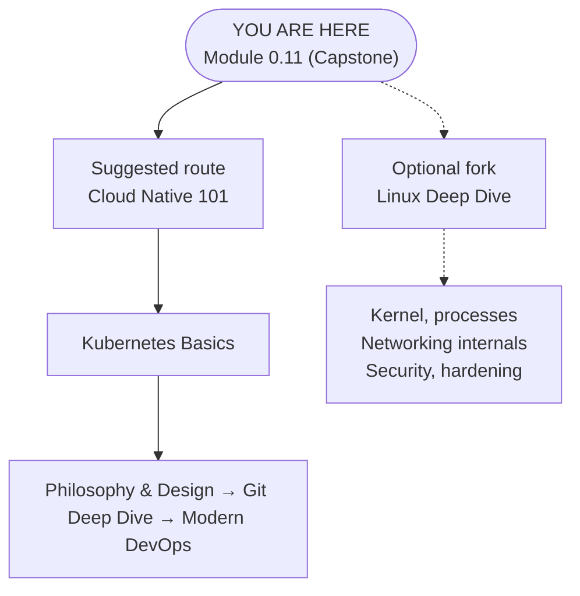

> **Complexity**: `[MEDIUM]` - Capstone project
>
> **Time to Complete**: 90–120 minutes (long-form beginner read + server drills)
>
> **Prerequisites**: [Module 0.1](../module-0.1-what-is-a-computer/) through [Module 0.10](/prerequisites/zero-to-terminal/module-0.10-what-is-the-cloud/) -- all of them

---

## What You'll Be Able to Do

After this module, you will be able to:

- **Deploy** a terminal-driven web server using either a local container or a cloud VM, then explain which process is listening for requests.
- **Trace** an HTTP request from a browser through ports, networking, nginx, the filesystem, and the response path back to the user.
- **Diagnose** common first-server failures with `curl`, `docker ps`, `systemctl`, port checks, firewall checks, and careful path inspection.
- **Compare** local Docker deployment and cloud VM deployment, choosing the safer option for a learning goal, a demo, or a real public test.

---

## Why This Module Matters

Hypothetical scenario: you have just finished the first ten modules in this track, and a friend asks whether all that terminal work can actually produce something visible. You could describe files, ports, SSH, packages, and cloud VMs one topic at a time, but the stronger answer is to put a page on a server and let them open it. This capstone turns abstract skills into a running system, which is why the module is about deploying, testing, breaking, and fixing a tiny website rather than reading one more definition.

That small website is not a toy in the sense that it uses different fundamentals from professional systems. A production platform has more layers, stricter security, automation, monitoring, TLS certificates, multiple environments, and usually Kubernetes 1.35+ somewhere later in the KubeDojo journey. Underneath those layers, though, the same chain still appears: a program listens on a port, receives an HTTP request, reads or generates content, and sends a response back over the network.

Option A uses an authorized local container with deliberate loopback publication, subject to the Engine and routing caveats below. Option B uses a disposable cloud VM to practice SSH, packages, public addressing, and firewalls. Both teach the request flow; neither a container nor a cloud label alone establishes isolation or correct configuration.

---

## The Skills You've Built

This module is a capstone because it asks earlier concepts to work together at the same time. A web server is not separate from files, commands, networking, cloud, or SSH; it is where those ideas meet in a concrete workflow. If any earlier module felt isolated, this is the place where it should start to feel connected, because one browser refresh depends on almost every skill you have practiced so far.

| Module | Skill | How You'll Use It |
|--------|-------|-------------------|
| 0.1 | How computers work | Understanding what the server is actually doing |
| 0.2 | The terminal | Your only interface for this entire project |
| 0.3 | Commands | Navigating, creating files, checking status |
| 0.4 | Files and directories | Creating your website's HTML file |
| 0.5 | Editing files | Writing your web page with nano |
| 0.6 | Git basics | Saving versions of your page so a broken edit is easy to undo |
| 0.7 | Networking | Understanding ports, IPs, and how browsers find servers |
| 0.8 | Servers and SSH | Knowing what a server is and connecting to one in Option B |
| 0.9 | Packages | Installing software on a server |
| 0.10 | The cloud | Understanding where your server lives in Option B |

The table is also a diagnostic map. When the browser cannot load your page, you can ask which layer is failing instead of guessing randomly. A file-path problem points back to Modules 0.4 and 0.5, a port problem points back to Module 0.7, a remote-login problem points back to Module 0.8, and an installation problem points back to Module 0.9. Good troubleshooting is often just disciplined memory: name the layer, test that layer, then move to the next one.

Before you continue, pick a path for the first pass. Choose the local container path if you want the fastest and safest proof that a server can run on your own machine. Choose the cloud VM path if you specifically want the experience of publishing a page that someone else can reach from another network. You can do both, and doing both is valuable because the differences make the shared concepts easier to see.

---

## What a Web Server Actually Does

A web server is a program that waits for network requests and sends back responses. That sounds almost too simple, but the simplicity is the point: the web works because browsers and servers agree on a common protocol, HTTP, for asking and answering. Your browser does not magically read files from another computer. It opens a network connection, sends a structured request, and waits for a server program to decide what response should be returned.

nginx, pronounced "engine-X," is the server program you will use today. It is popular because it was designed around efficient connection handling, simple static-file serving, and flexible configuration, which makes it useful for tiny exercises and large production systems. In this module nginx will do one narrow job: listen for HTTP traffic, map a URL path to an HTML file, read that file from disk, and send it back with the headers your browser expects.

The restaurant analogy from earlier modules still helps, as long as you do not stretch it too far. The browser is the customer asking for a dish, nginx is the waiter receiving the order, the filesystem is the kitchen shelf where prepared dishes are stored, and the HTML file is the dish served to the table. The important detail is that the waiter must be actively on duty. A beautiful HTML file sitting on disk is not a website until a server process is listening for requests and returning it.

When you type a URL, several decisions happen quickly. If the URL contains a domain, DNS turns the name into an IP address; if the URL contains a raw IP address, that step is already done. The browser chooses a port, usually port 80 for HTTP and port 443 for HTTPS, then opens a TCP connection to the server. After the connection exists, the browser sends an HTTP request such as "GET /", and nginx turns that slash path into a file lookup.

Pause and predict: if nginx is running correctly but the file it expects is missing, what do you think the browser should show? Your answer should separate the network layer from the application layer. A missing file is different from a closed port, and a closed port is different from a cloud firewall timeout, even though all three can feel like "the website is broken" when you are staring at a browser tab. Commit to your answer before opening the reveal.

<details>
<summary>Check your prediction</summary>

An HTTP error establishes a response; inspect content and configuration to diagnose a missing file. Refusal suggests a missing listener or active rejection, possibly by an intermediary. Timeout leaves routing, filtering, addressing, and availability as hypotheses. Symptoms guide checks rather than proving one cause or repair.

</details>

The request path for your first server looks like this. Notice that every arrow has a test you can run later, which is why diagrams are not decoration in operations work. If a system is confusing, draw the path, write the expected handoff at each step, and test the handoffs one at a time.

| Step | Component | Question to Ask | First Test |
|------|-----------|-----------------|------------|
| 1 | Browser | Did I request the correct host and port? | Recheck the URL and port number |
| 2 | Network | Can traffic reach that IP and port? | Use browser error details or `curl` |
| 3 | Server process | Is nginx actually running? | Use `docker ps` or `systemctl status` |
| 4 | Filesystem | Is the file in the path nginx serves? | Inspect the configured web root |
| 5 | Response | Did the server return the expected HTML? | Use `curl` before blaming the browser |

This request model is the same whether nginx runs in a local container or on a cloud VM. The local path adds Docker's port mapping between your host and the container. The cloud path adds SSH, a public IP address, a provider firewall, and a package-managed nginx service. Those additions matter, but they do not change the central idea that an HTTP request must reach a listening process and that process must know which file to serve.

---

## Option A: Local Server with Docker

The local option uses a container runtime to run nginx without permanently installing nginx directly into your operating system. Docker, Podman, OrbStack, and Rancher Desktop package the application and its filesystem into an isolated environment called a container. You do not need to master container internals yet, but you do need the operational idea: a container has its own process space and filesystem, while your computer remains the host that forwards traffic into it.

Use an up-to-date, preconfigured Docker Engine on a local machine you are authorized to use, with a local Docker context; a remote context changes which machine receives containers and published ports. The alternatives below illustrate runtime choices, but this exercise uses Docker's behavior. If no authorized runtime is available, read the examples or ask your instructor for a disposable environment rather than changing a shared machine.

| Tool | Best for | License |
|------|----------|---------|
| [Docker Desktop](https://www.docker.com/products/docker-desktop/) | Most popular, biggest community | Free for personal/small business |
| [OrbStack](https://orbstack.dev/) | macOS option | Free for personal use |
| [Podman Desktop](https://podman-desktop.io/) | No daemon, rootless by default | Free and open source |
| [Rancher Desktop](https://rancherdesktop.io/) | Includes K8s built-in | Free and open source |

Optional Linux setup belongs only in an authorized disposable VM with a console and a teardown plan. Docker-group membership grants root-level privileges and persists beyond this lesson; starting the daemon also changes host state. Prefer the preconfigured runtime above. The following setup commands are illustrative, not instructions to modify your everyday or shared host.

```text
# Runtime choice 1: Docker
sudo apt update && sudo apt install docker.io -y
sudo systemctl start docker
sudo usermod -aG docker $USER
```

**Important:** After an authorized group change, log out and back in or use `newgrp docker` before relying on the new membership. After practice, tear down the disposable VM through its owner-approved process. Removing the lesson container does not undo installed packages, daemon state, or group privileges; do not blindly remove groups or disable services that other users rely on.

```text
# Runtime choice 2: Podman (no daemon, no root needed)
sudo apt update && sudo apt install podman -y
```

If you install Podman, the commands are conceptually identical, but you type `podman` instead of `docker`. Some engineers make an interactive shell shortcut so old Docker examples call Podman, but shortcuts are not a learning requirement and they can make copied examples less clear. In this module, the command examples keep the explicit `docker` name so each line shows the tool being invoked.

These commands use a Bash-compatible shell; on Windows, use an authorized WSL or lab shell rather than pasting them into PowerShell. Check the client, active context, [endpoint details](https://docs.docker.com/reference/cli/docker/context/inspect/), and [Server version](https://docs.docker.com/reference/cli/docker/version/) before creation. `docker --version` reports only the client. Confirm the endpoint belongs to your authorized local runtime and the Server Engine is at least 28.0.0; stop and ask the lab owner if either is unknown or unsuitable. These checks do not eliminate the routing caveat below.

```bash
docker --version
docker context show
docker context inspect
docker version
```

Now run nginx in the background, publishing port 8080 on the local host's IPv4 loopback address. Docker otherwise publishes on all host addresses by default. Use a current Engine: versions older than 28.0.0 have a documented same-L2-network reachability caveat even for localhost publication. Loopback binding is not a substitute for checking custom routing and firewall policy; do not treat this example as an absolute isolation guarantee.

The assignment records the ID returned by successful creation and clears it on failure. Keep this shell and context for copy and cleanup; never populate the variable with an existing container's ID. A collision means choose an unused name, not adopt or delete the existing container. This records your creation result, not a general ownership guarantee. In the command, `$(...)` captures the creation output, while `||` runs the clearing assignment if creation fails. The later `test -n` checks that the captured value is nonempty, and `&&` connects the dependent operation to that check. These guards prevent a failed create from falling through to a familiar default name. They do not verify arbitrary IDs, authorize another person's container, or preserve context across terminal sessions. If you lose this shell or change Docker contexts, stop and recover the creation evidence with your instructor instead of guessing which container to remove.

```bash
lesson_container=$(docker run -d -p 127.0.0.1:8080:80 --name my-website nginx) || lesson_container=''
```

The `-p 127.0.0.1:8080:80` mapping names the host address, host port, and container port. Your browser contacts host port 8080; nginx listens on container port 80. Use `http://127.0.0.1:8080` if `localhost` resolves to IPv6 on your machine, since this example explicitly binds IPv4.

> **Stop and think**: Consider the concept of network ports from Module 0.7. If a port acts as a dedicated receiving dock for network traffic on your machine, what happens at the operating system level when Docker attempts to bind to port 8080 while another background application is already actively listening on that exact same port?

Use the browser only after you have a reason to believe the process started. A browser is a friendly interface, but it compresses many different failures into a few vague messages. When you visit the local URL, you are asking the host side of Docker's port mapping to forward an HTTP request into nginx inside the container.

```
http://127.0.0.1:8080
```

You should see an nginx welcome page. That confirms an HTTP response at the URL you requested, not every detail of the deployment. Corroborate it with `docker ps` for your lesson container and its published address/port. Later, serving your distinctive custom page supplies stronger evidence that this request reached the document you intended.

Before you customize the page, make a prediction about file serving. Does nginx load every HTML file into memory once at startup, or does it read the requested file when a request arrives? The practical consequence matters: if nginx reads the file on request, replacing `index.html` should change the next browser refresh without restarting the container. If nginx cached the file permanently at startup, your edit would not appear until the server restarted.

Create a fresh disposable workspace under your exclusive control. Run the whole connected block: `&&` runs the next command only after success, so failed creation or navigation prevents opening the editor. Listings display context and the editor opens automatically. Leave existing names untouched and choose an unused name for later paths; do not use `mkdir -p`. Unexpected contents or uncertain ownership mean exit without saving and start fresh.

```bash
cd ~ &&
mkdir kubedojo-first-server &&
cd kubedojo-first-server &&
pwd &&
ls -a &&
nano index.html
```

Paste this page into nano, then save with `Ctrl + O`, press Enter, and exit with `Ctrl + X`. The HTML is intentionally plain so the lesson stays focused on the server path rather than front-end design. You can customize colors and text later after you have confirmed the deployment mechanics.

```html
<!DOCTYPE html>
<html>
<head>
    <title>My First Server</title>
    <style>
        body {
            font-family: Arial, sans-serif;
            max-width: 600px;
            margin: 80px auto;
            text-align: center;
            background-color: #1a1a2e;
            color: #eee;
        }
        h1 { color: #00d4ff; }
        p { font-size: 1.2em; line-height: 1.6; }
        .badge {
            display: inline-block;
            background: #00d4ff;
            color: #1a1a2e;
            padding: 8px 20px;
            border-radius: 20px;
            font-weight: bold;
            margin-top: 20px;
        }
    </style>
</head>
<body>
    <h1>Hello, Internet!</h1>
    <p>This page is running on a server that I set up myself,
       using nothing but the terminal.</p>
    <p>I went from "what is a computer" to "I deployed a website"
       in ten modules.</p>
    <div class="badge">Zero to Terminal: Complete</div>
</body>
</html>
```

Copy the file into the running lesson container using its captured creation ID in the same shell and Docker context. The destination path is not arbitrary: the official nginx Docker image serves static content from `/usr/share/nginx/html/` unless its configuration is changed. Do not substitute an unrelated name or ID when recovering from a failed creation.

```bash
test -n "$lesson_container" && docker cp index.html "$lesson_container:/usr/share/nginx/html/index.html"
```

Refresh `http://127.0.0.1:8080` after the copy completes. If your page appears, you have deployed a local web server with a custom document. If the welcome page still appears, do not rerun random commands. Check whether you copied to your lesson container, whether the destination path includes `/usr/share/nginx/html/index.html`, and whether the browser tab uses the published address and port.

When done, stop and remove only the container you created for this lesson. If the name was already occupied or creation failed, stop rather than adopting or removing another container. Your workspace's `index.html` remains on the host; container removal does not remove it or undo host runtime setup.

```bash
test -n "$lesson_container" && docker stop "$lesson_container" && docker rm "$lesson_container" && lesson_container=''
```

This local path is excellent for practice because mistakes are cheap. You can remove the container, rerun it with a different port, copy the page again, and repeat until the request path feels familiar. That repetition builds the mental reflex you will need later when containers run in a cluster and `kubectl` replaces a single local Docker command.

---

## Option B: Cloud Server with SSH and nginx

The cloud option deliberately adds a public endpoint, unlike Option A's intended loopback publication. Use only an authorized disposable VM: SSH, package installation, firewall policy, and billing each introduce decisions that the local path does not teach.

Free tiers change over time, so check the provider's current pricing and eligibility before creating anything. Use only an authorized disposable lab VM, record its related resources, and agree on teardown first. Stopping compute is not complete cleanup: retained resources may remain billable, so follow the inventory and verification steps below rather than assuming a free-tier label guarantees no charges.

Sign up only if you are comfortable with the provider's account requirements and billing model. Create the smallest free-eligible Ubuntu VM you can find, download the SSH private key when prompted, and allow inbound SSH on port 22 plus inbound HTTP on port 80. Save the public IP address because it is the address your browser will contact after nginx is installed.

When you download the SSH key, your computer may save it with permissions that are too open for SSH to accept. The `chmod` command restricts the key file so only your user can read it, which protects the credential and satisfies SSH's safety checks. Then the `ssh` command uses that key to authenticate to the remote Ubuntu account on your VM.

```bash
chmod 400 ~/Downloads/my-key.pem
ssh -i ~/Downloads/my-key.pem ubuntu@YOUR_PUBLIC_IP
```

Replace `YOUR_PUBLIC_IP` with the actual IP address assigned to your VM, and replace the key path with the real path where your browser saved the file. If the command succeeds, the prompt changes because your terminal is now controlling a shell on the remote server. That shift is subtle but important: commands after SSH run on the cloud VM, not on your laptop.

Install nginx with the package manager. `apt update` refreshes the package index so the VM knows what versions are available, and `apt install nginx -y` installs nginx without prompting for confirmation. On Ubuntu, the package usually starts the nginx service automatically after installation, which means a running server can exist before you edit any files.

```bash
sudo apt update
sudo apt install nginx -y
```

Check the service state from the VM before opening a browser. `systemctl` talks to the service manager on the Linux machine, so it answers the question "is the nginx process supposed to be running here?" It does not prove the provider firewall allows outside traffic, and that distinction is exactly why we test one layer at a time.

```bash
sudo systemctl status nginx
```

Pause and predict: nginx is active on the VM but an outside browser times out. What does a local HTTP test add, and which endpoint, listener, routing, or filtering checks would you make next? Separate observations from hypotheses before opening the reveal.

<details>
<summary>Check your prediction</summary>

Compare `curl http://localhost` inside the VM with the intended page. Local success supports that request path, not every listener address or the external endpoint. Timeout does not identify a firewall fault: inspect the public address, listener binding, routes, and policy before changing configuration.

</details>

Open your browser on your own computer and visit the public IP using plain HTTP. Do not use `localhost` for the cloud path, because `localhost` always points back to the machine where the browser runs. The public IP is the address of the VM, so it is the name of the remote destination your browser must contact.

```
http://YOUR_PUBLIC_IP
```

A welcome page demonstrates an HTTP response; corroborate the intended VM and listener separately. Timeout leaves addressing, routing, filtering, and availability open. Refusal suggests a missing listener or active rejection, possibly by an intermediary. Compare local and external evidence before choosing a cause.

Edit the default page on the VM. Ubuntu's nginx package serves files from `/var/www/html/` by default, which differs from the official nginx Docker image path you used earlier. That difference is not a contradiction; it is configuration. The same nginx program can serve different directories depending on how it was packaged and configured.

```bash
sudo nano /var/www/html/index.html
```

Delete the default content and paste the cloud version of your page. The HTML is nearly the same as the local option, but the text states that the server is a cloud VM reached through SSH. Keeping the pages similar makes it easier to compare deployment paths without confusing the result with unrelated styling changes.

```html
<!DOCTYPE html>
<html>
<head>
    <title>My First Cloud Server</title>
    <style>
        body {
            font-family: Arial, sans-serif;
            max-width: 600px;
            margin: 80px auto;
            text-align: center;
            background-color: #1a1a2e;
            color: #eee;
        }
        h1 { color: #00d4ff; }
        p { font-size: 1.2em; line-height: 1.6; }
        .badge {
            display: inline-block;
            background: #00d4ff;
            color: #1a1a2e;
            padding: 8px 20px;
            border-radius: 20px;
            font-weight: bold;
            margin-top: 20px;
        }
    </style>
</head>
<body>
    <h1>Hello, Internet!</h1>
    <p>This page is running on a real cloud server that I set up myself,
       using nothing but SSH and the terminal.</p>
    <p>I went from "what is a computer" to "I deployed a website
       on the internet" in ten modules.</p>
    <div class="badge">Zero to Terminal: Complete</div>
</body>
</html>
```

A distinctive page at the authorized public URL supports that this request returned your intended content. It does not independently prove the VM, firewall rules, listener, or filesystem path; corroborate these with provider inventory, service configuration, and the saved file when diagnosing a mismatch.

Stop and think: the web server translates URL paths into filesystem paths under a configured web root. If nginx maps the root URL `/` to `/var/www/html/`, what browser path would request an image saved at `/var/www/html/assets/logo.png`? The answer is not the full Linux path, because the browser never sees the server's private directory layout; it sees the URL path that nginx maps into that directory.

Use `curl` when the browser result is ambiguous. A browser renders HTML, caches resources, hides some headers, and may retry requests in ways that obscure the simple request-response exchange. `curl` makes the exchange plain by sending an HTTP request and printing the response body or status information in the terminal, which is why it is a favorite first diagnostic tool for web servers.

For the cloud path, run `curl http://localhost` from inside the SSH session when you want to test nginx without involving the provider firewall. If that works, nginx and the filesystem are healthy on the VM. Then run `curl http://YOUR_PUBLIC_IP` from your own machine when you want to test the external path. Those two tests separate "server works locally" from "outside traffic can reach the server."

When finished, disconnect and inventory the resources created specifically for this authorized disposable lab. Terminate/delete the VM and review its owned retained disks, snapshots, reserved/public addresses, and other billable resources; release only those no longer needed and authorized for removal. Verify the resource inventory and billing afterward, allowing for reporting delay. Stopping compute or deleting one VM does not guarantee zero charges, and unrelated resources must remain untouched.

```bash
exit
```

---

## Reading Server Symptoms Like an Operator

Once you have seen both deployment paths, the most valuable practice is learning to read symptoms without panic. A server failure usually gives you clues about which layer rejected, ignored, or never received the request. Beginners often collapse every symptom into "nginx is broken," but an operator separates the path into client, host, port, process, configuration, and file. That separation is what turns troubleshooting from superstition into a repeatable method.

Start with the wording and timing of the failure. A refusal suggests a missing listener or active rejection, possibly by an intermediary; it does not identify the rejecting device. A timeout leaves routing, filtering, availability, and addressing as hypotheses. An HTTP error response establishes an exchange with a responder, so inspect the endpoint, request, routing, permissions, and served content before choosing a cause.

The local Docker path gives you a clean place to practice this reading. If `localhost:8080` refuses the connection, check the published address and port, the container, and IPv4 versus IPv6 resolution. If `127.0.0.1:9090` works after you used `-p 127.0.0.1:9090:80`, the client URL was mismatched. If the welcome page appears after copying your file, inspect the copy destination and served file before changing ports.

The cloud VM path adds a different diagnostic split. If local `curl` succeeds while an outside request times out, compare the requested address, listener binding, client path, and access policy; local success alone does not identify a firewall fault. If the local request fails, investigate that path before changing provider rules. Inside-out tests narrow the evidence without turning one successful response into a complete health verdict.

It also helps to name the authority for each fact. Docker is the authority for whether a container exists and which host ports are published. `systemctl` is the authority for whether Ubuntu thinks the nginx service is active. The cloud console is the authority for provider firewalls and public IP assignment. The filesystem is the authority for whether `index.html` exists in the web root. `curl` is the authority for what a simple HTTP client receives from a specific URL at a specific moment.

Before running another fix command, ask yourself which authority can answer the next question. If the question is "did my browser request the right port," the answer is in the URL and Docker's published ports. If the question is "does nginx read my custom page," the answer is in the web-root path and the `curl` response. If the question is "can the internet reach my VM," the answer is in external testing plus the provider firewall, not in the text editor.

This discipline is the beginning of production thinking. Real deployments have load balancers, TLS certificates, service discovery, container orchestration, health probes, logs, metrics, and rollout strategies, but the habit stays the same. You define the expected path, test the nearest layer, and move outward only after the inner layer is proven. A small nginx page is enough to teach that habit because the path is simple enough to hold in your head.

There is one more reason to practice symptom reading here: it reduces fear. The first time a server does not answer, it can feel like the whole system is opaque. After you have intentionally broken a port mapping and intentionally moved an index file out of the web root, the same failures become recognizable shapes. Recognition is powerful because it lets you slow down, gather evidence, and make one targeted change instead of many nervous changes.

Think of the server as a series of doors. The browser must knock on the right address, the network must deliver the knock to the right machine, the port must have a listener behind it, nginx must know which shelf to check, and the file must be on that shelf. If a door is closed, the fix is not to repaint every door. The fix is to identify which door is closed, open that one, and test the path again.

This is also why the capstone asks you to break the deployment on purpose. Controlled failure teaches more than a lucky first success because it gives you a known cause and an observable effect. When you change only the host port, you learn how a wrong URL behaves. When you rename `index.html`, you learn how a healthy server behaves when the expected file is absent. Those memories become reference points for future debugging.

Finally, keep your explanations concrete. "The server is down" is too vague to be useful unless you already know which server process, which machine, and which port you mean. "nginx is running on the VM, local `curl` returns my HTML, but external HTTP times out" is a useful sentence because it narrows the fault to outside reachability. The more precise sentence is not fancy; it is simply a better tool.

When you can produce that kind of sentence, you are no longer just following the module. You are practicing the same reasoning that will later help with containers, Kubernetes Services, ingress controllers, cloud load balancers, and production incident response. The tools will change and the systems will get larger, but the first move remains familiar: trace the request, test the layer, and explain the evidence before changing the system.

---

## Patterns & Anti-Patterns

The strongest pattern in this module is to test from the inside outward. First prove the server process is running, then prove it serves the expected file locally, then prove the correct port is reachable from the client side. This pattern prevents a common beginner spiral where someone edits HTML, changes firewall rules, restarts services, and reruns containers without knowing which layer failed.

Another useful pattern is to keep names and paths explicit while learning. Naming the container `my-website`, typing the full web-root path, and writing the intended URL in your notes may feel slow, but explicitness gives you handles for diagnosis. Later, when tools automate deployment, the same precision will show up as service names, labels, manifests, and routing rules.

A third pattern is choosing the smallest environment that proves the thing you need to learn. If your learning goal is "how does nginx respond to a browser request," local Docker is enough and avoids cloud account risk. If your learning goal is "how do SSH, public IPs, and cloud firewalls affect a server," a VM is the right environment because local Docker hides those layers.

| Pattern | When to Use It | Why It Works |
|---------|----------------|--------------|
| Test inside-out | Browser cannot reach a page | Separates server health from external network reachability |
| Keep paths explicit | Learning a new runtime or package layout | Prevents Docker and Ubuntu nginx paths from blending together |
| Prefer the smallest useful environment | Practicing a concept for the first time | Reduces cost, risk, and unrelated failure modes |

The matching anti-pattern is troubleshooting from the outside only. If you refresh a browser twenty times without checking whether the process is running, you are asking the least precise tool to answer the most important question. Browsers are excellent clients, but they are not complete diagnostic instruments, and they are especially weak when multiple layers can produce similar visible failures.

Another anti-pattern is treating defaults as universal facts. Docker's nginx image uses `/usr/share/nginx/html/`, while Ubuntu's nginx package commonly uses `/var/www/html/`. Neither path is the "real" nginx path in all situations. The real path is the path configured in that installation, which is why professional engineers inspect configuration and documentation rather than relying only on memory.

The final anti-pattern is leaving public resources around because the exercise felt small. A VM with a public IP is infrastructure, not a worksheet. It may have billing consequences, security exposure, or stale software if forgotten. The better habit is to decide before you create the resource whether it will be stopped, terminated, or kept for a specific next task.

---

## Decision Framework

Use the local container path for fast feedback and deliberate loopback publication, subject to the Engine and routing caveats above. It is a good first choice for connecting files, ports, nginx, and browser requests. Remove only containers you created for this lesson; a disposable container does not make existing host files or runtime configuration disposable.

Use the cloud VM path when the learning objective includes remote administration. SSH key permissions, package installation, service state, public IP addresses, and cloud firewalls are not side details; they are the reason to choose the VM path. The tradeoff is that you must be more careful with billing, cleanup, and public reachability.

Use both paths if you want the clearest mental model. Run local Docker first, then deploy to a VM and compare what changed. You will see that nginx, HTTP, ports, and files are common to both paths, while container port publishing, SSH, provider firewalls, and package-managed services are environment-specific details.

| Decision | Choose Local Docker | Choose Cloud VM |
|----------|---------------------|-----------------|
| Need no signup | Yes | No |
| Need deliberate public reachability | Not this loopback setup's intent | Yes, with authorized policy |
| Want to practice SSH | No | Yes |
| Want fastest reset | Yes | Sometimes |
| Need to avoid billing risk | Yes | No |
| Want infrastructure realism | Partial | Stronger |

Which approach would you choose here and why: you need to demonstrate to a nontechnical friend that your terminal can publish a visible page within ten minutes, but you do not want to create any accounts or risk charges. Commit to your answer before opening the reveal.

<details>
<summary>Check your answer</summary>

The best answer is local Docker, because the goal is visibility on your own machine and the constraints make public reachability unnecessary. A cloud VM would add signup, SSH key handling, provider firewall rules, and billing considerations that the scenario explicitly excludes. If the friend must open the page from their phone on another network, the answer changes because the requirement changes — public reachability is exactly what the cloud VM path provides.

</details>

---

## Did You Know?

- [**The first website ever made is still online.**](https://first-website.web.cern.ch/) Tim Berners-Lee created the first website at CERN during the Web's earliest days. It was [served from a NeXT computer with a handwritten note taped to it: "This machine is a server. DO NOT POWER IT DOWN!!"](https://home.cern/science/computing/the-birth-of-the-web/short-history-web/), and you can still visit the historical copy at [info.cern.ch](http://info.cern.ch).
- **nginx was created to solve a scaling problem.** In 2002, Igor Sysoev began work connected to the "C10K problem," the challenge of serving 10,000 simultaneous connections on one server. The [official nginx site](https://nginx.org/en/) and the [official NGINX engineering write-up](https://blog.nginx.org/blog/inside-nginx-how-we-designed-for-performance-scale) explain the event-driven architecture behind that design.
- **Port 80 is conventional, not magical.** HTTP clients assume port 80 when a URL starts with `http://` and does not specify a port, but a server can listen on another port if the client includes it explicitly. That is why the Docker path uses `http://127.0.0.1:8080` while the cloud path uses `http://YOUR_PUBLIC_IP` without a port suffix.
- **The same nginx binary can serve different directories.** The official nginx Docker image serves from `/usr/share/nginx/html/` by default, while Ubuntu's nginx package commonly serves from `/var/www/html/`. That difference is a packaging and configuration choice, not a contradiction in how web servers work.

---

## Common Mistakes

| Mistake | Why It Happens | How to Fix It |
|---------|----------------|---------------|
| Forgetting to open port 80 in the cloud firewall | SSH works on port 22, so the VM feels reachable even while HTTP is blocked | Allow inbound HTTP on port 80 in the provider security group or firewall, then test again |
| Using `http://localhost` for the cloud option | `localhost` always means the machine running the browser, not the remote VM | Use the VM's public IP address when testing from your own computer |
| Editing the wrong `index.html` path | Docker and Ubuntu package layouts use different web roots | Use `/usr/share/nginx/html/index.html` for the official nginx container and `/var/www/html/index.html` for Ubuntu nginx |
| Forgetting `sudo` on the cloud VM | Web files under `/var/www/html/` are usually owned by root | Use `sudo nano /var/www/html/index.html` or adjust ownership deliberately in a later, more advanced setup |
| Mapping the wrong Docker ports | Host address, host port, and container port serve different roles | Use `-p 127.0.0.1:8080:80` and visit `http://127.0.0.1:8080` |
| Blaming the browser before testing the server | Browser errors hide whether the failure is process, port, firewall, or file path | Use `docker ps`, `systemctl status nginx`, and `curl` to isolate the failing layer |
| Leaving cloud resources after practice | Disks, snapshots, and addresses can outlive a VM and remain billable | Teardown only owned lab resources, inspect retained allocations, and verify inventory and billing afterward |

---

## Quiz

<details>
<summary>1. Your local Docker deployment says the container started, but `http://localhost:8080` gives a connection error. How do you diagnose the path without guessing?</summary>

Inspect your successfully created container and expect `127.0.0.1:8080->80/tcp`. Test `http://127.0.0.1:8080`; if that works while `localhost` fails, check IPv4 versus IPv6 resolution before republishing. Check container state and context if neither works. Do not switch to `0.0.0.0` as a repair: that broadens the listening address.
</details>

<details>
<summary>2. You copied `index.html` into `/var/www/html/index.html` inside the official nginx container, but the welcome page still appears. What went wrong, and how do you fix it?</summary>

The official nginx image uses `/usr/share/nginx/html/` by default. Use the guarded copy block with the ID returned by your own successful creation to place the file there, then check the response. Container and Ubuntu package defaults differ; verify the actual configuration rather than copying to a familiar but unrelated path.
</details>

<details>
<summary>3. Your cloud VM shows `active (running)` for nginx, but a coworker on another network sees a timeout when visiting the public IP. What should you check next?</summary>

A running process does not establish external reachability. Compare local HTTP with the outside request, then verify the public endpoint, listener binding, routing, and access policy. Local success narrows the investigation but does not identify a firewall fault; inspect exact errors before selecting a repair.
</details>

<details>
<summary>4. You need to explain the request path for `http://YOUR_PUBLIC_IP` to a teammate. What steps should your explanation include?</summary>

Because the URL uses a raw IP address, DNS lookup is not the main event, although domain-based sites would need DNS first. The browser opens a TCP connection to that IP on port 80, sends an HTTP GET request for `/`, and nginx receives it because it is listening on that port. nginx maps `/` to the configured web root, reads `index.html`, and sends an HTTP response back through the same connection. The explanation should mention the browser, TCP, port 80, nginx, the filesystem, and the response, because leaving out one layer makes troubleshooting harder later.
</details>

<details>
<summary>5. You are choosing between local Docker and a cloud VM for a first demo. The demo must be safe, free, and repeatable, but it does not need to be visible outside your laptop. Which option should you choose?</summary>

Choose local Docker for that demo because it satisfies the learning goal with less risk and fewer unrelated variables. It still teaches the core server model: nginx listens on a port, Docker forwards traffic, and the browser receives HTML. The cloud VM would add SSH, provider networking, public exposure, and billing considerations that are not required by the scenario. A cloud VM becomes the better choice only when public reachability or remote administration is part of the goal.
</details>

<details>
<summary>6. You edited the cloud page with nano and saved it, but the browser still shows the old default page. What exact checks help you decide whether this is a file, service, or URL issue?</summary>

First confirm you edited `/var/www/html/index.html` on the VM, not a local file or the container path from Option A. Next run `curl http://localhost` inside the SSH session to see whether nginx returns your new HTML from the server itself. If local `curl` returns the new page while the browser does not, check whether the browser is pointed at the correct public IP and refresh carefully. If local `curl` returns the old page, the file path or save operation is wrong, not the outside network.
</details>

<details>
<summary>7. You repeated the guarded create assignment with `127.0.0.1:9090:80`, then visited `http://127.0.0.1:8080`. Why does that fail, and what is the clean repair?</summary>

It fails because the host port changed to 9090, while your browser is still requesting 8080. Docker forwards loopback port 9090 into container port 80. Visit `http://127.0.0.1:9090` or recreate your lesson container with `-p 127.0.0.1:8080:80` if the original port is required. Keep the loopback address when repairing the port mapping; changing HTML will not repair this mismatch.
</details>

---

## Hands-On Exercise: Make It Yours

Exercise scenario: you have deployed the template page and now need to prove that you can customize, test, break, diagnose, and repair a first server without relying on a GUI website builder. Choose either the local Docker path or the cloud VM path from the module, then keep a short troubleshooting log as you work. The log can be a few lines in a text file, but it should record the URL you tested, the symptom you observed, the command you ran, and the conclusion you reached.

### Task 1: Customize the Page

Update your page so it includes your name or a pseudonym, three things you learned in this track, and one link to a site you would actually revisit. The goal is not visual polish; the goal is proving that you can edit a file, place it in the correct web root, and make nginx serve the version you intended.

```html
<a href="https://kubedojo.dev" style="color: #00d4ff;">KubeDojo</a>
```

<details>
<summary>Solution guidance</summary>

For local Docker, confirm your owned workspace with `pwd`, edit `index.html`, and use the guarded copy block with your captured container ID. For the authorized disposable VM, edit `/var/www/html/index.html` over SSH. Refresh the correct URL and compare responses; a distinctive temporary sentence can help identify the saved content being served.
</details>

### Task 2: Test Before You Trust the Browser

Use a terminal-based HTTP test before relying on the browser. For local Docker, test the host URL you published, `http://127.0.0.1:8080`. For the cloud VM, test `http://localhost` from inside the SSH session and then test the authorized public endpoint from your own machine to compare local and external responses.

<details>
<summary>Solution guidance</summary>

The expected result is the raw HTML of your page or an HTTP response that clearly indicates nginx answered. If the terminal returns your custom `<h1>` text, nginx is serving the correct file and the browser is no longer your only evidence. If the terminal cannot connect, return to the process and port checks before editing HTML again.
</details>

### Task 3: Break the Deployment Deliberately

For Option A, use the guarded cleanup block, then repeat the guarded create assignment with `127.0.0.1:9090:80` instead of `127.0.0.1:8080:80`. This records the replacement ID for copying and cleanup; stop on failure. Record the old URL's symptom. For Option B, rename the web root file only on your disposable lab VM:

```bash
sudo mv /var/www/html/index.html /var/www/html/broken.html
```

The root URL should no longer show the custom page.

<details>
<summary>Solution guidance</summary>

The Docker failure teaches host-port mapping, so the diagnosis should mention that 8080 no longer forwards to nginx. The cloud failure teaches web-root file lookup, so the diagnosis should mention that nginx still runs but no longer finds the expected `index.html` at the root path. In both cases, the failure is intentional, which means you should be able to explain it before repairing it.
</details>

### Task 4: Repair and Explain the System

Repair the deployment so the original expected URL works again. Then explain the request path out loud or in writing, starting with the browser and ending with the HTML response. Include the port, nginx, and the filesystem path in the explanation, because those are the layers most beginners accidentally skip.

<details>
<summary>Solution guidance</summary>

For Docker, use the guarded cleanup and original create blocks to restore `127.0.0.1:8080:80`, then use the guarded copy block with the new ID. For the lab VM, restore `/var/www/html/index.html` and compare local and external responses. Explain the changed observation and why the repair addresses that layer.
</details>

### Success Criteria

- [ ] Your custom page loads in a browser at either `http://127.0.0.1:8080` or the authorized VM public endpoint.
- [ ] The page includes your name or pseudonym, three track takeaways, and at least one link.
- [ ] You edited the page through the terminal and placed it in the correct nginx web root.
- [ ] You used a terminal HTTP test to confirm the server response before or alongside the browser.
- [ ] You deliberately broke the server, recorded the symptom, diagnosed the layer, and repaired it.
- [ ] You can compare the local Docker path with the cloud VM path using ports, files, SSH, and firewall concepts.

The success criteria are intentionally broader than "the page loaded once." A first server is useful only if you can reason about it when it stops working. If you can explain why a wrong port causes one error, why a wrong file path causes another, and why a cloud firewall can block an otherwise healthy server, you have moved beyond copying commands into actual operations thinking.

---

## Sources

- [Docker port publishing and localhost limitations](https://docs.docker.com/engine/network/port-publishing/)
- [Docker Linux post-installation: docker-group privileges](https://docs.docker.com/engine/install/linux-postinstall/)
- [AWS EC2: Stop and start instances, including retained-resource charges](https://docs.aws.amazon.com/AWSEC2/latest/UserGuide/how-ec2-instance-stop-start-works.html)

- [Docker Desktop](https://www.docker.com/products/docker-desktop/)
- [Docker Personal Subscription](https://www.docker.com/products/personal/)
- [Docker run reference](https://docs.docker.com/reference/cli/docker/container/run/)
- [nginx Docker Official Image overview](https://hub.docker.com/_/nginx)
- [nginx official site](https://nginx.org/en/)
- [Inside NGINX: How We Designed for Performance & Scale](https://blog.nginx.org/blog/inside-nginx-how-we-designed-for-performance-scale)
- [A typical HTTP session](https://developer.mozilla.org/en-US/docs/Web/HTTP/Guides/Session?hl=en-US)
- [Oracle Cloud Free Tier FAQ](https://www.oracle.com/cloud/free/faq/)
- [Oracle Cloud Free](https://cloud.oracle.com/free)
- [Google Cloud free tier](https://cloud.google.com/free/docs/gcp-free-tier)
- [Google Cloud Free](https://cloud.google.com/free)
- [Amazon EC2 Free Tier](https://docs.aws.amazon.com/AWSEC2/latest/UserGuide/ec2-free-tier-usage.html)
- [AWS Free Tier](https://aws.amazon.com/free)
- [CERN: Restoring the first website](https://first-website.web.cern.ch/)
- [A short history of the Web](https://home.cern/science/computing/the-birth-of-the-web/short-history-web/)
- [The birth of the Web](https://home.cern/science/computing/the-birth-of-the-web)
- [First website historical copy](http://info.cern.ch)

---

## Next Module

You have finished **Zero to Terminal**. On the suggested prerequisites route, continue into **[Cloud Native 101](/prerequisites/cloud-native-101/module-1.1-what-are-containers/)** and then **[Kubernetes Basics](/prerequisites/kubernetes-basics/module-1.1-first-cluster/)** to turn this first-server capstone into containers and hands-on cluster work.

**Optional:** [Linux Fundamentals](/linux/) deepens kernel, process, networking, and security knowledge if you want a systems fork—not required before Cloud Native 101.



Cloud Native 101 shows how containers and orchestration turn single-server lessons into repeatable deployment patterns. Linux deepens the same request-response model at the operating-system layer. If you are following the hub route, start with Cloud Native 101 and treat Linux as a parallel option you can pick up anytime.
