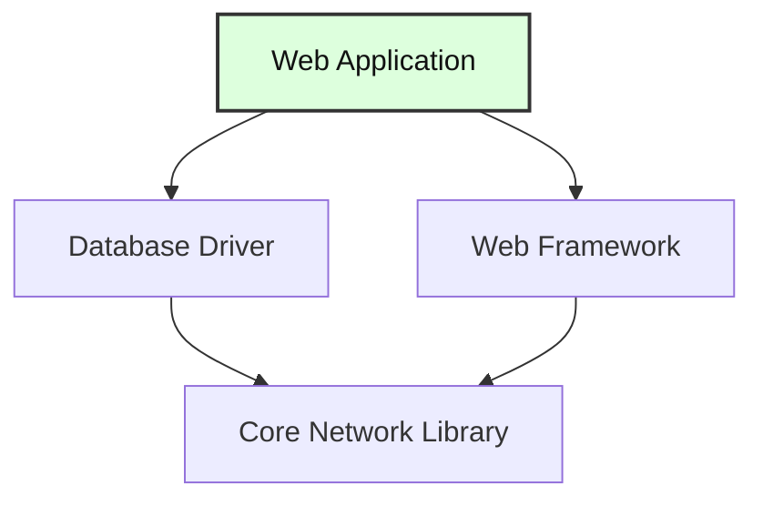

> **Complexity**: `[MEDIUM]` - Long-form foundational read for absolute beginners
>
> **Time to Complete**: 80–100 minutes (read + Killercoda lab)
>
> **Prerequisites**: [Module 0.4: Files and Directories](/prerequisites/zero-to-terminal/module-0.4-files-and-directories/) and [Module 0.7: What is Networking?](/prerequisites/zero-to-terminal/module-0.7-what-is-networking/) - You should be comfortable with the terminal, navigating files, and basic networking concepts.

---

## What You'll Be Able to Do

After this module, you will be able to install useful command-line tools, choose the right package-management workflow for your operating system, and inspect what a package brings onto your machine before you trust it in daily engineering work.

- **Execute** software installations from the terminal using your OS's package manager.
- **Compare** package managers such as `apt`, `brew`, and `dnf` so you can choose the right tool for a given operating system.
- **Evaluate** the security and stability implications of updating or removing packages on a development machine or server.
- **Diagnose** dependency requirements by extracting package metadata about installed software and its supporting libraries.

## Why This Module Matters

Hypothetical scenario: You are onboarding to a Kubernetes 1.35+ learning environment, and the setup guide asks you to install `kubectl`, `helm`, `kind`, `htop`, and a text editor. If you treat each tool as a separate website download, every machine becomes a slightly different snowflake: one laptop has an older binary, another has the wrong CPU build, and a server is missing a support library that nobody remembered to document. Package managers reduce that chaos by turning installation into repeatable commands that can be reviewed, copied, automated, and updated later.

The same habit matters outside labs. Engineers use package managers to patch vulnerable utilities, install diagnostics during incidents, keep development laptops close to production environments, and remove tools that no longer belong on a host. A package manager is not magic, and it is not risk-free, but it gives you a controlled path through a messy problem: software is made of files, versions, permissions, repositories, dependencies, signatures, and installation scripts. Learning that path early will make future container, cloud, and Kubernetes modules feel much less mysterious.

In this module you will build a practical mental model for software installation from the terminal. You will see how source code becomes a program, why packages exist, what `sudo` changes, how dependencies are resolved, and how to install, update, remove, search, and inspect small tools. The goal is not to memorize every package-manager flag. The goal is to recognize the workflow well enough that a new command such as `brew info`, `apt show`, or `dnf install` feels like a variation on a pattern you already understand.

## Software, Source Code, and Executables

Software is a set of instructions that tells a computer what to do, but that simple definition hides several layers. When you open a browser, play a video, run `ls`, or start a Kubernetes client, you are asking the operating system to load files from disk into memory and execute instructions through the processor. Some of those instructions were written by people as readable text, some were generated by build tools, and some arrived on your machine already packaged by another maintainer.

Here is a short software example in Python. The line is ordinary text, and you can read the instruction without knowing much about how processors work. Python interprets the text and displays a result.

```python
print("Hello, World!")
```

That one line gives you the first important separation: source code is for humans and tools, while running programs are for the operating system and processor. A programming language is like a recipe language with strict grammar. The computer is an extremely literal cook; it will follow valid instructions quickly, but it will not guess what you meant when punctuation, indentation, filenames, permissions, or dependency versions are wrong.

Some languages produce an executable file before you run them. Go commonly follows this model: a compiler translates the source code into machine code. The example below is readable by a human, but the processor does not execute the words `package`, `import`, or `fmt.Println` directly.

```go
package main

import "fmt"

func main() {
    fmt.Println("Hello from Go!")
}
```

The journey from readable code to a program you can run can have several stages. A compiled executable must be compatible with its target operating system and CPU architecture; scripts can also be executable when an appropriate interpreter is available.

```
Source Code  ->  Compiler  ->  Binary (executable)
(recipe)        (translator)  (the finished dish, ready to serve)
```


Once the binary exists, execution is much simpler from the user's point of view. The operating system checks whether the file is executable, loads it, and starts the process. That is why many tools can be run by typing a path or command name after installation.

```bash
./my-program
```

The terminal might then print the result the program was written to produce. If you compiled the Go example above into `my-program`, the visible output would be the text below, and the program would exit after doing exactly one job.

```text
Hello from Go!
```

Not every language makes you compile first. Python is usually interpreted, JavaScript may be interpreted or compiled just in time, and many cloud-native tools are distributed as ready-made binaries that you never build yourself. The important beginner lesson is that installation means placing the right executable files, libraries, metadata, and support files where the operating system and shell can find them reliably.

Pause and predict: if a processor ultimately runs machine instructions, what has to be true before a command like `htop` can work from any terminal window? Think through the path from source code, to packaged files, to an executable location, to your shell finding the command name without you typing a full path.

<details><summary>Check your prediction</summary>

For `htop` to run by name from a given shell, check these conditions:

1. **Compatibility**: The executable must be compatible with the system, including its processor architecture and operating system.
2. **Standard executable location**: The resulting binary must be placed in a directory registered in your shell's `PATH` environment variable, such as `/usr/bin` or `/usr/local/bin`.
3. **Execution permissions**: Your user must be permitted to execute the file.
4. **Shared library resolution**: Any required dynamic libraries must be locatable by the system's loader.

A package manager can install the executable and declared dependencies, but a successful installation does not guarantee that every shell can find or run it.

</details>

## Packages and Package Managers

Installing from source manually is possible, but it is a poor default for beginners and a fragile default for teams. Without a package, you would download source code, install the correct compiler, choose build options, compile for your CPU, move files into system directories, record what you installed, and remember how to remove or update everything later. That is a lot of hidden work for a single tool, and every manual step creates another place where two machines can drift apart.

A package is a structured bundle of files and metadata, which may include a version, maintainer, dependencies, and installation instructions. Verification information can also be supplied through repository metadata.

A package manager can find packages in configured sources, install them, and later upgrade or remove them. Verification depends on the package manager and its configuration; installation is not proof that software is safe. A catalog is called a repository in many Linux systems and a tap in Homebrew.

Homebrew calls a package definition a formula; a cask defines how to install precompiled software. The Cellar is the directory containing installed formula versions. Formulae can also use prebuilt bottles. See the [Homebrew terminology](https://docs.brew.sh/Formula-Cookbook#homebrew-terminology).

```bash
sudo apt install htop
brew install htop
```

Those two commands express the same goal on different platforms. On Ubuntu or Debian, `apt` installs software into system-managed locations and normally needs administrator privileges. On macOS, Homebrew usually installs into a Homebrew-managed prefix and is designed to work without `sudo` for normal package operations. The details differ, but the pattern is stable: search the catalog, resolve dependencies, download files, install them, and record what happened.

| Package Manager | Operating System | Install Command |
|-----------------|------------------|-----------------|
| **apt** | Ubuntu, Debian (Linux) | `sudo apt install package-name` |
| **dnf** / **yum** | Fedora, RHEL, CentOS (Linux) | `sudo dnf install package-name` |
| **brew** (Homebrew) | macOS (and Linux) | `brew install package-name` |
| **pacman** | Arch Linux | `sudo pacman -S package-name` |
| **choco** | Windows | `choco install package-name` |

This curriculum mostly uses `apt` on Linux and `brew` on macOS because those are common choices for the environments you will encounter early. That does not make the other tools unimportant. Fedora's `dnf`, Arch's `pacman`, and Windows package managers solve the same family of problems with different commands, policies, and repository ecosystems. Once you recognize the concepts, learning a new package manager becomes a translation exercise instead of a new discipline.

Package managers also create an audit trail. You can ask what is installed, which version you have, which repository it came from, and which other packages it needs. That is much better than relying on memory or a folder full of downloaded installers. When a future module asks you to install `kubectl`, you should immediately think about the same questions: which package source is trusted, which version do I need, what else is installed with it, and how will I update it when Kubernetes moves forward?

Exercise scenario: You are preparing two laptops for a study group. One runs Ubuntu, and the other runs macOS. You want both learners to install `htop`, `tree`, and eventually Kubernetes tooling without creating a pile of manual steps. The right answer is not one universal command; the right answer is one repeatable package-management workflow per operating system, written down clearly enough that each learner can run it and inspect the result.

The package manager also helps you communicate setup instructions as engineering artifacts rather than personal memory. A written command such as `sudo apt install tree` can be reviewed, versioned in documentation, repeated in a lab, and compared with a teammate's command history. A sentence like "I downloaded the tool from the website" leaves too many questions unanswered: which website, which file, which version, which architecture, and which update path?

## Privilege, Trust, and `sudo`

Package installation can change files used across sessions. On a Linux system, a package may install commands under `/usr/bin`, libraries under `/usr/lib`, and configuration under `/etc`. System locations are commonly protected from writes by ordinary users.

`sudo` runs a command as another user, root by default, when the configured security policy permits it. Depending on that policy, it may prompt for authentication and may log the command. The granted authority belongs to that command and its processes, so inspect what you are about to run.

```bash
apt install htop
sudo apt install htop
```

The first command is intentionally missing `sudo`, so on a typical Ubuntu or Debian system it fails when the package manager tries to modify protected locations. The second command asks for temporary administrative privileges and can proceed if your user is permitted. This is not busywork. It is a safety boundary that forces you to notice when a command is about to change the system rather than only your home directory.

When `sudo` prompts for a password, the terminal normally does not echo what you type. Type carefully and press Enter; the keyboard is still working even if the screen shows no characters. Configuration can change the prompt or authentication behavior.

Homebrew takes a different path for day-to-day package management. Its documentation says formula installation and updates do not require `sudo`, so run Homebrew as the account that owns the installation. Follow the documentation for cases that need elevated privileges. Different package managers have different privilege models, so copy commands with context instead of treating `sudo` as decoration.

```bash
brew install htop
```

Trust is the other half of privilege. A package manager may run maintainer scripts, place binaries on your `PATH`, start services, or install libraries that other programs will load. That does not mean package managers are unsafe; it means installation is a security decision. Prefer official repositories, vendor documentation, and well-known package sources, and be especially cautious with commands copied from random comments or scripts that pipe a network download directly into a shell.

Before running this, what output do you expect from `apt install tree` without `sudo` on a Linux system? Write down your prediction first, then try it in a disposable lab or local machine where you are allowed to test. Reading the exact error message teaches you more than memorizing a warning, because real troubleshooting starts with what the system actually said.

<details><summary>Check your prediction</summary>

An ordinary user may see a permission or lock-file error. The wording varies by system; read the actual error before retrying.

</details>

Privilege should feel deliberate, not scary. The healthiest habit is to pause when a command asks for administrator authority and ask what protected resource it needs. Installing a system package is a reasonable use of that authority; editing random files under `/usr` by hand usually is not. This pause becomes more important when you later install container runtimes, cloud CLIs, and Kubernetes helpers that can affect networking, credentials, or background services.

## Dependencies and Version Constraints

Software often uses other software. A web application might require a database driver, a command-line tool might require a terminal UI library, and a Python application might require Python and additional packages. These required supporting pieces are dependencies.



A package manager reads dependency metadata and builds an installation plan. If you ask for one program, the plan may include several libraries, helper tools, certificates, language runtimes, or data packages. Beginners sometimes worry that the package manager is doing something suspicious because it downloads more than they typed. In many cases, that extra work is exactly the reason you are using the package manager in the first place.

```bash
sudo apt install some-program
```

A package manager may show additional packages before asking for confirmation. This synthetic example lists proposed additions; it does not establish which dependency relationship caused each one.

```text
Reading package lists... Done
The following additional packages will be installed:
  dependency-1 dependency-2 dependency-3
```

Dependencies become difficult when versions disagree. Program A may require version 1.0 of `libfoo`, while Program B requires version 2.0 of the same library. If only one version can occupy the relevant location, the requirements conflict. Separate environments can help manage such conflicts, subject to their isolation boundaries.

Package managers cannot remove all version tension, but they can make it visible and manageable. They maintain databases of installed versions, calculate compatible dependency sets, refuse impossible upgrades, and show which packages will be installed, removed, or held back. That is a major improvement over a manual folder of downloaded binaries, where you may not even know which file introduced an incompatible library.

Dependency inspection is a diagnostic skill, not trivia. When a production host suddenly behaves differently after an update, engineers ask what package changed, what dependency changed with it, and whether a service is now loading a different library. When a development laptop cannot run a tool, engineers check whether a dependency is missing or pinned to the wrong version. The package manager's metadata gives you the starting evidence for those questions.

Pause and predict: imagine one command-line app strictly requires `libfoo` version 1.0 and another strictly requires `libfoo` version 2.0. If your operating system has one shared library location for that dependency, which app becomes risky to install second, and why might a container or isolated environment make the conflict easier to manage?

<details><summary>Check your prediction</summary>

Whichever app is installed second may conflict with the first if both require incompatible versions in the same location. A package manager may refuse the plan, or a replacement could break the first app; the scenario alone does not establish the outcome.

Separate environments can give applications different dependency trees. Their isolation depends on configuration: a Python virtual environment, for example, does not isolate every system library or the whole filesystem.

</details>

This is also why "it installed successfully" is not the same as "the system is in the desired state." A package can install while pulling in a newer library than expected, leaving an old configuration file untouched, or enabling a service that still needs manual setup. Package managers handle a large part of the mechanical work, but verification remains your responsibility. The right question after an install is what changed and whether the tool now behaves as required.

## Installing, Updating, Removing, and Searching

Package managers normally separate refreshing metadata from installing packages. On Ubuntu and Debian, `apt update` downloads the latest package indexes from configured repositories. It does not upgrade every installed package by itself; it refreshes the local catalog so later install or upgrade commands are based on current information. That distinction matters when a package was released recently or a security fix has just arrived.

```bash
sudo apt update
```

On macOS, Homebrew has its own metadata update workflow. If Homebrew is not installed yet, the official installer command is published by the Homebrew project. Treat commands like this with respect because they download and execute an installer; use the official documentation, read the command, and understand why it is different from installing an ordinary formula.

```bash
/bin/bash -c "$(curl -fsSL https://raw.githubusercontent.com/Homebrew/install/HEAD/install.sh)"
```

Once Homebrew is present, update its package metadata before installing or upgrading tools. This is the Homebrew equivalent of refreshing the catalog so your local machine knows about current formula definitions.

```bash
brew update
```

Now you can install a monitoring tool. `htop` shows a terminal view of processes and resource usage, and lets you interact with the process list.

```bash
sudo apt install htop
```

The same package on macOS uses Homebrew's command shape. Notice that the package name stays the same while the package manager and privilege model change. That is the comparison habit you want to develop.

```bash
brew install htop
```

After installation, launch the program from the terminal. You will see an interactive display with process rows and resource bars. Press `q` to quit when you are done exploring, because terminal programs often have keyboard controls rather than graphical close buttons.

```bash
htop
```

The next tool, `tree`, helps you visualize directories. Earlier modules asked you to create files and folders; `tree` turns that nested structure into a readable outline. It is especially useful when you need to explain a project layout, compare expected files with actual files, or include a directory snapshot in troubleshooting notes.

```bash
sudo apt install tree
```

On macOS, use the Homebrew form. Again, do not treat the Linux and macOS commands as interchangeable, because the operating systems use different package stores and privilege assumptions.

```bash
brew install tree
```

Once installed, run `tree` against a practice directory. If you completed the earlier file-system exercise, the path below should produce a small recipe-style structure. If that directory does not exist on your machine, `tree` reports an error such as `[error opening dir]` and shows zero directories and files.

```bash
tree ~/kubedojo-practice
```

This synthetic example shows a possible directory outline. The actual path and files depend on your machine.

```text
/home/yourname/kubedojo-practice
└── recipes
    ├── appetizers
    │   └── bruschetta.txt
    ├── desserts
    │   └── tiramisu.txt
    └── main-courses
        └── pasta-carbonara.txt
```

Updating installed software is a separate operational decision. On Ubuntu and Debian, refresh the index, then list available upgrades before deciding what to change. The actual upgrade plan can hold packages back:

```bash
sudo apt update
apt list --upgradable
```

On macOS, list outdated Homebrew packages with:

```bash
brew outdated
```

After refreshing metadata, review available upgrades. On Ubuntu and Debian, `apt update` refreshes the catalog and `apt upgrade` applies available upgrades, but holds back packages whose upgrade would require removing an installed package:

```bash
sudo apt update
sudo apt upgrade
```

You will often see the two commands joined with `&&`. The operator means "run the second command only if the first command succeeds," which is helpful because upgrading from a failed metadata refresh would be a poor signal.

```bash
sudo apt update && sudo apt upgrade
```

Run those upgrade commands only after reviewing the plan, ideally in a disposable lab or VM.

Homebrew uses a similar two-step shape with different verbs. `brew update` refreshes Homebrew's metadata, while `brew upgrade` upgrades outdated, unpinned packages.

```bash
brew update && brew upgrade
```

Again, run `brew update && brew upgrade` only after reviewing `brew outdated`, ideally in a disposable lab or VM.

Removing software should also go through the package manager when possible. If you installed a package with `apt`, let `apt` remove it so the package database stays accurate. Manually deleting binaries can leave configuration files, dependencies, service units, or package records behind, which makes later troubleshooting harder.

```bash
sudo apt remove package-name
```

`apt remove` removes the named package but normally leaves modified configuration files. `apt purge` also removes those packaged configuration files, but not data or configuration in your home directory. Automatically installed dependencies can remain after removal; `apt autoremove` removes those no longer needed. Read its proposed list before confirming, since it may include software you still use. See the [apt manual](https://manpages.debian.org/bookworm/apt/apt.8.en.html).

Homebrew has the same idea with a different verb. If you installed a formula with Homebrew, uninstall it with Homebrew so the Cellar, links, and package records are handled consistently.

```bash
brew uninstall package-name
```

Searching is how you avoid guessing package names. If you only remember that you want a system monitor, search for a keyword and read the results. This is safer than repeatedly mistyping names or downloading a similarly named tool from an untrusted source.

```bash
apt search keyword
```

Homebrew search works the same way conceptually. It searches Homebrew's formulae and casks for names that match your term, then you can use `brew info` to inspect a candidate before installation.

```bash
brew search keyword
```

Pause and reflect: which approach would you choose here and why: installing a tool immediately because a blog post mentions its name, or searching the package manager and inspecting the package metadata first? Consider what operational and security risks arise when you run installation commands directly from third-party guides without verifying package provenance.

<details><summary>Check your prediction</summary>

Search and inspect metadata first. It can show a package's version, declared dependencies, and other available details. Check the source and project documentation separately when deciding whether to trust it.

A blog post may be outdated or target a different release. `apt show` and `brew info` provide useful evidence, but neither proves that a package is safe, maintained, or suitable for your system.

</details>

Updates and removals deserve the same discipline as installs because they change the dependency graph too. Read the packages to be installed, upgraded, removed, or left unchanged, then decide whether the plan matches your intention.

## Reading Package Metadata

Installing a tool is only half the skill. The other half is reading the package manager's explanation of what it knows. Package metadata answers questions such as which version is available, which repository provides it, which dependencies it needs, what description the maintainer published, and sometimes which files or services are involved. This is the difference between "I ran a command" and "I can diagnose what the command changed."

On Ubuntu and Debian systems, `apt show` displays metadata for a package. The displayed candidate need not be the installed version; use installed-package information as well when checking what is on the machine.

```bash
apt show htop
apt-cache policy htop
command -v htop
```

Compare the installed and candidate versions in the policy output; `command -v` identifies the command your shell finds.

On macOS, Homebrew's equivalent inspection command is `brew info`. It shows the formula description, installed status, version, dependencies, install path, and related caveats when they exist. The exact fields vary by formula, but the habit is the same: inspect before you assume.

```bash
brew info htop
```

You can also inspect installed packages broadly. On Ubuntu and Debian, `apt list --installed` prints installed package records. Piping the output to `head` keeps the first practice run manageable, because a normal system may have many installed packages and you do not need to flood the terminal while learning.

```bash
apt list --installed | head -20
```

Homebrew's list command shows installed formulae. On a fresh machine this might be short; on a developer laptop it can reveal years of accumulated tools. Reading the list is a good way to find packages that should be upgraded, documented, or removed.

```bash
brew list
```

Version checks are a practical habit because bug reports and setup guides often depend on exact versions. Many command-line tools support `--version`, `-v`, or a similar flag. When a teammate says "it works for me," the next useful question is often "which version are you running?"

```bash
htop --version
```

For deeper dependency inspection on Debian-based systems, you may also see `apt-cache depends`. It focuses on dependency relationships rather than the broader package description. You do not need to memorize every line, but you should recognize that package metadata is queryable evidence.

```bash
apt-cache depends htop
```

Metadata reading becomes more important as the tools become more powerful. Installing `tree` is low risk, but installing a database, container runtime, cloud CLI, or Kubernetes tool can add services, credentials paths, completion scripts, configuration directories, and transitive dependencies. The inspection habit you practice here scales into real operational caution later.

Exercise scenario: A teammate says their `htop` screen looks different from yours, and both of you insist the tool is installed correctly. Before reinstalling anything, compare package metadata and version output on both machines. If the package version, repository source, or build differs, you have a concrete explanation to investigate instead of arguing from screenshots.

Metadata also teaches humility about cross-platform instructions. A package name can exist on multiple platforms while still producing different versions, compile options, default paths, or dependency sets. That does not make one package manager wrong. It means your documentation should name the operating system, package manager, command, expected version when it matters, and verification command. Good setup instructions are specific enough to reproduce, but not so brittle that they pretend every platform is identical.

## Patterns & Anti-Patterns

| Pattern | Use It When | Why It Works |
|---------|-------------|--------------|
| Prefer the platform package manager | You need common system tools such as `htop`, `tree`, `curl`, or editors | The package manager records versions, dependencies, and files so upgrades and removals remain manageable. |
| Inspect package metadata first | The package is unfamiliar, privileged, network-facing, or part of a setup guide | Metadata reveals dependencies, descriptions, versions, and source information before the install changes your machine. |
| Update metadata before install or upgrade | The system is new, recently offline, or responding to a security advisory | Refreshing retrieves available metadata; check for errors before relying on it. |

| Anti-Pattern | What Goes Wrong | Better Alternative |
|--------------|-----------------|--------------------|
| Copying installer commands from untrusted pages | You may run code with your user's privileges or administrator privileges without knowing its source | Prefer official docs, platform repositories, and package metadata you can inspect. |
| Mixing package manager and manual installs for one tool | Your shell may run a different version than the one you meant to use | Pick one installation method per tool unless you have a documented reason. |
| Ignoring update output | You miss removals, held packages, dependency changes, or authentication failures | Read the planned changes before confirming and verify versions afterward. |

## When You'd Use This vs Alternatives

| Situation | Prefer | Reason |
|-----------|--------|--------|
| Installing a common terminal utility | `apt`, `dnf`, `pacman`, or `brew` | The tool is part of the machine environment and should be updated with the machine. |
| Installing a fast-moving vendor CLI | Official vendor repository or installer | The operating system repository may lag behind the vendor's supported version. |
| Installing libraries for one application | Project-level package manager or isolated environment | The dependency belongs to the project, not every user and service on the host. |
| Diagnosing what is already installed | Package metadata commands | The package database gives evidence about versions, dependencies, and install source. |

## Common Mistakes

| Mistake | Why It Happens | How to Fix It |
|---------|----------------|---------------|
| Forgetting `sudo` with `apt install` on Linux | The learner remembers the package name but forgets that system directories require administrator privileges. | Re-run the install as `sudo apt install package-name`, then read the prompt and package plan before confirming. |
| Using `sudo` with normal Homebrew installs | The learner assumes every install command needs administrator privileges because Linux examples often use `sudo`. | Use `brew install package-name` without `sudo` unless official Homebrew documentation says otherwise for a special case. |
| Installing before refreshing package metadata | The local package index is stale, especially on a new machine or after a long offline period. | Run `sudo apt update` or `brew update` first so installs and upgrades use current catalog information. |
| Ignoring the dependency list | Extra packages look like noise, so the learner confirms without reading what else will be installed. | Pause at the install plan and scan dependencies, removals, upgrades, and disk usage before accepting. |
| Typing a package name from memory | Similar names and typos can produce failed installs or risky lookalike-package situations. | Use `apt search keyword` or `brew search keyword`, then inspect the candidate with `apt show` or `brew info`. |
| Deleting installed files by hand | The learner sees a binary path and removes it without updating the package database. | Remove software with the same package manager that installed it, such as `sudo apt remove package-name` or `brew uninstall package-name`. |
| Treating updates as harmless on servers | Package managers make updates easy, so it is tempting to apply them without testing or reading the plan. | Test important updates in a safe environment, read the proposed changes, apply them deliberately, and verify versions afterward. |

## Quiz

Use these scenarios to test whether you can reason about package management rather than only recall command names. Each answer explains the operational tradeoff, because real troubleshooting usually depends on why the command is appropriate.

<details><summary>Question 1: You need to execute software installations for `htop`, `tree`, and a Kubernetes client on an Ubuntu learning machine. A friend suggests downloading random binaries from search results because it seems faster. What package-management approach should you choose first, and why?</summary>

Start with the operating system package manager or the official vendor installation instructions, not random search-result binaries. A package manager gives you a repeatable command, dependency handling, version metadata, and a removal or upgrade path. For Kubernetes tooling, official documentation matters because client version compatibility can affect later Kubernetes 1.35+ exercises. The faster-looking manual download creates more uncertainty about source, updates, and which binary your shell will run.

</details>

<details><summary>Question 2: You compare package managers across two machines: Ubuntu uses `apt`, macOS uses `brew`, and Fedora documentation mentions `dnf`. What should stay conceptually the same even though the commands differ?</summary>

The shared concept is that these package managers can search configured catalogs, handle dependencies, install packages, and provide update and removal commands. The command syntax and privilege model differ, so copying `sudo apt install` onto macOS is the wrong translation. Refresh metadata, inspect package details, choose a source, and verify the result.

</details>

<details><summary>Question 3: You no longer need a package on a shared Ubuntu server. What is the difference between remove, purge and autoremove, and what should you check first?</summary>

`remove` removes the package while usually retaining modified configuration; `purge` also removes those configuration files. `autoremove` targets automatically installed dependencies that are no longer needed. Check the proposed removal list and whether other users or services need the software before confirming.

</details>

<details><summary>Question 4: You evaluate a security update for a command-line tool on a shared development server. Why is "always auto-upgrade everything immediately" too simplistic, and what safer workflow should you use?</summary>

Automatic upgrades can apply legitimate fixes at times when nobody is watching, and even legitimate fixes can change behavior or restart services. The safer workflow is to refresh metadata, read the proposed upgrade plan, test important changes where possible, apply the update deliberately, and verify the installed version afterward. That still treats security updates as important, but it adds stability controls. Package managers make execution easy; engineers still own timing, testing, and verification.

</details>

<details><summary>Question 5: You install a small weather CLI and the package manager plans to install several dependencies, including a networking library. Should you cancel just because extra packages appear?</summary>

Not automatically. Extra packages may be required dependencies, such as libraries for HTTP requests, terminal output, or language runtimes. You should read the dependency list and decide whether it is reasonable for the tool, especially if the package is unfamiliar or privileged. Cancel when the plan looks surprising or untrusted, but do not assume every dependency is a problem.

</details>

<details><summary>Question 6: You need to diagnose dependency requirements for `htop` before documenting a lab setup. Which commands would you use on Ubuntu and macOS, and what information are you looking for?</summary>

On Ubuntu, use `apt show htop` and optionally `apt-cache depends htop`; on macOS, use `brew info htop`. Look for version, description, dependencies, and any available source or installation details. Metadata helps investigate differences, but it does not by itself prove why behavior differs or show the complete installation plan.

</details>

## Hands-On Exercise: Your First Software Installations

This exercise asks you to update package metadata, install two small utilities, run them, search for related packages, and inspect dependency information. Use either the Ubuntu/Debian path or the macOS path depending on your machine. If you are using a temporary lab environment, it is normal for the package lists and installed package counts to differ from your personal computer.

On Windows, use an authorized Ubuntu WSL shell or an appropriate Ubuntu lab shell; the [linked Killercoda scenario](https://killercoda.com/kubedojo/scenario/prereq-0.9-packages) is an additional option.

### Task 1: Refresh the Package Catalog

On Ubuntu or Debian, refresh the package list before installing anything. Read the output and notice that this command downloads metadata rather than installing every available update.

```bash
sudo apt update
```

On macOS, refresh Homebrew's metadata. If Homebrew is not installed on your machine, use the official Homebrew installation documentation before continuing rather than copying installer commands from an unrelated page.

```bash
brew update
```

<details><summary>Solution notes for Task 1</summary>

The successful result is not a particular package count. The important sign is that the command completes without authentication, network, or repository errors. If Linux asks for your password after `sudo`, type it even though the terminal normally does not display characters.

</details>

### Task 2: Install and Run `htop`

On Ubuntu or Debian, install `htop` with `apt`. When prompted, read the proposed package and dependency plan, then type `y` only if it matches your expectations. The `-y` flag automatically answers yes to confirmation prompts, which is convenient in scripted labs but skips that manual confirmation moment on important machines.

```bash
sudo apt install htop
```

On macOS, install the same tool with Homebrew. Notice again that the package name is the same while the package manager and privilege model differ.

```bash
brew install htop
```

Run `htop` after installation. Explore the CPU bars, memory usage, process list, and process IDs, then press `q` to quit the interactive screen.

```bash
htop
```

<details><summary>Solution notes for Task 2</summary>

A successful run opens the interactive `htop` interface rather than printing "command not found." If the command is missing, verify that the install completed successfully and that you are using the same terminal environment where the package manager placed the executable.

</details>

### Task 3: Install and Use `tree`

On Ubuntu or Debian, install `tree` through `apt`. Read the dependency plan when prompted, then confirm with `y` only if it looks right. This utility is small, but it teaches the same install pattern you will later use for more important tools.

```bash
sudo apt install tree
```

On macOS, install `tree` through Homebrew. If the formula is already installed but outdated, Homebrew may upgrade it.

```bash
brew install tree
```

Run `tree` against the practice directory from earlier modules if it exists. The command prints a visual directory outline, which is useful when you want to reason about project structure from the terminal.

```bash
tree ~/kubedojo-practice
```

If that directory does not exist, use your home directory with a depth limit so the output stays readable. The `-L 1` flag means "show only one level deep."

```bash
tree ~ -L 1
```

<details><summary>Solution notes for Task 3</summary>

The successful result is a directory tree, not a specific set of filenames. If `~/kubedojo-practice` is missing, that is a file-system state issue rather than a package issue, so test `tree` against another directory before reinstalling the package.

</details>

### Cleanup: Remove a lab package

After completing the tasks, if you installed `tree` specifically for this exercise and no one else needs it, remove it on your authorized practice machine. Review the proposed changes before confirming. On Ubuntu or Debian run `sudo apt remove tree`; on macOS run `brew uninstall tree`. Otherwise leave it installed. Explain what `purge` or `autoremove` would change before considering either command, and check the package list to verify the result.

### Task 4: Search, List, and Check Versions

On Ubuntu or Debian, list a small sample of installed packages. The pipe to `head` keeps the output short enough to inspect without scrolling through the entire package database.

```bash
apt list --installed | head -20
```

On macOS, list Homebrew-managed formulae. A new Homebrew installation may have only a few entries, while a long-used developer machine may have many.

```bash
brew list
```

Search by keyword instead of guessing exact package names. This Ubuntu/Debian example looks for packages related to system monitoring.

```bash
apt search "system monitor"
```

Use the Homebrew version of the same search habit on macOS. The exact results will differ because the catalogs are not identical.

```bash
brew search "monitor"
```

Check the version of the tool you installed. Version output is one of the first facts to collect when two machines behave differently.

```bash
htop --version
```

<details><summary>Solution notes for Task 4</summary>

The expected outcome is that you can produce package lists, search results, and a version string. If search results differ between machines, that can be normal because package repositories, operating systems, and metadata freshness differ.

</details>

### Task 5: Inspect Dependencies

On Ubuntu or Debian, inspect package metadata for `htop`. Look for fields such as version, description, repository source, and dependencies.

```bash
apt show htop
```

For a dependency-focused view on Debian-based systems, inspect the dependency relationship directly. This can help you explain why installing one package may bring in several supporting packages.

```bash
apt-cache depends htop
```

On macOS, inspect the same package with Homebrew. Look for dependency lines, install status, caveats, and version information.

```bash
brew info htop
```

<details><summary>Solution notes for Task 5</summary>

You are not expected to memorize every dependency. The success condition is that you can find metadata and explain at least one dependency or package detail in your own words. That explanation is the bridge between running commands and diagnosing package behavior.

</details>

### Task 6: Package Diagnostics (Unguided)

This unguided task uses simulated transcripts. Identify what each output establishes, which causes remain hypotheses, and what evidence is needed before recommending a change. Do not infer a unique cause or an official release-version matrix from these limited illustrations.

Synthetic transcript A depicts a newly provisioned Ubuntu server where an engineer attempts to install Nginx:

```text
ubuntu@web-node-01:~$ sudo apt install nginx
Reading package lists... Done
Building dependency tree... Done
Reading state information... Done
E: Unable to locate package nginx
ubuntu@web-node-01:~$
```

Synthetic transcript B depicts a confirmation prompt for a network diagnostic utility recommended on a community forum:

```text
admin@prod-api-02:~$ sudo apt install net-speed-check
Reading package lists... Done
Building dependency tree... Done
The following additional packages will be installed:
  libx11-6 libx11-data libxau6 libxcb1 libxdmcp6 x11-common xterm
The following NEW packages will be installed:
  libx11-6 libx11-data libxau6 libxcb1 libxdmcp6 net-speed-check x11-common xterm
0 upgraded, 8 newly installed, 0 to remove and 12 not upgraded.
Need to get 4,120 kB of archives.
After this operation, 18.5 MB of additional disk space will be used.
Do you want to continue? [Y/n]
```

Synthetic transcript C depicts two engineers comparing `htop` versions after noticing differences in output and hotkeys:

```text
# Simulated workstation A; no Ubuntu release-version association is asserted:
alice@workstation:~$ htop --version
htop 3.0.5

# Simulated workstation B; no Ubuntu release-version association is asserted:
bob@workstation:~$ htop --version
htop 3.3.0
```

<details><summary>Solution notes for Task 6</summary>

Transcript A: APT cannot locate `nginx` in the package information currently available to it. An empty or stale index is one hypothesis, not a demonstrated cause. Check the package spelling and configured repositories; on an authorized practice host, run `sudo apt update` and inspect its output for repository, network, or authentication errors. Retry installation only after confirming the intended package is available; refreshing configured sources does not repair every missing-package cause.

Transcript B: The plan lists additional packages and projected disk use; it does not establish which are required dependencies, why they were selected, or whether they will run. Cancel with `n` and inspect the package metadata and proposed dependencies before deciding whether this tool is appropriate for the server.

Transcript C: These simulated outputs show different `htop` versions on two workstations; they are not a verified package-version matrix for those Ubuntu releases. Different release repositories, enabled sources, updates, or installation methods could explain the difference. Compare `command -v htop`, `apt show htop`, and `apt-cache policy htop` on each machine to inspect the selected executable, installed package, candidate version, and repository origins before attributing the behavior to an OS release or reinstalling anything.

</details>

### Success Criteria

- [ ] Execute software installations for `htop` and `tree` using the package manager for your operating system.
- [ ] Compare the Ubuntu/Debian and macOS command shapes for update, install, search, list, and inspect workflows.
- [ ] Evaluate update and removal commands by explaining what changes they make and when you would be cautious.
- [ ] Diagnose dependency requirements for an installed package using `apt show`, `apt-cache depends`, or `brew info`.
- [ ] Run `htop`, quit it with `q`, and confirm its installed version.
- [ ] Use `tree` to display a directory and explain whether any error is a package problem or a missing-directory problem.
- [ ] Distinguish observed package errors from hypotheses, evaluate dependency plans, and identify evidence needed to explain version differences.

## Sources

- [OWASP CI/CD-SEC-03: Dependency Chain Abuse](https://owasp.org/www-project-top-10-ci-cd-security-risks/CICD-SEC-03-Dependency-Chain-Abuse)
- [Ubuntu Server documentation: Package management](https://ubuntu.com/server/docs/package-management)
- [Ubuntu manpage: apt](https://manpages.ubuntu.com/manpages/noble/man8/apt.8.html)
- [Debian Reference: Debian package management](https://www.debian.org/doc/manuals/debian-reference/ch02.en.html)
- [Homebrew Documentation: Installation](https://docs.brew.sh/Installation)
- [Homebrew Documentation: Manpage](https://docs.brew.sh/Manpage)
- [Debian bookworm: apt manual](https://manpages.debian.org/bookworm/apt/apt.8.en.html)
- [Debian bookworm: apt-secure manual](https://manpages.debian.org/bookworm/apt/apt-secure.8.en.html)
- [Filesystem Hierarchy Standard](https://specifications.freedesktop.org/fhs/latest/)
- [Debian Policy: package relationships](https://www.debian.org/doc/debian-policy/ch-relationships.html)
- [Fedora quick docs: DNF](https://docs.fedoraproject.org/en-US/quick-docs/dnf/)
- [ArchWiki: pacman](https://wiki.archlinux.org/title/Pacman)
- [Chocolatey documentation: choco install](https://docs.chocolatey.org/en-us/choco/commands/install/)
- [sudo manual](https://www.sudo.ws/docs/man/sudo.man/)
- [Kubernetes documentation: Install tools](https://kubernetes.io/docs/tasks/tools/)

## Next Module

**Continue to**: [Module 0.10: What is the Cloud?](/prerequisites/zero-to-terminal/module-0.10-what-is-the-cloud/) - You now have the package-management foundation you need to install cloud and Kubernetes tooling without treating every setup guide as a mystery.
